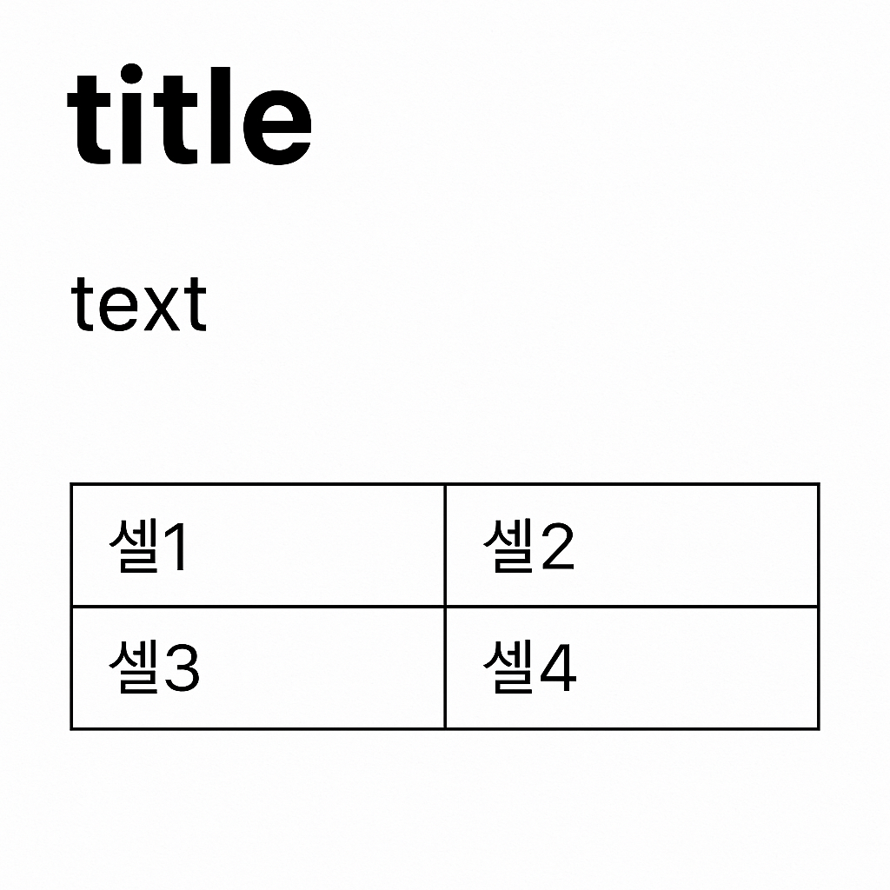

# 1. HTML 시작하기

[toc]

**소스 코드는 cmd(ctrl)+ /로 확인할 수 있습니다.**

## HTML이란?

- 다양한 인터넷 정보를 웹 브라우저에 보여줄 때 사용하는 언어 (웹 문서를 만드는 언어)
- HTML = **HyperText Markup Language**의 줄임말
  - **HyperText**: 문서를 서로 연결해주는 링크를 의미
  - **Markup**: '표시한다'라는 의미로, 구조와 의미를 정의하는 역할
- 즉, HTML은 텍스트, 이미지, 영상 등의 콘텐츠를 웹 브라우저에서 보이게 하고 그 위치와 구조를 표시하는 언어

---

## HTML과 일반 문서의 차이점

### 일반 문서

- 엑셀, 워드 파일 등의 문서는 **입력 프로그램과 출력 프로그램이 동일**함
- 예) 워드로 표를 만들고 워드로 다시 열어 확인함

### HTML 문서

- **입력 프로그램과 출력 프로그램이 다름**
- 예) 웹 편집기(VS Code 등)에서 HTML을 작성하고, 웹 브라우저(크롬, 사파리 등)에서 출력 확인
- 웹 브라우저는 태그를 통해 문서의 구조를 해석함

---

## HTML 태그 예시

~~~html
<h1>title</h1>

text

<table>
    <tr>
        <td>셀1</td>
        <td>셀2</td>
    </tr>
    <tr>
        <td>셀3</td>
        <td>셀4</td>
    </tr>
</table>
~~~

---

## 시각적 예시 이미지

아래는 위의 HTML 코드를 웹 브라우저에 표시한 결과 화면입니다:

> 💡 위 코드는 `h1`, `p`, `table`, `tr`, `td` 같은 HTML **태그**를 사용하여 브라우저가 제목, 텍스트, 표 등을 구분해 렌더링하는 구조입니다.

---

## 핵심 요약

> 💡 HTML은 **태그 기반의 마크업 언어**로, `<여는태그>내용</닫는태그>` 형식이 기본입니다.

---

End
