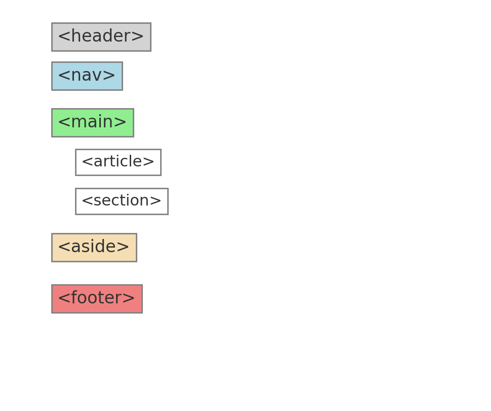

# 3. 웹 문서 구조를 만드는 시맨틱 태그

## 1. 시맨틱 태그란?

- 시맨틱이란 '의미론적인', '의미가 통하는'이라는 뜻의 영단어입니다.
- 즉, 태그의 이름만 봐도 어떤 역할을 하는지 직관적으로 알 수 있습니다.
- 예시: `
`, `<a>`, `<nav>` 등

## 2. 시맨틱 태그는 왜 필요할까?

1. 웹 브라우저가 HTML 코드만 보고도 각 영역의 역할을 이해할 수 있음
2. 정확한 문서 구조 덕분에 다양한 장치에서도 일관된 표현 가능
3. 검색 엔진이 필요한 정보를 정확히 인식할 수 있음

## 3. 주요 시맨틱 태그 정리

### `<header>`
- 문서나 섹션의 머리말 영역
- 검색창, 사이트 메뉴 등 포함
- 일반적으로 웹 페이지 상단에 위치

### `<nav>`
- 현재 문서나 다른 문서로 이동할 수 있는 **내비게이션 링크** 집합
- 독립적으로 혹은 `header`, `footer` 등에 포함되어 사용 가능
- 여러 개 사용 시 `id`를 통해 구분 가능

### `<main>`
- 웹 문서의 중심 내용 영역
- **문서당 1개만 사용 가능**
- 반복적인 요소 포함 ❌ (예: 메뉴, 푸터)

### `<article>`
- 독립적인 콘텐츠 블록 (예: 뉴스 기사, 블로그 글 등)
- 내부에 `<section>`을 포함할 수 있음
- 문서 내 여러 개 사용 가능

### `<section>`
- 관련된 콘텐츠를 묶는 용도
- 주로 제목(`<h2>`~`<h6>`)과 함께 사용

### `<aside>`
- 본문 외 추가 정보 또는 사이드바
- 필요할 때만 사용 (선택 요소)

### `<footer>`
- 문서 또는 섹션의 맨 아래 영역
- 저작권, 제작자 정보, 연락처 등 포함
- 내부에 `<header>`, `<section>`, `<article>` 포함 가능

### `
`
- division의 줄임말
- 시맨틱 태그 등장 이전에는 구조 구분에 주로 사용
- 의미는 없고 **스타일 적용 및 레이아웃 구분용**
- `id` 또는 `class`와 함께 사용함

#### 🔹 id 속성

- 한 문서 내에서 **고유해야 함** (중복 ❌)
- CSS에서 `#id명`으로 선택 가능

~~~html

고영훈

<!-- 잘못된 예 -->

고영훈

~~~

#### 🔹 class 속성

- 중복 사용 가능 (여러 요소에 동일 클래스명 사용 가능)
- CSS에서 `.클래스명`으로 선택
- 한 요소에 여러 클래스 적용 가능 (공백으로 구분)

~~~html

고영훈

고영훈

~~~

---

> 💡 시맨틱 태그는 문서의 의미를 명확히 전달하여 **접근성, 유지보수, 검색엔진 최적화(SEO)** 등에 모두 도움이 됩니다.

---

End
