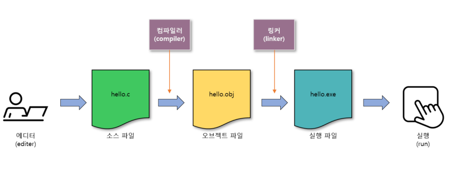

# C 프로그램 실행 파일 생성 과정

이번 학습에서는 C 언어로 작성된 프로그램이 어떻게 실행 가능한 파일로 만들어지는지를 단계별로 알아보았다. 소스 파일 → 목적 파일 → 실행 파일의 흐름을 이해하면 컴파일러와 링커의 역할을 보다 명확하게 파악할 수 있다.

---

## 1. 전체 과정 개요

- C 프로그램은 다음과 같은 단계를 거쳐 실행 파일로 만들어진다.

- 일반적으로 개발자는 **소스 파일까지만 작성**하고, 그 이후 컴파일과 실행 파일 생성 과정은 개발 도구가 처리한다.
- 만약 컴파일 과정에서 오류가 발생하면, 해당 단계에서 중단되며 실행 파일이 생성되지 않는다.

---

## 2. 소스 파일 (*.c)

- C 언어의 문법으로 작성된 **원시 코드 파일**
- 텍스트 기반으로 저장되며, **확장자는 `.c`**를 사용한다.
- 협업과 유지 보수의 관점에서 관례를 따르는 것이 좋다.

> 예시: C - `.c`, C++ - `.cpp`, Java - `.java`, C# - `.cs`

---

## 3. 목적 파일 (*.obj)

- 컴파일러가 소스 파일을 번역하여 생성한 **중간 결과물**
- 사용자가 직접 만들 필요는 없으며, **자동 생성됨**

### ❓ 목적 파일이 필요한 이유

- 모든 소스 파일을 매번 전부 다시 컴파일하면 매우 비효율적임
- **소스 파일을 나누어 관리**하면 일부만 수정 시 해당 파일만 다시 컴파일 가능
- 변경되지 않은 파일의 목적 파일은 **그대로 재사용**하여 전체 빌드 시간을 절약함

> 목적 파일이 없다면 프로그램 개발 시간이 훨씬 더 길어졌을 것이다.

---

## 4. 실행 파일 (*.exe)

- 목적 파일들을 링커(Linker)가 연결하여 만들어지는 **최종 실행 가능한 파일**
- **기계어로 구성되어 컴퓨터가 직접 실행할 수 있는 형태**
- 더 이상의 컴파일 없이 바로 실행 가능

### ⚠ 운영체제별 확장자 차이

- Windows: `.exe`
- Linux: (확장자 없음, 실행 권한 부여)
- macOS: (Mach-O 형식, 응용 프로그램 패키지로 감싸 사용)

---

> 📌 정리  
C 프로그램은 `.c` 소스 파일에서 시작하여 `.obj` 목적 파일을 거쳐 `.exe` 실행 파일로 최종 완성된다. 이 과정을 이해하면 컴파일 오류의 원인이나 빌드 속도 최적화에도 도움이 되며, 협업 시에도 보다 효율적인 개발이 가능해진다.

---

이미지 출처: [https://byunghyun23.tistory.com/2](https://byunghyun23.tistory.com/2)

End
