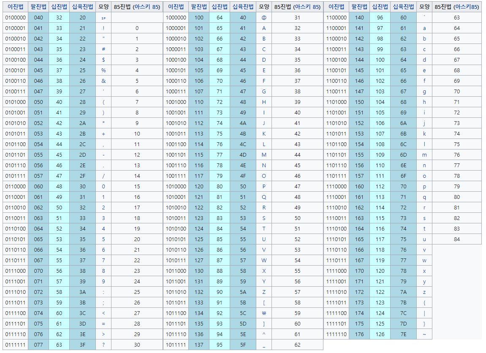
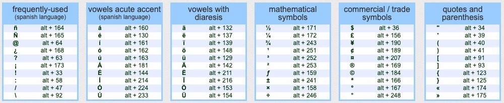

[toc]

# A Promise to Express Letters in Numbers: ASCII

## Origin of ASCII

두 장치가 통신할 때 문자를 전송하는 방법에는 크게 두 가지가 있다:

1. **스캔(Scan)**  
   - 팩스처럼 a라는 문자를 그대로 스캔하여 전송하는 방법  
2. **변수 지정(Specify variables)**  
   - 예를 들어 두 장치가 97을 'a'라고 미리 약속하고, 97이 전송되면 문자 'a'로 인식하는 방식

첫 번째 방법은 이미지의 크기에 따라 전송 데이터가 달라지며, 최소한의 픽셀 정보도 커서 **데이터 용량이 큼**.  
두 번째 방법은 **숫자 한 개로 문자를 표현**할 수 있기 때문에 훨씬 **효율적**이다.

하지만 제조사마다 문자를 숫자로 표현하는 방식이 달라 **통신 간 정보 해석 오류**가 발생했고, 이를 해결하기 위해 **표준 코드 체계**가 필요했다.  
그렇게 등장한 것이 바로 우리가 사용하는 **ASCII**다.

---

## What is ASCII?

### ASCII (American Standard Code for Information Interchange)

- 1967년 표준으로 제정되어, 1986년에 마지막 개정
- **7 Bit 인코딩** 방식으로 구성되어 있으며, 총 128개의 문자(0~127)를 표현
  - **제어 문자(Control Characters)**: 0~31번 (총 33개, 출력 불가)
  - **출력 가능한 문자(Printable Characters)**: 32~126번 (총 95개)
- 총 7비트로 구성되며, 8비트 중 1비트는 보조로 사용됨

  
출처: [wondangcom.com](https://wondangcom.com/1780)

---

## Extended ASCII

컴퓨터의 발전으로 더 다양한 문자를 표현해야 했고, 이에 따라 **7비트에서 8비트로 확장**된 버전이 등장했다.

### ✅ 특징

- **8 Bit 인코딩 방식**으로, 총 256개의 문자를 표현 (0~255)
- **기존 ASCII(0~127)** + **확장 문자(128~255)**
- 주로 특수 문자, 유럽 문자, 블록 문자 등이 추가됨

  
출처: [keepandshare.com](https://www.keepandshare.com/doc/947949/how-to-enter-ascii-codes-on-windows?ifr=y)

---

### 왜 1 Byte가 적절한가?

- 확장 ASCII는 0~255 범위이므로 **부호 없는 1 Byte(8 Bit)**로 표현 가능
- 따라서 컴퓨터가 문자를 아스키코드로 저장할 경우, **1 Byte가 가장 효율적**

---

> 📌 정리  
문자를 숫자로 표현하는 방식은 효율적인 데이터 통신을 가능하게 하며, 그 대표적 표준이 ASCII이다. ASCII는 컴퓨터 시스템 간 문자 해석을 통일시켰으며, 확장 ASCII는 보다 많은 문자를 포괄하여 다양한 언어 환경을 지원하게 되었다.

---

End
