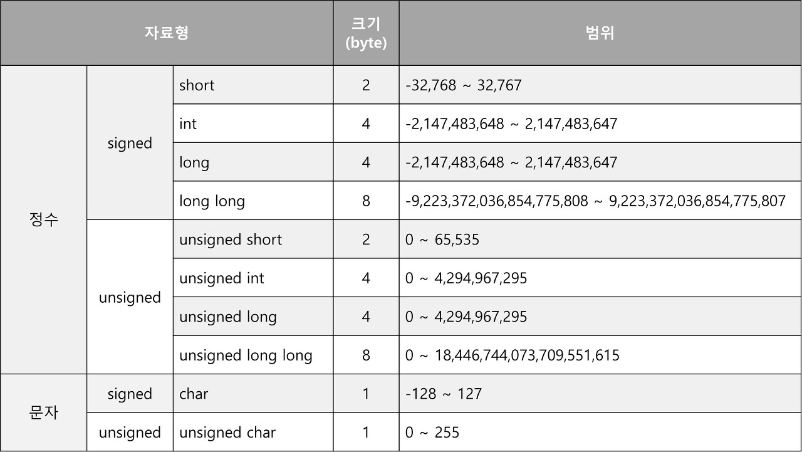
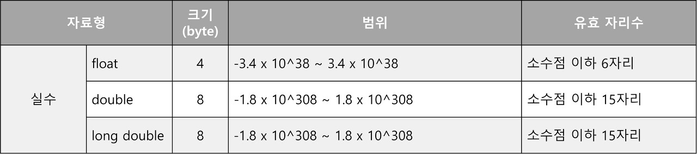

[toc]

# C 언어에서 정수형 자료형 (Integer Data Types in C)

이번 학습에서는 정수형 데이터를 표현할 때 사용하는 다양한 C 언어의 자료형에 대해 살펴보았다. 왜 자료형이 필요한지부터 시작하여 `char`, `int`, `short`, `long` 등 각각의 비트 수에 따른 범위와 용도를 정리하였다.

---

## 1. 자료형이 필요한 이유

프로그래밍 과정에서는 변수를 메모리에 저장하기 위해 **얼마만큼의 공간이 필요한지**를 알아야 한다.  
컴퓨터는 메모리를 1 Byte 단위로 관리하지만, 모든 데이터를 1 Byte로 표현할 수는 없다.  
그래서 데이터의 **크기에 맞는 자료형(Data Type)**을 명시해야 하며, 이를 통해 컴파일러가 메모리를 적절하게 할당할 수 있게 된다.

---

## 2. 정수를 표현하는 자료형

C 언어에서 정수 데이터를 표현하는 자료형은 **1 Byte, 2 Byte, 4 Byte** 크기로 구성되며, 각각 부호 여부에 따라 다시 나뉜다.

---

### ✅ char (1 Byte)

#### 1. `signed char`

- **부호 있는 1 Byte 정수형**
- 1 Bit는 부호 비트, 7 Bit는 값 저장
- 표현 범위: `-128 ~ 127`

#### 2. `unsigned char`

- **부호 없는 1 Byte 정수형**
- 8 Bit 전체를 값 저장에 사용
- 표현 범위: `0 ~ 255`

---

### ✅ short (2 Byte)

#### 1. `signed short int`

- 부호 비트 1 Bit + 값 비트 15 Bit
- 표현 범위: `-32,768 ~ 32,767`

#### 2. `unsigned short int`

- 부호 없음 → 2 Byte 전체 사용
- 표현 범위: `0 ~ 65,535`

---

### ✅ long (4 Byte)

#### 1. `signed long int`

- 부호 비트 1 Bit + 값 비트 31 Bit
- 표현 범위: `-2,147,483,648 ~ 2,147,483,647`

#### 2. `unsigned long int`

- 부호 없음 → 전체 4 Byte 사용
- 표현 범위: `0 ~ 4,294,967,295`

---

## 3. 자료형 요약 정리

---

## 4. 정수 자료형 표기 생략 규칙

- `signed`와 `unsigned`는 서로 반대 개념이므로 `signed`는 보통 생략 가능하다.
- 또한 `int`는 암시적으로 포함된 경우가 많아 자주 생략된다.

| 원래 표기            | 생략 가능한 형태                                        | 흔히 사용하는 형태 |
|----------------------|----------------------------------------------------------|-------------------|
| signed short int     | short int, signed short, short                           | short             |
| unsigned short int   | unsigned short                                           | unsigned short    |
| signed long int      | long int, signed long, signed int, long, **int**        | int               |
| unsigned long int    | unsigned int, unsigned long                              | unsigned int      |

---

> 📌 정리  
C 언어의 정수형 자료형은 다양한 메모리 크기와 부호 여부에 따라 나뉘며, 각 용도에 맞게 선택하는 것이 메모리 효율성과 데이터 정확성 확보에 중요하다.

---

이미지 출처: [velog](https://velog.io/@hyhy9501/4.-C%EC%96%B8%EC%96%B4%EC%99%80-%EC%9E%90%EB%A3%8C%EA%B5%AC%EC%A1%B0%EB%A1%A0)

End
