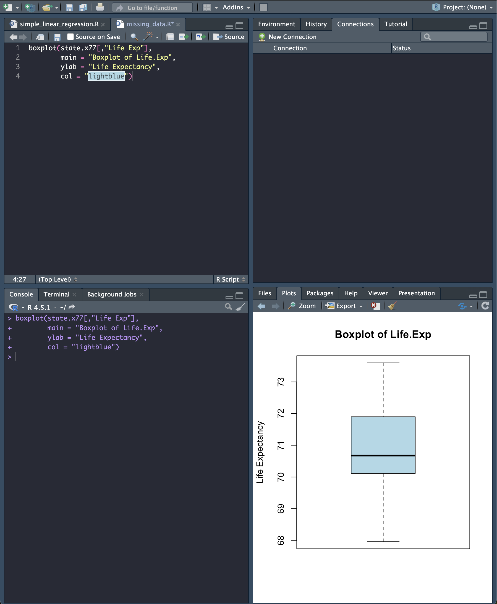
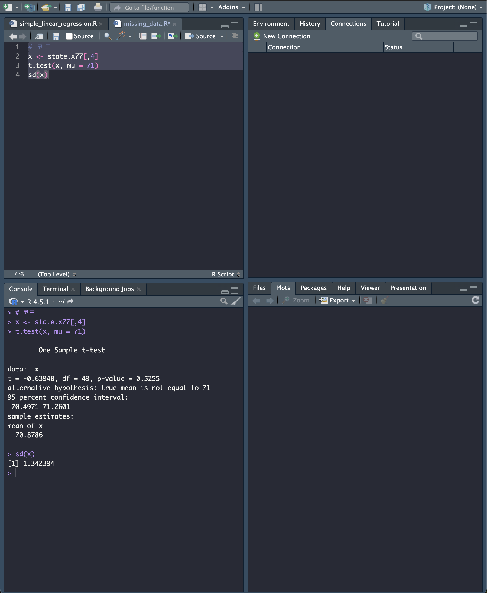
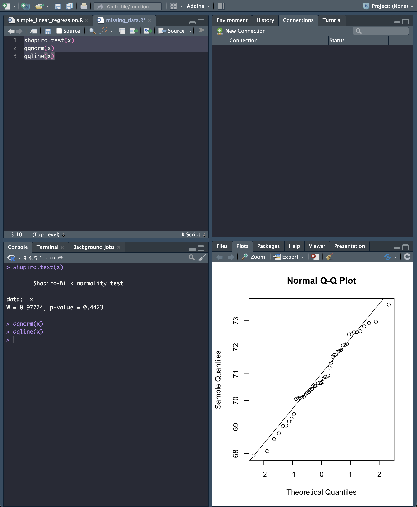

[toc]

# 일표본 t-검정 보고서

### 문제

```markdown
R의 state.x77 데이터에서 기대수명(Life.Exp)이 71세라고 말할 수 있는지 알아보고자 한다.

유의수준 0.05에서 일표본 t-검정을 실시하시오.

(1) 귀무가설(H0)과 대립가설(H1)을 설정하시오.
(2) 검정통계량을 계산하시오.
(3) p-value를 구하시오.
(4) 검정 결과를 해석하시오.
```

### Boxplot



---

### 풀이

```markdown
평균이 71인지 알아보기 위하여, 다음과 같이 가설을 세우자.
                       `H0: μ = 71   vs   H1 ∶ μ ≠ 71`
표본크기는 50이고, 표본평균은 𝑥ҧ = 70.8786 이고, 표본표준편차는 𝑠=1.342394이다.
평균에 대한 95% 신뢰구간 => (70.4971 71.2601)
검정통계량 => 𝑇 = -0.63948
유의확률 => 𝑝 = 0.5255이다. 
따라서 유의수준 0.05 에서 귀무가설을 기각하지 않는다.
즉, `유의수준 0.05에서 기대수명이 71세라고 말할 수 있다.` 
```

### 코드

```R
x <- state.x77[,4]
t.test(x, mu = 71)
sd(x)
```

### 결과



```markdown
자료가 정규분포를 따르는지 확인하기 위하여, 샤피로의 검정을 실시하였다.
유의확률 P = 0.4423가 유의수준 0.05보다 크므로, 자료의 분포가 정규분포라고 볼 수 있다.
그림의 QQ-plot에서 자료들이 거의 일직선에 놓임을 확인할 수 있다.
```

### 코드

```R
shapiro.test(x)
qqnorm(x)
qqline(x)
```

### 결과



---

End.