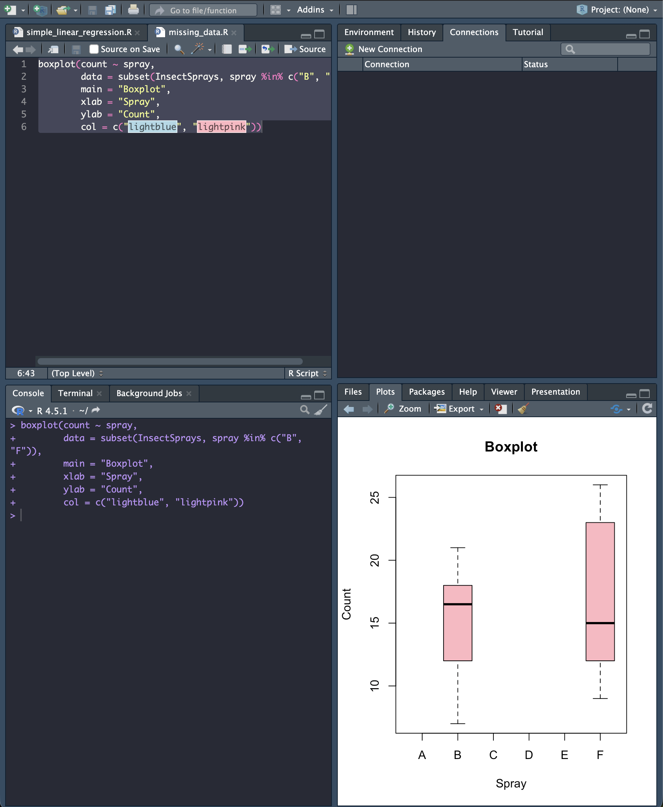

[toc]

# 이표본 t-검정 보고서

### 문제

```markdown
R의 InsectSprays에서 B,F를 뿌릴 때, 죽는 벌레 수가 동일한지 검정하기 위하여,
유의수준 0.05에서 이표본 T-검정을 실시해보자.
그림1은 자료의 상자도표이다.
```

### boxplot



---

### 풀이

```markdown
두 스프레이를 뿌릴 때 죽은 평균 벌레수가 동일한지 알아보기위하여, 다음과 같이 가설을 세우자.
      												`𝐻0: 𝜇B = 𝜇F vs 𝐻1: 𝜇B ≠ 𝜇F`
```

```markdown
표본크기는 각각 𝑛1,=12 𝑛2 =12이고, 표본평균은 𝑥ҧ = 15.33333,𝑦ത = 16.66667이고,
표본표준편차는 𝑠𝑋 =4.271115, 𝑠𝑌 =6.213378이다.
등분산검정에 대한 유의확률 𝑝 =0.2294
가 유의수 준 𝛼 = 0.05보다 크므로, `등분산`이다.

등분산 T-검정을 이용하여 계산한 평균차이 (𝜇𝐵 − 𝜇𝐹 ) 에 대한 95% 신뢰구간은 (-5.847224, 3.180557) 이고, 
검정통계량은 𝑇 = -0.61259이며, 유의확률 은 𝑝 = 0.5464 이다. 
따라서 유의수준 0.05 에서 `귀무가설을 기각한다`. 

즉, 유의수준 0.05에서 살충제 B와 F의 효과는 같다.
```

---

### 코드

```R
# 데이터 추출
x <- InsectSprays[InsectSprays$spray == 'B', "count"]
y <- InsectSprays[InsectSprays$spray == 'F', "count"]

# 데이터 결합
count <- c(x, y)
spray <- c(rep('B', length(x)), rep('F', length(y)))

# 데이터프레임 생성
xy <- data.frame(count, spray)

# 표본평균
aggregate(count ~ spray, data = xy, mean)

# 표준편차
aggregate(count ~ spray, data = xy, sd)

# 상자도표
boxplot(count ~ spray, data = xy)

# 등분산 검정
var.test(x, y)

# 이표본 t-검정 (등분산 가정)
t.test(x, y, var.equal = TRUE)
```

---

### 결과


---

End.
