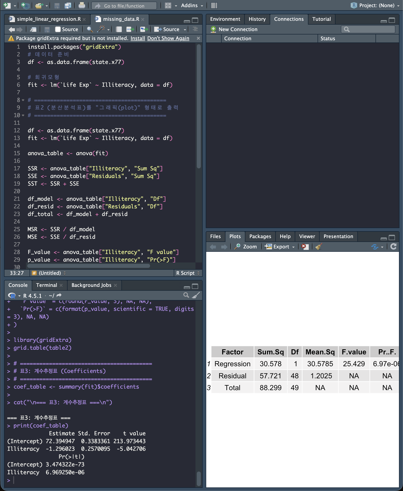
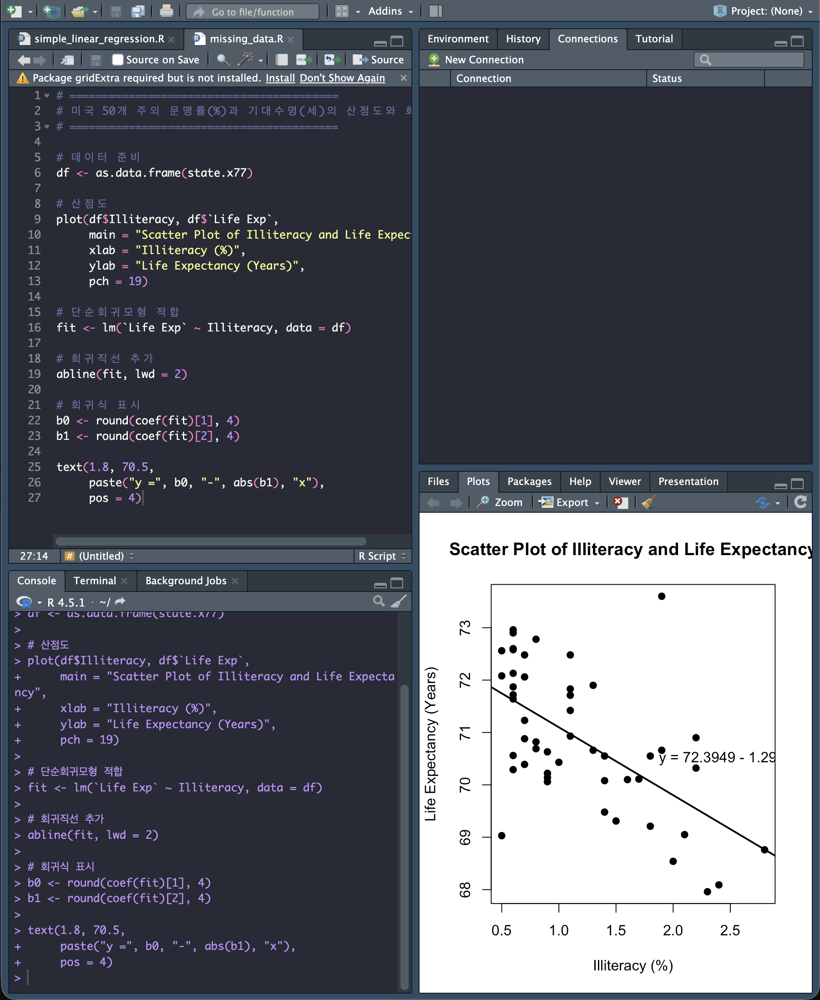
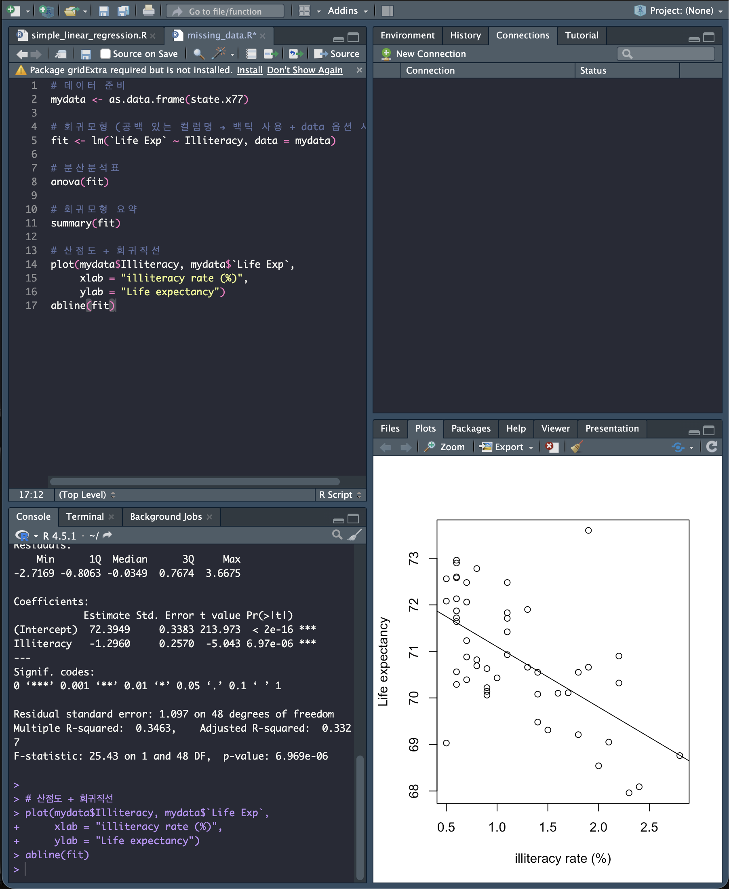

# 문맹률이 수명에 미치는 영향에 관한 회귀분석 보고서

```markdown
(1)-(2) 문맹이 수명에 미치는 영향을 알아보기 위하여, 미국 50 개 주의 문맹률 % (1970년)과 기대수명 (세)(1969–71년)을 조사하 였다.
(자료: state.x77 in R, U.S. Department of Commerce, Bureau of the Census (1977)) 단순회귀분석을 실시하여 아래의 표2과 표3를 얻었다.
```

## Plot. 분산분석: 종속변수 y는 기대수명 (세) , 독립변수 x는 문맹률 (%)

## 표3. 계수추정표



---

#### 미국 50개 주에 대한 문맹률(%)과 기대수명((세)의 산점도와 회귀직선



---

## 코드

```R
# 데이터 준비
mydata <- as.data.frame(state.x77)

# 회귀모형 (공백 있는 컬럼명 → 백틱 사용 + data 옵션 사용)
fit <- lm(`Life Exp` ~ Illiteracy, data = mydata)

# 분산분석표
anova(fit)

# 회귀모형 요약
summary(fit)

# 산점도 + 회귀직선
plot(mydata$Illiteracy, mydata$`Life Exp`,
     xlab = "illiteracy rate (%)",
     ylab = "Life expectancy")
abline(fit)
```




---

## 문제

```markdown
1. 표2에 대한 설명으로 틀린 것은 어느 것인가?

  1. 결정계수 𝑅2= 0.346 이므로 총변동 중 회귀모형이 설명하는 변동은 34.6%이다.(30.578/88.299)

  2. 𝐻0: β = 0에 대한 검정통계량은 F=25.4이다.

  3. 잔차의 평균제곱합은 57.721이다.

  4. 유의수준 0.05에서 귀무가설을 기각하므로 <그림1>의 직선 모형이 유의하다.(틀림)
  - 유의확률이 유의수준 보다 작기 때문에 귀무가설을 기각함, 그래프도 틀린 그래프가 됨
  5. 위 보기 중 답 없음
```

---

```markdown
2. 표3에 대한 설명으로 틀린 것은 어느 것인가?

  1. 𝐻0: α = 0에 대한 검정통계량은 t=213.973이고, 유의수준 0.05에서 y절편이 0이 아니다.

  2. 유의수준 0.05에서 𝐻0: β=0 에 대한 p 값이 0.05보다 작으므로,문맹률이 수명에 유의하게 영향을 미친다고 볼 수 있다.

  3. 표2의 F-검정통계량과 표3에서 𝐻0: β = 0에 대한 t-검정통계량의 제곱은 동일하다.(틀림)
  - 다름

  4. 유의수준 0.05에서 문맹률이 1%감소할 때 수명이 1.296세 감소한다고 할 수 있다. 

  5. 위 보기 중 답 없음
```

- R^2 = 결정계수 = SSR/SST

---

End.
