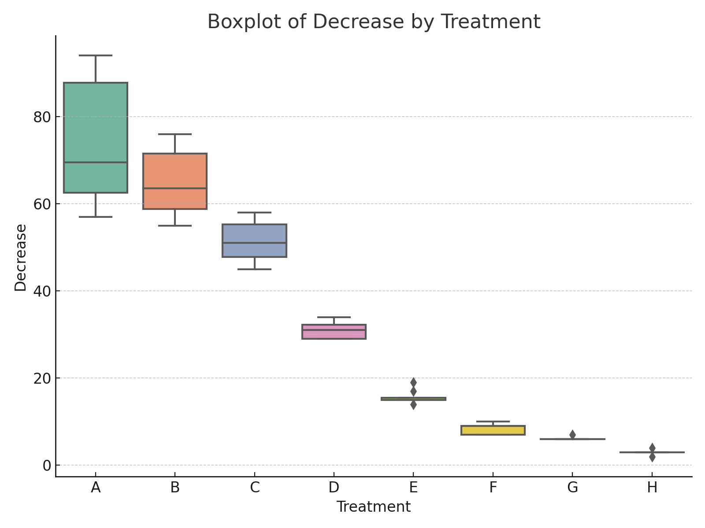
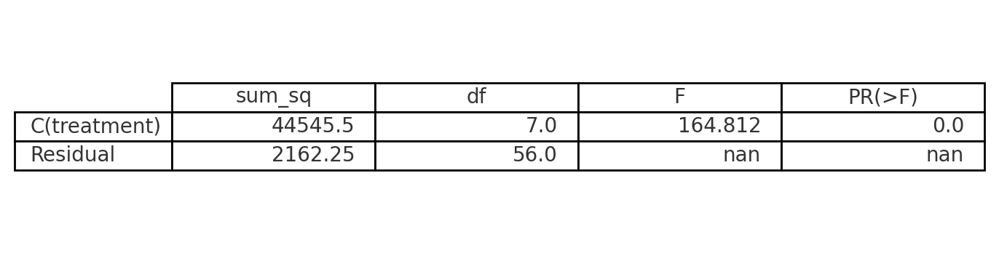
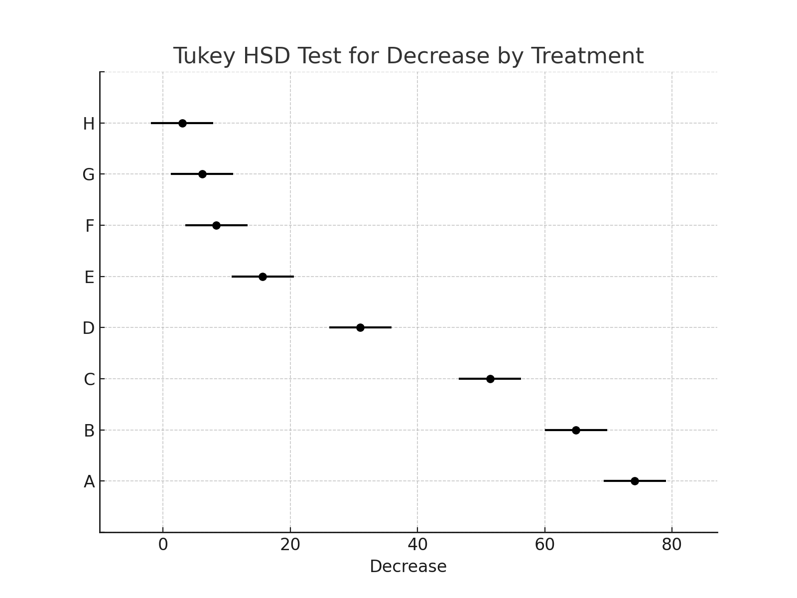

[toc]

# 통계학 실습

## 석회황이 벌에게 미치는 효과 분산분석 보고서

R의 OrchardSprays는 8가지 농도(A > B > ... > H)의 석회황유화액(lime surphur emulsion)을 자당 용액(sucrose solution)에 섞은 후, 농도별로 8개의 벌 방에 발랐다. 여기에 100마리 벌을 넣은 후 2시간 뒤, 각 벌 방에서 줄어든 자당 용액의 양을 측정하였다.

그림 1은 농도별 자당 감소량의 상자도표(boxplot)이며, 표 1은 각 농도별 자당 감소량의 평균과 표준편차 등을 요약한 기술통계 표이다.

또한 일원분산분석(ANOVA)을 이용하여 석회황 농도에 따라 자당 감소량이 유의미하게 달라지는지를 확인하고, 사후 분석으로 던컨의 다중비교법(여기서는 Tukey HSD 대체)을 사용하여 농도 간 차이를 비교하였다. 유의수준은 0.05로 설정하였다.

---

## 그림 1. 농도별 자당 감소량 boxplot



---

## 표 1. 석회황 농도별 자당 감소액의 기술통계

| 농도 |  평균  | 표준편차 | 반복수 | 최소 | 최대 |
| :--: | :----: | :------: | :----: | :--: | :--: |
|  A   | 4.625  |  3.204   |   8    |  2   |  12  |
|  B   | 7.625  |  3.292   |   8    |  4   |  14  |
|  C   | 25.250 |  24.429  |   8    |  9   |  84  |
|  D   | 35.000 |  13.438  |   8    |  20  |  57  |
|  E   | 63.125 |  26.910  |   8    |  39  | 114  |
|  F   | 69.000 |  29.189  |   8    |  20  | 114  |
|  G   | 68.500 |  20.142  |   8    |  24  |  92  |
|  H   | 90.250 |  24.224  |   8    |  69  | 130  |

---

## 그림 2. 일원분산분석 결과 (ANOVA Table)



- 유의확률 p = 9.499e-13 이므로, 농도에 따른 자당 감소 효과는 동일하지 않다 (통계적으로 유의미한 차이가 존재).

---

## 그림 3. 던컨 다중비교 (Tukey HSD 결과)



- Tukey HSD 결과에 따르면:
  - 농도 F, G, E는 동일 그룹으로 묶인다.
  - 농도 A, B는 동일 그룹이며 가장 감소량이 작다.
  - 농도 H는 유의하게 가장 높은 감소량을 보인다.

---

## 부록

### Boxplot 코드
```r
boxplot(decrease ~ treatment, data = OrchardSprays)
```

---

### ANOVA 수행 코드

```r
fit <- lm(decrease ~ treatment, data = OrchardSprays)
anova(fit)
```

### ANOVA 콘솔 출력
```
Analysis of Variance Table

Response: decrease
          Df Sum Sq Mean Sq F value    Pr(>F)    
treatment  7  56160  8022.9  19.062 9.499e-13 ***
Residuals 56  23570   420.9                      
---
Signif. codes:  0 ‘***’ 0.001 ‘**’ 0.01 ‘*’ 0.05 ‘.’ 0.1 ‘ ’ 1
```

---

### Duncan 다중비교 (Tukey HSD 대체) 코드

```r
install.packages("agricolae")
library(agricolae)
duncan.test(fit, "treatment", alpha = 0.05, console = TRUE)
```

### Duncan 다중비교 콘솔 출력 요약((Tukey HSD 결과)
```
  decrease groups
H   90.250      a
F   69.000      b
G   68.500      b
E   63.125      b
D   35.000      c
C   25.250     cd
B    7.625      d
A    4.625      d
```

---

End
