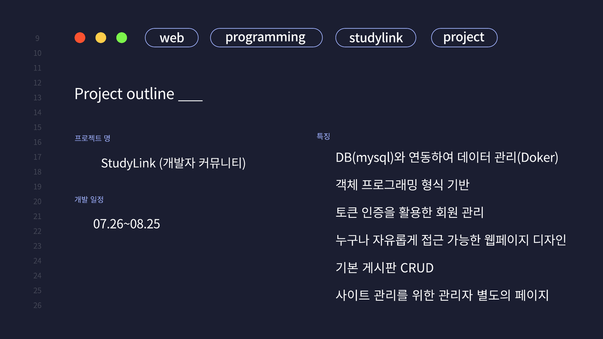
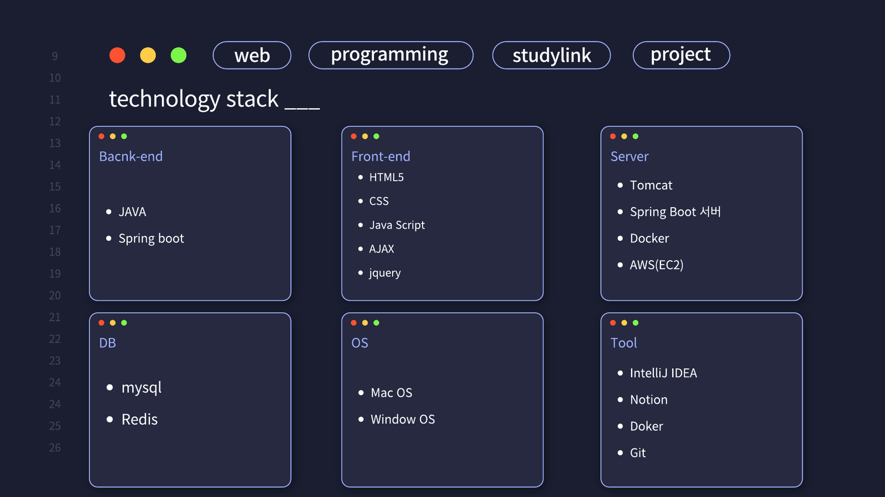
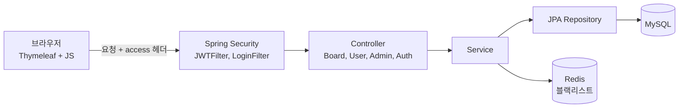
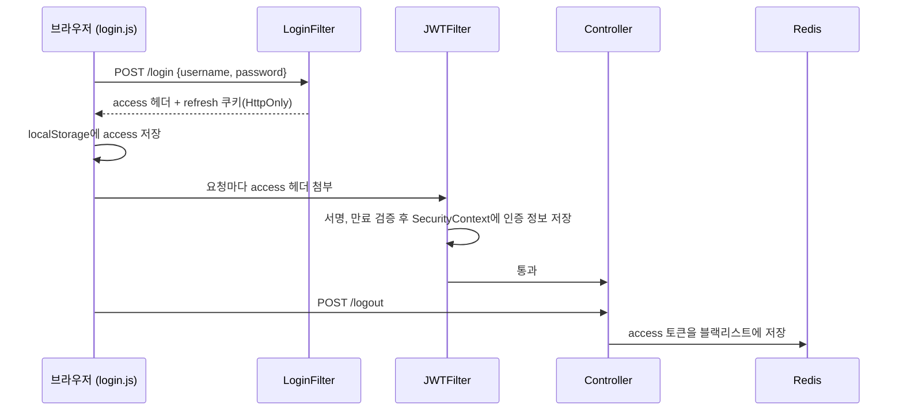
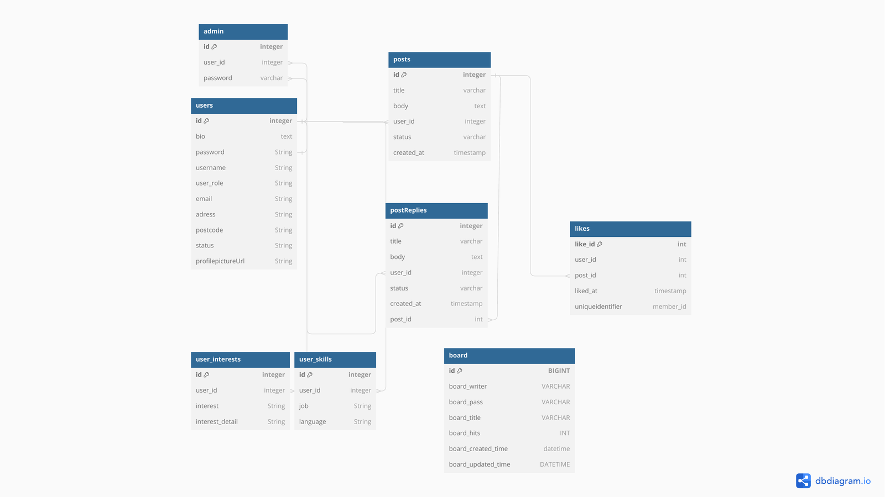

## 한눈에 보기

| 항목 | 내용 |
| --- | --- |
| 활동 | 2024 Project Busan (2024.07 ~ 2024.10) |
| 개발 기간 | 2024.07.26 ~ 2024.08.25 (약 한 달) |
| 팀 | 4명 (백엔드 3, 프론트엔드 1) |
| 내 역할 | **프론트엔드**: 전반적인 화면 디자인, 마이페이지 기능 |
| 서비스 | StudyLink, 개발자들이 스터디를 모집하고 소통하는 커뮤니티 |
| 핵심 기능 | 토큰 기반 회원 관리, 게시판 CRUD와 댓글, 페이징, 관리자 페이지 |


_프로젝트 개요 슬라이드_

---

## 1. 무엇을 만들었나

| 기능 | 설명 |
| --- | --- |
| 회원 관리 | 회원가입, 로그인, 로그아웃, 비밀번호 변경, 탈퇴. JWT Access, Refresh 토큰 사용 |
| 마이페이지, 프로필 | 자기소개, 보유 기술(Skill), 관심 분야(Interest) 등록과 수정 |
| 게시판 | 글 작성, 조회(조회수), 수정, 삭제, 댓글, 페이지 단위 목록 |
| 관리자 | 상위, 하위 관리자 구분. 회원 목록, 게시글 목록 관리 |
| 오류 페이지 | 401, 403, 404 전용 페이지 |

"누구나 자유롭게 접근 가능한 웹페이지 디자인"을 목표로, 로그인하지 않아도 게시글은 볼 수 있고 글쓰기, 마이페이지는 로그인한 사용자만 쓰도록 나누려 했음. 다만 이 구분은 주로 화면(JavaScript) 쪽에서 했고, 서버 설정은 더 넓게 열려 있었음(6절).

## 2. 기술 스택


_기술 스택 슬라이드_

| 영역 | 사용 기술 |
| --- | --- |
| 백엔드 | Java 17, Spring Boot 3.3, Spring Security, Spring Data JPA, jjwt 0.12 |
| 프론트엔드 | HTML, CSS, JavaScript(fetch, AJAX), jQuery, Thymeleaf 템플릿 |
| 데이터 | MySQL(회원, 게시글), Redis(로그아웃한 토큰 블랙리스트) |
| 배포 | Docker, docker-compose, AWS EC2, Tomcat(Spring Boot 내장) |
| 도구 | IntelliJ IDEA, Git, Notion |

## 3. 구조와 인증 흐름



로그인부터 로그아웃까지의 토큰 흐름.



- 세션 대신 토큰을 쓰므로 서버가 로그인 상태를 기억하지 않아도 됨(Stateless). 서버를 여러 대로 늘려도 같은 토큰으로 인증됨
- Access 토큰은 1시간, Refresh 토큰은 14일. Access가 만료되면 Refresh로 다시 발급(`/api/auth/reissue`)
- 토큰은 만료 전까지 유효하므로, 로그아웃할 때 Redis에 "더 이상 받지 않을 토큰"을 저장해 막는 구조

## 4. ERD


_dbdiagram.io로 그린 ERD 수정본_

`users`를 중심으로 게시글(`posts`, `board`), 댓글, 관리자(`admin`), 기술(`user_skills`), 관심 분야(`user_interests`)가 1:N 또는 1:1로 연결됨. 기술과 관심 분야를 회원 테이블의 열이 아니라 **별도 테이블**로 뺀 덕분에 한 사람이 여러 개를 등록할 수 있음.

## 5. 내가 맡은 프론트엔드

화면 디자인 전체와 로그인 상태에 따라 바뀌는 메뉴, 마이페이지를 맡았음. 서버가 HTML을 그려 주는 Thymeleaf 위에, 인증이 필요한 부분은 JavaScript `fetch`로 API를 호출하는 방식.

```javascript
// login.js: 로그인 성공 시 응답 헤더의 access 토큰 저장
fetch('/login', {
    method: 'POST',
    headers: { 'Content-Type': 'application/json' },
    body: JSON.stringify({ username, password })
})
    .then(data => {
        if (data.ok) {
            localStorage.setItem('access', data.headers.get("access"));
            window.location.href = "/";
        } else {
            messageElement.textContent = 'Login failed: 아이디와 비밀번호가 틀립니다.';
        }
    });
```

```javascript
// index.js: 토큰이 유효하면 프로필, 로그아웃 메뉴를, 아니면 로그인, 회원가입 메뉴를 보여 줌
fetch('/api/auth/validate-token', { method: 'POST', headers: { 'access': accessToken } })
    .then(response => {
        if (response.ok) {
            profileDropdown.innerHTML = `
                <li><a href="/profile">My Profile</a></li>
                <li><a href="#" id="logoutButton">로그아웃</a></li>`;
        } else {
            localStorage.removeItem('access');
            displayLoginSignupOptions();
        }
    });
```

- 같은 헤더 영역이 로그인 여부에 따라 다른 메뉴를 보여 주도록 만들었음
- 처음으로 프론트와 백엔드가 **HTTP 헤더, 상태 코드, JSON 형식**을 약속하고 맞춰 가는 과정을 경험함. 백엔드가 `access` 헤더로 토큰을 주기로 정하자 프론트 코드도 그 이름에 맞춰야 했음

---

## 6. 2년 뒤 다시 읽어 본 코드

블로그에 정리하면서 2024년 8월 23일 시점의 최종 코드를 다시 읽어 봤음. 당시에는 기능이 돌아가는 데 집중했지만, 지금 보니 고쳐야 할 부분이 분명히 보였음.

| # | 문제 | 위치 | 영향 |
| --- | --- | --- | --- |
| 1 | 블랙리스트 저장 키와 조회 키가 다름 | `BlackList.id` = 이메일, `JWTFilter`는 `existsById(accessToken)` | 로그아웃한 Access 토큰도 만료(1시간) 전까지 계속 통과 |
| 2 | TTL 단위 불일치 | 남은 시간을 **밀리초**로 계산해 `@TimeToLive(unit = MINUTES)`에 저장 | 1시간짜리 토큰 기록이 약 6.8년 동안 Redis에 남음 |
| 3 | Refresh 토큰을 읽는 위치가 다름 | 서버는 HttpOnly 쿠키로 주는데 `mypage.js`는 `localStorage`에서 읽음 | 값이 항상 비어 있어 재발급 로직이 실행되지 않음 (**내가 맡은 부분**) |
| 4 | 권한 범위가 넓음 | `/board/**`, `/admin/**`를 `permitAll` | 로그인하지 않아도 `GET /board/delete/{id}`로 글 삭제 가능 |
| 5 | 필터 제외 경로가 동작하지 않음 | `path.startsWith("/api/auth/**")` | `**`는 문자 그대로 비교되어 어떤 경로도 제외되지 않음 |
| 6 | 비밀값이 코드에 있음 | `application.properties`, `docker-compose.yml` | DB 비밀번호, 서버 주소, JWT 서명 키가 저장소에 남음 |
| 7 | 토큰을 로그에 출력 | `log.warn("... {}", accessToken)` | 로그를 볼 수 있는 사람이 토큰을 재사용할 수 있음 |
| 8 | 컨테이너 안에서 매번 빌드 | `ENTRYPOINT`가 `gradlew build`를 무한 반복 | 시작이 느리고 빌드 실패 시 재시작 반복 |

### 고친다면

```java
// 1, 2: 토큰 자체를 키로, TTL은 초 단위로
@RedisHash("black")
public class BlackList {
    @Id private String accessToken;
    @TimeToLive(unit = TimeUnit.SECONDS) private Long ttlSeconds;
}
long ttl = Duration.between(Instant.now(), jwtUtil.getExpirationDate(token).toInstant()).toSeconds();
```

```java
// 4: 읽기만 공개하고, 쓰기와 삭제는 인증 + 작성자 확인
.requestMatchers(HttpMethod.GET, "/board/", "/board/paging", "/board/{id}").permitAll()
.requestMatchers("/board/save", "/board/update/**", "/board/delete/**").authenticated()
.requestMatchers("/admin/**", "/api/admin/**").hasRole("ADMIN")
// 삭제는 GET이 아니라 DELETE 메서드로 바꾸고, 서비스에서 작성자 본인인지 확인
```

```javascript
// 3: Refresh는 HttpOnly 쿠키로만 다루고, JS는 쿠키를 함께 보내기만 함
fetch("/api/auth/reissue", { method: "POST", credentials: "include" })
```

```yaml
# 6: 비밀값은 환경 변수로
spring:
  datasource:
    password: ${DB_PASSWORD}
jwt:
  secret: ${JWT_SECRET}
```

> 6번처럼 저장소에 한 번 올라간 비밀값은 파일에서 지워도 Git 기록에 남음. 이 코드를 공개 저장소에 올린 적이 있다면 DB 비밀번호와 JWT 키를 **새로 바꾸는 것**이 먼저임
{: .prompt-warning }

---

## 7. 내가 한 일

| 구분 | 한 일 |
| --- | --- |
| 화면 디자인 | 메인, 로그인, 회원가입, 게시판, 관리자, 오류(401, 403, 404) 페이지의 전체적인 화면 디자인과 공통 스타일(`styles.css`) |
| 마이페이지 | 마이페이지, 프로필 수정, 비밀번호 변경, 회원 탈퇴 화면(`mypage`, `profile`, `password_change`, `delete_account`)과 각 화면의 API 호출 JavaScript |
| 로그인 상태 UI | 로그인 성공 시 Access 토큰 저장(`login.js`), 로그인 여부에 따라 메뉴를 바꾸는 메인 화면(`index.js`) |
| 협업 | 백엔드 3명이 만든 API에 맞춰 화면을 연결 |
| 이후 | 2년 뒤 이 글을 쓰며 백엔드까지 포함한 전체 코드를 다시 읽고 6절의 문제 8가지를 찾아 수정 방향 정리 |

## 8. 얻은 것

- **동작하는 것과 안전한 것은 다르다**: 처음 해 본 팀 웹 프로젝트라 "화면이 뜨고 버튼이 동작하는 것"이 목표였음. 다시 읽어 보니 1번 문제는 로그아웃 버튼을 눌러도 화면상으로는 정상이라 테스트 없이는 찾을 수 없는 종류였음
- **경계의 약속은 양쪽 모두 알아야 한다**: 백엔드가 정한 토큰 전달 방식(헤더, 쿠키)을 정확히 이해하지 못한 채 프론트 코드를 짜서 3번 문제가 생겼음. 역할이 나뉘어 있어도 API 명세는 둘 다 알아야 함
- **인증 구조에 대한 이해**: Access, Refresh 토큰을 나누는 이유, HttpOnly 쿠키, 토큰 블랙리스트처럼 인증 개념을 프론트에서 직접 다루며 익힘
- **협업 방식**: 한 달 동안 4명이 Notion으로 일정을 나누고 Git으로 합치면서, 기능을 작게 나눠 자주 합치는 것이 충돌을 줄인다는 것을 경험함. 이 경험이 이후 디자인패턴 수업의 팀 프로젝트에서 역할 분리와 인터페이스를 먼저 정하는 습관으로 이어졌음

## 9. 개선 사항

| 개선 | 방법 |
| --- | --- |
| 인증 테스트 | 로그인, 로그아웃 후 같은 토큰으로 요청했을 때 401이 나오는지 확인하는 통합 테스트(`spring-security-test`) |
| 권한 설계 | 공개, 회원, 관리자 경로를 표로 먼저 정리하고 `SecurityConfig`에 그대로 옮기기 |
| 비밀값 관리 | 환경 변수, `.env`는 `.gitignore`에 추가, 배포 환경은 비밀값 관리 서비스 |
| 프론트 토큰 처리 | 토큰 확인, 재발급 코드를 페이지마다 복사하지 않고 공통 `apiFetch()` 함수 하나로 |
| 배포 | 멀티 스테이지 Docker 빌드로 빌드된 jar만 실행 |
| 로그 | 토큰, 비밀번호 같은 민감 정보는 출력하지 않기 |

---

## 핵심 정리

1. StudyLink는 2024 Project Busan에서 4인 팀이 한 달 동안 만든 개발자 스터디 커뮤니티로, 프론트엔드(디자인, 마이페이지)를 맡았음
2. Spring Boot와 Spring Security로 JWT 기반 인증을, JPA와 MySQL로 게시판과 회원 데이터를, Redis로 로그아웃 토큰 블랙리스트를 구현함
3. Access 토큰은 응답 헤더, Refresh 토큰은 HttpOnly 쿠키로 전달하는 Stateless 구조
4. 기술과 관심 분야를 별도 테이블로 분리한 ERD로 한 회원이 여러 항목을 가질 수 있게 함
5. 다시 읽어 보니 블랙리스트 키 불일치로 로그아웃한 토큰이 계속 유효했고, TTL 단위도 분과 밀리초가 섞여 있었음
6. 내가 맡은 마이페이지 코드는 쿠키로 오는 Refresh 토큰을 localStorage에서 찾아 재발급이 동작하지 않았음
7. 게시판 삭제가 인증 없이 열려 있었고, 비밀값과 토큰이 코드와 로그에 남아 있었음
8. 동작하는 것과 안전한 것은 다르며, 역할이 나뉘어도 API 약속과 권한 설계는 모두가 이해하고 테스트로 확인해야 함

---

End.
