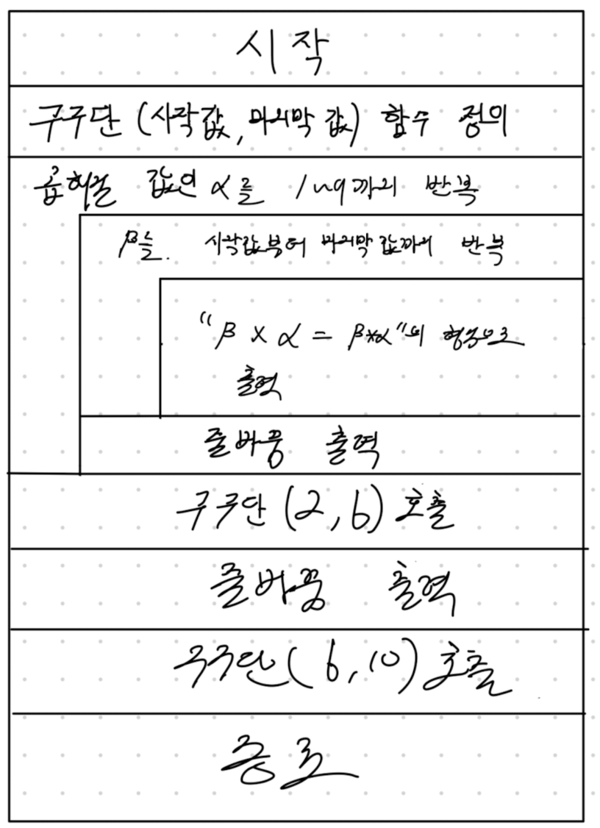
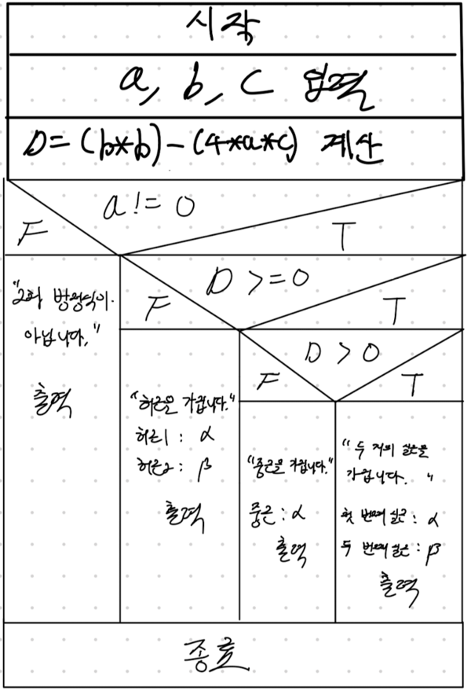

## 학습 목표

- 실습 과제를 풀 때 쓰는 프로그램 설계 5단계
- NS차트(Nassi-Shneiderman chart)로 순서, 선택, 반복을 그리는 방법
- 구구단과 2차 방정식 프로그램을 설계부터 테스트까지 작성하기
- 전역 변수, 지역 변수, 매개변수가 섞일 때 어떤 값이 쓰이는지 판단하기
- Call by Value와 Call by Reference의 차이
- 파일(`data.txt`)에서 데이터를 읽어 처리하기

---

## 1. 프로그램 설계 5단계

자료구조 실습 과제는 모두 아래 순서로 보고서를 작성한다.

1. **문제 정의**: 무엇을 만들어야 하는지 한두 문장으로
2. **입출력 정의**: 입력이 무엇이고, 어떤 형식으로 출력하는지
3. **설계**: 플로우차트 또는 NS차트
4. **구현**: 코드
5. **테스트 케이스 작성 및 적용**: 정상 입력과 경계 입력을 모두 확인

> 코드를 먼저 쓰지 말고 **입출력을 먼저 정하는 것**이 핵심이다. 입출력이 정해지면 테스트 케이스가 자연스럽게 나온다.
{: .prompt-warning }

### NS차트

NS차트는 순서도와 달리 화살표가 없고, 상자를 위에서 아래로 쌓아 흐름을 표현한다.

| 구조 | 모양 |
| --- | --- |
| 순서 | 상자를 위아래로 쌓음 |
| 선택(if) | 역삼각형으로 나누고 왼쪽 F, 오른쪽 T |
| 반복(for, while) | ㄱ자 모양으로 안쪽 상자를 감쌈 |

---

## 2. 1주차 과제: 구구단과 2차 방정식

> 1. 구구단을 [2,3,4,5단 / 6,7,8,9단] 형식으로 출력하는 프로그램의 문제 정의, 입출력 정의, 설계
> 2. 2차 방정식의 해를 구하는 프로그램의 문제 정의, 입출력 정의, 설계
{: .prompt-info }

### 구구단

- 문제 정의: 구구단을 2~5단, 6~9단 두 그룹으로 나눠 출력한다
- 입력: 없음
- 출력: 한 줄에 `2 x 1 = 2   3 x 1 = 3 ...`처럼 같은 곱하는 수를 가로로 나열

{: width="420" }
_구구단 NS차트: gugudan(시작값, 끝값) 함수를 두 번 호출_

NS차트대로 구현하면 다음과 같다. (보고서에는 NS차트만 제출해서, 아래 코드는 차트를 그대로 옮겨 새로 작성했다.)

```c
#include <stdio.h>

void gugudan(int start, int end) {          /* start단부터 end-1단까지 한 줄에 */
    for (int a = 1; a <= 9; a++) {
        for (int b = start; b < end; b++)
            printf("%d x %d = %2d\t", b, a, b * a);
        printf("\n");
    }
}

int main(void) {
    gugudan(2, 6);
    printf("\n");
    gugudan(6, 10);
    return 0;
}
```

실행 결과 (앞 4줄)

```text
2 x 1 =  2    3 x 1 =  3    4 x 1 =  4    5 x 1 =  5
2 x 2 =  4    3 x 2 =  6    4 x 2 =  8    5 x 2 = 10
2 x 3 =  6    3 x 3 =  9    4 x 3 = 12    5 x 3 = 15
2 x 4 =  8    3 x 4 = 12    4 x 4 = 16    5 x 4 = 20
```

**바깥 반복이 곱하는 수(1~9), 안쪽 반복이 단(2~5)**이어야 가로로 단이 나열된다. 순서를 바꾸면 2단 전체가 한 줄에 찍힌다.

### 2차 방정식

$$ax^2 + bx + c = 0,\quad D = b^2 - 4ac$$

| 조건 | 출력 |
| --- | --- |
| $$a = 0$$ | "2차 방정식이 아닙니다." |
| $$D < 0$$ | 허근 $$\dfrac{-b}{2a} \pm \dfrac{\sqrt{-D}}{2a}i$$ |
| $$D = 0$$ | 중근 $$-\dfrac{b}{2a}$$ |
| $$D > 0$$ | 두 실근 $$\dfrac{-b \pm \sqrt{D}}{2a}$$ |

{: width="420" }
_2차 방정식 NS차트: a != 0 → D >= 0 → D > 0 순서로 선택_

```c
#include <stdio.h>
#include <math.h>

void root_checker(double a, double b, double c) {
    if (a == 0) {
        printf("2차 방정식이 아닙니다.\n");
        return;
    }
    double D = (b * b) - (4 * a * c);

    if (D < 0) {
        double real_n = -b / (2.0 * a);
        double imag_n = fabs(sqrt(-D) / (2.0 * a));   /* a < 0일 때도 양수로 */
        printf("허근을 가집니다.\n");
        printf("허근1 : %.2f + %.2fi\n", real_n, imag_n);
        printf("허근2 : %.2f - %.2fi\n", real_n, imag_n);
    } else if (D == 0) {
        printf("중근을 가집니다.\n");
        printf("중근 : %.2f\n", -b / (2.0 * a));
    } else {
        double sqrtD = sqrt(D);
        printf("두 개의 실근을 가집니다.\n");
        printf("첫 번째 실근 : %.2f\n", (-b + sqrtD) / (2.0 * a));
        printf("두 번째 실근 : %.2f\n", (-b - sqrtD) / (2.0 * a));
    }
}

int main(void) {
    double a, b, c;
    printf("2차 방정식의 계수 a, b, c를 입력하세요: ");
    scanf("%lf %lf %lf", &a, &b, &c);
    root_checker(a, b, c);
    return 0;
}
```

테스트 케이스 (입력 → 출력)

```text
1 2 5   → 허근을 가집니다.  허근1 : -1.00 + 2.00i  허근2 : -1.00 - 2.00i
1 -4 4  → 중근을 가집니다.  중근 : 2.00
1 -3 2  → 두 개의 실근을 가집니다.  첫 번째 실근 : 2.00  두 번째 실근 : 1.00
0 1 2   → 2차 방정식이 아닙니다.
-1 2 -5 → 허근을 가집니다.  허근1 : 1.00 + 2.00i  허근2 : 1.00 - 2.00i
```

> 제출한 코드는 `imag_n = sqrt(fabs(D)) / (2.0 * a)`였다. 그대로 실행하면 `-1 2 -5`처럼 **a가 음수**일 때 `허근1 : 1.00 + -2.00i`가 출력된다. 허수부에 `fabs`를 씌워 고쳤다. 테스트 케이스에 음수 a를 넣지 않아 발견하지 못한 경우다.
{: .prompt-danger }

---

## 3. 2주차 과제 1: 전역 변수와 지역 변수 (4가지 경우)

> main(), A(), B() 함수를 만들어 그림에 주어진 4가지 경우의 프로그램을 각각 작성하라.
{: .prompt-info }

| 범위 | 선언 위치 | 보이는 곳 | 수명 |
| --- | --- | --- | --- |
| 지역 변수 | 함수(블록) 안 | 그 블록 안 | 블록이 끝나면 사라짐 |
| 전역 변수 | 함수 밖 | 파일 전체 | 프로그램 종료까지 |
| 매개변수 | 함수 머리 | 그 함수 안 | 호출이 끝나면 사라짐 |

같은 이름이 겹치면 **가장 안쪽(가까운) 선언이 이긴다**(shadowing).

```c
/* Case_1: main의 지역 변수를 매개변수로 전달 */
void A(int a) { int T1 = a * 10;  printf("T1 = %d\n", T1); }
void B(int a) { int T2 = a * 100; printf("T2 = %d\n", T2); }
int main() { int a = 50; a = a + 50; A(a); B(a); return 0; }

/* Case_2: 전역 변수 a = 50을 모든 함수가 공유 */
int a = 50;
void A() { int T2 = a * 10;  printf("T2 = %d\n", T2); }
void B() { int T3 = a * 100; printf("T3 = %d\n", T3); }
int main() { int T1 = a * 5; printf("T1 = %d\n", T1); A(); B(); return 0; }

/* Case_3: 각 함수가 자기만의 a를 가짐 */
void A() { int a = 20; printf("A 함수 a = %d\n", a); }
void B() { int a = 10; printf("B 함수 a = %d\n", a); }
int main() { int a; a = 50; a = a * 2; A(); B(); return 0; }

/* Case_4: 전역 a = 50, main과 A는 지역 a로 가림 */
int a = 50;
void A() { int a = 5; int T2 = a * 10; printf("T2 = %d\n", T2); }
void B() { int T3 = a * 100; printf("T3 = %d\n", T3); }
int main() { int a = 10; int T1 = a * 10; printf("T1 = %d\n", T1); A(); B(); return 0; }
```

실행 결과 비교

| Case | 변수 사용 방식 | T1 | T2 | T3 |
| --- | --- | --- | --- | --- |
| 1 | main에서 계산 후 매개변수로 전달 | 1000 | 10000 | - |
| 2 | 전역 변수 공유 | 250 | 500 | 5000 |
| 3 | 함수마다 독립된 지역 변수 | - | A: 20 | B: 10 |
| 4 | 전역 + 지역 혼합 | 100 | 50 | 5000 |

> **(중요!!)** Case_4에서 B()의 `a`는 main의 `a = 10`이 아니라 **전역 `a = 50`**이다. main의 지역 변수는 main 안에서만 보이므로, B()가 호출된 위치와는 상관없다(C는 정적 범위 규칙).
{: .prompt-warning }

---

## 4. 2주차 과제 2: Call by Value와 Call by Reference

> main에서 실수 a, b를 scanf로 입력받아 더하는 plus() 함수를 두 방식으로 작성하라. 합은 소수점 둘째 자리까지 출력한다.
{: .prompt-info }

```c
/* Call by Value: 값을 복사해서 넘기고, 결과는 return으로 받음 */
float plus(float a, float b) {
    return a + b;
}
int main() {
    float a, b, sum;
    printf("두 개의 실수를 입력하세요: ");
    scanf("%f %f", &a, &b);
    sum = plus(a, b);
    printf("합: %.2f\n", sum);
    return 0;
}
```

```c
/* Call by Reference: sum의 주소를 넘겨 함수가 직접 써 넣음 */
void plus(float a, float b, float *sum) {
    *sum = a + b;
}
int main() {
    float a, b, sum;
    printf("두 개의 실수를 입력하세요: ");
    scanf("%f %f", &a, &b);
    plus(a, b, &sum);
    printf("합: %.2f\n", sum);
    return 0;
}
```

실행 결과 (입력 `90 60`)

```text
두 개의 실수를 입력하세요: 90 60
합: 150.00
```

| | Call by Value | Call by Reference |
| --- | --- | --- |
| 넘기는 것 | 값의 **복사본** | 변수의 **주소** |
| 함수 안에서 바꾸면 | 원본은 그대로 | 원본이 바뀜 |
| 결과 전달 | `return` (값 1개) | 포인터로 여러 값도 가능 |

엄밀히 말하면 C에는 Call by Reference가 없고 **주소를 값으로 넘기는 것(call by address)**이다. `scanf("%f", &a)`에 `&`를 붙이는 이유도 같다.

---

## 5. 2주차 과제 3: 성적 처리 (보충)

> data.txt(학번, 영어, 국어, 수학)를 읽어 평균을 계산하고 성적을 매기는 프로그램. 출력 예: `1: 92, A`
{: .prompt-info }

이 문제는 제출 자료에 답안이 남아 있지 않아 새로 작성했다. 과제의 성적 기준표는 그림으로만 주어져 확인할 수 없어서, **90/80/70/60점 기준**으로 가정했다.

```c
#include <stdio.h>

char grade(double avg) {
    if (avg >= 90) return 'A';
    else if (avg >= 80) return 'B';
    else if (avg >= 70) return 'C';
    else if (avg >= 60) return 'D';
    return 'F';
}

int main(void) {
    FILE *fp = fopen("data.txt", "r");
    if (fp == NULL) { printf("data.txt를 열 수 없습니다.\n"); return 1; }

    int id, eng, kor, math;
    while (fscanf(fp, "%d %d %d %d", &id, &eng, &kor, &math) == 4) {
        double avg = (eng + kor + math) / 3.0;
        printf("%d: %.2f, %c\n", id, avg, grade(avg));
    }
    fclose(fp);
    return 0;
}
```

실행 결과 (과제로 받은 `data.txt` 10줄)

```text
1: 94.67, A
2: 53.33, F
3: 84.33, B
4: 74.33, C
5: 63.00, D
6: 26.67, F
7: 100.00, A
8: 73.00, C
9: 80.00, B
10: 76.67, C
```

- `fscanf`의 반환값(읽은 항목 수)이 4일 때만 반복해야 파일 끝에서 멈춘다. `while (!feof(fp))`를 쓰면 마지막 줄을 두 번 처리하는 실수가 흔하다
- 평균은 `/ 3`이 아니라 `/ 3.0`으로 나눠야 정수 나눗셈이 되지 않는다

---

### 강의 자료 및 정리 노트에서 정정한 부분 정리

| 위치 | 원래 | 정정 | 이유 |
| --- | --- | --- | --- |
| 1주차 2차 방정식 코드 | `imag_n = sqrt(fabs(D)) / (2.0 * a)` | `fabs(sqrt(-D) / (2.0 * a))` | a < 0이면 `+ -2.00i`처럼 출력됨 (실행해서 확인) |
| 2주차 과제 2 보고서 | 소주점 둘째 자리 | 소수점 둘째 자리 | 오타 |
| 2주차 과제 2 | Call by Reference | 주소 전달(call by address) | C는 포인터 값을 복사해 넘김 |

---

## 최종 핵심 정리

1. 과제는 문제 정의 → 입출력 정의 → 설계(NS차트) → 구현 → 테스트 순서로 작성한다
2. NS차트는 화살표 없이 상자로 순서, 선택(역삼각형), 반복(ㄱ자)을 표현한다
3. 구구단 가로 출력은 바깥 반복이 곱하는 수, 안쪽 반복이 단이어야 한다
4. 2차 방정식은 a = 0을 먼저 거르고 판별식 D의 부호로 허근, 중근, 두 실근을 나눈다
5. 테스트 케이스에는 a < 0 같은 경계 입력도 넣어야 숨은 버그가 드러난다
6. 같은 이름의 변수는 가장 안쪽 선언이 우선하며, 다른 함수의 지역 변수는 보이지 않는다
7. Call by Value는 복사본을, Call by Reference(주소 전달)는 주소를 넘겨 원본을 바꾼다
8. 파일 입력은 `fscanf`의 반환값으로 끝을 판단하고, 평균은 실수 나눗셈으로 구한다

---

End.
