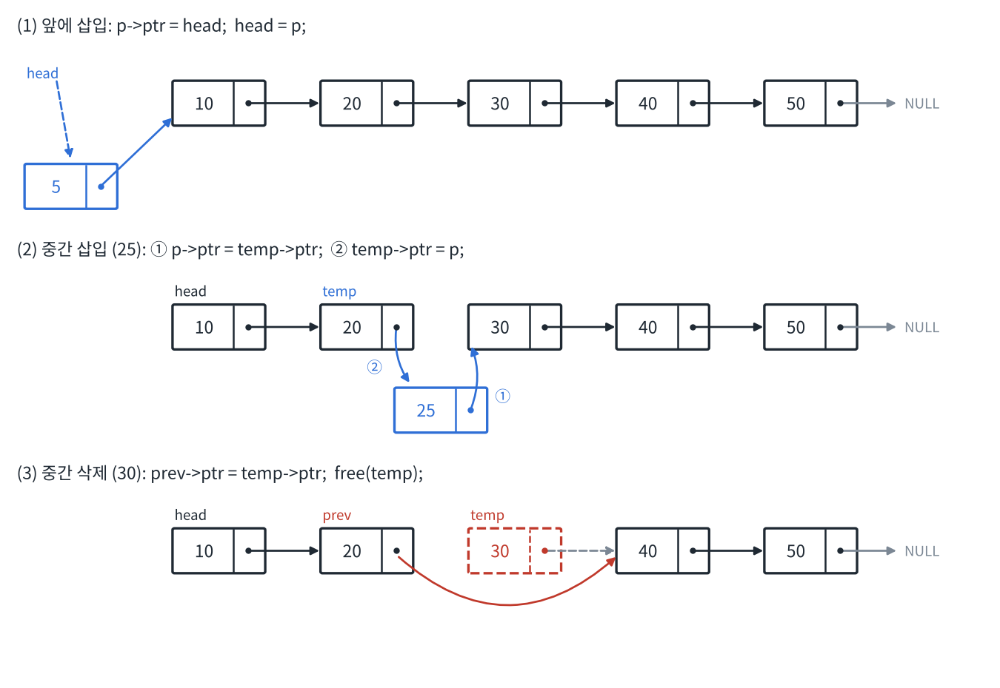

## 학습 목표

- 노드 구조체(`data` + `ptr`)와 `malloc`으로 연결 리스트 만들기
- 지역 변수만으로, 전역 `head`로 연결 리스트 구축하기
- 끝에 추가하는 두 방법: 매번 head부터 순회 vs tail 포인터 유지
- 노드를 순회하며 합 구하기
- 정렬된 리스트의 맨 앞, 중간, 맨 뒤에 삽입하기
- 맨 앞, 중간, 맨 뒤 노드 삭제하기
- 배열과 연결 리스트의 차이 (중간고사 출제)

---

## 1. 연결 리스트의 구조

연결 리스트(linked list, linear list)는 **노드**들을 포인터로 이어 붙인 자료구조다. 각 노드는 데이터와 다음 노드의 주소를 가진다.

```c
struct node {
    int data;            /* 데이터 */
    struct node *ptr;    /* 다음 노드의 주소 (마지막이면 NULL) */
};
```

- `head`: 첫 노드를 가리키는 포인터. head를 잃으면 리스트 전체를 잃는다
- 마지막 노드의 `ptr`은 `NULL`
- 노드는 `malloc`으로 필요할 때 만들고, 다 쓰면 `free`로 돌려준다

---

## 2. 5주차 실습: 연결 리스트 만들기

> 1. **지역 변수만** 사용해서 연결 리스트를 구축하시오. 데이터: 0, 10, 20, 30, 40, 50, 25
> 2. **전역 변수**를 사용해서 구축하시오(함수화). A) 매번 head부터 끝 노드까지 찾아가서 추가 B) 끝 노드 정보를 인자로 받아 추가
> 3. 연결 리스트 노드들의 data 합을 구하시오
{: .prompt-info }

### 1번: 지역 변수만 사용

```c
#include <stdio.h>
#include <stdlib.h>

int main() {
    struct node {
        int data;
        struct node *ptr;
    };
    int A[7] = {0, 10, 20, 30, 40, 50, 25};
    struct node *head = NULL, *temp = NULL, *cur = NULL;

    for (int i = 0; i < 7; i++) {
        temp = (struct node *)malloc(sizeof(struct node));
        temp->data = A[i];
        temp->ptr = NULL;
        if (head == NULL) head = temp;   /* 첫 노드 */
        else cur->ptr = temp;            /* 마지막 노드 뒤에 연결 */
        cur = temp;                      /* cur는 항상 마지막 노드 */
    }

    for (temp = head; temp != NULL; temp = temp->ptr) {
        printf("%d", temp->data);
        if (temp->ptr != NULL) printf(" -> ");
    }
    printf("\n");

    while (head != NULL) {               /* 메모리 해제 */
        temp = head->ptr;
        free(head);
        head = temp;
    }
    return 0;
}
```

실행 결과

```text
0 -> 10 -> 20 -> 30 -> 40 -> 50 -> 25
```

### 2번: 전역 head와 두 가지 추가 방식

```c
typedef struct node { int data; struct node *ptr; } Node;
Node *head = NULL;

/* A 방식: 매번 head부터 끝까지 찾아가서 추가 */
void addNodeAtEnd(int value) {
    Node *temp = (Node *)malloc(sizeof(Node));
    temp->data = value;
    temp->ptr = NULL;
    if (head == NULL) { head = temp; return; }
    Node *cur = head;
    while (cur->ptr != NULL) cur = cur->ptr;   /* 끝 노드 찾기 */
    cur->ptr = temp;
}

/* B 방식: 끝 노드(tail)를 인자로 받아 바로 추가 */
void addNodeFromTail(Node **tail, int value) {
    Node *temp = (Node *)malloc(sizeof(Node));
    temp->data = value;
    temp->ptr = NULL;
    if (*tail == NULL) head = temp;
    else (*tail)->ptr = temp;
    *tail = temp;                              /* 호출한 쪽의 tail을 갱신 */
}
```

두 방식 모두 실행 결과는 `0 -> 10 -> 20 -> 30 -> 40 -> 50 -> 25`로 같다. 차이는 **비용**이다.

| | A 방식 (head부터 순회) | B 방식 (tail 유지) |
| --- | --- | --- |
| 노드 1개 추가 | $$O(n)$$ | $$O(1)$$ |
| n개 구축 전체 | $$0 + 1 + \cdots + (n-1) = O(n^2)$$ | $$O(n)$$ |
| 필요한 것 | head만 | tail 포인터 하나 더 |

B 방식에서 `Node **tail`(포인터의 포인터)을 받는 이유는, 함수 안에서 **main의 tail 변수 자체**를 바꿔야 하기 때문이다. `Node *tail`로 받으면 복사본만 바뀐다.

### 3번: 노드 합

```c
int sumOfNodes(void) {
    int sum = 0;
    for (Node *cur = head; cur != NULL; cur = cur->ptr)
        sum += cur->data;
    return sum;
}
```

실행 결과

```text
연결리스트: 0 -> 10 -> 20 -> 30 -> 40 -> 50 -> 25
총합: 175
```

---

## 3. 6주차 실습: 삽입과 삭제

> 10 → 20 → 30 → 40 → 50 리스트에서
> 삽입: 5(맨 앞), 25(중간), 60(맨 뒤) / 삭제: 10(맨 앞), 30(중간), 50(맨 뒤). 각각 따로 작성한 뒤, 맨 앞·중간·맨 뒤가 **한 함수로** 되는 프로그램을 작성하시오.
{: .prompt-info }


_앞에 삽입, 중간 삽입, 중간 삭제에서 바뀌는 포인터_

### 삽입: 순서가 중요하다

중간 삽입은 **① 새 노드가 뒤를 먼저 잡고 ② 앞 노드가 새 노드를 가리킨다.** ②를 먼저 하면 `temp->ptr`에 있던 30의 주소가 사라져 뒤쪽 리스트를 잃어버린다.

```c
/* 정렬된 위치에 삽입: 맨 앞, 중간, 맨 뒤를 한 함수로 */
void node_Insert(node **head, int a) {
    node *p = (node *)malloc(sizeof(node));
    p->data = a;
    p->ptr = NULL;

    if (*head == NULL || (*head)->data > a) {   /* 맨 앞 */
        p->ptr = *head;
        *head = p;
        return;
    }
    node *temp = *head;                          /* 중간 또는 맨 뒤 */
    while (temp->ptr != NULL && temp->ptr->data < a)
        temp = temp->ptr;
    p->ptr = temp->ptr;    /* ① */
    temp->ptr = p;         /* ② */
}
```

맨 뒤 삽입은 따로 만들 필요가 없다. 반복이 끝났을 때 `temp`가 마지막 노드라면 `temp->ptr`이 `NULL`이므로 ①에서 `p->ptr = NULL`이 되어 자연스럽게 끝에 붙는다.

### 삭제: 앞 노드를 기억해야 한다

단일 연결 리스트는 뒤로만 갈 수 있으므로, 지울 노드(`temp`)의 **앞 노드(`temp_f`)**를 함께 들고 다닌다.

```c
void del_node(node **head, int key) {
    node *temp = *head, *temp_f = NULL;

    if (temp != NULL && temp->data == key) {    /* 맨 앞 */
        *head = temp->ptr;
        free(temp);
        return;
    }
    while (temp != NULL && temp->data != key) { /* 찾기 */
        temp_f = temp;
        temp = temp->ptr;
    }
    if (temp == NULL) {                          /* 없음 */
        printf("%d을(를) 찾을 수 없습니다.\n", key);
        return;
    }
    temp_f->ptr = temp->ptr;                     /* 중간 또는 맨 뒤 */
    free(temp);
}
```

실행 결과 (`10 20 30 40 50`에 삽입 3번, 새로 만든 `10 20 30 40 50`에서 삭제 3번, 빈 줄 생략)

```text
초기 연결리스트:
10 20 30 40 50
5 삽입 후:
5 10 20 30 40 50
25 삽입 후:
5 10 20 25 30 40 50
60 삽입 후:
5 10 20 25 30 40 50 60
10 삭제 후:
20 30 40 50
30 삭제 후:
20 40 50
50 삭제 후:
20 40
```

> head를 바꿀 수 있는 함수(맨 앞 삽입·삭제)는 `node **head`를 받아야 한다. `node *head`로 받으면 함수 안에서 head를 바꿔도 main의 head는 그대로다.
{: .prompt-danger }

### 강의 슬라이드의 빈칸 정답

| 문제 | 빈칸 |
| --- | --- |
| 맨 앞 삽입 (5) | ① `p->ptr = head;` ② `head = p;` |
| 맨 뒤 삽입 (60) | ① `temp->ptr = p;` (조건 `temp->ptr == NULL`) |
| 중간 삽입 (25) | ① `p->ptr = temp->ptr;` ② `temp->ptr = p;` (조건 `temp->data < 25 && temp->ptr->data > 25`) |
| 맨 앞 삭제 (10) | ① `head = temp->ptr;` ② `free(temp);` |
| 맨 뒤 삭제 | 끝에서 두 번째 노드에서 ① `free(temp->ptr);` ② `temp->ptr = NULL;` |
| 중간 삭제 (key) | ① `q = temp->ptr;` ② `temp->ptr = q->ptr; free(q);` (조건 `temp->ptr->data == key`) |

---

## 4. 배열과 연결 리스트 비교

> **(중요!!)** 중간고사에 그대로 출제된 표다.
{: .prompt-warning }

| 항목 | 배열 (Array) | 연결 리스트 (Linked List) |
| --- | --- | --- |
| 메모리 할당 | 정적 할당 (크기 고정) | 동적 할당 (노드 단위로 추가·제거) |
| 메모리 연속성 | 연속적 | 비연속적 (포인터로 연결) |
| 인덱스 접근 | $$O(1)$$ | 처음부터 따라가야 함, $$O(n)$$ |
| 탐색 | 선형 $$O(n)$$, 정렬되어 있으면 이진 탐색 $$O(\log n)$$ | 항상 선형 $$O(n)$$ |
| 중간 삽입·삭제 | 뒤 원소를 모두 이동, $$O(n)$$ | 위치를 알면 포인터만 바꿔 $$O(1)$$ |
| 메모리 효율 | 쓰지 않는 칸이 생길 수 있음 | 필요한 만큼만, 대신 노드마다 포인터 공간 추가 |
| 구현 | 간단 | 포인터 처리 때문에 복잡 |
| 크기 변경 | 실행 중 불가 (realloc 제외) | 실행 중 자유롭게 |
| 캐시 효율 | 연속 메모리라 높음 | 노드가 흩어져 낮음 |

- 연결 리스트의 삽입이 $$O(1)$$인 것은 **삽입할 위치의 앞 노드를 이미 알고 있을 때**다. 위치를 찾는 데는 여전히 $$O(n)$$이 든다

---

### 강의 자료 및 정리 노트에서 정정한 부분 정리

| 위치 | 원래 | 정정 | 이유 |
| --- | --- | --- | --- |
| 6주차 슬라이드 | `while (temp =/= null)` | `while (temp != NULL)` | C의 비교 연산자는 `!=` |
| 6주차 슬라이드 | `p-data` | `p->data` | 구조체 포인터 멤버 접근 |
| 5주차 3번 보고서 | "2번 문제의 A방식(마지막 노드(tail)를 순회하여 추가하는 방식) 사용" | A 방식은 **head부터 끝까지 순회**하는 방식 | 설명이 B 방식과 섞임. 코드는 A 방식이 맞음 |
| 6주차 삭제 함수 보고서 | 입력 리스트 "5 → 10 → … → 60" | 실제 코드는 새로 만든 `10 20 30 40 50`에서 삭제 | 실행 결과와 입력 설명이 다름 |
| 6주차 삽입·삭제 main 코드 | 삽입 후 리스트를 지우고 다시 만든 뒤 삭제 | 마지막에 리스트를 `free`하지 않음 | 메모리 누수. 프로그램 종료 시 회수되지만 습관상 해제 |

---

## 최종 핵심 정리

1. 연결 리스트의 노드는 데이터와 다음 노드 주소를 갖는 자기 참조 구조체다
2. head를 잃으면 리스트 전체를 잃고, 마지막 노드의 ptr은 NULL이다
3. 끝에 추가할 때 매번 순회하면 구축 전체가 $$O(n^2)$$, tail을 유지하면 $$O(n)$$이다
4. 함수 안에서 head나 tail을 바꾸려면 포인터의 포인터(`node **`)로 넘긴다
5. 중간 삽입은 새 노드가 뒤를 먼저 잡고(①) 앞 노드가 새 노드를 가리킨다(②)
6. 정렬 삽입 함수 하나로 맨 앞, 중간, 맨 뒤를 모두 처리할 수 있다
7. 삭제는 앞 노드를 기억했다가 앞 노드의 ptr을 다음 노드로 바꾸고 free한다
8. 배열은 인덱스 접근 $$O(1)$$, 연결 리스트는 위치를 알 때 삽입·삭제 $$O(1)$$이 강점이다

---

End.
