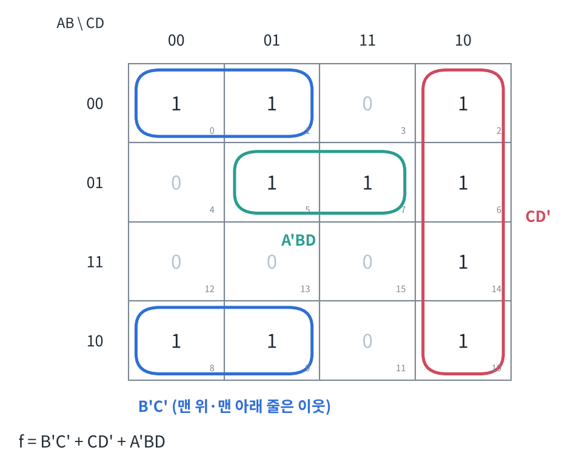

## 학습 목표

- 7가지 게이트(NOT, AND, OR, NAND, NOR, XOR, XNOR)의 식과 진리표
- NAND = negative-OR, NOR = negative-AND 등가와 응용 예제
- CMOS와 TTL의 특징, 전파 지연, 팬아웃
- 부울 대수 법칙, 규칙 10·11, 드모르간 정리로 식 간소화
- SOP·POS 표준형과 진리표 사이의 변환
- 카르노 맵과 Quine-McCluskey로 최소화하기
- NAND·NOR가 범용 게이트인 이유

---

## 1. 논리 게이트 (Chapter 3)

| 게이트 | 식 | 출력이 1인 경우 | A,B = 00 01 10 11 |
| --- | --- | --- | --- |
| NOT | $$\overline{A}$$ | A = 0 | - |
| AND | $$AB$$ | 모두 1 | 0 0 0 1 |
| OR | $$A + B$$ | 하나 이상 1 | 0 1 1 1 |
| NAND | $$\overline{AB}$$ | 하나라도 0 | 1 1 1 0 |
| NOR | $$\overline{A + B}$$ | 모두 0 | 1 0 0 0 |
| XOR | $$A \oplus B$$ | 서로 다름 | 0 1 1 0 |
| XNOR | $$\overline{A \oplus B}$$ | 서로 같음 | 1 0 0 1 |

입력이 n개면 진리표는 $$2^n$$줄이다.

### 등가 기호와 응용

| 게이트 | 등가 표현 | 읽는 법 |
| --- | --- | --- |
| NAND | negative-OR ($$\overline{A} + \overline{B}$$) | "입력 중 하나라도 LOW면 출력 HIGH" |
| NOR | negative-AND ($$\overline{A}\,\overline{B}$$) | "입력이 모두 LOW일 때만 출력 HIGH" |

- **AND 게이트 = enable/inhibit**: 한 입력을 제어 신호로 쓰면, 제어가 HIGH일 때만 다른 입력의 펄스가 통과한다(주파수 측정기의 1초 게이트)
- 안전벨트 경보: 시동 ON AND 벨트 미착용 AND 타이머 ON → 경보 (3입력 AND)
- 탱크 경보(Ex 3-12, 3-13): 센서가 1/4 이상이면 HIGH. "두 탱크 중 하나라도 1/4 아래로 떨어지면 LED" → 하나라도 LOW면 HIGH이므로 **NAND(negative-OR)**
- 착륙 장치(Ex 3-18): 세 바퀴 센서가 모두 LOW(정상)일 때 초록 LED → **NOR(negative-AND)**
- 고장 감지(Ex 3-20): 병렬로 같은 동작을 하는 두 회로의 출력을 **XOR**하면 다를 때(한쪽 고장) HIGH

### 반도체 기술

| | CMOS | TTL |
| --- | --- | --- |
| 소자 | FET(MOSFET) | 바이폴라 트랜지스터 |
| 전원 | 5V 또는 3.3V | 5V |
| 소비 전력 | 작음, 주파수에 비례해 증가 | 크고 주파수와 거의 무관 |
| 정전기 | 민감함 | 덜 민감 |

- **전파 지연** $$t_{PHL}$$, $$t_{PLH}$$: 입력 변화부터 출력 변화까지의 시간. 짧을수록 빠른 회로
- **SPP(speed-power product)** = 전파 지연 × 소비 전력. 작을수록 좋음
- **팬아웃**: 한 게이트 출력이 정상 동작을 유지하면서 구동할 수 있는 입력 수
- 고장: TTL의 끊어진(open) 입력은 HIGH처럼 동작한다. AND/NAND를 시험할 때 쓰지 않는 입력은 HIGH, OR/NOR는 LOW로 둔다

### 다이오드·트랜지스터로 만든 게이트 (시험 대비 정리)

| 회로 | 구성 | 동작 |
| --- | --- | --- |
| 트랜지스터 인버터 | NPN 1개 + 컬렉터 풀업 저항 | A = 1 → ON → 출력이 GND(0), A = 0 → OFF → 출력이 Vcc(1) |
| 다이오드 AND | 다이오드 2개 + 풀업 저항 | 입력 중 하나라도 0이면 그 다이오드로 전류가 빠져 출력 0 |
| 트랜지스터 AND | NPN 2개 **직렬** | 둘 다 ON일 때만 Vcc가 출력으로 연결 |
| 다이오드 OR | 다이오드 2개 + 풀다운 저항 | 하나라도 1이면 다이오드를 통해 출력에 전압 |
| 트랜지스터 OR | NPN 2개 **병렬** | 하나만 ON이어도 출력 1 |

직렬은 AND, 병렬은 OR로 기억한다.

---

## 2. 부울 대수 (Chapter 4)

### 법칙과 규칙

| 이름 | 식 |
| --- | --- |
| 교환 | $$A + B = B + A$$, $$AB = BA$$ |
| 결합 | $$A + (B + C) = (A + B) + C$$ |
| 분배 | $$A(B + C) = AB + AC$$ |
| 규칙 1~4 | $$A + 0 = A$$, $$A + 1 = 1$$, $$A \cdot 0 = 0$$, $$A \cdot 1 = A$$ |
| 규칙 5~8 | $$A + A = A$$, $$A + \overline{A} = 1$$, $$AA = A$$, $$A\overline{A} = 0$$ |
| 규칙 9 | $$\overline{\overline{A}} = A$$ |
| 규칙 10 (흡수) | $$A + AB = A$$ |
| 규칙 11 | $$A + \overline{A}B = A + B$$ |
| 규칙 12 | $$(A + B)(A + C) = A + BC$$ |

### 드모르간 정리

$$\overline{AB} = \overline{A} + \overline{B},\qquad \overline{A + B} = \overline{A}\,\overline{B}$$

"곱의 보수는 보수의 합, 합의 보수는 보수의 곱". 긴 막대를 끊고 연산자를 바꾼다.

### 간소화 예 (Ex 4-9)

$$
\begin{aligned}
AB + A(B + C) + B(B + C) &= AB + AB + AC + BB + BC \\
&= AB + AC + B + BC \quad (\text{규칙 } 5,\ 7) \\
&= B + AC \quad (\text{규칙 } 10:\ B + AB = B,\ B + BC = B)
\end{aligned}
$$

SymPy의 `simplify_logic`으로도 `B | (A & C)`가 나와 확인했다.

### SOP와 POS

| 형태 | 모양 | 구현 | 표준형 |
| --- | --- | --- | --- |
| SOP (곱의 합) | $$AB + \overline{A}C$$ | AND-OR (= NAND-NAND) | 모든 곱항에 모든 변수(최소항, minterm) |
| POS (합의 곱) | $$(A + B)(\overline{A} + C)$$ | OR-AND (= NOR-NOR) | 모든 합항에 모든 변수(최대항, maxterm) |

- 진리표에서 **출력 1인 줄**을 곱항으로 모으면 표준 SOP, **출력 0인 줄**을 합항으로 모으면 표준 POS
- 표준 SOP의 최소항 번호에 들어가지 않은 번호들이 표준 POS의 최대항 번호가 된다

Ex 4-22: 출력이 1인 입력이 011, 100, 110, 111이면

$$X = \overline{A}BC + A\overline{B}\,\overline{C} + AB\overline{C} + ABC = BC + A\overline{C}$$

---

## 3. 카르노 맵과 Quine-McCluskey

### 카르노 맵 규칙

- 행과 열의 순서는 **그레이 코드**(00, 01, 11, 10). 이웃 칸은 1비트만 다르다
- 맨 위와 맨 아래, 맨 왼쪽과 맨 오른쪽도 이웃(wrap-around)
- 1을 **2의 거듭제곱(1, 2, 4, 8, 16)개** 직사각형으로, **가능한 크게**, 모든 1이 적어도 한 번 포함되도록 묶는다
- 묶음 안에서 0과 1이 모두 나타나는 변수는 지운다
- **don't care(X)**: BCD의 1010~1111처럼 나오지 않는 입력은 1로도 0으로도 볼 수 있어 묶음을 키우는 데 쓴다

### 예: f(A,B,C,D) = Σm(0, 1, 2, 5, 6, 7, 8, 9, 10, 14)

Quine-McCluskey는 1의 개수로 최소항을 묶고, 1비트만 다른 항끼리 합쳐 `-`로 표시하는 과정을 반복해 **주항(prime implicant)**을 찾는다.

| 주항 | 덮는 최소항 |
| --- | --- |
| $$\overline{B}\,\overline{C}$$ | 0, 1, 8, 9 |
| $$\overline{B}\,\overline{D}$$ | 0, 2, 8, 10 |
| $$C\overline{D}$$ | 2, 6, 10, 14 |
| $$\overline{A}\,\overline{C}D$$ | 1, 5 |
| $$\overline{A}BD$$ | 5, 7 |
| $$\overline{A}BC$$ | 6, 7 |

- 9번은 $$\overline{B}\,\overline{C}$$만, 14번은 $$C\overline{D}$$만 덮으므로 이 둘이 **필수 주항(essential prime implicant)**
- 남은 5, 7번을 한 번에 덮는 $$\overline{A}BD$$를 고르면 끝

$$f = \overline{B}\,\overline{C} + C\overline{D} + \overline{A}BD$$

{: width="520" }
_Σm(0,1,2,5,6,7,8,9,10,14)의 최소 SOP. 칸 오른쪽 아래 숫자는 최소항 번호_

SymPy `SOPform`으로 최소화해도 같은 세 항이 나온다. $$\overline{B}\,\overline{D}$$도 주항이지만 이미 다른 항들이 모두 덮어서 필요 없다.

| | 카르노 맵 | Quine-McCluskey |
| --- | --- | --- |
| 방법 | 그림에서 눈으로 묶음 | 표로 기계적으로 비교 |
| 변수 수 | 5~6개까지 현실적 | 많아도 가능 |
| 자동화 | 어려움 | 프로그램으로 구현 가능 |

### 7-세그먼트 응용

0~9를 표시할 때 켜지는 세그먼트(a~g). 예를 들어 세그먼트 a는 1, 4를 제외한 모든 숫자에서 켜진다. 각 세그먼트마다 BCD 4비트 입력에 대한 식을 카르노 맵(1010~1111은 don't care)으로 최소화한다.

| 숫자 | 세그먼트 |
| --- | --- |
| 0 | a b c d e f |
| 1 | b c |
| 2 | a b d e g |
| 7 | a b c |
| 8 | a b c d e f g |

---

## 4. 조합 논리 회로 (Chapter 5)

**조합 논리**: 출력이 **현재 입력에만** 의존(기억 소자가 없음). 7장의 순차 논리와 대비된다.

- AND-OR = SOP, AND-OR-Invert = SOP의 보수
- XOR = $$A\overline{B} + \overline{A}B$$, XNOR = $$AB + \overline{A}\,\overline{B}$$

### 범용 게이트

NAND만으로(또는 NOR만으로) 모든 논리를 만들 수 있다.

| 만들 것 | NAND로 | NOR로 |
| --- | --- | --- |
| NOT | 두 입력을 묶음: $$\overline{AA} = \overline{A}$$ | $$\overline{A + A} = \overline{A}$$ |
| AND | NAND 뒤에 NOT | 입력을 각각 NOT한 뒤 NOR |
| OR | 입력을 각각 NOT한 뒤 NAND | NOR 뒤에 NOT |

- **NAND-NAND = AND-OR**: $$\overline{\overline{AB} \cdot \overline{CD}} = AB + CD$$ (드모르간)
- NAND 회로를 읽을 때는 출력 쪽부터 NAND를 negative-OR 기호로 바꿔 **버블끼리 마주 보게** 그리면 이중 반전이 사라져 식이 바로 보인다

### 펄스 입력

조합 회로의 출력은 매 순간의 입력으로 결정되므로, 입력 파형을 구간별로 나눠 진리표를 적용하거나 간소화한 식에 대입해 출력 파형을 그린다.

---

### 강의 자료 및 정리 노트에서 정정한 부분 정리

| 위치 | 원래 | 정정 | 이유 |
| --- | --- | --- | --- |
| Ch.4 목차 | Simpliofication | Simplification | 철자 |
| Ch.4 p.33 | in witch | in which | 철자 |
| Ch.5 p.1 | Combination Logic Analysis | Combinational Logic Analysis | 교재 원래 제목 |
| Ch.3 p.13 | LOW lever | LOW level | 철자 |
| Ch.4 p.24~25 | "ChatGPT에게 물어보기"로 카르노 맵을 쓰는 회사 목록 | 근거 없는 사례 목록이라 정리에서 제외 | 생성형 AI 답변은 출처가 아님 |

---

## 최종 핵심 정리

1. NAND는 negative-OR, NOR는 negative-AND와 같고 상황 문장의 "하나라도", "모두"로 게이트를 고른다
2. CMOS는 저전력이고 TTL은 정전기에 덜 민감하며, 전파 지연과 팬아웃이 성능 지표다
3. 규칙 10 $$A + AB = A$$, 규칙 11 $$A + \overline{A}B = A + B$$, 드모르간 정리로 식을 줄인다
4. 진리표의 1인 줄은 표준 SOP(최소항), 0인 줄은 표준 POS(최대항)가 된다
5. 카르노 맵은 그레이 코드 순서이고, 2의 거듭제곱 크기로 최대한 크게 묶으며 가장자리도 이웃이다
6. 필수 주항부터 고르고 남은 최소항을 최소 개수의 주항으로 덮는다
7. Σm(0,1,2,5,6,7,8,9,10,14)의 최소 SOP는 $$\overline{B}\,\overline{C} + C\overline{D} + \overline{A}BD$$다
8. NAND와 NOR는 범용 게이트이고, NAND-NAND 회로는 AND-OR(SOP)와 같다

---

End.
