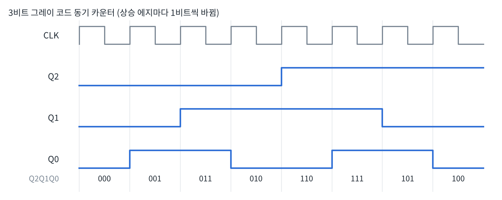

## 학습 목표

- 조합 논리와 순차 논리의 차이
- S-R 래치, 게이트 D 래치, 래치와 플립플롭의 차이
- D, J-K 플립플롭의 동작과 비동기 입력(PRE, CLR)
- 셋업·홀드 시간, 전파 지연, 최대 클럭 주파수
- 원숏과 555 타이머의 펄스 폭·주파수 공식
- 비동기(리플) 카운터와 동기 카운터, 모듈러스 줄이기
- J-K 여기표와 카르노 맵으로 동기 카운터 설계
- 시프트 레지스터 4종과 존슨·링 카운터

---

## 1. 래치와 플립플롭 (Chapter 7)

| | 조합 논리 | 순차 논리 |
| --- | --- | --- |
| 출력이 의존하는 것 | 현재 입력만 | 현재 입력 + **현재 상태(기억)** |
| 기본 소자 | 게이트 | 래치, 플립플롭 (쌍안정 소자) |

### S-R 래치

NOR 두 개(active-HIGH 입력) 또는 NAND 두 개(active-LOW 입력)를 교차 연결.

| S | R | Q (NOR 래치) |
| --- | --- | --- |
| 0 | 0 | 유지 |
| 1 | 0 | 1 (SET) |
| 0 | 1 | 0 (RESET) |
| 1 | 1 | **무효** ($$Q = \overline{Q}$$가 되어 버림) |

- 응용: 스위치를 누를 때 접점이 여러 번 붙었다 떨어지는 **채터링(contact bounce)** 제거
- **게이트 S-R 래치**: EN이 HIGH일 때만 S, R을 반영
- **게이트 D 래치**: $$S = D$$, $$R = \overline{D}$$로 묶어 무효 상태를 없앰. EN이 HIGH인 동안 Q가 D를 그대로 따라간다(투명)

### 에지 트리거 플립플롭

클럭의 **상승 에지 또는 하강 에지 순간에만** 입력을 반영한다(동기식). 래치는 레벨(EN = HIGH인 구간 전체)에 반응한다는 점이 다르다.

| 플립플롭 | 동작 |
| --- | --- |
| D | 에지에서 $$Q \leftarrow D$$ |
| J-K | J=K=0 유지, J=1 K=0 SET, J=0 K=1 RESET, **J=K=1 토글** (무효 상태 없음) |
| T (J=K=1로 묶은 J-K) | 에지마다 토글 |

- **비동기 입력** PRE(preset), CLR(clear): 클럭과 상관없이 즉시 Q를 1 또는 0으로. 보통 active-LOW라서 평소에는 HIGH로 둔다

### 동작 특성 (데이터시트)

| 항목 | 뜻 |
| --- | --- |
| 전파 지연 $$t_{PLH}, t_{PHL}$$ | 클럭 에지(또는 PRE/CLR)부터 출력 변화까지 |
| 셋업 시간 $$t_s$$ | 클럭 에지 **전에** 입력이 유지돼야 하는 최소 시간 |
| 홀드 시간 $$t_h$$ | 클럭 에지 **후에** 입력이 유지돼야 하는 최소 시간 |
| $$f_{max}$$ | 안정적으로 동작하는 최대 클럭 주파수 |

### 응용

- 병렬 데이터 저장(레지스터), **주파수 분주**: 토글 플립플롭 하나는 클럭을 2분주, n개를 이으면 $$2^n$$분주
- 카운팅: 분주기의 출력들을 묶어 읽으면 2진 카운터

### 원숏과 555 타이머

**원숏(단안정 멀티바이브레이터)**: 트리거되면 정해진 시간 $$t_W$$ 동안만 불안정 상태(펄스)를 낸 뒤 돌아온다. 재트리거 불가형(74121)과 재트리거 가능형(74LS122).

$$t_W = 0.7\,R_{EXT}C_{EXT}\quad(74121)$$

Ex 7-12: 100ms 펄스, $$R_{EXT} = 39$$kΩ이면 $$C_{EXT} = \dfrac{100\text{ms}}{0.7 \times 39\text{k}\Omega} \approx 3.66\,\mu\text{F}$$

**555 타이머**: 비교기 2개(문턱 $$\tfrac{2}{3}V_{CC}$$, 트리거 $$\tfrac{1}{3}V_{CC}$$) + S-R 래치 + 방전 트랜지스터.

| 모드 | 공식 |
| --- | --- |
| 단안정(원숏) | $$t_W = 1.1\,R_1C_1$$ |
| 비안정(발진기) | $$t_H = 0.7(R_1 + R_2)C_1$$, $$t_L = 0.7R_2C_1$$ |
| | $$f = \dfrac{1.44}{(R_1 + 2R_2)C_1}$$, 듀티 사이클 $$= \dfrac{R_1 + R_2}{R_1 + 2R_2} \times 100\%$$ |

비안정 모드는 $$R_1 + R_2$$로 충전하고 $$R_2$$로만 방전하므로 듀티 사이클이 항상 50%보다 크다. 50% 미만이 필요하면 충전이 $$R_1$$만 거치도록 다이오드를 추가한다.

---

## 2. 카운터 (Chapter 8)

### 비동기(리플) 카운터

앞단 플립플롭의 출력이 다음 단의 클럭이 된다.

- n개면 최대 모듈러스 $$2^n$$
- 플립플롭이 동시에 바뀌지 않아 지연이 누적된다. Ex 9-1: 4비트, 단당 10ns → 최악 40ns. 누적 지연이 클럭 주기보다 짧아야 한다
- 누적 지연 중에 잠깐 틀린 상태가 나타나 디코딩 출력에 **글리치**가 생긴다 → 클럭이 LOW일 때만 디코더를 켜는 **strobing**으로 제거
- **모듈러스 줄이기**: 원하는 상태가 되는 순간 NAND로 CLR. MOD-12면 1100에서 $$Q_3$$, $$Q_2$$를 NAND해 클리어(0~11 반복). 10진(decade) 카운터는 1010에서 $$Q_3$$, $$Q_1$$

### 동기 카운터

모든 플립플롭이 **같은 클럭**을 받는다. 4비트 2진 동기 카운터는 $$J_0 = K_0 = 1$$, $$J_1 = K_1 = Q_0$$, $$J_2 = K_2 = Q_0Q_1$$, $$J_3 = K_3 = Q_0Q_1Q_2$$ (아랫자리가 모두 1일 때 토글).

- 74LS163A(4비트 2진, 동기 LOAD), 74LS160A(BCD 10진), 74HC190(업/다운 10진, MAX/MIN, RCO 출력)

### 동기 카운터 설계 절차

1. 상태 순서와 상태도
2. 다음 상태표
3. 플립플롭 **여기표**로 각 입력 값 결정
4. 각 J, K를 카르노 맵에 옮김 (사용하지 않는 상태는 don't care)
5. 식을 구해 회로 구현

J-K 여기표:

| $$Q_n \to Q_{n+1}$$ | J | K |
| --- | --- | --- |
| 0 → 0 | 0 | X |
| 0 → 1 | 1 | X |
| 1 → 0 | X | 1 |
| 1 → 1 | X | 0 |

### 예: 3비트 그레이 코드 카운터

000 → 001 → 011 → 010 → 110 → 111 → 101 → 100 → 000

여기표와 카르노 맵으로 구한 식

$$J_2 = Q_1\overline{Q_0},\quad K_2 = \overline{Q_1}\,\overline{Q_0},\quad J_1 = \overline{Q_2}Q_0,\quad K_1 = Q_2Q_0,\quad J_0 = \overline{Q_2 \oplus Q_1},\quad K_0 = Q_2 \oplus Q_1$$

이 식을 Python으로 다음 상태표에서 다시 유도하고(SymPy `SOPform`, don't care 포함), J-K 동작을 8클럭 동안 시뮬레이션해 순서가 맞는지 확인했다.

_시뮬레이션한 타이밍도: 매 클럭마다 정확히 한 비트만 바뀐다_

### 캐스케이드와 분주

- 카운터를 이으면 모듈러스가 곱해진다: MOD-4와 MOD-8 → 32, 10진 카운터 3개 → 1000
- Ex 9-7: 1MHz에서 10kHz를 얻으려면 100분주 → 74HC190 두 개
- **잘린 시퀀스**: 74LS161A 4개(16비트, 65,536)로 40,000분주를 하려면 $$65536 - 40000 = 25536 = \text{63C0}_{16}$$을 미리 LOAD하고, 끝(FFFF)에서 다시 LOAD
- 응용: 디지털 시계(60분주, 시간 카운터), 주차장 차량 수 관리, 병렬-직렬 변환

---

## 3. 시프트 레지스터 (Chapter 9)

클럭마다 저장된 비트를 한 칸씩 옮기는 플립플롭 묶음.

| 종류 | 입력 → 출력 | 용도 |
| --- | --- | --- |
| SISO | 직렬 → 직렬 | 시간 지연 |
| SIPO | 직렬 → 병렬 | 직렬-병렬 변환 (UART 수신) |
| PISO | 병렬 → 직렬 | 병렬-직렬 변환 (UART 송신), SHIFT/LOAD 제어 |
| PIPO | 병렬 → 병렬 | 데이터 저장 |
| 양방향 | RIGHT/LEFT 입력으로 방향 선택 | |

4비트 SISO에 1010을 넣으면 4클럭 뒤에 첫 비트가 출력으로 나오기 시작한다.

### 시프트 레지스터 카운터

| 카운터 | 연결 | 상태 수 (n단) | 사용하지 않는 상태 |
| --- | --- | --- | --- |
| 존슨(twisted ring) | 마지막 단의 $$\overline{Q}$$를 첫 단에 | $$2n$$ | $$2^n - 2n$$ |
| 링 | 마지막 단의 $$Q$$를 첫 단에, 1 하나만 순환 | $$n$$ | $$2^n - n$$ |

5단 존슨 카운터: 00000 → 10000 → 11000 → 11100 → 11110 → 11111 → 01111 → 00111 → 00011 → 00001 → 00000 (10개 상태)

링 카운터는 출력 하나만 1이라 디코딩 없이 바로 순차 제어 신호로 쓴다(키보드 스캔).

---

### 강의 자료 및 정리 노트에서 정정한 부분 정리

| 위치 | 원래 | 정정 | 이유 |
| --- | --- | --- | --- |
| Ch.7 p.3~4 | S-R (Self-Reset) Latch | Set-Reset Latch | 약어 풀이 오류 |
| 강의 파일 번호 | Chapter 7 파일 = 7장, Chapter 8 파일 = "9. Counter", Chapter 9 파일 = "8. Shift Register" | 수업 순서: 7장 플립플롭 → 카운터 → 시프트 레지스터 | 교재 판(edition)에 따라 장 번호가 달라 슬라이드 머리글이 섞임 |
| Ch.8 p.6 (Ex 9-2) | MOD-12에서 "Q0 and Q2 and Q3?" | $$Q_2$$, $$Q_3$$만 NAND | 12 = 1100이므로 $$Q_0$$은 0 |
| Ch.9 p.10 | Number of Unused States: 2n - 2n | $$2^n - 2n$$ | 지수 표기가 빠짐 |

---

## 최종 핵심 정리

1. 순차 논리는 현재 상태를 기억하며, 래치는 레벨에, 플립플롭은 클럭 에지에 반응한다
2. S-R 래치는 S = R = 1이 무효이고, D 래치와 J-K 플립플롭은 이 문제를 없앤다
3. J-K 플립플롭은 J = K = 1에서 토글하며, 토글 플립플롭은 클럭을 2분주한다
4. 셋업 시간은 에지 전, 홀드 시간은 에지 후 입력이 유지돼야 하는 최소 시간이다
5. 555 비안정 모드의 주파수는 $$1.44/((R_1 + 2R_2)C_1)$$이고 듀티 사이클은 50%보다 크다
6. 리플 카운터는 지연이 누적되어 글리치가 생기고, 동기 카운터는 모든 플립플롭이 같은 클럭을 받는다
7. 동기 카운터는 다음 상태표 → J-K 여기표 → 카르노 맵 순서로 설계한다
8. n단 존슨 카운터는 2n개, 링 카운터는 n개 상태를 순환한다

---

End.
