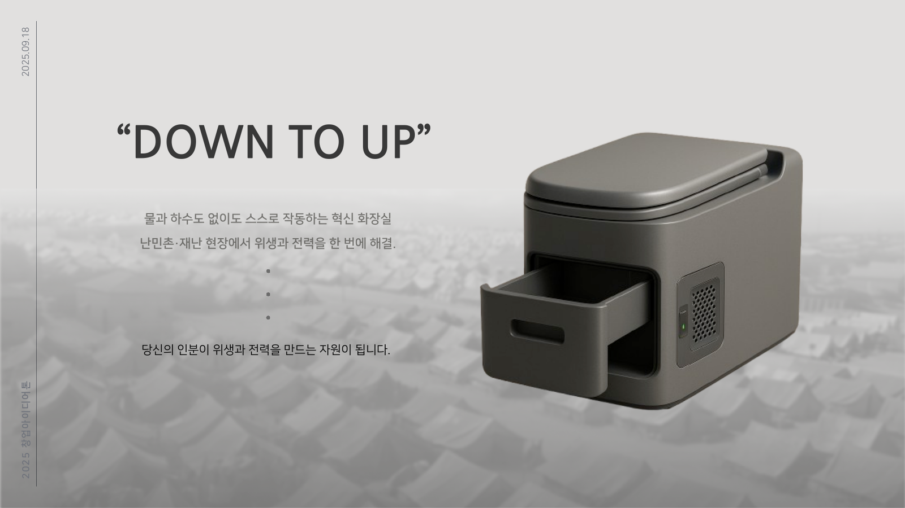
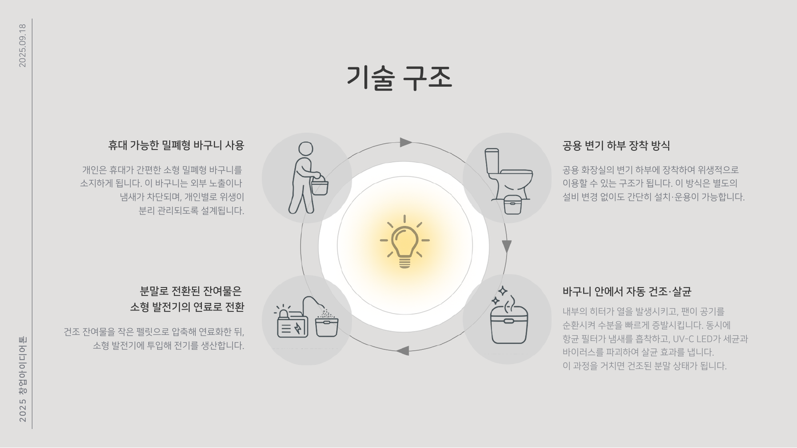
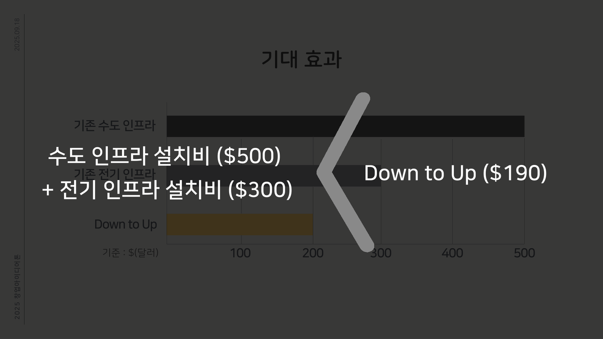
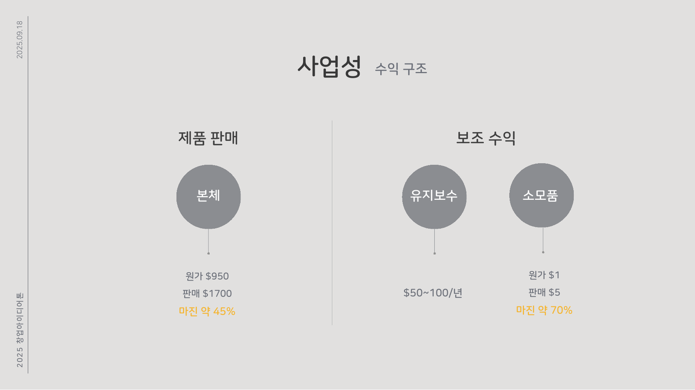

## 한눈에 보기

| 항목 | 내용 |
| --- | --- |
| 활동 | 2025 홍익대학교 메이커랜드 창업아이디어 해커톤 (학술제), 2025.09.17 ~ 09.18 |
| 결과 | **참여상** |
| 팀 | 9조 "순살제조기", 4명 (리더, 기획, 디자인, 발표) |
| 내 역할 | **아이디어 기획과 전체 전략 구성**: 문제 정의, 근거 자료 조사, 해결 구조, 발표 흐름 |
| 아이디어 | Down To Up, 물과 하수도 없이 스스로 작동하는 발전형 화장실 |
| 슬로건 | Bright Yourself, "깨끗한 화장실이자 작은 발전소" |

_발표 자료: 제품 콘셉트_

---

## 1. 문제 정의

이틀 동안 아이디어를 내야 하는 해커톤이라 "무엇을 만들까"보다 **"누구의 어떤 문제를 풀까"**를 먼저 정했음. 대상은 물, 하수도, 전기 인프라가 모두 부족한 **난민촌과 재난 현장**.

| 문제 | 조사한 근거 |
| --- | --- |
| 에너지 부족 | 2023년 세계 인구의 92%가 전기를 쓰지만 약 6억 6,600만 명은 여전히 전기를 쓰지 못함(그중 5억 6,500만 명이 사하라 이남 아프리카) |
| 물 부족, 하수도 | 가정 오수의 44%가 안전하게 처리되지 않고 방출됨. 가정 물 사용의 약 27%가 변기(미국 EPA) |
| 질병 확산 | 깨끗한 물, 화장실, 손 씻기 시설 부족으로 매년 약 100만 명이 설사병으로 사망(WHO) |
| 사회, 경제 | 약 1억 7천만 명은 기본적인 위생 시설조차 없음(UN) |
| 자원 잠재력 | 건조된 배설물 1 kg의 에너지는 19 ~ 22 MJ로 목재와 비슷함 |

네 가지 문제가 **같은 장소(인프라가 없는 곳)**에서 동시에 일어난다는 점을 연결해, 한 제품으로 위생과 에너지를 함께 해결한다는 방향을 잡았음.

---

## 2. 해결 구조

_발표 자료: 기술 구조_

| 단계 | 내용 | 해결하는 문제 |
| --- | --- | --- |
| 개인 바구니 | 냄새가 새지 않는 밀폐형, 개인별 위생 관리 | 감염 확산 |
| 하부 장착 | 기존 공용 변기 아래에 끼우기만 하면 됨 | 설치 비용, 인프라 |
| 건조, 살균 | 히터와 팬으로 수분 증발, 항균 필터로 냄새 흡착, UV-C로 세균, 바이러스 제거 | 물 사용, 하수도, 질병 |
| 연료화 | 분말을 펠릿으로 압축해 소형 발전기 연료로 | 에너지 부족 |

---

## 3. 기대 효과와 사업성

_발표 자료: 기존 인프라와 설치 비용 비교_

| 비교 | 비용 (팀 추정) |
| --- | --- |
| 기존 방식 | 수도 인프라 설치 약 500달러 + 전기 인프라 약 300달러 |
| Down To Up | 약 190달러 |

_발표 자료: 수익 구조_

| 수익원 | 원가 | 판매가 | 마진 |
| --- | --- | --- | --- |
| 본체 | 950달러 | 1,700달러 | 약 45% |
| 유지보수 | – | 연 50 ~ 100달러 | – |
| 소모품 (필터 등) | 1달러 | 5달러 | 발표 자료 70% (계산상 80%) |

- 패널에서 꼽은 적용 대상은 **난민촌, 재난 현장, 군부대**. 개인이 아니라 이런 시설을 운영하는 기관이 구매하는 구조
- 한 번 판매하고 끝나는 구조가 아니라 소모품과 유지보수로 반복 수익을 얻는 구조
- 발표 마지막 장의 FINANCE 항목은 1억 원

---

## 4. 내가 한 일

기획 담당으로, 다른 팀원이 디자인과 발표를 진행할 수 있도록 **무엇을, 왜, 어떻게**를 먼저 정하는 일을 맡았음.

| 단계 | 한 일 |
| --- | --- |
| 주제 선정 | 초빙 강연 뒤 대상을 "난민촌과 재난 현장"으로 좁히고, 에너지, 물, 질병, 위생 불평등 네 문제를 한 제품으로 묶는 방향 제안 |
| 근거 조사 | WHO, UN, 미국 EPA 등의 통계를 찾아 출처와 함께 문제정의 문서로 정리 (1절 표) |
| 해결 구조 | 밀폐형 바구니 → 건조, 살균 → 펠릿 연료화 → 소형 발전의 순환 구조와 단계별 해결 문제 정리 (2절) |
| 발표 흐름 | 제안 배경, 해결 방법, 제품 소개, 기술 구조 순서의 발표 대본 초안 작성 |
| 전략 | 구매 주체를 개인이 아닌 기관으로 두고, 본체 판매와 소모품, 유지보수 반복 수익을 합친 사업 구조를 팀과 함께 정리 |

## 5. 얻은 것

- **문제를 숫자로 보여 주기**: 제안 배경을 "화장실이 부족하다"가 아니라 6억 6,600만, 44%, 100만처럼 출처 있는 숫자로 정리해 발표 대본의 뼈대로 썼음. 숫자마다 출처를 남겨 두어 질문에 대비함
- **아이디어를 한 문장으로 줄이기**: "물 없이 작동하는 발전형 화장실"이라는 문장이 정해지자 디자인과 발표가 빨라졌음
- **역할 분담의 순서**: 리더가 진행을 잡고, 기획(나)이 문제와 구조를 정하면, 디자이너가 그 구조를 그림으로 바꾸고, 발표자가 대본으로 옮기는 흐름. 기획이 정해져야 뒤가 움직이는 구조라 문제 정의를 빨리 끝내는 것이 중요했음
- **평균이 아닌 특정한 사람의 문제**: 초빙 강연에서 "AI는 여러 결과 중 가장 가능성이 높은 값, 즉 평균값을 답으로 고른다"는 말을 듣고, 특정한 사람의 문제에서 출발해야 새로운 아이디어가 나온다고 받아들였음. 대상을 난민촌으로 좁힌 이유
- **개발 없는 문제 해결**: 처음 참가한 창업 해커톤이었고, 코드를 짜는 대신 "이 문제가 정말 존재하는가"를 자료로 증명하는 일이 생각보다 훨씬 많은 시간을 차지했음
- **부족했던 것**: 참여상으로 마무리했고, 아이디어의 의미는 충분히 설명했지만 실현 가능성(시제품, 에너지 계산, 현장 검증)을 보여 주는 자료가 부족했음. 이 부분을 6절에서 다시 따져 봄

## 6. 다시 따져 본 개선 사항

블로그에 정리하며 발표 숫자를 다시 계산해 봤음.

### 발전량은 얼마나 될까 (보충, 추정)

사람 한 명이 하루에 내는 배설물의 건조 무게를 약 30 g, 에너지 밀도를 20 MJ/kg로 잡으면

- 하루 열에너지: 0.03 kg × 20 MJ/kg = 0.6 MJ ≈ **0.17 kWh**
- 소형 발전기의 효율을 10 ~ 25%로 잡으면 전기로는 하루 약 **17 ~ 40 Wh**
- 3 W LED 전등을 6 ~ 13시간 켤 수 있는 양. 건조에 쓰는 히터 전력을 빼면 더 줄어듦

"작은 발전소"라는 표현보다 **"조명 정도를 스스로 해결하는 화장실"**이 정확한 기대치였음. 건조에 필요한 에너지가 만들어지는 에너지보다 클 수도 있다는 점은 발표 때 다루지 못했음.

| 개선 사항 | 내용 |
| --- | --- |
| 에너지 수지 | 건조, 살균에 쓰는 전력과 발전량을 같은 표에 놓고, 부족분은 태양광 패널로 보완하는 구조 |
| 비용 근거 | 190달러와 950달러(원가)가 서로 다른 기준이라 헷갈림. 설치비, 1인당 연간 비용처럼 기준을 통일 |
| 마진 계산 | 소모품 마진은 (5 − 1) / 5 = 80%. 발표 자료의 70%와 다름 |
| 사용자 검증 | 실제 구호 현장의 위생 담당자나 NGO 인터뷰로 "바구니를 개인이 들고 다니는 방식"이 현실적인지 확인 |
| 경쟁 비교 | 이미 쓰이는 컨테이너형 건식 화장실, 바이오가스 화장실과 비교해 차별점을 분명히 |
| 시제품 | 히터, 팬, UV-C LED를 아두이노로 묶은 최소 시제품으로 건조 시간 측정 |

---

## 핵심 정리

1. Down To Up은 2025 메이커랜드 창업아이디어 해커톤에서 4인 팀으로 제안해 참여상을 받은 물 없는 발전형 화장실 아이디어
2. 나는 아이디어 기획과 전체 전략, 즉 문제 정의와 근거 조사, 해결 구조, 발표 흐름을 맡았음
3. 대상을 난민촌과 재난 현장으로 좁히고 에너지, 하수도, 질병, 위생 불평등 네 문제를 한 제품으로 연결함
4. 밀폐형 바구니 → 건조, 살균 → 펠릿 연료화 → 소형 발전의 순환 구조
5. 사업성은 본체 판매(마진 약 45%)에 소모품과 유지보수의 반복 수익을 더하는 구조
6. 문제를 출처 있는 숫자로 제시하는 것과 아이디어를 한 문장으로 줄이는 것이 기획에서 가장 중요했음
7. 다시 계산해 보니 1인당 발전량은 하루 약 17 ~ 40 Wh로 조명 수준이며, 건조 에너지와의 수지를 따져야 함
8. 다음에는 에너지 수지, 통일된 비용 기준, 현장 사용자 검증, 최소 시제품으로 실현 가능성을 보여 주고 싶음

---

End.
