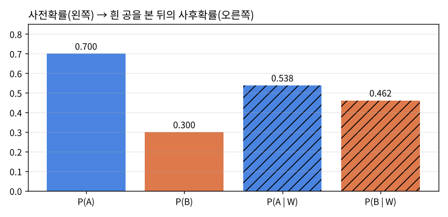

## 학습 목표

- 머신러닝에서 확률이 필요한 이유(불확실성)
- 사전확률, 가능도, 증거, 사후확률의 의미
- 조건부 확률 정의에서 베이즈 정리 유도
- 최소 오류 베이즈 분류기: 사후확률이 가장 큰 부류를 고르는 이유
- 과제 1(상자 문제)을 손풀이와 Python으로 검증
- 강의 예제(Z-바이러스, 과일, 카드, 스팸)와 베이즈 추론의 한계

---

## 1. 왜 확률인가

강의(3장)에서 든 불확실성의 원인

- **데이터**: 센서 측정 오류
- **지식**: 전문가 지식이 불완전하거나 문제 자체가 불확실(주식, 부동산)
- **관점**: 전문가마다 의견이 다름
- **정보 획득**: 모든 정보를 모을 수 없음
- **언어**: 자연어의 모호함

"감기이면 열이 난다" 같은 규칙도 100% 참이 아니다. 그래서 명제를 참/거짓 대신 **0~1 사이의 확률**로 다루고, 가장 확률이 높은 결론을 고른다.

---

## 2. 베이즈 정리

### 유도

> **(중요!!)** 베이즈 정리 유도 과정 (출제 표시)
{: .prompt-warning }

① 조건부 확률의 정의

$$P(A \mid B) = \frac{P(A \cap B)}{P(B)}, \qquad P(B \mid A) = \frac{P(A \cap B)}{P(A)}$$

② 두 식에서 결합확률을 꺼내면 같은 값이다

$$P(A \cap B) = P(A \mid B)P(B) = P(B \mid A)P(A)$$

③ 양변을 P(B)로 나누면

$$P(A \mid B) = \frac{P(B \mid A)P(A)}{P(B)}$$

④ 분류 문제의 기호(부류 w, 특징 x)로 바꾸면

$$P(w \mid x) = \frac{P(x \mid w)P(w)}{P(x)}$$

| 항 | 이름 | 뜻 |
| --- | --- | --- |
| P(w) | 사전확률(prior) | 데이터를 보기 전에 부류 w일 확률 |
| P(x \| w) | 가능도(likelihood) | 부류가 w일 때 특징 x가 나올 확률 |
| P(x) | 증거(evidence) | 모든 부류에 대해 더한 x의 확률 (정규화 상수) |
| P(w \| x) | 사후확률(posterior) | x를 관찰한 뒤 부류가 w일 확률 |

### 최소 오류 베이즈 분류기

- 규칙: **사후확률이 가장 큰 부류를 고른다**
- 이렇게 고르면 틀릴 확률(1 − 고른 부류의 사후확률)이 가장 작아지므로 오류 확률이 최소다
- 분모 P(x)는 모든 부류에 똑같이 들어가서 비교할 때는 분자 `P(x | w) P(w)`만 봐도 된다
- 사전확률이 모두 같으면 가능도만 비교하면 된다

베이지언 분류의 장점(노트): 결과가 확률이라 **예측의 불확실성(오차)을 수치로 계산하고 그림으로 보여 줄 수 있다.**

---

## 3. 과제 1: 상자 문제

> **과제 1**: 주머니에 상자 표가 A 7장, B 3장 들어 있다. A 상자에는 흰 공 2개·파란 공 8개, B 상자에는 흰 공 6개·파란 공 9개가 있다. 표를 뽑아 해당 상자에서 공을 하나 꺼냈더니 흰 공이었다. (1) P(A), `P(W | A)`, P(A, W), P(W)를 구하고 어느 상자에서 나왔을지 답하라. (2) 영수의 답이 왜 틀렸는지 설명하라. (3) Python으로 사후확률을 검증하라. (4) 베이즈 정리를 3줄로 요약하라.
{: .prompt-info }

대화 속 주장

- 철수: `P(A | W)`, `P(B | W)`를 비교해야지. 7/13, 6/13이니까 A!
- 영수: P(A), P(B)만 비교해서 큰 쪽(A)이야 → **틀림**

### 손풀이

| 값 | 계산 | 결과 |
| --- | --- | --- |
| P(A) | 7 / 10 | 0.7 |
| P(W \| A) | 2 / 10 | 0.2 |
| P(A, W) | 0.7 × 0.2 | 0.14 |
| P(B, W) | 0.3 × 6/15 = 0.3 × 0.4 | 0.12 |
| P(W) | 0.14 + 0.12 (전확률) | 0.26 |
| P(A \| W) | 0.14 / 0.26 | 7/13 ≈ 0.538 |
| P(B \| W) | 0.12 / 0.26 | 6/13 ≈ 0.462 |

### 영수가 틀린 이유

- 영수는 **사전확률**만 봤다. "흰 공이 나왔다"는 증거를 반영하지 않았다
- 이번 문제에서는 답(A)이 우연히 같지만, **이유가 틀렸다.** B 상자는 흰 공 비율(0.4)이 A(0.2)의 두 배라서 증거가 B 쪽을 지지한다. 그 효과가 사전확률 차이(0.7 vs 0.3)를 다 뒤집을 만큼 크지 않았을 뿐이다
- 예를 들어 B 상자의 흰 공이 15개 중 12개(0.8)라면 P(B, W) = 0.24 > P(A, W) = 0.14가 되어 답이 B로 바뀐다. 사전확률만 보는 방법은 이런 경우를 못 잡는다



### Python 검증 코드

```python
# 확률 정의 (사전확률, 조건부확률)
pA, pB = 0.7, 0.3             # P(A), P(B)
pW_A, pW_B = 2/10, 6/15       # P(W|A), P(W|B)

# 전확률 (Evidence)
pW = pA * pW_A + pB * pW_B    # P(W)

# 사후확률 (Posterior, Bayes' theorem)
pA_given_W = (pA * pW_A) / pW # P(A|W)
pB_given_W = (pB * pW_B) / pW # P(B|W)

print("1) P(A)      = %.2f" % pA)
print("2) P(W|A)    = %.2f" % pW_A)
print("3) P(A,W)    = %.2f" % (pA * pW_A))
print("4) P(W)      = %.2f" % pW)
print("5) P(A|W)    = %.3f" % pA_given_W)
print("6) P(B|W)    = %.3f" % pB_given_W)

if pA_given_W > pB_given_W:
    print(f"→ 결론: A 상자일 확률이 더 높음 ({pA_given_W*100:.1f}%)")
else:
    print(f"→ 결론: B 상자일 확률이 더 높음 ({pB_given_W*100:.1f}%)")
```

실행 결과

```text
1) P(A)      = 0.70
2) P(W|A)    = 0.20
3) P(A,W)    = 0.14
4) P(W)      = 0.26
5) P(A|W)    = 0.538
6) P(B|W)    = 0.462
→ 결론: A 상자일 확률이 더 높음 (53.8%)
```

`fractions.Fraction`으로 다시 계산하면 `P(A | W)`가 정확히 **7/13**이라 철수의 말과 같다.

### 베이즈 정리 3줄 요약 (제출)

1. 베이즈 정리는 새로운 증거가 주어졌을 때 확률을 갱신하는 방법이다
2. 사후확률 = 사전확률 × 가능도 ÷ 증거(전체 확률)
3. 관찰한 데이터에 비추어 가장 그럴듯한 가설을 고를 수 있다

---

## 4. 강의 예제 (3장 Lab)

모두 Python으로 다시 계산했다.

### Z-바이러스 (진단 검사)

인구의 10%가 감염, 감염자는 90% 양성, 비감염자는 70% 음성(= 30% 위양성). 양성이 나왔을 때 실제 감염일 확률은?

$$P(Z \mid +) = \frac{0.9 \times 0.1}{0.9 \times 0.1 + 0.3 \times 0.9} = \frac{0.09}{0.36} = 0.25$$

- 검사가 90% 정확해도 양성 판정의 75%는 **위양성**이다. 감염자 자체가 적기(사전확률 10%) 때문
- 위양성이 0이면 분모의 두 번째 항이 사라져 100%가 된다

### 과일 문제

그릇 1: 사과 10, 바나나 30 / 그릇 2: 사과 20, 바나나 20. 그릇을 무작위로 고르고 과일을 꺼냈더니 바나나였다.

$$P(1 \mid \mathrm{banana}) = \frac{0.75 \times 0.5}{0.75 \times 0.5 + 0.5 \times 0.5} = 0.6$$

### 카드

얼굴 카드(J, Q, K) 12장 중 킹은 4장이므로 `P(King | Face)` = 4/12 = 1/3. 베이즈 식으로도 `P(Face | King)` = 1, P(King) = 4/52, P(Face) = 12/52를 넣으면 같은 값이다.

### 스팸 필터

메일의 40%가 스팸, 특정 단어가 제목에 나올 확률은 스팸 1%, 정상 0.4%.

$$P(\mathrm{spam} \mid \mathrm{word}) = \frac{0.01 \times 0.4}{0.01 \times 0.4 + 0.004 \times 0.6} = 0.625$$

---

## 5. 베이즈 추론의 한계와 확신도

- 베이즈 추론은 사전확률, 가능도 같은 값이 **정확히 주어져야** 한다
- 의학처럼 믿을 만한 통계를 얻기 어려운 분야도 있다
- 대안: **확신도(Certainty Factor) 이론**. 확률 대신 전문가가 주는 확신도로 "IF 증거 THEN 가설"의 신뢰도를 계산한다. 박테리아 감염 진단 전문가 시스템 **MYCIN**에서 사용

### 토마스 베이즈

- 영국의 목사이자 수학자(1701년 무렵 ~ 1761). 에든버러 대학에서 논리학과 신학을 공부
- 사후에 친구 **리처드 프라이스**가 유고를 정리해 1763년 왕립학회에 발표했고, 이 "역확률" 논문이 베이즈 정리의 출발점
- 탄생 300주년에 맞춰 Bellhouse(2004)가 그의 생애를 정리한 논문을 냈다

---

### 강의 자료 및 정리 노트에서 정정한 부분 정리

| 위치 | 원래 | 정정 | 이유 |
| --- | --- | --- | --- |
| 3장 "베이즈 정리와 추론" | p(E \| H)를 "사후 확률"로 표기 | **가능도(likelihood)** | 가설을 조건으로 한 증거의 확률. 사후확률은 P(H \| E) |
| 3장 "증거와 가설이 여러 개일 때" | 감기(H1), 폐렴(H1) | 폐렴은 H2 | 서로 다른 가설 |
| 시험 대비 노트 | Price가 1764년 출판 | 1763년 왕립학회 발표(학회지는 1763년 권) | 발표 연도 |
| 과제 1 결론 | 영수의 답이 틀렸다 | 영수의 **방법**이 틀렸고 답은 우연히 같음 | 숫자를 바꾸면 결론이 뒤집히는 예로 확인 |

---

## 최종 핵심 정리

1. 머신러닝은 센서·지식·언어의 불확실성을 다루므로 명제를 0~1의 확률로 표현한다
2. 결합확률을 두 가지로 쓴 `P(B | A)`P(A) = `P(A | B)`P(B)에서 베이즈 정리가 나온다
3. 사후확률 = 가능도 × 사전확률 ÷ 증거, 비교할 때는 분모를 생략해도 된다
4. 사후확률이 가장 큰 부류를 고르는 최소 오류 베이즈 분류기는 오류 확률을 최소로 만든다
5. 과제 1에서 P(W) = 0.26, `P(A | W)` = 7/13 ≈ 0.538, `P(B | W)` = 6/13 ≈ 0.462
6. 사전확률만 비교하면 증거를 무시하게 되고, B의 흰 공 비율이 더 컸다면 결론이 바뀐다
7. Z-바이러스 검사는 양성이어도 감염 확률이 25%뿐이다. 사전확률이 낮으면 위양성이 대부분이 된다
8. 베이즈 추론은 정확한 확률이 필요하다는 한계가 있고, MYCIN은 대안으로 확신도를 사용했다

---

End.
