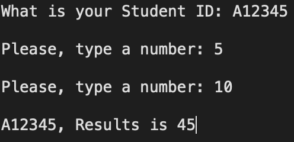

## 학습 목표

- MIPS 프로그램의 기본 구조(`.data`, `.text`, `main`) 이해
- `syscall`로 문자열·정수를 입력받고 출력하는 방법 (`$v0` 번호)
- `read_string`으로 받은 문자열 끝의 줄바꿈(`\n`)을 지우는 반복문 작성
- `add`, `mul`로 계산하고 결과를 레지스터 사이에서 옮기기
- 과제 1 코드를 SPIM으로 실행해 출력이 요구사항과 같은지 확인

---

## 1. 과제 내용

> **과제 1**: 학번을 묻고("What is your Student ID: "), 정수를 두 번 입력받은 뒤("Please, type a number: "), **(첫 번째 수 + 두 번째 수) × 3**을 "학번, Results is 결과" 형식으로 출력하라.
{: .prompt-info }

요구된 실행 예시는 아래와 같다. 5 + 10 = 15, 15 × 3 = 45

```text
What is your Student ID: A12345
Please, type a number: 5
Please, type a number: 10
A12345, Results is 45
```



---

## 2. 미리 알아 둘 것: syscall

MIPS 시뮬레이터(MARS, SPIM)는 `$v0`에 서비스 번호를 넣고 `syscall`을 실행하면 운영체제 기능을 대신 수행한다.

| `$v0` | 기능 | 인자 / 결과 |
| --- | --- | --- |
| 1 | 정수 출력 | `$a0` = 출력할 정수 |
| 4 | 문자열 출력 | `$a0` = 문자열 주소 (`\0`으로 끝나야 함) |
| 5 | 정수 입력 | 결과가 `$v0`에 들어옴 |
| 8 | 문자열 입력 | `$a0` = 버퍼 주소, `$a1` = 최대 길이 |
| 10 | 프로그램 종료 | 없음 |

- `li`(load immediate)는 상수를 레지스터에 바로 넣는 **의사 명령어**
- `la`(load address)는 라벨의 **주소**를 넣고, `lw`는 그 주소에 있는 **값**을 읽는다

---

## 3. 코드

```assembly
# 컴퓨터 구조 HW1 Mips 실습
# 작성자: 고영훈
# 날짜: 2025/09/20

.data
    prompt_1: .asciiz "What is your Student ID: "   # 출력할 문자열
    prompt_2: .asciiz "Please, type a number: "
    msg: .asciiz ", Results is "
    newline: .asciiz "\n"
    buffer: .space 20     # 문자열 입력 받을 버퍼(20바이트 크기)
    A: .word 3
.text

main:
    # 학번 입력 받기
    ## 질문 출력 
    li $v0, 4 # print string = 4
    la $a0, prompt_1
    syscall

    ## 학번 입력
    li $v0, 8 # read string
    la $a0, buffer # 입력할 위치
    li $a1, 20 # 최대 크기
    syscall

    # 줄바꿈(이미지와 비슷하게 작성)
    li $v0,4 
    la $a0,newline
    syscall

    # ==== 줄바꿈 제거 ====
    la $t2, buffer          # $t2 = buffer 시작 주소
    remove_loop:
        lb $t3, 0($t2)          # 현재 문자 읽기
        beq $t3, $zero, remove_done  # '\0' = 맨끝 만나면 종료
        beq $t3, 10, remove_newline  # '\n'(ASCII 10)이면 교체
        addi $t2, $t2, 1        # 다음 문자로 이동
        j remove_loop

    remove_newline:
        sb $zero, 0($t2)        # '\n' → '\0' 바꿈
    remove_done:

    # 두 개의 정수 입력
    # 질문 출력 
    li $v0, 4 # print string
    la $a0, prompt_2
    syscall

    # 정수0 입력
    li $v0, 5 # 5번이 정수를 입력받음(li는 바로 불러오기임)
    syscall
    move $t0, $v0 # 입력 받은 정수를 $t0에 넣음

    # 줄바꿈
    li $v0,4 
    la $a0,newline
    syscall

    # 질문 출력 
    li $v0, 4 # print string
    la $a0, prompt_2
    syscall

    # 정수1 입력
    li $v0, 5
    syscall
    move $t1, $v0

    # 정수 덧셈
    add $s0, $t0, $t1

    # 곱하기 3
    lw $t0, A
    mul $s1, $s0, $t0 # 최신 버전 기준

    # 줄바꿈
    li $v0,4 
    la $a0,newline
    syscall

    # 최종 출력
    # 학번 출력
    li $v0, 4
    la $a0, buffer
    syscall

    # ", Result is " 출력
    li $v0, 4
    la $a0, msg
    syscall

    # 결과값 출력
    li $v0, 1
    move $a0, $s1
    syscall
    

    # 코드 종료
    li $v0, 10
    syscall

# ======================== End ========================
```

### 흐름 정리

1. `prompt_1` 출력 → `syscall 8`로 학번을 `buffer`에 저장
2. `read_string`은 입력 끝의 **줄바꿈까지 버퍼에 넣는다.** 그대로 출력하면 "A12345" 다음 줄에 ", Results is"가 찍히므로, `remove_loop`가 버퍼를 한 글자씩 보며 ASCII 10(`\n`)을 `\0`으로 바꾼다
3. 정수 두 개를 `syscall 5`로 받아 `$t0`, `$t1`에 저장
4. `add $s0, $t0, $t1`로 더하고, 메모리의 상수 `A`(= 3)를 `lw`로 읽어 `mul`로 곱함
5. 학번 → ", Results is " → 결과 순서로 출력하고 `syscall 10`으로 종료

> `mul $s1, $s0, $t0`은 의사 명령어다. 어셈블러가 `mult $s0, $t0`(결과를 Hi, Lo에 저장) + `mflo $s1`로 바꿔 준다. 곱셈 결과가 32비트를 넘으면 상위 비트는 Hi에 남고 버려진다.
{: .prompt-tip }

---

## 4. 실행 결과 (SPIM)

컨테이너에서 SPIM 8.0으로 실행했다. SPIM은 입력을 화면에 다시 보여 주지 않으므로, 입력한 값은 프롬프트 뒤에 직접 적었다.

```text
What is your Student ID: A12345

Please, type a number: 5

Please, type a number: 10

A12345, Results is 45
```

- 결과 45는 요구사항과 같다
- 프롬프트 사이에 빈 줄이 하나씩 더 있는 이유: 입력할 때 누른 Enter의 줄바꿈 + 코드에서 출력하는 `newline`. 실행 예시 그림과 비슷하게 보이도록 넣은 것이라 채점 형식(문장)에는 영향이 없다

다른 입력으로도 확인했다.

| 입력 | 계산 | 출력 |
| --- | --- | --- |
| 5, 10 | (5 + 10) × 3 | 45 |
| −4, 1 | (−4 + 1) × 3 | −9 |
| 0, 0 | 0 | 0 |

---

## 5. 개선할 수 있는 점

- 상수 3은 메모리(`A: .word 3`)에 둘 필요 없이 `li $t0, 3` 한 줄이면 된다. `lw`는 메모리 접근이 한 번 더 생긴다
- `buffer`가 20바이트라 학번이 19글자를 넘으면 잘린다. 과제 범위에서는 문제없음
- `$s` 레지스터는 호출된 함수가 보존해야 하는 레지스터다. `main`만 있는 프로그램이라 상관없지만, 임시 값은 `$t`를 쓰는 습관이 좋다

---

### 강의 자료 및 정리 노트에서 정정한 부분 정리

| 위치 | 원래 | 정정 | 이유 |
| --- | --- | --- | --- |
| 이 글의 이전 버전 설명 | "두 수 사이 정수의 합" | (두 수의 합) × 3 | 과제 문서의 요구사항 3번. 5부터 10까지의 합도 우연히 45라 헷갈렸음 |
| 이전 버전 문제 설명 | 결과 식 없이 예시만 | 요구사항 4개를 모두 적음 | 다른 입력으로 검산할 수 있게 |

---

## 최종 핵심 정리

1. MIPS 프로그램은 데이터 영역 `.data`와 코드 영역 `.text`로 나뉘고, 실행은 `main` 라벨에서 시작한다
2. 입출력은 `$v0`에 서비스 번호를 넣고 `syscall`: 1 정수 출력, 4 문자열 출력, 5 정수 입력, 8 문자열 입력, 10 종료
3. 문자열 입력(8)은 끝의 줄바꿈까지 버퍼에 저장하므로, 그대로 출력하려면 `\n`을 `\0`으로 바꿔야 한다
4. `lb`/`sb`는 1바이트, `lw`/`sw`는 4바이트(word)를 읽고 쓴다
5. `li`, `la`, `move`, `mul`은 실제 명령어 여러 개로 바뀌는 의사 명령어다
6. `mul`의 실체는 `mult` + `mflo`이고, 64비트 곱셈 결과의 상위 32비트는 Hi 레지스터에 남는다
7. (5 + 10) × 3 = 45를 SPIM에서 그대로 얻었고, 음수 입력(−4, 1 → −9)도 맞게 계산된다
8. 상수는 메모리 대신 `li`로 넣는 편이 메모리 접근이 없어 더 간단하다

---

End.
