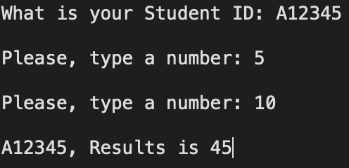

[toc]

# Computer_Architecture_HW1

## 문제

```markdown
What is your Student ID: A12345
Please, type a number: 5
Please, type a number: 10
A12345, Results is 45
```

- 위의 결과와 똑같이 나오게 `assembly` 프로그래밍을 수행하시오

---

## 정답

```assembly
.data
    prompt_1: .asciiz "What is your Student ID: "   # 출력할 문자열
    prompt_2: .asciiz "Please, type a number: "
    msg: .asciiz ", Results is "
    newline: .asciiz "\n"
    buffer: .space 20     # 문자열 입력 받을 버퍼(20바이트 크기)
    A: .word 3
.text

main:
    # 학번 입력 받기
    ## 질문 출력 
    li $v0, 4 # print string = 4
    la $a0, prompt_1
    syscall

    ## 학번 입력
    li $v0, 8 # read string
    la $a0, buffer # 입력할 위치
    li $a1, 20 # 최대 크기
    syscall

    # 줄바꿈(이미지와 비슷하게 작성)
    li $v0,4 
    la $a0,newline
    syscall

    # ==== 줄바꿈 제거 ====
    la $t2, buffer          # $t2 = buffer 시작 주소
    remove_loop:
        lb $t3, 0($t2)          # 현재 문자 읽기
        beq $t3, $zero, remove_done  # '\0' = 맨끝 만나면 종료
        beq $t3, 10, remove_newline  # '\n'(ASCII 10)이면 교체
        addi $t2, $t2, 1        # 다음 문자로 이동
        j remove_loop

    remove_newline:
        sb $zero, 0($t2)        # '\n' → '\0' 바꿈
    remove_done:

    # 두 개의 정수 입력
    # 질문 출력 
    li $v0, 4 # print string
    la $a0, prompt_2
    syscall

    # 정수0 입력
    li $v0, 5 # 5번이 정수를 입력받음(li는 바로 불러오기임)
    syscall
    move $t0, $v0 # 입력 받은 정수를 $t0에 넣음

    # 줄바꿈
    li $v0,4 
    la $a0,newline
    syscall

    # 질문 출력 
    li $v0, 4 # print string
    la $a0, prompt_2
    syscall

    # 정수1 입력
    li $v0, 5
    syscall
    move $t1, $v0

    # 정수 덧셈
    add $s0, $t0, $t1

    # 곱하기 3
    lw $t0, A
    mul $s1, $s0, $t0 # 최신 버전 기준

    # 줄바꿈
    li $v0,4 
    la $a0,newline
    syscall

    # 최종 출력
    # 학번 출력
    li $v0, 4
    la $a0, buffer
    syscall

    # ", Result is " 출력
    li $v0, 4
    la $a0, msg
    syscall

    # 결과값 출력
    li $v0, 1
    move $a0, $s1
    syscall
    

    # 코드 종료
    li $v0, 10
    syscall

# ======================== End ========================

```

---

## 결과



---

End.
