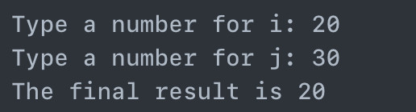

[toc]

# Computer Architecture HW2

## 문제

```c
int leaf_example (int g, int h, int i, int j) {
  int f;
  f = g – (h * i) - j;
  
  return f;
}
```

```markdown
Type a number for i: 20
Type a number for j: 30
The final result is 20
```

- leaf_example을  MIPS 프로그램으로 변경하라
- 위의 결과와 동일하게 출력하라

---

## 정답

```assembly
.data
    prompt_i: .asciiz "Type a number for i: "   # j를 입력 받을 때 출력할 문자열
    prompt_j: .asciiz "Type a number for j: "   # j를 입력 받을 때 출력할 문자열
    rst_1: .asciiz "The final result of "
    stdnt_id: .asciiz "A12345"               # 학번
    rst_2: .asciiz " is "
    newline: .asciiz "\n"
    buffer: .space 20     # 문자열 입력 받을 버퍼(20바이트 크기)
    g_val: .word 150
    h_val: .word 5

.text

main:
    # 두 개의 정수 i, j 입력
    # 질문 출력 
    li $v0, 4 # print string
    la $a0, prompt_i
    syscall

    # 정수i 입력
    li $v0, 5 # 5번이 정수를 입력받음(li는 바로 불러오기임)
    syscall
    move $t0, $v0 # 입력 받은 정수를 $t0에 넣음

    # 줄바꿈
    li $v0,4 
    la $a0,newline
    syscall

    # 질문 출력 
    li $v0, 4
    la $a0, prompt_j
    syscall

    # 정수j 입력
    li $v0, 5
    syscall
    move $t1, $v0

    # 인자 전달 -- 이걸 안 해서 계속 틀렸었음
    lw $a0, g_val      # g
    lw $a1, h_val      # h
    move $a2, $t0      # i
    move $a3, $t1      # j

    # leaf_example 함수 호출
    jal leaf_example
    move $s0, $v0 # leaf_example 함수의 반환값을 $s0에 저장

    # 줄바꿈
    li $v0,4 
    la $a0,newline
    syscall

    # 결과 출력
    ## "The final result of " 출력
    li $v0, 4
    la $a0, rst_1
    syscall

    ## 학번 출력
    li $v0, 4
    la $a0, stdnt_id
    syscall

    ## " is " 출력
    li $v0, 4
    la $a0, rst_2
    syscall

    ## 결과값 출력
    li $v0, 1 # print integer
    move $a0, $s0
    syscall 

    # 코드 종료
    li $v0, 10 # exit
    syscall


# ======================== Functions ========================

leaf_example:
    # 변수 백업
    addi $sp, $sp, -12
    sw $t1, 8($sp)
    sw $t0, 4($sp)
    sw $s0, 0($sp)
    
    # f값 계산
    mul $t1, $a1, $a2 # h * i
    sub $t0, $a0, $t1 # g - (h * i)
    sub $s0, $t0, $a3 # f = g - (h * i) - j

    # 결과 저장
    move $v0, $s0

    # 변수 복원
    lw $t1, 8($sp)
    lw $t0, 4($sp)
    lw $s0, 0($sp)
    addi $sp, $sp, 12

    # 복귀
    jr $ra

# ======================== Functions ========================


# ======================== End ========================

```

---

## 결과

`

---

End.
