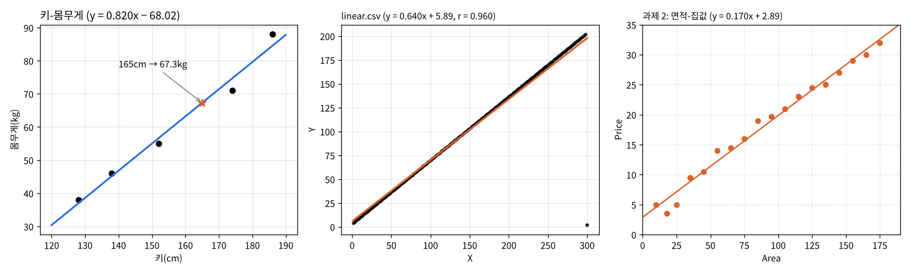

## 학습 목표

- 지도·비지도·강화 학습의 차이
- 회귀와 분류를 데이터 분포로 구분하기
- 선형 회귀 모델 f(x) = Wx + b와 손실 함수(평균 제곱 오차)
- 최소제곱법과 경사하강법으로 W, b 구하기
- sklearn `LinearRegression` 사용법(입력은 2차원 배열)
- 실습 코드와 과제 2를 다시 실행해 결과 해석
- 과잉 적합과 과소 적합

---

## 1. 머신러닝의 종류

| 종류 | 데이터 | 목표 | 예 |
| --- | --- | --- | --- |
| 지도 학습 | 입력 x와 정답(레이블) y | x → y 함수 학습 | 회귀, 분류 |
| 비지도 학습 | 입력 x만 | 데이터 속 구조 찾기 | 군집화(K-means) |
| 강화 학습 | 행동에 대한 보상 | 보상을 최대로 하는 행동 학습 | 알파고, 게임 |

- 지도와 비지도의 차이는 **교사(정답)의 유무**
- 샘플 = 입력 x, 레이블 = 정답 y. 학습은 (x, y)로 모델을 만드는 것, 예측은 레이블 없는 x에 모델을 적용하는 것
- 학습 데이터로 만든 모델은 **처음 보는 테스트 데이터**로 평가해야 일반화 성능을 알 수 있다

### 회귀 vs 분류

> **(중요!!)** 산점도를 보고 회귀와 분류 중 무엇을 써야 하는지 고르는 문제 (출제 표시)
{: .prompt-warning }

| 항목 | 회귀 | 분류 |
| --- | --- | --- |
| 출력 | **연속적인 실수** | **이산적인 부류** |
| 예 | 키 → 몸무게, 면적 → 집값 | 스팸/정상, 개/고양이 |
| 그래프에서 | 점들을 지나는 선을 찾음 | 부류를 나누는 경계를 찾음 |

판단 기준은 입력이 아니라 **출력(y)** 이다. y가 숫자로 연속적이면 회귀, 몇 개 부류 중 하나면 분류.

---

## 2. 선형 회귀

$$f(x) = Wx + b$$

- W: 가중치(기울기), b: 바이어스(절편)
- 데이터를 가장 잘 설명하는 W, b를 찾는 문제

### 손실 함수

> **(중요!!)** 손실 함수는 **최소화**한다. "손실 함수는 최대화하는 것이 목적이다"는 X (O/X 출제)
{: .prompt-warning }

$$L(W, b) = \frac{1}{n}\sum_{i=1}^{n}\big(y_i - (Wx_i + b)\big)^2$$

- 직선과 데이터 사이의 간격을 **제곱해서** 더한다(L2). 제곱하면 위·아래 방향과 상관없이 거리 크기만 보고, 큰 오차를 더 크게 벌준다
- 손실 함수 = 비용 함수 = 목적 함수(objective function)라고도 부른다

### 최소 손실을 찾는 두 방법

| 방법 | 내용 |
| --- | --- |
| 최소제곱법(분석적) | 미분 = 0을 풀어 공식으로 바로 계산 |
| 경사하강법(반복적) | 기울기 반대 방향으로 조금씩 이동 |

단순 선형 회귀의 최소제곱 해는

$$W = \frac{\sum (x_i - \bar{x})(y_i - \bar{y})}{\sum (x_i - \bar{x})^2}, \qquad b = \bar{y} - W\bar{x}$$

경사하강법 업데이트(강의 코드)

$$W \leftarrow W - \eta \cdot \frac{2}{n}\sum x_i(\hat{y}_i - y_i), \qquad b \leftarrow b - \eta \cdot \frac{2}{n}\sum (\hat{y}_i - y_i)$$

강의 예제 X = [0, 1, 2], y = [3, 3.5, 5.5]에 학습률 0.01, 1000번을 돌리면 W = 1.2532, b = 2.7455가 나오고, 최소제곱 해(W = 1.25, b = 2.75)에 거의 도달한다.

---

## 3. sklearn으로 선형 회귀

```python
from sklearn import linear_model

reg = linear_model.LinearRegression()
X = [[0], [1], [2]]        # 반드시 2차원 (샘플 수, 특징 수)
y = [3, 3.5, 5.5]
reg.fit(X, y)

print(reg.coef_, reg.intercept_)
print(reg.score(X, y))      # 결정계수 R^2
print(reg.predict([[5]]))
```

실행 결과

```text
[1.25] 2.7500000000000004
0.8928571428571429
[9.]
```

- X를 `[0, 1, 2]`처럼 1차원으로 주면 오류가 난다. 특징이 하나여도 `[[0], [1], [2]]` 또는 `x.reshape(-1, 1)`
- x = 5에서 1.25 × 5 + 2.75 = **9.0**. 강의 자료에는 `array([8.])`로 적혀 있어 정정 표에 남겼다

### 키-몸무게 예제

```python
X = [[174], [152], [138], [128], [186]]
y = [71, 55, 46, 38, 88]
reg = linear_model.LinearRegression().fit(X, y)
print(reg.predict([[165]]))
```

실행 결과

```text
[67.30998637]
```

- 학습된 직선은 몸무게 = 0.820 × 키 − 68.02, R² = 0.981
- 키 165cm → 약 67.3kg



### 당뇨병 데이터

```python
import numpy as np
from sklearn import datasets
from sklearn.model_selection import train_test_split

diabetes_X, diabetes_y = datasets.load_diabetes(return_X_y=True)
diabetes_X_new = diabetes_X[:, np.newaxis, 2]     # 2번 특징만 사용

X_train, X_test, y_train, y_test = train_test_split(
    diabetes_X_new, diabetes_y, test_size=0.1, random_state=0)
regr = linear_model.LinearRegression().fit(X_train, y_train)
```

다시 실행해서 테스트 데이터 45개로 평가한 결과

| 지표 | 값 |
| --- | --- |
| 기울기 | 966.7 |
| 절편 | 151.2 |
| 테스트 R² | 0.191 |
| 테스트 RMSE | 62.6 |

- 2번 특징은 `feature_names`로 확인하면 **bmi(체질량지수)** 다. 실습 코드 주석의 "혈청 지질 수치"는 s1~s6 쪽이라 정정했다
- 특징 하나로는 R²가 0.19라 설명력이 낮다. 특징을 모두 쓰는 다중 회귀가 필요하다
- `np.newaxis`가 2차원 모양 (442, 1)을 만들어 주는 역할

---

## 4. 실습: linear.csv

`scipy.stats.linregress`는 기울기, 절편, 상관계수 r, p값, 표준오차를 한 번에 돌려준다.

```python
import pandas as pd
from scipy import stats

f = pd.read_csv('linear.csv')
x = f.iloc[:, 0]
y = f.iloc[:, 1]
slope, intercept, r_val, p_val, std_error = stats.linregress(x, y)
print("회귀 함수: y = {:.3f}x + {:.3f}".format(slope, intercept))
```

실행 결과

```text
회귀 함수: y = 0.640x + 5.889
```

데이터를 살펴보니 300개 중 298개가 **정확히 y = (2/3)x + 3.22** 위에 있고, 마지막 두 점(X = 299, 300)만 y = 1.89로 뚝 떨어져 있다(가운데 그림의 오른쪽 아래 점).

| 데이터 | 기울기 | 절편 | 상관계수 r |
| --- | --- | --- | --- |
| 300개 전체 | 0.640 | 5.889 | 0.960 |
| 이상치 2개 제외 | 0.667 | 3.222 | 1.000 |

- 점 두 개가 기울기와 r을 눈에 띄게 바꿨다. 제곱 오차는 큰 오차를 크게 벌주기 때문에 **선형 회귀는 이상치에 민감**하다
- 회귀 전에 산점도를 먼저 그려 보는 이유

### 정규화하면 기울기 = 상관계수

`simpleRegression.py`는 데이터를 표준화(평균 0, 표준편차 1)한 뒤 최소제곱 공식을 for 문으로 직접 계산한다.

```python
data = (data - data.mean()) / data.std()
X = data['X'].values
Y = data['Y'].values

numerator = 0
denominator = 0
for i in range(len(X)):
    numerator += (X[i] - np.mean(X)) * (Y[i] - np.mean(Y))
    denominator += (X[i] - np.mean(X)) ** 2
slope = numerator / denominator
intercept = np.mean(Y) - slope * np.mean(X)
```

실행 결과

```text
SLOPE : 0.9598758089102876
INTERCEPT : 1.8567673586842067e-16
RMSE : 0.2799576813804624
```

- 기울기 0.9599가 위의 상관계수 r = 0.9599와 **같다.** 표준화하면 x, y의 표준편차가 모두 1이라 W = r × (s_y / s_x) = r이 되기 때문
- 절편은 사실상 0(1.9 × 10^-16, 부동소수점 오차). 두 변수의 평균이 0이니 직선이 원점을 지난다
- 그래서 이 코드의 기울기는 원래 단위(0.640)가 아니다. 원래 단위로 예측하려면 표준화를 되돌려야 한다

---

## 5. 과제 2: 면적에 따른 집값 예측

> **과제 2**: 면적(Area)과 집값(Price) 데이터로 선형 회귀 모델을 학습하고, 산점도와 회귀선을 그려라.
{: .prompt-info }

```python
import numpy as np
from sklearn.linear_model import LinearRegression

X = np.array([[10], [18], [25], [35], [45], [55], [65], [75], [85], [95],
              [105], [115], [125], [135], [145], [155], [165], [175]])
Y = np.array([5.0, 3.5, 5.0, 9.5, 10.5, 14.0, 14.5, 16.0, 19.0, 19.7,
              21.0, 23.0, 24.5, 25.0, 27.0, 29.0, 30.0, 32.0])

model = LinearRegression()
model.fit(X, Y)

x_line = np.linspace(0, 190, 100).reshape(-1, 1)
y_pred = model.predict(x_line)
```

다시 실행한 결과

| 항목 | 값 |
| --- | --- |
| 기울기 W | 0.1697 |
| 절편 b | 2.887 |
| R² | 0.985 |
| 면적 100 예측 | 19.85 |
| 면적 200 예측 | 36.82 |

- 면적이 10 늘 때 집값이 약 1.7 오른다
- 면적 200은 학습 범위(10~175) **밖**이라 외삽(extrapolation)이다. 직선 관계가 계속 유지된다는 보장이 없으니 조심해서 해석해야 한다
- 원래 코드는 그래프만 그리고 W, b, R²를 출력하지 않았다. 모델을 설명하려면 `model.coef_`, `model.intercept_`, `model.score(X, Y)`도 함께 보여 주는 편이 좋다
- 제출 코드는 macOS 글꼴(`AppleGothic`)을 지정해서 다른 운영체제에서는 한글 제목이 깨질 수 있다

---

## 6. 과잉 적합과 과소 적합

| 구분 | 증상 | 원인 | 해결 |
| --- | --- | --- | --- |
| 과잉 적합(overfitting) | 학습 데이터는 잘 맞히지만 새 데이터는 못 맞힘 | 모델이 너무 복잡, 데이터가 적음 | 데이터 늘리기, 규제(정규화), 단순한 모델 |
| 과소 적합(underfitting) | 학습 데이터도 잘 못 맞힘 | 모델이 너무 단순 | 특징 추가, 복잡한 모델 |

당뇨병 예제의 R² 0.19는 특징 하나짜리 직선이 너무 단순한 **과소 적합**에 가깝다.

---

### 강의 자료 및 정리 노트에서 정정한 부분 정리

| 위치 | 원래 | 정정 | 이유 |
| --- | --- | --- | --- |
| 6장 선형 회귀 예제 | `reg.predict([[5]])` → `array([8.])` | `array([9.])` | 1.25 × 5 + 2.75 = 9 (직접 실행) |
| 6장 예제 주석 | `y = x + 3` | 학습 결과는 y = 1.25x + 2.75 | 세 점이 한 직선 위에 있지 않음 |
| 10/14 실습 주석 | 2번 컬럼 = 혈청 지질 수치 | 2번 컬럼 = bmi | `load_diabetes().feature_names` 확인 |
| 7주차 필기 | "각 모델과 점의 거리를 최소화시켜야 한다 = 틀린 말" | 회귀는 점과 직선의 (수직) 거리 제곱합을 **최소화**하는 것이 맞음. 분류(SVM 등)는 경계와 점의 거리(마진)를 **크게** 함 | 회귀와 분류의 목표가 섞여 있음 |

---

## 최종 핵심 정리

1. 지도 학습은 정답이 있고 회귀·분류로 나뉘며, 비지도 학습은 정답 없이 군집화, 강화 학습은 보상으로 배운다
2. 출력이 연속이면 회귀, 이산 부류면 분류. 판단 기준은 y다
3. 선형 회귀는 f(x) = Wx + b이고, 오차 제곱의 평균인 손실 함수를 **최소화**한다
4. 최소제곱법은 공식으로 한 번에, 경사하강법은 기울기 반대로 반복해서 같은 답(W = 1.25, b = 2.75)에 도달한다
5. sklearn 입력은 2차원 배열이어야 하고, 강의 예제의 x = 5 예측은 8이 아니라 9다
6. 키 165cm → 67.3kg(R² = 0.981), 당뇨병 bmi 하나로는 테스트 R² = 0.19
7. linear.csv는 이상치 2개가 기울기를 0.667 → 0.640, r을 1.000 → 0.960으로 바꿨다. 선형 회귀는 이상치에 민감하다
8. 표준화한 뒤의 회귀 기울기는 상관계수와 같고, 과제 2의 집값 모델은 W = 0.170, R² = 0.985

---

End.
