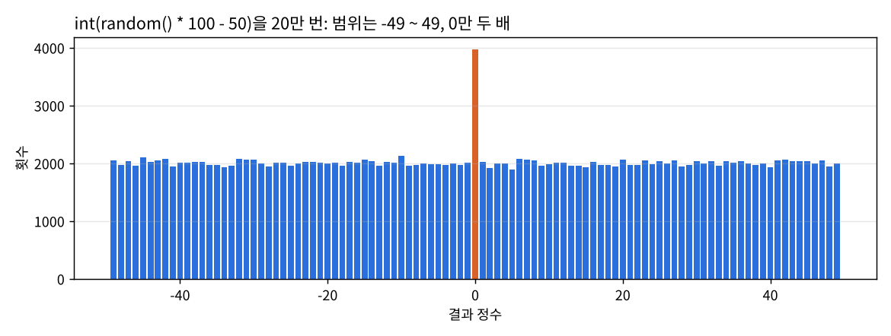

## 학습 목표

- `random` 모듈 함수별 난수 범위(이상, 이하, 초과, 미만)
- 원하는 구간의 실수·정수 난수 만들기
- `if`, `elif`, `else`의 흐름과 들여쓰기
- `if`를 여러 개 쓸 때와 `elif`를 쓸 때의 차이
- 과제 4-1: 조건에 맞는 난수 생성
- 과제 6: 숫자 맞추기 게임 개선(기회 제한, 점수, 2인용)

---

## 1. random 모듈

> **(중요!!)** 난수 함수는 **생성 범위**가 핵심. 이상·미만·초과·이하를 정확히 구분할 것
{: .prompt-warning }

| 함수 | 결과 | 범위 |
| --- | --- | --- |
| `random()` | 실수 | 0.0 **이상** 1.0 **미만** |
| `uniform(a, b)` | 실수 | a 이상 b 이하 (부동소수점 반올림에 따라 b는 나올 수도, 안 나올 수도 있음) |
| `randrange(a, b)` | 정수 | a 이상 b **미만** |
| `randrange(a, b, c)` | 정수 | a, a + c, a + 2c, … 중 b 미만 |
| `randint(a, b)` | 정수 | a 이상 b **이하** |

```python
import random as rd

print(rd.random() * 100)          # 0 이상 100 미만
print(rd.random() * 70 - 50)      # -50 이상 20 미만
print(rd.randrange(1, 10))        # 1 ~ 9
print(rd.randrange(1, 100, 5))    # 1, 6, 11, ..., 96
print(rd.randint(10, 70))         # 10 ~ 70
```

- 구간 [a, b)의 실수 = `a + random() * (b - a)`
- `randrange(1, 100, 5)`는 1부터 5씩 건너뛰므로 "5의 배수"가 아니라 **5로 나눈 나머지가 1인 수**다

### int(random() * 100 - 50)의 함정

실습 코드 주석은 "−50보다 크고 50보다 작은 정수"였다. 20만 번 돌려 보면



- 범위는 **−49 ~ 49**이고, **0이 다른 값의 두 배**로 나온다
- `int()`는 0 쪽으로 자르기 때문에 −0.9 같은 값도 0, 0.9도 0이 된다. 즉 (−1, 1) 구간 전체가 0으로 몰린다
- 균등한 정수가 필요하면 `randint(-50, 49)`나 `randrange(-50, 50)`처럼 정수 함수를 쓰는 것이 맞다

---

## 2. 조건문

```python
import random as rd

n = rd.randrange(1, 6)
print("You rolled a", n)
if n % 2 == 0:
    print("victory")
else:
    print("defeat")
print("game over")
```

- 들여쓴 줄만 if/else에 속한다. `print("game over")`는 항상 실행
- **주사위인데 `randrange(1, 6)`이면 1~5만 나온다.** 1000번 돌려 봐도 6이 한 번도 안 나왔다. 주사위는 `randrange(1, 7)` 또는 `randint(1, 6)`

### if 여러 개 vs elif

> 시험 유형: 아래 코드의 출력을 쓰고, 어디가 잘못됐는지 고쳐라
{: .prompt-info }

```python
# if만 여러 개
if coupon >= 20:
    print('Bag')
if coupon >= 10:
    print('Diary')
if coupon < 10:
    print('Coffee')
```

| coupon | if만 쓴 경우 | elif로 고친 경우 |
| --- | --- | --- |
| 25 | Bag, **Diary** | Bag |
| 20 | Bag, **Diary** | Bag |
| 15 | Diary | Diary |
| 7 | Coffee | Coffee |

```python
# elif로 고친 코드
if coupon >= 20:
    print('Bag')
elif coupon >= 10:
    print('Diary')
else:
    print('Coffee')
```

- `if`를 나란히 쓰면 조건마다 **따로** 검사해서 20 이상이면 두 개가 출력된다
- `elif`는 앞 조건이 거짓일 때만 검사하므로 하나만 실행된다. 두 번째 조건에 `coupon < 20`을 쓰지 않아도 되는 이유

### 시험에 나올 수 있는 문법 오류

```python
math = 85
if math >= 85:
    print('Pass')
print('Good')      # if 블록이 여기서 끝남
else:              # SyntaxError: 짝이 되는 if가 없음
    print('Fail')
```

- `else` 뒤에는 조건을 쓸 수 없다(`else math < 85:`는 오류). 조건이 필요하면 `elif`
- 학점처럼 위에서부터 큰 기준을 검사하면, 아래 조건은 이미 위 조건이 걸러진 상태라 범위를 다시 쓸 필요가 없다

---

## 3. 과제 4-1: 조건에 맞는 난수

> **과제 4-1**: 하나의 프로그램으로 (1) 60보다 크고 100보다 작은 실수 난수, (2) 10 이상 70 이하의 정수 난수를 출력하라.
{: .prompt-info }

```python
import random as rd

# 1. 60 초과 100 미만 실수
while True:
    rst = 60 + rd.random() * (100 - 60)
    if rst > 60:          # random()이 정확히 0.0이면 60이 나오므로 제외
        break
print("1번 조건에 맞는 난수 = %f" % rst)

# 2. 10 이상 70 이하 정수
print(f"2번 조건에 맞는 난수 = {rd.randint(10, 70)}")
```

- `random()`은 1.0 미만이라 100은 절대 안 나오고, 0.0은 나올 수 있어서 60을 반복문으로 걸렀다. "초과"와 "이상"의 차이를 정확히 처리한 코드
- 10만 번 생성해 보니 (1)은 60.0005 ~ 99.9989, (2)는 10과 70이 모두 나왔다

---

## 4. 과제 6: 숫자 맞추기 게임 개선

> **과제 6**: 컴퓨터가 1~20 중 하나를 고르고 사람이 맞히는 게임을 다음 중 하나 이상 개선하라. (1) 기회는 5번, 넘으면 Game over (2) 맞힌 횟수에 따라 Score 100/80/60/50 (3) 두 사람이 번갈아 맞히고 우승자 출력
{: .prompt-info }

원본은 맞힐 때까지 무한 반복하며 Higher/Lower만 알려 준다. 세 가지 모두 구현했다.

### (1) 기회 5번

```python
import random as rd

com = rd.randrange(1, 21)
attempt = 0

while True:
    user = int(input("Enter a number between 1 and 20: "))
    attempt += 1

    if user == com:
        print("Correct")
        print("Count : %d" % attempt)
        break
    if attempt == 5:
        print("Sum of Count : %d" % attempt)
        print("Game over")
        break
    if user < com:
        print("The number is higher")
    else:
        print("The number is lower")
    print("Count : %d" % attempt)
```

- 시도 횟수를 **먼저** 올리고, 정답 검사 → 5번째인지 검사 순서로 둬서 5번째에 맞히면 Correct가 나온다

### (2) 점수

맞힌 뒤 `count`로 점수를 고른다.

```python
if count == 1:
    print("Score : 100")
elif count == 2:
    print("Score : 80")
elif count == 3:
    print("Score = 60")
else:                     # 4번 이상
    print("Score = 50")
```

### (3) 2인용

User1과 User2가 한 반복 안에서 번갈아 입력하고, 먼저 맞힌 쪽에서 `break`한다. 반복이 끝난 뒤 `user1 == com`이면 User1 승리, 아니면 User2 승리.

### 실행 결과 (시드를 고정해 정답 11)

```text
(2) 점수 버전: 10 → 15 → 11
The number is higher / Count : 1
The number is lower  / Count : 2
Correct / Count : 3
Computer : 11
Sum of Count : 3
Score = 60

(3) 2인용: User1 5, User2 15, User1 10, User2 12, User1 11
Winner is User1
Computer : 11
Sum of Count_1 : 3
```

(1)도 1~5를 차례로 넣으면 4번 "higher" 후 5번째에 `Game over`로 끝났다.

검토하면서 확인한 점

- (2)에서 점수 출력이 `Score : 100`, `Score : 80`과 `Score = 60`, `Score = 50`으로 형식이 섞여 있다. 하나로 통일하는 것이 좋다
- (2)는 네 분기 모두 `Computer`, `Sum of Count`를 똑같이 출력한다. 공통 부분을 if 밖으로 빼고 점수만 분기하면 코드가 절반으로 준다
- 세 버전 모두 숫자가 아닌 값을 입력하면 `int()`에서 `ValueError`로 멈춘다. `try/except`로 다시 입력받게 하면 더 견고하다

---

### 강의 자료 및 정리 노트에서 정정한 부분 정리

| 위치 | 원래 | 정정 | 이유 |
| --- | --- | --- | --- |
| 6주차 주사위 코드 | `randrange(1, 6)` | `randrange(1, 7)` 또는 `randint(1, 6)` | 6이 나오지 않음 |
| 5주차 실습 주석 | `random() * 100`: 0보다 크고 100보다 작은 | 0 **이상** 100 미만 | random()은 0.0을 포함 |
| 5주차 실습 주석 | `int(random() * 100 - 50)`: −50보다 크고 50보다 작은 정수 | −49 ~ 49, 0이 두 배 확률 | int()는 0 쪽으로 자름 (20만 번 실행 확인) |
| 5주차 실습 주석 | `randrange(1, 100, 5)`: 1~99 사이 정수 | 1, 6, …, 96 (20개) | 간격 5로 건너뜀 |
| 중간 대비 노트 | unfiform | uniform | 오타 |

---

## 최종 핵심 정리

1. `random()`은 0.0 이상 1.0 미만, `randrange(a, b)`는 a 이상 b 미만, `randint(a, b)`는 a 이상 b 이하
2. [a, b) 실수는 `a + random() * (b - a)`, 정수는 정수 함수를 쓰는 것이 안전하다
3. `int(random() * 100 - 50)`은 −49 ~ 49이고 0이 두 배로 나온다
4. 주사위는 `randint(1, 6)`. `randrange(1, 6)`은 6이 나오지 않는다
5. `if`를 나란히 쓰면 조건마다 검사해 여러 개가 출력될 수 있고, `elif`는 하나만 실행한다
6. `else`에는 조건을 쓸 수 없고, 들여쓰기가 끊기면 `else`가 짝을 잃어 SyntaxError가 난다
7. 과제 4-1은 60 "초과"를 반복문으로 정확히 처리했다
8. 과제 6은 기회 제한, 점수, 2인용을 모두 구현했고, 출력 형식 통일과 입력 예외 처리가 남은 개선점이다

---

End.
