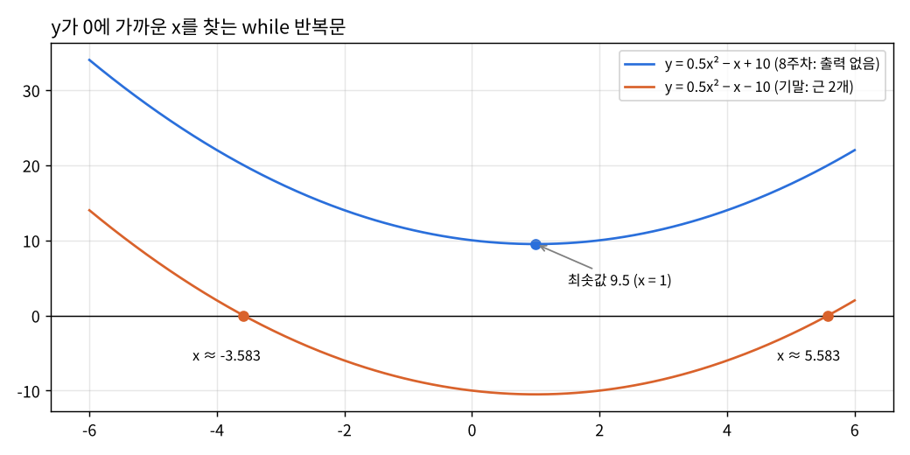

## 학습 목표

- `for`와 `range(start, stop, step)`의 범위
- `while True` + `break` 패턴과 종료 조건의 위치
- 누적 합(합계, 짝수 합), 중첩 반복(구구단)
- 문자열 반복(`'*' * n`)으로 별 패턴 출력
- 과제 5: 별 피라미드
- 실수를 0.001씩 늘리는 반복문에서 생기는 문제

---

## 1. for와 range

```python
for 변수 in 반복가능객체:
    실행할 문장
```

| 코드 | 값 |
| --- | --- |
| `range(5)` | 0, 1, 2, 3, 4 |
| `range(1, 11)` | 1 ~ 10 |
| `range(2, 101, 2)` | 2, 4, …, 100 |
| `range(10, -1, -1)` | 10, 9, …, 0 |
| `range(5, 0, -1)` | 5, 4, 3, 2, 1 |

끝 값은 **포함되지 않는다.** 거꾸로 셀 때는 간격을 음수로 주고, 끝 값을 원하는 마지막 수보다 하나 더 작게 둔다.

### 합계 구하기 (기말 예제)

```python
total = 0
for n in range(1, 11):
    total += n
print('합계:', total)

total = 0                      # 짝수 합: 간격 2로
for i in range(2, 101, 2):
    total += i
print(total)

total = 0                      # 짝수 합: 나머지로 걸러서
for i in range(1, 101):
    if i % 2 == 0:
        total += i
print(total)
```

실행 결과

```text
합계: 55
2550
2550
```

같은 합을 `while`로도 쓸 수 있다. 이때는 **초기값, 조건, 증가**를 직접 써야 한다.

```python
total = 0
i = 1
while i < 11:
    total += i
    i += 1
```

### 구구단 (중첩 반복)

```python
for i in range(1, 10):
    for j in range(2, 10):
        print(f"{j} x {i} = {j*i}", end='\t')
    print()                    # 한 줄 끝나면 줄바꿈
```

바깥 반복이 곱하는 수(i), 안쪽 반복이 단(j)이라 출력이 **가로로 2단~9단**이 나란히 놓인다. `end='\t'`는 줄바꿈 대신 탭을 붙인다.

---

## 2. while과 break

### 카운트다운

```python
for i in range(10, -1, -1):
    print("Count Down", i)
print("Missile Launch")
```

8주차 실습의 `while` 버전은 다음과 같았다.

```python
i = 10
while True:
    print("Count Down", i)
    if i < 0:
        break
    i -= 1
print("Missile Launch")
```

실행해 보니 출력된 숫자는 10, 9, …, 0, **−1**이었다. 출력을 먼저 하고 종료 조건을 나중에 검사하기 때문에 −1까지 찍힌 뒤 멈춘다. 고치려면

- 검사를 출력 앞으로: `if i < 0: break`를 `print` 위로
- 또는 조건식을 반복 조건에: `while i >= 0:`

### 숫자 맞추기 (기말 예제)

```python
import random as rd
num = rd.randrange(1, 21)      # 1 이상 21 미만

while True:
    user = int(input("숫자 맞추기"))
    if user == num:
        print("correct")
        break
    elif user > num:
        print("Down")
    else:
        print("Up")
```

`while True`는 무한 반복이고, 원하는 순간에 `break`로 빠져나온다. 반복 횟수를 미리 모를 때 쓴다.

---

## 3. 과제 5: 별 피라미드

> **과제 5**: 반복문을 이용해 첨부 그림처럼 가운데 정렬된 별 피라미드를 출력하라.
{: .prompt-info }

```python
height = 7                      # 층 수
for i in range(height):
    stars = 1 + 2 * i           # 1, 3, 5, 7, 9, 11, 13
    spaces = height - i - 1     # 6, 5, 4, 3, 2, 1, 0
    print(" " * spaces + "*" * stars)

print()
for i in range(height - 1, -1, -1):     # 거꾸로
    stars = 1 + 2 * i
    spaces = height - i - 1
    print(" " * spaces + "*" * stars)
```

실행 결과

```text
      *
     ***
    *****
   *******
  *********
 ***********
*************

*************
 ***********
  *********
   *******
    *****
     ***
      *
```

- i번째 줄의 별은 2i + 1개(홀수), 앞 공백은 height − i − 1개
- 오른쪽 공백은 출력하지 않아도 보이는 모양이 같다
- 기말 예제의 "1, 2, …, 5개 후 5, 4, …, 1개" 패턴은 `range(1, 12)`로 한 번에 돌리고 `i < 6`이면 i개, 아니면 12 − i개를 찍어도 된다

---

## 4. 반복문으로 방정식의 근 찾기

8주차 실습: x를 −6부터 0.001씩 늘리며 y가 −0.01과 0.01 사이인 x를 출력한다. 코드 옆에 "?? 왜 안 됨?"이라고 적어 둔 부분이다.

```python
x = -6.0
while x < 6:
    y = 0.5*x**2 - x + 10
    if y > -0.01 and y < 0.01:
        print("%.5f\t%.5f" % (x, y))
    x += 0.001
```

**아무것도 출력되지 않는 것이 정상**이다. 0.5x² − x + 10의 최솟값은 x = 1에서 **9.5**라 y가 0 근처로 내려오지 않는다(판별식 1 − 20 < 0, 실근 없음).

기말 정리 코드에서는 상수항이 **−10**으로 바뀌어 있었고, 그 식은 근이 두 개다.



실행 결과(기말 버전)

```text
-3.58400	0.00653
-3.58300	0.00194
-3.58200	-0.00264
-3.58100	-0.00722
5.58100	-0.00722
5.58200	-0.00264
5.58300	0.00194
5.58400	0.00653
```

- 근의 공식으로 x = 1 ± √21 ≈ −3.5826, 5.5826
- 근 하나당 4줄이 나온다. 허용 범위 ±0.01 안에 x가 여러 개 들어가기 때문
- 0.001을 계속 더하면 오차가 쌓인다. 0.1을 10번 더해도 `0.9999999999999999`가 되어 `== 1.0`이 False다. 반복 횟수는 정수로 세고 `x = -6 + k * 0.001`처럼 계산하는 편이 안전하다

---

### 강의 자료 및 정리 노트에서 정정한 부분 정리

| 위치 | 원래 | 정정 | 이유 |
| --- | --- | --- | --- |
| 8주차 카운트다운 while | 출력 후 `if i < 0: break` | 검사를 출력 앞에 두거나 `while i >= 0` | −1까지 출력됨 (실행 확인) |
| 8주차 "?? 왜 안 됨?" | y = 0.5x² − x + 10에서 근을 찾음 | 실근이 없어 출력이 없는 것이 정상 | 최솟값 9.5 |
| 과제 5 주석 | 별 개수 1, 3, 5, 7, 9, 12, 15 | 1, 3, 5, 7, 9, 11, 13 | 2i + 1 |

---

## 최종 핵심 정리

1. `range(start, stop, step)`의 stop은 포함되지 않고, 거꾸로 셀 때는 step을 음수로 준다
2. 1~10의 합은 55, 2~100 짝수 합은 2550(간격 2 또는 `% 2 == 0` 두 방법)
3. `while`은 초기값·조건·증가를 직접 관리해야 하고, `while True` + `break`는 횟수를 모를 때 쓴다
4. 종료 검사를 출력 뒤에 두면 마지막 값(−1)이 한 번 더 찍힌다
5. 중첩 반복과 `end='\t'`로 구구단을 가로로 배치할 수 있다
6. 피라미드의 i번째 줄은 공백 height − i − 1개, 별 2i + 1개
7. 0.5x² − x + 10은 실근이 없어 출력이 없고, −10으로 바꾸면 x ≈ −3.583, 5.583 근처가 출력된다
8. 실수를 반복해서 더하면 오차가 쌓이므로 반복 횟수는 정수로 세는 것이 안전하다

---

End.
