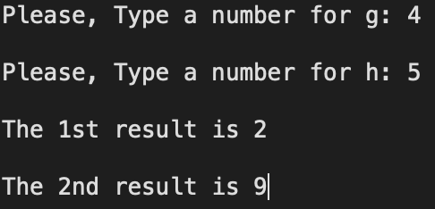

[toc]

# Computer Architecture 3

## 문제

```c
1) f = B[h] - g;
2) f = A[B[g]+h-2];

// datasets
A={1, 2, 3, 4, 5, 6, 7, 8, 9, 10}
B={1, 2, 3, 4, 5, 6, 7, 8, 9, 10}
```

```markdown
Please, Type a number for g: 4
Please, Type a number for h: 5
The 1st result is 2
The 2nd result is 9
```

- 위의 결과와 동일하게 출력하라

---

## 정답

```assembly
.data
    prompt_g: .asciiz "Please, Type a number for g: "   # g를 입력 받을 때 출력할 문자열
    prompt_h: .asciiz "Please, Type a number for h: "   # h를 입력 받을 때 출력할 문자열
    rst_1: .asciiz "The 1st result is "
    rst_2: .asciiz "The 2nd result is "
    newline: .asciiz "\n"
    buffer: .space 20     # 문자열 입력 받을 버퍼(20바이트 크기)
    msg_input_err: .asciiz "Error: g and h must be in 0..9\n"
    msg_index_err: .asciiz "Error: Index out of range in A[B[g]+h-2]\n"
    ## 배열 선언
    A_arr: .word 1, 2, 3, 4, 5, 6, 7, 8, 9, 10 
    B_arr: .word 1, 2, 3, 4, 5, 6, 7, 8, 9, 10

.text


# ======================== Main Program ========================
.globl main
main:
    # 두 개의 정수 g, h 입력
    # 질문 출력
    li $v0, 4 # print string
    la $a0, prompt_g
    syscall

    # 정수g 입력
    li $v0, 5 # 5번이 정수를 입력받음(li는 바로 불러오기임)
    syscall
    move $t0, $v0 # 입력 받은 정수를 $t0에 넣음

    # 줄바꿈
    li $v0, 4 # print string
    la $a0, newline
    syscall

    # 질문 출력 
    li $v0, 4 # print string
    la $a0, prompt_h
    syscall

    # 정수h 입력
    li $v0, 5 # 정수 입력
    syscall
    move $t1, $v0

    # --- 범위 검사: 0 <= g,h <= 9 ---
    # g 검사
    bltz  $t0, input_error    # if g < 0 -> error
    li    $t2, 10             # upper bound is 10 (we check g < 10)
    slt   $t3, $t0, $t2       # $t3 = (g < 10)
    beq   $t3, $zero, input_error

    # h 검사
    bltz  $t1, input_error    # if h < 0 -> error
    slt   $t3, $t1, $t2       # $t3 = (h < 10)
    beq   $t3, $zero, input_error

    # 인자 전달 -- 이걸 안 해서 계속 틀렸었음
    move $a0, $t0      # g
    move $a1, $t1      # h 

    # f_function_1 호출
    jal f_function_1
    move $s0, $v0    # 반환값 f를 $s0에 저장

    move $a0, $t0      # g (re-pass for f_function_2)
    move $a1, $t1      # h (re-pass for f_function_2)

    # f_function_2 호출
    jal f_function_2
    move $s1, $v0    # 반환값 f를 $s1에 저장
    
    # 줄바꿈
    li $v0,4 
    la $a0,newline
    syscall

    # 1) 결과 출력
    ## "The 1st result is " 출력
    li $v0, 4 # print string
    la $a0, rst_1
    syscall

    ## 결과값 출력
    li $v0, 1 # print integer
    move $a0, $s0
    syscall

    # 줄바꿈
    li $v0, 4 # print string
    la $a0, newline
    syscall

    # 줄바꿈
    li $v0, 4 # print string
    la $a0,newline
    syscall

    # 2) 결과 출력
    ## "The 2nd result is  " 출력
    li $v0, 4 # print string
    la $a0, rst_2
    syscall

    ## 결과값 출력
    li $v0, 1 # print integer
    move $a0, $s1
    syscall

    # 코드 종료
    li $v0, 10 # exit
    syscall

# ======================== Main Program ========================


# ======================== Functions ========================
f_function_1:
    # 인자: $a0 = g, $a1 = h
    # 반환값: $v0 = f

    # B[h] 불러오기
    sll $t2, $a1, 2        # h * 4 (word 단위이므로)
    la $t3, B_arr          # B 배열의 시작 주소 로드
    add $t4, $t3, $t2      # B[h]의 주소 계산
    lw $t5, 0($t4)         # B[h] 값을 $t5에 로드

    # f = B[h] - g
    sub $v0, $t5, $a0      # f 계산

    jr $ra                  # 함수 종료


f_function_2:
    # 인자: $a0 = g, $a1 = h
    # 반환값: $v0 = f

    # B[g] 불러오기
    sll $t6, $a0, 2        # g * 4
    la $t7, B_arr          # B 배열의 시작 주소 로드
    add $t8, $t7, $t6      # B[g]의 주소 계산
    lw $t9, 0($t8)         # B[g] 값을 $t9에 로드

    # h - 2
    addiu $t0, $a1, -2
    add   $t1, $t9, $t0   # idx = B[g] + (h - 2)

    # --- 인덱스 검사: 0 <= idx <= 9 ---
    bltz  $t1, index_error    # if idx < 0 -> error
    li    $t2, 10             # compare with 10
    slt   $t3, $t1, $t2       # $t3 = (idx < 10)
    beq   $t3, $zero, index_error

    # A[idx] 불러오기
    sll $t2, $t1, 2      # idx * 4
    la  $t3, A_arr        # A 배열의 시작 주소 로드
    add $t4, $t3, $t2   # A[idx]의 주소 계산
    lw  $v0, 0($t4)       # 반환값을 $v0에 저장

    jr $ra                 # 함수 종료

# ======================== Functions ========================


# ======================== Error Handlers ========================
input_error:
    li  $v0, 4
    la  $a0, msg_input_err
    syscall
    li  $v0, 10
    syscall

index_error:
    li  $v0, 4
    la  $a0, msg_index_err
    syscall
    li  $v0, 10
    syscall
# ====================== End Error Handlers ======================

# ======================== End ========================
```

---

## 결과

`

---

End.
