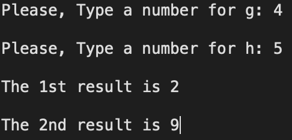

## 학습 목표

- 바이트 주소 체계에서 배열 원소 주소 = 시작 주소 + 인덱스 × 4
- `sll`(왼쪽 시프트)로 곱하기 4를 대신하는 이유
- `la` + `add` + `lw`로 배열 원소 읽기
- 배열 값을 다시 인덱스로 쓰는 간접 참조 `A[B[g] + h - 2]`
- 잘못된 인덱스를 막는 범위 검사(`bltz`, `slt`)

---

## 1. 과제 내용

> **과제 3**: 바이트 주소를 쓰고 배열 원소는 4바이트다. g, h를 입력받아 ① f = B[h] − g, ② f = A[B[g] + h − 2]를 출력하라. A = B = {1, 2, …, 10}. 채점 때 g, h를 바꿔 가며 확인한다.
{: .prompt-info }

```text
Please, Type a number for g: 4
Please, Type a number for h: 5
The 1st result is 2
The 2nd result is 9
```

- ① B[5] = 6, 6 − 4 = 2
- ② B[4] = 5, 5 + 5 − 2 = 8, A[8] = 9



---

## 2. 배열 원소의 주소

MIPS 메모리는 **바이트 단위**로 주소가 붙고, `int` 하나(word)는 4바이트다. 그래서 `B[h]`의 주소는

```text
&B[h] = &B[0] + h × 4
```

| 명령어 | 의미 |
| --- | --- |
| `sll $t2, $a1, 2` | `$t2 = h << 2 = h × 4` (곱셈기 대신 시프터 사용, 1사이클) |
| `la $t3, B_arr` | 배열 시작 주소 |
| `add $t4, $t3, $t2` | `&B[h]` |
| `lw $t5, 0($t4)` | `B[h]` 값 읽기 |

> **(중요!!)** `lw`의 오프셋에 인덱스를 그대로 넣으면 안 된다. `lw $t5, h($t3)`처럼 쓰고 싶어도 오프셋은 **상수**만 가능하고, 단위도 바이트라서 인덱스 × 4를 따로 계산해 더해야 한다. 상수 인덱스라면 `B[1]` = `lw $t0, 4($s7)`.
{: .prompt-warning }

---

## 3. 코드

```assembly
# 컴퓨터 구조 HW3 Mips 실습
## 작성자: 고영훈
### 날짜: 2025/10/23

.data
    prompt_g: .asciiz "Please, Type a number for g: "   # g를 입력 받을 때 출력할 문자열
    prompt_h: .asciiz "Please, Type a number for h: "   # h를 입력 받을 때 출력할 문자열
    rst_1: .asciiz "The 1st result is "
    rst_2: .asciiz "The 2nd result is "
    newline: .asciiz "\n"
    buffer: .space 20     # 문자열 입력 받을 버퍼(20바이트 크기)
    msg_input_err: .asciiz "Error: g and h must be in 0..9\n"
    msg_index_err: .asciiz "Error: Index out of range in A[B[g]+h-2]\n"
    ## 배열 선언
    A_arr: .word 1, 2, 3, 4, 5, 6, 7, 8, 9, 10 
    B_arr: .word 1, 2, 3, 4, 5, 6, 7, 8, 9, 10

.text


# ======================== Main Program ========================
.globl main
main:
    # 두 개의 정수 g, h 입력
    # 질문 출력
    li $v0, 4 # print string
    la $a0, prompt_g
    syscall

    # 정수g 입력
    li $v0, 5 # 5번이 정수를 입력받음(li는 바로 불러오기임)
    syscall
    move $t0, $v0 # 입력 받은 정수를 $t0에 넣음

    # 줄바꿈
    li $v0, 4 # print string
    la $a0, newline
    syscall

    # 질문 출력 
    li $v0, 4 # print string
    la $a0, prompt_h
    syscall

    # 정수h 입력
    li $v0, 5 # 정수 입력
    syscall
    move $t1, $v0

    # --- 범위 검사: 0 <= g,h <= 9 ---
    # g 검사
    bltz  $t0, input_error    # if g < 0 -> error
    li    $t2, 10             # upper bound is 10 (we check g < 10)
    slt   $t3, $t0, $t2       # $t3 = (g < 10)
    beq   $t3, $zero, input_error

    # h 검사
    bltz  $t1, input_error    # if h < 0 -> error
    slt   $t3, $t1, $t2       # $t3 = (h < 10)
    beq   $t3, $zero, input_error

    # 인자 전달 -- 이걸 안 해서 계속 틀렸었음
    move $a0, $t0      # g
    move $a1, $t1      # h 

    # f_function_1 호출
    jal f_function_1
    move $s0, $v0    # 반환값 f를 $s0에 저장

    move $a0, $t0      # g (re-pass for f_function_2)
    move $a1, $t1      # h (re-pass for f_function_2)

    # f_function_2 호출
    jal f_function_2
    move $s1, $v0    # 반환값 f를 $s1에 저장
    
    # 줄바꿈
    li $v0,4 
    la $a0,newline
    syscall

    # 1) 결과 출력
    ## "The 1st result is " 출력
    li $v0, 4 # print string
    la $a0, rst_1
    syscall

    ## 결과값 출력
    li $v0, 1 # print integer
    move $a0, $s0
    syscall

    # 줄바꿈
    li $v0, 4 # print string
    la $a0, newline
    syscall

    # 줄바꿈
    li $v0, 4 # print string
    la $a0,newline
    syscall

    # 2) 결과 출력
    ## "The 2nd result is  " 출력
    li $v0, 4 # print string
    la $a0, rst_2
    syscall

    ## 결과값 출력
    li $v0, 1 # print integer
    move $a0, $s1
    syscall

    # 코드 종료
    li $v0, 10 # exit
    syscall

# ======================== Main Program ========================


# ======================== Functions ========================
f_function_1:
    # 인자: $a0 = g, $a1 = h
    # 반환값: $v0 = f

    # B[h] 불러오기
    sll $t2, $a1, 2        # h * 4 (word 단위이므로)
    la $t3, B_arr          # B 배열의 시작 주소 로드
    add $t4, $t3, $t2      # B[h]의 주소 계산
    lw $t5, 0($t4)         # B[h] 값을 $t5에 로드

    # f = B[h] - g
    sub $v0, $t5, $a0      # f 계산

    jr $ra                  # 함수 종료


f_function_2:
    # 인자: $a0 = g, $a1 = h
    # 반환값: $v0 = f

    # B[g] 불러오기
    sll $t6, $a0, 2        # g * 4
    la $t7, B_arr          # B 배열의 시작 주소 로드
    add $t8, $t7, $t6      # B[g]의 주소 계산
    lw $t9, 0($t8)         # B[g] 값을 $t9에 로드

    # h - 2
    addiu $t0, $a1, -2
    add   $t1, $t9, $t0   # idx = B[g] + (h - 2)

    # --- 인덱스 검사: 0 <= idx <= 9 ---
    bltz  $t1, index_error    # if idx < 0 -> error
    li    $t2, 10             # compare with 10
    slt   $t3, $t1, $t2       # $t3 = (idx < 10)
    beq   $t3, $zero, index_error

    # A[idx] 불러오기
    sll $t2, $t1, 2      # idx * 4
    la  $t3, A_arr        # A 배열의 시작 주소 로드
    add $t4, $t3, $t2   # A[idx]의 주소 계산
    lw  $v0, 0($t4)       # 반환값을 $v0에 저장

    jr $ra                 # 함수 종료

# ======================== Functions ========================


# ======================== Error Handlers ========================
input_error:
    li  $v0, 4
    la  $a0, msg_input_err
    syscall
    li  $v0, 10
    syscall

index_error:
    li  $v0, 4
    la  $a0, msg_index_err
    syscall
    li  $v0, 10
    syscall
# ====================== End Error Handlers ======================


# ======================== End ========================
```

### 구조

- `main`: 입력 → g, h가 0~9인지 검사 → `f_function_1`, `f_function_2` 호출 → 결과 출력
- `f_function_1`: `B[h] − g`
- `f_function_2`: `B[g]`를 읽고 `idx = B[g] + h − 2` 계산 → **idx가 0~9인지 다시 검사** → `A[idx]`
- 범위 검사는 `bltz`(0보다 작으면 분기)와 `slt`(10보다 작으면 1)를 조합했다. 배열 밖을 읽으면 다른 데이터(여기서는 `B_arr`나 문자열)를 읽게 되는데, MIPS는 오류를 내지 않고 **엉뚱한 값을 그대로 돌려주기** 때문이다

---

## 4. 실행 결과 (SPIM)

```text
Please, Type a number for g: 4

Please, Type a number for h: 5

The 1st result is 2

The 2nd result is 9
```

채점처럼 g, h를 바꿔 가며 실행했다.

| g | h | ① B[h] − g | ② idx = B[g] + h − 2 | ② 결과 |
| --- | --- | --- | --- | --- |
| 4 | 5 | 6 − 4 = 2 | 5 + 3 = 8 | A[8] = 9 |
| 3 | 1 | 2 − 3 = −1 | 4 − 1 = 3 | A[3] = 4 |
| 0 | 1 | 2 − 0 = 2 | 1 − 1 = 0 | A[0] = 1 |
| 1 | 0 | 1 − 1 = 0 | 2 − 2 = 0 | A[0] = 1 |
| 0 | 0 | 1 | 1 − 2 = −1 | 인덱스 오류 메시지 |
| 9 | 9 | 10 − 9 = 1 | 10 + 7 = 17 | 인덱스 오류 메시지 |
| 10 | 2 | — | — | 입력 오류 메시지 |

- idx가 0~9를 벗어나는 경우(예: g = h = 0이면 −1)는 C였다면 **정의되지 않은 동작**이다. 코드가 오류 메시지를 내고 종료하도록 처리했다
- 출력에서 1st와 2nd 결과 사이에 빈 줄이 하나 더 있다. `newline` 출력이 두 번 연속 들어가 있기 때문인데, 예시 형식과 맞추려면 한 번만 출력하면 된다

---

## 5. 레지스터 사용에서 주의할 점

`f_function_2`는 `$t0`, `$t1`, `$t2`, `$t3`을 덮어쓴다. `main`은 호출 전에 g, h를 `$t0`, `$t1`에 두고 있었는데, 두 번째 호출 **뒤에는** 그 값을 다시 쓰지 않아서 문제가 없었다. 만약 호출 후에도 g, h가 필요했다면

- `main`에서 `$s` 레지스터에 옮겨 두거나
- 호출 전에 스택에 저장해야 한다 (`$t`는 caller-saved)

---

### 강의 자료 및 정리 노트에서 정정한 부분 정리

| 위치 | 원래 | 정정 | 이유 |
| --- | --- | --- | --- |
| 이 글의 이전 버전 제목 | 02. Computer_Architecture_3 | 03. Computer_Architecture_HW3 | 번호가 과제 2와 겹쳤음 |
| 이전 버전 결과 그림 | `` 앞에 백틱 | 그림 정상 표시 | 마크다운 문법 오류 |
| 과제 코드 출력 | 결과 사이 줄바꿈 2번 | 1번이면 예시와 같음 | 출력 형식 (값은 정확) |

---

## 최종 핵심 정리

1. 바이트 주소에서 word 배열 원소의 주소는 시작 주소 + 인덱스 × 4
2. × 4는 `sll ..., 2`로 계산한다. 곱셈기보다 빠르고 Hi/Lo를 건드리지 않는다
3. `lw`의 오프셋은 상수만 가능하므로, 변수 인덱스는 주소를 먼저 계산해서 `0(주소)`로 읽는다
4. `A[B[g] + h - 2]`는 `B[g]`를 읽은 뒤 그 값으로 다시 주소를 계산하는 2단계 간접 참조
5. g = 4, h = 5일 때 ① 2, ② 9로 과제 예시와 같았고, 다른 입력 4쌍도 손계산과 일치했다
6. MIPS는 배열 범위를 검사하지 않으므로 인덱스 검사를 직접 넣어야 엉뚱한 메모리를 읽지 않는다
7. 함수 안에서 `$t` 레지스터를 덮어쓰면 호출한 쪽의 값이 사라질 수 있으니, 호출 후에도 필요한 값은 `$s`나 스택에 둔다
8. 배열 시작 주소는 `la`로 얻는다 (`la`는 `lui` + `ori`로 바뀌는 의사 명령어)

---

End.
