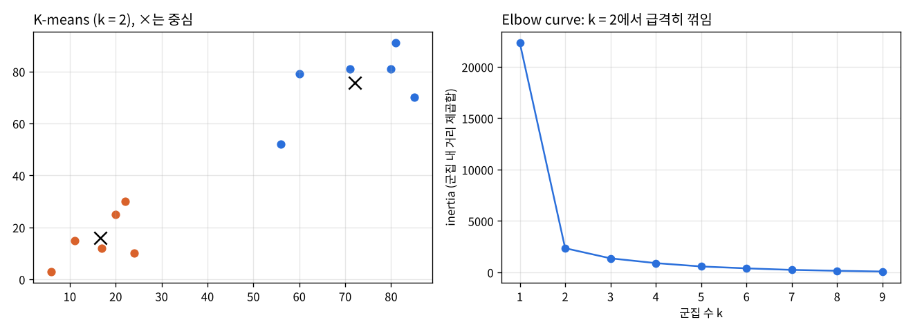

## 학습 목표

- kNN 분류의 원리와 장단점
- sklearn으로 iris 데이터를 학습·평가·예측
- kNN을 직접 구현해서 sklearn 결과와 비교(과제 3)
- 학습/테스트 분할의 한계와 k-겹 교차 검증
- 교차 검증 실습 코드의 버그 찾기(`make_scorer`의 부호)
- K-means 군집화 알고리즘과 엘보 곡선

---

## 1. kNN (k-Nearest Neighbors)

새 데이터가 들어오면 **가장 가까운 k개의 학습 데이터**를 찾고, 그중 가장 많은 부류로 분류한다.

$$d(\mathbf{a}, \mathbf{b}) = \sqrt{\sum_i (a_i - b_i)^2}$$

| 장점 | 단점 |
| --- | --- |
| 학습(준비) 단계가 사실상 없음 | 예측 때 **모든 학습 데이터와 거리 계산** → 데이터가 많으면 느리고 메모리를 많이 씀 |
| 이해하기 쉽고 부류 수에 제한 없음 | 특징의 단위(스케일)에 민감 → 표준화 필요 |
| | k를 잘 골라야 함 (작으면 잡음에 민감, 크면 경계가 뭉개짐) |

### iris 실습

```python
from sklearn.datasets import load_iris
from sklearn.model_selection import train_test_split
from sklearn.neighbors import KNeighborsClassifier
from sklearn import metrics

iris = load_iris()
X, y = iris.data, iris.target
X_train, X_test, y_train, y_test = train_test_split(X, y, test_size=0.2, random_state=4)
print(X_train.shape, X_test.shape)

knn = KNeighborsClassifier(n_neighbors=6)
knn.fit(X_train, y_train)
y_pred = knn.predict(X_test)
print("정확도:", metrics.accuracy_score(y_test, y_pred))

classes = {0: 'setosa', 1: 'versicolor', 2: 'virginica'}
y_pred_new = knn.predict([[3, 4, 5, 2], [5, 4, 2, 2]])
print(classes[y_pred_new[0]], classes[y_pred_new[1]])
```

실행 결과

```text
(120, 4) (30, 4)
정확도: 0.9666666666666667
versicolor setosa
```

- iris는 **150개 샘플**(품종별 50개), 특징 4개(꽃받침·꽃잎의 길이와 너비)
- 테스트 30개 중 29개를 맞혀 정확도 96.7%
- 새 데이터 예측도 2차원 배열로 넣어야 한다

같은 분할에서 k를 바꿔 보면

| k | 1 | 3 | 5 | 6 | 7 | 9 | 15 |
| --- | --- | --- | --- | --- | --- | --- | --- |
| 정확도 | 0.933 | 0.967 | 0.967 | 0.967 | 0.967 | 0.967 | 0.967 |

k = 1은 가장 가까운 점 하나만 따라가서 잡음에 흔들린다. 테스트가 30개뿐이라 1개 차이가 3.3%p로 크게 보인다는 점도 감안해야 한다.

---

## 2. 과제 3: kNN 직접 구현

> **과제 3**: kNN 알고리즘을 라이브러리 없이 구현하고, sklearn의 `KNeighborsClassifier`와 정확도를 비교하라.
{: .prompt-info }

```python
import numpy as np

def euclidean_distance(a, b):
    return np.sqrt(np.sum((a - b) ** 2))

def predict_one(x_test, x_train, y_train, k):
    distances = []
    for i in range(len(x_train)):
        d = euclidean_distance(x_test, x_train[i])
        distances.append((d, y_train[i]))
    distances.sort(key=lambda x: x[0])           # 거리 오름차순
    neighbors = distances[:k]
    labels = [label for (dist, label) in neighbors]
    return max(labels, key=labels.count)          # 다수결

def predict_batch(x_test, x_train, y_train, k):
    return np.array([predict_one(x, x_train, y_train, k) for x in x_test])

y_pred = predict_batch(x_test, x_train, y_train, k=3)
print("kNN 구현 정확도:", np.mean(y_pred == y_test))
```

실행 결과

```text
-----------------------------
kNN 구현 		    |
정확도: 0.9666666666666667  |
-----------------------------
kNN 호출 		    |
정확도: 0.9666666666666667  |
-----------------------------
End.
```

검토하면서 확인한 점

- 제출 코드는 직접 구현을 **k = 3**, sklearn을 **k = 6**으로 돌려 비교했다. 같은 조건으로 비교하려면 k를 맞춰야 한다
- sklearn도 k = 3으로 돌려 보니 30개 예측이 **모두 같았고**, 둘 다 같은 샘플 하나(정답 versicolor를 virginica로)를 틀렸다
- 동점(예: k = 4에서 2 대 2)이면 `max(labels, key=labels.count)`는 리스트에서 먼저 나온 부류, 즉 **더 가까운 쪽**을 고른다. k를 홀수로 두면 두 부류 문제에서 동점을 피할 수 있다
- 테스트 하나마다 학습 데이터 120개와 거리를 다 계산하므로 복잡도는 O(테스트 수 × 학습 수 × 특징 수). sklearn은 KD 트리 같은 자료구조로 이 부분을 빠르게 한다

---

## 3. 교차 검증 (Cross Validation)

학습:테스트를 8:2로 한 번만 나누면, **어떤 샘플이 테스트에 들어갔는지**에 따라 점수가 흔들린다. 그 점수로 모델이나 하이퍼파라미터를 고르면 그 분할에 맞춰진(biased) 선택이 된다.

**S-겹 교차 검증**: 데이터를 S개 묶음으로 나누고, 한 묶음을 검증용으로, 나머지 S − 1개를 학습용으로 쓰는 일을 S번 반복해 점수를 평균한다(읽기 자료: Bishop, *PRML* 1.3절).

- 모든 데이터가 한 번씩 검증에 쓰여 데이터를 낭비하지 않는다
- 대가는 학습을 **S번** 해야 한다는 것
- S = N이면 하나씩 빼는 leave-one-out
- `StratifiedKFold`는 각 묶음의 부류 비율을 전체와 같게 맞춘다. 회귀에서는 y를 구간으로 나눈 `y_bins`로 비율을 맞췄다

### 실습: best k 찾기 코드의 버그

11/18 실습은 diamonds 데이터(가격 회귀)에 랜덤 포레스트를 쓰고, k-겹의 k를 바꿔 가며 평균 RMSE가 가장 작은 k를 찾는 문제였다. 파일에는 두 버전이 있었다.

```python
# (A) 처음 작성 → 주석 처리하고 "틀린 코드"로 표시
rmse_scorer = make_scorer(root_mean_squared_error)
mean_rmse = np.mean(scores)

# (B) "결과가 달라서 다시 작성"한 최종 코드
rmse_scorer = make_scorer(mean_squared_error)
mean_rmse = -np.mean(scores)
best_k = min(results, key=results.get)
```

(B)를 그대로 돌려 보니 문제가 있었다. 시간이 오래 걸려서 데이터 10,000개, 트리 30개로 줄이고 k = 2, 3, 5, 8, 10만 확인했다.

| k | (B) 출력값 | 실제 RMSE |
| --- | --- | --- |
| 2 | −517,694 | 719.51 |
| 3 | −465,000 | 681.80 |
| 5 | −441,291 | 663.46 |
| 8 | −420,206 | **647.27** |
| 10 | −438,457 | 659.99 |

```text
(B)가 고른 best k : 2   ← RMSE가 가장 큰 k
(A)가 고른 best k : 8
neg_root_mean_squared_error로 계산한 best k : 8
```

원인

1. `make_scorer(mean_squared_error)`는 이름과 달리 **RMSE가 아니라 MSE**를 계산한다
2. `make_scorer`는 기본값 `greater_is_better=True`라서 점수를 **양수 그대로** 돌려준다. 음수로 바뀌는 것은 문자열 `'neg_mean_squared_error'`를 쓸 때다
3. 양수 MSE에 −를 붙이니 오차가 클수록 값이 작아지고, `min`이 **가장 나쁜 k**를 고르게 됐다

처음 버전 (A)가 맞았다. 가장 안전한 방법은 sklearn의 문자열 점수를 쓰는 것이다.

```python
scores = cross_val_score(pipeline, X, y, cv=skf.split(X, y_bins),
                         scoring='neg_root_mean_squared_error')
mean_rmse = -np.mean(scores)        # 이제 음수 → 양수 RMSE
```

> 덧붙여, k-겹의 k는 모델의 하이퍼파라미터가 아니라 **평가 방법의 설정**이다. k가 클수록 각 학습에 쓰는 데이터가 많아져 오차가 조금 줄어드는 경향이 있을 뿐, 그 k가 "더 좋은 모델"을 뜻하지는 않는다. 교차 검증은 보통 k를 5나 10으로 정해 두고, 그 점수로 **모델의 하이퍼파라미터**(트리 수, kNN의 k 등)를 고르는 데 쓴다.
{: .prompt-tip }

---

## 4. K-means 군집화 (비지도 학습)

정답 없이 데이터를 k개 묶음으로 나눈다.

1. k개의 점을 무작위로 골라 중심(centroid)으로 정한다
2. 각 데이터를 가장 가까운 중심의 군집에 배정한다
3. 군집마다 평균을 내서 중심을 옮긴다
4. 배정이 더 바뀌지 않을 때까지 2, 3을 반복한다

```python
import numpy as np
from sklearn.cluster import KMeans

X = np.array([[6, 3], [11, 15], [17, 12], [24, 10], [20, 25], [22, 30],
              [85, 70], [71, 81], [60, 79], [56, 52], [81, 91], [80, 81]])
kmeans = KMeans(n_clusters=2, n_init=10, random_state=0).fit(X)
print(kmeans.cluster_centers_)
print(kmeans.labels_)
```

실행 결과

```text
[[72.16666667 75.66666667]
 [16.66666667 15.83333333]]
[1 1 1 1 1 1 0 0 0 0 0 0]
```

- 왼쪽 아래 6개, 오른쪽 위 6개로 나뉜다. 군집 번호 0, 1은 임의로 붙으므로 실행마다 바뀔 수 있다
- 실습 코드는 `random_state`가 없어 실행할 때마다 번호(색)가 바뀔 수 있다. 재현하려면 `random_state`를 지정한다

### 엘보 곡선으로 k 고르기

k를 1~9로 바꿔 가며 **inertia**(각 점과 소속 중심 사이 거리 제곱합)를 그린다.

| k | 1 | 2 | 3 | 4 | 5 |
| --- | --- | --- | --- | --- | --- |
| inertia | 22,329 | 2,348 | 1,363 | 898 | 571 |



- k가 늘면 inertia는 계속 줄어든다(k = 데이터 수면 0). 그래서 가장 작은 값이 아니라 **감소 폭이 갑자기 줄어드는 지점(팔꿈치)** 을 고른다. 이 데이터는 k = 2
- make_blobs(중심 4개) 실습도 같은 방법으로 k = 4를 찾을 수 있다

---

### 강의 자료 및 정리 노트에서 정정한 부분 정리

| 위치 | 원래 | 정정 | 이유 |
| --- | --- | --- | --- |
| 7장 iris 설명 | "50개의 아이리스 꽃 샘플" | 150개(품종별 50개) | `load_iris().data.shape` = (150, 4) |
| 7장 K-means 코드 | `from sklearn.cluster import Kmeans` | `KMeans` | 대소문자가 다르면 ImportError |
| 7장 혼동 행렬 코드 | `metrics.plot_confusion_matrix(...)` | `metrics.ConfusionMatrixDisplay.from_estimator(...)` | sklearn 1.2에서 삭제된 함수 |
| 11/18 실습 최종 코드 | `make_scorer(mean_squared_error)`, `-np.mean(scores)` | `scoring='neg_root_mean_squared_error'` 후 부호 반전 | MSE를 RMSE로 착각하고 부호도 뒤집혀 가장 나쁜 k를 고름 (실행 확인) |
| 과제 3 | 직접 구현 k = 3 vs sklearn k = 6 | 같은 k로 비교 | 조건이 다르면 비교가 되지 않음 |

---

## 최종 핵심 정리

1. kNN은 가장 가까운 k개 이웃의 다수결로 분류하고, 학습은 없지만 예측 때 모든 데이터와 거리를 계산한다
2. iris(150개, 특징 4개)를 8:2로 나눠 k = 6에서 정확도 96.7%
3. 직접 구현한 kNN(k = 3)은 sklearn(k = 3)과 30개 예측이 모두 같았다
4. kNN은 특징 스케일에 민감하고, k가 너무 작으면 잡음에, 너무 크면 경계 뭉개짐에 약하다
5. S-겹 교차 검증은 모든 데이터를 검증에 한 번씩 써서 분할 운에 덜 흔들리는 점수를 준다
6. `make_scorer(mean_squared_error)`는 양수 MSE를 돌려주므로, 부호를 뒤집고 min을 고르면 가장 나쁜 k(2)가 나온다
7. 오차 점수는 `'neg_root_mean_squared_error'`처럼 sklearn의 문자열 점수를 쓰는 것이 안전하다
8. K-means는 중심 배정과 평균 이동을 반복하고, 엘보 곡선이 꺾이는 k(예제는 2)를 고른다

---

End.
