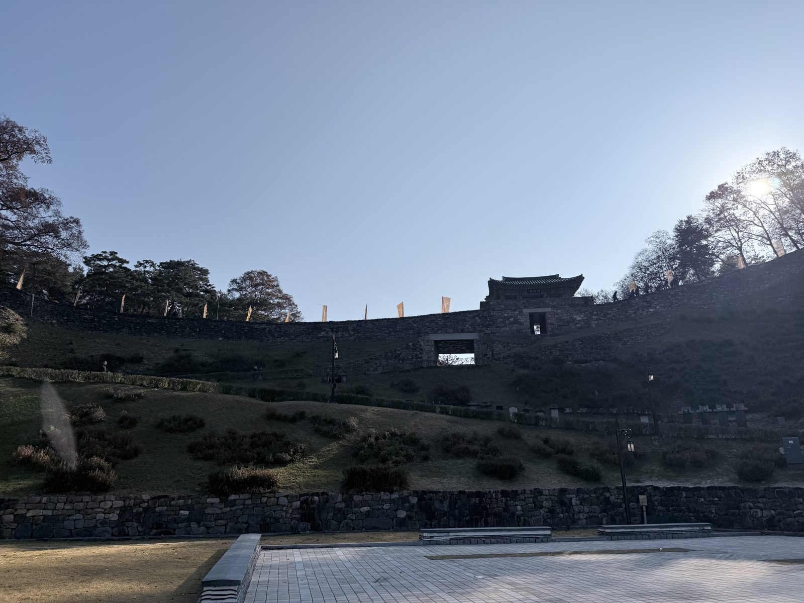
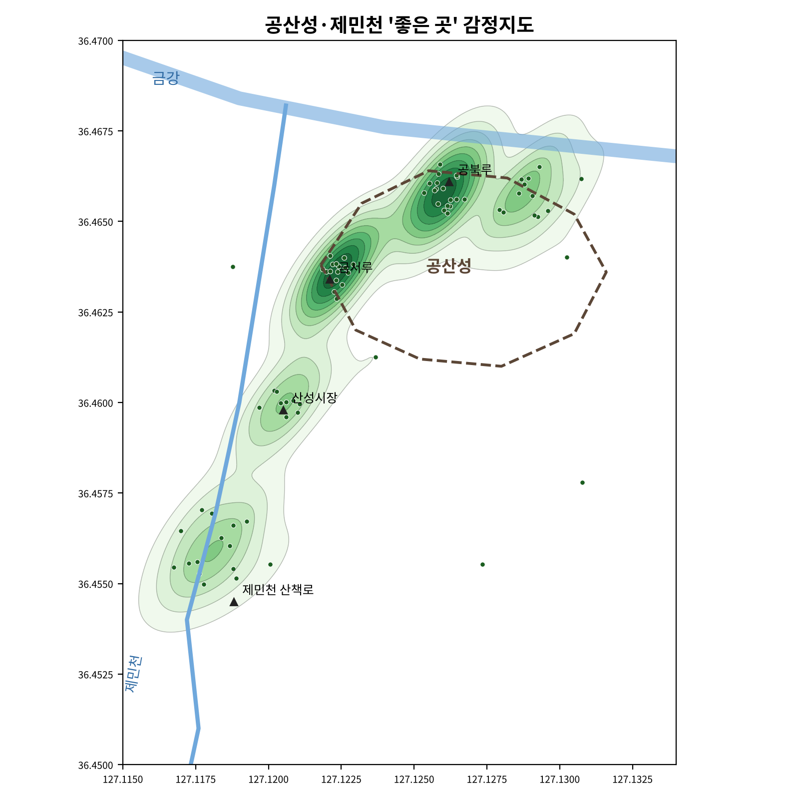
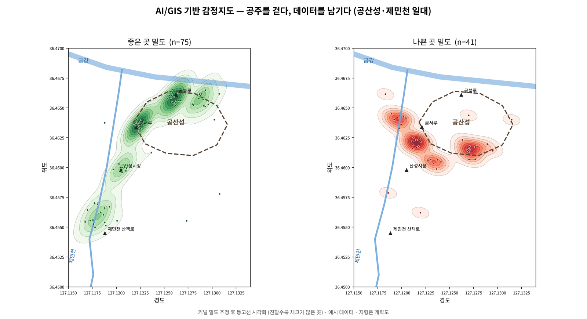

## 한눈에 보기

| 항목 | 내용 |
| --- | --- |
| 프로그램 | 공주 지산학 아카데미 「AI/GIS 기반 감정지도 제작 체험」 |
| 일시, 장소 | 2025.11.22(토), 국립공주대학교와 공주시 공산성, 제민천 일대 |
| 공동 주관 | 국립공주대, 광운대, 부산대, 전남대, 홍익대 |
| 도구 | QGIS, Python (NumPy, SciPy, Matplotlib) |
| 결과물 | 좋은 곳, 나쁜 곳 커널 밀도 감정지도와 재현 가능한 Python 코드 |


_현장 답사: 공산성_

---

## 1. 감정지도란

감정지도(Emotional Map)는 사람이 공간에서 느낀 감정을 **위치 정보와 함께 기록**해 지도 위에 나타낸 것. 관광지와 원도심은 보통 방문객 수, 시설 수 같은 정량 지표로 평가하지만, 걷는 사람이 실제로 느끼는 쾌적함이나 불편함은 그런 지표에 잘 드러나지 않음. 감정지도는 이 주관적인 경험을 **점 데이터**로 바꿔 공간 패턴을 찾는 방법.


답사 경로는 공산성 금서루 → 성곽길 → 공북루, 그리고 제민천 산책로. 걷다가 인상적인 지점에서 위치를 찍고 **좋음/나쁨과 그 이유**를 남겼음.

---

## 2. 데이터

> 당일 참가자들이 찍은 원본 데이터는 남아 있지 않음. 그래서 아래 분석은 참가자 5명(P1 ~ P5)의 현장 동선과 기록한 장소, 사유를 바탕으로 **다시 구성한 예시 데이터**로 과정을 재현한 것(난수 시드 20251122 고정). 지도는 "실제 측정 결과"가 아니라 "이 방법으로 무엇을 볼 수 있는가"를 보여 주는 용도
{: .prompt-warning }

| 필드 | 설명 | 예시 |
| --- | --- | --- |
| `id` | 지점 번호 | 1 |
| `participant` | 참가자 | P3 |
| `lon`, `lat` | 경도, 위도 (EPSG:4326) | 127.1224, 36.4636 |
| `mood` | 감정 | good / bad |
| `score` | 점수 | +1 / −1 |
| `place` | 장소 유형 | 금서루 전망 |
| `reason` | 체크 사유 | 성곽과 원도심이 한눈에 보이는 전망 |

```python
CLUSTERS = [  # (이름, 중심 경도, 위도, 반경(도), 개수, 감정, 사유)
    ("금서루 전망",        127.1224, 36.4636, 0.0004, 16, "good", "성곽과 원도심이 한눈에 보이는 전망"),
    ("공북루·금강 뷰",     127.1262, 36.4658, 0.0005, 18, "good", "금강 물길과 다리 야경"),
    ("남측 급경사 계단",    127.1270, 36.4614, 0.0005, 10, "bad",  "급한 계단, 난간 부족"),
    ("성곽 입구 차도",      127.1214, 36.4622, 0.0004,  9, "bad",  "차량 소음, 좁은 보도"),
    # ... 9개 장소 유형
]
for name, lon, lat, r, n, mood, reason in CLUSTERS:
    pts = rng.normal([lon, lat], [r, r * 0.8], size=(n, 2))   # 장소 주변에 흩어진 체크
```

같은 코드를 다시 실행해 저장된 `points.csv`와 **완전히 같은 결과**가 나오는 것을 확인했음.

```text
116 points
('공북루·금강 뷰', 'good') 18
('금서루 전망', 'good') 16
('제민천 카페거리', 'good') 14
('북측 성곽길', 'good') 12
('남측 급경사 계단', 'bad') 10
('산성시장 먹거리', 'good') 9
('성곽 입구 차도', 'bad') 9
('제민천 하류 정비 구간', 'bad') 8
('개별 체크', 'bad') 8
('공영주차장 주변', 'bad') 6
('개별 체크', 'good') 6
```

전체 116개 지점 중 좋은 곳 75개(65%), 나쁜 곳 41개(35%). 범위는 약 1.3 km × 1.3 km.

---

## 3. 분석: 커널 밀도 추정 (KDE)

점 하나하나에 종 모양의 커널(가우시안)을 씌우고 모두 더해, 지도 전체에 연속적인 밀도 값을 만듦. 체크가 몰린 곳일수록 값이 큼. QGIS의 Heatmap 렌더러와 "커널 밀도 추정" 도구가 같은 원리.

$$\hat{f}(x) = \frac{1}{n}\sum_{i=1}^{n} K_h(x - x_i)$$

```python
xmin, xmax, ymin, ymax = 127.1150, 127.1340, 36.4500, 36.4700
gx, gy = np.mgrid[xmin:xmax:300j, ymin:ymax:300j]          # 300 x 300 격자 (약 5 m 간격)
grid = np.vstack([gx.ravel(), gy.ravel()])

def kde(mood):
    p = np.array([[r["lon"], r["lat"]] for r in rows if r["mood"] == mood]).T
    k = gaussian_kde(p, bw_method=0.25)                      # 대역폭 계수
    z = k(grid).reshape(gx.shape)
    return z / z.max(), p                                    # 최댓값 1로 정규화

z, p = kde("good")
levels = np.linspace(0.08, 1, 10)                            # 등고선 10단계
ax.contourf(gx, gy, z, levels=levels, cmap="Greens", alpha=0.85)
ax.contour(gx, gy, z, levels=levels, colors="#33333355", linewidths=0.5)
ax.set_aspect(1 / np.cos(np.radians(36.46)))                 # 위도에 따른 경도 길이 보정
```

| 설정 | 값 | 이유 |
| --- | --- | --- |
| 커널 | 가우시안 | QGIS Heatmap 기본 커널과 비슷한 부드러운 모양 |
| 대역폭 계수 | 0.25 | 작으면 잘게 쪼개지고 크면 뭉개짐. 장소 단위(약 50 ~ 80 m) 차이가 보이도록 |
| 정규화 | 최댓값 = 1 | 좋은 곳 지도와 나쁜 곳 지도를 같은 척도로 비교 |
| 화면 비율 | $$1 / \cos 36.46^\circ$$ | 위도 36도에서 경도 1도는 위도 1도보다 짧아, 그대로 그리면 지도가 옆으로 늘어남 |

---

## 4. 결과


_좋은 곳 감정지도_


_좋은 곳(초록)과 나쁜 곳(빨강) 비교_

| 구분 | 진한 곳 | 해석 |
| --- | --- | --- |
| 좋은 곳 | 공북루, 금서루 일대 | 금강과 원도심이 내려다보이는 성곽 북, 서쪽에 모임 |
| 좋은 곳 | 제민천 카페거리, 산성시장 | 성곽에서 원도심으로 이어지는 "좋은 동선" 띠 |
| 나쁜 곳 | 남측 급경사 계단, 성곽 입구 차도 | 성곽 남쪽 출입부와 제민천 하류에 몰림 |

- 좋은 곳은 **조망과 쉼**이 있는 북쪽, 나쁜 곳은 **접근과 이동**이 불편한 남쪽 출입부로 나뉨
- 같은 공산성 안에서도 경관은 강점이지만, 들어가는 길(차도, 계단, 주차장)에서 보행 경험이 끊김

### 시사점

| 제안 | 근거 |
| --- | --- |
| 진입부 보행 환경 개선 | 성곽 입구 차도의 보도 확보, 남측 계단 난간과 쉼터 |
| 좋은 동선 연결 | 금서루 → 산성시장 → 제민천 카페거리를 원도심 산책 코스로 안내 |
| 하천 관리 | 제민천 하류 쓰레기와 악취 |
| 참여형 도시계획 | 주관적 감정도 위치와 함께 모으면 정량 분석의 근거가 됨 |

---

## 5. 내가 한 일

| 단계 | 한 일 |
| --- | --- |
| 사전 교육 | 감정지도 개념, GIS 좌표계(WGS84), QGIS 기본 사용법 |
| 현장 답사 | 공산성(금서루 → 성곽길 → 공북루)과 제민천 산책로를 걸으며 좋은 곳, 나쁜 곳을 위치와 이유와 함께 체크 |
| 데이터 정리, 분석 | 참가자별 체크 지점을 하나의 점 레이어로 합치고 속성을 입력한 뒤, QGIS Heatmap(커널 밀도)으로 좋은 곳, 나쁜 곳 밀도 지도 작성 |
| 재현 코드 (활동 후) | 원본 데이터가 남지 않아, 현장 동선을 바탕으로 예시 데이터를 재구성하고 같은 원리를 Python으로 다시 구현(`gongju_emotion_map.py`, 시드 고정) |
| 데이터 정리 | 점 데이터를 CSV와 GeoJSON(EPSG:4326)으로 저장하고, 좋은 곳 지도와 좋은 곳, 나쁜 곳 비교 지도 생성 |
| 보고서 | 감정지도의 개념, 데이터 구조, 분석 방법, 결과와 시사점을 README로 정리 |

## 6. 얻은 것

- **공간을 보는 눈**: 늘 지나던 길도 "좋다, 불편하다"를 기록하며 걸으니 평소라면 그냥 지나쳤을 계단 난간, 보도 폭 같은 것이 눈에 들어왔음
- **주관적 데이터의 정량화**: 개인의 감정 같은 주관적인 데이터도 위치와 함께 모으면 밀도 지도라는 객관적인 결과물로 바뀌는 과정이 인상 깊었음. 데이터 분석이 숫자만이 아니라 사람의 경험을 담을 수 있다는 것을 배웠음
- **GIS 기초**: 점 데이터, 좌표계, 커널 밀도 추정, 등고선 시각화라는 GIS 분석의 기본 흐름을 QGIS와 Python 양쪽으로 익힘
- **데이터 관리 습관**: 원본 데이터를 남겨 두지 않아 나중에 예시 데이터로 재구성해야 했음. 현장에서 모은 데이터는 그날 바로 백업해야 한다는 것을 배운 활동이기도 함

## 7. 개선 사항

| 한계 | 개선 방향 |
| --- | --- |
| **예시 데이터** | 장소와 개수를 사람이 정해 만든 데이터라, 지도는 그 설계를 그대로 다시 보여 줄 뿐 새로운 발견이 아님. 실제 수집 데이터로 다시 분석해야 결론을 말할 수 있음 |
| 표본 | 참가자 5명, 하루, 한 시간대. 시간대, 계절, 연령별 차이를 볼 수 없음 |
| 감정 척도 | 좋음/나쁨 두 가지뿐. 5점 척도와 감정 범주(쾌적, 불안, 소음, 피로)를 함께 기록 |
| 좌표계 | 위경도(도 단위) 그대로 KDE를 계산해 가로, 세로 거리 단위가 다름. 미터 단위 투영 좌표계(EPSG:5186 등)로 바꾼 뒤 계산해야 "반경 60 m"처럼 해석 가능 |
| 대역폭 | 0.25를 눈으로 정함. 교차 검증이나 Scott, Silverman 규칙과 비교하고, 값에 따라 결론이 바뀌는지 확인 |
| 비교 방식 | 좋은 곳, 나쁜 곳을 따로 정규화해 "어디가 더 좋은가"는 비교 불가. 점수(+1, −1)를 가중치로 한 순감정 지도나 비율 지도 추가 |
| 배경지도 | 지형 윤곽이 개략 좌표. OpenStreetMap 위에서 그리면 위치 오차가 줄어듦 |
| 수집 도구 | 모바일 웹 폼으로 위치, 사진, 감정을 바로 기록하면 표본을 늘리고 백업 문제도 해결됨 |

---

## 핵심 정리

1. 공주 지산학 아카데미에서 공주 공산성과 제민천을 걸으며 좋은 곳, 나쁜 곳을 위치와 함께 기록하는 감정지도를 만들었음
2. 감정지도는 걷는 사람의 주관적 경험을 점 데이터로 바꿔 정량 지표에 드러나지 않는 공간 패턴을 찾는 방법
3. 데이터는 id, 참가자, 위경도, 감정, 점수, 장소 유형, 사유로 구성했고 CSV와 GeoJSON(EPSG:4326)으로 저장함
4. 원본이 남지 않아 현장 동선을 바탕으로 예시 데이터 116개를 재구성했고, 시드를 고정해 같은 결과를 재현함
5. 커널 밀도 추정(가우시안, 대역폭 0.25, 300 × 300 격자)으로 점을 연속적인 밀도 지도로 바꾸고 등고선 10단계로 시각화함
6. 좋은 곳은 조망과 쉼이 있는 성곽 북쪽, 나쁜 곳은 접근이 불편한 남쪽 출입부로 나뉘어 진입부 보행 환경 개선을 제안함
7. 주관적 감정도 위치와 함께 모으면 객관적인 결과물이 될 수 있지만, 현장 데이터는 바로 백업해야 함
8. 실제 데이터, 미터 좌표계, 대역폭 검증, 순감정 지도, 모바일 수집 도구가 다음 단계

---

End.
