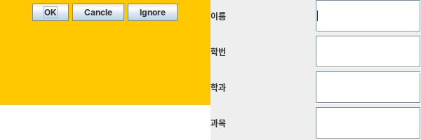
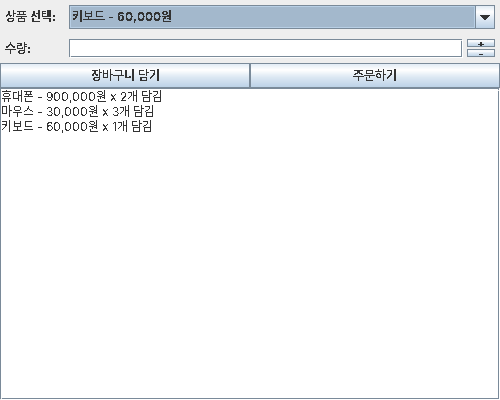

## 학습 목표

- 이벤트 기반 프로그래밍과 Swing의 구조(JFrame, 컨텐트팬)
- 배치 관리자 FlowLayout, GridLayout, BorderLayout, GridBagLayout
- 메뉴와 ActionListener, 내부 클래스·람다로 리스너 달기
- 모달 다이얼로그에서 값 받아오기
- ServerSocket과 Socket으로 1:1 채팅
- JDBC로 데이터베이스에 SQL 실행
- 과제 8: 상품 주문 GUI

GUI 예제는 화면이 없는 서버에서 가상 디스플레이(Xvfb)로 실행하고 캡처했다.

---

## 1. Swing 기초

- **이벤트 기반 프로그래밍**: 프로그램이 순서대로 끝나는 것이 아니라, 버튼 클릭 같은 **이벤트가 생기면** 등록해 둔 리스너가 실행된다
- `JFrame`이 창이고, 컴포넌트는 창의 **컨텐트팬(Container)** 에 붙인다

```java
public class ContentPaneEx extends JFrame {
    public ContentPaneEx() {
        setTitle("ContentPane과 JFrame");
        setDefaultCloseOperation(JFrame.EXIT_ON_CLOSE);   // 창을 닫으면 프로그램 종료
        Container contentPane = getContentPane();
        contentPane.setBackground(Color.ORANGE);
        contentPane.setLayout(new FlowLayout());
        contentPane.add(new JButton("OK"));
        contentPane.add(new JButton("Cancle"));
        contentPane.add(new JButton("Ignore"));
        setSize(300, 150);
        setVisible(true);
    }
}
```

`setDefaultCloseOperation`을 빼면 창을 닫아도 프로그램(JVM)이 계속 실행된다.

### 배치 관리자

| 배치 관리자 | 방식 | 기본으로 쓰는 곳 |
| --- | --- | --- |
| FlowLayout | 왼쪽에서 오른쪽으로 흐르듯, 넘치면 다음 줄 | JPanel |
| BorderLayout | 동·서·남·북·중앙 5구역 | JFrame의 컨텐트팬 |
| GridLayout(행, 열) | 같은 크기의 격자 | |
| GridBagLayout | 격자 + 칸 병합·가중치 | |

```java
GridLayout grid = new GridLayout(4, 2);   // 4행 2열
grid.setVgap(5);                          // 행 사이 간격
c.setLayout(grid);
c.add(new JLabel("이름"));  c.add(new JTextField(""));
c.add(new JLabel("학번"));  c.add(new JTextField(""));
...
```



왼쪽은 FlowLayout(버튼 3개가 한 줄로), 오른쪽은 GridLayout(4행 2열, 칸 크기가 모두 같음).

---

## 2. 메뉴와 이벤트 리스너

```java
class MenuActionListener implements ActionListener {
    public void actionPerformed(ActionEvent e) {
        String cmd = e.getActionCommand();     // 눌린 메뉴의 글자
        switch (cmd) {
            case "Load":
                if (imgLabel.getIcon() != null) return;
                imgLabel.setIcon(new ImageIcon("flower.jpg"));
                break;
            case "Hide":   imgLabel.setVisible(false); break;
            case "ReShow": imgLabel.setVisible(true); break;
            case "EXIT":   System.exit(0); break;
        }
    }
}
```

- 리스너 하나를 메뉴 아이템 4개에 모두 달고, `getActionCommand()`로 어떤 아이템인지 구분했다
- `MenuActionListener`는 **내부 클래스**라 바깥 클래스의 `imgLabel`에 바로 접근할 수 있다
- `new ImageIcon("flower.jpg")`는 **실행한 폴더** 기준 상대 경로다. IDE에서 실행 폴더가 프로젝트 루트면 `src/flower.jpg`를 못 찾아 그림이 안 나온다

### 모달 다이얼로그

```java
class MyDialog extends JDialog {
    public MyDialog(JFrame frame, String title) {
        super(frame, title, true);      // true = 모달
        ...
        okButton.addActionListener(e -> setVisible(false));
    }
    public String getInput() {
        if (tf.getText().length() == 0) return null;
        return tf.getText();
    }
}
```

**모달**이면 `dialog.setVisible(true)`가 다이얼로그가 닫힐 때까지 **반환하지 않는다**. 그래서 바로 다음 줄의 `dialog.getInput()`이 사용자가 입력을 마친 값을 읽을 수 있다. 모달이 아니면 바로 다음 줄로 넘어가 빈 값을 읽는다.

---

## 3. 소켓 통신

| 클래스 | 역할 |
| --- | --- |
| `ServerSocket` | 포트를 열고 **연결 요청을 기다림**(`accept()`). 데이터를 주고받지는 않음 |
| `Socket` | 실제 데이터 송수신. `accept()`가 서버 쪽 Socket을 돌려줌 |

- 소켓 연결은 **양방향** 통신이다
- 송수신은 서버·클라이언트 모두 **Socket**으로 한다. ServerSocket은 접속 요청을 받는 목적으로만 존재

```java
// 서버
ServerSocket listener = new ServerSocket(9999);
Socket socket = listener.accept();                       // 연결 대기
BufferedReader in = new BufferedReader(new InputStreamReader(socket.getInputStream()));
BufferedWriter out = new BufferedWriter(new OutputStreamWriter(socket.getOutputStream()));
String inputMessage = in.readLine();
out.write(outputMessage + "\n");
out.flush();                                             // 버퍼를 비워야 실제로 전송

// 클라이언트
Socket socket = new Socket("localhost", 9999);
```

같은 컴퓨터에서 서버와 클라이언트를 동시에 실행해 대화를 주고받았다.

```text
[서버]                                   [클라이언트]
연결을 기다리고 있습니다.
연결되었습니다.
클라이언트: 안녕                          보내기 >> 안녕
보내기 >> 반가워                          서버: 반가워
클라이언트: 또 보자                       보내기 >> 또 보자
보내기 >> 잘 가                           서버: 잘 가
클라이언트에서 bye로 연결을 종료하였음      보내기 >> bye
```

- `readLine()`은 줄바꿈까지 읽으므로 보낼 때 `"\n"`을 꼭 붙인다
- `flush()`를 빼면 데이터가 버퍼에 남아 상대가 계속 기다린다
- 한 번에 한 사람만 말할 수 있는 구조(서버는 받은 뒤 보내고, 클라이언트는 보낸 뒤 받음)다. 동시에 주고받으려면 받기를 별도 스레드로 돌려야 한다

---

## 4. JDBC

자바에서 데이터베이스에 SQL을 실행하는 API. 실습은 MySQL의 `student` 테이블에 학생을 추가 → 수정 → 삭제하며 매번 전체를 출력했다.

```java
Class.forName("com.mysql.cj.jdbc.Driver");              // 드라이버 로드
conn = DriverManager.getConnection(
        "jdbc:mysql://localhost:3306/sampledb", "root", "비밀번호");
stmt = conn.createStatement();
stmt.executeUpdate("insert into student (name, id, dept) values('아무개', '0893012', '컴퓨터공학')");
stmt.executeUpdate("update student set id='0189011' where name='아무개'");
stmt.executeUpdate("delete from student where name='아무개'");

ResultSet srs = stmt.executeQuery("select * from student");
while (srs.next())
    System.out.println(srs.getString("name"));
```

| 메소드 | 쓰임 | 반환 |
| --- | --- | --- |
| `executeQuery` | SELECT | `ResultSet` |
| `executeUpdate` | INSERT, UPDATE, DELETE | 바뀐 행 수 |

- 실습 코드에는 DB 비밀번호가 소스에 그대로 적혀 있어서 글에서는 가렸다. 실제로는 환경 변수나 설정 파일에서 읽는 편이 안전하다
- 사용자 입력을 SQL 문자열에 이어 붙이면 SQL 인젝션 위험이 있으므로 `PreparedStatement`와 `?` 자리표시자를 쓴다
- MySQL 서버와 드라이버가 없는 환경이라 이 예제는 실행하지 못했다

---

## 5. 과제 8: 상품 주문 GUI

> **과제 8**: Swing으로 상품을 고르고 수량을 정해 장바구니에 담고 주문하는 프로그램을 만들어라.
{: .prompt-info }

구성

| 부분 | 컴포넌트 | 배치 |
| --- | --- | --- |
| 상품 선택 | `JComboBox<String>` (휴대폰, 키보드, 마우스) | GridBagLayout |
| 수량 | `JTextField` + `+`/`-` 버튼 | BorderLayout + GridLayout(2, 1) |
| 버튼 | 장바구니 담기, 주문하기 | GridLayout(1, 2) |
| 장바구니 | `JTextArea` (읽기 전용) + `JScrollPane` | BorderLayout.CENTER |

핵심 처리

```java
// 숫자가 아닌 키는 입력 자체를 막음
qtyField.addKeyListener(new KeyAdapter() {
    public void keyTyped(KeyEvent e) {
        if (!Character.isDigit(e.getKeyChar())) e.consume();
    }
});

// - 버튼: 최소 1 유지
decBtn.addActionListener(e -> {
    String txt = qtyField.getText().trim();
    int val = txt.matches("^[0-9]+$") ? Integer.parseInt(txt) : 1;
    qtyField.setText(String.valueOf(Math.max(1, val - 1)));
});

private void addToCart() {
    if (!qtyField.getText().matches("^[0-9]+$")) {
        JOptionPane.showMessageDialog(this, "수량은 정수만 입력 가능합니다.");
        return;
    }
    cartArea.append(item + " x " + qty + "개 담김\n");
}
```

가상 화면에서 실행하고, 같은 패키지의 작은 드라이버 코드로 버튼을 눌러(`doClick()`) 휴대폰 2개(1 입력 후 +), 마우스 3개, 키보드 1개(빈 칸에서 −)를 담은 화면이다.



검토하면서 확인한 점

- 키 입력 필터와 정규식 검사를 함께 써서 숫자 외 입력이 두 겹으로 막힌다. 붙여넣기(Ctrl + V)는 `keyTyped`를 거치지 않는데, 정규식 검사가 그 경우를 잡아 준다
- 수량 0도 정규식 `^[0-9]+$`를 통과해 "0개 담김"이 들어간다. `qty > 0` 검사가 필요하다
- `prices` 배열(900,000 / 60,000 / 30,000)을 선언해 놓고 **한 번도 쓰지 않는다.** 주문할 때 합계 금액을 계산해 보여 주면 가격 정보를 상품 문자열과 따로 둔 이유가 생긴다. 예: 휴대폰 2 + 마우스 3 + 키보드 1 = 1,950,000원
- `+`/`-` 버튼 높이를 텍스트 필드 높이의 절반으로 잡아서 화면에서 기호가 거의 보이지 않는다(캡처의 오른쪽 작은 버튼). `JSpinner`를 쓰면 같은 기능을 표준 컴포넌트로 만들 수 있다
- 상품 이름과 가격을 하나의 문자열로 묶어 두어서, 가격을 바꾸려면 문자열과 `prices` 배열 두 곳을 고쳐야 한다. 상품 클래스 하나에 이름과 가격을 함께 두는 편이 낫다

---

### 강의 자료 및 정리 노트에서 정정한 부분 정리

| 위치 | 원래 | 정정 | 이유 |
| --- | --- | --- | --- |
| 11/13 실습 버튼 | Cancle | Cancel | 오타 |
| 12/2 JDBC 실습 | 비밀번호가 소스에 직접 기록 | 글에서는 가림, 환경 변수·설정 파일 사용 권장 | 보안 |
| 과제 8 | `prices` 배열 미사용 | 주문 시 합계 계산에 사용 | 선언만 하고 쓰지 않음 |

---

## 최종 핵심 정리

1. Swing은 이벤트 기반이며, 컴포넌트는 JFrame의 컨텐트팬에 붙이고 `EXIT_ON_CLOSE`로 창과 프로그램 종료를 맞춘다
2. 컨텐트팬의 기본 배치는 BorderLayout, JPanel은 FlowLayout이고 GridLayout은 같은 크기 격자다
3. 리스너 하나를 여러 컴포넌트에 달고 `getActionCommand()`로 구분할 수 있다
4. 모달 다이얼로그의 `setVisible(true)`는 닫힐 때까지 반환하지 않아 바로 다음 줄에서 입력값을 읽을 수 있다
5. ServerSocket은 연결만 받고, 실제 송수신은 양쪽의 Socket이 한다. `"\n"`과 `flush()`를 잊지 말 것
6. JDBC는 SELECT에 `executeQuery`, 변경에 `executeUpdate`를 쓰고, 입력값은 PreparedStatement로 넘긴다
7. 주문 GUI는 숫자 외 입력을 두 겹으로 막았지만 수량 0, 미사용 가격 배열, 작은 버튼이 개선점이다
8. 가상 디스플레이에서 GUI를 실행·캡처해 배치와 동작을 확인했다

---

End.
