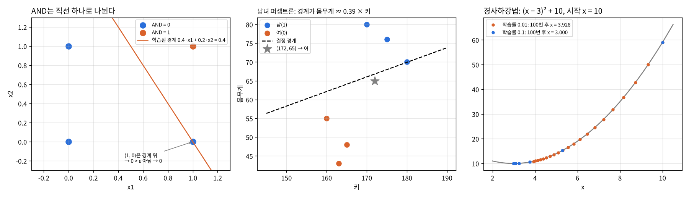

## 학습 목표

- 퍼셉트론의 구조(가중합 + 계단 함수)와 학습 규칙
- AND 연산을 학습하는 과정을 에폭별로 추적
- 퍼셉트론이 XOR을 풀지 못하는 이유(선형 분리)와 해결책
- sklearn `Perceptron`으로 키·몸무게 분류, 결정 경계 해석
- 경사하강법과 학습률의 영향
- 다층 퍼셉트론(MLP), 활성화 함수, 손실 함수, 역전파

---

## 1. 퍼셉트론

1957년 로젠블라트가 만든 가장 단순한 인공 신경망이다. 입력의 **가중합**이 임계값을 넘으면 1, 아니면 0을 출력한다.

$$y = \begin{cases} 1, & w_1x_1 + w_2x_2 + b > 0 \\ 0, & \text{otherwise} \end{cases}$$

- 임계값 θ를 바이어스 b = −θ로 옮겨 쓰면, 입력에 항상 1인 값을 하나 더 붙이고 b를 가중치처럼 학습할 수 있다
- 신경망의 장점(강의): 예제로부터 **스스로 학습**하고, 소자 몇 개가 고장 나도 전체가 크게 망가지지 않는다

### 학습 규칙

$$w_i \leftarrow w_i + \eta\,(y - \hat{y})\,x_i$$

- 맞히면 오차 y − ŷ = 0이라 그대로
- 1을 0으로 틀리면(오차 +1) 가중치를 키우고, 0을 1로 틀리면(오차 −1) 줄인다

---

## 2. 실습: AND를 학습하는 퍼셉트론

```python
import numpy as np

epsilon = 0.0000001

def step_func(t):
    if t > epsilon: return 1      # 부동소수점 오차를 피하려고 0 대신 아주 작은 값과 비교
    else: return 0

X = np.array([[0, 0, 1],          # 마지막 1은 바이어스용 입력
              [0, 1, 1],
              [1, 0, 1],
              [1, 1, 1]])
y = np.array([0, 0, 0, 1])        # AND
W = np.zeros(len(X[0]))

def perceptron_fit(X, y, epochs=1):
    global W
    eta = 0.2
    for t in range(epochs):
        print("epochs=", t)
        for i in range(len(X)):
            predict = step_func(np.dot(X[i], W))
            error = y[i] - predict
            W += eta * error * X[i]
            print("입력:", X[i], "정답:", y[i], "출력:", predict, "가중치:", W)

perceptron_fit(X, y, 6)
```

실행 결과(에폭별 마지막 가중치만 정리)

| 에폭 | 틀린 입력 | 에폭 끝 가중치 (w1, w2, b) |
| --- | --- | --- |
| 0 | [1, 1] | (0.2, 0.2, 0.2) |
| 1 | [0, 0], [0, 1], [1, 1] | (0.4, 0.2, 0.0) |
| 2 | [0, 1], [1, 0], [1, 1] | (0.4, 0.2, −0.2) |
| 3 | [1, 0], [1, 1] | (0.4, 0.4, −0.2) |
| 4 | [0, 1] | (0.4, 0.2, −0.4) |
| 5 | 없음 | (0.4, 0.2, −0.4) |

```text
입력: [0, 0] -> 출력: 0, 정답: 0
입력: [0, 1] -> 출력: 0, 정답: 0
입력: [1, 0] -> 출력: 0, 정답: 0
입력: [1, 1] -> 출력: 1, 정답: 1
```

- 강의 자료의 실행 결과와 에폭마다 가중치가 정확히 같다
- 학습된 경계는 0.4x₁ + 0.2x₂ − 0.4 = 0이다. 그런데 (1, 0)을 넣으면 가중합이 **정확히 0**이라 경계 위에 있다. ε과 비교해 0이 나와서 맞힌 것이고, 여유(margin)가 전혀 없는 경계다. 퍼셉트론은 "분리만 되면" 멈추기 때문에 가장 좋은 경계를 찾아 주지는 않는다



---

## 3. XOR 문제

```python
from sklearn.linear_model import Perceptron

X = [[0, 0], [0, 1], [1, 0], [1, 1]]
y = [0, 1, 1, 0]
clf = Perceptron(tol=1e-3, random_state=0).fit(X, y)
print(clf.predict(X))
```

실행 결과

```text
[0 0 0 0]
```

- 정확도 50%. 모두 0으로 찍었다
- XOR은 (0, 1)·(1, 0)과 (0, 0)·(1, 1)을 **직선 하나로 나눌 수 없다(선형 분리 불가능).** 퍼셉트론의 결정 경계는 직선(초평면)이라 원리적으로 불가능하다
- 같은 코드로 AND는 `[0 0 0 1]`로 잘 학습된다

### 해결: 게이트를 쌓기

XOR = AND(NAND, OR)

```python
def XOR(x1, x2):
    s1 = NAND(x1, x2)
    s2 = OR(x1, x2)
    return AND(s1, s2)
```

실행 결과

```text
0 XOR 0 -> 0
0 XOR 1 -> 1
1 XOR 0 -> 1
1 XOR 1 -> 0
```

퍼셉트론 두 개(NAND, OR)의 출력을 다시 퍼셉트론(AND)에 넣었다. 즉 **층을 하나 더 쌓으면** 풀린다. 이것이 다층 퍼셉트론의 아이디어다.

---

## 4. 실습: 키·몸무게로 남녀 분류

```python
X = np.array([[170, 80], [175, 76], [180, 70],
              [160, 55], [163, 43], [165, 48]])
y = np.array([1, 1, 1, 0, 0, 0])     # 1 = 남, 0 = 여
clf = Perceptron(tol=1e-3, random_state=0).fit(X, y)
```

학습 데이터 6개는 모두 맞혔다. 학습된 값을 보면

```text
coef_ = [[-181.  466.]]   intercept_ = [-3.]   n_iter_ = 22
```

- 결정 경계는 −181 × 키 + 466 × 몸무게 − 3 = 0, 즉 **몸무게 ≈ 0.39 × 키**
- 키의 가중치가 **음수**다. 이 모델은 사실상 "키에 비해 몸무게가 무거우면 남자"라는 규칙을 배웠다
- 그래서 (172cm, 65kg)는 여자, (168cm, 70kg)는 남자로 분류된다. 데이터 6개로는 그럴듯한 규칙을 배우기 어렵다는 것을 보여 준다
- 입력 단위가 커서(150~190) 가중치도 수백 단위로 커졌다. 특징을 표준화하면 학습이 더 안정적이다

실습 코드는 `while True` 안에서 키와 몸무게를 입력받고, 둘 다 0이면 종료한다.

---

## 5. 경사하강법

손실 함수를 최소로 만드는 W를 찾는 최적화 방법이다. **기울기(미분값)의 반대 방향**으로 조금씩 이동한다.

$$x \leftarrow x - \eta \cdot f'(x)$$

- 미분값이 양수면 왼쪽으로, 음수면 오른쪽으로 → 항상 내려가는 방향
- 변수가 여러 개면 편미분을 모은 벡터(그래디언트)를 쓴다

실습: 손실 f(x) = (x − 3)² + 10, 기울기 f'(x) = 2x − 6, 시작 x = 10

| 학습률 η | 100번 반복 후 x | 손실 |
| --- | --- | --- |
| 0.01 | 3.928 | 10.86 |
| 0.1 | 3.000 | 10.00 |

- 최솟값은 x = 3, 손실 10이다. η = 0.01로는 100번 안에 도착하지 못했다. 매번 오차의 2%만 줄이기 때문(x − 3 ← 0.98(x − 3))
- 실습 코드에는 `precision = 0.00001`이 선언만 되어 있고 쓰이지 않는다. 이동량이 precision보다 작아질 때 멈추도록 하면 η = 0.01에서 **474번** 만에 x = 3.0005로 수렴했다
- 학습률이 너무 크면(예: η > 1) 최솟값을 넘어 발산한다

---

## 6. 다층 퍼셉트론 (MLP)

입력층과 출력층 사이에 **은닉층**이 있는 신경망이다.

### 활성화 함수

| 함수 | 식 | 출력 범위 | 특징 |
| --- | --- | --- | --- |
| 계단 | 0보다 크면 1 | {0, 1} | 미분값이 0이라 경사하강법을 쓸 수 없음 |
| 시그모이드 | 1 / (1 + e^(−x)) | (0, 1) | 1980년대부터 사용, 층이 깊으면 기울기 소실 |
| tanh | (e^x − e^(−x)) / (e^x + e^(−x)) | (−1, 1) | 0을 중심으로 대칭 |
| ReLU | max(0, x) | [0, ∞) | 계산이 빠르고 기울기 소실이 적음 |

- **선형 함수는 아무리 쌓아도 선형 함수 하나와 같다.** 그래서 은닉층에는 반드시 비선형 활성화 함수가 필요하다

### 손실 함수

$$E = \frac{1}{2}\sum_k (t_k - y_k)^2$$

강의 예: 정답이 2인 숫자를 10개 출력 유닛으로 분류할 때

| 출력 | 손실 |
| --- | --- |
| 2번 출력 0.8 (나머지 0.1, 0.1) | 0.03 |
| 0번 출력 0.9, 2번 출력 0.1 | 0.81 |

정답에 가까울수록 손실이 작다(NumPy로 같은 값 확인).

### 역전파 (Backpropagation)

1. **순방향**: 입력에서 출력까지 층별로 가중합 → 활성화를 계산
2. 출력과 정답의 오차로 손실 계산
3. **역방향**: 체인 룰로 각 가중치에 대한 손실의 편미분을 출력층부터 거꾸로 계산
4. 경사하강법으로 모든 가중치를 갱신

### XOR을 MLP로 학습

은닉 유닛 2개, 시그모이드, 학습률 0.5로 역전파를 NumPy로 직접 구현해 돌렸다.

| 반복 | 손실 | 출력 (00, 01, 10, 11) |
| --- | --- | --- |
| 0 | 0.503 | 0.478, 0.460, 0.471, 0.453 |
| 1,000 | 0.499 | 0.504, 0.491, 0.509, 0.495 |
| 5,000 | 0.0018 | 0.030, 0.972, 0.966, 0.027 |
| 10,000 | 0.0006 | 0.018, 0.983, 0.979, 0.016 |

- 처음 1,000번 동안은 손실이 거의 줄지 않다가 그 뒤에 빠르게 수렴했다. 퍼셉트론 하나로는 50%가 한계였던 XOR을 은닉층 하나로 풀었다
- sklearn `MLPClassifier`(은닉 4개, tanh)로도 시드 5개 모두 `[0 1 1 0]`을 맞혔다

---

### 강의 자료 및 정리 노트에서 정정한 부분 정리

| 위치 | 원래 | 정정 | 이유 |
| --- | --- | --- | --- |
| 11/25 실습 주석 (AND 패키지 버전) | "XOR 학습 예제" | AND 학습 예제 | 레이블이 [0, 0, 0, 1] |
| 12/2 경사하강법 실습 | `precision` 선언만 하고 미사용 | 이동량 < precision이면 종료 | 그대로 두면 100번 후 x = 3.93으로 끝나 최솟값에 못 감 |

---

## 최종 핵심 정리

1. 퍼셉트론은 가중합이 0을 넘으면 1을 내는 모델이고, 바이어스는 항상 1인 입력의 가중치로 학습한다
2. 학습 규칙 w ← w + η(y − ŷ)x는 틀린 방향으로만 가중치를 고친다
3. AND 학습은 에폭 5에서 (0.4, 0.2, −0.4)로 멈췄고, (1, 0)은 경계 위에 있어 여유가 없다
4. XOR은 선형 분리가 불가능해서 퍼셉트론 하나로는 정확도 50%(모두 0)에 그친다
5. NAND와 OR의 출력을 AND로 합치면 XOR이 된다 → 층을 쌓는 것이 해결책
6. 남녀 퍼셉트론은 "몸무게 ≈ 0.39 × 키"라는 경계를 배웠다. 데이터 6개로 만든 규칙의 한계를 보여 준다
7. 경사하강법은 기울기 반대로 움직이며, η = 0.01은 100번으로 부족했고 멈춤 조건을 넣으면 474번에 수렴했다
8. MLP는 비선형 활성화 함수와 역전파로 학습하며, 은닉층 하나로 XOR을 손실 0.0006까지 학습했다

---

End.
