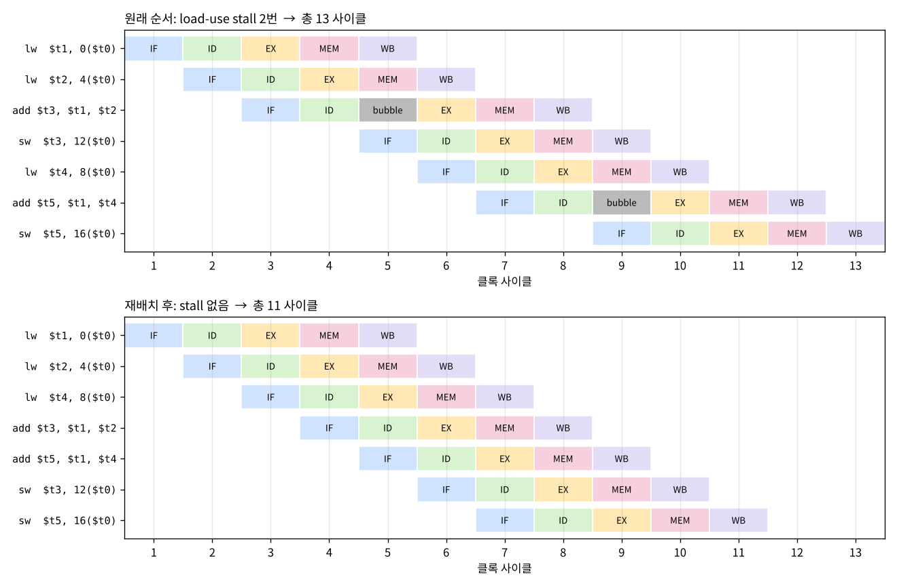

## 학습 목표

- 단일 사이클 구현의 한계와 파이프라인이 성능을 높이는 원리
- `lw`, `sw`, R 형식, `beq`의 제어 신호와 그 이유
- 세 가지 해저드와 해결법, 명령어 재배치로 stall 없애기
- 캐시: 지역성, Word·Block·Page, 블록 크기, 쓰기 정책
- 가상 메모리: 페이지 테이블, TLB, 페이지 폴트 처리 과정, 관리 비트
- I/O(Memory-mapped vs Isolated, DMA), RAID, 예외 처리(EPC, Cause), VM과 컨테이너

손으로 정리한 기말 정리 노트와 기출 유형별 답안 노트를 주제 순서로 다시 묶었다. 해저드 문제는 파이프라인 일정을 코드로 그려 사이클 수를 확인했다.

---

## 1. 단일 사이클 vs 파이프라인

> **(중요!!)** 단일 사이클 구현이 오늘날 쓰이지 않는 이유
{: .prompt-warning }

- 단일 사이클은 모든 명령어를 **한 클록** 안에 끝내야 한다. 그래서 클록 주기를 **가장 오래 걸리는 명령어(`lw`)**에 맞춰야 한다
- `add`처럼 짧은 명령어도 긴 클록을 다 써야 해서 낭비가 크고, 각 하드웨어 유닛도 한 사이클에 한 번만 쓰인다
- **파이프라인**은 명령어를 IF, ID, EX, MEM, WB 5단계로 나누고 여러 명령어를 겹쳐 실행한다. 한 명령어의 지연 시간은 줄지 않지만 **처리량(throughput)**이 이상적으로 단계 수만큼 늘어난다

| 구분 | 클록 주기 | CPI | 특징 |
| --- | --- | --- | --- |
| 단일 사이클 | 가장 긴 명령어 기준(길다) | 1 | 단순하지만 느림 |
| 멀티 사이클 | 가장 긴 단계 기준(짧다) | 명령어마다 다름 | 유닛 재사용 |
| 파이프라인 | 가장 긴 단계 기준 | 이상적으로 1에 가까움 | 해저드 처리 필요 |

---

## 2. 제어 신호

> **(중요!!)** 주어진 데이터패스에서 `lw` 수행에 필요한 제어 신호와 이유 (기출)
{: .prompt-warning }

| 명령어 | RegDst | ALUSrc | MemtoReg | RegWrite | MemRead | MemWrite | Branch |
| --- | --- | --- | --- | --- | --- | --- | --- |
| R 형식 | 1 | 0 | 0 | 1 | 0 | 0 | 0 |
| **lw** | **0** | **1** | **1** | **1** | **1** | **0** | **0** |
| sw | X | 1 | X | 0 | 0 | 1 | 0 |
| beq | X | 0 | X | 0 | 0 | 0 | 1 |

`lw $rt, offset($rs)`의 이유

- **RegDst = 0**: I 형식이라 목적 레지스터가 rd가 아니라 **rt**
- **ALUSrc = 1**: ALU 두 번째 입력이 레지스터가 아니라 **부호 확장한 오프셋**(주소 = rs + offset)
- **MemtoReg = 1**: 레지스터에 쓸 값이 ALU 결과가 아니라 **메모리에서 읽은 값**
- **RegWrite = 1**: 읽은 값을 레지스터에 저장
- **MemRead = 1 / MemWrite = 0**: 메모리를 읽기만 함
- **Branch = 0**: 분기 명령어가 아님

X(don't care)는 어떤 값이어도 결과가 바뀌지 않는다는 뜻이다. `sw`는 레지스터에 쓰지 않으니 RegDst, MemtoReg가 무관하다.

---

## 3. 해저드 (Hazard)

| 종류 | 원인 | 예 | 해결 |
| --- | --- | --- | --- |
| 구조 해저드 | 같은 하드웨어를 두 명령어가 동시에 사용 | 메모리가 하나일 때 IF와 MEM 충돌 | 명령어·데이터 메모리(캐시) 분리, stall |
| 데이터 해저드 | 앞 명령어의 결과가 아직 레지스터에 쓰이지 않았는데 다음 명령어가 사용 | `lw` 직후 그 값을 쓰는 `add` | 포워딩, stall, 명령어 재배치 |
| 제어 해저드 | 분기 결과가 나오기 전에 다음 명령어를 가져와야 함 | `beq` | stall, 분기 예측, 분기 지연 슬롯 |

데이터 해저드 해결법 3가지

1. **Stall(버블)**: 값이 준비될 때까지 기다림. 확실하지만 사이클 낭비
2. **Forwarding(바이패싱)**: EX/MEM, MEM/WB 파이프라인 레지스터에 있는 결과를 레지스터 파일에 쓰기 전에 바로 ALU 입력으로 당겨 옴
3. **명령어 재배치**: 의존성이 없는 명령어를 사이에 끼워 넣음(컴파일러)

> 포워딩이 있어도 **load-use 해저드**는 1사이클 stall이 남는다. `lw`의 값은 MEM 단계가 끝나야 나오는데, 바로 다음 명령어는 그 시점에 이미 EX 단계에 들어가야 하기 때문이다.
{: .prompt-tip }

### 명령어 재배치 문제

> **문제** (12, 13, 24년 모두 출제): 해저드 위치와 종류를 찾고, 코드 순서를 바꿔 stall을 없애라.
{: .prompt-info }

```assembly
lw  $t1, 0($t0)
lw  $t2, 4($t0)
add $t3, $t1, $t2    # $t2를 바로 앞 lw가 읽어 옴 → load-use stall
sw  $t3, 12($t0)
lw  $t4, 8($t0)
add $t5, $t1, $t4    # $t4를 바로 앞 lw가 읽어 옴 → load-use stall
sw  $t5, 16($t0)
```

재배치: 세 번째 `lw`를 위로 올려 두 `add`가 각자 쓰는 값을 **한 명령어 이상 떨어진 곳**에서 받게 한다.

```assembly
lw  $t1, 0($t0)
lw  $t2, 4($t0)
lw  $t4, 8($t0)
add $t3, $t1, $t2    # $t2는 2개 앞에서 로드 → 포워딩으로 해결
add $t5, $t1, $t4    # $t4는 2개 앞에서 로드 → 포워딩으로 해결
sw  $t3, 12($t0)
sw  $t5, 16($t0)
```

5단계 파이프라인(포워딩 있음)을 가정해 두 순서의 일정을 그렸다.



- 원래: 명령어 7개 + 파이프라인 채우기 4 + stall 2 = **13사이클**
- 재배치 후: 7 + 4 = **11사이클**
- 재배치는 결과(메모리에 저장되는 값)를 바꾸지 않아야 한다. `$t4`를 쓰는 명령어가 원래 `lw $t4` 앞에 없어서 위로 올려도 안전하다

---

## 4. 메모리 계층과 캐시

### Word, Block, Page

| 단위 | 정의 | 어디서 쓰나 |
| --- | --- | --- |
| Word | CPU가 한 번에 처리하는 데이터 크기 (MIPS는 32비트 = 4바이트) | 레지스터, ALU |
| Block(Line) | 캐시와 메모리 사이에서 옮기는 단위, 1워드 이상 | 캐시 |
| Page | 가상 메모리에서 메모리와 디스크 사이에서 옮기는 고정 크기 단위 (보통 4KB) | 가상 메모리 |

### 지역성 (Locality)

- **시간 지역성(Temporal)**: 최근에 쓴 데이터나 명령어는 곧 다시 쓰일 가능성이 높다 (반복문 변수)
- **공간 지역성(Spatial)**: 어떤 주소를 쓰면 그 근처 주소도 곧 쓰일 가능성이 높다 (배열, 순차 명령어)
- 캐시가 효과가 있는 이유가 지역성이다. 블록 단위로 가져오는 것은 공간 지역성을 이용하는 것

### Valid bit와 Tag

- **Tag**: 캐시 블록에 들어 있는 데이터가 메모리의 **어느 주소**에서 왔는지 구분
- **Valid bit**: 그 블록에 **유효한 데이터**가 있는지 표시. 전원을 켠 직후에는 모두 0

### 블록이 너무 크면 생기는 문제

1. 캐시 전체 크기가 고정되어 있으면 블록 수가 줄어들어 **충돌이 늘고 miss rate가 다시 올라간다**
2. miss 한 번에 가져올 데이터가 많아져 **miss penalty가 커진다**

### 쓰기 정책

| 정책 | 동작 | 장점 | 단점 |
| --- | --- | --- | --- |
| Write-Through | 캐시에 쓸 때마다 메모리도 같이 갱신 | 메모리와 항상 일치, 단순 | 쓰기마다 메모리 접근 → 느림 |
| Write-Back | 캐시만 갱신, 블록이 교체될 때 메모리에 씀(Dirty일 때만) | 메모리 접근 감소 | 구현 복잡, 교체 시 지연 |

- **Write Buffer**: Write-Through의 단점을 줄이려고 메모리에 쓸 데이터를 잠시 담아 두는 버퍼. CPU는 버퍼에 넣고 바로 다음 일을 한다

### 교체 정책

- **LRU(Least Recently Used)**: 가장 오랫동안 쓰이지 않은 블록·페이지를 교체 대상(victim)으로 고름. 시간 지역성에 잘 맞는다
- 정확한 LRU는 기록 비용이 커서, 실제로는 **Reference bit**로 근사한다
- 다른 방식: FIFO(먼저 들어온 것), Random, LFU(가장 적게 쓴 것)

---

## 5. 가상 메모리

### 가상 메모리가 필요한 이유

- 각 프로그램(프로세스)에 **독립된 가상 주소 공간**을 주고, 실제 물리 메모리 위치는 OS와 하드웨어가 연결한다
- 지금 필요한 페이지만 메모리에 올리고 나머지는 디스크(swap 공간)에 두어 **물리 메모리보다 큰 프로그램**과 **여러 프로세스**를 동시에 실행할 수 있다
- 프로세스끼리 서로의 메모리에 접근하지 못하게 **보호**한다

### 페이지 테이블

- 가상 페이지 번호 → 물리 페이지 번호를 적은 표
- **메인 메모리**에 저장된다. 시작 주소는 CPU의 **Page Table Register**가 가리킨다
- OS가 만들고 관리·갱신하며, 주소 변환 때 하드웨어(MMU)가 읽는다

### TLB (Translation Lookaside Buffer)

- 최근 주소 변환 결과(페이지 테이블 항목 일부)를 저장하는 **CPU 안의 작은 캐시**
- TLB가 없으면 메모리 접근 한 번에 **페이지 테이블 읽기 + 실제 데이터 읽기 = 메모리 2번**이 필요하다
- TLB hit이면 페이지 테이블을 읽지 않고 바로 물리 주소를 얻는다

### 관리 비트

> **(중요!!)** Valid, Dirty, Reference bit의 정의와 언제, 왜 쓰는지 (기출 노트에 "100% 출제" 표시)
{: .prompt-warning }

| 비트 | 의미 | 언제 쓰나 | 왜 |
| --- | --- | --- | --- |
| Valid | 페이지 테이블 항목이 유효한지 = 그 페이지가 **물리 메모리에 있는지** | MMU가 주소를 변환할 때 | 0이면 페이지 폴트를 일으켜 OS가 디스크에서 가져오게 함 |
| Dirty | 메모리에 올라온 뒤 **내용이 바뀌었는지** | 페이지(또는 Write-Back 캐시 블록)를 교체할 때 | 1이면 디스크에 다시 써야 하고, 0이면 그냥 버려도 됨 → 불필요한 쓰기 감소 |
| Reference(Use) | 최근에 **접근된 적이 있는지** | 교체할 victim을 고를 때 | 주기적으로 0으로 지우고, 0인 페이지를 우선 교체해 LRU를 근사 |

### 페이지 폴트 처리 과정

1. CPU가 가상 주소로 메모리 접근을 요청
2. MMU가 TLB를 확인 → miss
3. Page Table Register로 페이지 테이블에 접근해 Valid bit 확인
4. Valid = 0이면 **페이지 폴트** 예외 발생, 제어가 OS로 넘어감
5. OS가 디스크의 swap 공간에서 해당 페이지 위치를 찾음
6. 빈 물리 페이지가 없으면 Reference bit를 참고해 victim을 고름
7. victim의 Dirty = 1이면 디스크에 먼저 써 둠
8. 새 페이지를 메모리에 올리고 페이지 테이블(Valid = 1)과 TLB를 갱신
9. 폴트를 일으킨 명령어를 **처음부터 다시 실행** (EPC에 저장한 주소로 돌아감)

---

## 6. 입출력 (I/O)

### Memory-mapped I/O vs Isolated I/O

| 구분 | Memory-mapped I/O | Isolated(Port-mapped) I/O |
| --- | --- | --- |
| 주소 공간 | 메모리 주소의 일부를 I/O 장치에 배정 | I/O 전용 주소 공간 따로 |
| 명령어 | `lw`/`sw` 그대로 사용 | `in`/`out` 같은 전용 명령어 필요 |
| 장점 | 명령어 체계가 단순, 프로그래밍이 유연 | 메모리 주소 공간을 다 쓸 수 있음 |
| 단점 | 메모리 주소 공간이 줄어듦, I/O 영역은 캐시하지 않도록 따로 처리해야 함 | 명령어 수 증가, 프로그래밍이 덜 유연 |

- MIPS는 Memory-mapped I/O를 쓴다 (x86은 둘 다 지원)

### Polling, Interrupt, DMA

- **Polling**: CPU가 장치 상태를 계속 확인 → CPU 시간 낭비
- **Interrupt**: 장치가 준비되면 CPU에 알림 → 확인하는 낭비는 없지만 데이터 전송은 여전히 CPU가 함
- **DMA(Direct Memory Access)**: CPU가 DMA 컨트롤러에 전송할 주소·크기를 알려 주면, **데이터 전송 자체는 CPU 없이** 장치와 메모리가 직접 한다. 끝나면 인터럽트로 알림
  - 왜 필요한가: 디스크처럼 큰 데이터를 옮길 때 CPU가 바이트마다 개입하면 CPU 시간이 크게 낭비된다
- **I/O Processor(채널)**: I/O 명령어를 스스로 실행하는 별도 프로세서로, DMA보다 CPU에서 더 독립적

---

## 7. RAID

**RAID(Redundant Array of Inexpensive/Independent Disks)**: 여러 물리 디스크를 하나의 논리 디스크처럼 묶는 기술

사용하는 이유 2가지

1. **성능**: 데이터를 여러 디스크에 나눠 저장(striping)해 병렬로 읽고 씀
2. **신뢰성(가용성)**: 중복 저장이나 패리티로 디스크가 고장 나도 데이터를 복구

| 레벨 | 방식 | 견딜 수 있는 고장 | 특징 |
| --- | --- | --- | --- |
| 0 | Striping만 | 0 | 가장 빠르지만 하나만 고장 나도 전부 잃음 |
| 1 | Mirroring | 1 (짝마다) | 공간 효율 50% |
| 2 | 해밍 코드 ECC | 1 | 복잡해서 거의 안 씀 |
| 3 | 바이트 단위 striping + 전용 패리티 디스크 | 1 | 패리티 디스크 병목 |
| 4 | 블록 단위 striping + 전용 패리티 디스크 | 1 | 작은 쓰기마다 패리티 디스크 병목 |
| 5 | 블록 단위 + **분산 패리티** | 1 | 병목 해소, 가장 널리 사용 |
| 6 | 블록 단위 + **이중 패리티(P + Q)** | 2 | 디스크 2개 고장까지 복구 |
| 10 | RAID 1 + 0 | 짝마다 1 | 빠르고 안전하지만 공간 효율 50% |

---

## 8. 예외 처리: EPC와 Cause 레지스터

- **EPC(Exception Program Counter)**: 예외를 일으킨 **명령어의 주소**를 저장. 처리 후 그 명령어로 돌아가 다시 실행하거나 다음으로 넘어갈 때 쓴다
- **Cause 레지스터**: 예외의 **원인 코드**(정의되지 않은 명령어, 산술 오버플로, 페이지 폴트 등)를 저장. OS가 어떤 처리 루틴으로 갈지 판단할 때 읽는다
- 차이: EPC는 **어디서**, Cause는 **왜**

---

## 9. 가상 머신 vs 컨테이너

| 구분 | Virtual Machine | Container |
| --- | --- | --- |
| 가상화 수준 | 하드웨어(하이퍼바이저) | OS(호스트 커널 공유) |
| 포함하는 것 | 게스트 OS 전체 + 앱 | 앱 + 필요한 라이브러리 |
| 격리 | 높음 | VM보다 낮음 (커널 공유) |
| 자원·속도 | 무겁고 부팅 느림 | 가볍고 시작이 빠름 |

---

### 강의 자료 및 정리 노트에서 정정한 부분 정리

| 위치 | 원래 | 정정 | 이유 |
| --- | --- | --- | --- |
| 기출 답안 노트 (Dirty bit) | "캐시 블록이 메모리에 비해 수정되었는지" | 페이지 테이블에서는 페이지가 디스크 사본과 다른지, 캐시에서는 블록이 메모리와 다른지 | 질문이 페이지 테이블 비트(Valid·Reference와 함께)를 묻는 문맥 |
| 기출 답안 노트 (Write-Back) | "페이지가 교체될 때 메모리에 업데이트" | **캐시 블록**이 교체될 때 메모리에 씀 | Write-Back은 캐시 정책, 페이지 교체와 구분 |
| 기출 답안 노트 (DMA) | "CPU는 다른 일을 하다가 DMA가 인터럽트를 발생하면" | 전송 시작 설정과 완료 인터럽트 처리만 CPU가 함 | 데이터 전송 중에는 CPU 개입 없음 |
| 기출 답안 노트 (TLB) | "페이지 테이블에 접근할 때 이중 메모리 접근을 최소화" | TLB hit이면 페이지 테이블 접근 자체를 생략 | 이중 접근 = 페이지 테이블 1번 + 데이터 1번 |
| 기출 답안 노트 오타 | 주조, 테이터, 있ㅋ기, 가져와햐 | 주소, 데이터, 있기, 가져와야 | 오타 |

---

## 최종 핵심 정리

1. 단일 사이클은 가장 긴 명령어에 클록을 맞춰 낭비가 크고, 파이프라인은 5단계를 겹쳐 처리량을 높인다
2. `lw`의 제어 신호는 RegDst 0, ALUSrc 1, MemtoReg 1, RegWrite 1, MemRead 1, MemWrite 0, Branch 0
3. 해저드는 구조·데이터·제어 3종류이고, 데이터 해저드는 stall, 포워딩, 명령어 재배치로 해결한다
4. load-use 해저드는 포워딩으로도 1사이클 stall이 남지만, 재배치하면 예제는 13 → 11사이클이 된다
5. 캐시는 시간·공간 지역성 덕분에 효과가 있고, 블록이 너무 크면 블록 수 감소와 miss penalty 증가가 생긴다
6. Write-Through는 단순하지만 메모리 접근이 많고, Write-Back은 Dirty 블록만 교체 시 쓴다
7. 페이지 테이블은 메모리에 있고, TLB가 변환 결과를 캐시해 메모리 이중 접근을 줄이며, Valid·Dirty·Reference 비트가 폴트·쓰기·교체를 결정한다
8. DMA는 CPU 없이 장치-메모리 전송, RAID 5는 분산 패리티로 1개, RAID 6은 이중 패리티로 2개 고장을 견딘다

---

End.
