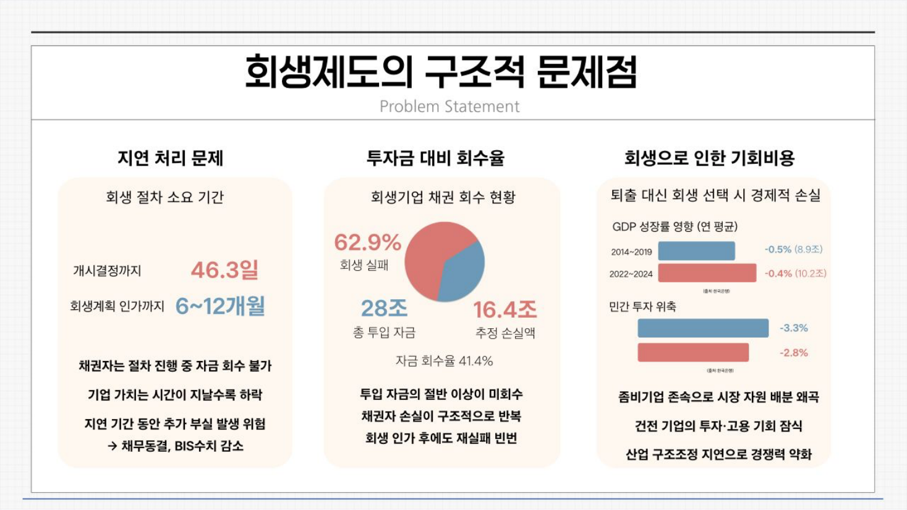
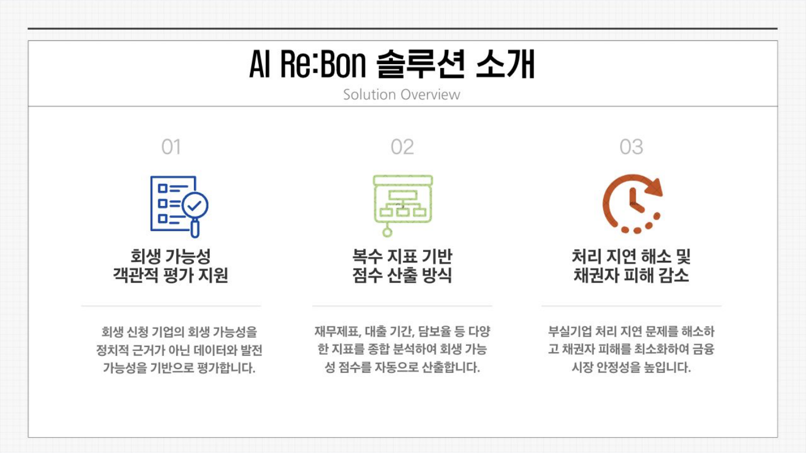
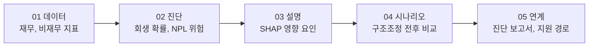
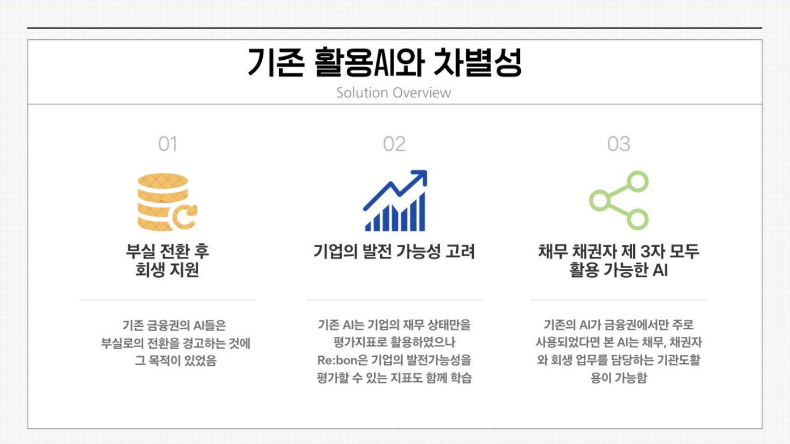
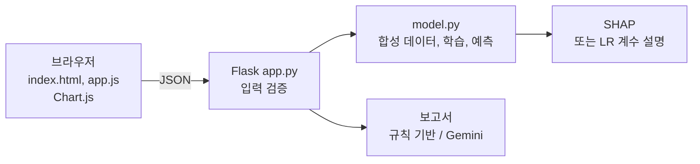
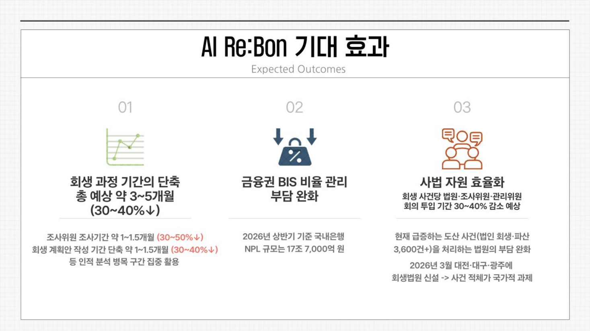

## 한눈에 보기

| 항목 | 내용 |
| --- | --- |
| 활동 | 2026 HUSS AI 경진대회 (HUSS 융합캠프, 2026.07) |
| 팀 | 연트워크, 4명 |
| 주제 | 부실기업 구조조정의 새로운 해법: **기업의 회생 가능성 판별 지원 AI** |
| 결과물 | 발표 자료, 실행 가능한 웹 데모(Flask + JavaScript), 테스트 코드, 시연 영상 |
| 모델 | Logistic Regression + Random Forest 스태킹 앙상블 (XGBoost, LightGBM은 선택) |
| 이후 | 같은 아이디어를 "도시의 기업 회복력" 관점으로 다듬어 2026 스마트시티 아이디어 경진대회 발표 자료로 준비 중 |

---

## 1. 문제: 회생 판단은 늦고, 정보는 흩어져 있다

기업 회생은 재정적으로 어려운 기업이 파산 대신 채무를 조정하고 사업을 이어 가도록 법원이 감독하는 절차. 청산 가치보다 **계속기업 가치**가 높을 때 의미가 있음. 발표 자료에 따르면 2023년 기업회생 신청은 전년 대비 54.9% 늘어 역대 최고치를 기록했고, 2025년에도 증가세가 이어지고 있음.


_발표 자료: 회생제도의 구조적 문제점_

| 문제 | 내용 (발표 자료 기준) |
| --- | --- |
| 지연 처리 | 회생 개시 결정까지 평균 46.3일, 회생계획 인가까지 6 ~ 12개월. 그사이 기업 가치는 계속 떨어짐 |
| 낮은 회수율 | 회생기업 채권 중 회생 실패 62.9%, 투입 자금 28조 원 중 추정 손실 16.4조 원 (회수율 41.4%) |
| 기회비용 | 회생 가능성이 낮은 기업에 자금이 묶이면 건전한 기업의 투자, 고용 기회가 줄어듦 |

정리하면, 회생 가능성을 **빨리, 근거와 함께** 판단할 도구가 없다는 것이 출발점이었음.

## 2. 해결: Re:Bon


_발표 자료: 솔루션 소개_




_발표 자료: 기존 AI와의 차별점_

| 기존 금융권 AI | Re:Bon |
| --- | --- |
| 부실로 넘어가는 것을 **경고**하는 데 목적 | 부실 이후 **회생 지원**에 초점 |
| 재무 상태 위주 평가 | 특허, 산업 전망, 경영진 안정성 등 **발전 가능성 지표**도 함께 학습 |
| 금융기관 내부용 | 채무자, 채권자, 회생 업무 담당 기관이 **함께 보는** 근거 자료 |

---

## 3. 시스템 구조



| API | 역할 |
| --- | --- |
| `GET /api/health` | 서버 상태 확인 |
| `GET /api/train` | 모델 학습(처음 한 번), 성능과 변수 중요도 반환 |
| `POST /api/predict` | 지표 8개 입력 → 회생 확률, NPL 위험 |
| `POST /api/explain` | 변수별 기여도(SHAP, 실패 시 LR 계수 기반) |
| `POST /api/benchmark` | 업종 평균과 비교 |
| `POST /api/timeseries` | 5개년 재무 추이 |
| `POST /api/ai_report` | 진단 보고서 (Gemini 키가 없으면 규칙 기반) |

입력값은 서버에서 **타입과 범위를 먼저 검증**함. 화면에서 막더라도 API를 직접 호출하면 이상한 값이 들어올 수 있기 때문.

```python
INPUT_SPECS = {   # 이름: (타입, 최솟값, 최댓값, 기본값)
    'debt_ratio': (float, 0.0, 1500.0, 200.0),
    'industry_outlook': (int, 1, 5, 3),
    # ... 지표 8개
}

def parse_inputs(data):
    parsed = {}
    for name, (caster, minimum, maximum, default) in INPUT_SPECS.items():
        value = caster(data.get(name, default))
        if isinstance(value, float) and not math.isfinite(value):
            raise ValueError(f'{name} 값은 유한한 숫자여야 합니다.')
        if not minimum <= value <= maximum:
            raise ValueError(f'{name} 값은 {minimum}~{maximum} 범위여야 합니다.')
        parsed[name] = value
    return parsed
```

## 4. 데이터와 모델

### 입력 지표 8개

| 구분 | 지표 |
| --- | --- |
| 재무 | 부채비율, 이자보상배율, 영업이익률, 총부채 대비 현금흐름, 당좌비율 |
| 비재무 | 보유 특허 수, 산업 전망(1 ~ 5), 경영진 안정성(1 ~ 5) |

### 합성 데이터

실제 회생 판례 데이터는 구할 수 없어서, 한계기업의 지표 분포를 흉내 낸 **합성 데이터 1,200건**을 만들었음. 지표마다 가중치를 준 점수에 잡음을 더하고, 로지스틱 함수로 바꿔 0.5 이상이면 회생 성공(1)으로 라벨을 붙임.

```python
score = (
    -0.8 * (df['debt_ratio'] - 350) / 250
    + 1.8 * df['interest_coverage_ratio']
    + 1.2 * (df['operating_profit_margin'] + 5) / 10
    + 2.2 * (df['cash_flow_to_debt'] + 2) / 8
    + 0.5 * (df['quick_ratio'] - 80) / 50
    + 0.2 * df['tech_patents']
    + 1.0 * (df['industry_outlook'] - 3)
    + 0.8 * (df['ceo_stability'] - 3)
    + rng.normal(0, 1.5, n_samples)          # 잡음
)
prob = 1 / (1 + np.exp(-score))
df['rehabilitated'] = (prob > 0.5).astype(int)
```

### 스태킹 앙상블

```python
X_train, X_test, y_train, y_test = train_test_split(X, y, test_size=0.25, random_state=42, stratify=y)
estimators = [('lr', lr), ('rf', rf)]            # XGBoost, LightGBM이 설치되어 있으면 추가
stacking = StackingClassifier(
    estimators=estimators,
    final_estimator=LogisticRegression(max_iter=1000, random_state=42),
    cv=5,
)
stacking.fit(X_train_s, y_train)
```

기본 모델들의 예측 확률을 5-fold 교차 검증으로 만든 뒤, 그 확률들을 다시 입력으로 받는 로지스틱 회귀(메타 모델)가 최종 확률을 냄.

---

## 5. 실행 결과

이 글을 쓰며 저장된 코드를 그대로 다시 실행했음(XGBoost, LightGBM 없이 LR + RF).

```text
Ran 5 tests in 0.112s
OK

lr       {'accuracy': 0.8867, 'f1': 0.9023, 'auc': 0.9635}
rf       {'accuracy': 0.8633, 'f1': 0.8852, 'auc': 0.9484}
ensemble {'accuracy': 0.8833, 'f1': 0.8997, 'auc': 0.9627}
{'total_samples': 1200, 'success_rate': 0.58, 'failure_rate': 0.42}
```

앙상블 정확도 88.3%, ROC-AUC 0.963으로 발표 자료의 숫자와 같았음. 변수 중요도는 총부채 대비 현금흐름 → 이자보상배율 → 영업이익률 순.

<video controls muted playsinline preload="metadata" style="width:100%;border-radius:8px" src="/assets/video/activities/rebon_demo.mp4"></video>
_실행 영상 (39초): 기업 선택 → 예측 → SHAP 근거 → 구조조정 시나리오 → 업종 비교 → 진단 보고서_


_발표 자료: 기대 효과_

---

## 6. 88.3%를 어떻게 읽어야 할까

결과를 다시 보면서 두 가지가 눈에 띄었음.

1. **단순한 LR(88.7%)이 앙상블(88.3%)보다 조금 높음**. 라벨을 만든 식이 원래 "가중합 → 로지스틱"이라 LR이 정답 구조와 똑같기 때문. 복잡한 모델을 쌓아도 얻을 게 없는 데이터였음
2. 잡음을 뺀 **생성식 자체**로 테스트셋을 맞혀 봤더니

```python
s = (-0.8*(df.debt_ratio-350)/250 + 1.8*df.interest_coverage_ratio + ...)   # 잡음 없는 점수
print("oracle test acc:", ((s[te] > 0) == df.rehabilitated[te]).mean())
```

```text
oracle(노이즈 없는 생성식) test acc: 0.88
oracle AUC: 0.961
```

정답을 만든 공식을 알고 있어도 88%가 한계. 즉 모델은 **우리가 넣은 잡음(표준편차 1.5) 수준까지 공식을 거의 완벽히 다시 배운 것**이고, 88.3%는 "실제 기업의 회생을 88% 맞힌다"는 뜻이 아니라 "**우리가 정한 규칙을 잘 따라 한다**"는 뜻. 그래서 실제 활용 전에는 진짜 회생, 청산 사례로 다시 검증해야 함.

> 스마트시티 경진대회용 수정본에서는 이 점을 반영해 "합성 데이터 기반 프로토타입, 실제 회생기업 데이터의 외부 검증 결과가 아님"을 슬라이드에 명시하고, 기대 효과도 "확정 효과로 주장하지 않고 파일럿에서 기준값부터 측정"하는 방식으로 바꿨음
{: .prompt-info }

---

## 7. 내가 한 일

팀 연트워크(4명)의 한 사람으로 대회 기간 동안 아래 작업을 함께 했고, 대회 이후의 정리는 내가 이어서 했음.

| 시점 | 한 일 |
| --- | --- |
| 문제 조사 | 법원 회생 사건 통계, 한국은행, 자본시장연구원 보고서, 언론 기사에서 처리 지연과 회수율 근거를 모으고, Claude와 ChatGPT로 자료 출처와 회생 절차 단계별 기간 탐색 |
| 기획 | 예측 대상(회생 성공 여부)과 사용자(법원, 금융기관, 기업)를 정하고 재무 5개, 비재무 3개 지표 선정 |
| 개발 | 합성 데이터 생성, 스태킹 앙상블, SHAP 설명, Flask API와 대시보드로 이어지는 웹 데모와 스모크 테스트 |
| 발표 | 문제점, 솔루션, 차별성, 기대 효과 순서의 발표 자료와 시연 영상(자동 녹화 스크립트) |
| 대회 이후 | 같은 아이디어를 "도시의 기업 회복력" 관점으로 다듬은 스마트시티 경진대회용 v2 발표 자료 준비 |
| 블로그 정리 | 코드를 다시 실행해 성능을 재현하고, 잡음 없는 생성식과 비교해 88.3%의 의미를 검증(6절) |

## 8. 얻은 것

- 기업 회생이라는 낯선 법, 금융 문제를 AI 문제로 바꾸는 과정이 가장 어려웠음. "무엇을 예측할 것인가(회생 성공 여부)", "누가 쓰는가(법원, 금융기관, 기업)"를 먼저 정하자 화면과 기능이 정해졌음
- 확률 하나만 보여 주는 모델은 이해관계자를 설득하지 못한다는 점에서 **설명 가능성(SHAP)과 시나리오 비교**가 핵심이라고 판단했고, 발표에서도 이것을 기존 AI와의 차별점으로 내세웠음
- 높은 정확도가 나왔을 때 기뻤지만, 다시 따져 보니 그 숫자는 데이터를 만든 우리 자신의 가정을 반영한 것이었음. **성능 숫자보다 그 숫자가 어디서 나왔는지**를 먼저 설명해야 한다는 것을 배웠음
- 테스트 코드, 입력 검증, 실행 영상 자동 녹화 스크립트를 갖춰 두면 코드를 고친 뒤에도 같은 시연을 다시 만들 수 있음. 데모도 하나의 소프트웨어로 관리해야 한다는 것을 느꼈음

## 9. 개선 사항

| 개선 | 내용 |
| --- | --- |
| 실제 데이터 | 법원 회생 사건 통계, OpenDART 재무제표, 한국자산관리공사 자료로 실제 회생 성공, 실패 라벨 구성 |
| 라벨 생성 | 합성 데이터도 `prob > 0.5`로 자르지 말고 `rng.binomial(1, prob)`로 뽑아야 실제처럼 불확실성이 남음 |
| 시간 기준 검증 | 무작위 분할 대신 과거 연도로 학습하고 이후 연도로 평가 (미래 정보 누출 방지) |
| 설명 일관성 | 화면의 확률은 스태킹 모델, SHAP 설명은 RF 모델에서 나와 서로 다른 모델을 설명함. 스태킹 전체에 대한 SHAP(KernelExplainer)이나 LR 단일 모델로 통일 |
| 표시 오류 | XGBoost가 없을 때 `xgb_success`에 LR 값이 그대로 들어감. 없는 모델은 표시하지 않도록 수정 |
| 확률 보정 | 회생 확률을 그대로 의사결정에 쓰려면 보정 곡선(calibration)으로 확인 |
| 거버넌스 | 기업 정보 처리 기준, 전문가 검토 절차, 모델 모니터링 |

---

## 핵심 정리

1. Re:Bon은 2026 HUSS AI 경진대회에서 팀 연트워크로 만든 기업 회생 가능성 판별 지원 AI 웹 데모
2. 회생 절차의 지연(개시까지 평균 46.3일)과 낮은 회수율(41.4%)을 근거로, 회생 가능성을 빨리 근거와 함께 판단하는 도구를 목표로 함
3. 재무 5개, 비재무 3개 지표로 회생 확률과 NPL 위험을 추정하고 SHAP 근거, 구조조정 시나리오, 업종 비교, 보고서를 제공함
4. Flask API는 입력 타입과 범위를 서버에서 검증하고, 스모크 테스트 5개가 모두 통과함
5. 합성 데이터 1,200건과 LR + RF 스태킹 앙상블로 정확도 88.3%, AUC 0.963을 재현함
6. 단순 LR이 앙상블보다 높고, 잡음 없는 생성식의 정확도도 88%여서 이 성능은 실제 예측력이 아니라 우리가 정한 규칙의 재현임
7. 이후 수정본에서는 합성 데이터 한계를 명시하고 기대 효과를 파일럿 측정 방식으로 바꿨음
8. 실제 회생 데이터, 확률적 라벨, 시간 기준 검증, 설명 대상 일치, 확률 보정이 다음 과제

---

End.
