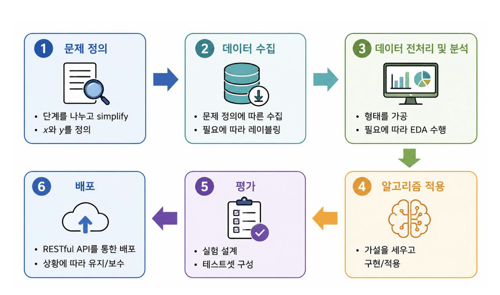
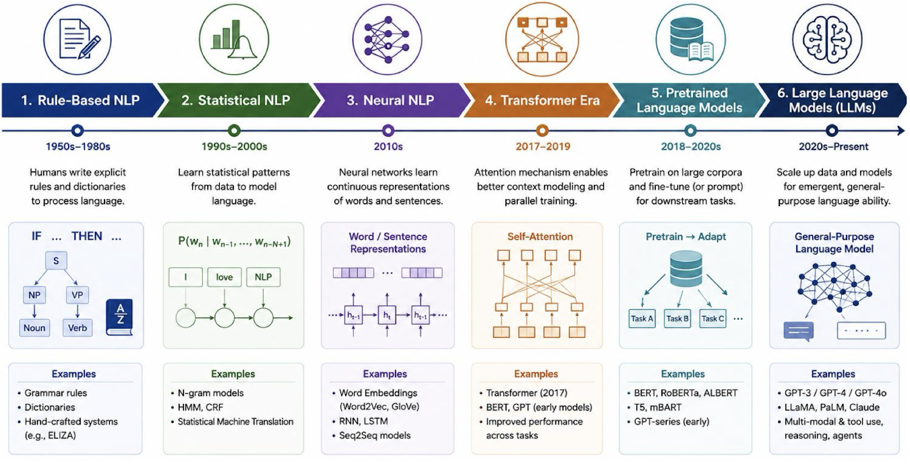

[toc]

## 1. 강의의 학습 목표

- NLP란 무엇인가?
- NLP는 왜 어려운가?
- NLP로 무엇을 할 수 있는가?
- NLP는 어떻게 발전해 왔는가?
- 앞으로 NLP는 어떤 방향으로 나아가는가?

## 2. 자연어

### 자연어와 자연어 처리

- 자연어(Natural Language)란?
  - 사람들이 일상적으로 사용하는 언어를 인공적으로 만들어진 언어인 **인공어**와 구분하여 부르는 개념
- 자연어 처리(NLP)는 다음 두 방향의 변환을 포함
  - **자연어 이해(NLU, Natural Language Understanding)**
     사람이 이해하는 자연어를 컴퓨터가 이해할 수 있는 값으로 변환(사람 → 컴퓨터)
  - **자연어 생성(NLG, Natural Language Generation)**
     컴퓨터가 이해할 수 있는 값을 사람이 이해할 수 있는 자연어로 변환(컴퓨터 → 사람)

NLP는 컴퓨터가 사람의 말을 이해하도록 바꾸는 과정과, 컴퓨터의 결과를 사람이 읽을 수 있는 말로 바꾸는 과정을 모두 포함

## 3. NLP와 인공지능

NLP는 입력 $x가 주어졌을 때 출력 y$를 반환하는 함수로 표현할 수 있음

$$
 y = f(x)
$$

여기서:

- **파라미터(weight parameter, $\theta$)란?**
  - 입력 $x가 들어왔을 때 어떤 출력 y$를 내보낼지 결정하는 함수 $f$의 동작 방식을 결정
- **학습이란?**
  - $x와 y$의 쌍으로 이루어진 데이터가 주어졌을 때, $x에서 y$로 가는 관계를 배우는 과정
  - $x와 y$를 통해 적절한 파라미터 $\theta$를 찾아내는 것
- **모델이란?**
  - 상황에 따라 알고리즘 자체를 이르거나, 알고리즘에 사용되는 파라미터를 이름

> NLP 모델은 입력 언어를 적절한 출력으로 변환하는 함수

### 좋은 NLP 모델의 조건

좋은 인공지능 모델은 **일반화(Generalization)**를 잘해야 함

- 학습 중 보지 못한 **unseen 데이터**에 대해서도 **좋은 예측(prediction)**을 해야 함
- 모든 가능한 경우의 수에 대한 데이터를 수집할 수 없기 때문에, 모델은 보지 못한 경우에도 적절한 판단을 내려야 함

**기존 머신러닝의 한계**

- 기존 머신러닝은 주로 선형 또는 낮은 차원의 데이터를 다루도록 설계됨
- `Kernel` 등을 사용하여 비선형 데이터를 다룰 수 있지만 한계가 있음
- 이미지, 텍스트, 음성과 같은 훨씬 높은 차원의 데이터에서는 성능이 낮게 나타날 수 있음

**좋은 모델 == 처음 보는 데이터에도 잘 작동하는 모델**

## 4. 자연어 처리가 어려운 이유

### 중의성과 생략된 문맥

자연어가 어려운 주요 이유는 **중의성(Ambiguity)**이다.

**중의성**이란?

- 하나의 표현이 여러 의미로 해석될 수 있는 현상

예시

> ```
> 차를 마시러 공원에 가던 차 안에서 나는 그녀에게 차였다.
> ```

이 문장에서 `차`와 `차였다`는 문맥에 따라 서로 다른 의미를 가질 수 있음

영어로도 다음과 같은 여러 해석이 가능함

- `I was kicking her in the car that went to the park for tea.`
- `I was a car to her, in the car I had a car and went to the park.`
- `I got dumped by her on the way to the park for tea.`
- `I was in the car going to the park for tea and I was in her car.`
- `I got dumped by her in the car that was going to the park for a cup of tea.`

자연어는 효율성을 높이는 방향으로 진화했기 때문에, 짧은 문장 안에 많은 정보를 담고 정보량이 낮은 문맥은 생략하는 경향이 있음

생략된 문맥으로 인해 **모호함** 발생

- 사람은 생략된 문맥을 효율적으로 보충할 수 있음
- 컴퓨터는 생략된 문맥을 채우는 작업에 매우 취약함

또 다른 예 : `나는 철수를 안 때렸다.`

| 원문                   | 가능한 의미                                          |
| ---------------------- | ---------------------------------------------------- |
| 나는 철수를 안 때렸다. | 철수는 맞았지만 때린 사람이 나는 아니다.             |
| 나는 철수를 안 때렸다. | 나는 누군가를 때렸지만, 그 사람이 철수는 아니다.     |
| 나는 철수를 안 때렸다. | 나는 누군가를 때린 적도 없고, 철수도 맞은 적이 없다. |

컴퓨터는 문장에 직접 쓰이지 않은 정보를 알기 어려움

같은 문장도 누가 무엇을 했는지에 따라 여러 의미가 될 수 있음

### 의역과 의미·문맥

- **의역(Paraphrase)란?**
  - 같은 의미를 서로 다른 표현으로 나타내는 것

1. 여자가 김치를 어떤 남자에게 집어 던지고 있다.
2. 여자가 어떤 남자에게 김치로 때리고 있다.
3. 여자가 김치 쓰레기를 날리고 있다.
4. 여자가 배추 김치 한 포기로 남자를 때리고 있다.
5. 여자가 김치를 사용해 남자를 때리고 있다.
6. 남자가 여자에게 김치로 싸대기를 맞고 있다.
7. 남자가 여자로부터 김치로 맞고 있다.

표현은 서로 다르지만, 상황과 의미의 관계를 파악해야 서로 유사한 표현인지 판단할 수 있음

**자연어와 컴퓨터 표현의 차이**

- **언어는 이산적(Discrete)**인 값을 갖지만, **인간의 이해는 연속적(Continuous)임**
- `One-hot` 인코딩은 단어의 유사도나 모호성을 표현하기 어려움
  - 서로 다른 `One-hot` 벡터 사이의 유사도나 거리는 모두 동일하게 취급됨
- 사람은 `<파랑>`과 `<핑크>` 중에서 `<빨강>`에 더 가까운 단어를 판단할 수 있음
  - 이러한 판단은 인간의 계층적 어휘 체계와 관련된다.
- 사전에 기록된 모든 단어를 높은 차원의 벡터로 표현하면 매우 `sparse`해진다.

컴퓨터가 단어를 단순히 서로 다른 번호로만 표현하면 단어 사이의 의미 관계를 알기 어려움

단순한 `One-hot` 표현은 모든 단어를 서로 똑같이 멀리 있는 것으로 봄

## 5. NLP 문제 해결 파이프라인

NLP 문제를 해결하는 전체 과정은 다음 6단계로 제시된다.



1. **문제 정의**
   - 문제를 여러 단계로 나눔
   - **입력 $x와 출력 y$를 정의**
2. **데이터 수집**
   - 문제 정의에 따라 데이터를 수집
   - 필요하면 데이터에 라벨을 붙임
3. **데이터 전처리 및 분석**
   - 데이터의 형태를 가공함
   - 필요하면 `EDA(Exploratory Data Analysis, 탐색적 데이터 분석)`를 수행함
4. **알고리즘 적용**
   - 가설을 세움
   - 알고리즘을 구현하고 적용
5. **평가**
   - 실험을 설계
   - 테스트셋을 구성
6. **배포**
   - `RESTful API`를 통해 모델을 배포
   - 상황에 따라 유지·보수

**NLP는 바로 모델을 적용하는 것이 아니라, 먼저 문제와 입력·출력을 정하고 데이터를 준비한 뒤 전처리, 알고리즘 적용, 평가, 배포 순서로 진행함**

## 6. NLP의 주요 작업

### NLP 작업의 전체 개요

- 텍스트 분류
- 시퀀스 라벨링
- 정보 추출
- 기계 번역
- 질의응답
- 텍스트 요약
- 텍스트 생성
- 대화 시스템

같은 문장이라도 주제를 알고 싶은지, 단어의 역할을 알고 싶은지, 번역하고 싶은지에 따라 적용하는 NLP 작업과 출력이 달라짐

### 텍스트 분류

- **텍스트 분류(Text Classification)이란?**
  - 입력된 텍스트를 미리 정의된 하나 이상의 범주(Category/Class)로 분류하는 NLP 작업
  - 문장, 문서, 리뷰, 이메일 등 다양한 길이의 텍스트에 적용되며, NLP에서 가장 기본적이고 널리 사용되는 문제 중 하나

$$
 \mathrm{Text}*x \rightarrow \mathrm{Model}\ f*\theta \rightarrow \mathrm{Label}\ y
$$

응용

| 응용                    | 입력              | 출력                           |
| ----------------------- | ----------------- | ------------------------------ |
| `Sentiment Analysis`    | 상품·영화 리뷰    | `Positive / Negative`          |
| `Spam Detection`        | `Email / Message` | `Spam / Normal`                |
| `Topic Classification`  | `News Article`    | `Politics / Sports / Tech`     |
| `Intent Classification` | `User Query`      | `Search / Order / Reservation` |

**텍스트 분류는 글을 읽고 미리 정해 둔 범주 중 하나를 선택하는 작업**

예를 들어 리뷰를 긍정·부정으로 나누거나, 뉴스 기사를 정치·스포츠·기술 분야로 나눌 수 있음

### 시퀀스 라벨링

- **시퀀스 라벨링(Sequence Labeling)이란?**
  - 문장을 구성하는 각 `Token`에 `Label`을 부여하는 작업
  - 즉, **입력이 토큰의 시퀀스**라면 **출력은 라벨의 시퀀스**

예시 문장:

> ```
> Apple released a new iPhone in California.
> ```

| Token     | Apple | released | a    | new  | iPhone    | in   | California |
| --------- | ----- | -------- | ---- | ---- | --------- | ---- | ---------- |
| NER Label | `ORG` | `O`      | `O`  | `O`  | `PRODUCT` | `O`  | `LOC`      |

대표적인 작업은 다음과 같다.

- **POS Tagging**: 각 단어의 품사를 식별
- **Named Entity Recognition (NER)**: 사람, 조직, 장소, 제품 등의 개체를 식별

| 라벨      | 의미           | 설명                        | 예                           |
| --------- | -------------- | --------------------------- | ---------------------------- |
| `ORG`     | `Organization` | 회사, 기관, 단체            | `Apple`, `Google`, `NASA`    |
| `PRODUCT` | `Product`      | 제품이나 상품               | `iPhone`, `Galaxy`           |
| `LOC`     | `Location`     | 장소, 지역                  | `California`, `Seoul`        |
| `O`       | `Outside`      | 정의된 개체에 해당하지 않음 | `released`, `a`, `new`, `in` |

⭐️시퀀스 라벨링은 **문장을 단어 단위로 나누고 각 단어의 역할을 표시하는 작업**

예를 들어 `Apple`은 조직, `iPhone`은 제품, `California`는 장소로 표시

### 정보 추출

- **정보 추출(Information Extraction)이란?**
  - 텍스트 속에서 **의미 있는 개체와 관계를 구조화된 정보로 추출**하는 작업

예시 문장:

> ```
> Apple released a new iPhone in California.
> ```

추출 결과는 다음과 같이 나타낼 수 있다.

- `Apple` — `ORG`
- `iPhone` — `PRODUCT`
- `California` — `LOC`
- `Apple` $\rightarrow$ `released` $\rightarrow$ `iPhone`
- `Apple` $\rightarrow$ `in` $\rightarrow$ `California`

**개체는 노드로, 개체 사이의 관계는 연결선으로 표현할 수 있음**

**시퀀스 라벨링이 각 단어의 종류를 표시하는 작업**이라면, ****

**정보 추출은 그 단어들이 서로 어떤 관계를 가지는지까지 구조화하는 작업**

### 기계 번역

- **기계 번역(Machine Translation)이란?**
  - 한 언어(Source Language)의 문장이나 문서를 다른 언어(Target Language)로 자동 변환하는 기술

$$
 \mathrm{Source\ Language}
 \rightarrow
 \mathrm{Translation\ Model}
 \rightarrow
 \mathrm{Target\ Language}
$$

예시:

- 원문: `오늘 날씨가 정말 좋습니다.`
- 번역문: `The weather is really nice today.`

자료의 변환 과정은 다음 요소를 포함한다.

1. 원천 언어 문장 입력
2. 언어·의미 표현을 통해 의미와 문맥을 반영
3. `Neural / Transformer Model` 적용
4. 목표 언어 문장 생성

기계 번역은 한 언어의 문장을 다른 언어로 바꾸는 작업

단어를 단순히 치환하는 것이 아니라 **의미와 문맥을 보존하여 목표 언어의 문장을 생성하는 과정**

### 질의응답과 텍스트 요약

- **질의응답(Question Answering)이란?**
  - 질문에 대해 관**련 정보를 찾아 적절한 답을 생성하거나 추출하는 작업**

자료의 예시에서는 다음과 같은 문맥이 주어진다.

> ```
> Apple introduced the iPhone in 2007.
> ```

질문:

> ```
> When was the iPhone introduced?
> ```

답변:

> ```
> 2007
> ```

- **텍스트 요약(Text Summarization)이란?**
  - 긴 텍스트의 **핵심 정보를 유지하면서 짧고 간결한 형태로 변환**하는 작업

### 텍스트 생성과 대화 시스템

- **텍스트 생성(Text Generation)이란?**
  - 주어진 입력이나 문맥을 기반으로 **새로운 자연어 텍스트를 생성하는 작업**

예시:

- 입력: `Artificial intelligence is changing the way we work.`
- 생성된 텍스트: `AI can automate repetitive tasks and help people make better decisions.`
- **대화 시스템(Dialogue Systems)이란?**
  - 사용자와 문맥을 주고받으며 자연어로 상호작용하는 시스템

자료의 대화 예시는 다음과 같음

- 사용자: `What is NLP?`
- 도우미: `NLP is a field of AI that enables computers to understand and generate human language.`
- 사용자: `Can you give me an example?`
- 도우미: `Machine translation and chatbots are common examples.`

**텍스트 생성은 새로운 글을 만드는 작업**이고,

**대화 시스템은 사용자의 질문과 앞선 대화 내용을 고려하여 자연어로 계속 상호작용하는 작업**

### 하나의 문장에 적용되는 여러 NLP 작업

다음 문장을 기준으로 작업별 결과가 달라짐

> ```
> Apple released a new iPhone in California.
> ```

| 알고 싶은 것                 | NLP 작업                 | 출력                               |
| ---------------------------- | ------------------------ | ---------------------------------- |
| 이 문장의 주제는?            | `Text Classification`    | `Technology`                       |
| 각 단어의 역할은?            | `Sequence Labeling`      | `Apple → ORG`, `iPhone → PRODUCT`  |
| 어떤 정보와 관계가 있는가?   | `Information Extraction` | `Apple → released → iPhone`        |
| 다른 언어로 표현하면?        | `Machine Translation`    | `애플은 새로운 아이폰을 출시했다.` |
| `Apple`이 무엇을 출시했는가? | `Question Answering`     | `iPhone`                           |
| 핵심 내용은 무엇인가?        | `Summarization`          | `Apple released a new iPhone.`     |
| 다음 내용을 생성하면?        | `Text Generation`        | `The new device features ...`      |

> **NLP 작업은 입력 문장 자체보다, 그 문장에서 무엇을 알아내려는지에 따라 결정됨**

## 7. NLP의 발전 과정

NLP의 발전 단계:



| 단계                           | 시기            | 핵심 내용                                      |
| ------------------------------ | --------------- | ---------------------------------------------- |
| `Rule-Based NLP`               | `1950s–1980s`   | 사람이 명시적 규칙과 사전을 작성               |
| `Statistical NLP`              | `1990s–2000s`   | 데이터에서 통계적 패턴을 학습                  |
| `Neural NLP`                   | `2010s`         | 신경망이 단어와 문장의 연속적 표현을 학습      |
| `Transformer Era`              | `2017–2019`     | 어텐션을 통해 문맥을 모델링하고 병렬 학습      |
| `Pretrained Language Models`   | `2018–2020s`    | 대규모 말뭉치로 사전학습 후 다양한 작업에 적용 |
| `Large Language Models (LLMs)` | `2020s–Present` | 대규모 데이터와 모델을 이용한 범용 언어 능력   |

NLP는 사람이 규칙을 직접 작성하는 방식에서 시작해, 데이터의 통계적 패턴을 학습하는 방식, 신경망과 `Transformer`를 사용하는 방식으로 발전했음

이후 **사전학습 언어 모델과 대규모 언어 모델**이 등장하면서 **하나의 모델이 여러 작업을 수행할 수 있게 됨**

### 규칙 기반 NLP

**Rule-Based NLP**에서는 사람이 언어 규칙을 직접 설계함

- 문법 규칙, 사전, 패턴 등을 이용해 언어를 처리
- 규칙이 명확한 문제에서는 효과적
- 복잡하고 다양한 언어 표현을 모두 규칙으로 작성하기 어렵다는 한계

예시:

- `Dictionary`
- `Grammar / Rules`
- `Patterns / Heuristics`
- `IF ... THEN ...`

### 통계적 NLP

**Statistical NLP**에서는 사람이 모든 규칙을 직접 만드는 대신, **데이터에서 언어의 확률적 패턴을 학습**

- 대규모 `Corpus`를 기반으로 단어와 문장의 출현 패턴을 모델링
- 새로운 입력에 대해 확률적으로 가장 적절한 결과를 선택
- 예시로 `N-gram`, `HMM`, `CRF`, 통계적 기계 번역 등이 제시

**규칙 기반 방식은 사람이 “이런 경우에는 이렇게 처리하라”는 규칙을 작성**

**통계적 방식은 많은 데이터에서 어떤 단어와 문장이 자주 함께 나타나는지를 학습하여 결과를 선택**

### ⭐️신경망 NLP⭐️

**Neural NLP**는 **신경망을 이용하여 언어의 복잡한 패턴을 데이터로부터 학습**

- 사람이 특징(feature)을 하나씩 설계하는 대신, **모델이 유용한 표현(Representation)을 학습**
- 단어를 연속적인 벡터인 `Embedding`으로 표현하여 의미적 관계를 학습
- 문장의 순서와 문맥(Context)을 모델링할 수 있음
- 핵심 관점은 다음 문장으로 요약됨

> ```
> Neural NLP learns representations, not just rules or statistics.
> ```

#### 핵심 기술

- **Word Embedding**
  - 단어를 의미를 반영하는 `Dense Vector`로 표현
  - 예: `Word2Vec`, `GloVe`
- **RNN / LSTM**
  - 단어를 순차적으로 처리
  - **이전 정보를 이용하여 문맥과 순서를 모델링**
- **Seq2Seq**
  - 입력 `Sequence`를 다른 `Sequence`로 변환
  - `Machine Translation` 등에서 활용

**신경망 NLP는 단어를 의미를 반영하는 숫자 벡터로 바꾸어 학습하고,**

**단어가 나타나는 순서와 앞뒤 문맥을 함께 고려함**

### Transformer의 등장

Transformer의 핵심은 **Self-Attention임**

- **모든 단어가 다른 모든 단어와 직접 연결됨**
- **단어 사이의 관계를 병렬로 학습**함
- 장거리 의존성과 확장성을 함께 달성하는 것을 목표로 함
- 순차 처리에 의존하는 기존 `RNN`보다 **병렬 처리가 가능**함

강의 자료는 `RNN`과 `Transformer`를 다음과 같이 대비함

| 기준          | `RNN`                          | `Transformer`                                   |
| ------------- | ------------------------------ | ----------------------------------------------- |
| 처리 방식     | 단어를 순차적으로 처리         | 모든 단어를 병렬적으로 처리                     |
| 장거리 의존성 | 학습이 어렵고 학습 속도가 느림 | `Self-Attention`으로 단어 간 관계를 직접 모델링 |
| 학습 속도     | 순차 처리로 병렬화가 어려움    | 병렬 처리로 빠른 학습                           |
| 확장성        | 제한적                         | 대규모 데이터와 대형 모델에 적합                |

Transformer의 영향으로 `BERT`, `GPT`, `T5`, `RoBERTa`, `GPT-3 / GPT-4` 등 여러 모델이 등장하고 현대 NLP의 기반 기술로 확장되었음

`RNN`은 단어를 하나씩 순서대로 처리하지만,

`Transformer`는 문장 안의 단어들을 서로 직접 비교하면서 동시에 처리할 수 있음, 그래서 긴 문맥과 큰 데이터에 더 적합한 구조로 발전했다.

## 8. 사전학습 언어 모델

### Task-Specific Learning과 Pretrain → Adapt

기존 방식은 **Task-Specific Learning**이었다.

- NLP 작업마다 별도의 모델과 학습 데이터가 필요함
- `Sentiment Analysis`, `QA`, `NER` 등을 각각 개별적으로 학습함
- 충분한 `Labeled Data`를 확보해야 하는 부담이 있음

$$
 \text{Task Data}
 \rightarrow
 \text{Train a Model}
 \rightarrow
 \text{Specific Task}
$$

새로운 방식은 **Pretrain → Adapt**이다.

1. 대규모 `Unlabeled Text`를 이용해 **언어 모델을 먼저 학습함**
2. 학습된 언어 지식과 **표현(Representation)을 다양한 NLP 작업에 재사용함**
3. 적은 작업별 데이터로 `Fine-tuning`하여 목적에 맞게 적용

$$
 \text{Large Text Corpus}
 \rightarrow
 \text{Pretraining}
 \rightarrow
 \text{Pretrained Language Model}
 \rightarrow
 \text{Fine-tuning}
 \rightarrow
 \text{Downstream Task}
$$

**사전학습 방식**에서는 먼저 많은 텍스트로 언어 능력을 학습한 뒤,

**적은 양의 작업별 데이터로 필요한 작업에 맞게 조정함**

## 9. 대규모 언어 모델 시대

### 작업별 모델에서 범용 모델로

과거에는 **한 작업에 하나의 모델**을 사용하는 방식이 일반적임**(One Tak → One Model)**

- `Sentiment Analysis` $\rightarrow$ `Model A`
- `Machine Translation` $\rightarrow$ `Model B`
- `Question Answering` $\rightarrow$ `Model C`
- `Summarization` $\rightarrow$ `Model D`

각 작업마다 별도 모델과 `Labeled Dataset`이 필요했고, 새로운 작업이 생기면 새 모델을 다시 학습해야 했음이 때문에 모델 간 지식 공유가 제한적

현재는 **하나의 모델이 여러 작업을 수행하는 범용 모델**로 발전함**(One Model → Many Tasks)**

- 자연어 `Instruction` 또는 `Prompt`로 원하는 작업을 지정
- 별도의 모델 학습 없이 `Zero-shot`, `Few-shot`, `In-context Learning`이 가능
- 텍스트뿐 아니라 `Image`, `Audio` 등으로 `Multimodal` 영역까지 확장됨
- 수행 가능한 작업에는 다음이 포함됨
  - `Classification`
  - `Translation`
  - `Question Answering`
  - `Summarization`
  - `Generation`
  - `Coding`

현재의 범용 모델은 **하나의 모델에 자연어로 지시하여 분류, 번역, 질문 답변, 요약, 생성, 코딩 등 여러 작업을 수행할 수 있음**

### 생성형 AI 시대의 NLP

**전통적 NLP**는 주어진 언어를 분석하고 이해하는 데 중심을 둠

- `Classify`: 텍스트 분류
- `Extract`: 개체·관계·정보 추출
- `Translate`: 언어 변환
- `Answer`: 질문에 답변
- `Summarize`: 핵심 내용 요약

**생성형 AI**는 언어 분석을 넘어 새로운 콘텐츠를 생성함

- `Generate`: 문서, 이메일, 보고서 작성
- `Rewrite`: 수정, 교정, 스타일 변환
- `Reason`: 복잡한 문제 분석 및 단계적 해결
- `Code`: 코드 생성·설명·디버깅
- `Create`: 아이디어와 콘텐츠 생성

또한 최근 생성형 AI는 NLP를 중심으로 여러 `Modalities`와 결합한다.

$$
 \text{Text} + \text{Image} + \text{Audio} + \text{Video}
 \rightarrow
 \text{Multimodal Generative AI}
$$

**전통적인 NLP**가 이미 **주어진 문장을 분류하고 분석하는 데 집중**했다면,

**생성형 AI**는 **새로운 문서, 코드, 아이디어, 이미지·음성·영상 관련 콘텐츠까지 만들도록 확장됨**

## 10. NLP의 현재 한계

강력한 언어 모델도 완벽한 언어 이해를 제공하지는 않는다.

> **Powerful Language Models $\neq$ Perfect Language Understanding**

### 환각(Hallucination)

- 그럴듯하지만 사실과 다른 정보를 생성할 수 있음
- 반드시 정확한 답변을 말하지 않음
- 핵심 표현:

$$
 \text{Fluent} \neq \text{Factual}
$$

### 깊은 문맥과 추론(Deep Context & Reasoning)

- 긴 문맥이나 복잡한 조건에서 중요한 정보를 놓칠 수 있음
- 추론 능력이 좋아 보여도 정답이 보장되는 것은 아님

$$
 \text{Good Reasoning} \neq \text{Guaranteed Correctness}
$$

### 중의성과 인간 의도(Ambiguity & Human Intent)

- 같은 표현도 상황, 문화, 화자의 의도에 따라 의미가 달라질 수 있음
- 풍자, 암시, 유머 등을 정확히 이해하는 것은 여전히 어려울 수 있음

강의의 최종 요약에서는 한계로 다음 항목도 제시된다.

- `Hallucination`
- `Reasoning Error`
- `Bias`
- `Freshness`
- `Reliability`

언어 모델의 답변이 자연스럽고 자신 있어 보여도 항상 사실이라는 뜻은 아니다. 긴 문맥, 복잡한 추론, 풍자나 암시처럼 사람의 의도에 의존하는 표현에서는 여전히 오류가 발생할 수 있다.

## 11. 최종 핵심 정리

| 주제              | 핵심 내용                                                    |
| ----------------- | ------------------------------------------------------------ |
| NLP란 무엇인가?   | 인간 언어를 컴퓨터가 이해·처리·생성하는 AI 기술              |
| NLP가 어려운 이유 | `Ambiguity`, `Context`, `Syntax`, `Semantics` 등 자연어의 복잡성 |
| 주요 NLP 작업     | `Classification`, `NER`, `Translation`, `QA`, `Summarization`, `Generation`, `Dialogue` |
| NLP의 발전        | `Rule-Based` → `Statistical` → `Neural` → `Transformer` → `PLM` → `LLM` |
| 현대 NLP          | 하나의 범용 모델이 다양한 작업을 수행하며 `Multimodal`, `RAG`, `Agent`로 확장 |
| 주요 한계         | `Hallucination`, `Reasoning Error`, `Bias`, `Freshness`, `Reliability` 문제 |

> **핵심 문장:** NLP는 인간의 자연어를 컴퓨터가 이해하고 처리하며 생성하도록 하는 AI 기술이며, 규칙 기반 방식에서 통계적·신경망·Transformer·사전학습 언어 모델·대규모 언어 모델로 발전해 왔다.
