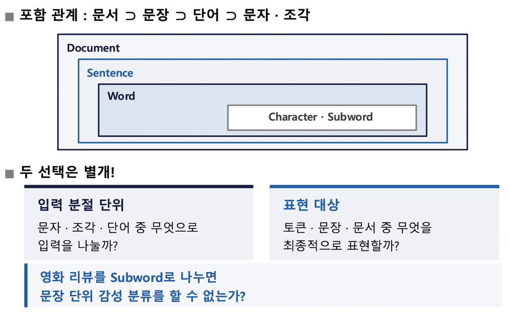
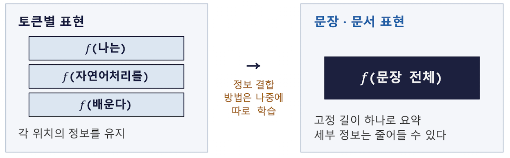
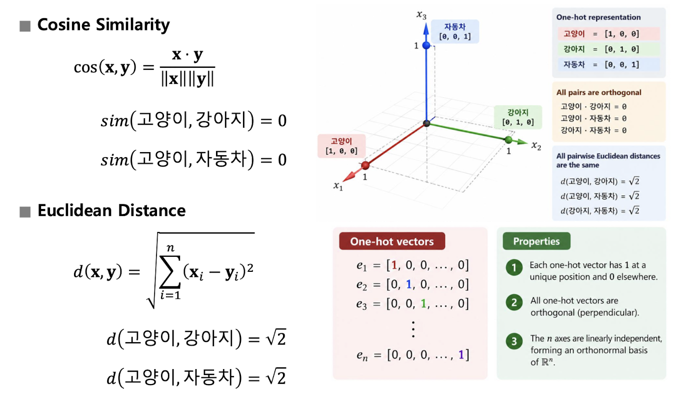
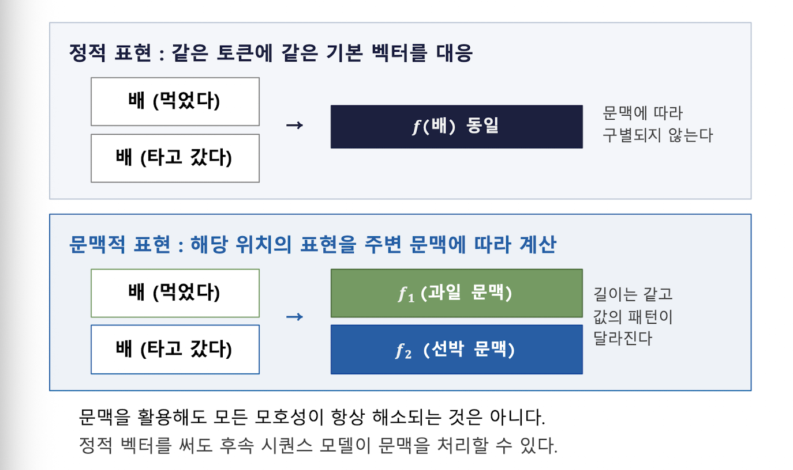

[toc]

## 1. 기계에 표현이 필요한 이유

디지털 텍스트는 이미 바이트와 문자 코드로 저장되어 있지만,

**저장 규칙 자체가 단어 사이의 의미 관계를 제공 X**

수치 기반 모델에 경우 계산할 수 있는 입력 구조를 필요로 하므로,

텍스트를 모델 입력에 적합한 형태로 조직해야 함

> **표현 설계란 어떤 정보를 모델의 계산에 제공할 것인지 결정하는 일**

예를 들어 영어 대문자 `A`, `B`, `C`의 문자 코드가 연속적이어도,

코드 숫자의 차이가 작다는 이유만으로 **A와 B의 의미가 A와 C보다 가깝다고 말할 수는 없음**

**저장을 위한 숫자와 의미 계산을 위한 표현은 목적이 다름**

### 쉬운 설명

1. 컴퓨터는 텍스트를 저장할 때 문자에 숫자 코드를 부여함
2. 하지만 이 숫자는 문자를 저장하고 찾기 위한 번호일 뿐, 단어의 의미를 나타내는 점수가 아님.
3. 따라서 모델이 언어를 처리하려면 저장용 코드와 별도로, 계산에 사용할 입력 구조를 만들어야 함
4. 표현을 설계할 때는 단순히 모든 글자를 숫자로 바꾸는 것이 아니라, 순서·빈도·의미·문맥 중 어떤 정보를 남길지 정해야 함

## 2. 문자 인코딩과 모델 입력 표현의 차이

**문자 인코딩**과 **모델 입력 표현**은 서로 다른 질문에 대한 답을 반환

| 구분               | 답하는 질문                           | 예                   |
| ------------------ | ------------------------------------- | -------------------- |
| **문자 인코딩**    | 문자를 어떻게 저장하고 전송할 것인가? | 유니코드, UTF-8      |
| **모델 입력 표현** | 모델에 어떤 정보를 전달할 것인가?     | 토큰 ID 시퀀스, 벡터 |

전체 흐름은 두 층으로 구분 됨

1. **저장·복원 층**: 텍스트와 바이트 사이 변환**(텍스트 → 바이트)**
2. **모델 계산 층**: 텍스트를 특징 벡터로 바꾸고 과제 출력을 만듦**(텍스트 → 특징 벡터 → 과제 출력)**

즉, **저장 과정은 텍스트를 보존하고 복원**하는 데,

**모델 입력 표현은 예측과 분류에 필요한 정보를 “계산 가능한 형태”로 제공**하는 데 목적이 있음

### 쉬운 설명

- 문자 인코딩은 컴퓨터가 글자를 파일이나 통신 데이터로 저장하는 방법
- 모델 입력 표현은 저장된 글자를 인공지능이 계산할 수 있도록 바꾸는 방법
- 같은 텍스트라도 저장할 때는 UTF-8을 사용할 수 있고, 모델에 넣을 때는 토큰 ID나 벡터로 바꿀 수 있음
- 따라서 **“문자가 어떤 바이트로 저장되는가?”**와 **“모델이 어떤 정보를 계산하는가?”**는 서로 다른 문제임

## 3. 언어에서 숫자로 변환되는 입력 흐름

대표적인 토큰 기반 신경망 입력 흐름은 다음과 같다.

```
원문 → 토큰 시퀀스 → 토큰 ID 시퀀스 → 벡터 시퀀스 → 모델 → 예측
```

예시 문장 `"나는 자연어처리를 배운다"`는 다음처럼 변환됨

| 단계    | 예시                           |
| ------- | ------------------------------ |
| 원문    | 나는 자연어처리를 배운다       |
| 토큰    | `[나는, 자연어처리를, 배운다]` |
| 토큰 ID | `[2, 3, 4]`                    |
| 벡터    | `[v₂, v₃, v₄]`                 |
| 예측    | 문장 주제: 교육                |

초기 자연어 처리의 설명을 위해 **띄어쓰기 단위 토큰**을 사용하지만,

모든 자연어 처리 방법이 반드시 이 절차를 따르는 것은 아님

### 토큰·ID·벡터·정답 레이블

| 용어            | 의미                                |
| --------------- | ----------------------------------- |
| **토큰**        | 모델이 처리하도록 나눈 단위         |
| **ID**          | 토큰을 식별하는 번호                |
| **벡터**        | 모델이 계산에 사용하는 수치 묶음    |
| **정답 레이블** | 지도학습에서 예측과 비교하는 목표값 |

**입력은 토큰 ID와 벡터를 통해 예측으로 이어짐**

**정답 레이블은 예측 결과와 비교되어 오차를 만들고, 이 오차를 이용해 역전파가 적용됨**

### 쉬운 설명

1. 먼저 원래 문장을 작은 처리 단위인 **토큰**으로 나눔
2. 각 토큰에 어휘집에 등록된 **번호 부여**.**(ID)**
3. 번호를 모델이 계산할 수 있는 **벡터**로 변환
4. 모델은 벡터들을 이용해 주제나 감성 같은 **결과를 예측**
5. 지도학습에서는 **정답 레이블과 예측 비교**
6. 두 결과의 차이인 **오차를 이용해 모델 내부의 값 수정**

## 4. 표현의 정의와 정보 보존·손실

**표현**은 언어 정보를 계산 가능한 형태로 조직하는 방법이다. 표현을 설계할 때는 다음 세 가지를 결정한다.

| 결정할 내용                | 가능한 선택                        |
| -------------------------- | ---------------------------------- |
| 어떤 단위를 표현할 것인가? | 문자, **토큰,** 문장, 문서         |
| 무엇을 남길 것인가?        | 정체성, 순서, 빈도, 의미, **문맥** |
| 어떤 구조를 사용할 것인가? | 시퀀스, **벡터**, 행렬             |

좋은 표현의 기준 == **해결하려는 과제와 연결되는가**

표현을 만드는 과정에서 정보가 보존될 수도 있고 손실될 수도 있음

### 정보 손실의 예

다음 두 문장을 비교한다.

- 개가 사람을 물었다.
- 사람이 개를 물었다.

단어 목록만 남기면 두 문장 모두 다음 정보로 축약된다.

- 개
- 사람
- 물다

그러나 다음 정보는 사라진다.

- 누가 누구를 물었는가
- 문장 속 역할
- 단어 사이의 관계
- 단어의 순서

**Q. 주제 분류와 사건의 행위자 추출 중 어느 과제가 이 정보 손실에 더 민감한가?**

**A. 주제 분류**에서는 단어 목록만으로도 충분할 수 있지만, **사건의 행위자 추출**처럼 역할과 관계가 중요한 과제에서는 정보 손실에 더 민감함

> 모든 표현이 모든 정보를 보존해야 하는 것은 아님
>  중요한 것은 **해결하려는 과제에 필요한 정보를 남기는 것**

### 쉬운 설명

- 표현은 과제에 필요한 정보를 골라 정리하는 과정
- **단어 목록**만 남기면 **어떤 단어가 나왔는지는 알 수 있음**
- 하지만 그 단어들이 어떤 순서로 등장했는지, 누가 행동을 했는지까지는 알 수 없을 수 있음
- 문서의 **주제**를 분류할 때는 **단어의 등장 여부**가 유용할 수 있음
- 반대로 문장에서 **행위자나 대상의 역할을 찾을 때는 순서와 관계를 보존**해야 한다.

## 5. 언어 표현의 수준

언어 표현은 다섯 가지 수준으로 나눌 수 있다.

| 수준          | 표현 대상        | 예시·용도                  |
| ------------- | ---------------- | -------------------------- |
| **Character** | 개별 문자        | `학`, `교`; 표면 형태      |
| **Subword**   | 단어 내부의 조각 | `play`, `ing`; 부분 재사용 |
| **Word**      | 단어 단위        | `school`; 어휘 항목        |
| **Sentence**  | 문장 전체        | 리뷰 한 문장의 감성        |
| **Document**  | 문서 전체        | 기사·보고서의 주제         |

**⭐️토큰은 반드시 단어와 같지 않다.⭐️**

**토큰**은 문자, Subword, 단어 등 모델이 처리하도록 정한 여러 **단위**를 가리킬 수 있음

### 입력 분절 단위와 최종 표현 대상

언어의 포함 관계는 다음과 같음



## 6. 문자 수준 표현

문자 수준 표현은 문장을 개별 문자 단위로 나누는 방식이다. 예를 들어 `학교에 간다`는 다음처럼 나뉨

- **문자 단위**: `학`, `교`, `에`, 공백, `간`, `다` → 6개
- 어절 단위: `학교에`, `간다` → 2개

| 장점                                               | 부담                                 |
| -------------------------------------------------- | ------------------------------------ |
| 작은 단위를 재사용해 새로운 단어를 조합할 수 있다. | 같은 문장이 더 많은 토큰이 된다.     |
| **철자와 오타 같은 표면 정보를 남길 수 있다.**     | 여러 문자를 묶어 해석해야 한다.      |
| 새로운 단어의 구성 요소를 표현할 수 있다.          | 어휘집 밖 문자 처리 정책이 필요하다. |

문자 표현은 표면 형태를 세밀하게 보존하지만,

**Q. 표현 가능성과 의미 이해는 같은가?**

**A.표현할 수 있다는 것과 의미를 이해한다는 것은 동일하지 않다.**

## 7. 단어 수준 표현과 형태론적 유형

### 단어 수준 표현

단어 수준 표현은 단**어를 독립적인 어휘 항목으로 다룸**

예를 들어 `학교`, `학교에`, `학교에서`, `학교로`를 각각 별도 항목으로 등록할 수 있음

| 특징               | 설명                                                   |
| ------------------ | ------------------------------------------------------ |
| 독립적인 어휘 항목 | 각 단어를 하나의 항목으로 처리한다.                    |
| 짧은 시퀀스        | 문자 단위보다 시퀀스가 짧아지는 경향이 있다.           |
| 이해 용이성        | 사람이 이해하기 쉽다.                                  |
| 어휘집 증가        | 단어의 여러 표면형을 각각 등록하면 어휘집이 커진다.    |
| 한국어의 주의점    | 띄어쓰기 단위인 어절과 언어학적 단어는 항상 같지 않다. |

`학교`, `학교에`, `학교에서`, `학교로`를 모두 별도 항목으로 등록하면 어휘집이 커진다.

반대로 **공통 부분을 공유**하면 **재사용 기회가 늘어남**

### 형태론적 유형

언어마다 단어가 문법적 의미를 표현하는 방식이 다르다.

| 유형       | 핵심 특징                                                    | 대표 언어                  | 예                                      |
| ---------- | ------------------------------------------------------------ | -------------------------- | --------------------------------------- |
| **고립어** | 단어 형태가 거의 변하지 않고 어순이나 독립된 기능어로 문법 관계를 표현한다. | 중국어, 베트남어           | 동사 형태가 거의 변하지 않음            |
| **교착어** | 어근 뒤에 조사·어미 같은 형태소를 차례로 붙인다.             | 한국어, 일본어, 터키어     | `먹 + 었 + 습 + 니다`                   |
| **굴절어** | 하나의 어미 변화가 여러 문법 정보를 동시에 표현한다.         | 라틴어, 러시아어, 스페인어 | 스페인어 `hablo`: 말하다 + 1인칭 + 현재 |
| **포합어** | 많은 형태소가 결합해 하나의 단어가 문장에 가까운 의미를 갖는다. | 이누이트계 언어 등         | 한 단어에 주어·목적어·동사 정보 결합    |

영어는 고립어와 굴절어의 특징을 함께 가진다. 예를 들어 `I eat`, `he eats`, `I/he ate`처럼 형태가 일부 변한다.

언어 구조가 매우 다른 언어를 현대 자연어 처리에서 처리할 수 있는 이유와 관련된다. 표현 단위와 분절 방법을 조절할 수 있다는 점이 핵심 주제이다.

**Q. 현대 NLP가 서로 구조가 매우 다른 언어를 처리할 수 있는 가장 큰 이유는?**

A. **현대 NLP는** 언어를 **토큰의 벡터 표현과 문맥적 관계로 학습하기 때문에** 구조가 서로 다른 언어도 동일한 모델 구조로 처리할 수 있음

## 8. 미등록 단어와 OOV

**OOV(Out of Vocabulary)**는 어휘집에 등록되지 않은 단어를 뜻함

표현을 설계할 때 다음과 같은 질문이 발생함

| 관찰되는 형태          | 표현 설계 질문                        |
| ---------------------- | ------------------------------------- |
| 학교, 학교에, 학교에서 | 각각 별도 항목으로 둘 것인가?         |
| 먹다, 먹었다, 먹겠다   | 공통 부분을 공유할 것인가?            |
| 새로 등장한 고유명사   | 어휘집에 없으면 어떻게 처리할 것인가? |

예를 들어 어휘집에 `학교`만 있고 입력이 `학교에서`라면, 표면형 전체를 하나의 토큰으로 삼는 규칙에서는 `학교에서`를 위한 새 항목이 필요함

사람에게 익숙한 표현이라도 모델의 어휘집에 등록되어 있지 않으면 낯선 입력이 될 수 있음

### 쉬운 설명

1. **모델은 자신이 가진 어휘집에 등록된 토큰만 바로 인식할 수 있음**
2. 어휘집에 `학교`만 있고 `학교에서`가 없다면, **두 표현을 같은 것으로 자동 처리하지 않을 수 있음**
3. 사람은 `학교에서`가 `학교`와 관련 있다는 것을 쉽게 알 수 있지만, 모델은 등록된 토큰과 분절 규칙에 따라 처리한다.
4. **새로운 고유명사나 새로운 단어도 어휘집에 없다면 OOV 문제가 발생함**

## 9. Subword 표현

**Subword는 단어 전체보다 작은 조각을 어휘 단위로 사용하는 접근**

예시:

- `playing` → `play` + `ing`
- `replaying` → `re` + `play` + `ing`

이때 `play`는 여러 단어에서 재사용 됨

| Subword가 제공하는 것 | 설명                                                         |
| --------------------- | ------------------------------------------------------------ |
| 부분 재사용           | **자주 쓰이는 조각을 여러 단어에서 공유**                    |
| OOV 완화              | 단어 전체를 몰라도 알고 있는 조각으로 표현                   |
| 균형 조절             | 문자 단위와 단어 단위 사이에서 어휘집 크기와 시퀀스 길이 조절 |

### Subword가 의미 이해를 보장하지 않는 이유

**Subword 조각이 반드시 형태소나 의미 단위일 필요는 없음**

- 통계적으로 정한 조각이 언어학적 의미 경계와 일치한다는 보장도 없다.

어휘집에 `re`, `play`, `ing`가 있으면 `replaying`을 표현할 수 있지만,

**표현할 수 있다는 사실이 그 단어의 뜻을 이미 이해했다는 의미는 아님(표현할 수 있음 ≠ 뜻을 이해 함)**

또한 미등록 단어 문제의 완화와 의미 이해는 별개의 문제

- 미등록 문자를 어떻게 처리하는지에 따라 OOV 대응 범위도 달라짐

## 10. 토큰별·문장·문서 표현

**표현 대상의 범위에 따라** **토큰별 표현, 문장 표현, 문서 표현을 구분할 수 있음**



| 표현 수준       | 특징                                        | 사용 목적                  |
| --------------- | ------------------------------------------- | -------------------------- |
| **토큰별 표현** | 각 위치의 정보를 유지한다.                  | 토큰 위치와 개별 단위 처리 |
| **문장 표현**   | 문장 전체를 고정 길이 벡터 하나로 요약한다. | 문장 비교·분류             |
| **문서 표현**   | 여러 문장의 주제와 내용을 다룬다.           | 문서 비교·검색·주제 처리   |

**토큰별 표현은 각 위치의 정보 유지**

**문장·문서 전체 표현은 하나의 고정 길이 벡터로 요약하기 때문에 세부 정보가 줄어들 수 있음**

표현 함수는 다음처럼 나타낼 수 있다.

### 과제에 따른 필요한 표현

| 과제                      | 필요한 표현 예      |
| ------------------------- | ------------------- |
| 사람 이름의 **위치** 찾기 | 토큰별 표현         |
| 리뷰 **감성 분류**        | 문장·리뷰 전체 표현 |
| **비슷한 보고서 찾기**    | 문서 전체 표현      |

예시:

> 이 영화는 초반이 지루했지만 결말은 훌륭했다.

- 전체적인 **리뷰 감성을 판단**하려면 **문장 전체의 요약이 중요**
  - **개별 단어의 정확한 위치는 상대적으로 덜 중요**
- **초반과 결말을 각각 평가하려면 각 대상의 위치와 관계 중요**
  - 문장 전체를 하나로 압축하면 `초반 = 부정`, `결말 = 긍정`이라는 세부 정보가 손실될 수 있음

### 쉬운 설명

- 토큰별 표현은 문장 속 각 단어의 위치 정보를 유지
- 문장 표현은 문장 전체를 하나의 벡터로 요약
- 문서 표현은 여러 문장으로 이루어진 문서의 주제와 내용을 표현
- 사람 이름이 어디에 있는지 찾으려면 각 토큰의 위치 필요
- 리뷰 전체가 긍정인지 부정인지 판단하려면 문장 전체를 요약한 표현 필요
- 한 문장 안의 여러 대상을 각각 평가하려면 전체 요약만으로는 세부 정보가 부족할 수 있음

## 11. 어휘집과 토큰 ID

### 어휘집의 정의

**어휘집(Vocabulary)란?**

- 모델이 사용하는 토큰과 ID의 대응 목록

모델이 처리할 수 있는 토큰 목록

예시 어휘집:

| 토큰         | ID   |
| ------------ | ---- |
| `<PAD>`      | 0    |
| `<UNK>`      | 1    |
| 나는         | 2    |
| 자연어처리를 | 3    |
| 배운다       | 4    |
| 좋아한다     | 5    |

어휘집 크기는 다음과 같다.

$$
 |V| = 6
$$

- `<UNK>`: 미등록 토큰을 대신하는 기호
- `<PAD>`: 입력 길이를 맞출 때 사용하는 기호

특수 토큰의 종류와 번호는 AI 모델마다 다를 수 있음

이 어휘집에는 `수학을`이 없으므로 `나는 수학을 배운다`는 다음처럼 표현됨

$$
 [2, 1, 4]
$$

어휘집·분절 규칙·모델은 서로 일치해야 함

훈련 시점과 사용 시점에 같은 ID를 서로 다른 토큰으로 해석하면 입력의 의미가 바뀐다.

### 토큰에서 ID 시퀀스로 변환

| 문장                       | 토큰 ID 시퀀스 |
| -------------------------- | -------------- |
| 나는 자연어처리를 배운다   | `[2, 3, 4]`    |
| 나는 자연어처리를 좋아한다 | `[2, 3, 5]`    |
| 나는 수학을 배운다         | `[2, 1, 4]`    |

ID 시퀀스의 핵심 특성은 다음과 같음

1. 순서가 있는 ID 목록은 토큰 순서 유지
2. 같은 어휘집에서 같은 토큰은 같은 ID를 가짐
3. 여러 미등록 토큰을 `<UNK>` 하나로 바꾸면 서로 구별할 수 없음
4. ⭐️I**D 목록은 의미 점수의 목록이 아니다.**⭐️

### `<UNK>`로 인한 정보 손실

`수학을`과 `과학을`이 모두 어휘집에 없다면 둘 다 `<UNK>`로 바뀐다.

$$
 \text{나는 수학을 배운다} \rightarrow [2,1,4]
$$

$$
 \text{나는 과학을 배운다} \rightarrow [2,1,4]
$$

결과적으로 서로 다른 두 문장이 같은 ID 시퀀스가 됨

어떤 과목인지에 대한 정보가 사라지고, 원래 의미를 복원할 수 없음

이 문제는 다음 흐름으로 이어진다.

```
단어 수준 토큰화 → OOV → <UNK> → 정보 손실 → 더 작게 나누기 → Subword 토큰화
```

단어 전체를 사용하는 방식에서 정보 손실이 커질 때 Subword 방식이 대안으로 고려됨

### 쉬운 설명

- 어휘집은 모델이 사용할 토큰과 번호를 연결해 놓은 목록이다.
- `나는`이 항상 ID `2`라면, 같은 어휘집 안에서는 계속 ID `2`로 표현된다.
- 그러나 ID `2` 자체가 의미 점수인 것은 아니다.
- 어휘집에 없는 단어는 `<UNK>`로 바뀔 수 있다.
- `수학을`과 `과학을`이 모두 `<UNK>`가 되면, 모델 입력에서는 두 단어를 구별할 수 없다.

## 12. 토큰 ID의 숫자적 거리와 의미의 관계

토큰 ID는 **식별자**일 뿐 의미 공간 좌표 X

- ID는 모델이 토큰을 찾기 위한 번호

예:

| 단어   | ID   |
| ------ | ---- |
| 고양이 | 10   |
| 자동차 | 11   |
| 강아지 | 90   |

숫자상 거리는 다음과 같다.

$$
 |10-11|=1
$$

$$
 |10-90|=80
$$

그러나 **이 숫자 차이는 의미적 거리와 관계 없음**

`고양이`와 `강아지`는 동물이라는 관련성이 있지만, `고양이`와 `자동차`의 ID가 더 가까울 수 있음

- 번호가 가까운 토큰이 의미적으로 가까운 것은 아님

1. **ID 번호를 바꾸어도 단어의 뜻은 바뀌지 않음**
2. **ID는 토큰을 찾는 데 사용**
3. **⭐️의미 관계는 별도의 표현과 학습을 통해 처리⭐️**

## 13. One-hot 표현

**One-hot 표현이란?**

- 자기 토큰의 위치만 $1$이고 나머지는 모두 $0$인 벡터**(자기만 1이고 나머지는 모두 0인 벡터)**

어휘집의 좌표 순서가 다음과 같다고 하자.

$$
 [\langle\text{PAD}\rangle,\langle\text{UNK}\rangle,\text{나는},\text{자연어처리를},\text{배운다},\text{좋아한다}]
$$

그러면 다음과 같이 표현된다.

| 토큰         | One-hot 벡터    |      |
| ------------ | --------------- | ---- |
| 나는         | $[0,0,1,0,0,0]$ |      |
| 자연어처리를 | $[0,0,0,1,0,0]$ |      |
| 배운다       | $[0,0,0,0,1,0]$ |      |
| 좋아한다     | $[0,0,0,0,0,1]$ |      |
|              |                 |      |

ID는 0부터 시작하므로 ID가 2인 `나는`의 $1$은 벡터의 세 번째 칸에 들어감

### One-hot 행렬의 크기

문장 `나는 자연어처리를 배운다`의 토큰 ID가 `[2,3,4]`라면 One-hot 행렬은 다음과 같다.

$$
 \begin{pmatrix}
 0&0&1&0&0&0\\
 0&0&0&1&0&0\\
 0&0&0&0&1&0
 \end{pmatrix}
$$

행렬의 크기는 다음과 같다.

$$
 3 \times 6
$$

- 행의 수: 문장 길이인 토큰 수 $3$
- 열의 수: 어휘집 크기 $|V|=6$
- 각 토큰 벡터의 차원: 어휘집 크기 $6$

**Q. [2, 3, 5]의 One-hot 행렬을 직접 작성하세요. 크기는 얼마인가?**

**A.**

$$
 \begin{pmatrix}
 0&0&1&0&0&0\\
 0&0&0&1&0&0\\
 0&0&0&0&0&1
 \end{pmatrix}
$$

- 행의 수: 문장 길이인 토큰 수 $3$
- 열의 수: 어휘집 크기 $|V|=6$
- 각 토큰 벡터의 차원: 어휘집 크기 $6$

따라서 `[2,3,5]`의 One-hot 행렬도 $3 \times 6$이다.

**One-hot 벡터의 차원은 문장 길이가 아니라 어휘집 크기**

### 쉬운 설명

- One-hot에서는 각 토큰마다 자신을 나타내는 위치에만 $1$을 둔다.
- 나머지 위치는 모두 $0$이다.
- 어휘집에 토큰이 6개 있으면 각 토큰의 One-hot 벡터 차원도 6이다.
- 문장에 토큰이 3개 있으면 벡터가 3개 필요하므로 행렬의 크기는 $3 \times 6$이다.
- 따라서 One-hot 벡터의 차원은 문장 길이가 아니라 어휘집 크기이다.

## 14. One-hot 인코딩의 한계

One-hot에는 세 가지 주요 한계가 있음

### 1) 고차원

어휘집 크기가 커질수록 벡터 차원도 커짐

$$
 \text{벡터 차원}=|V|
$$

### 2) 희소성

토큰 벡터에서 대부분의 값이 $0$임

어휘집 크기가 $10{,}000$이면 하나의 One-hot 벡터에는 다음과 같은 값이 있음

- $1$개: 해당 토큰의 위치
- $0$개: $9{,}999$개

### 3) 의미 관계 부재

서로 다른 토큰은 서로 다른 위치에 $1$을 가지므로 One-hot 자체에는 단어 간 의미적 가까움을 나타내는 정보가 없음

예를 들어 세 단어 어휘집에서는 다음과 같다.

| 단어   | One-hot 벡터 |
| ------ | ------------ |
| 고양이 | $[1,0,0]$    |
| 강아지 | $[0,1,0]$    |
| 자동차 | $[0,0,1]$    |

고양이와 강아지, 고양이와 자동차 모두 겹치는 $1$의 위치가 없음

$따라서 One-hot 자체만으로는 두 쌍의 의미 관계 차이를 구별할 수 없다.

### One-hot에서의 유사도와 거리



코사인 유사도는 다음과 같다.

​                                				              $\cos(\mathbf{x},\mathbf{y}) = \frac{\mathbf{x}\cdot\mathbf{y}}
 {\|\mathbf{x}\|\|\mathbf{y}\|}
 $

One-hot 벡터의 서로 다른 토큰은 직교하므로 다음이 성립한다.
$$
 \operatorname{sim}(\text{고양이},\text{강아지})=0
$$
$$
 \operatorname{sim}(\text{고양이},\text{자동차})=0
$$

유클리드 거리는 다음과 같이 정의된다.

​                                                                     $d(\mathbf{x},\mathbf{y})= \sqrt{\sum_{i=1}^{n}(x_i-y_i)^2}
 $

서로 다른 세 One-hot 벡터 사이의 거리는 모두 같다.

$$
 d(\text{고양이},\text{강아지})=\sqrt{2}
$$
$$
d(\text{고양이},\text{자동차})=\sqrt{2}
$$

### 쉬운 설명

- 어휘집이 커지면 One-hot 벡터의 칸도 많아진다.
- 하지만 실제로 1이 들어가는 칸은 하나뿐이고 나머지는 모두 $0$이다.
- 서로 다른 단어는 항상 다른 위치에 $1$을 가지므로, One-hot만 보면 모든 단어가 똑같이 구별된다.
- 고양이와 강아지가 관련된 단어라는 정보도, 고양이와 자동차가 다른 종류라는 정보도 One-hot 자체에는 들어 있지 않다.
- 따라서 One-hot은 “어떤 토큰인가”는 구별하지만 “어떤 토큰과 의미적으로 가까운가”는 직접 표현하지 못한다.

## 15. One-hot 벡터와 학습 가능한 표현

One-hot 자체에는 의미 관계가 없지만,

후속 모델은 **단어가 사용되는 문맥과 학습 목표**를 이용해 내**부 파라미터에서 단어 간 관계를 학습할 수 있음**

예시 문장:

- 고양이는 사료를 먹는다.
- 강아지는 사료를 먹는다.
- 고양이는 동물이다.
- 강아지는 동물이다.
- 자동차는 도로를 달린다.
- 자동차는 주차장에 주차한다.

모델이 `"_____는 사료를 먹는다"`와 같은 빈칸을 예측하는 상황을 많이 학습하면,

고양이와 강아지는 비슷한 문맥에서 등장하므로 내부 표현이 비슷한 방향으로 조정될 수 있음

예시로 제시된 학습된 벡터는 다음과 같다.

$$
 E(\text{고양이})=[0.81,0.72,0.10]
$$

$$
 E(\text{강아지})=[0.78,0.75,0.13]
$$

$$
 E(\text{자동차})=[0.12,0.08,0.91]
$$

즉, One-hot 자체가 의미를 제공하는 것은 아니지만,

**학습 과정에서 One-hot을 바탕으로 별도의 밀집 표현이 조정될 수 있음**

### 쉬운 설명

- **처음의 One-hot 벡터는 단어의 정체성만 구별함**
- 모델이 많은 문장을 보면서 어떤 단어들이 비슷한 문맥에서 사용되는지 학습할 수 있다.=
- 고양이와 강아지가 비슷한 문장에 자주 등장하면, 모델 내부에서는 두 단어의 벡터가 비슷해질 수 있다.
- 자동차가 다른 문맥에 등장하면 자동차의 벡터는 다른 방향으로 조정될 수 있다.
- 의미 관계는 One-hot에 처음부터 들어 있는 것이 아니라 학습 과정에서 만들어진다.

## 16. 희소 표현과 밀집 표현

희소성과 밀집성은 **값이 어떻게 분포하는가**에 관한 구분이다.

| 구분      | 희소 표현                     | 밀집 표현                                |
| --------- | ----------------------------- | ---------------------------------------- |
| 값의 분포 | **대부분의 값이 $0$**         | **많은 좌표가 $0$이 아님**               |
| 예        | $[0,0,1,0,0,0]$               | $[0.2,-0.4,0.7]$                         |
| 대표 표현 | **One-hot**, 빈도 기반 특징   | **학습된 임베딩**                        |
| 주의점    | 희소하다고 쓸모없는 것은 아님 | 밀집하다고 의미가 자동으로 생기지는 않음 |

**⭐️(중요)혼동하지 말 것⭐️**

| 구분              | 의미                                  |
| ----------------- | ------------------------------------- |
| **희소·밀집**     | 값 $0$의 분포에 관한 구분             |
| **고차원·저차원** | 좌표의 개수에 관한 구분               |
| **의미 정보**     | 표현의 구성 방식과 학습에 따라 결정됨 |

따라서 무작위 벡터 $[0.2,-0.4,0.7]$를 `고양이`에 붙인다고 해서 의미 표현이 완성되는 것은 아님

### 쉬운 설명

- 희소와 밀집은 벡터 안에 $0$이 얼마나 많은지를 말한다.
- 고차원과 저차원은 벡터의 칸이 몇 개인지를 말한다.
- 이 두 구분은 서로 다르다.
- 값이 많이 들어 있는 밀집 벡터라도 학습되지 않았다면 의미를 담고 있다고 할 수 없다.
- 반대로 희소한 표현도 특정 과제에 필요한 정보를 담을 수 있으므로 단순히 쓸모없다고 보면 안 된다.

## 17. 좋은 표현이 갖추어야 할 정보

**좋은 표현은 해결하려는 과제에 필요한 정보를 제공해야 함**

| 요구조건        | 점검 질문                           | 예                          |
| --------------- | ----------------------------------- | --------------------------- |
| **정체성**      | 서로 다른 표현을 구별하는가?        | 고양이 / 강아지             |
| **의미 관계**   | 관련된 개념을 활용하는가?           | 자동차 / 승용차             |
| **순서·관계**   | 누가 무엇을 했는가?                 | A가 B를 칭찬 / B가 A를 칭찬 |
| **문맥**        | 같은 형태의 다른 쓰임을 구별하는가? | 먹는 배 / 타는 배           |
| **과제 적합성** | 예측에 필요한 차이를 남기는가?      | 좋다 / 좋지 않다            |

### 유사성은 하나의 기준이 아니다

두 문장 쌍은 과제에 따라 다르게 처리해야 한다.

1. `이 영화는 좋다` / `이 영화는 좋지 않다`

- 형태는 매우 비슷하다.
- 감성은 서로 반대이다.
- **감성 분류에서는 부정 표현을 구별하는 것이 중요함**

1. `자동차가 도착했다` / `승용차가 도착했다`

- **표면형은 다르다.**
- 관련된 개념이다.
- 교통 관련 문서 검색에서는 개념적 관련성을 활용하는 것이 중요할 수 있음

**모든 과제를 하나의 의미적 유사성 기준으로 설명할 수 없음**

**계산 비용과 표현 길이도 함께 고려해야 함**

### 쉬운 설명

- 좋은 표현은 단어를 구별할 수 있어야 한다.
- 동시에 관련된 단어들이 관련 있다는 정보도 어느 정도 반영할 수 있어야 한다.
- 문장의 순서가 바뀌었을 때 의미가 달라진다면 순서와 관계를 보존해야 한다.
- 같은 단어가 주변 문맥에 따라 다른 뜻을 가지면 문맥을 활용해야 한다.
- 무엇이 중요한지는 과제마다 다르다.
- 감성 분류에서는 `좋다`와 `좋지 않다`의 차이가 중요하고, 검색에서는 `자동차`와 `승용차`의 관련성이 중요할 수 있다.

## 18. 문맥이 의미를 바꾸는 방식

같은 표면형이라도 주변 문맥에 따라 의미가 달라질 수 있음

예시:

- `나는 배를 먹었다.` → 과일
- `나는 배를 타고 갔다.` → 선박

해석을 결정하는 요소는 다음과 같다.

1. 표면형은 동일하다: `배`
2. 주변 정보가 다르다: `먹었다`와 `타고 갔다`

`나는 배가 좋다`처럼 주변 정보가 부족한 문장만 주어지면, 과일인지 선박인지 확정할 수 없음

### 정적 표현과 문맥적 표현



| 구분        | 정적 표현                                    | 문맥적 표현                                       |
| ----------- | -------------------------------------------- | ------------------------------------------------- |
| 기본 방식   | **같은 토큰에 같은 기본 벡터를 대응**한다.   | **해당 위치의 표현을 주변 문맥에 따라 계산**한다. |
| `배`의 표현 | 먹는 배와 타는 배가 같은 표현이 될 수 있다.  | 과일 문맥과 선박 문맥에서 다른 표현이 된다.       |
| 표현 예     | $f(\text{배})$ 동일                          | $f_1$ 과일 문맥, $f_2$ 선박 문맥                  |
| 특징        | **문맥에 따른 구별이 직접 반영되지 않는다.** | 길이는 같고 값의 패턴이 달라진다.                 |

문맥적 표현을 사용해도 모든 모호성이 항상 해소되는 것은 아님

또한 정적 벡터를 사용하더라도 후속 시퀀스 모델이 문맥을 처리할 수 있음

### 쉬운 설명

- `배`라는 글자 자체만 보면 과일인지 선박인지 알 수 없다.
- `먹었다`가 함께 있으면 과일로 해석되고, `타고 갔다`가 함께 있으면 선박으로 해석된다.
- 정적 표현은 같은 `배`에 기본적으로 같은 벡터를 줄 수 있다.
- 문맥적 표현은 주변 단어를 보고 해당 위치의 `배`를 다르게 표현한다.
- 다만 문맥이 충분하지 않으면 문맥적 표현을 사용해도 의미가 확정되지 않을 수 있다.

## 19. 텍스트 표현의 발전 흐름

강의에서는 텍스트 표현이 제공하는 정보가 다음과 같이 확장되는 개념 지도를 제시한다.

```
정체성 → 통계 → 학습된 관계 → 문맥
```

| 표현 방식          | 주로 제공하는 정보                  | 강의상 학습 시점           |
| ------------------ | ----------------------------------- | -------------------------- |
| **One-hot**        | 토큰의 정체성 구별                  | 오늘                       |
| **Count / TF-IDF** | 출현 정보와 문서별 중요도           | 5주차                      |
| **단어 임베딩**    | 단어 관계를 연속적인 벡터로 학습    | 6주차                      |
| **문맥적 표현**    | 같은 토큰도 문맥에 따라 다르게 표현 | 이후 Attention·Transformer |

**⭐️중요⭐️**

**각 방법은 남기는 정보와 계산 비용이 다름**

**뒤의 방법이 앞의 모든 방법을 완전히 대체하는 것은 아님**

**토큰화는** 위의 표현 발전 흐름과 별도로 **입력 단위를 정하는 과정**

### 쉬운 설명

- One-hot은 어떤 토큰인지 구별하는 데 집중한다.
- Count나 TF-IDF는 토큰이 얼마나 나타났고 특정 문서에서 얼마나 중요한지를 사용한다.
- 단어 임베딩은 단어 사이의 관계를 벡터로 학습한다.
- 문맥적 표현은 같은 단어라도 주변 문장에 따라 다르게 표현한다.
- 표현 방식이 발전한다고 해서 이전 방식이 항상 쓸모없어지는 것은 아니다.
- 토큰화는 문장을 어떤 단위로 나눌지 정하는 별도의 과정이다.

## 20. 최종 핵심 정리

1. **표현**은 계산에 필요한 언어 정보를 구조화하는 일이다.
2. 토큰의 단위와 어휘집이 모델 입력을 구성한다.
3. **ID는 식별자이며 의미 점수가 아니다.**
4. One-hot은 토큰의 정체성을 구별하지만 의미 관계를 직접 담지 않는다.
5. 과제에 따라 순서·관계·문맥·전체 의미가 필요하다.
6. Subword로 표현할 수 있다고 해서 의미를 이해한 것은 아니다.
7. 입력 분절 단위와 최종 표현 대상은 서로 다른 선택이다.
8. 좋은 표현은 해결하려는 과제에 필요한 정보를 남겨야 한다.
