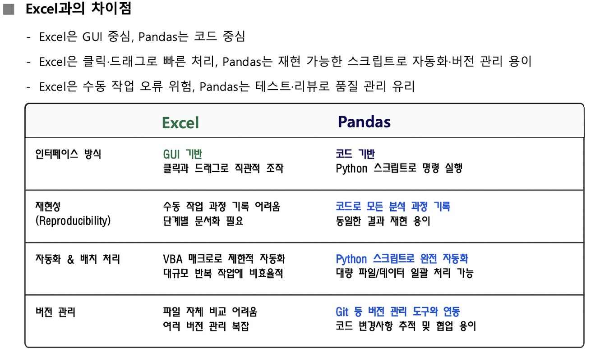
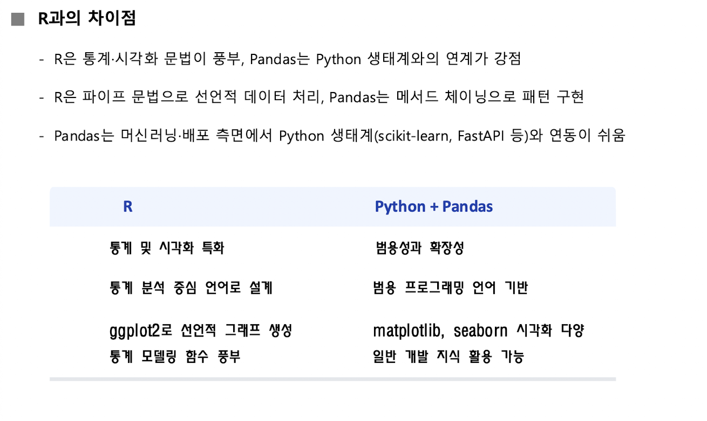
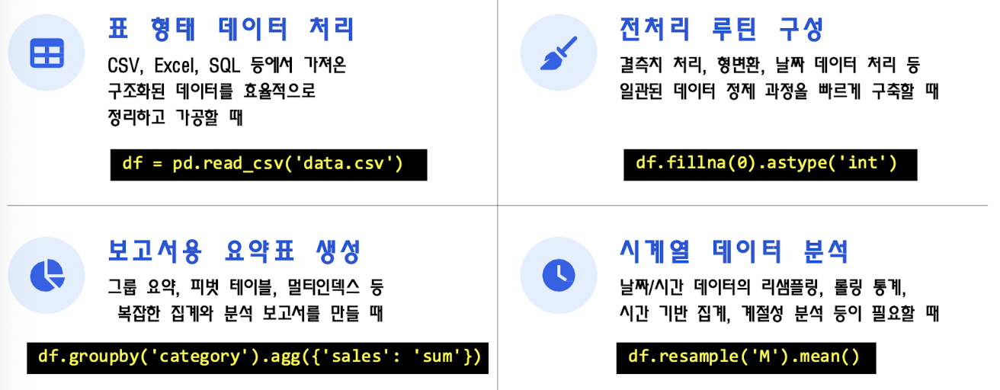
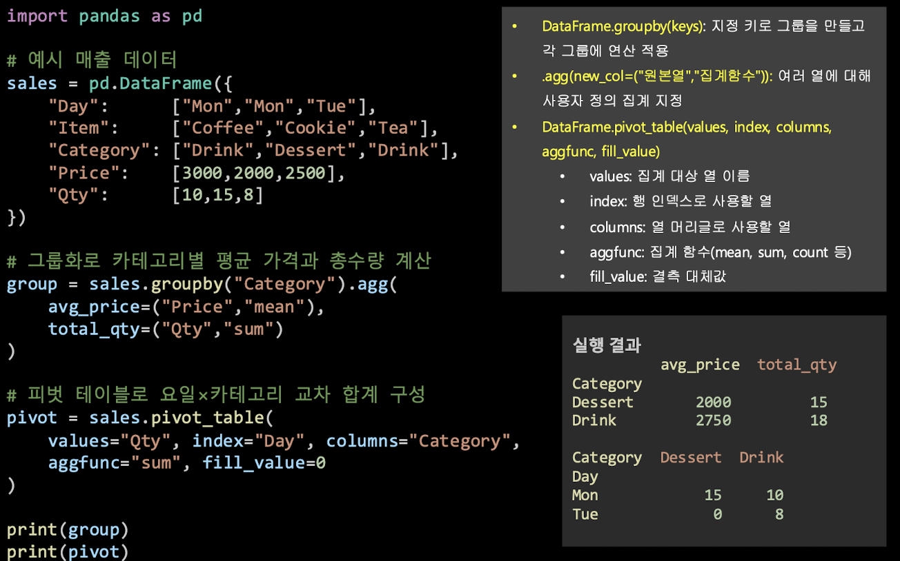
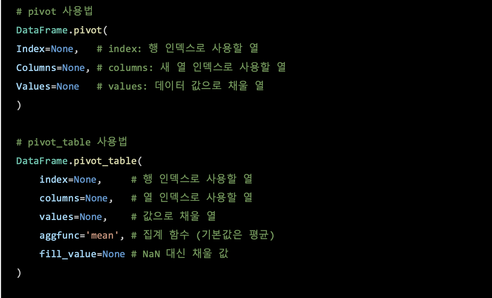
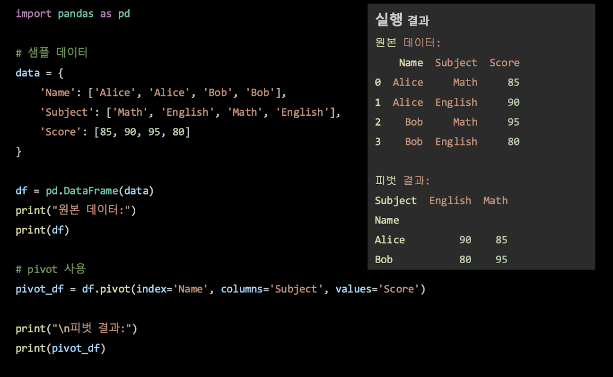
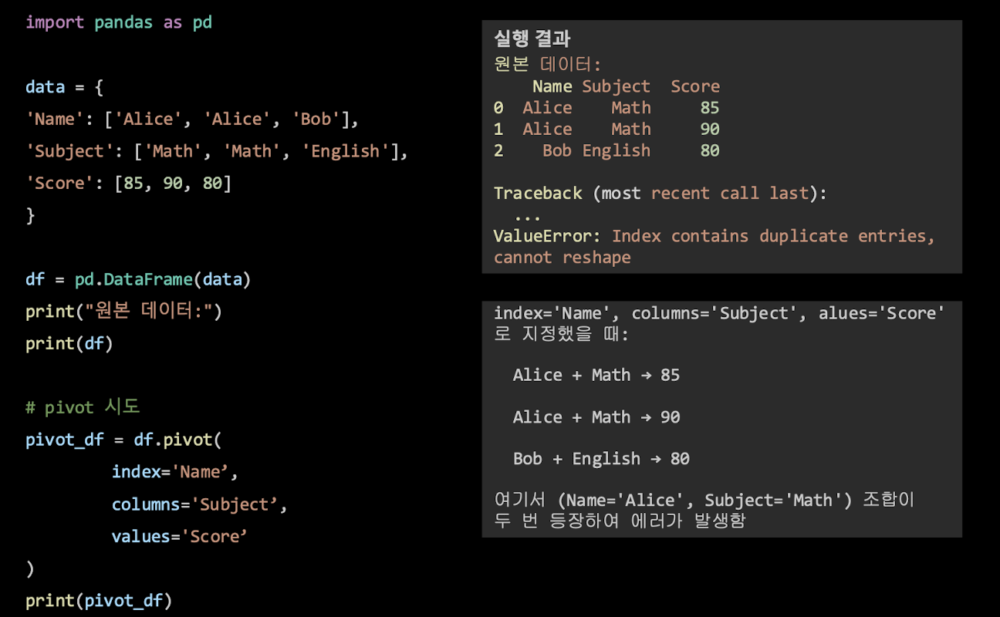
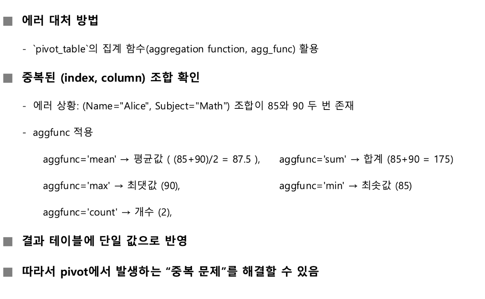
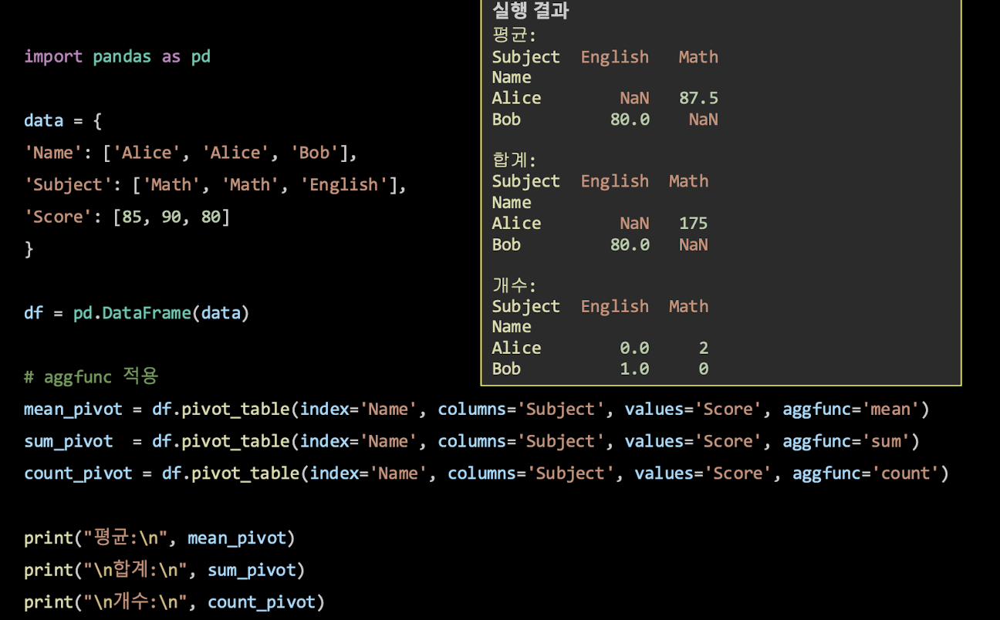

[toc]

## Python 데이터 처리에서 NumPy와 Pandas의 역할

- **NumPy**는 다차원 균일 배열인 `ndarray`, 벡터화 연산, 선형대수 및 수치 계산 기능을 제공함
  - 이미지·신호의 행렬 연산, 대규모 로그·측정값의 통계 처리, 머신러닝 전처리 및 특성 공학 등에 활용됨
  - 데이터과학·머신러닝 라이브러리의 기반이 되며, 브로드캐스팅으로 코드 간결성과 연산 성능을 높일 수 있음
- **Pandas**는 `DataFrame`을 중심으로 표 형태 데이터를 다루며, 레이블 기반 인덱싱, 결측치 처리, 그룹화와 집계 기능을 제공함
  - CSV, Excel, SQL, Parquet 등의 입출력을 지원하고, 표 데이터의 로딩·정제·변환·요약·집계에 사용되고, 그룹 요약·피벗·다중 인덱스 및 시계열 처리에도 활용됨
  - 장점으로 일관된 고수준 API, 다양한 입출력 기능, 시각화 도구와의 연계, 요약 기능임
  - 반면 메모리 기반 실행으로 초대용량 데이터 처리에 한계가 있을 수 있고, 연산 연결이 길어지면 가독성이 낮아질 수 있음

| 구분          | NumPy                                 | Pandas                                       |
| ------------- | ------------------------------------- | -------------------------------------------- |
| 중심 자료구조 | 다차원 균일 배열 `ndarray`            | 표 형태 자료구조 `DataFrame`                 |
| 주요 기능     | 빠른 벡터화 연산, 선형대수, 수치 계산 | 레이블 기반 인덱싱, 결측치 처리, 그룹화·집계 |
| 주된 용도     | 수치 배열과 행렬 계산                 | 표 형태 데이터의 정리·분석                   |

데이터가 숫자들의 배열이나 행렬 중심이면 **NumPy**,

- 온도값 여러 개에 같은 계산을 적용하는 일은 NumPy의 배열 연산과 잘 맞음

이름이 붙은 열과 행으로 된 표를 정리해야 하면 **Pandas**

- 사람별 나이와 부서를 표로 불러온 뒤 부서별 평균을 구하는 일은 Pandas의 `DataFrame`과 그룹 집계에 잘 맞음

### Pandas와 Excel·R의 차이 및 활용 맥락



- **Excel과 비교**
  - **Excel**은 GUI 중심이며 클릭과 드래그로 데이터를 조작
  - **Pandas**는 Python 코드로 명령을 실행
    - Pandas는 분석 과정을 코드로 기록하므로 동일한 분석을 다시 실행하기 쉽고, 테스트·검토와 버전 관리에 유리함
    - Python 스크립트로 대량 파일이나 반복 작업을 자동화할 수 있음



- **R과 비교**

  - **R**은 통계·시각화 문법과 통계 모델링 기능이 풍부하고, `ggplot2`와 `dplyr` 등을 통한 선언적 데이터 처리에 강점이 있음
  - Python과 Pandas는 범용 프로그래밍 언어와의 결합, `matplotlib`, `seaborn` 등 시각화 도구, 머신러닝·배포 생태계와의 연계가 강점
  - **Pandas**가 Python 생태계의 **NumPy, scikit-learn, TensorFlow** 등과 호환되며 실무·엔지니어링·배포 파이프라인으로 이어지기 쉬움

- **Pandas의 활용**

  

## NumPy

### 배열 생성, 선택, 요약 통계

- **NumPy**는 고성능 다차원 배열과 벡터화 연산 제공
- 선형대수, 푸리에 변환, 난수 생성 등 수치 계산 도구도 포함
- 설치 명령:

```bash
pip install numpy
```

- 기본 사용 예:

```python
import numpy as np

a = np.array([1, 2, 3])
b = np.zeros((2, 3))
c = np.arange(0, 10, 2)
d = np.linspace(0, 1, 5)
```

- 배열의 `shape`는 **차원별 크기**를 나타내며, **인덱싱과 슬라이싱**으로 원하는 위치의 값을 고를 수 있음
- `mean`과 `std`로 평균과 표준편차 등의 요약 통계를 확인할 수 있음
- NumPy 연산은 배열에 대해 한꺼번에 연산하는 **벡터화 연산**으로 제시됨

**배열**은 같은 종류의 값을 줄이나 표처럼 모아 둔 자료구조

예시에서 `np.array([1, 2, 3])`은 값 세 개를 담는 배열을 만들고,

$$
 [1, 2, 3]
$$

`np.zeros((2, 3))`은 두 행 세 열짜리 0 배열을 만듬

$$
 \begin{bmatrix}0 & 0 & 0 \\0 & 0 & 0\end{bmatrix}
$$

`np.arange(0, 10, 2)`는 0부터 10 미만까지 2씩 건너뛰는 값을 만들며,

`np.linspace(0, 1, 5)`는 양 끝값을 포함해 0과 1 사이를 다섯 값으로 균등하게 나눔

### 조건 마스킹과 벡터화 계산

- 스마트 홈 센서의 기온 데이터 예제에서는 물리적으로 불가능하다고 지정한 범위를 벗어난 값을 마스킹으로 제외
- 정상 범위 조건은 $$-20 \leq T \leq 50$$이며, 코드에서는 이 조건을 만족하는 값만 `clean`에 남김
- 정제된 섭씨 값의 평균을 계산한 뒤 모든 값에 섭씨에서 화씨로 변환하는 식을 적용하고, 화씨 평균을 구함

```python
import numpy as np

temps_c = np.array([14.2, 15.8, 99.0, 16.0, 17.1, -50.0, 18.3, 19.0])
mask = (temps_c >= -20) & (temps_c <= 50)
clean = temps_c[mask]

mean_c = clean.mean()
fahrenheit = clean * 9/5 + 32
mean_f = fahrenheit.mean()

print(mean_c, mean_f)
```

- 제시된 출력은 `16.12 60.99`이다.
- `numpy.mean(a, axis=None, dtype=None, keepdims=False)`는 배열 원소의 산술평균 계산
- `axis`를 지정하면 선택한 축을 따라 평균을 계산하여 스칼라 또는 배열을 반환할 수 있음
- `clean * 9/5 + 32`는 스칼라 연산을 배열의 모든 원소에 적용하는 벡터화 계산의 예

**마스킹**은 조건에 맞는 값만 골라내는 방법

예시에서는 측정값 중 $$-20$$보다 작거나 $$50$$보다 큰 값을 제외함

예를 들어 `99.0`은 상한을 넘고 `-50.0`은 하한보다 작으므로 `clean`에 포함되지 않음

나머지 값으로 평균을 구하는 것이 예제의 정제 과정

그 다음 `clean * 9/5 + 32`를 실행하면 배열의 각 값에 같은 변환이 적용됨

### 평균 중심화

- **평균 중심화(mean-centering)란?**
  - **각 열에서 해당 열의 평균을 빼서 각 열의 평균 위치가 0이 되도록 변환하는 과정**
- 변환 전 행렬 $$X \in \mathbb{R}^{n \times p}$$의 열 평균을 $$\mu \in \mathbb{R}^{p}$$라 하면 중심화 결과는 다음과 같음

$$
 X_c = X - \mathbf{1}\mu^T
$$

- 여기서 $$\mathbf{1} \in \mathbb{R}^{n \times 1}$$은 길이가 $$n$$인 1벡터이며, $$\mathbf{1}\mu^T \in \mathbb{R}^{n \times p}$$는 각 행에 같은 평균 벡터 $$\mu$$를 복제한 행렬임
- 중심화의 목적을 열마다 평균 위치를 0으로 맞추어 비교·학습의 안정성을 높이는 것
- **회귀, 주성분분석(PCA), 표준화(Z-score) 전 단계에서 자주 활용됨**
- 웹 로그의 클릭 수·구매 수·체류 시간처럼 열마다 규모가 다른 상황을 예로 들면,
- 코드에서는 `axis=0`으로 열 평균을 계산한 뒤, 각 행에서 해당 열 평균을 뺌

```python
import numpy as np

data = np.array([
    [120, 12, 35],
    [80, 9, 40],
    [200, 20, 30]
])

col_means = data.mean(axis=0)
centered = data - col_means

print("열 평균:", col_means)
print("중심화 결과:\n", centered)
```

- 열 평균은 `[130. 13.2 35.]`이며, 중심화 결과는 다음과 같음

```
[[-10.  -1.2   0.]
 [-50.  -4.2   5.]
 [ 70.   6.8  -5.]]
```

각 열에는 서로 다른 종류의 값이 들어갈 수 있음

예를 들어 한 열은 클릭 수, 다른 열은 구매 수, 또 다른 열은 체류 시간일 수 있음

**중심화는 각 열의 평균을 그 열의 값에서 빼는 작업**

그래서 **“평균보다 얼마나 높거나 낮은가”**를 기준으로 값이 다시 표현됨

**각 열의 평균 위치를 0으로 옮긴다는 뜻이지, 모든 열의 값 범위나 변동 정도까지 같게 만든다는 뜻은 아님**

### 최소제곱 선형회귀와 행렬 랭크

예:

- 학습 시간 $$X=[1,2,3,4,5]$$와 시험 점수 $$y=[50,60,65,70,80]$$에 대해 최소제곱 선형회귀를 적합하고, 학습 시간 6시간일 때 점수를 예측
- `np.vstack`으로 상수항과 독립변수로 이뤄진 설계행렬을 구성하고,
- `np.linalg.lstsq`로 최소제곱 해를 구함

```python
import numpy as np

X = np.array([1, 2, 3, 4, 5])
y = np.array([50, 60, 65, 70, 80])

A = np.vstack([np.ones_like(X), X]).T
coeffs, residuals, rank, s = np.linalg.lstsq(A, y, rcond=None)

b0, b1 = coeffs
y_pred_6 = b0 + b1 * 6
print("b0:", b0, "b1:", b1, "pred@6:", y_pred_6)
```

- 출력은 절편 $$b_0=46.0$$, 기울기 $$b_1=6.0$$, `pred@6`은 $$82.0$$임
- 따라서 예시에서 적합된 식은 $$y=46+6x$$이며, $$x=6$$일 때 예측 점수는 $$82$$
- `numpy.vstack(tup)`은 같은 열 길이를 가진 1차원 또는 2차원 배열들을 행 방향으로 쌓아 2차원 배열을 만든다. 이 예에서는 상수항 배열과 $$X$$를 설계행렬의 열로 결합하는 데 사용된다.
- `numpy.linalg.lstsq(a, b, rcond=None)`은 $$\min_x \|ax-b\|_2$$의 해를 구한다. 반환값은 `(x, residuals, rank, s)`이며, 각각 최소제곱 해(회귀계수), 잔차 제곱합, 행렬의 랭크, 특이값 배열을 나타냄
- **랭크(rank)**는 선형 독립인 행 또는 열의 최대 개수이며, 행 공간 또는 열 공간을 생성하는 기저 벡터의 개수로 설명됨

회귀 예제에서는 학습 시간과 점수의 관계를 직선으로 나타내려 함

설계행렬의 첫 부분은 각 관측값에 대응하는 상수항이고, 나머지 부분은 학습 시간임

최소제곱 계산은 실제 점수와 직선이 내놓는 값의 차이를 바탕으로 계수를 구하고, 이 데이터에 적용한 결과로 얻은 직선은 $$y=46+6x$$이고, 여기에 $$x=6$$을 넣으면 예측값은 $$82$$

이는 이 예제에서 계산된 예측이지, 모든 학생의 점수가 같은 방식으로 변한다는 일반 규칙은 아님

**랭크는 행이나 열 가운데 서로 독립적인 정보가 몇 개 있는지를 나타내는 수**

- **변수의 독립적 개수 → 어떤 데이터를 나타내는 데 필요한 최소한의 차원 수**
- 행렬의 선형 독립한 행 또는 열의 최대 개수를 의미함
- **즉, 행렬을 행 공간이나 열 공간으로 봤을 대, 그 공간을 생성하는 기저 벡터의 개수**

## Pandas

### 기본 구조: Series와 DataFrame

- **Series**는 값과 인덱스 쌍으로 구성되는 **1차원 자료구조**
  - **NumPy 배열 기반**
  - 위치 기반 접근뿐 아니라 레이블 기반 접근과 벡터 연산 지원
  - **단일 변수 저장과 시계열 데이터 처리 등에 활용**
- **DataFrame**은 행과 열로 이루어진 **2차원 테이블**
  - **각 열은 Series로 구성**
  - 행과 열 모두에 인덱스를 가짐
  - Excel 시트나 SQL 테이블과 유사
  - **다양한 데이터 소스 연결, 행·열 접근, 정제·집계·병합·피벗을 지원**
- Pandas 기본 문법에서는 `pd.DataFrame(...)`으로 표를 만들고, `head()`로 상위 행을 미리 보며, `describe()`로 수치형 열의 평균·표준편차·사분위수 등 요약 통계를 확인함
- `read_excel()`로 Excel 파일을 읽은 뒤 `info()`와 `describe()`로 자료를 점검하고, `df["Name"]` 또는 `df[["Name", "Salary"]]`로 열을 선택할 수 있음
- `df[df["Age"] >= 28]`과 같이 조건으로 행을 필터링하고, `groupby("Department")["Salary"].mean()`으로 부서별 평균 연봉을 계산하는 예도 제시됨

| 구분        | Series                      | DataFrame                      |
| ----------- | --------------------------- | ------------------------------ |
| 차원        | 1차원                       | 2차원                          |
| 구성        | 값과 인덱스                 | 여러 Series, 즉 여러 열의 집합 |
| 인덱스      | 단일 인덱스                 | 행 인덱스와 열 이름            |
| 비슷한 구조 | NumPy 1차원 배열            | Excel 시트, SQL 테이블         |
| 주된 활용   | 단일 변수 저장, 시계열 처리 | 여러 변수의 분석·전처리·집계   |

**Series**는 라벨이 붙은 값 한 줄,

**DataFrame**은 그런 열 여러 개가 모인 표

예:

`a`, `b`, `c`라는 인덱스에 **각각** 10, 20, 30이 붙은 자료는 **Series**

여기에 이름·나이·점수처럼 **여러 항목**을 열로 나란히 두면 **DataFrame**

한 변수의 값만 살펴볼 때는 **Series**

변수 사이의 관계를 정리하거나 특정 조건에 맞는 행을 고를 때는 **DataFrame**

### 그룹화와 집계



- `groupby`는 지**정한 키로 데이터를 그룹으로 나눈 뒤 각 그룹에 집계 연산 적용**
- 카페 매출 예제는 `Category`별 평균 가격과 총수량 계산
- `agg()`에서 `avg_price=("Price", "mean")`,
- `total_qty=("Qty", "sum")`과 같이 **새 결과 열 이름과 원본 열·집계 함수 지정**
- 결과:

| Category | avg_price | total_qty |
| -------- | --------- | --------- |
| Dessert  | 2000      | 15        |
| Drink    | 2750      | 18        |

### 피벗과 피벗 테이블

- **피벗이란?**
  - **표를 재구조화하여 데이터를 다른 관점으로 표현하는 방법**
  - **행과 열의 두 축을 교차시켜 요약하는 2차원 표**
- 공통 인자는 다음과 같음
  - `index`: **새 표의 행 인덱스로 사용할 열로, 해당 열의 고유값이 행 인덱스가 됨**
  - `columns`: **새 표의 열로 사용할 열로, 고유값 또는 조합에 따라 열이 만들어짐**
  - `values`: 셀에 넣을 값이 있는 열로, 대응하는 값이 없으면 기본적으로 `NaN`이 들어감
- **`pivot`은 집계 없이 단순 재구조화함**
  - `(index, columns)` 조합이 중복되면 하나의 셀에 들어갈 값이 여러 개가 되어 `ValueError`가 발생함
- **`pivot_table`**은 **재구조화**와 **집계**를 함께 함
  - `aggfunc`로 `mean`, `sum`, `count` 등을 지정하고, `fill_value`로 결측치 채우기 가능
  - `margins=True`를 사용하면 행·열 총합(마진)을 포함할 수 있음
  - `pivot_table`의 주요 인자는 다음과 같음

| 인자         | 기능                                               |
| ------------ | -------------------------------------------------- |
| `values`     | 집계할 값이 있는 열                                |
| `index`      | 행 인덱스로 사용할 열                              |
| `columns`    | 새 열의 기준으로 사용할 열                         |
| `aggfunc`    | 집계 함수. 사용 예로 `mean`, `sum`, `count`가 있음 |
| `fill_value` | 결측 셀을 대신 채울 값                             |

**⭐️중요 - pivot 및 pivot_table은 모두 데이터프레임을 재구조화 하는 데 사용⭐️**





- 학생 점수 예제에서 `pivot(index='Name', columns='Subject', values='Score')`를 적용하면 행에 학생 이름, 열에 과목, 셀에 점수가 들어감

| Name  | English | Math |
| ----- | ------- | ---- |
| Alice | 90      | 85   |
| Bob   | 80      | 95   |

- Pivot 에러를 처리하는 방법

  

  

  
