[toc]

### 데이터 시각화의 의미와 역할

- **데이터 시각화란?**
  - 수치와 복잡한 데이터를 그래프나 차트로 표현해 의미를 직관적으로 이해하도록 돕는 과정
  - 단순히 숫자를 그림으로 바꾸는 데 그치지 않고, 데이터의 **추세·패턴·이상치**를 드러내는 것이 목적
- 시각화는 다음과 같은 역할을 함
  - **통찰 제공:** 매출 추세를 보고 전략을 조정하거나 검사 차트를 참고해 치료 방향을 정하는 데 활용할 수 있음
  - **데이터 품질 확인:** 박스플롯과 히스토그램으로 이상치나 결측치 등 데이터의 문제를 살펴볼 수 있음
  - **소통과 설득:** 복잡한 수식 대신 그래프를 이용해 메시지를 전달하고, 다양한 이해관계자가 함께 논의할 수 있음

> 목표는 Matplotlib과 Seaborn의 기초를 익히고, 분포·관계·시계열을 시각화해 실제 데이터의 패턴을 파악하는 것

### Matplotlib의 개념과 기본 구조

- **Matplotlib이란?**
  - Python에서 널리 사용되는 기본 **시각화 라이브러리로 세밀한 제어 가능**
  - MATLAB의 시각화를 Python에서 구현하려는 요구에서 출발
  - **주요 특징**
    1. 두 가지 사용 방식
       1. **pyplot**: 상태 기반 인터페이스 → 간단하지만 복잡해지면 가독성 저하
       2. **객체 지향 API** → Figure, Axes를 명시적으로 다룸 → 복잡한 그래프 제어에 유리
    2. **커스터마이징**
       1. 축, 눈금, 서체, 색상, 마커 등 세밍 제어 등 다양한 출력 포맷 지원
- **NumPy, pandas, SciPy와 연계**되며, `DataFrame.plot()`도 내부적으로 Matplotlib 기반임
- **Seaborn, Cartopy, mplfinance 등 확장 라이브러리도 Matplotlib 생태계와 연결됨**
- Matplotlib의 주요 구성 요소:
  - **Figure**
    - **전체 그림을 담는 캔버스**
    - 하나 이상의 **Axes와 제목·범례·컬러바** 등의 요소를 포함할 수 있음
    - **하나의 Figure 안에는 보통 두 개의 Axis(x축, y축)**가 들어 있고, 3D인 경우 세 개가 들어갈 수 있음
  - **Axes**
    - **실제 데이터가 그려지는 좌표 영역**
    - **각 Axes는 눈금(tick)과 레이블(lable)**을 가리킴
    - 제목, 축 이름, 데이터, 축 범위, 눈금 등을 설정
    - **하나의 Figure에 여러 Axes**가 들어갈 수 있음
  - **Axis**
    - **x축이나 y축처럼 각 좌표축을 담당하는 객체**
    - 축의 스케일, 눈금 위치, 눈금 레이블을 관리
    - 눈금 위치는 `Locator`, 눈금 텍스트는 `Formatter`가 지정
    - **데이터 범위와 레이블링을 세밀하게 제어하는 용도**
  - **Artist**
    - Figure에서 **눈에 보이는 “모든” 요소**
    - **선, 점, 글자, 도형, 범례, 제목 등이 해당**
    - **대부분의 Artist는 특정 Axes에 연결됨**

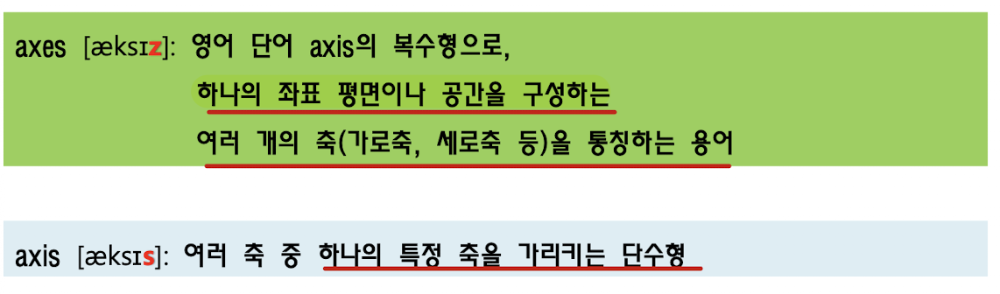

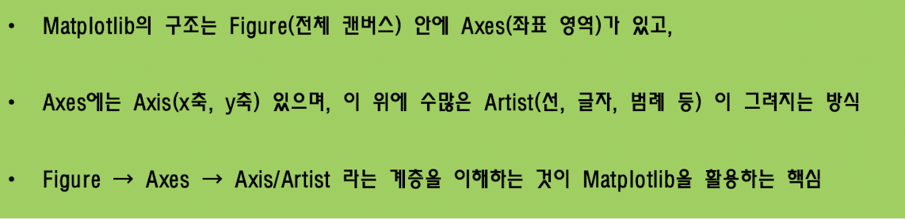

- Figure와 Axes는 `plt.figure()`, `plt.subplots()` 등으로 만들 수 있음
- `plt.subplots()`는 Figure와 Axes를 함께 생성
- `plt.subplots(2, 2)`는 2행 2열의 Axes 배열 생성
- `plt.subplot_mosaic()`은 Figure 안에 Axes 객체를 추가로 생성해 주는 편의 함수
- 기본 작업 흐름:
  - **Figure와 Axes 생성 → Axes에 데이터 그리기 → 그래프 출력**
  - `plt.show()`는 **그래프 표시**
- 플로팅 함수에는 보통 `numpy.array` 또는 `numpy.ma.masked_array` 사용

```python
fig, ax = plt.subplots()
ax.plot(x, y)
ax.set_title("Simple Plot")
plt.show()
```

> **핵심:**
>  Matplotlib **기본 구조는 Figure(전체 캔버스) → Axes(데이터 영역) → Axis와 Artist(축과 시각 요소)**

- 그림을 그릴 때 도화지와 그림이 놓일 자리를 먼저 정한다고 생각해 보자
- **Figure는 큰 도화지**, **Axes는 그 위에서 실제 그래프를 그리는 칸**, **Artist는 그 칸에 그려지는 선·점·글자**에 해당함
- 예:
  - 한 화면에 **그래프 두 개**를 나란히 두고 싶다면, **Figure라는 도화지 안에 Axes 두 개를 준비**한 다음 각 Axes에 그래프를 그릴 수 있음

### Matplotlib의 사용 방식과 스타일 설정

- **객체 지향 방식**
  - `fig, ax = plt.subplots()`로 **Figure와 Axes를 직접 생성하고,**  `ax.plot()`, `ax.set_title()` 같은 객체 메서드를 호출
  - 코드 구조가 분명해 **복잡한 그래프나 여러 축을 다루는 데 유리**

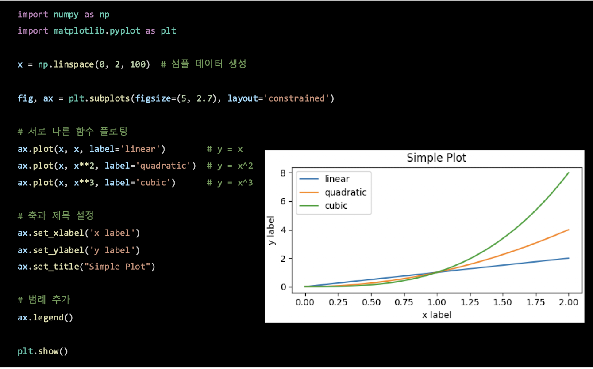

- **⭐️Pyplot 방식(시험 출제)⭐️**
  - `plt.plot()`처럼 함수를 호출하면 Matplotlib이 현재 활성화된 Figure와 Axes 관리
  - **장점: 간단한 그래프를 빠르게 만드는 데 편리**
  - **단점 : 그래프가 여러 개가 되면 가독성과 관리가 어려워질 수 있음**

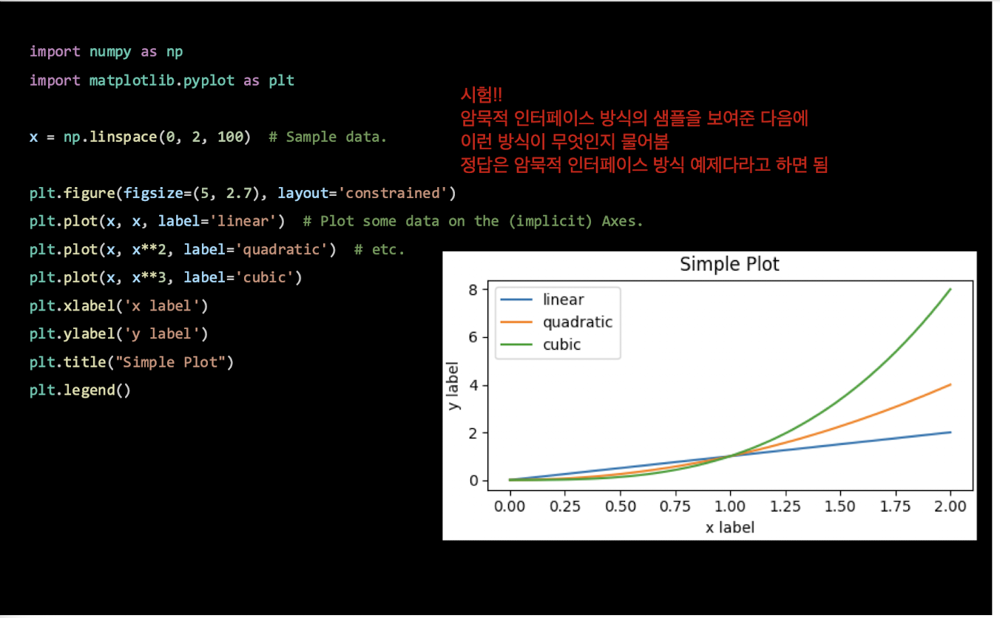

- **Artist의 스타일링**
  - **그래프를 그릴 때 플롯 메서드를 호출하여 지정하거나, 생성 후 setter 메서드로 바꿀 수 있음**
  - 예를 들어 plot 함수를 이용해 선의 색상·굵기·스타일을 지정하고, `set_linestyle()`로 선 스타일을 나중에 변경할 수 있음
  - **다양한 색상과 색상 맵을 사용할 수 있음**
- 선 그래프에서는 선 스타일과 마커 모양을 다르게 설정해 여러 데이터 시리즈를 구분할 수 있음
- **레이블과 제목, 텍스트**
  - 그래프에 레이블과 텍스트를 추가하여 데이터의 의미를 명확하게 전달
- **축 범위, 격자, 범례(Legend)**
  - 그래프에서 여러 데이터 시리즈를 명확히 구분하는 데 중요한 요소
- 2차원 값은 `pcolormesh()`, `contourf()`, `imshow()` 등으로 색상 맵에 표현할 수 있음
- 점 자료는 색상값을 지정한 `scatter()`로 나타낼 수 있음
- `LogNorm`은 예시에서 색상값에 로그 스케일을 적용하는 데 사용됨

### Seaborn의 특징과 Matplotlib과의 비교

- **Seaborn이란?**
  - **Matplotlib을 기반으로 만든 Python 시각화 라이브러리**
  - **커스터마이징 최소화**
  - 기본적으로 예쁘고 일관성 있는 스타일 제공
  - **Matplotlib의 설정을 간결**하게 하고, **통계적 시각화(플롯, 분포도, 다변량 관계 등)를 직관적으로 표현**
  - 데이터 처리 → 시각화 과정을 자연스럽게 연결
  - **pandas DataFrame과 긴밀히 연동됨**
- 기본 스타일과 색상 팔레트가 세련되고 일관적이며, 회귀선·분포·다변량 관계 등의 통계 플롯을 지원합니다. 데이터 처리와 시각화 흐름을 자연스럽게 연결해 탐색적 데이터 분석과 보고서·발표 자료 등에 활용됩니다.
- **Matplotlib**
  - 수준 API를 제공해 **세밀하게 조정하고 복잡한 그래프를 구현하기 좋지만**, 설정 코드가 많고 기본 스타일은 단순함
- **Seaborn**
  - 고수준 API로 **간결한 코드와 통계 시각화에 강점**이 있지만, **세부 커스터마이징에는 제약**이 있어 복잡한 작업에서는 Matplotlib을 함께 써야 할 수 있음
- 산점도 예시:
  - **Matplotlib**은 기본 스타일로 **단순하고 직접적인 표현**을 보임
  - **Seaborn**은 색상 팔레트와 **자동 스타일링을 적용해 시각적으로 다른 표현 제공**

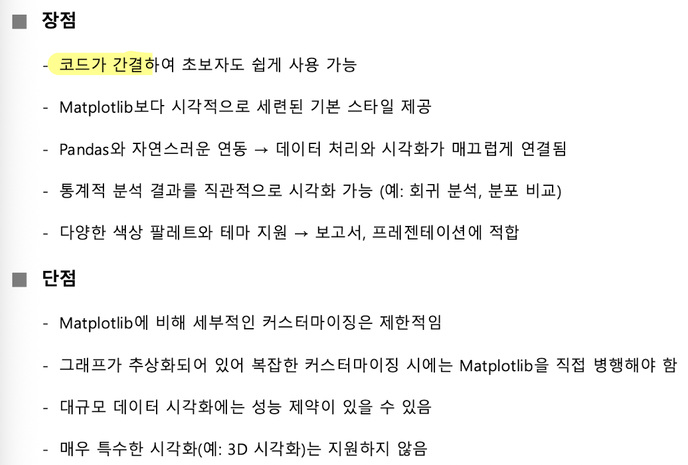

**⭐️시험 출제⭐️**

- matplot과 seaborn을 구분하는 문제 출제
- **어떤 특성이 있는지 구분하기**

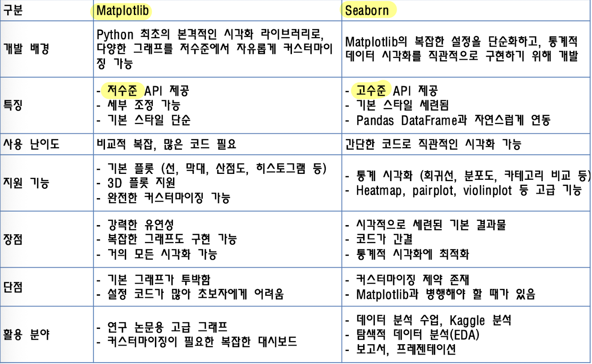

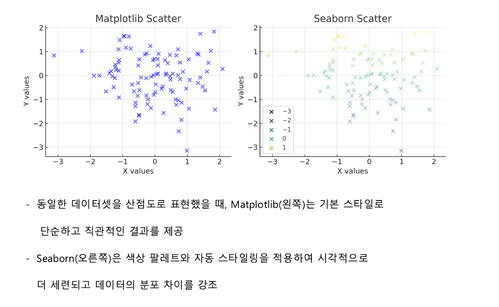

| 구분        | Matplotlib                                         | Seaborn                                                  |
| ----------- | -------------------------------------------------- | -------------------------------------------------------- |
| 인터페이스  | 저수준 API, 세밀한 제어                            | 고수준 API, 간결한 코드                                  |
| 기본 스타일 | 단순함                                             | 세련되고 일관적인 스타일                                 |
| 강점        | 복잡한 그래프와 커스터마이징                       | 통계 시각화, DataFrame 연동                              |
| 고려점      | 설정 코드가 많고 학습이 비교적 복잡함              | 세부 조정에 제약이 있어 Matplotlib 병행이 필요할 수 있음 |
| 활용 예     | 연구용 고급 그래프, 커스터마이징이 필요한 대시보드 | 탐색적 데이터 분석, 교육, 보고서와 발표 자료             |

### 분포를 보는 그래프: 히스토그램과 박스플롯

- **히스토그램**
  - **수치 데이터를 구간별로 나누어 각 구간의 빈도를 막대로 나타내는 도구**
  - 예시에서는 시험 점수 목록을 8개 구간(`bins=8`)으로 나누어 분포를 표현함

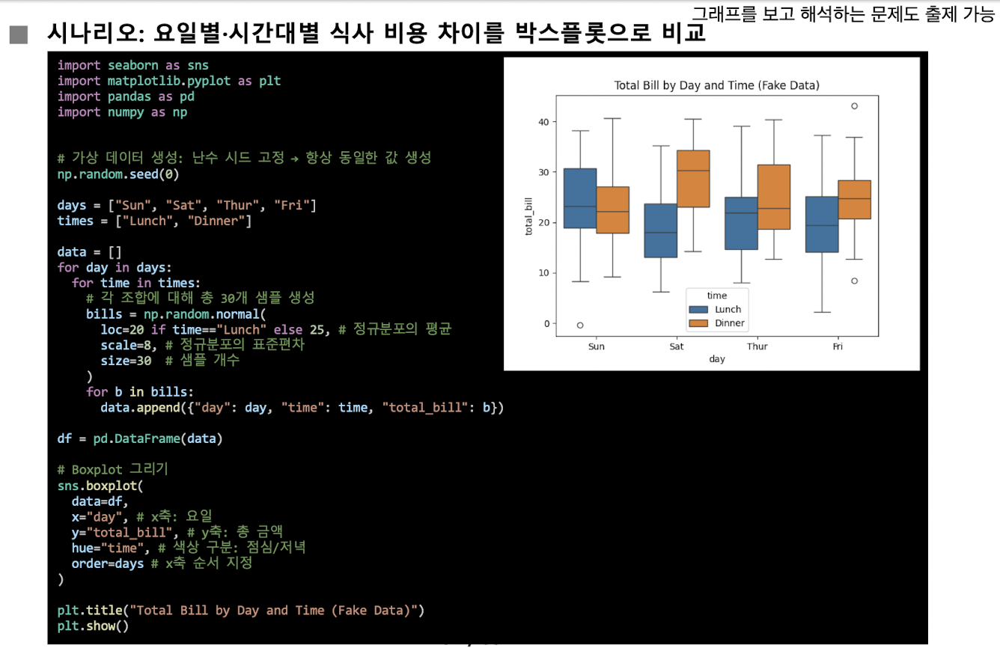

- **박스플롯**
  - **분포의 중심과 퍼짐, 이상치를 한 그림에서 살펴보는 통계적 시각화 도구**
  - 상자 안의 선은 **중앙값**으로, 자료의 절반은 이 값보다 크고 절반은 작음
  - 상자의 아래·위 경계는 각각 제1사분위수\(Q_1 (25\% 위치)과 제3사분위수 Q_3 (75\% 위치)\)이며, 상자에는 가운데는 50%
    - 사분위 범위는 $IQR(Interquartile Range) = Q_3 - Q_1(75\% - 25\%) = 50\%$입니다.
  - **수염**은 일반적으로 $Q_1 - 1.5 \times IQR(50)와 Q_3 + 1.5 \times IQR(50)$ 범위 안에 있는 가장 작은 값과 가장 큰 값까지 이어짐
  - 수염 바깥 점은 이상치로 표시됨
    - 이상치는 자료의 변동성, 오류 또는 특별한 패턴과 관련될 수 있으므로 주의 깊게 해석해야 함
  - 상자의 크기와 중앙값의 위치, 상자와 수염의 상대적인 모양을 살펴 분포가 퍼져 있는지, 비대칭인지 파악할 수 있음

> **핵심**
>  박스플롯의 중앙값·사분위수·수염·이상치가 각각 무엇을 나타내는지 구분하고, 이를 이용해 분포의 중심·퍼짐·비대칭성을 읽어야 함

### Seaborn의 범주형 분포 그래프

- **바이올린 플롯(`violinplot`)이란?**
  - **박스플롯의 중앙값·사분위 정보와 커널 밀도 추정(KDE)에 따른 분포 모양을 함께 보여줌**
  - 바이올린의 두꺼운 부분은 자료가 많이 모인 구간, 얇은 부분은 자료가 드문 구간
  - `hue`와 `split=True`를 사용하면 두 그룹을 하나의 범주 축에서 좌우로 나누어 비교할 수 있음

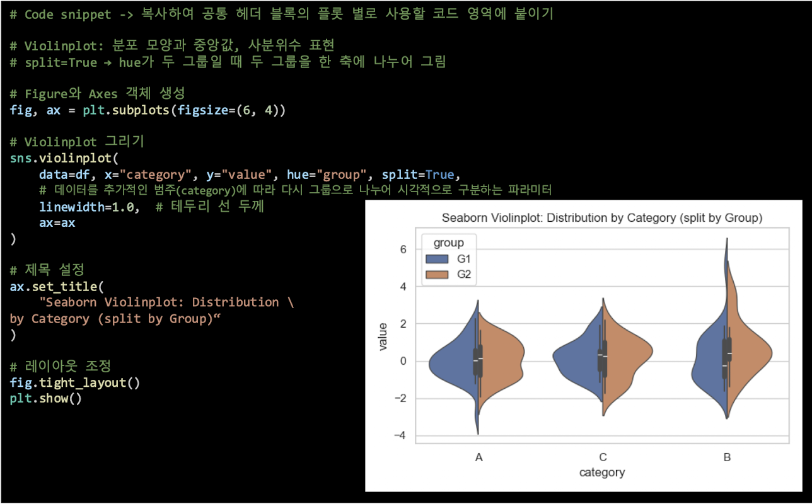

- **스트립 플롯(`stripplot`)이란?**
  - **범주형 변수를 가로축에, 수치형 값을 세로축에 두고 개별 자료를 점으로 표시**
  - **점들이 세로로 모이는 값의 범위는 데이터의 상태 표현**
    - 세로 위치 → 데이터 범위 파악
  - **특정 구간의 점 밀집은 데이터 집중을 표현**
    - 점 밀집 정도 → 특정 구간 집중 여부 확인
  - `jitter`는 값 자체를 바꾸지 않고 점을 **가로로 흩어 겹침을 줄임**
  - `alpha`는 **투명도를 조절해 밀집 구간 강조**
    - `jitter, alpha`  적용 여부 → 분포 해석 용이성 향상

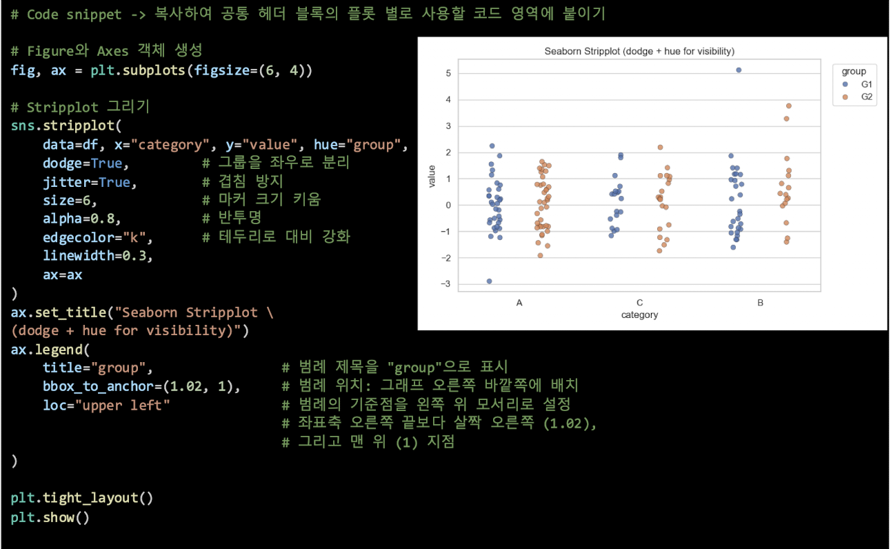

- **스웜 플롯(`swarmplot`)이란?**
  - **Stripplot과 유사하게 개별 점을 표시하지만, 점이 겹치지 않도록 자동 배치함**
  - **범주(category)별로 데이터의 실제 값을 모두 표시**
  - **벌집 형태 배치 → 빈도와 분포 패턴을 명확히 관찰 가능**
  - 장점
    - 작은 자료에서 모든 관측점을 확인 가능
    - 그룹 간 분포를 비교하기 용이
    - **Stripplot보다 해석이 용이함**
  - 단점
    - **자료가 많으면 점이 지나치게 퍼져 해석이 어려워질 수 있음**

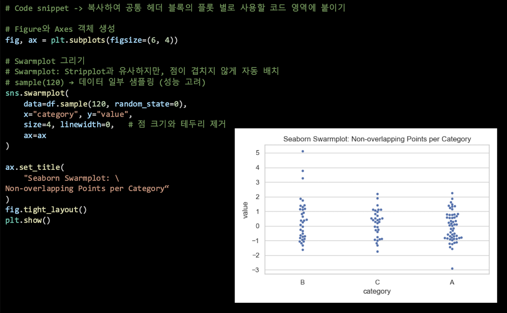

| 그래프        | 무엇을 보여주는가              | 주요 고려점                                                  |
| ------------- | ------------------------------ | ------------------------------------------------------------ |
| 바이올린 플롯 | 중앙값·사분위 정보와 분포 모양 | `hue`와 `split=True`로 두 그룹을 나누어 비교 가능            |
| 스트립 플롯   | 개별 관측값과 범주별 분포      | 점이 겹칠 수 있어 `jitter`, `alpha`를 활용                   |
| 스웜 플롯     | 겹치지 않게 배치된 개별 관측값 | 작은 자료에서 유용하지만 자료가 많으면 과도하게 퍼질 수 있음 |

- **바이올린 플롯은 분포를 윤곽으로 요약**
- 스**트립 플롯과 스웜 플롯은 관측된 자료 하나하나를 점으로 표시**

### Seaborn의 막대·빈도 그래프

- **막대 그래프(`barplot`)란?**
  - **범주형 데이터 → 통계량을 막대 높이로 나타냄**
  - **기본적으로 평균(mean)을 표시하고 신뢰구간(CI)을 함께 그림**
  - `hue` 옵션으로 범주 내부의 그룹 간 평균 차이 비교 가능
  - **특징**
    - **막대 높이 → 범주의 대표 값(**평균, 중앙값, 합계 등 `estimator` 로 변경 가능)
      - `estimator`를 바꾸면 평균 이외의 통계량을 사용할 수 있음
    - 신**뢰구간(CI)**
      - **검은색 실선으로 표시**
      - **데이터 변동성과 불확실성 표현**
      - **신뢰구간 겹침 → 차이가 유의하지 않을 가능성**
      - **신뢰구간 분리 → 차이가 뚜렷할 수 있음**
  - **해석**
    - **막대 높이 → 범주별 대표 값 확인**
    - **신뢰구간 → 데이터 변동성 & 그룹 간 차이 해석**
    - **그룹 막대 비교(hue) → 범주 내 그룹 관계 분석**

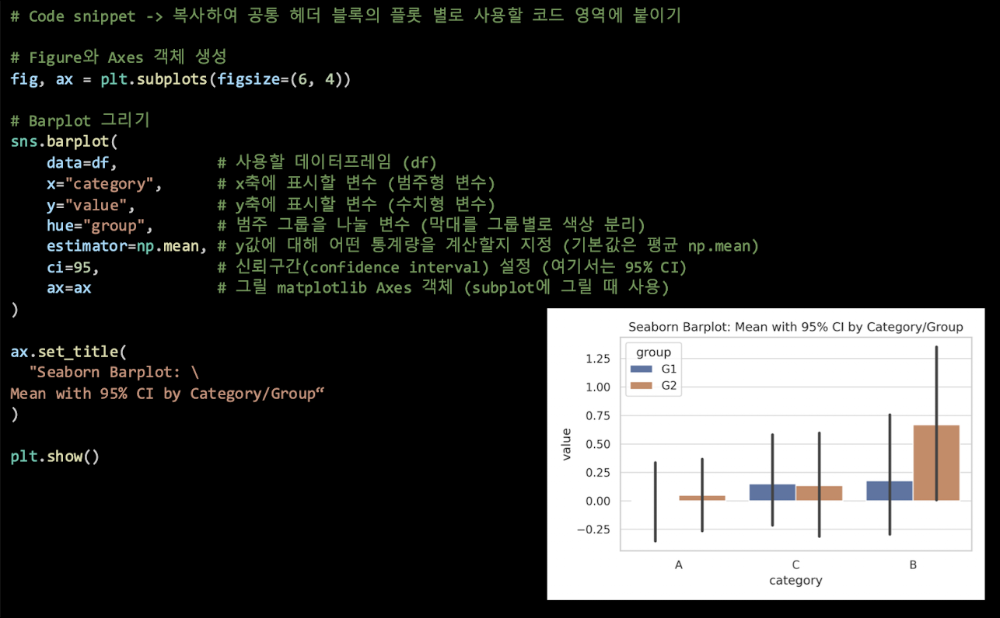

- **빈도 그래프(`countplot`)란?**
  - **범주형 데이터의 빈도(횟수)를 막대 높이로 표현**
  - **Barplot과 달리 평균, 통계값이 아닌 단순 빈도를 보여줌**
  - 특징
    - **가로축 → 범주(category)**
    - **세로축 → 빈도(count)**
    - **`hue` 옵션 → 범주 내부의 그룹별 분포 비교 가능**
  - 활용
    - 범주형 변수 분포 파악
    - 클래스 불균형 확인
    - **데이터 전처리 및 분류 문제 준비 단계에서 사용**
  - 해석
    - 포인트 막대 높이 → 각 범주의 데이터 수 비교
    - 그룹 지정 시 → 그룹 간 상대적 비율 파악
    - 전체 데이터셋 내 불균형 여부 확인

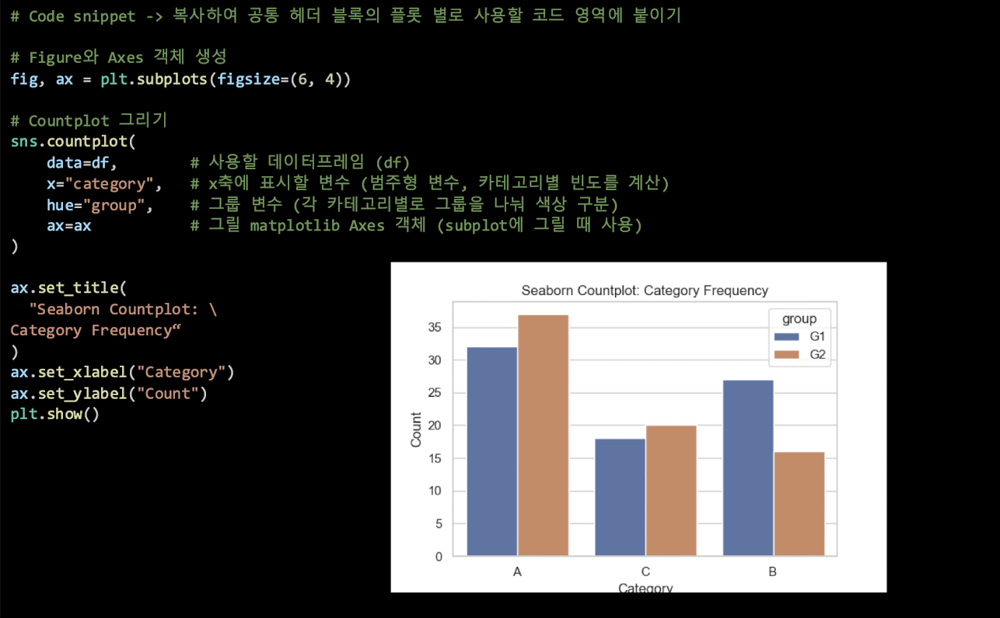

> **핵심**
>  `barplot`은 기본적으로 범주별 평균과 신뢰구간을, `countplot`은 범주별 자료의 개수를 나타냅니다.

**막대 그래프(**`barplot)`**는 각 범주의 수치값을 모아 평균 같은 대표값을 보여주는 것이 기본**

**빈도 그래프(**`countplot)`**는 각 범주에 자료가 몇 개 있는지 보여줌**

- 가령 A 범주에 10개의 값이 있고 B 범주에 5개의 값이 있다고 상상해 보자
  - 빈도 그래프는 A와 B의 **자료 개수 차이**를 보여줌
  - 막대 그래프는 A와 B 안의 수치값을 요약해 **평균 같은 대표값의 차이**를 보여줌

### 변수 간 관계를 보는 그래프: 히트맵과 페어플롯

- **히트맵(`heatmap`)이란?**
  - **데이터 행렬을 색상으로 시각화**
  - 주로 상관관계 행렬(correlation matrix) 시각화에 활용
  - 표보다 패턴, 경향성을 쉽게 파악 가능
  - **특징**
    - 가로축, 세로축 → 변수명
    - **셀 색상**
      - **두 변수 간 관계(예: 상관계수)**
        - +1에 가까움 → 강한 양의 상관관계
        - -1에 가까움 → 강한 음의 상관관계
        - $0$ 근처이면 선형 관계가 없음
    - 변수 간 관계의 패턴을 빠르게 살펴 볼 수 있음
  - **활용**
    - **변수 선택 및 다중공선성(multicollinearity) 탐지**
      - **다중공선성이란?**
        - 서로 다른 변수라고 생각해서 모델에 넣었지만, 실제로는 두 변수가 거의 같은 정보를 담고 있어 서로 중복되는 상태
    - 변수 간 관계 이해 및 **불필요, 중복 변수 제거**

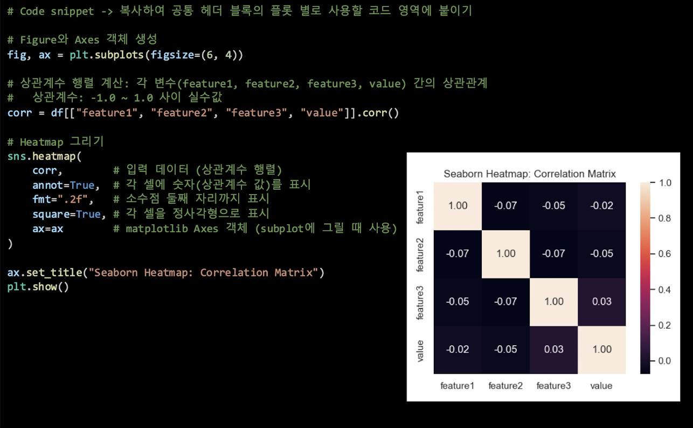

- **페어플롯(`pairplot`)이란?**
  - 변수 간 관계를 **산점도(Scatter plot)**와 각 변수의 개별 분포를 대각선의 **히스토그램**으로 보여줌
  - **셀 → 두 변수 간 관계**
    - **점이 직선 형태 → 강산 선형 관계**
    - **점이 무작위 분포 → 선형 관계 없음**
  - **대각선 → 각 변수의 히스토그램(분포 특성)**
  - 활용
    - 탐색적 데이터 분석(EDA)에 활용
    - 다중공선성(multicollinearity) 가능성 점검
    - 변수 간 선형, 비선형 관계 확인
    - `hue` 옵션 → 범주별 분포 차이 시각화 가능

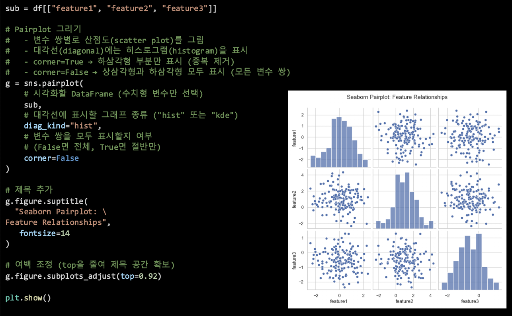

| 그래프   | 셀 또는 위치가 나타내는 것               | 주요 활용                             |
| -------- | ---------------------------------------- | ------------------------------------- |
| 히트맵   | 변수 쌍의 상관계수 등을 색과 값으로 표시 | 관계 패턴 및 다중공선성 가능성 검토   |
| 페어플롯 | 변수 쌍의 산점도, 대각선의 변수별 분포   | 여러 변수의 관계·분포를 한꺼번에 탐색 |

- **히트맵**은 여러 숫자를 색으로 바꾸어 표처럼 배치하는 방식
  - 상관관계 히트맵에서는 행과 열에 변수 이름이 있고, 교차하는 칸에 두 변수의 상관계수가 들어감
- **페어플롯**은 여러 변수의 관계를 작은 그래프들로 펼쳐놓은 표처럼 볼 수 있음
  - feature1과 feature2의 칸은 두 변수의 산점도이고, 대각선 칸은 feature1 자체의 분포처럼 변수 하나의 분포를 보여줌
  - 예를 들어 점들이 대각선 형태로 모이는지 살펴 변수 간 선형 관계를 탐색할 수 있음
  - 다만 **히트맵의 상관계수는 선형 관계를 요약**하고, 페**어플롯의 산점도는 눈에 보이는 점의 배치를 보여주는 것**이므로 두 결과가 모든 관계를 설명한다고 단정하지는 못함
