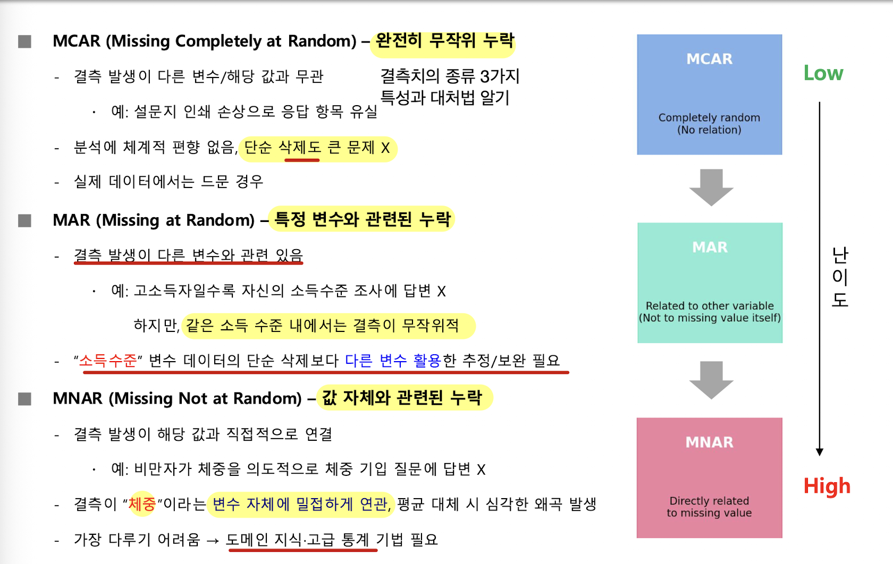

# 결측치(Missing Value) 처리

## 결측치의 의미와 영향

### 결측치

**결측치란?**

- **변수의 값이 비어 있거나 기록되지 않은 상태**
- 단순한 빈칸이 아니라 **분석 전반에 큰 영향**
- **불완전한 데이터 사용시 → 잘못된 분석 결과**
- **즉, 결측치 처리가 데이터 전처리의 핵심 과제**

결측치를 무시하면 발생하는 일

- **통계적 왜곡**
  - 평균, 분산, 상관계수 등 기초 통계량 왜곡
  - **표본이 모집단을 제대로 대표하지 못하는 문제 발생**
- **모델 정확도 저하**
  - 결측치를 포함한 데이터를 직접 처리하지 못하는 머신러닝 알고리즘이 많음
  - **결측치 때문에 예측력이 낮아짐**
  - **특정 집단에 집중 발생 시 → 편향된 학습 결과**
- **학습 불완정성**
  - **무작위 제거** → 데이터 크기 축소되고, 검정력 약화 됨
  - **잘못된 값 대체** → 실제 패턴 반영 실패하고, 불안정한 결과 초래

**발생 원인:**

- **데이터 수집 오류** → 입력 실수, 네트워크 지연, 저장 매체 손상 등
- 소득·재산·건강 등 민감한 설문 문항에 대한 **응답 거부**
- 센서 전원 꺼짐, 네트워크 연결 끊김, **장비 오작동**
- **데이터베이스나 파일을 병합할 때 발생하는 키 값 불일치**

> 결측치는 “값이 0”이라는 뜻이 아니라 **값을 알 수 없거나 기록하지 못했다**는 뜻일 수 있음

---

### 결측치 유형: MCAR, MAR, MNAR(중간고사 100% 출제)

결측치는 누락이 발생하는 방식에 따라 구분함

**MCAR**에서 **MAR**, **MNAR**로 갈수록 다루기 어려움

|             유형             |                             의미                             |                             예시                             |                         처리상 핵심                          |
| :--------------------------: | :----------------------------------------------------------: | :----------------------------------------------------------: | :----------------------------------------------------------: |
| **MCAR**(완전히 무작위 누락) |           결측 발생이 다른 변수나 해당 값과 무관함           |             설문지 인쇄 손상으로 응답 항목 유실              | 분석에 체계적 편향이 없음 **단순 삭제도 큰 문제 X**  실제 데이터에서는 드문 경우 |
|    **MAR** (무작위 누락)     | • 결측 발생이 다른 변수와 관련이 있음   • 해당 변수의 값 자체와는 관련되지 않음 | 고소득자일수록 소득 조사에 답하지 않지만, 같은 소득 수준 안에서는 결측이 무작위적 |     관련된 다른 변수를 활용한 추정·보완이 필요할 수 있음     |
|   **MNAR** (비무작위 누락)   |           결측 발생이 누락된 값 자체와 직접 관련됨           |       비만자가 체중 기입 질문에 의도적으로 답하지 않음       | 평균 대체가 심각한 왜곡을 만들 수 있으며, 도메인 지식과 고급 통계 기법이 필요함 |

> **핵심:**
>  **결측이 다른 변수와 관련되면 MAR, 누락된 값 자체와 관련되면 MNAR**
>  “필요한 변수로 결측을 설명할 수 있는가”와 “누락값 그 자체가 누락 확률과 연결되는가”를 구분함

예:

인쇄가 번져서 어떤 응답자의 답이 우연히 사라졌다면 특정 응답자 특성과 무관한 **MCAR**

반면 높은 소득 집단에서 응답 누락이 더 많지만 집단 안에서는 누락이 무작위라면 **MAR**

응답자가 자신의 실제 소득 때문에 답을 숨기는 경우처럼, 빠진 소득값 자체가 누락과 연결되면 **MNAR**

즉,

1. **MCAR는 다른 정보와 무관한 누락**
2. **MAR는 다른 변수와 연결된 누락**
3. **MNAR는 빠진 값 자체와 연결된 누락**

---

### 결측치 처리 방법(제거법, 대체법, 도메인 지식 활용)

#### 제거법

**제거법이란?**

- **결측치를 포함한 행이나 결측이 많은 변수를 제외하고, 완전한 데이터만 활용**

**방법**

- **행 제거(Listwise deletion)**: 결측치가 하나라도 있는 **행 전체 삭제**
  - 장점: 구현이 간단하고 남은 데이터는 완전
  - 단점: **데이터와 표본 수가 크게 줄 수 있고**, 특정 집단의 결측이 집중되면 분석이 왜곡될 수 있음
- **열 제거(Variable deletion)**: 결측치가 많은 **변수 자체 삭제**
  - 장점: 단순하고 불필요한 변수를 제거할 수 있음
  - 단점: **중요한 변수를 잃으면 설명력·성능·해석력이 낮아질 수 있음**

장점

- 구현 간단, 추가 보완 불필요
- 결측치가 적으면 큰 영향 없음

단점

- 데이터 손실 및 표본 수 부족
- 특정 집단 결측 시 분석 왜곡 위험
- 중요한 변수 제거 시 성능 및 해석력 저하

> - 단순한 전체 행 제거는 실무에서 적절하지 않음
> - 결측률, 분석 목적 등을 고려하여 행/열 제거 방식을 선택
> - 데이터 품질을 유지하면서 분석 시능 데이터를 뽑아내는 것이 관건

---

#### 대체법

**대체법이란?**

- 결측치를 **특정값이나 예측값으로 채워 데이터 크기를 유지하는 방법**
- 결측을 없앨 수는 있지만, 잘못 적용하면 새로운 **왜곡이 생길 수 있음**

|             유형             |                             의미                             |                             예시                             |                         처리상 핵심                          |
| :--------------------------: | :----------------------------------------------------------: | :----------------------------------------------------------: | :----------------------------------------------------------: |
| **MCAR**(완전히 무작위 누락) |           결측 발생이 다른 변수나 해당 값과 무관함           |             설문지 인쇄 손상으로 응답 항목 유실              | • 분석에 체계적 편향이 없음   • **단순 삭제도 큰 문제 X**   • 실제 데이터에서는 드문 경우 |
|    **MAR** (무작위 누락)     | • 결측 발생이 다른 변수와 관련이 있음   • 해당 변수의 값 자체와는 관련되지 않음 | 고소득자일수록 소득 조사에 답하지 않지만, 같은 소득 수준 안에서는 결측이 무작위적 |     관련된 다른 변수를 활용한 추정·보완이 필요할 수 있음     |
|   **MNAR** (비무작위 누락)   |           결측 발생이 누락된 값 자체와 직접 관련됨           |       비만자가 체중 기입 질문에 의도적으로 답하지 않음       | 평균 대체가 심각한 왜곡을 만들 수 있으며, 도메인 지식과 고급 통계 기법이 필요함 |

##### 회귀 기반 대체

**회귀 기반 대체란?**

- 결측이 있는 변수를 다른 변수와의 관계를 이용해 예측함
- 누락된 값을 “예측”해서 채우는 방식

**Iterative Imputer란?**

- 결측 변수를 다른 변수들의 함수로 가정

  → 반복 회귀모형으로 추정

- 장점

  - 평균/최빈값 대체보다 변수 간 상관관계, 구조적 특성 반영
  - **더 현실성 있는 값 예측 가능**

- 한계

  - **데이터가 적거나 상관성이 약하면 부정확한 값 생성**
  - 반복 횟수 및 초기값에 따라 결과가 달라짐
  - 예측 값이 실제 범위를 벗어날 위험이 있음

---

#### 도메인 지식 활용

**도메인 지식이란?**

- **해당 분야의 배경지식**으로, **단순한 통계 처리 한계 보완**

**의미 구분 필요**

- 중요한 구분은 **“없음”과 “미기록”**이다.
- 데이터 수집 배경 고려 → 분석 신뢰도와 현장 적용성 강화
- 필요시 해당 분야 전문가와 협업 필수
- 환자 데이터에서 검사 결과가 `0`이면 실제 증상이 없다는 뜻일 수 있지만, 값이 비어 있으면 검사 누락이나 기록 오류일 수 있음
- 금융 데이터에서 거래 금액 `0원`은 거래가 없다는 뜻일 수 있지만, 값이 비어 있으면 입력 오류나 시스템 누락일 수 있음

---

## 이상치 탐지

### 이상치의 의미와 영향

**이상치란 무엇인가?**

- **데이터의 일반적 분포, 패턴에서 크게 벗어난 값**

**발생 원인**

- 데이터 수집 및 입력 오류
- 시스템 통합 시 단위 오류
- 극단적인 사건 발생

**의미와 해석**

- 단순 오류 → 제거
- **중요한 신호 → 분석 대상**
- 맥락에 따라 판단해야 함

**영향**

- **통계적 요약**: 평균, 표준편차 등 요약값 크게 흔들림
- **모델 성능 저하**: 회귀선 왜곡, 결정 경계 학습 오류, 예측력

**이상치를 무시했을 때 발생하는 문제점**

- **통계적 왜곡**
  - 평균, 표준편차, 분산 등 기본 통계량 왜곡
  - 기본 통계량 오류 → 분석 전반에 부정적 영향
- **모델 성능 저하**
  - 잘못된 패턴 학습, 극단 값에 끌려감
  - **회귀: 단일 이상치가 회귀선 왜곡**
  - **분류: 이상치가 결정 경계를 구부려 과적합 초래**
  - **정확도와 일반화 성능 모두 저하**
- **학습 불안정성**
  - 학습이 발산하거나 수렴 불안정 → 훈련 시간 증가, 신뢰도 저하
  - **학습 모델에서 심각한 이상치 → 손실 함수가 커짐 → 기울기 폭발 발생**

**중요성**

- **이상치 탐지, 해석, 처리 여부가 분석 신뢰도를 좌우 → 데이터 과학 필수 단계**

---

### 이상치 탐지 방법

| 방법의 구분            | 주요 기법                       | 판단 방식                                                    | 장점                               | 단점                                                  |
| ---------------------- | ------------------------------- | ------------------------------------------------------------ | ---------------------------------- | ----------------------------------------------------- |
| **통계적 방법**        | Z-Score, IQR(사분위 범위)       | 평균·표준편차·사분위수 등 분포 기준에서 임계값 이상 벗어난 관측치를 탐지 | 계산이 간단하고 직관적임           | **분포가 정규분포가 아닐 때 정확도가 낮아질 수 있음** |
| **거리 기반 방법**     | KNN Distance, DBSCAN            | 데이터 사이의 거리를 계산해 밀도가 낮거나 주변과 떨어진 점을 탐지 | 다양한 데이터 분포에 적용 가능     | **고차원 데이터에서 거리 계산이 비효율적일 수 있음**  |
| **머신러닝 기반 방법** | Isolation Forest, One-Class SVM | 정상 데이터 패턴을 학습한 뒤 그 패턴과 크게 다른 점을 탐지   | 복잡한 패턴의 이상치 탐지가 가능함 | 계산 비용이 크고 모델 선택·조정이 필요함              |

통계적 방법은 “**전체 데이터의 기준에서 얼마나 멀리 떨어졌는가”를 보는 방식**

거리 기반 방법은 **“주변 데이터와 얼마나 가까운가”를 살펴보는 방식**

머신러닝 기반 방법은 정**상 데이터의 패턴을 먼저 학습한 뒤 그 패턴과 다른 사례를 찾는 방식**

---

### 이상치 처리 방법

이상치 처리는 **제거·대체·변환**으로 나눌 수 있음

**데이터 특성과 분석 목적**에 따라 신중히 골라야 함

- **제거(Deletion)**
  - 입력 오류나 센서 고장으로 판단되는 **값 삭제**
  - **장점**
    - 간단하고 분포를 정리하기 쉬움
  - **단점**
    - 데이터 손실이 생기며 중요한 신호까지 제거할 수 있음
- **대체(Imputation)**
  - **평균·중앙값·최빈값 또는 회귀·KNN 등으로 바꿈(통계적 기반 or 거리 기반)**
  - **평균·중앙값·최빈값(대표값 기반), 회귀(모델 기반), KNN(거리 기반) 등을 이용해 대체**
  - **장점**
    - 데이터 손실을 줄일 수 있음
  - **단점**
    - 변동성이 왜곡되고 인위적인 값이 만들어질 수 있음
- **변환(Transformation)**
  - 로그 변환, 제곱근 변환, 표준화 등을 적용
  - **장점**
    - **구조를 유지하면서 이상치의 영향을 완화**
  - **단점**
    - 변수의 의미가 변할 수 있고 모든 상황에 효과적인 것은 아님

오류로 확인된 값을 **제거**하는 것은 잘못 적힌 측정치를 기록에서 빼는 것과 비슷함

그 값이 진짜 사건이라면 삭제는 중요한 정보를 없앨 수 있음

값을 다른 값으로 **대체**하면 행은 유지되지만, 새 값이 실제 데이터의 변동을 충분히 담지 못할 수 있음

**변환**은 큰 값을 압축해 영향력을 줄이는 방법이지만, 변수의 해석 방식도 달라질 수 있음

**그러므로 “이상치가 있다”는 판단과 “삭제해야 한다”는 결정은 별개임**

이상치가 왜 생겼는지와 분석에서 어떤 의미를 갖는지를 확인한 뒤 처리 방법을 선택해야 함

---

## 데이터 정규화와 스케일링

### 정규화가 필요한 이유

**정규화란?**

- **데이터의 크기나 범위를** **일정한 기준으로 조정하는 과정**
- 서로 다른 단위·범위의 변수를 비교 가능

**필요성**

- **변수 단위 차이 조정**
  - 큰 값을 가진 변수가 모델에 과도한 영향 → 예측 정확도 저하
  - **정규화 → 변수 간 동등한 조건에서 학습 기여**
- **학습 속도와 안정성 확보**
  - **경사 하강법 최적화 시 변수 크기 차이 → 기울기 불균형**
  - 수렴 경로가 지그재그로 비효율적, 실패 위험
  - **정규화 → 균형 잡힌 스케일 → 빠르고 안정적인 학습**
- **이상치와 분포 왜곡 완화**
  - 극단적으로 큰 값 → 전체 스케일 확대, 다른 데이터 중요성 감소
  - **정규화 → 이상치 영향 완화, 전체 분포 반영 강화**

**주요 기법**

- **Min-Max Scaling - 0~1 범위로 변환**
- **Z-score Standardization - 평균 0, 표준편차 1로 변환**
- **Robust Scaling - 중앙값, 사분위수 활용, 이상치 영향 감소**

**효과**

- **변수 간 공정한 비교 가능**
- **모델 학습 효율성, 안정성 향상**
- **해석 및 시각화 용이성 증대**

---

### 주요 정규화 기법

**로그·제곱근 변환**은 **공통적으로 데이터 크기를 압축**하고 분포를 안정화해 극단값의 영향을 완화함

|         구분          | 기법                                         | 정의                                                         | 변환 기준·공식                                               | 장점                                                         | 한계·주의점                                                  |
| :-------------------: | -------------------------------------------- | ------------------------------------------------------------ | ------------------------------------------------------------ | ------------------------------------------------------------ | ------------------------------------------------------------ |
| **최소-최대 정규화**  | **최소-최대 정규화 **(Min-Max Scaling)       | 데이터 최소값 → 0 최대값 → 1로 변환 모든 값을 0~1 범위로 선형 변환 | 최솟값을 0, 최댓값을 1로 선형 변환:  x′=max(x)−min(x)x−min(x) | 1. 결과가 0∼1 범위 단위   2. 다른 변수를 비교하기 쉬움   3. KNN, K-means 같은 거리 기반 알고리즘에 효과적 | **• 이상치에 민감**   • 극단값이 최솟값·최댓값이 되면 나머지 데이터가 0 근처에 몰려 구별이 어려워질 수 있음 |
|   **Z-점수 표준화**   | **Z-점수 표준화**  (Z-score Standardization) | 데이터 → 평균 0, 표준편차 1 분포로 변환 Z-점수: 평균으로부터 몇 개의 표준편차 떨어져 있는지 의미 | 평균을 0, 표준편차를 1로 변환:  x′=σx−μ                      | • 값의 평균으로부터의 상대적 위치를 해석하기 쉬움   • **경사 하강법 기반 모델에 적합** | • **이상치가 평균과 표준편차를 왜곡할 수 있음**   • 이상치가 많으면 로버스트 스케일링이 권장됨 |
| **로버스트 스케일링** | **로버스트 스케일링** (Robust Scaling)       | 중앙값과 사분위 범위 기준으로 변환                           | 중앙값을 기준으로 빼고 IQR로 나눔: x′=IQRx−Median, IQR=Q3−Q1 | • 극단값이 많은 데이터에서 비교적 안정적   • 이상치에 강함   | • 값을 0∼1로 제한x   • 데이터의 세밀한 변화를 과도하게 단순화할 수 있음   • 정규분포·대칭적 데이터에서는 효율이 낮을 수 있음 |
|     **로그 변환**     | **로그 변환**  Log Transformation)           | 데이터 크기 압축 분포 안정화 이상치 영향 완화                | x′=log(x+c)                                                  | • 큰 값을 강하게 압축   • 비대칭 분포에 적합                 | • 0 이하 값에 적용할 수 없음   • 해석이 직관적이지 않을 수 있음 |
|    **제곱근 변환**    | **제곱근 변환 (**Square Root Transformation) | 데이터 크기 압축 분포 안정화 이상치 영향 완화                | x′=x+c                                                       | • 로그 변환보다 완만하게 압축   • 분산이 큰 데이터나 방문자 수·사건 횟수 같은 카운트 데이터에 적합 | **•** **음수 데이터에 적용할 수 없음 **  **• 효과가 제한적일 수 있음** |

측정값이 `0~1` 사이에 있어야 한다면 최소-최대 정규화가 직관적

Z-점수 표준화는 값이 평균보다 표준편차 몇 개만큼 위나 아래에 있는지 나타냄

로버스트 스케일링은  **중앙값과 IQR을 기준**으로 하므로 **극단값이 많을 때 더 안정적**일 수 있음

**로그와 제곱근 변환**은 **큰 값의 간격을 압축하는 방식**이며, **로그가 더 강하게 압축함**

핵심은 방법마다 기준과 한계가 다르다는 점

---

## 범주형 데이터 처리

### 범주형 데이터의 종류

**범주형 데이터(Categorical Data)란?**

- 집단이나 범주를 구분하는 데이터
- 문자열·라벨·기호로 표현되어 **값의 크기를 직접 비교할 수 없음**
- 예: 성별, 혈액형, 도시, 학년
- **명목형 데이터(Nominal)**
  - **순서나 크기가 없음**
  - 예: 혈액형 `A/B/O/AB`, 국적
- **순서형 데이터(Ordinal)**
  - **순서는 있지만 범주 사이의 정량적 차이는 없음**
  - 예: 학년(`1학년 < 2학년 < 3학년`), 고객 만족도
- **활용**
  - 집단 비교 기준
  - 순서형 변수는 예측 모델에서 중요한 설명 변수
- **처리 필요성**
  - 대부분 알고리즘은 수치 데이터만 처리 가능
  - **범주형 데이터 → 수치형으로 변환 필요**

---

### 범주형 데이터 인코딩 방법

|                방법                 |    주로 쓰는 데이터    |                          처리 방식                           |                           장점                           |                         단점·주의점                          |
| :---------------------------------: | :--------------------: | :----------------------------------------------------------: | :------------------------------------------------------: | :----------------------------------------------------------: |
|  **라벨 인코딩** (Label Encoding)   |  **순서형(ordinal)**   |  • 범주 → 정수 변환   • 예시는 `서울=0`, `부산=1`, `대전=2`  |            구현이 간단하고 메모리 효율이 높음            | 순서가 없는 범주에 적용하면 **숫자 크기에 의미가 있는 것처럼 오해될 수 있음** |
| **원-핫 인코딩** (One-Hot Encoding) |  **명목형(nominal)**   | • 범주마다 새 열 생성   • 해당 범주는 `1`, 나머지는 `0`으로 표시 |         범주 사이에 잘못된 순서를 부여하지 않음          | 범주 수가 많으면 열이 늘어 차원 폭발, 즉 **차원의 저주가 생길 수 있음** |
|   **더미 변수** (Dummy Variables)   |  **명목형(nominal)**   |    **원-핫 인코딩에서 범주 하나를 제외해** **중복 방지**     | • 다중공선성을 완화   • 회귀모델의 안정성을 높일 수 있음 |             기준 범주 선택에 따라 해석이 달라짐              |
|  **타깃 인코딩** (Target Encoding)  |       고급 기법        |                 범주를 평균 목표값으로 치환                  |             범주를 목표값 정보를 이용해 표현             |                  데이터 누수에 주의해야 함                   |
|       **임베딩** (Embedding)        | 고급 기법, 딥러닝 활용 | 범주형 변수를 벡터로 매핑해 고차원을 저차원으로 변환하고 의미를 보존 |        고차원 범주 표현을 저차원으로 바꿀 수 있음        |    강의 자료는 별도의 단점이나 설정 방법을 제시하지 않음     |

도시를 `서울=0`, `부산=1`, `대전=2`처럼 숫자로 바꾸면 간단하지만, 도시 사이에 순서가 없는데도 숫자 크기가 뜻이 있는 것처럼 보일 수 있음

**그래서 순서가 있는 범주에 라벨 인코딩**을 쓰고, **순서가 없는 명목형 범주에는 각 범주마다 별도 열을 만드는 원-핫 인코딩을 사용할 수 있음**

원-핫 인코딩은 순서를 만들어 내지 않는 대신 범주가 많아지면 열도 많아잠

더미 변수는 원-핫 인코딩에서 범주 하나를 빼 중복을 피하지만, 어떤 범주를 기준으로 두느냐에 따라 회귀모델의 해석이 달라질 수 있음

방법 선택은 범주에 실제 순서가 있는지부터 확인하는 데서 시작함

---

End.
