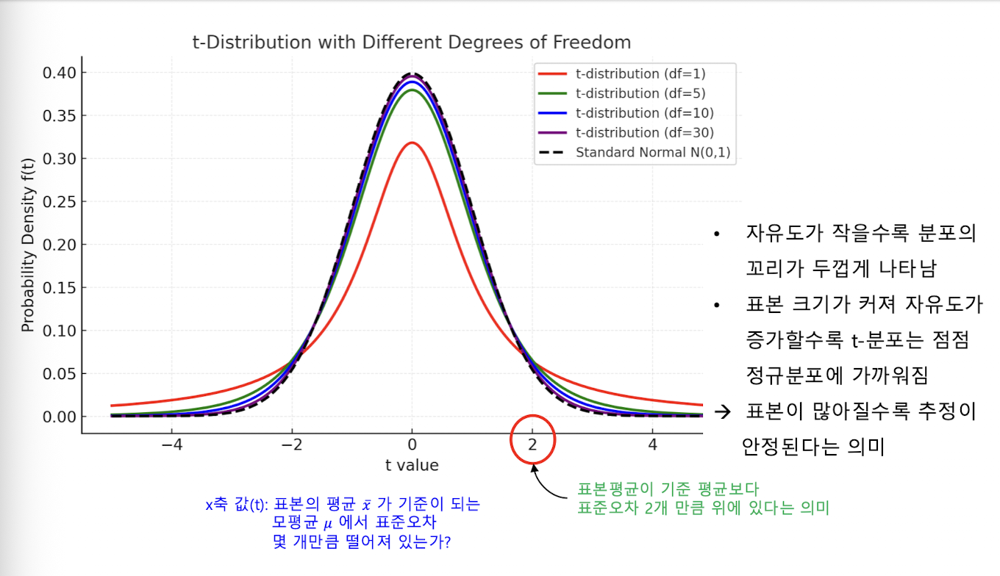
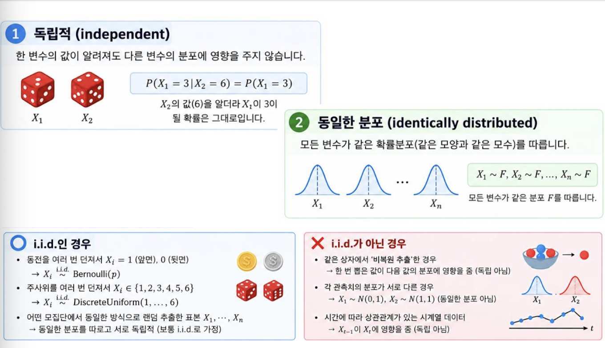

[toc]

## 주요 개념

- 평균(Mean), 중앙값(Median), 최빈값(Mode)
- 분산(Variance), 표준편차(Standard Deviation)
- 확률분포 (이항분포, 포아송분포, 정규분포 등)
- 추정(Estimation): 점추정과 구간추정

## 기술통계와 중심 경향

### **기술통계란?**

- 데이터를 요약해 대표적인 **특성과 분포를 파악하는 방법**

**목적**

- 수집한 데이터를 전체적으로 이해하고, 이후 분석 방법을 선택하는 기초를 제공

**주요 질문**

- **평균적으로 어떤 경향인지 → 평균**
- **데이터가 얼마나 퍼져 있는지 → 표준편차**
- **가장 자주 나타나는 값은 무엇인지 → 최빈값**
- **극단값이 있는지 → 이상치(Outlier)**

예

- 10명의 학생 시험 점수
  - [72, 77, 77, 83, 88, 91, 95]
- 이 데이터를 요약하면
  - 평균: 약 83.3
  - 중앙값: 83
  - 표준편차: 약 9.5
  - 최빈값:  77 (두 번 등장 - 가장 많이 등장)
- 성적이 80점대 초반에 몰려 있고, 흩어짐은 약 10점 수준이라는 것을 직관적으로 파악

---

### **중심 경향이란?**

- **데이터의 전반적인 위치나 대푯값을 나타내는 지표**

**효과**

- 복잡한 데이터 요약 - 수많은 데이터 값을 하나의 대표값으로 단순화하여 빠르게 이해 가능
- 비교 가능성 제공 - 집단 간 차이를 평균이나 중앙값으로 비교하면서 해석 가능
- 의사결정 지원 - 중심값을 활용한 정책 결정이나 전략 수립 근거 제공
- 데이터 해석 기준 - 분산, 표준편차 같은 다른 통계 지표들을 해석할 때 기준점 역할

---

## 평균의 종류와 선택 기준

**산술평균이란?**

- 모든 값을 동일한 비중으로 더한 뒤 자료 개수로 나눈 값

$$
 \bar{x}=\frac{1}{n}\sum_{i=1}^{n}x_i
$$

**장점**

- 계산과 해석이 쉽고 기본적으로 널리 쓰임

**단점**

- 극단값에 민감해 평균이 왜곡될 수 있음

데이터의 목적과 구조에 따라 가중평균, 기하평균, 조화평균, 절사평균을 선택함

| 평균               | 정의                                       | 적합한 상황                             | 강의의 사례                           |
| ------------------ | ------------------------------------------ | --------------------------------------- | ------------------------------------- |
| **산술평균(중요)** | **값의 합을 개수로 나눔**                  | **값이 단순히 더해지는 상황**           | **시험 점수, 키·몸무게, 소득**        |
| 가중평균           | 각 값에 가중치를 적용한 평균               | 값마다 중요도가 다를 때                 | 중간고사와 기말고사 점수              |
| **기하평균(중요)** | **값들의 곱의 $n$제곱근**                  | **성장률·비율의 누적 효과가 중요할 때** | **투자 수익률, 인구 증가율**          |
| **조화평균(중요)** | **값의 개수를 역수들의 합으로 나눈 값**    | **속도·효율·비율처럼 분모가 중요할 때** | **평균 속도, 연비, CPU 성능, 처리율** |
| 절사평균           | 정렬된 자료의 양 끝 일부를 제외한 산술평균 | 극단값의 영향을 줄이고 싶을 때          | 상·하위 일부 자료를 제거한 평균       |

**가중평균**은 값의 중요도 반영

$$
 \bar{x}=\frac{\sum_{i=1}^{n}w_i x_i}{\sum_{i=1}^{n}w_i}
$$

중간고사 $80점에 가중치 40\%, 기말고사 90점에 가중치 60\%를 적용하면 가중평균은 86$점임

$$
 \bar{x}=\frac{0.4\times80+0.6\times90}{0.4+0.6}=86
$$

------

**기하평균**은 값들을 곱한 뒤 자료 개수의 제곱근을 취함

여러 기간의 성장 배율처럼 **곱셈으로 누적되는 데이터를 요약할 때 쓰임**
$$
 G=\left(\prod_{i=1}^{n}x_i\right)^{1/n}
$$
강의의 투자 예시에서 3년간 수익률은 각각 $+10\%, +20\%, $-5\%이고, 이에 대응하는 배율은 1.1, 1.2, 0.95다. 전체 배율은 1.1\times1.2\times0.95=1.254이며, 이를 3년 동안의 일정한 연간 성장률로 나타내면 약 7.8\%다. 산술평균 수익률은 약 8.3\%$로 계산되어, 실제 누적 성장을 일정한 비율로 표현한 값과 다르다.

$$
 r=(1.254)^{1/3}-1\approx7.8\%
$$

------

**조화평균**은 역수들의 평균을 다시 역수로 바꾼 값

큰 값보다 **작은 값의 영향을 더 크게 반영**하므로, 분**모나 작업 시간이 중요한 속도·처리율 등의 평균에 적합**

$$
 H=\frac{n}{\sum_{i=1}^{n}\frac{1}{x_i}}
$$

서울에서 부산까지 $200\ \mathrm{km}를 100\ \mathrm{km/h}$로 이동하고, 같은 거리로 돌아올 때 $50\ \mathrm{km/h}$로 이동하면

산술평균은 $75\ \mathrm{km/h}$

하지만 실제 평균 속도는 전체 거리 $400\ \mathrm{km}를 총 시간 6시간으로 나눈 66.67\ \mathrm{km/h}$

조화평균도 같은 결과를 줌
$$
 H=\frac{2}{\frac{1}{100}+\frac{1}{50}}=66.67\ \mathrm{km/h}
$$
같은 작업량을 순차적으로 처리하는 CPU의 성능도 시간과 작업량을 고려해야 함

$CPU A가 100\ \mathrm{ops/s}, CPU B가 300\ \mathrm{ops/s}라면 산술평균은 200\ \mathrm{ops/s}조화평균은 150\ \mathrm{ops/s}$임

산술평균은 빠른 CPU의 성능을 지나치게 반영하고 느린 CPU의 영향을 과소평가할 수 있음

**산술평균과의 차이점(중요!!)**

- **산술평균은 “그냥 더해서 나눈 값” → 큰 값에 민감**
- **조화평균은 “역수의 평균” → 작은 값에 민감**

------

**절사평균이란?**

- 자료를 오름차순으로 정렬하고 상/하위의 일부 값을 제외한 뒤 나머지 값의 **산술평균을 계산함**

**효과**

- **극단값의 영향을 줄여 안정적인 대표값을 얻는 데 효과적**

$$
 T_p=\frac{1}{n-2k}\sum_{i=k+1}^{n-k}x_{(i)},\qquad k=\lfloor p\cdot n\rfloor
$$

$x_{(i)}$는 정렬된 자료

$k$는 제거할 자료 개수

$p=0$이면 전체 자료를 사용

$p=0.05이면 상·하위 각각 5\%씩, 전체 10\%$를 제거

$p=0.10이면 상·하위 각각 10\%$씩 제거

$p$는 극단값에 강건해지는 정도와 정상 자료를 보존하는 정도 사이의 절충으로 설정함

------

## 산포도와 분포의 퍼짐

### 산포도란?

- 데이터가 평균을 중심으로 얼마나 퍼져 있는지를 나타냄

**주요 지표**

- **분산**
  - 각 데이터가 평균에서 떨어진 정도를 제곱해 평균 낸 값
  - 분산이 클수록 데이터가 넓게 퍼져 있음
- **표준편차**
  - 분산의 제곱근이며 데이터와 같은 단위를 가지므로 직관적으로 해석하기 쉬움
- **사분위수**
  - 데이터를 4등분해 분포의 범위와 이상치를 살펴볼 때 쓰며, $Q1$, $Q2$, $Q3$를 포함함

**활용**

- 평균만 제시하는 것보다 중앙값, 표준편차, 최빈값 등을 함께 제시하면 데이터의 분포와 특성을 잘 설명할 수 있음
- 산포도는 확률분포와 추정, 가설검정 등 통계적 추론의 기초임

**평균은 중심을 보여주지만, 점수들이 그 중심 주위에 촘촘히 모였는지 넓게 흩어졌는지는 따로 봐야 함**

---

## 확률변수와 이산형·연속형 구분

### **⭐️확률변수란?⭐️**

- **우연적 사건의 결과를 수치로 표현하는 함수**
  - 주사위 눈금, 시험 점수 등
- 가능한 모든 결과의 **집합인 표본공간 $\Omega$에서 실수 집합 $\mathbb{R}$로 가는 사상으로 정의함**

$$
 X:\Omega\to\mathbb{R}
$$

**$\Omega:$ 가능한 모든 사건들의 집합(표본공간)**

**$\mathbb{R}$ : 실수 집합**

주사위 실험에서 $\Omega=\{w_1,w_2,\ldots,w_6\}$라면,

**왜 함수로 이해해야 할까?**

- 수학적 일관성 **사건에 확률을 부여**하고 이를 **계산하기 위해 사건을 수치로 변환하는 규칙이 필요**
- 확률분포 정의의 기반 확률분포는 "**확률변수가 특정 수치를 가질 확률**" 을 나타내므로, 확률 변수의 함수적 성질이 전제되어야 함
- 응용의 편리성 실제 데이터 분석에서는 사건 자체보다는 **수치화 된 결과를 다루는 것이 효율적**
- 수학에서의 변수
  - 값을 대입할 수 있는 기호로, 그 자체가 값(value)를 직접 나타냄
- **확률변수**
  - 표본공간의 **사건을 실수로 변환하는 함수**
  - **사건에 확률이 결합되어 있다는 점이 본질적 차이**

예

- 확률변수 $X는 각 사건 w_i$를 눈금 값 $\{1,2,3,4,5,6\}$에 대응시킴
- 예컨대 $x=3$은 수학적 변수에 값을 대입한 것이지만,
- 주사위를 던져 나온 사건 $w에 X(w)=3$을 대응시키는 것은 확률변수의 개념임
- **따라서 확률변수는 사건을 수치로 연결시켜 확률적 계산을 가능하게 하는 함수적 개념(중요)!!**
- **사건을 수치화**해야 확률을 계산하고 확률분포를 정의할 수 있음

확률변수는 가능한 값의 형태와 확률을 표현하는 방식에 따라 **이산형**과 **연속형**으로 나뉨

| 구분                              | 이산형 확률변수                                | 연속형 확률변수                                    |
| --------------------------------- | ---------------------------------------------- | -------------------------------------------------- |
| 값의 형태                         | **셀 수 있는 값**                              |                                                    |
| **유한하거나 가산무한**일 수 있음 | 특정 구간 안에서 무한히 많은 값을 가질 수 있음 |                                                    |
| 연속적인 실수 구간                |                                                |                                                    |
| 확률 표현                         | 확률질량함수(PMF)                              |                                                    |
| **모든 확률의 합은 1**            | 확률밀도함수(PDF)                              |                                                    |
| 특정 값의 확률                    | **각 값에 직접 확률을 부여할 수 있음**         | **특정 값 하나의 확률은 $0$이며 구간 확률로 정의** |
| 예시                              | 주사위, 동전, 손님 수                          | 키, 몸무게, 시간, 온도                             |

## 확률분포와 이산형 분포

### **확률분포**

- 확률변수가 가질 수 있는 값과 각 값이 나타날 확률을 체계적으로 정리한 것
- 즉, **어떤 값이 얼마나 자주 나타나는지를 수학적으로 표현**한 것

------

#### **이산형 확률분포**

- 확률변수가 가질 수 있는 값이 **정수처럼 하나하나 세어질 수 있는 경우에 해당하는 분포**
- 확률변수가 취할 수 있는 **값들은 뚝뚝 끊어져 있으며, 각각의 값마다 확률이 주어짐**
- 확률변수의 가능한 값들은 유한 개일 수도 있고, 무한히 많더라도 **셀 수 있는 경우라면 모두 이산형에 속함**
  - 동전을 여러 번 던졌을 때 앞면이 나오는 횟수
  - 주사위를 던졌을 때 나오는 눈금
  - 편의점에 1시간 동안 들어오는 손님 수

**특징**

- 각 값에 대한 확률을 직접 더할 수 있음
- **모든 확률의 합은 항상 1이 됨**
- 이산형 확률분포는 **결과가 셀 수 있는 값들로만 이루어져 있고, 각각의 값에 확률이 배분**

**이항분포, 포아송분포, 기하분포가 대표적임**

------

#### **확률질량함수(PMF)**

- **이산형 확률변수의 분포를 정의하는 함수**
- 확률변수 $X$가 특정 값 $x$를 가질 확률

$$
 P(X=x)=f(x)
$$

**특징**

- **가능한 모든 값에 대한 확률의 합은 1**
- PMF를 알면 **평균(기댓값)과 분산을 계산할 수 있음**

$$
 E[X]=\sum_x x\cdot f(x)
$$

$$
 \operatorname{Var}(X)=\sum_x (x-E[X])^2\cdot f(x)
$$

------

#### 이항분포

- 어떤 사건이 **두 가지 결과(성공/실패, 참/거짓, 앞/뒤 등)로만 나뉘는 상황**에서,
- **동일한 확률을 가진 독립적인 시행을 여러 번 반복했을 때 성공이 발생하는 횟수를 나타내는 분포**

예를 들어 동전을 10번 던져서 앞면이 몇 번 나오는지를 모델링

성공·실패처럼 결과가 두 가지인 시행을 여러 번 반복할 때, 성공 횟수를 모델링함

**특징**

- **모든 시행들은 서로 독립**
- **각 시행의 성공 확률이 동일**

$n$은 시행 횟수

$p$는 한 번의 시행에서 성공할 확률

$k$는 성공 횟수

$$
 P(X=k)=\binom{n}{k}p^k(1-p)^{n-k}
$$

$$
 평균 : E[X]=np,\qquad 분산 : \operatorname{Var}(X)=np(1-p)
$$

------

#### 포아송분포

- 일정한 시간이나 공간에서 **드물게 발생하는 사건의 횟수를 모델링함**
- **$\lambda$**는 단위 시간 또는 단위 공간당 **평균 발생 횟수**이고
- $k$는 관측된 횟수

**특징**

- 사건은 서로 독립적으로 발생
- 사건은 짧은 시간 간격에서 비례적으로 발생
- 동시에 여러 사건 발생 확률은 매우 낮음

$$
 P(X=k)=\frac{\lambda^k e^{-\lambda}}{k!},
 \qquad k=0,1,2,\ldots
$$

**평균과 분산은 모두 $\lambda$**

$$
 평균 : E[X]=\lambda,  \qquad 분산 : \operatorname{Var}(X)=\lambda
$$

------

#### 기하분포

- 성공·실패의 베르누이 시행을 반복해 **첫 성공이 나올 때까지의 시행 횟수를 나타냄**
- $p$는 성공 확률
- $k$는 첫 성공이 일어날 때까지의 시행 횟수

$$
 P(X=k)=(1-p)^{k-1}p,\qquad k=1,2,3,\ldots
$$

**특징**

- **모든 시행 독립**
- **성공 확률 동일**
- 평균은 $\frac{1}{p}, 분산은 \frac{1-p}{p^2}$
- **무기억성(Memoryless) - 이미 $s$번 실패했더라도 앞으로의 성공 확률은 동일**

$$
 평균 : E[X]=\frac{1}{p},\qquad
 분산 : \operatorname{Var}(X)=\frac{1-p}{p^2}
$$

성공 확률 $p=0.3인 그래프에서 k=1일 확률은 p$

$k=2가 되려면 첫 번째에 실패하고 두 번째에 성공해야 하므로 (1-p)p$

$k=3은 앞의 두 번 실패 후 세 번째에 성공해야 하므로 (1-p)^2p$

확률분포는 가능한 결과의 목록과 각 결과의 가능성을 한곳에 정리한 것입니다. 예를 들어 주사위라면 눈금별 확률을 기록하고, 동전을 여러 번 던진다면 앞면이 나온 횟수별 확률을 기록할 수 있습니다. 이산형 분포에서는 값을 하나씩 셀 수 있기 때문에 각 값의 확률을 더할 수 있고, 가능한 결과 전체의 확률은 $1$이 됩니다.

**세 분포는 무엇을 세는지로 구분하면 편함**

- **이항분포**는 정해진 횟수의 시행에서 **성공이 몇 번 나왔는지 셈**
- **포아송분포**는 일정한 시간이나 공간에서 **사건이 몇 번 발생했는지 셈**
- **기하분포**는 성공 횟수 자체가 아니라 **첫 성공이 나올 때까지 몇 번 시행했는지 셈**

---

## 연속형 확률분포와 확률밀도함수

### 연속형 확률분포

**연속형 확률분포란?**

- 확률변수가 특정 구간 안에서 무수히 많은 실숫값을 가질 수 있을 때
- 개별 값 하나에 확률을 부여하지 않고 구간의 확률을 정의함

**특징**

- **특정 값 하나의 확률은 0**
- **확률밀도함수(PDF)를 적분해 구간 확률 계산**
- **PDF 곡선 아래 전체 면적 1**

------

### 확률밀도함수

**확률밀도함수란?**

- 연속형 확률변수가 **특정 구간에 속할 확률을 나타내는 함수**
- 연속형 확률변수는 특정 값 하나에 대한 확률이 0이므로, $P(X = x)$ 형태로는 의미가 없음
- 대신, PDF f(x)는 값의 “**밀도(density)**"를 표현하며, 구간 단위의 **확률을 적분을 통해 계산**

특징

- $f(x)$는 음수가 아니고, 전체 영역에 대한 적분은 $1$

$$
 f(x)\geq0,\qquad
 \int_{-\infty}^{\infty}f(x)\,dx=1
$$

- 구간 $[a,b]$에 들어갈 확률은 해당 구간에서 **PDF를 적분해 구함**

$$
 P(a\leq X\leq b)=\int_a^b f(x)\,dx
$$

------

## 정규분포와 표준화

### 정규분포

**정규분포란?**

- 평균 $\mu$를 중심으로 **좌우 대칭인 종 모양의 연속형 분포**
- 정규분포의 확률밀도함수는 다음과 같음

$$
 PDF(확률밀도함수) : f(x;\mu,\sigma)=\frac{1}{\sigma\sqrt{2\pi}}
 \exp\left(-\frac{(x-\mu)^2}{2\sigma^2}\right)
$$

$$
 CDF(누적분포함수) : \Phi(z)=P(Z<z)=\int_{-\infty}^{z}\frac{1}{\sqrt{2\pi}}e^{-t^2/2}\,dt
$$

특징

- 대칭성
  - 정규분포는 **평균 $\mu$를 중심으로 좌우 대칭이며 왜도는 $0$**
- 표준정규분포
  - 냄평균 $\mu=0, 표준편차 \sigma=1인 정규분포는  Z\sim N(0,1)$로 나타냄
- 선형결합의 폐포성
- 모집단에서 데이터를 여러 개를 뽑아 평균을 계산하면 그 평균값 자체도 확률변수가 되며 정규분포
- **최대엔트로피: 주어진 평균·분산 제약 하에서 엔트로피가 최대인 분포**

**정규분포 == 가우시안분포**

------

### 표준화(Z-Score)

**표준화 또는 Z-점수란?**

- **정규분포 값을 표준정규분포 기준으로 바꿈(정규분포 → 표준정규분포)**
- **임계값과 구간확률 등을 계산하는 데 사용함**
- 경험 규칙 : 68-95-99.7 법칙
  - 평균에서 $\pm1\sigma 이내: 약 68\%$
  - 평균에서 $\pm2\sigma 이내: 약 95\%$
  - 평균에서 $\pm3\sigma 이내: 약 99.7\%$

정리

- 정규분포는 가운데가 높고 양쪽으로 낮아지는 종 모양의 곡선
- 이때 **평균 $\mu$는 곡선의 중심**을 표시하고,
- **표준편차 $\sigma$는 중심에서 어느 정도 떨어진 범위를 볼 때 기준**이 됨
- Z-점수는 원래의 단위와 중심을 표준정규분포의 기준에 맞춰 표현하므로, 임계값이나 구간확률을 계산하기 쉽게 해줍니다.

---

## 정규분포와 기계학습

선형회귀에서 예측값 $\hat{y}와 실제값 y$의 차이인 오차가 정규분포를 따른다고 가정

$$
 y=\hat{y}+\epsilon,\qquad \epsilon\sim N(0,\sigma^2)
$$

예측 손실에 대한 확률 밀도 함수

$$
 p(y\mid\hat{y})
 =\frac{1}{\sigma\sqrt{2\pi}}
 \exp\left(-\frac{(y-\hat{y})^2}{2\sigma^2}\right)
$$

로그를 취하고 부호를 바꾸면 **제곱오차 항**이 나타난다.

$\log p(y\mid\hat{y})
 =\frac{(y-\hat{y})^2}{2\sigma^2}+\text{constant}$

**정규분포의 활용**

- **가우시안 나이브 베이즈**
  - **연속형 특성의 조건부분포를 정규분포로 가정해 사후확률을 계산**
- **가우시안 혼합모형(GMM)**
  - 여러 정규의 혼합으로 복잡한 분포 근사
- 딥러닝
  - 가중치 초기화와 배치정규화에서 활성 분포를 근사 정규로 가정하는 논리가 사용
  - 확산모형은 학습/샘플링 과정에서 가우시안 노이즈를 점진적으로 주입하거나 제거

---

## 자유도와 t-분포

### **자유도**

- **데이터가 가질 수 있는 독립적인 정보의 개수**
- 전체 데이터 중에서 통계량을 계산할 대 제약 조건에 의해 자유롭게 변할 수 있는 값의 수
- **제약조건을 만족시키면서 독립적으로 정할 수 있는 값의 개수**

$$
 DoF=n-(\text{제약조건 수})
$$

------

### **t-분포**

- 표본이 작거나 모분산을 알 수 없을 때 평균을 추론하는 데 쓰는 연속형 확률분포
- 정규분포와 비슷한 종 모양이지만 꼬리가 더 두꺼워 **극단값에 더 큰 확률을 부여**
- 자유도 $v$가 커질수록 정규분포에 가까워지며,
- 자유도가 무한대에 수렴하면 정규분포와 같아짐
- 표본 크기가 $n일 때 자유도는 일반적으로 n-1$이다.

$$
 f(t;v)=
 \frac{\Gamma\left(\frac{v+1}{2}\right)}
 {\sqrt{v\pi}\,\Gamma\left(\frac{v}{2}\right)}
 \left(1+\frac{t^2}{v}\right)^{-\frac{v+1}{2}},
 \qquad -\infty<t<\infty
$$

---

## 독립·동일분포와 중심극한정리

### **i.i.d**

- **Independent & Identically Distributed**
- 확률변수들이 서로 **독립적**이고 **동일한 분포**를 따른다는 뜻
- **독립적**
  - 한 변수의 값이 알려져도 다른 변수의 분포에 영향을 주지 않음
- **동일분포**
  - 모든 변수가 같은 확률분포를 따른다는 뜻

------

### **중심극한정리(CLT)**

- **표본의 크기가 충분히 클 때, 모집단의 분포에 상관 없이 표본평균의 분포는 정규분포에 수렴함**
- **원래 데이터가 정규분포가 아니더라도**, **표본평균을 반복해서 구하면 그 값들의 분포가 점점 정규분포로 수렴**

독립이고 동일한 분포를 따르는 확률변수들이 기댓값 $\mu$, 분산 $\sigma^2$를 가질 때,

표본 크기 $n$이 충분히 커지면 표본평균의 표준화된 분포가 표준정규분포에 수렴함

$$
 \bar{X}*n=\frac{1}{n}\sum*{i=1}^{n}X_i
$$

$$
 \frac{\bar{X}_n-\mu}{\sigma/\sqrt{n}}
 \xrightarrow{d}N(0,1)
$$

중심극한정리 직관적인 이해

- 주사위를 던지는 실험에서 한 번 던질 때의 결과는 균등분포(1~6)이다.
- 하지만 주사위를 30번 던져 평균을 구하는 실험을 수천 번 반복하면, 이 평균들의 분포는 정규분포 형태로 근사
- 즉, 원래 데이터의 분포가 어떤 모양이든 간에, 평균값의 분포는 정규분포로 수렴

인공지능(Al)에서의 적용 사례

- 모델 성능 추정 및 불확실성 추정
  - 모델의 예측값에 대한 평균 손실(Ioss)을 여러 배치에서 측정하면,
  - 개별 손실의 분포가 어떻든 간에 배치 평균 손실은 정규분포로 근사
- **배치 정규화(Batch Normalization)**
  - 미니배치(batch)마다 평균과 분산을 계산해 정규화할 때, 각 배치의 평균은 표본평균
  - 대규모 표본에서의 평균 추정
  - 수집된 로그 데이터나 센서 데이터 표본 평균을 이용한 추정에서는 CLT를 적용해 정규 근사

---

## 점추정과 구간추정

### **추정(Estimation)**

- **표본으로부터 모집단의 특성을 추론하는 것**
- **표본 자료를 사용해 모집단의 파라미터(모수)를 예측하는 절차**

---

### **점추정(Point Estimation)**

- **점추정은 모수(parameter)의 값을 하나의 구체적인 수치(점) 로 추정하는 방법**
- 예를 들어, 모집단의 평균이나 분산 같은 모수를 모를 때, 표본 데이터를 이용해 이를 하나의 값으로 추정
- 점추정 예시
  - 어떤 학교 학생들의 평균 키를 알고 싶을 때, 전체 학생을 조사할 수 없다면 표본 50명을 뽑아 평균 키를 계산한다.
  - 이때 표본평균 &는 모평균 A의 점추정량이며, 계산된 값이 점추정치가 된다.
- **점추정치 하나만으로는 추정의 불확실성을 알 수 없음**
- 실무 통계적 추론에서는 구간추정(Interval Estimation)과 함께 사용되어 신뢰도를 보완

---

### 구간추정(Interval Estimation)

- **모수가 포함될 가능성이 높은 구간을 제시**
- **추정값에 대한 불확실성을 반영**
- **보통 신뢰구간(CI)을 사용**

---

### **신뢰구간**

- 모집단의 모수가 포함될 가능성이 높은 구간을 제시
- “모수가 이 구간 안에 있을 것이다.”라는 정보 제공

---

End.
