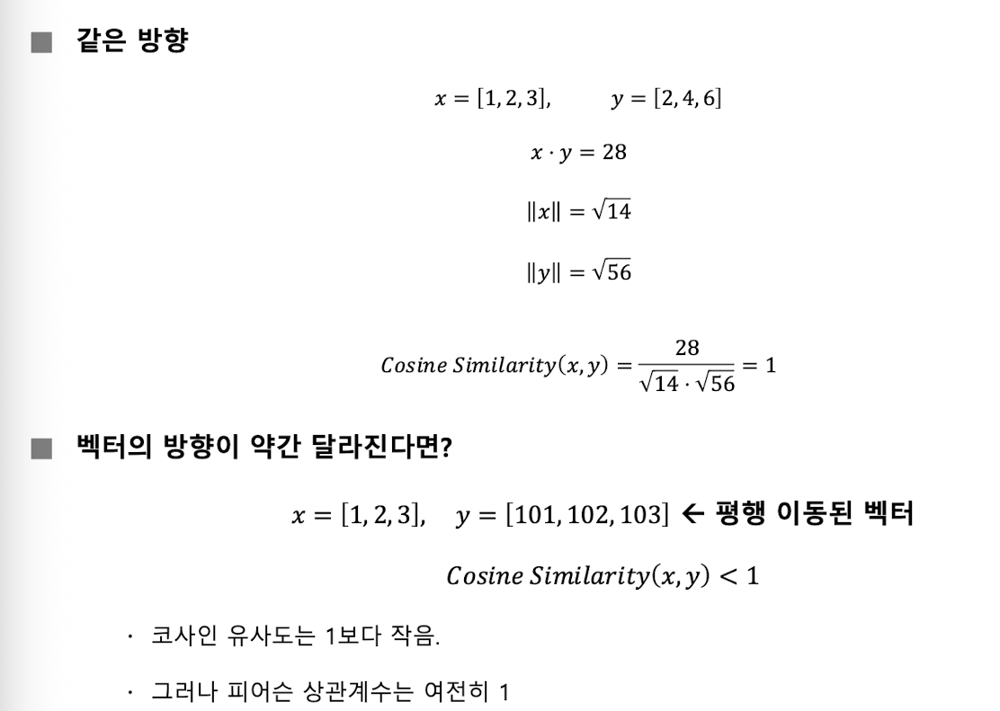
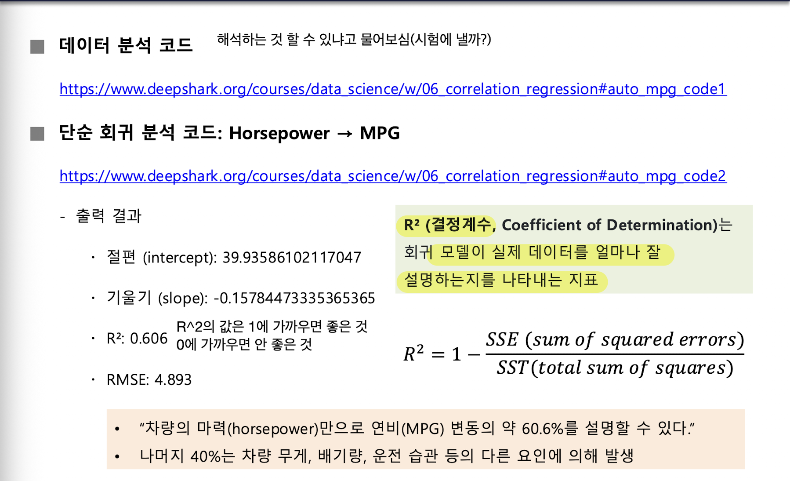
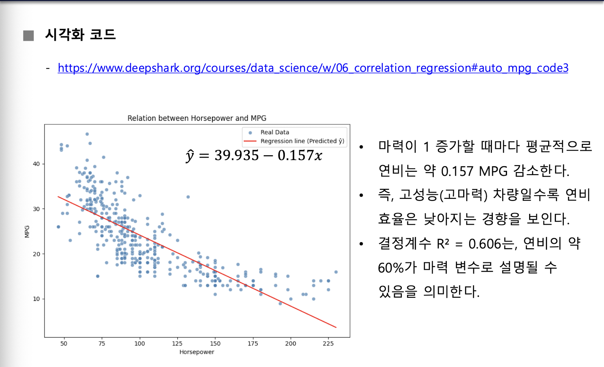
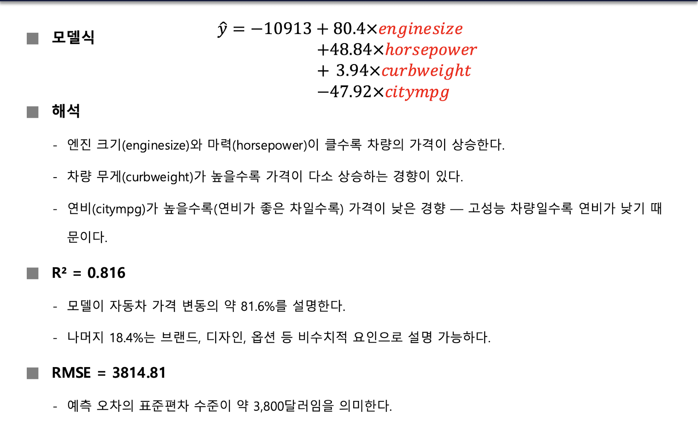
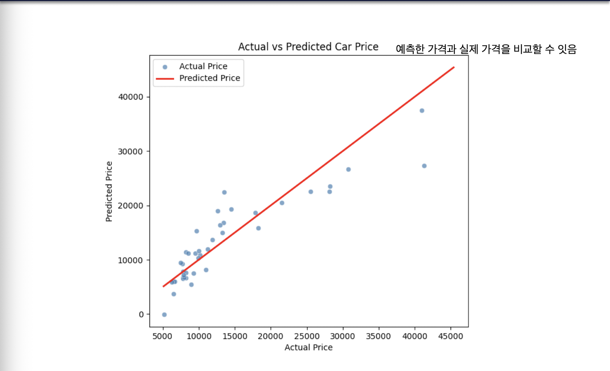
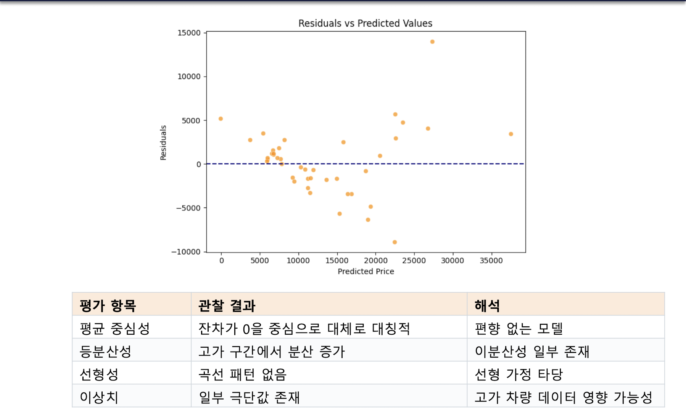
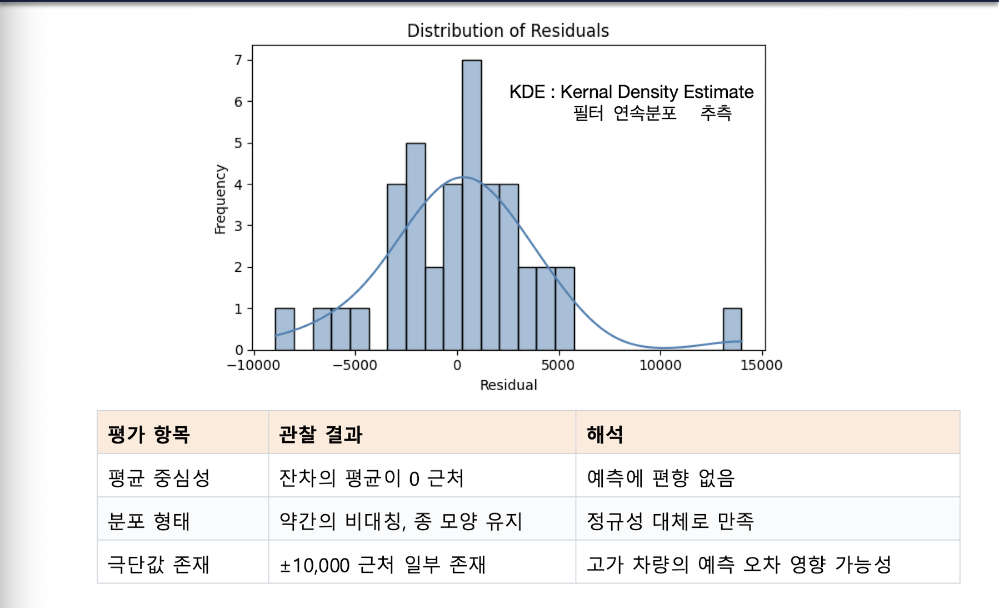
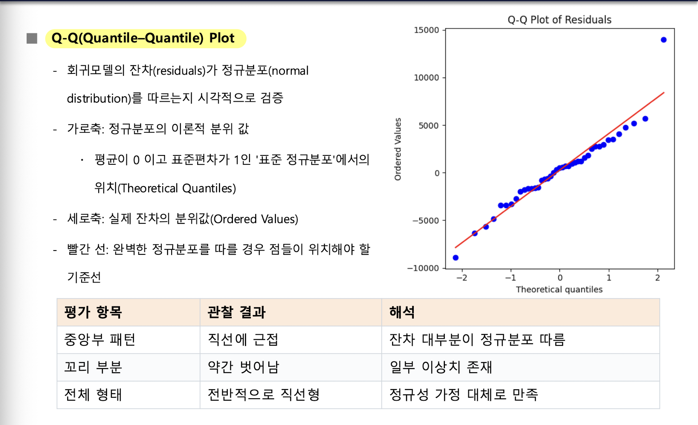

[toc]

## 상관 분석

### 상관의 개념과 종류

#### 상관

- **두 변수가 얼마나 함께 움직이는지** 나타내는 통계적 척도
- 상관계수는 두 변수의 변화 방향과 선형 관계의 강도를 수치로 나타냄
- **범위는 $-1부터 1$**

| 종류      | 관계                                                         |
| --------- | ------------------------------------------------------------ |
| 양의 상관 | **한 변수가 증가할 때 다른 변수도 증가**하는 경향이 있어요. 예: 공부시간이 늘수록 점수가 높아지는 경우 |
| 음의 상관 | **한 변수가 증가할 때 다른 변수는 감소**하는 경향이 있어요. 예: 운동시간이 늘수록 체중이 감소하는 경우 |
| 상관 없음 | **두 변수의 변화가 서로 관련되지 않는 경우**예요. 예: 신발 사이즈와 수학 점수 |

상관계수 $r$의 대표적인 해석은 다음과 같아요.

| 상관계수 | 관계 유형        | 해석                                               |
| -------- | ---------------- | -------------------------------------------------- |
| $r=+1$   | 완전한 양의 상관 | 두 변수가 완벽하게 같은 방향으로 움직여요.         |
| $0<r<1$  | 양의 상관        | 두 변수가 함께 증가하는 경향이 있어요.             |
| $r=0$    | **상관 없음**    | 선형 관계가 거의 없어요.                           |
| $-1<r<0$ | 음의 상관        | 한쪽이 증가할 때 다른 쪽은 감소하는 경향이 있어요. |
| $r=-1$   | 완전한 음의 상관 | 두 변수가 완벽하게 반대 방향으로 움직여요.         |

- 상관계수는 **선형 관계의 방향과 강도**를 보여줌
- 따라서 $r=0$이라는 해석은 **선형 관계**가 거의 없다는 뜻이지,
- 모든 종류의 관계가 없다는 뜻으로 확대해서는 안 됨
- 왜 그런 일이 생겼는지, 한 변수가 다른 변수를 일으켰는지까지 말해주지는 않음

---

### 공분산과 피어슨 상관계수

#### 공분산

**공분산이란?**

- **두 변수가 함께 변하는 정도를 나타냄**
- **두 변수가 평균을 기준으로 얼마나 움직이는지 나타낸 것**

**방향성 해석**

- 양수 $\to$ 두 변수가 같은 방향으로 움직임
- 음수 $\to$ 두 변수가 반대 방향으로 움직임
- $0에 가까움 \to$ 관계 없음
- 자료의 각 값이 평균에서 얼마나 떨어져 있는지 살펴보고, 두 편차를 곱해 평균을 구함

$$
\operatorname{Cov}(X,Y) = \frac{1}{n} \sum_{i=1}^{n} (x_i-\bar{x})(y_i-\bar{y})
$$

**공분산 - 방향성만 알려줌**

---

#### 피어슨 상관계수

**피어슨 상관계수란?**

- **두 변수의 선형적 관계를 수치로 표현하는 지표**
- 공분산을 표준화함

$$
r = \frac{\sum_{i=1}^{n}(x_i-\bar{x})(y_i-\bar{y})}{\sqrt{\sum_{i=1}^{n}(x_i-\bar{x})^2 \sum_{i=1}^{n}(y_i-\bar{y})^2}}
$$

- **단위에 관계없이** $-1 \le r \le 1이며, r$의 부호는 관계의 **방향 파악**
  - 단위 제거 후 비교 가능
- **크기는 선형 관계의 강도를 파악**
- **다만 상관이 높다고 해서 인과관계가 성립하는 것은 아님(중요!!)**
  - **상관계수가 높다고 해서 한 변수가 다른 변수를 ‘원인’으로 만든다는 뜻은 아님**

**피어슨 상관계수 - 단위 제거 후 비교 가능**

**$r$ 값으로 선형 관계의 방향과 강도 파악**

**해석 시 반드시 맥락 고려**

---

## 코사인 유사도와 피어슨 상관계수의 차이

### 코사인 유사도

**코사인 유사도란?**

- 두 벡터의 **방향(각도)의 유사성** 비교
- 벡터의 크기나 단위에 영향을 받지 않음
- 방향이 같을수록 유사도 높음

**수학적 해석**

- 두 벡터의 내적을 각 벡터의 $L_2$ 노름, 즉 벡터 길이의 곱으로 나눠 계산함

$$
\operatorname{CosineSimilarity}(x,y) = \frac{x \cdot y}{\lVert x \rVert \lVert y \rVert} = \frac{\sum_{i=1}^{n}x_i y_i}{\sqrt{\sum_{i=1}^{n}x_i^2} \sqrt{\sum_{i=1}^{n}y_i^2}}
$$

값의 범위와 해석은 다음과 같음

- $1: 완전히 같은 방향 (\cos 0^\circ$)
- $0: 직각 방향 (\cos 90^\circ$)
- $-1: 완전히 반대 방향 (\cos 180^\circ$)

예:

$x=[1,2,3], y=[2,4,6]은 같은 방향이므로 코사인 유사도 1$ (같은 방향으로 크기만 2배로 키운 것)

반면 $y=[101,102,103]처럼 벡터의 모든 값에 일정한 수를 더하면 방향이 달라져 코사인 유사도는 1$보다 작아짐

이때 피어슨 상관계수는 평균을 제거하기 때문에 여전히 $1$

| 구분             | 피어슨 상관계수                        | 코사인 유사도                                        |
| ---------------- | -------------------------------------- | ---------------------------------------------------- |
| 초점             | 평균 제거 후 **선형 관계 측정**        | 벡터의 방향적 유사성 측정                            |
| 정규화 기준      | **평균 및 표준편차**                   | $L_2$ 노름, 즉 벡터 길이                             |
| 단위 영향        | 평균 제거로 일부 제거                  | **완전히 제거**                                      |
| 이동(shift) 영향 | **평균을 제거하므로 영향을 받지 않음** | 값에 상수를 더하면 방향이 바뀌어 값이 달라질 수 있음 |
| 활용 분야        | 통계, 상관 분석                        | 텍스트, 문서, 추천 시스템                            |

- **코사인 유사도는 데이터의 이동(shift)에 민감**
  - 즉, 모든 값에 일정한 값을 더하면 벡터의 방향이 바뀌어 유사도가 달라질 수 있음
  - **코사인 유사도**는 벡터의 방향을 비교
  - **코사인 유사도는 고차원 벡터의 방향적 유사성을 비교할 때 유용**
- **피어슨 상관계수는 평균을 제거하기 때문에 이동에 영향을 받지 않음**
  - **피어슨 상관계수**는 평균을 뺀 뒤 두 변수의 선형 관계를 비교

---

## 상관행렬과 히트맵: Boston Housing 사례

### 상관행렬

**상관행렬이란?**

- **여러 수치형 변수 사이의 상관계수를 한 표에 모아 보여줌**
- 히트맵에서는 양의 상관을 붉은색 계열, 음의 상관을 파란색 계열, $0$에 가까운 값을 흰색 또는 중간색으로 나타낼 수 있음

Boston House Price 데이터 분석의 절차는 다음과 같음

1. `pandas`로 CSV를 불러옴
2. `df.info()`, `df.describe()`, `df.isnull().sum()` 등으로 변수 유형과 결측치 확인
3. 수치형 변수만 추출해 `df.corr()`로 상관행렬 계산
4. `MEDV`와 각 변수의 상관계수를 내림차순으로 정렬해 주요 요인 확인
5. `sns.heatmap`으로 전체 상관행렬을 시각화하고, `MEDV`와 상관이 높은 상위 5개 변수의 별도 히트맵 생성

자료의 변수 설명은 다음과 같음

| 변수      | 설명                                                         |
| --------- | ------------------------------------------------------------ |
| `CRIM`    | 마을별 1인당 범죄 발생률                                     |
| `ZN`      | 25,000 평방피트(약 2323㎡) 이상의 대형 주택용 토지로 지정된 주거용 토지 비율 |
| `INDUS`   | 마을별 비소매 상업 지역 비율                                 |
| `CHAS`    | 찰스강과 접해 있는지 나타내는 더미 변수: 접함은 $1$, 접하지 않음은 $0$ |
| `NOX`     | 대기 중 질소 산화물 농도(1000만분의 1 단위)                  |
| `RM`      | 주택당 평균 방 개수                                          |
| `AGE`     | 1940년 이전에 지어진 자가주택의 비율                         |
| `DIS`     | 보스턴의 5개 주요 고용 중심지까지의 가중 거리                |
| `RAD`     | 고속도로 접근성 지수                                         |
| `TAX`     | 재산세율(10,000달러당 세금액)                                |
| `PTRATIO` | 학생-교사 비율                                               |
| `B`       | 흑인 인구 비율을 기반으로 계산된 지표. 식은 $1000(Bk-0.63)^2$이며, $Bk$는 흑인 인구 비율 |
| `LSTAT`   | 하위 계층(저소득층) 인구의 비율(%)                           |
| `MEDV`    | 자가주택의 중앙 가격(단위: 1,000달러)                        |

`MEDV`와의 상관계수 상위 5개 변수는 다음과 같이 제시됨

| 순위 | 변수   | 상관계수 | 강의 자료의 설명                                        |
| ---- | ------ | -------- | ------------------------------------------------------- |
| 1    | `RM`   | $0.695$  | 평균 방 개수가 많을수록 집값이 높아지는 경향            |
| 2    | `ZN`   | $0.360$  | 대형 주택용 토지 비율과 집값이 양의 상관을 보임         |
| 3    | `B`    | $0.333$  | 흑인 인구 비율 기반 지표와 당시 집값 사이의 통계적 상관 |
| 4    | `DIS`  | $0.250$  | 주요 고용 중심지까지의 거리와 집값 사이의 양의 상관     |
| 5    | `CHAS` | $0.175$  | 찰스강 인접 여부와 집값 사이의 양의 상관                |

이는 데이터에서 관찰된 **상관관계**를 보여주는 결과임

표의 상관계수만으로 각 변수가 집값을 일으키는 원인이라고 결론 내릴 수는 없음

여러 주택의 가격과 특징을 한꺼번에 비교한다고 생각해 보자

방 개수, 범죄 발생률, 세금, 강 인접 여부처럼 서로 다른 열을 가진 표에서 `MEDV`와 각 열이 얼마나 함께 움직이는지 계산함

이렇게 변수 쌍마다 계산한 **상관계수를 모아놓은 것이 상관행렬임**

히트맵은 그 표의 숫자를 색으로도 보여줌

붉은색 계열은 양의 상관, 파란색 계열은 음의 상관, 흰색이나 중간색은 $0$에 가까운 값을 나타냄

색이 숫자를 대신하는 게 아니라, 숫자의 방향과 크기를 한눈에 살펴보도록 도와줌

---

## 단순 회귀 분석

### 단순 선형 회귀와 최소제곱법

**단순 선형 회귀란?**

- 하나의 독립 변수 $x와 종속 변수 y$ 사이의 선형 관계를 직선으로 근사해 예측하는 방법
- $x가 변할 때 y$가 어떻게 변하는지를 하나의 직선으로 근사하여 예측하는 것

$$
y = \beta_0 + \beta_1x + \epsilon
$$

- $y$: 예측하려는 종속 변수
- $x$: 입력 또는 설명 변수인 독립 변수
- **$\beta_0: 절편. x=0$일 때의 값**
- **$\beta_1: 기울기. x$가 1단위 증가할 때의 변화량**
- $\epsilon$: 실제값과 회귀선 사이의 오차를 나타내는 항

**최소제곱법(OLS : Ordinary Least Squares)이란?**

- 회귀선은 데이터 점들과의 거리(잔차)가 작도록 설정
- 각 데이터의 실제값과 예측값의 차이를 제곱해 모두 더한 **제곱오차합(SSE)**을 최소화하는 방법

$$
\text{OLS objective: } \min_{\beta} \sum_{i=1}^{n}(y_i-\hat{y}_i)^2
$$

**평균제곱오차(MSE : Mean Squared Error)란?**

- **SSE를 데이터 개수 $n$으로 나눈 값**
- 잔차 제곱합을 데이터 개수 $n$으로 나눈 평균값

$$
\operatorname{MSE} = \frac{\operatorname{SSE}}{n} = \frac{1}{n} \sum_{i=1}^{n}(y_i-\hat{y}_i)^2
$$

- **MSE는 SSE를 평균으로 바꿔 표현하지만, 최솟값을 만드는 지점은 OLS와 같음**
- **MSE와 SSE는 최솟값을 만드는 직선이 같음**

$$
\min \operatorname{MSE} \iff \min \operatorname{SSE}
$$

### 자동차 연비 예제: 마력으로 MPG 예측

Auto MPG 실습은 자동차의 마력(`horsepower`)을 독립 변수로, 연비인 `mpg`를 종속 변수로 두고 관계를 분석함

데이터셋 변수는 다음과 같음

| 변수           | 설명                                               |
| -------------- | -------------------------------------------------- |
| `mpg`          | 자동차의 연비(Miles per gallon, 종속 변수)         |
| `cylinders`    | 실린더 수                                          |
| `displacement` | 배기량(입방 인치)                                  |
| `horsepower`   | 마력                                               |
| `weight`       | 차량 무게(파운드)                                  |
| `acceleration` | $0 \to 60\text{mph}$ 가속 시간(초)                 |
| `model year`   | 생산 연도                                          |
| `origin`       | 생산 지역 코드: $1$은 미국, $2$는 유럽, $3$은 일본 |
| `car name`     | 차량 이름                                          |

---

## 다중 회귀 분석

### 다중 선형 회귀의 개념

**다중 선형 회귀란?**

- **두 개 이상의 독립 변수를 함께 사용**해 종속 변수의 변동을 설명하고 예측하는 방법

$$
y = \beta_0 + \beta_1x_1 + \beta_2x_2 + \cdots + \beta_nx_n + \epsilon
$$

- $y$: 예측 대상인 종속 변수
- $x_i$: 독립 변수들
- **$\beta_0$: 절편**
- **$\beta_i: 해당 독립 변수의 회귀계수. 다른 변수가 일정할 때 그 변수의 변화가 y$에 미치는 영향을 나타냄**
- $\epsilon$: 모델이 설명하지 못하는 부분인 오차항

**다중 선형회귀에서 입력 변수(독립변수)가 $n개라면, 절편 1개와 각 변수의 회귀계수 n개를 포함하여 총 n+1$개의 파라미터를 추정해야 함**

예:

​	자동차 가격을 예측하면서 엔진 크기만 보는 대신 마력과 차량 무게, 연비도 함께 살펴본다고 생각해 보자

​	**여러 특징을 동시에 입력해 하나의 가격을 예측하는 것이 다중 회귀의 기본 모습**

​	식의 **$x_1, x_2, \dots, x_n$은 각각 입력 특징**을 가리키고,

​	각 특징 앞의 **$\beta_i$는 그 특징의 변화가 예측값에 어떤 방향과 크기로 연결되는지 나타냄**

​	다만 이 계수를 읽을 때는 **다른 변수들이 일정하다고 놓고** 해당 변수의 변화만 해석함

​	마지막의 $\epsilon$은 모델의 식만으로 설명하지 못하는 차이를 나타냄

**여러 변수를 함께 고려한다고 해서 실제 가격의 모든 변동을 설명한다는 뜻은 아님**

### 자동차 가격 예측 실습과 모델 평가

Car Price Prediction 실습은 자동차 판매가격인 `price`를 여러 차량 특성으로 설명

자료의 변수는 다음과 같음

| 변수                                 | 설명                       |
| ------------------------------------ | -------------------------- |
| `symboling`                          | 보험 위험 등급             |
| `wheelbase`                          | 축간 거리(인치)            |
| `carlength`, `carwidth`, `carheight` | 차량 크기                  |
| `curbweight`                         | 공차중량(파운드)           |
| `enginesize`                         | 엔진 배기량(cc)            |
| `horsepower`                         | 마력(hp)                   |
| `peakrpm`                            | 최대 회전수(rpm)           |
| `citympg`, `highwaympg`              | 도심·고속도로 연비         |
| `price`                              | 자동차 판매가격(종속 변수) |

실습 흐름의 순서

1. 데이터 불러오기와 확인
2. 특징 변수 선택
3. 학습·검증 데이터 분리
4. 모델 학습 및 회귀계수 해석
5. $R^2$와 RMSE(Root Mean Squared Error, 평균제곱근오차) 평가
6. 실제값과 예측값의 시각화

실행 결과의 데이터 크기는 $(205, 26)$이며, **제시된 회귀계수는 다음과 같음**

| 변수         | 회귀계수  |
| ------------ | --------- |
| `enginesize` | $80.397$  |
| `horsepower` | $48.838$  |
| `curbweight` | $3.936$   |
| `citympg`    | $-47.919$ |

- **절편 $= -10913.718$**

- **$R^2 = 0.816$,**

- **$\text{RMSE} = 3814.81$**
  - **RMSE는 회귀모델의 예측값과 실제값 사이의 오차를 측정하는 평가지표**

제시된 모델식은 다음과 같음

$$
\hat{y} = -10913 + 80.4 \times \text{enginesize} + 48.84 \times \text{horsepower} + 3.94 \times \text{curbweight} - 47.92 \times \text{citympg}
$$

- 해석에 따르면 **엔진 크기와 마력이 클수록 가격이 상승**하고, **공차중량이 높을수록 가격이 다소 상승하는 경향**이 있음

- `citympg`의 계수는 음수로 제시돼 있어 **연비가 높을수록 가격이 낮은 경향**으로 해석하며,

- **자료는 이를 고성능 차량일수록 연비가 낮은 경향과 연결해 설명함**

- **$R^2 = 0.816은 모델이 자동차 가격 변동의 약 81.6\%$를 설명한다는 의미**

- 나머지 $18.4\%$는 브랜드, 디자인, 옵션 등 비수치적 요인으로 설명될 수 있다고 제시됨

- $\text{RMSE} = 3814.81은 예측 오차의 표준편차 수준이 약 3,800$달러라고 설명

---

## 잔차 분석

### 잔차의 의미와 이상적인 특징

**잔차란?**

- **실제값과 예측값의 차이**

$$
e_i = y_i - \hat{y}_i
$$

- **모델이 각 데이터 점을 얼마나 잘 예측했는지 보여줌**
- 회귀 성능 지표가 높더라도 **잔차의 분포를 확인하면 모델의 선형성 가정이 적절한지 살펴볼 수 있음**

강의에서 제시한 이상적인 잔차의 특징은 다음과 같음

| 조건                           | 설명                                           |
| ------------------------------ | ---------------------------------------------- |
| 평균이 $0$에 가까움            | 실제값과 예측값의 평균적인 차이가 거의 없음    |
| 등분산성                       | 예측값의 크기에 따라 잔차의 분산이 일정해야 함 |
| 독립성                         | 잔차끼리 독립적이어야 함                       |
| (시간 순서나 패턴이 없어야 함) |                                                |
| 정규성                         | 잔차 분포가 정규분포에 가까워야 함             |

자동차 가격을 예측한 뒤, 실제 가격에서 예측 가격을 빼는 상황을 생각해보자

- 한 자동차의 실제 가격이 예측 가격보다 높으면 잔차가 양수이고, 낮으면 잔차가 음수임
- 이 차이를 **잔차**라고 함
- **평균이 $0$에 가까운 잔차는 예측과 실제의 평균적인 차이가 거의 없다는 뜻**
- **등분산성은 예측 가격의 크기에 따라 잔차의 퍼짐이 일정한지 보는 조건**
- **독립성은 잔차끼리 시간 순서나 일정한 패턴으로 엮이지 않아야 한다는 뜻**
- **정규성은 잔차의 분포가 정규분포에 가까운지를 가리킴**

잔차 분석은 모델 점수만 보는 것과 달리, **예측 오차가 어떤 모양으로 나타나는지** 확인하는 과정

### 잔차 대 예측값 그림과 잔차 분포

잔차 대 예측값 그림에서는 가로축이 예측 가격, 세로축이 잔차

관찰 결과는 다음과 같음

해석:

- 가로축의 값이 달라져도 점들이 $0$을 중심으로 위아래에 놓이면, 실제값과 예측값의 평균적인 차이가 한쪽으로 치우치지 않았다는 뜻
- 잔차 대 예측값 그림에서는 뚜렷한 곡선 패턴이 보이지 않아 선형 가정이 타당하다고 해석
- 하지만 고가 구간에서는 잔차의 퍼짐이 커져 **이분산성이 일부 존재**한다고 관찰
- 그림에 일부 큰 잔차도 나타나며, 자료에서는 고가 차량 데이터의 영향일 가능성을 제시함

- 잔차 분포 그림에서는 잔차의 평균이 $0$에 가깝고,
- 분포가 약간 비대칭이지만 종 모양을 유지한다고 관찰
- 정규성을 대체로 만족하는 모습으로 해석 가능
- 또한 $\pm 10,000$ 근처의 일부 극단값이 있으며,
- 고가 차량의 예측 오차와 관련될 가능성 제시

**정리:**

- 평균이 $0 근처이고 종 모양을 대체로 유지하지만, 약간 비대칭이고 \pm 10,000$ 근처의 극단값이 있음

- 따라서 자료의 해석은 정규성을 대체로 만족한다고 보면서도, 일부 큰 오차가 있음을 함께 남겨둠

---

### Q-Q 그림으로 잔차의 정규성 확인

**Q-Q 그림이란?**

- **회귀 잔차가 정규분포를 따르는지** 시각적으로 확인하는 방법
- **가로축: 평균이 $0, 표준편차가 1$인 표준 정규분포의 이론적 분위값**
- **세로축: 실제 잔차의 분위값**
- 빨간 선: 완벽하게 정규분포를 따른다면 점들이 놓일 기준선

관찰 결과 중앙부의 점들은 직선에 가깝고, 꼬리 부분은 약간 벗어남

**전체적으로는 직선형에 가까워 잔차 대부분이 정규분포를 따름**

일부 이상치가 있는 것으로 해석

**전반적으로 직선형이라 정규성 가정은 대체로 만족하는 것으로 제시됨**

요약:

- 잔차를 작은 값부터 큰 값 순으로 늘어놓고, 정규분포라면 각 순서의 값이 어디쯤 놓일지 비교한다고 생각해볼게요.

- **실제 잔차의 위치를 세로축에, 정규분포에서 기대되는 위치를 가로축에 표시한 그림이 Q-Q 그림**

-  점들이 빨간 기준선에 가까우면 실제 잔차의 분포가 정규분포에 가까운 모습을 보임

- 그림에서는 중앙부가 선에 가깝고 꼬리 부분은 약간 벗어남

- 그래서 잔차 대부분은 정규분포를 따르는 것으로 해석하면서도, 끝부분에는 일부 이상치가 있다고 설명함

- 따라서,
  - Q-Q 그림을 볼 때는 가운데 점들이 선을 따르는지와 양 끝부분이 얼마나 벗어나는지를 함께 확인할 것
  - 이 자료의 결론은 정규성 가정이 **대체로 만족된다**는 것이며, 모든 점이 완벽하게 선 위에 있다는 뜻은 아님

---

End.
