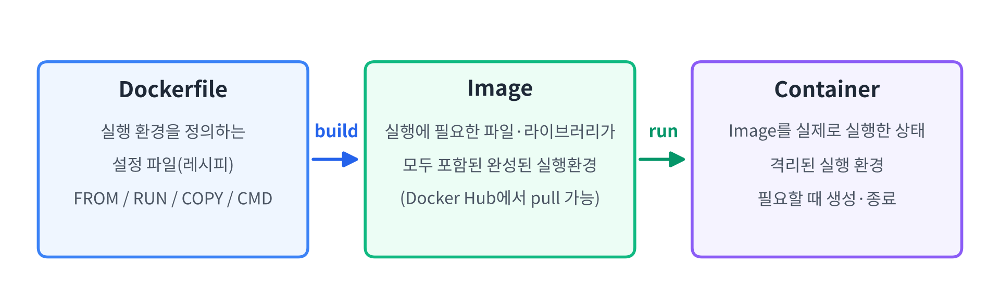
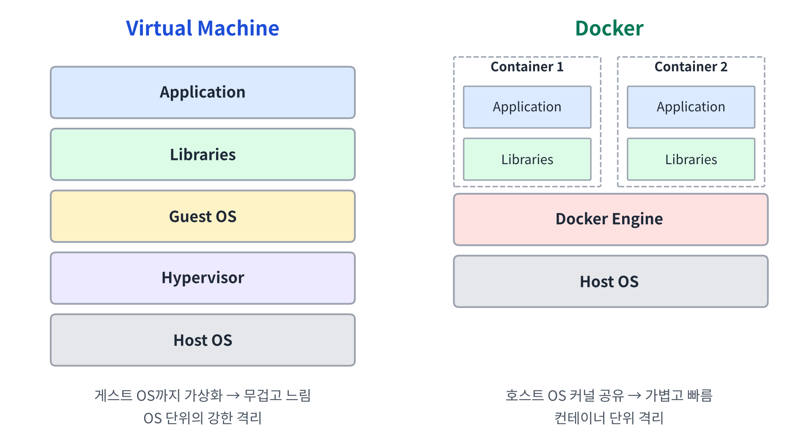
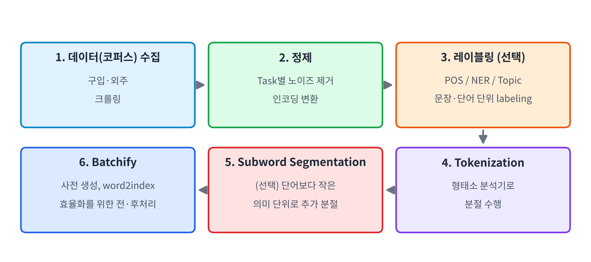
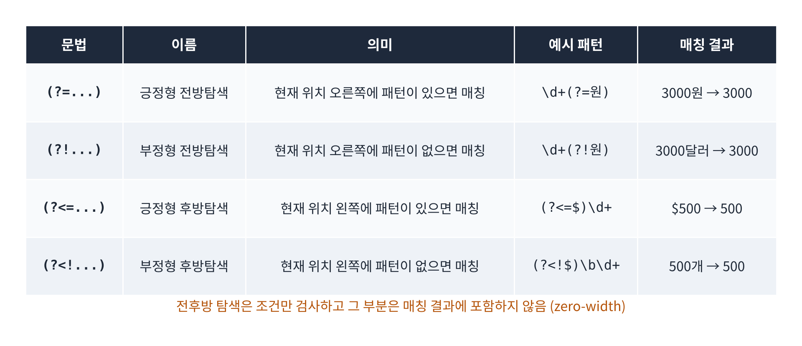

[toc]

## 1. 강의의 학습 목표

- **실습 환경 구축**: Docker, WSL을 이용한 NLP 실습 환경 만들기
- **언어 빅데이터 수집**: 코퍼스를 어디서, 어떻게 확보하는가?
- **언어 빅데이터 전처리**: 정규표현식을 이용한 노이즈 제거

## 2. 왜 Docker가 필요한가?

딥러닝·NLP 실습에서 가장 흔한 문제

**"다른 사람들은 되는데... 왜 내 컴퓨터에서는 안 되나?"**

| 사용자 | Python | PyTorch | CUDA |
|------|--------|---------|------|
| 학생 A | 3.11 | 2.x | 12.x |
| 학생 B | 3.12 | 설치 오류 | CPU only |
| 교수님 | 3.10 | 다른 버전 | 다른 버전 |

→ 사람마다 **실습 환경이 서로 다름**

> **Docker를 사용하면 모든 개발자에게 동일한 환경 제공이 가능**

### Docker란?

**Docker**

- 애플리케이션과 실행에 필요한 라이브러리·환경을 **하나의 Container로 패키징하고 실행하는 플랫폼**

| 필요성 | 설명 |
|------|------|
| **개발환경의 일관성** | OS, Python, 라이브러리 버전 차이로 발생하는 실행 오류 감소 |
| **프로젝트별 환경 격리** | 프로젝트마다 다른 버전을 독립적으로 사용 → 의존성 충돌 방지 |
| **빠른 개발환경 구축** | 준비된 Image로 필요한 환경을 빠르게 구성 |
| **협업과 재현성 향상** | Image 또는 Dockerfile 공유 → 다른 사람도 동일한 환경에서 실행·테스트 |
| **개발~배포 환경 일관성** | 개발 PC의 환경을 테스트·운영 서버에서도 동일하게 구성 |

### 쉬운 설명

1. 내 컴퓨터에서 잘 돌아가던 코드도 다른 컴퓨터에서는 버전 차이 때문에 오류가 날 수 있음
2. Docker는 코드뿐 아니라 **코드가 실행되는 환경 자체를 통째로 묶어서** 전달함
3. 따라서 누가 실행하든 **같은 환경에서 같은 결과**를 얻을 수 있음

## 3. Docker 기본 구조



| 구성 요소 | 의미 | 특징 |
|---------|------|------|
| **Dockerfile** | 실행 환경을 정의한 설정 파일**(레시피)** | OS, 라이브러리 설치, 실행 명령 등을 기술 |
| **Image** | Dockerfile을 빌드한 결과 | 실행에 필요한 모든 파일과 라이브러리가 포함된 상태, Docker Hub에서 다운로드 가능 |
| **Container** | Image를 실행한 상태 | 독립된 실행 환경(격리), 필요할 때 생성·종료 |

전체 흐름

`Dockerfile → (build) → Image → (run) → Container`

### VM vs. Docker



| 구분 | Virtual Machine | Docker |
|-----|----------------|--------|
| 가상화 범위 | **게스트 OS까지 포함** | **애플리케이션 + 라이브러리만** |
| OS | 각 VM이 독립적인 OS 사용 | **호스트 OS의 커널을 공유** |
| 무게 | 무거움 (큰 용량, 느린 부팅) | 가벼움 (작은 용량, 빠른 시작) |
| 격리 수준 | OS 단위의 강한 격리 | 컨테이너 단위의 격리 |

**Q. Docker가 VM보다 가벼운 이유는?**

**A.** 컨테이너마다 별도의 게스트 OS를 띄우지 않고 **호스트 OS의 커널을 공유**하기 때문

### 쉬운 설명

- VM은 컴퓨터 안에 **컴퓨터를 하나 더** 만드는 방식
- Docker는 운영체제는 같이 쓰고 **실행 환경만 따로 분리**하는 방식
- 그래서 Docker는 더 빠르고 가볍지만, 격리 수준은 VM이 더 강함

## 4. WSL (Windows Subsystem for Linux)

**WSL이란?**

- **Windows 안에서 Linux 환경을 사용할 수 있도록 제공하는 기능**

### 등장 배경

- 서버·클라우드·AI 분야에서는 **Linux가 중요한 개발 및 실행 환경**
- 하지만 많은 개발자의 개인 PC는 Windows를 사용
- 기존에 Linux 환경이 필요하면?
  - 별도의 Linux PC 사용
  - 듀얼 부팅 또는 VM 설치
    - 환경 구축이 번거로움
    - VM은 별도의 운영체제를 실행 → **많은 자원 필요**

> "Windows를 사용하면서 Linux 개발 환경도 편리하게 사용할 수 없을까?" → **WSL**

### WSL 2 + Ubuntu 설치

```bash
wsl --version                  # wsl 버전 확인
wsl -l -v                      # 설치된 리눅스 배포판 확인
wsl --list --online            # 설치 가능한 리눅스 배포판 확인
wsl --install -d Ubuntu-24.04  # 우분투 24.04 배포판(distro) 설치
wsl --status                   # wsl 상태 확인
wsl -d Ubuntu                  # 설치된 리눅스 배포판으로 접속
lsb_release -a                 # LSB(Linux Standard Base) 정보 확인
exit                           # 우분투에서 윈도우로 돌아올 때
```

### Docker Desktop 설치 → WSL 2 연동

1. Docker 공식 사이트에서 **Docker Desktop for Windows** 다운로드·설치
2. **Settings → General → Use the WSL 2 based engine** 체크
3. **Settings → Resources → WSL Integration**
   - `Enable integration with my default WSL distro` 체크 **또는**
   - `Additional distributions: Ubuntu` ON
   - 체크 후 **Apply & Restart**

WSL에서 Docker 동작 확인

```bash
docker --version          # 도커 버전 확인
docker run hello-world    # 이미지 다운로드 + "hello-world" 컨테이너 실행
docker ps -al             # 컨테이너 정보 확인
```

### VS Code 확장(Extension)

| Extension | 용도 |
|-----------|------|
| **Docker** | VS Code에서 Docker를 GUI로 관리 |
| **Dev Containers** | 실행 중인 Docker Container 내부로 VS Code 연결 |
| **WSL** | VS Code를 WSL Ubuntu에 연결 |
| **Remote - SSH** | 연구실 서버, 클라우드 Instance 등 원격 서버 연결 |

VS Code를 WSL Ubuntu에 연결

- `Ctrl + Shift + P` → **WSL: Connect to WSL**
  - 배포판이 여러 개라면 **WSL: Connect to WSL using Distro... → Ubuntu**
- 터미널이 안 보이면 **Ctrl + 백틱 키** (숫자 1 왼쪽 키)

```bash
pwd                               # 현재 위치 확인 → /home/username
ll                                # 현재 디렉토리 세부 정보 (long list)
mkdir -p workspace/hongik-nlp     # 작업 디렉토리 생성
cd workspace                      # 작업 디렉토리로 이동
```

이후 VS Code **Open Folder**로 `~/workspace` (= `/home/username/workspace`) 열기

## 5. Docker Hub와 실습용 이미지

**Docker Hub**

- GitHub가 **소스코드**를 공유하는 저장소라면, Docker Hub는 **실행환경**을 공유하는 저장소

| 저장소 | 의미 | 다운로드 | 업로드 |
|------|------|--------|------|
| **GitHub** | "내 코드를 그대로 가져가세요" | `git clone` | `git push` |
| **Docker Hub** | "내 실행환경을 그대로 가져가세요" | `docker pull` | `docker push` |

### 실습용 이미지

```
Docker Hub
└── kafa46/hongik-nlp   ← Repository
    ├── :cpu            ← Tag
    └── :gpu            ← Tag
```

| Tag | 설명 |
|-----|------|
| `:cpu` | CPU용 PyTorch가 설치된 범용 NLP 실습 이미지, **GPU가 없는 PC에서도 사용 가능** |
| `:gpu` | CUDA 지원 PyTorch가 설치된 GPU 가속 이미지, **NVIDIA GPU 환경에서 사용** |

**Tag란?**

- Repository 안에서 원하는 Image의 버전이나 구성을 식별하기 위한 이름
- **Tag 자체가 Image는 아님** → 특정 Image를 가리키는 사람이 읽기 쉬운 식별자(label)
- 같은 Image에 여러 Tag를 붙이는 것도 가능

### 이미지 다운로드 및 컨테이너 실행

```bash
# 실습 폴더 생성 및 이동
mkdir -p ~/workspace/hongik-nlp
cd ~/workspace/hongik-nlp

# CPU 환경
docker pull kafa46/hongik-nlp:cpu
docker run -it -d --name hongik-nlp -v "$PWD:/workspace" kafa46/hongik-nlp:cpu

# GPU 환경
nvidia-smi                              # WSL에서 NVIDIA GPU 인식 확인
# sudo apt install nvidia-utils-595     # Windows에서는 되지만 WSL에서 안 될 때
docker pull kafa46/hongik-nlp:gpu
docker run -it -d --gpus all --name hongik-nlp -v "$PWD:/workspace" kafa46/hongik-nlp:gpu
```

| 옵션 | 의미 |
|-----|------|
| `-i` | **Interactive** 모드, 표준 입력(stdin)을 열린 상태로 유지 |
| `-t` | **TTY**, 가상 터미널 할당 |
| `-d` | **Detached**, 컨테이너를 백그라운드에서 실행 |
| `--name` | 컨테이너 이름(별명) 지정 |
| `-v` | 볼륨 연결, 로컬의 `$PWD`와 컨테이너의 `/workspace`를 연결 |
| `--gpus all` | 호스트 PC의 GPU를 컨테이너에서 사용할 수 있도록 할당 |

`-v` 옵션의 특징

- 컨테이너에 `/workspace`가 없으면 새로 만들고, 있으면 바로 연결
- **둘 중 하나만 변경해도 양쪽에 같이 반영됨 (Bind Mount)**

> Docker 옵션은 다 외우는 것이 불가능 → `--help` 옵션을 적극 활용

### 컨테이너 접속하기 / 빠져나오기

```bash
docker ps                          # 실행 중인 컨테이너 목록 확인
docker exec -it hongik-nlp bash    # 컨테이너 접속
exit                               # 컨테이너 빠져나오기
```

- `docker exec`: 실행 중인 컨테이너에서 명령 실행
- `hongik-nlp`: 접속할 컨테이너 이름
- `bash`: Bash Shell 실행

### GPU 최종 확인

```python
# gpu_test.py
import torch

print("CUDA available:", torch.cuda.is_available())

if torch.cuda.is_available():
    print("GPU:", torch.cuda.get_device_name(0))
else:
    print("GPU를 사용할 수 없습니다.")
```

### VS Code로 컨테이너 내부 개발하기

1. `Ctrl + Shift + P`
2. **Dev Containers: Attach to Running Container...**
3. `hongik-nlp` 선택
4. 컨테이너 내부에서 **File → Open Folder... → /workspace**

`WSL의 ~/workspace/hongik-nlp ↔ (-v Bind Mount) ↔ 컨테이너의 /workspace ↔ (Dev Containers) ↔ VS Code`

### 쉬운 설명

1. `docker pull`로 교수님이 만든 실습 환경(Image)을 내려받음
2. `docker run`으로 그 Image를 실행해 컨테이너를 만듦
3. `-v` 옵션 덕분에 내 폴더와 컨테이너 폴더가 연결되어, 어느 쪽에서 파일을 수정해도 같이 바뀜
4. `docker exec`나 VS Code Dev Containers로 컨테이너 안에 들어가서 실습함

## 6. Conda 가상환경과 PyTorch

### Conda 가상환경 (Docker 대신 가상환경을 쓸 경우)

**conda**: Python 프로젝트별로 독립적인 실행 환경을 만들고 패키지를 관리

- Python 버전 관리
- 가상환경 관리
- Package / Dependency 관리

| 구분 | Anaconda | Miniconda |
|-----|---------|----------|
| 기본 목적 | 완성된 데이터과학 환경 | 최소 conda 환경 |
| NumPy/Pandas/Jupyter 등 | 다수 기본 포함 | 필요할 때 설치 |
| 설치 크기 | 큼 (수 GB 수준) | 작음 (수백 MB 수준) |
| 환경 통제 | 상대적으로 복잡 | 쉬움 |
| 초보자 | 편리 | 약간의 CLI 필요 |
| 수업/개발 서버 | 가능 | **추천** |

```bash
conda env list                          # 가상환경 목록 확인 (= conda info --envs)
conda create -n my_env_name python=3.11 # 파이썬 3.11로 가상환경 생성
conda activate my_env_name              # 가상환경 시작
conda deactivate                        # 가상환경 종료
```

### PyTorch

| 구분 | 내용 |
|-----|------|
| **장점** | Numpy와 매우 비슷한 문법, 문서화가 잘 되어 있음, 난이도에 비해 자유도 높음 |
| **과거 단점 → 현재** | TPU 지원 불가 → **지원 가능**, 낮은 상용화 → **상용화 활용도 높아짐**, TensorBoard 부재 → **지원** |

- PyTorch: 페이스북 진영 / TensorFlow: 구글 진영
- 설치: [https://pytorch.org/get-started/locally/](https://pytorch.org/get-started/locally/)

## 7. 언어 빅데이터 수집

### ML(딥러닝) 수행 절차

`문제 정의 → 데이터 수집 → 데이터 전처리 및 분석 → 알고리즘 적용 → 평가 → 배포`

| 단계 | 내용 |
|-----|------|
| 문제 정의 | 단계를 나누고 simplify, $x$와 $y$를 정의 |
| **데이터 수집** | 문제 정의에 따른 수집, 필요에 따라 레이블링 |
| 데이터 전처리 및 분석 | 형태를 가공, 필요에 따라 EDA 수행 |
| 알고리즘 적용 | 가설을 세우고 구현·적용 |
| 평가 | 실험 설계, 테스트셋 구성 |
| 배포 | RESTful API를 통한 배포, 유지·보수 |

### NLP 전처리 파이프라인



| 단계 | 내용 |
|-----|------|
| **1. 데이터(코퍼스) 수집** | 구입, 외주, 크롤링 |
| **2. 정제** | Task에 따른 노이즈 제거, 인코딩 변환 |
| 3. 레이블링 (Optional) | 문장마다 또는 단어마다 labeling (POS, NER, Topic) |
| **4. Tokenization** | 형태소 분석기를 활용하여 분절 |
| 5. Subword Segmentation (Optional) | 단어보다 더 작은 의미 단위로 추가 분절 (예: `unbelievable → un / ##believ / ##able`) |
| **6. Batchify** | 사전 생성 및 word2index 매핑, 효율화를 위한 전·후처리 |

### 코퍼스(Corpus)

**코퍼스(말뭉치)란?**

- **자연어 처리를 위한 문장들로 구성된 데이터 셋**

| 분류 | 의미 |
|-----|------|
| Monolingual Corpus | 하나의 언어로 구성 |
| Bi-lingual Corpus | 두 개의 언어로 구성 |
| Multi-lingual Corpus | 여러 언어로 구성 |
| **Parallel Corpus** | **대응되는 문장 쌍이 레이블링되어 있는 데이터** |

Parallel Corpus 예시

| English | Korean |
|---------|--------|
| I love university. | 나는 대학교를 좋아한다. |
| I am a college student. | 나는 대학생 입니다. |

### 데이터 수집 방법

| 방법 | 장점 | 단점 |
|-----|------|------|
| **구입·외주** | 정제 및 Labeling이 완성된 최고의 데이터 | 비용 발생, **내 Domain과 맞지 않는 경우가 대부분** |
| **무료 공개 데이터** | 비용 없음 | 종류와 양이 제한적, 한국어 데이터는 흔치 않음 |
| **크롤링(Crawling)** | 거의 무한대의 코퍼스, **원하는 Domain별 선별 수집 가능** | 품질이 천차만별, **정제에 많은 노력(시간·비용) 필요** |

구입처: 대학교(연구소), 플리토 등

무료 데이터 출처

- **AI Hub** (www.aihub.or.kr, 회원가입 필수) → AI데이터 → 교육/문화/스포츠 → 한국어-영어 번역 말뭉치
- **공공데이터 포털**: [https://www.data.go.kr](https://www.data.go.kr)
- **빅카인즈** (무료 뉴스기사): [https://www.bigkinds.or.kr/](https://www.bigkinds.or.kr/)
- **GitHub 공개 데이터**: 네이버 영화 리뷰 감성 데이터 [https://github.com/e9t/nsmc](https://github.com/e9t/nsmc)
- **외국 언론사 API**: New York Times [https://developer.nytimes.com/apis](https://developer.nytimes.com/apis)
- **Kaggle**: [https://www.kaggle.com/datasets](https://www.kaggle.com/datasets)

### 크롤링 시 주의점

- 크롤링 데이터의 품질 문제: 이모티콘, 특수문자, 노이즈, 한국어 띄어쓰기 등
- **데이터 적법성에 대한 논란은 여전히 진행 중**
  - 크롤링 허가 확인: `www.domain.com/robots.txt`
  - (예) `https://www.daum.net/robots.txt`, `https://www.youtube.com/robots.txt`
- 데이터 → 딥러닝 모델 → **소유권은?**

### 쉬운 설명

- 돈을 내고 산 데이터는 깨끗하지만 내가 원하는 분야와 안 맞을 때가 많음
- 무료 데이터는 양과 종류가 부족하고, 특히 한국어 데이터가 적음
- 크롤링은 원하는 분야의 데이터를 많이 모을 수 있지만, **지저분해서 정제에 시간이 많이 듦**
- 크롤링 전에는 `robots.txt`로 수집이 허용되는지 꼭 확인해야 함

## 8. 데이터 전처리 – 과연 지옥인가!?

널리 알려진 사실

- 가장 재미없고, 끝없는 반복
- 프로그래머가 싫어하는 지루한 반복 작업
- **하지만 제일 중요함!!!**

> **Garbage In, Garbage Out!**
>
> 딥러닝의 결과물(Final Outcome Quality)은 **데이터 입력에 달려 있음**

## 9. 언어 빅데이터 정제(Cleaning)

정제는 **2단계**에 걸쳐 수행

| 단계 | 내용 |
|-----|------|
| **1단계: 기계적 노이즈 제거** | Task에 따른 전형적 노이즈 제거, **전각문자 치환** |
| **2단계: 인터랙티브 노이즈 제거** | 코퍼스의 특징에 따른 노이즈 제거, 대소문자 통일(Optional) |

### 1단계: 전각문자 치환

**전각문자**: 유니코드 이전의 한글, 한자, 일본어 문서에서 쓰이던 폭이 넓은 문자

- `Ｐ`(전각) vs `P`(반각)
- 중국어/일본어는 **전각 치환 필요**, 오래된 한국어 문서는 **가끔 전각 치환 필요**

### 2단계: 인터랙티브 노이즈 제거

- 언어, 도메인, 코퍼스마다 **고유한 특성 존재**
- **신중한 접근 필요**: 이모티콘을 무조건 제거해도 될까?
  - 예를 들어 감성 분석에서는 `^^`, `ㅠㅠ` 같은 이모티콘이 **감성 정보**가 될 수 있음

**Q. 노이즈 제거 기준이 Task마다 달라지는 이유는?**

**A.** 같은 문자라도 어떤 Task에서는 노이즈이고, 어떤 Task에서는 **중요한 정보**이기 때문

## 10. 정규표현식(Regular Expression)

**정규표현식이란?**

- **언어 데이터에서 일정한 패턴을 표현하는 방법**

| 사용 방법 | 장점 | 단점 |
|---------|------|------|
| **Python 코딩** | 재활용성 높음 | 한 번에 적용되어 중간 과정 확인이 어려움 |
| **텍스트 에디터** (VS Code, Sublime Text 등) | 코딩 없이 즉석에서 사용 | 적용 과정이 남지 않아 재활용 어려움 |

전화번호 제거 예시

```python
import re

regex = r"([\w]+\s*:?\s*)?\(?\+?([0-9]{1,3})?\-?[0-9]{2,3}(\)|\-)?[0-9]{3,4}\-?[0-9]{4}"

x = "Ki: +82-10-1234-5678 "
print(repr(re.sub(regex, "REMOVED", x)))
# 출력: 'REMOVED '

x = "CONTENT jiu 02)1234-5678 :"
print(repr(re.sub(regex, "REMOVED", x)))
# 출력: 'CONTENT REMOVED :'
```

### 문자 집합: `[ ]`, `-`, `^`

| 문법 | 의미 | 예시 |
|-----|------|------|
| `[ ]` | **one of** (여러 개 중 하나) | `[234cde]` → 2 or 3 or 4 or c or d or e, `(2\|3\|4\|c\|d\|e)`와 같음 |
| `-` | 연속된 알파벳/숫자 | `[2-4c-e]` → `[234cde]`와 같음 |
| `[^ ]` | **None of** (해당 패턴을 제외한 모든 문자) | `[^2-4c-e]` → 2~4, c~e를 제외한 모든 문자 |

### 그룹과 OR: `( )`, `|`

- `( )`: 괄호로 묶으면 **그룹**이 만들어짐
  - `(x)(yz)` → `x`는 `\1`, `yz`는 `\2`에 지정
- `|`: **또는(or)**
  - `(x|y)` → x 또는 y

### 등장 횟수: `?`, `+`, `*`, `{n,m}`

| 문법 | 의미 |
|-----|------|
| `x?` | x가 **0번 또는 1번** 나타남 |
| `x+` | x가 **1번 이상** 나타남 |
| `x*` | x가 **0번 이상** 나타남 (강력한 표현, 사용 유의!) |
| `x{n}` | x가 **정확히 n번** 반복 |
| `x{n,}` | x가 **n번 이상** 반복 |
| `x{n,m}` | x가 **n번에서 m번 사이** 반복 |

⭐️ `?`, `+`, `*`, `{ }`는 모두 **바로 앞(왼쪽) 표현**을 수식함 ⭐️

`?` 활용 예시

- `http://www.naver.com`과 `https://www.naver.com`을 모두 찾고 싶다면?
  - `http://[\w.]+` → http만 매칭
  - `https?://[\w.]+` → **`s`가 있어도, 없어도 매칭**

### `.`, `^`, `$`

| 문법 | 의미 | 예시 |
|-----|------|------|
| `.` | **any character** (줄바꿈 제외 모든 문자), 매우 강력한 표현 → 조심스럽게 사용 | `.{9}`: 아무 문자나 9번, `b.+d`: `abcdddddd`에서 `bcdddddd` 매칭 |
| `^` | `[ ]` **밖**에서는 **라인의 시작** | `^x` |
| `$` | **라인의 끝** | `x$` |

**⭐️주의⭐️**

- `[ ]` **안**의 `^` → **not**
- `[ ]` **밖**의 `^` → **라인의 시작**

### 전후방 탐색 (Lookaround)



| 문법 | 이름 | 의미 |
|-----|------|------|
| `(?=...)` | 긍정형 전방탐색 | 현재 위치 **오른쪽**에 패턴이 **있는지** 검사 |
| `(?!...)` | 부정형 전방탐색 | 현재 위치 **오른쪽**에 패턴이 **없는지** 검사 |
| `(?<=...)` | 긍정형 후방탐색 | 현재 위치 **왼쪽**에 패턴이 **있는지** 검사 |
| `(?<!...)` | 부정형 후방탐색 | 현재 위치 **왼쪽**에 패턴이 **없는지** 검사 |

> 전후방 탐색은 조건만 검사하고, 검사한 부분은 매칭 결과에 포함하지 않음

### 지정 문자 (Meta Characters)

| 문자 | 의미 |
|-----|------|
| `\s` | 공백 문자(white space) |
| `\S` | 공백 문자를 제외한 모든 문자 |
| `\w` | alphanumeric + `_` (`[A-Za-z0-9_]`와 같음) |
| `\W` | `\w`를 제외한 모든 문자 (`[^A-Za-z0-9_]`와 같음) |
| `\d` | 숫자 (`[0-9]`와 같음) |
| `\D` | 숫자를 제외한 모든 문자 (`[^0-9]`와 같음) |

참고: Python 3의 `re`는 기본적으로 유니코드 기준이라 **한글도 `\w`에 매칭**됨

### 역슬래시(`\`) → 탈출문자(Escape)

정규식 기호가 아닌 **문자 그대로의 의미**로 쓰고 싶을 때 사용

| 표현 | 의미 |
|-----|------|
| `\\` | 백슬래시 |
| `\[` | 대괄호 |
| `\{` | 중괄호 |
| `\.` | 점 |
| `\-`, `\+` | 마이너스, 플러스 기호 |

### 쉬운 설명

- `[ ]`는 "이 중에 하나", `[^ ]`는 "이것들만 빼고"
- `?`는 "있어도 되고 없어도 됨", `+`는 "하나 이상", `*`는 "없어도 되고 여러 개여도 됨"
- `.`은 아무 문자나 다 매칭되기 때문에 너무 많이 잡힐 수 있어 조심해야 함
- `^`는 위치에 따라 뜻이 달라짐 → `[ ]` 안이면 "제외", 밖이면 "줄의 시작"
- 전후방 탐색은 "앞이나 뒤에 이런 게 있는지만 확인하고, 그 부분은 잡지 않는 것"

## 11. 텍스트 전처리 실습

### 1) 텍스트 파일 인코딩 변경

전달받은 텍스트 파일의 인코딩이 **한글 인코딩(EUC-KR, CP949 등)**인 경우

- 한국어 데이터를 처리할 때 종종 발생
- `convert_to_utf8.py`: 텍스트 파일의 인코딩을 **UTF-8로 변환하여 새 파일로 저장**하는 스크립트

```bash
python3 convert_to_utf8.py --help
python3 convert_to_utf8.py -f [입력파일]

# 예제
python3 convert_to_utf8.py -f review.sorted.uniq.tsv
```

### 2) Dataset Inspection & Cleaning (Manual and Local)

감성 분석 데이터셋 형식: `레이블(positive/negative) <TAB> 문장`

**입력파일 검사**

| 정규식 | 의미 |
|-------|------|
| `^(?!positive\|negative).*$` | 문장이 positive 또는 negative로 **시작하지 않는 행** 찾기 |
| `^[^\t]*$` | **탭(`\t`)이 하나도 없는 행** (1개 컬럼만 있는 행) 찾기 |
| `\n{2,}` | 엔터가 2번 이상 연속된 부분 → `\n` 하나로 변경 |

- 해당 문장을 replace로 지우면 빈 줄이 생김 → `\n{2,}`를 `\n`으로 바꿔 빈 줄 정리

**출력파일 검사**

| 정규식 | 의미 |
|-------|------|
| `^(positive\|negative)\t` | positive 또는 negative로 시작한 뒤 tab이 오는 행 |
| `^(positive\|negative)\t[0-9]+$` | 본문이 **숫자로만** 되어 있는 행 |
| `^(positive\|negative)\t[,.]+$` | 본문이 **마침표나 쉼표로만** 되어 있는 행 |

### 3) 정규식 실습: 전각문자 치환

필요한 파일

- 감성 분석 데이터셋: `review.sorted.uniq.tsv`
- 전각문자 치환 규칙: `regex.txt`
- 치환 규칙을 이용해 전각문자를 치환하는 프로그램: `refine.py`

```bash
python3 refine.py --help
python3 refine.py -s regex.txt -t 1 < review.sorted.uniq.tsv > review.sorted.uniq.refined.tsv
```

- `-s`: 치환 규칙 파일
- `-t`: 정제할 컬럼 번호

### 쉬운 설명

1. 먼저 파일의 인코딩을 **UTF-8로 통일**함
2. 에디터에서 정규식으로 **형식이 깨진 행**(레이블이 없거나, 탭이 없는 행)을 찾아 정리함
3. 정제 후에는 숫자나 문장부호만 남은 **의미 없는 문장**이 없는지 다시 검사함
4. 마지막으로 `refine.py`로 전각문자를 일괄 치환함

## 12. 최종 핵심 정리

1. **Docker**는 실행 환경을 통째로 묶어 **누구나 동일한 환경**에서 실습할 수 있게 해 줌
2. Docker는 호스트 OS 커널을 공유하므로 **VM보다 가볍고 빠름**
3. **WSL**을 이용하면 Windows에서도 Linux 개발 환경을 쉽게 사용할 수 있음
4. NLP 전처리는 **수집 → 정제 → (레이블링) → 토큰화 → (Subword 분절) → Batchify** 순서로 진행
5. 데이터 수집은 구입, 공개 데이터, 크롤링 중 **도메인 적합성과 정제 비용**을 고려해 선택
6. **Garbage In, Garbage Out** → 전처리는 지루하지만 가장 중요한 단계
7. 정제는 **기계적 노이즈 제거 → 인터랙티브 노이즈 제거**의 2단계로 수행
8. **정규표현식**은 패턴 기반 정제의 핵심 도구이며, `.`, `*`처럼 강력한 표현은 조심해서 사용

---

End.
