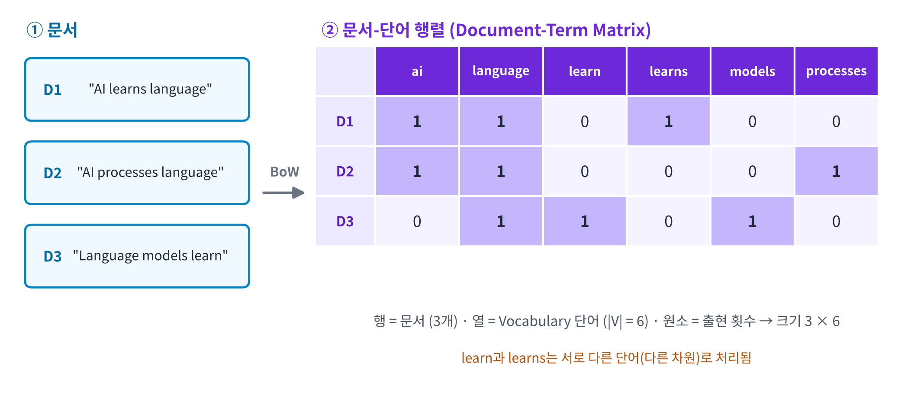
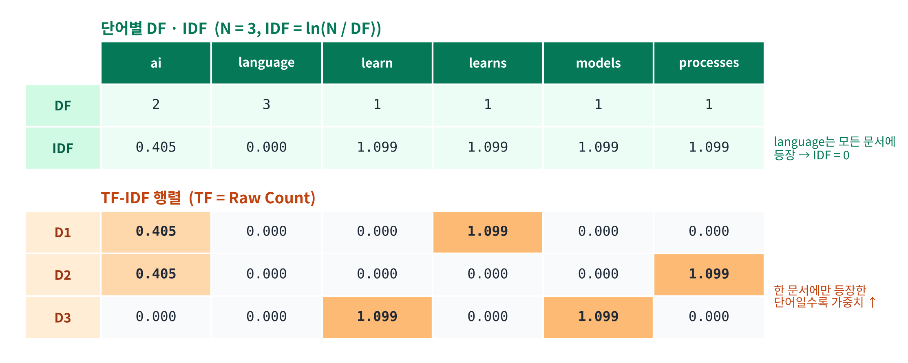
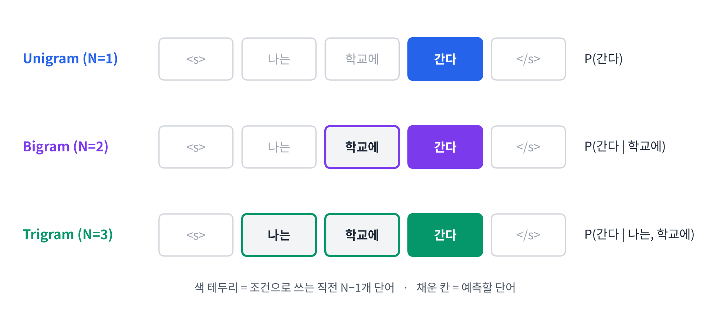
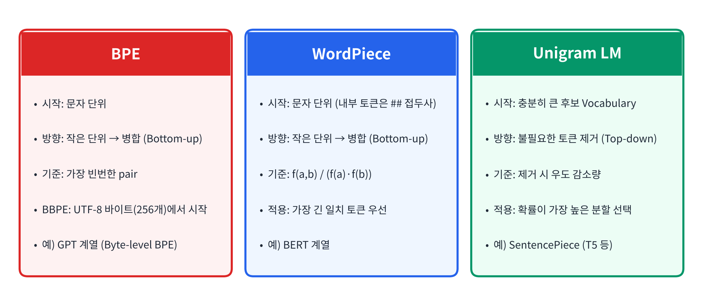
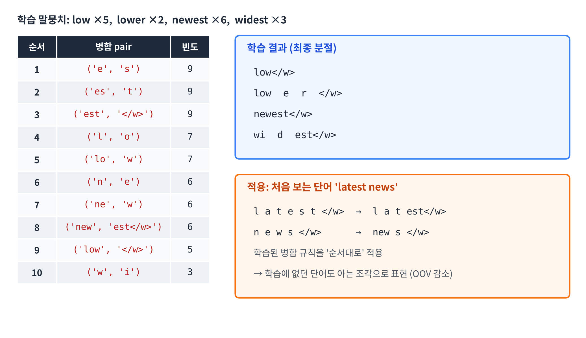

## 1. 강의의 학습 목표

- Bag of Words
- TF-IDF
- N-gram Language Model
- Subword Segmentation (BPE, BBPE, WordPiece, Unigram LM)
- Limitations & Transition
- Python Practice

## 2. 통계적 정보를 추출해야 하는 이유

**텍스트 전처리**는 불필요한 요소를 제거하고 분석 단위를 정리하는 과정

하지만 전처리 결과만으로는 **단어의 중요도나 문서의 특징을 정량적으로 비교하기 어려움**

텍스트에는 다음과 같은 **통계적 정보**가 존재함

| 통계적 성질 | 의미 |
|-----------|------|
| **Word Frequency** | 모든 단어가 동일한 빈도로 등장 X |
| **Co-occurrence** | 특정 단어들은 다른 단어들과 함께 나타나는 경향 |
| **Sequential Dependency** | 단어의 출현 가능성은 앞서 등장한 단어에 영향을 받음 |

> 이러한 정보를 **수치화**하면 **문서 비교, 정보 검색, 텍스트 분류** 등에 활용 가능

### 텍스트 → 통계적 표현

1. 텍스트에서 **분석 단위**(단어, 문서, 단어 시퀀스)를 정의
2. 각 분석 단위에 대한 **통계량 추출**
3. 추출된 통계량을 **벡터, 행렬 또는 확률분포**로 표현
4. 수치적 표현으로 문서의 특성과 언어 패턴을 분석

### 통계 기반 언어 표현 방법의 분류

| 구분 | 대표 기법 | 표현하는 정보 |
|-----|---------|------------|
| **Frequency-based** | BoW, TF-IDF | 단어의 출현 빈도와 상대적 중요도 |
| **Sequence-based** | N-gram | 인접 단어의 순서 및 결합 패턴 |
| **Probability-based** | N-gram Language Model | 이전 단어가 주어졌을 때 다음 단어의 조건부 확률 |
| **Similarity-based** | Cosine Similarity | 통계적 벡터로 표현된 문서 간 유사성 |

## 3. Bag of Words (BoW)

**Bag of Words란?**

- 텍스트를 구성하는 단어의 **출현 빈도(Frequency)**를 이용하여 문서를 수치 벡터로 표현
- 단어의 **순서(Order)와 문법적 구조는 고려하지 않음**
- 각 단어는 어휘집(Vocabulary)의 **하나의 차원(Dimension)**에 대응
- 동일한 Vocabulary를 사용하는 문서들은 **동일한 차원의 벡터**로 표현됨

$$
X_d = [\,c(w_1, d),\ c(w_2, d),\ \cdots,\ c(w_{|V|}, d)\,]
$$

- $$X_d$$: 문서 $$d$$의 BoW 벡터
- $$c(w_i, d)$$: 문서 $$d$$에서 단어 $$w_i$$의 출현 횟수
- $$\lvert V\rvert $$: Vocabulary에 포함된 고유 단어 수

### Vocabulary 만들기

**Vocabulary**: 말뭉치(Corpus)에 등장하는 **고유 단어(Unique Words)들의 집합**

1. 입력 문서 준비: `AI learns language`, `AI processes language`, `Language models learn`
2. 단어 추출 및 소문자 정규화
3. 중복 제거
4. 각 단어에 인덱스 할당 (Word-to-Index Mapping)

| Index | 0 | 1 | 2 | 3 | 4 | 5 |
|-------|---|---|---|---|---|---|
| Word | ai | language | learn | learns | models | processes |

- **Vocabulary 크기 $$\lvert V \rvert$$가 BoW 벡터의 차원을 결정** → 여기서는 $$\lvert V \rvert = 6$$
- ⭐️ `learn`과 `learns`는 **서로 다른 단어**로 처리됨 ⭐️

### 문서 → BoW 벡터 → 문서-단어 행렬

BoW 벡터의 각 원소는 **Vocabulary에 정의된 단어의 위치와 반드시 일치**

- 문장의 단어 수가 달라도 같은 Vocabulary를 쓰면 **벡터 차원이 동일**
- 단어가 등장하지 않으면 0, 한 번 등장하면 1, 여러 번 등장하면 그 횟수
- **벡터의 숫자만으로는 단어의 의미나 문장 내 순서를 파악할 수 없음**

**Document-Term Matrix (문서-단어 행렬)**

- 여러 문서의 BoW 벡터를 **행(Row) 단위로 결합한 행렬**
- 행: 문서, 열: Vocabulary의 단어, 원소: 해당 문서에서 단어의 출현 횟수
- 크기: **(문서 수) × (단어 수)** = $$3 \times 6$$

### Binary BoW vs. Count BoW

| 비교 항목 | Binary BoW | Count BoW |
|---------|-----------|----------|
| 표현 정보 | **출현 여부** | **출현 횟수** |
| 값의 범위 | $$\{0, 1\}$$ | $$\{0, 1, 2, \cdots\}$$ |
| 반복 출현 반영 | 불가능 | 가능 |
| 대표 활용 | 단어 존재 여부 기반 분류 | 단어 빈도 기반 분석 |
| 주요 한계 | 빈도 정보 손실 | 빈번한 단어의 영향이 커질 수 있음 |

**Q. Count BoW가 항상 Binary BoW보다 좋은가?**

영화 리뷰 감성 분류 예시 (Vocabulary = [좋아요, 최고예요])

| 문서 | 내용 | Binary BoW | Count BoW |
|-----|------|-----------|----------|
| A (긍정) | 좋아요 좋아요 좋아요 최고예요 | [1, 1] | [3, 1] |
| B (긍정) | 좋아요 최고예요 | [1, 1] | [1, 1] |

**A.** 항상 그렇지 않음

- **Count BoW**: '좋아요'가 3번 등장한 사실을 반영 → 반복이 **긍정 강도**를 나타낸다면 유용
- **Binary BoW**: 단어가 등장했다는 사실만 반영 → 반복 횟수가 분류에 불필요하다면 유리
- 긍정·부정 **이진 분류**에서 반복 횟수가 추가 정보를 주지 않는다면 **Binary BoW로도 충분**할 수 있음

### BoW의 한계

| 한계 | 설명 | 예시 |
|-----|------|------|
| **Loss of Word Order** | 단어의 순서와 문법 구조 무시 | `Dog bites man` ↔ `Man bites dog` → 같은 벡터 `[1, 1, 1]` |
| **High Dimensionality** | Vocabulary 크기만큼 벡터 차원 증가 | 저장 공간·계산 비용 증가 |
| **Sparsity** | 대부분의 원소가 0 | Vocabulary 50,000개, 문서 내 고유 단어 100개 → 비영(Non-zero) 원소는 **0.2%** |
| **Lack of Semantic Relationships** | 단어 간 의미 관계를 표현 못 함 | `car`와 `automobile`이 서로 다른 독립 차원 |
| **Frequency Bias** | 빈도가 높은 단어의 영향이 커짐 | `the`처럼 흔한 단어가 문서 구별에 유용하지 않음 |

### 쉬운 설명

1. BoW는 문서를 **단어 주머니**에 넣고 각 단어가 몇 번 나왔는지만 세는 방식
2. 모든 문서를 같은 Vocabulary 기준으로 세기 때문에 **벡터 길이가 항상 같음**
3. 하지만 단어 순서를 버리므로 "개가 사람을 물었다"와 "사람이 개를 물었다"를 구별하지 못함
4. 또한 자주 나오는 단어가 중요한 단어라는 보장이 없음 → **TF-IDF의 등장 배경**

## 4. TF-IDF

### 왜 TF-IDF인가?

- BoW(Count)는 단어의 **출현 빈도**로 문서를 표현
- 그러나 **빈도가 높다고 반드시 그 문서를 대표하는 중요한 단어는 아님**
- **여러 문서에 공통적으로 등장하는 단어**는 특정 문서를 구별하는 데 덜 유용함
- 따라서 **문서 내 빈도**와 **전체 문서에서의 희소성(Rarity)**을 함께 고려해야 함

> **TF-IDF (Term Frequency–Inverse Document Frequency)**: 문서 내 단어의 출현 빈도와 전체 문서 집합에서의 희소성을 결합하여 단어의 가중치를 계산

### Term Frequency (TF)

**TF란?**

- 특정 단어가 **하나의 문서 안에서 얼마나 자주 등장하는지**를 나타내는 통계량
- 다른 문서에서의 출현 여부는 **반영하지 않음**

**Raw Count TF** (단순 출현 빈도)

$$
TF_{raw}(t, d) = f(t, d)
$$

**Normalized TF** (문서 길이 정규화, 값의 범위는 $$[0, 1]$$)

$$
TF_{norm}(t, d) = \frac{f(t, d)}{\sum_{t' \in V} f(t', d)}
$$

- $$t$$: 대상 단어, $$d$$: 대상 문서, $$f(t, d)$$: 문서 $$d$$에서 $$t$$의 출현 횟수

**TF 계산 예시** (단어 `AI`)

| 계산 항목 | 문서 D1 | 문서 D2 |
|---------|--------|--------|
| 문서 내용 | AI learns AI language | AI learns language models AI process text information |
| 전체 단어 수 | 4 | 8 |
| AI 출현 횟수 | 2 | 2 |
| **Raw Count TF** | 2 | 2 |
| **Normalized TF** | 2 / 4 = **0.50** | 2 / 8 = **0.25** |

**Q. Raw Count TF가 같은데 Normalized TF는 왜 다른가?**

**A.** D2가 더 긴 문서이기 때문. 같은 2번이라도 **짧은 문서에서의 2번이 상대적으로 더 비중이 큼**

### Inverse Document Frequency (IDF)

**IDF란?**

- 특정 단어가 **전체 문서 집합에서 얼마나 드물게 등장하는지**를 나타내는 가중치
- 여러 문서에 공통적으로 등장할수록 **IDF ↓**, 소수의 문서에만 등장할수록 **IDF ↑**
- ⭐️ 단어의 출현 횟수가 아니라 **단어가 등장하는 문서의 개수**를 기준으로 계산 ⭐️

**Document Frequency (DF)**

$$
DF(t) = \left|\{\, d \in D : t \in d \,\}\right|
$$

**Inverse Document Frequency (IDF)**

$$
IDF(t) = \ln \frac{N}{DF(t)}
$$

- $$N$$: 전체 문서 수
- $$DF(t)$$: 단어 $$t$$가 한 번 이상 등장하는 문서의 개수
- $$\log$$: 문서 빈도 비율을 로그 변환하여 가중치 크기를 조절

### TF-IDF 계산

$$
TFIDF(t, d) = TF(t, d) \cdot IDF(t) = f(t, d) \cdot \ln \frac{N}{DF(t)}
$$

**TF-IDF 행렬**

$$
X_{TFIDF} \in \mathbb{R}^{m \times n}, \qquad a_{ij} = TF(w_j, d_i) \times IDF(w_j)
$$

- $$m$$: 전체 문서 수, $$n$$: Vocabulary의 단어 수
- $$a_{ij}$$: 문서 $$d_i$$에서 단어 $$w_j$$의 TF-IDF 가중치

앞의 문서 3개(`AI learns language`, `AI processes language`, `Language models learn`)로 계산하면 다음과 같음

| 단어 | 등장 문서 | DF | IDF 계산 | IDF |
|-----|---------|----|--------|-----|
| language | D1, D2, D3 | 3 | $$\ln(3/3)$$ | **0.000** |
| ai | D1, D2 | 2 | $$\ln(3/2)$$ | 0.405 |
| learn, learns, models, processes | 한 문서씩 | 1 | $$\ln(3/1)$$ | **1.099** |

- **language**는 모든 문서에 등장 → IDF = 0 → **모든 문서에서 가중치 0**
- **processes, models**처럼 한 문서에만 등장하는 단어 → **가중치가 가장 높음**

> **참고**: 실습에서 쓰는 sklearn의 `TfidfVectorizer`는 기본값으로 $$\ln\frac{1+N}{1+DF(t)} + 1$$ 형태의 IDF와 L2 정규화를 사용함
>
> 그래서 강의 수식으로 손 계산한 값과 숫자가 다르게 나옴 (예: language의 IDF가 0이 아님)

### TF-IDF의 특징과 한계

| 특징 | 설명 |
|-----|------|
| **단어 중요도 가중치** | TF와 IDF를 결합하여 가중치 부여 |
| **문서 구별 능력** | 공통 단어의 가중치는 낮추고, 특정 문서에 특징적인 단어의 가중치는 높임 |
| **수치 벡터 표현** | 문서를 고정 차원의 실수 벡터로 표현 → 머신러닝 알고리즘에 활용 |
| **높은 해석 가능성** | 각 차원이 특정 단어에 대응하므로 의미 해석이 쉬움 |
| **계산 효율성** | 계산이 단순하며 희소행렬 연산 활용 가능 |

| 한계 | 설명 |
|-----|------|
| **단어 순서 정보 손실** | 순서와 문법 구조를 고려하지 않음 |
| **의미적 관계 표현 불가** | `car`와 `automobile`도 독립적인 차원 |
| **고차원 벡터** | Vocabulary가 커질수록 차원 증가 |
| **희소 벡터** | 벡터 원소 대부분이 0 |
| **희귀 단어에 민감** | **오탈자·노이즈처럼 드문 단어에도 높은 IDF**가 부여될 수 있음 |
| **말뭉치 의존성** | 말뭉치가 달라지면 같은 단어의 가중치도 달라짐 |

### TF-IDF 활용 – 영화 추천 시스템 실습

- 데이터셋: [https://github.com/jbose038/naver-movie-recommendation](https://github.com/jbose038/naver-movie-recommendation)
- sklearn 설치: `pip install -U scikit-learn`
- 구조
  - **입력**: 최근 본 영화 제목
  - **알고리즘**: TF-IDF + Cosine Similarity
  - **출력**: 최근 본 영화와 내용이 가장 유사한 n개 영화 추천

### 쉬운 설명

- **TF**는 "이 문서 안에서 이 단어가 얼마나 자주 나오는가?"
- **IDF**는 "이 단어가 다른 문서에는 얼마나 드물게 나오는가?"
- 둘을 곱하면 **"이 문서에서 많이 나오면서, 다른 문서에는 잘 안 나오는 단어"**가 높은 점수를 받음
- 그래서 어디에나 나오는 단어(language, the 등)는 점수가 낮고, 그 문서만의 특징적인 단어는 점수가 높아짐

## 5. N-gram Language Model

**Q. 단어의 순서를 고려하면 무엇을 추가로 학습할 수 있는가?**

- BoW와 TF-IDF는 단어의 순서를 **보존하지 않음**
- **N-gram**: 연속된 **N개의 토큰**으로 구성되는 시퀀스
- **N-gram Language Model**: 이전 단어들이 주어졌을 때 **다음 단어의 출현 확률**을 추정
- 활용: 문장 확률 계산, 다음 단어 예측 등

### Unigram, Bigram, Trigram

예제 문장: `I love natural language processing`

| 모델 | N | 토큰 시퀀스 |
|-----|---|-----------|
| **Unigram** | 1 | I / love / natural / language / processing |
| **Bigram** | 2 | I love / love natural / natural language / language processing |
| **Trigram** | 3 | I love natural / love natural language / natural language processing |

- **N이 커질수록 더 긴 문맥**을 고려할 수 있음
- 동시에 가능한 N-gram 조합 수와 **데이터 희소성 문제도 증가**

### 문장 확률과 Chain Rule

전체 문장의 확률은 **확률의 연쇄법칙(Chain Rule)**으로 계산

$$
P(w_1, w_2, \cdots, w_T) = \prod_{t=1}^{T} P(w_t \mid w_1, w_2, \cdots, w_{t-1})
$$

- 각 단어의 조건부 확률을 곱하여 전체 시퀀스의 확률을 계산
- 원칙적으로 **이전의 모든 단어**를 조건으로 사용
- 문장이 길어지면 가능한 문맥 조합이 너무 많아 **확률 추정이 어려움**

### Markov Assumption

**다음 단어의 확률은 최근 N−1개 단어에 주로 의존한다**고 근사

$$
P(w_t \mid w_1, \cdots, w_{t-1}) \approx P(w_t \mid w_{t-N+1}, \cdots, w_{t-1})
$$

$$
P(w_1, \cdots, w_T) \approx \prod_{t=1}^{T} P(w_t \mid w_{t-N+1}, \cdots, w_{t-1})
$$

| 모델 | 조건으로 사용하는 문맥 | 조건부 확률 |
|-----|-----------------|----------|
| Unigram | 없음 (현재 단어만) | $$P(w_t)$$ |
| Bigram | 직전 1개 단어 | $$P(w_t \mid w_{t-1})$$ |
| Trigram | 직전 2개 단어 | $$P(w_t \mid w_{t-2}, w_{t-1})$$ |
| 4-gram | 직전 3개 단어 | $$P(w_t \mid w_{t-3}, w_{t-2}, w_{t-1})$$ |

**Markov Assumption의 장단점**

- **장점**: 문맥 길이를 제한하여 확률 추정의 복잡도를 낮춤
- **단점**: 멀리 떨어진 단어 사이의 관계(**장거리 의존성**)를 반영하기 어려움

### 최대우도추정 (MLE)

학습 데이터에서 조건부 확률을 **실제로 관찰한 상대 빈도**로 추정

$$
P(w_t \mid w_{t-1}) = \frac{C(w_{t-1}, w_t)}{C(w_{t-1})}
$$

- **분자**: 두 단어가 연속하여 등장한 횟수
- **분모**: 앞 단어가 문맥으로 등장한 총 횟수

**MLE 계산 예시**

예제 말뭉치

- S1: `<s> 나는 학교에 간다 </s>`
- S2: `<s> 나는 집에 간다 </s>`
- S3: `<s> 나는 학교에 간다 </s>`

| 이전 단어 | 다음 단어 | Bigram 빈도 | 이전 단어 빈도 | $$P$$(다음 \| 이전) |
|---------|---------|-----------|------------|----------------|
| `<s>` | 나는 | 3 | 3 | 1.000 |
| 나는 | 학교에 | 2 | 3 | 0.667 |
| 나는 | 집에 | 1 | 3 | 0.333 |
| 학교에 | 간다 | 2 | 2 | 1.000 |
| 집에 | 간다 | 1 | 1 | 1.000 |
| 간다 | `</s>` | 3 | 3 | 1.000 |

**같은 이전 단어를 가진 확률의 합은 1**이 됨 (예: 0.667 + 0.333 = 1)

### 데이터 희소성과 Zero Probability 문제

- N이 커질수록 가능한 N-gram 조합 수가 **급격히 증가**
- 제한된 학습 데이터에서는 많은 조합이 **한 번도 관찰되지 않음**
- 관찰되지 않은 N-gram은 MLE에서 **확률이 0**
- ⭐️ 문장에 확률 0인 N-gram이 하나라도 있으면 **전체 문장의 확률도 0** ⭐️

$$
P(\text{도서관에} \mid \text{나는}) = \frac{0}{3} = 0
$$

→ "나는 도서관에 간다"는 자연스러운 문장인데도 확률이 0이 되어 버림

### Add-one (Laplace) Smoothing

**Smoothing(평활화)**: 관찰되지 않은 N-gram에도 **확률 질량을 조금씩 나누어 주는 방법**

Add-one Smoothing은 **모든 가능한 다음 단어의 빈도에 1을 더함**

$$
P(w_t \mid w_{t-1}) = \frac{C(w_{t-1}, w_t) + 1}{C(w_{t-1}) + |V|}
$$

- $$\lvert V \rvert$$: 가능한 다음 단어의 Vocabulary 크기 (아래 예시에서는 3)

| 다음 단어 | 관찰 빈도 | MLE | Add-one Smoothing |
|---------|---------|-----|------------------|
| 학교에 | 2 | 2/3 ≈ 0.667 | (2+1)/(3+3) = **0.500** |
| 집에 | 1 | 1/3 ≈ 0.333 | (1+1)/(3+3) = **0.333** |
| 도서관에 | 0 | **0** | (0+1)/(3+3) = **0.167** |
| 합계 | 3 | 1.000 | 1.000 |

- 장점: 구현과 이해가 간단함
- 단점: 희귀하거나 관찰되지 않은 N-gram에 **과도한 확률을 할당**할 수 있음
- 실제로는 **Add-k, Backoff, Interpolation, Kneser–Ney Smoothing** 등도 활용

### Perplexity (PPL)

**Perplexity란?**

- 사전적 의미: **'당혹감', '혼란'** → 모델이 얼마나 헷갈려 하는가
- 언어 모델이 **실제 단어 시퀀스를 얼마나 잘 예측하는지** 평가하는 지표
- 모델의 **평균적인 예측 불확실성**을 나타냄
- ⭐️ **PPL이 낮을수록 좋은 모델** (실제 문장에 높은 확률을 부여) ⭐️
- **같은 평가 데이터와 같은 토큰화 조건**에서만 모델끼리 비교 가능

$$
PPL(W) = P(w_1, w_2, \cdots, w_T)^{-\frac{1}{T}}
$$

Chain Rule을 적용하면

$$
PPL(W) = \exp\left(-\frac{1}{T}\sum_{t=1}^{T} \ln P(w_t \mid w_1, \cdots, w_{t-1})\right)
$$

N-gram 모델(Markov Assumption)에서는

$$
PPL(W) \approx \exp\left(-\frac{1}{T}\sum_{t=1}^{T} \ln P(w_t \mid w_{t-N+1}, \cdots, w_{t-1})\right)
$$

**PPL 계산 예제 (Bigram)**

입력 문장: `<s> 나는 학교에 간다 </s>` (설명을 단순하게 하기 위해 `</s>`는 평가에서 제외 → $$T = 3$$)

| 예측 단어 | 조건부 확률 |
|---------|----------|
| 나는 | $$P(\text{나는} \mid \langle s \rangle) = 1.0$$ |
| 학교에 | $$P(\text{학교에} \mid \text{나는}) = 0.5$$ |
| 간다 | $$P(\text{간다} \mid \text{학교에}) = 0.25$$ |

$$
P(W) = 1.0 \times 0.5 \times 0.25 = 0.125
$$

$$
PPL(W) = (0.125)^{-1/3} = 2.0
$$

**Q. PPL = 2.0은 무슨 의미인가?**

**A.** 모델이 매 단어를 예측할 때 평균적으로 **2개의 선택지 중에서 고민하는 수준**의 불확실성을 갖는다는 의미

### N-gram Language Model의 한계

| 한계 | 설명 |
|-----|------|
| **제한된 문맥** | 직전 N−1개 단어만 고려 → 장거리 의존성 학습에 한계 |
| **데이터 희소성** | N이 커질수록 관찰되지 않은 조합 증가 |
| **저장 공간 증가** | 가능한 N-gram 조합 수가 최대 $$\lvert V \rvert^N$$으로 증가 |
| **일반화 한계** | 학습하지 않은 조합의 확률 추정이 어려움 |
| **의미 관계 부족** | 단어 간 의미적 유사성을 직접 학습하지 못함 |
| **고정된 문맥 길이** | 문장에 따라 참조할 문맥 범위를 유연하게 바꾸기 어려움 |

### 쉬운 설명

1. N-gram 모델은 **"앞에 이런 단어들이 나왔으면 다음엔 어떤 단어가 나올까?"**를 확률로 계산
2. 앞의 모든 단어를 다 보면 너무 복잡하므로 **바로 앞 N−1개만 보고** 판단 (Markov Assumption)
3. 확률은 말뭉치에서 **실제로 몇 번 같이 나왔는지 세어서** 구함 (MLE)
4. 한 번도 본 적 없는 조합은 확률이 0이 되므로 **Smoothing으로 조금씩 확률을 나눠 줌**
5. 모델의 성능은 **Perplexity**로 평가하며, **낮을수록 덜 헷갈리는 좋은 모델**

## 6. Subword Segmentation

**Q. 단어 단위와 문자 단위 사이에 왜 중간 단위가 필요한가?**

| 단위 | 장점 | 문제점 |
|-----|------|------|
| **Word-level** | 의미 단위가 명확 | Vocabulary 증가, **OOV 문제** |
| **Character-level** | OOV 거의 없음 | **시퀀스 길이 증가**, 단어 정보가 여러 토큰으로 분리 |
| **Subword-level** | **둘 사이의 균형** | 자주 나오는 문자열은 하나의 토큰, 드문 단어는 여러 토큰으로 분할 |

> **Subword는 Vocabulary 크기와 시퀀스 길이 사이의 균형을 맞추는 방법**

### Byte Pair Encoding (BPE)

**압축 알고리즘을 subword segmentation에 응용한 방법**

학습 코퍼스로 BPE 모델을 학습한 후, 학습·테스트 코퍼스에 적용

| 장점 | 단점 |
|-----|------|
| 희소성을 통계에 기반하여 **극적으로 감소** | **학습 데이터별로 BPE 모델이 따로 생성됨** |
| 언어별 특성 정보 없이 더 작은 의미 단위로 분절 가능 | |
| 학습 때 본 문자(seen character)로만 구성된 단어라면 **OOV 제거 가능** | |

**학습(Train)**

1. 단어 사전 생성 (빈도 포함)
2. Character 단위로 분절 후, **pair별 빈도 카운트**
3. **최빈도 pair**를 골라 merge
4. pair별 빈도 카운트 업데이트
5. 3번 과정 반복

**적용(Apply)**

1. 각 단어를 character 단위로 분절
2. 단어 내에서 **'학습 과정에서 merge된 pair의 순서대로'** merge 수행

학습 예시 (`</w>`는 단어의 끝을 표시하는 기호)

- 시작: `l o w </w>`: 5, `l o w e r </w>`: 2, `n e w e s t </w>`: 6, `w i d e s t </w>`: 3
- 첫 번째 best pair: `('e', 's')` → 빈도 9 (newest 6 + widest 3)
- 이후 `es + t`, `est + </w>`, `l + o`, `lo + w`, ... 순서로 병합
- 최종 분절: `low</w>`, `low e r </w>`, `newest</w>`, `wi d est</w>`

적용 예시: 처음 보는 단어 `latest news`

| 단계 | 적용한 규칙 | 결과 |
|-----|----------|------|
| 1 | `('e', 's')` | l a t **es** t `</w>` n e w s `</w>` |
| 2 | `('es', 't')` | l a t **est** `</w>` n e w s `</w>` |
| 3 | `('est', '</w>')` | l a t **est`</w>`** n e w s `</w>` |
| 4 | `('n', 'e')` | l a t est`</w>` **ne** w s `</w>` |
| 5 | `('ne', 'w')` | l a t est`</w>` **new** s `</w>` |

- 실습에서는 BPE 학습 결과(병합 순서)를 `model`이라는 파일로 저장

### Byte-level BPE (BBPE)

- 텍스트를 **UTF-8 바이트 시퀀스**로 바꾼 뒤 BPE를 적용하는 방법
- 초기 Vocabulary는 **256개의 가능한 바이트 값**으로 구성
- 빈번한 인접 바이트·토큰 쌍을 반복 병합하여 Subword Vocabulary 학습
- 모든 언어와 기호를 바이트로 표현할 수 있으므로 **문자 집합에 따른 OOV 문제를 방지**

### WordPiece

**WordPiece란?**

- 말뭉치의 통계로 Subword Vocabulary를 학습하고, 단어를 여러 Subword로 분할하는 기법
- BPE처럼 **작은 토큰 단위에서 시작하여 Vocabulary를 확장**
- 토큰 쌍의 **단순 빈도뿐 아니라 토큰 간 결합 관계**까지 고려
- **BERT 계열 모델**에서 대표적으로 사용

**결합 점수** (개념적 수식)

$$
Score(a, b) = \frac{f(a, b)}{f(a) \times f(b)}
$$

- $$f(a, b)$$: 두 토큰이 인접하여 등장한 빈도
- $$f(a), f(b)$$: 각 토큰이 등장한 빈도
- 점수가 높을수록 **개별 빈도에 비해 두 토큰이 함께 등장하는 경향이 강함**

> **BPE와의 차이**: BPE는 **가장 빈번한 쌍**을 병합하고, WordPiece는 **각 토큰의 개별 빈도까지 고려**하여 병합 대상을 선택함

**학습 과정**

| 단계 | 내용 | 통계 사용 |
|-----|------|--------|
| 1. 문자 단위 분해 | `hug` → `h`, `u`, `g` | X |
| 2. 위치 정보 반영 | 첫 글자는 그대로, 두 번째 글자부터 `##` 접두사 → `h`, `##u`, `##g` | X |
| 3. 초기 Vocabulary 생성 | 말뭉치(hug, hugs, bug, bugs) → $$\{h, b, \#\#u, \#\#g, \#\#s\}$$, $$\lvert V_0 \rvert = 5$$ | X |
| 4. 빈도 계산 | 토큰 빈도, 인접 토큰 쌍 빈도 계산 | **O** |
| 5. 병합 대상 선택 | 결합 점수가 가장 높은 쌍 선택 | **O** |
| 6. 반복 | 새 토큰 추가 → 빈도 재계산 → 목표 Vocabulary 크기까지 반복 | **O** |

- 특수 토큰(`[UNK]`, `[CLS]`, `[SEP]` 등)은 실제 모델에서 별도로 추가됨

**학습된 Vocabulary로 토큰화하기**

Vocabulary: `play`, `##er`, `##ers`, `##s`, `##ing`, `[UNK]` / 입력 단어: `players`

1. 단어 시작 위치 → 접두사 없는 토큰 중 **가장 긴 일치 토큰** 선택 → `play`
2. 남은 문자열 `ers` → 단어 내부이므로 `##`이 붙은 토큰 중 가장 긴 일치 토큰 선택 → `##ers` (`##er`보다 김)
3. 최종 결과: **`[play, ##ers]`**
4. 일치하는 토큰이 없으면 `[UNK]`로 처리

### Unigram Language Model

**Unigram LM이란?**

- Subword 토큰의 **출현 확률을 학습**하고, 말뭉치의 **우도(Likelihood)**로 Vocabulary를 최적화하는 확률 기반 토큰화 기법
- ⭐️ BPE·WordPiece와 반대로 **충분히 큰 후보 Vocabulary에서 시작하여 줄여 나감** ⭐️

**학습 과정**

1. **초기 후보 Vocabulary 생성**: 다양한 길이의 Subword 후보 추출
2. **Subword 확률 학습 (EM 알고리즘)**
   - E-step: 가능한 모든 분할의 확률을 계산하여 각 토큰의 기대 출현 횟수 추정
   - M-step: 기대 카운트로 각 토큰의 확률 재추정
3. **토큰 제거 (Pruning)**: 각 토큰을 제거했을 때 **우도가 얼마나 감소하는지** 평가 → 영향이 작은 토큰부터 제거
4. 목표 Vocabulary 크기가 될 때까지 2~3 반복

**수학적 원리**

입력 문자열 $$x$$의 분할 결과가 $$z = (s_1, s_2, \cdots, s_k)$$일 때, Unigram 가정에 따른 분할 확률은

$$
P(z) = \prod_{i=1}^{k} P(s_i)
$$

입력 문자열의 확률은 가능한 모든 분할 $$S(x)$$에 대한 합

$$
P(x) = \sum_{z \in S(x)} P(z)
$$

토큰화할 때는 **확률이 가장 높은 분할**을 선택

$$
z^* = \arg\max_{z \in S(x)} \prod_{i=1}^{k} P(s_i)
$$

**토큰화 예시**: 입력 단어 `lower`

| 후보 | 분할 방법 | 확률 계산 | 결과 |
|-----|--------|--------|------|
| 후보 1 | low + er | 0.20 × 0.10 | **0.020** |
| 후보 2 | lo + wer | 0.05 × 0.08 | 0.004 |
| 후보 3 | lower | 0.01 | 0.010 |

→ 가장 높은 확률 0.020을 갖는 **`[low, er]`** 선택

### 쉬운 설명

- **BPE**: 글자 단위에서 시작해서 **가장 자주 붙어 나오는 쌍**을 계속 합쳐 나감
- **BBPE**: 글자 대신 **바이트**에서 시작하므로 어떤 언어·이모지도 처리 가능
- **WordPiece**: BPE처럼 합쳐 나가지만, 단순히 많이 나온 쌍이 아니라 **"따로따로보다 같이 나올 때 의미 있는 쌍"**을 합침
- **Unigram LM**: 반대로 **큰 후보 집합에서 시작해서 덜 중요한 토큰을 지워 나가고**, 토큰화할 때는 확률이 가장 높은 분할을 고름

## 7. Limitations & Transition

### 통계 기반 표현의 공통 한계

| 공통 한계 | 설명 |
|---------|------|
| **High Dimensionality** | 어휘 수가 증가할수록 표현 차원이 커짐 |
| **Sparsity** | 대부분의 값이 0이 되어 정보가 희소함 |
| **Limited Semantic Representation** | 유사한 의미의 단어 관계를 직접 표현하기 어려움 |
| **Limited Context Modeling** | 제한된 문맥만 반영하거나 단어 순서를 충분히 반영하지 못함 |
| **Poor Generalization** | 학습 데이터에 없는 표현이나 조합에 취약함 |
| **Vocabulary Dependency** | 어휘집 구성 방식에 따라 성능과 표현 범위가 달라짐 |

### 다음 단계로의 발전

| 문제점 | 해결 방향 |
|------|---------|
| 고차원 표현 | **저차원 밀집 벡터** |
| 희소성 | **문맥 기반 학습** |
| 의미 관계 표현 부족 | **분포 가설 활용** |
| 문맥 반영 한계 | **유사 단어의 가까운 표현** |
| 일반화 부족 | **데이터 기반 일반화** |

`통계 기반 희소 표현 → 밀집 벡터 기반 표현 → Word Embedding (Word2Vec, GloVe, FastText)`

> 통계 기반 표현의 한계를 극복하기 위해 **밀집 벡터 기반 표현(Word Embedding)**으로 발전

## 8. 최종 핵심 정리

1. **BoW**는 단어의 출현 빈도로 문서를 벡터화하지만 **순서와 의미를 잃음**
2. **TF-IDF**는 문서 내 빈도(TF)와 문서 간 희소성(IDF)을 곱해 **문서를 구별하는 단어에 높은 가중치**를 줌
3. **N-gram LM**은 Markov Assumption으로 **직전 N−1개 단어만 보고 다음 단어 확률**을 추정
4. MLE의 **Zero Probability 문제**는 **Smoothing**으로 완화
5. **Perplexity는 낮을수록** 좋은 언어 모델
6. **Subword**는 Vocabulary 크기와 시퀀스 길이 사이의 균형을 맞추고 **OOV 문제를 완화**
7. **BPE·WordPiece는 병합(Bottom-up)**, **Unigram LM은 제거(Top-down)** 방식으로 Vocabulary를 학습
8. 통계 기반 표현의 한계(고차원, 희소성, 의미 부족)는 **Word Embedding**으로 이어짐

---

End.
