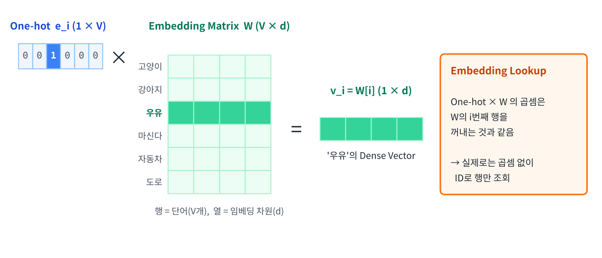
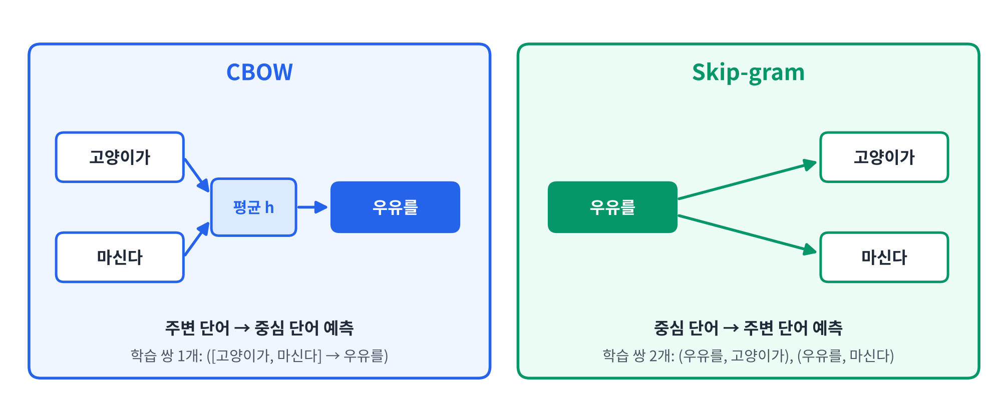
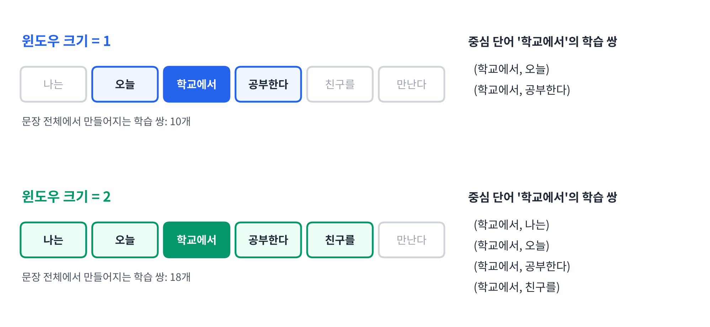
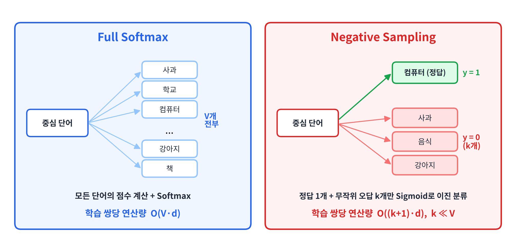
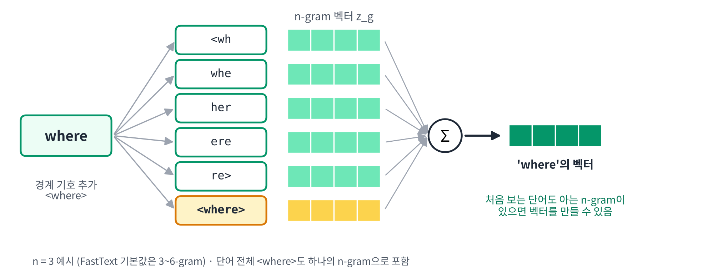
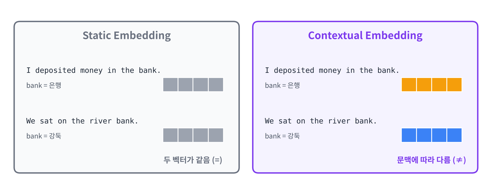

## 1. 강의의 학습 목표

- Word Embedding의 개념과 필요성
- Word2Vec의 구조와 학습 원리 이해
- 주요 Word Embedding 알고리즘 (Word2Vec, GloVe, FastText)
- Word Embedding의 의미적 특성과 한계
- Word Embedding 구현 및 활용

## 2. 단어(Words)의 특징

**눈으로 보면** 단어는

- **이산적 기호** (Discrete Symbol)
- **분류적 값** (Categorical Value)

**하지만 사람의 머릿속에서는**

- 어휘가 **계층적**으로 구성되어 있음
- 단어 사이에도 **유사성**이 존재
  - 예) 보라색은 파랑과 검정 중 어디에 가까운가?
  - 예) `남자 - 여자`, `현재 - 과거`처럼 단어 사이에 일정한 **관계**가 존재

> 컴퓨터가 단어를 다룰 때도 이런 **유사성과 관계**를 표현할 수 있어야 함

### One-hot Vector의 한계

**One-hot Vector**

- Vocabulary 크기 $$V$$에 대응하는 **$$V$$차원 벡터**
- 하나의 원소만 1이고 나머지는 모두 0
- 가장 단순하고 편리한 표현 방법

| 단어 | One-hot Vector |
|-----|---------------|
| Rome | $$[1, 0, 0, 0, \cdots, 0]$$ |
| Paris | $$[0, 1, 0, 0, \cdots, 0]$$ |
| Italy | $$[0, 0, 1, 0, \cdots, 0]$$ |
| France | $$[0, 0, 0, 1, \cdots, 0]$$ |

**단점**

- **High-dimensional & Sparse**: 차원이 크고 대부분이 0
- 서로 다른 단어의 벡터가 모두 **직교(Orthogonal)**
- 서로 다른 단어의 **Cosine Similarity는 항상 0**
- ⭐️ 단어 간 **의미적 관계(Semantic Relationship)를 직접 표현할 수 없음** ⭐️

**Q. One-hot에서 Rome–Paris와 Rome–France의 유사도는?**

**A.** 둘 다 **0**. One-hot만으로는 "Rome은 Paris와 같은 도시"라는 관계도, "Rome은 Italy의 수도"라는 관계도 표현할 수 없음

### 쉬운 설명

- 사람은 "고양이"와 "강아지"가 비슷하다는 것을 알지만, One-hot에서는 모든 단어가 **똑같이 다름**
- 그래서 딥러닝에 쓰기 좋은, **단어 사이의 관계를 담은 벡터**가 필요함 → **Word Embedding**

## 3. Word Embedding의 기본 개념

### Dense Vector로 표현하기

단어를 **연속적인 실수 값**으로 채운 벡터로 표현하면

- One-hot보다 **저차원의 Dense Vector**를 얻을 수 있음
- **단어 간 유사도와 특징**을 더 쉽게 학습할 수 있음

| 구분 | One-hot Vector | Embedding Vector |
|-----|---------------|-----------------|
| 차원 | $$V$$ (수만~수십만) | $$d$$ (보통 수십~수백) |
| 값 | 0 또는 1 | 연속적인 실수 |
| 밀도 | 희소(Sparse) | 밀집(Dense) |
| 단어 간 유사도 | 항상 0 | **의미에 따라 다름** |
| 생성 방식 | 규칙으로 정해짐 | **데이터로부터 학습** |

### Embedding Matrix와 Lookup 연산

**Embedding Matrix (임베딩 행렬)**

- Vocabulary의 각 단어에 대한 Dense Vector를 **행 단위로 저장한 행렬**
- Vocabulary 크기가 $$V$$, 임베딩 차원이 $$d$$일 때

$$
W \in \mathbb{R}^{V \times d}
$$

**Embedding Lookup (임베딩 조회)**

- 단어의 정수 ID로 Embedding Matrix에서 **해당 행을 선택**
- One-hot Vector와 Embedding Matrix의 **행렬 곱셈과 수학적으로 동일**

$$
\mathbf{v}_i = \mathbf{e}_i^{\top} W = W[i]
$$

- $$\mathbf{e}_i$$: 단어 $$i$$의 One-hot Vector
- $$W[i]$$: Embedding Matrix의 $$i$$번째 행



**Embedding Learning (임베딩 학습)**

- Embedding Matrix는 처음에 **임의의 값으로 초기화**
- 학습 과정에서 **Loss Function을 최소화하도록 가중치를 업데이트**
- → 학습된 벡터는 **학습 목표에 유용한 단어 간 관계**를 반영하게 됨

### 분포 가설 (Distributional Hypothesis)

- **단어의 의미는 그 단어가 사용되는 문맥(Context)과 밀접한 관계**가 있음
- 유사한 문맥에서 사용되는 단어들은 **유사한 의미적·기능적 특성**을 가질 가능성 ↑
- 단어의 문맥 분포를 이용하면 **의미적 관계를 학습**할 수 있음

예) `"___는 사료를 먹는다"`의 빈칸에는 **고양이, 강아지**가 자주 등장 → 두 단어는 비슷한 의미를 가질 가능성이 높음

### 동시출현빈도 (Co-occurrence Frequency)

- 특정 단어와 주변 단어가 **함께 등장하는 빈도**
- **Context Window**: 동시출현 여부를 판단하는 주변 단어의 범위
- **Window Size**: 주변 문맥의 범위를 결정하는 **Hyperparameter**
- 단어 × 단어 형태로 동시출현빈도를 모은 것이 **Co-occurrence Matrix**
  - 같은 문맥에 자주 등장하는 단어끼리는 비슷한 행 패턴을 가짐

### 아직 해결되지 않은 문제

- 사전 방식보다 **도메인에 특화된 의미**를 잘 표현할 수 있음
- 하지만 Feature로 선택하는 문서·단어의 범위도 결국 **Hyperparameter**
- ⭐️ 동시출현 행렬도 **여전히 Sparse Matrix** ⭐️

> **해결책**: 딥러닝을 지원할 수 있는 **Dense Feature Vector를 직접 학습**하자! → **Word2Vec**

### 쉬운 설명

1. 단어마다 숫자 몇 개(예: 100개)로 된 **좌표**를 하나씩 붙이는 것이 Word Embedding
2. 이 좌표들을 한 표에 모아 둔 것이 **Embedding Matrix**이고, 단어 ID로 해당 줄을 꺼내 쓰는 것이 **Lookup**
3. 좌표는 처음에 아무렇게나 시작해서, **비슷한 문맥에 나오는 단어끼리 가까워지도록** 학습됨

## 4. Word2Vec [Mikolov et al. 2013]

### 핵심 아이디어

- 단어의 의미적·문법적 특성은 **해당 단어가 사용되는 문맥에 반영**됨
- 유사한 문맥에서 사용되는 단어들은 **유사한 벡터 표현**을 학습할 가능성이 높음
- **주변 단어를 활용한 예측 학습**을 통해 단어의 Dense Vector를 얻음

### 두 가지 학습 구조

예시 문장: `"고양이가 우유를 마신다"` (중심 단어: 우유를, Window Size: 1)



| 구조 | 입력 | 예측 대상 |
|-----|-----|---------|
| **CBOW** | 주변 단어 (Context Words) | **중심 단어** (Target Word) |
| **Skip-gram** | 중심 단어 (Target Word) | **주변 단어** (Context Words) |

### 학습 전략

1. **Context Window를 이동**하며 중심 단어와 주변 단어의 학습 데이터를 생성
2. **예측 오차를 최소화**하도록 신경망의 가중치(Embedding Matrix)를 학습
3. 학습된 가중치에서 각 단어의 **고정 차원 Dense Embedding Vector**를 추출

## 5. CBOW (Continuous Bag of Words)

**CBOW란?**

- **주변 단어로 중심 단어를 예측**하는 Word2Vec 학습 방식
- Context Window 내 주변 단어의 **순서는 고려하지 않음** (그래서 Bag of Words)
- 주변 단어의 **평균 임베딩 벡터**로 중심 단어의 출현 확률을 계산

**① 주변 단어 임베딩의 평균**

$$
\mathbf{h} = \frac{1}{\lvert C_t \rvert} \sum_{c \in C_t} \mathbf{v}_{w_c}
$$

**② 중심 단어의 조건부 확률 (Softmax)**

$$
P(w_t \mid C_t) = \frac{\exp(\mathbf{u}_{w_t}^{\top} \mathbf{h})}{\sum_{j=1}^{V} \exp(\mathbf{u}_j^{\top} \mathbf{h})}
$$

**③ 손실 함수**

$$
\mathcal{L} = -\log P(w_t \mid C_t)
$$

- $$C_t$$: 중심 단어 $$w_t$$의 주변 단어 집합
- $$\mathbf{v}$$: 입력 임베딩 벡터 ($$W_{in}$$의 행), $$\mathbf{u}$$: 출력 임베딩 벡터 ($$W_{out}$$의 열)

### CBOW 학습 흐름

| 단계 | 내용 | 예시 (`고양이가 ___ 마신다`) |
|-----|------|---------------------------|
| 1. 입력층 | 주변 단어의 One-hot Vector ($$V$$차원) | `고양이가`, `마신다` |
| 2. 임베딩 층 | 공유 임베딩 행렬 $$W_{in} \in \mathbb{R}^{V \times d}$$에서 각 단어 벡터 Lookup | $$\mathbf{v}_{\text{고양이가}}, \mathbf{v}_{\text{마신다}} \in \mathbb{R}^d$$ |
| 3. 은닉층 | 주변 단어 벡터의 **평균** | $$\mathbf{h} = (\mathbf{v}_{\text{고양이가}} + \mathbf{v}_{\text{마신다}}) / 2$$ |
| 4. 출력층 | $$W_{out} \in \mathbb{R}^{d \times V}$$로 점수 계산 후 Softmax | 모든 단어의 확률 |
| 5. 예측 | 확률이 가장 높은 단어 | **우유를** |

- ⭐️ 두 주변 단어는 **동일한 임베딩 행렬 $$W_{in}$$을 공유** (Shared Weights) ⭐️

## 6. Skip-gram

**Skip-gram이란?**

- **중심 단어로 주변 단어를 예측**하도록 학습
- Context Window 내의 **각 주변 단어를 하나씩 예측 대상**으로 사용
- 예측 확률을 높이는 방향으로 Embedding Matrix를 갱신

**목적 함수** (최대화)

$$
\frac{1}{T} \sum_{t=1}^{T} \sum_{-c \le j \le c,\ j \ne 0} \log p(w_{t+j} \mid w_t)
$$

- $$T$$: 학습 말뭉치의 전체 토큰 수 (중심 단어 수)
- $$c$$: Window Size

### Skip-gram 학습 데이터 구성 예시

예시 문장: `나는 오늘 학교에서 공부한다 친구를 만난다`



| Window Size | 의미 | 중심 단어 '학교에서'의 학습 쌍 |
|------------|------|---------------------------|
| **1** | 중심 단어의 양쪽 1개 단어가 주변 단어 (최대 2개) | (학교에서, 오늘), (학교에서, 공부한다) |
| **2** | 중심 단어의 양쪽 2개 단어가 주변 단어 (최대 4개) | (학교에서, 나는), (학교에서, 오늘), (학교에서, 공부한다), (학교에서, 친구를) |

- 문장 끝의 단어는 한쪽 주변 단어가 없으므로 학습 쌍이 더 적음
- Window Size가 커지면 **학습 쌍이 많아지고, 더 넓은 문맥을 반영**하지만 계산량도 늘어남

학습 쌍을 만드는 과정을 코드로 표현하면 다음과 같음

```python
def skipgram_pairs(tokens, window):
    pairs = []
    for t, center in enumerate(tokens):
        for j in range(-window, window + 1):
            c = t + j
            if j == 0 or c < 0 or c >= len(tokens):
                continue
            pairs.append((center, tokens[c]))
    return pairs


tokens = ["나는", "오늘", "학교에서", "공부한다", "친구를", "만난다"]

for w in (1, 2):
    pairs = skipgram_pairs(tokens, w)
    print(f"window={w}, 학습 쌍 수={len(pairs)}")
    print([p for p in pairs if p[0] == "학교에서"])
```

실행 결과

```text
window=1, 학습 쌍 수=10
[('학교에서', '오늘'), ('학교에서', '공부한다')]
window=2, 학습 쌍 수=18
[('학교에서', '나는'), ('학교에서', '오늘'), ('학교에서', '공부한다'), ('학교에서', '친구를')]
```

### Skip-gram의 구조와 수식

| 단계 | 연산 | 크기 변화 |
|-----|------|--------|
| 입력 | 중심 단어의 One-hot Vector $$\mathbf{x}$$ | $$V$$ |
| 임베딩 추출 | $$\mathbf{h} = \mathbf{x}^{\top} W_{in}$$ (Input Embedding Matrix의 한 행) | $$V \rightarrow d$$ |
| 점수 계산 | $$\mathbf{z} = \mathbf{h} W_{out}$$ (Output Embedding Matrix) | $$d \rightarrow V$$ |
| 확률 계산 | Softmax로 주변 단어의 조건부 확률 분포 계산 | $$V$$ |

- 학습하는 행렬은 **입력 임베딩 행렬 $$W_{in}$$과 출력 임베딩 행렬 $$W_{out}$$** 두 개
- ⭐️ 학습이 끝나면 보통 **$$W_{in}$$의 각 행을 단어 임베딩 벡터로 사용** ⭐️

주변 단어 $$w_c$$의 등장 확률은 다음과 같은 **Softmax**로 계산

$$
p(w_c \mid w_t) = \frac{e^{s(w_t, w_c)}}{\sum_{j=1}^{V} e^{s(w_t, w_j)}}, \qquad s(w_t, w_c) = \mathbf{u}_{w_c}^{\top} \mathbf{v}_{w_t}
$$

- $$s(w_t, w_c)$$: **Score 함수** (두 벡터의 내적)
- $$\mathbf{v}_{w_t}$$: 중심 단어의 **입력** 임베딩 벡터 ($$W_{in}$$의 행)
- $$\mathbf{u}_{w_c}$$: 주변 단어의 **출력** 임베딩 벡터 ($$W_{out}$$의 열)

### 쉬운 설명

- **CBOW**는 "빈칸 채우기": 앞뒤 단어를 보고 가운데 단어를 맞힘
- **Skip-gram**은 그 반대: 가운데 단어 하나를 보고 주변에 어떤 단어가 올지 맞힘
- 문제를 맞히는 과정에서 **비슷한 문맥에 나오는 단어들의 벡터가 비슷해짐**
- 학습이 끝나면 문제를 맞히는 모델 자체보다 **그 과정에서 만들어진 임베딩 행렬**을 가져다 씀

## 7. Negative Sampling

### Full Softmax의 계산 문제

Softmax의 분모를 계산하려면 **Vocabulary의 모든 단어**에 대해 점수를 구해야 함

| 연산 | 계산 복잡도 |
|-----|----------|
| 단어 하나의 Score 계산 | $$O(d)$$ |
| Vocabulary 전체 Score 계산 | $$O(V \times d)$$ |
| Softmax 정규화 | $$O(V)$$ |

- 학습 쌍 **하나마다 전체 단어의 점수**를 계산해야 함
- 단어 수가 **수십만~수백만 개**라면 학습 비용이 크게 증가
- → 전체 단어 대신 **소수의 단어만 사용하는 효율적인 학습 방법**이 필요

### Negative Sampling의 개념

- **실제 주변 단어 + 무작위로 뽑은 소수의 단어**만 사용
- 전체 어휘에 대한 **다중 분류 문제**를 **여러 개의 이진 분류 문제**로 변환

| 구분 | 정의 | 레이블 |
|-----|------|------|
| **Positive Sample** | 실제 말뭉치에서 관찰된 (중심 단어, 주변 단어) 쌍 | $$y = 1$$ |
| **Negative Sample** | Noise Distribution에서 무작위로 추출한 단어와의 쌍 | $$y = 0$$ |

- 중심 단어마다 **Positive Pair 1개 + Negative Pair $$k$$개**로 학습
- Positive Pair의 점수는 **높이고**, Negative Pair의 점수는 **낮추도록** 학습
- **Softmax 대신 Sigmoid**로 각 단어 쌍의 이진 분류 손실을 계산



### Negative Sampling 목적 함수

중심 단어 $$w_t$$와 실제 주변 단어 $$w_c$$의 학습 쌍에 대해

$$
\mathcal{L} = -\log \sigma(\mathbf{u}_{w_c}^{\top} \mathbf{v}_{w_t}) - \sum_{i=1}^{k} \log \sigma(-\mathbf{u}_{n_i}^{\top} \mathbf{v}_{w_t})
$$

| 기호 | 의미 |
|-----|------|
| $$\mathbf{v}_{w_t}$$ | 중심 단어의 Input Embedding Vector |
| $$\mathbf{u}_{w_c}$$ | 실제 주변 단어의 Output Embedding Vector |
| $$n_i$$ | $$i$$번째 Negative Sample |
| $$k$$ | Negative Sample 개수 |
| $$\sigma(x)$$ | Sigmoid 함수 $$\frac{1}{1 + e^{-x}}$$ |

- **Positive Term**: 실제 주변 단어의 Sigmoid 출력이 **1에 가까워지도록** 학습
- **Negative Term**: 샘플링된 오답 단어들의 Sigmoid 출력이 **0에 가까워지도록** 학습

| 방식 | 학습 쌍당 연산량 |
|-----|-------------|
| Full Softmax | $$O(V \times d)$$ |
| **Negative Sampling** | $$O((k + 1) \times d)$$, 일반적으로 $$k \ll V$$ |

**Q. Negative Sampling은 왜 빠른가?**

**A.** 매번 $$V$$개(수십만 개) 단어를 모두 계산하는 대신, **정답 1개 + 오답 $$k$$개(보통 수 개~수십 개)**만 계산하기 때문

### 쉬운 설명

- Full Softmax는 정답을 맞힐 때마다 **사전에 있는 모든 단어**와 비교해야 해서 느림
- Negative Sampling은 문제를 **"이 두 단어가 실제로 같이 나온 쌍인가? (Yes/No)"**로 바꿈
- 진짜 쌍 1개와 가짜 쌍 몇 개만 보고 학습하므로 훨씬 빠름

## 8. GloVe [Stanford, Pennington et al. 2014]

**GloVe (Global Vectors for Word Representation)**

- 말뭉치 전체에서 집계한 **동시출현 통계**로 단어 벡터를 학습
- 두 단어 벡터의 내적이 **로그 동시출현빈도를 근사**하도록 학습 (**Regression** 문제)
- 장점: 학습이 빠르고, 출현빈도가 적은 단어도 비교적 잘 처리

| 구분 | Word2Vec | GloVe |
|-----|---------|-------|
| 학습 대상 | 중심 단어와 주변 단어의 **예측 관계** | 말뭉치에서 집계한 **동시출현 통계** |
| 학습 방식 | Window를 이동하며 **예측** 문제를 풂 | Window로 **동시출현빈도를 먼저 집계**한 뒤 회귀 |
| 반영 정보 | 지역적(Local) 문맥 | **전역적(Global) 통계** |

### GloVe의 목적 함수

원 논문의 목적 함수는 다음과 같음

$$
J = \sum_{i,j=1}^{V} f(X_{ij}) \left( \mathbf{w}_i^{\top} \tilde{\mathbf{w}}_j + b_i + \tilde{b}_j - \log X_{ij} \right)^2
$$

- $$X_{ij}$$: 단어 $$i$$의 문맥에 단어 $$j$$가 등장한 **동시출현빈도**
- $$\mathbf{w}_i^{\top} \tilde{\mathbf{w}}_j$$: 두 단어 벡터의 내적 → **예측값** $$\hat{y}$$
- $$\log X_{ij}$$: 로그 동시출현빈도 → **정답** $$y$$
  - 동시출현빈도는 단어에 따라 차이가 매우 크기 때문에 **log로 크기를 압축**
- $$b_i, \tilde{b}_j$$: 각 단어의 편향(bias)
- 예측값과 정답의 차이를 **제곱**하여 최소화 (Weighted Least Squares)

**가중치 함수 $$f(x)$$** (저빈도·고빈도 단어의 영향 조절)

$$
f(x) =
\begin{cases}
(x / x_{max})^{\alpha} & \text{if } x < x_{max} \\
1 & \text{otherwise}
\end{cases}
$$

- 동시출현빈도가 낮은 쌍은 **가중치를 낮춰** 노이즈의 영향을 줄임
- 너무 자주 등장하는 쌍도 가중치가 **1을 넘지 않도록** 제한
- 원 논문에서는 $$\alpha = 3/4$$, $$x_{max} = 100$$을 사용

> 강의 슬라이드는 같은 내용을 행렬 형태 $$\sum_x f(x)\,\lVert W' W x - \log C_x \rVert_2^2$$로 표현함 ($$C_x$$: 단어 $$x$$의 동시출현빈도 벡터)

### 쉬운 설명

- Word2Vec이 문장을 하나씩 읽으며 **"맞히기 게임"**으로 배운다면
- GloVe는 먼저 **"어떤 단어가 어떤 단어와 몇 번 같이 나왔는지" 표를 전부 만든 뒤**, 두 단어 벡터의 내적이 그 횟수(의 로그)와 같아지도록 학습함

## 9. FastText [Facebook, Bojanowski et al. 2016]

### Word2Vec의 한계

- **OOV(Out-of-Vocabulary)** 단어의 임베딩을 만들 수 없음
- **저빈도 단어**는 충분한 문맥을 학습하기 어려움
- 단어 내부의 **형태 정보(접두사·접미사 등)**를 활용하지 않음

### 개선 전략: Character n-gram

1. 단어를 **여러 개의 Character n-gram**으로 분해
2. 각 n-gram에 **학습 가능한 Subword Embedding Vector** 할당
3. n-gram 벡터들을 **합산**하여 단어의 표현을 구성
4. Skip-gram과 같은 방식으로 **주변 단어를 예측하며 학습**



예) `where`의 3-gram (단어 앞뒤에 경계 기호 `<`, `>`를 붙임)

$$
\mathcal{G}_{\text{where}} = \{\ \texttt{<wh},\ \texttt{whe},\ \texttt{her},\ \texttt{ere},\ \texttt{re>}\ \} \ \cup \ \{\ \texttt{<where>}\ \}
$$

FastText의 Score 함수는 **n-gram 벡터의 합**으로 계산

$$
s(w, c) = \sum_{g \in \mathcal{G}_w} \mathbf{z}_g^{\top} \mathbf{v}_c
$$

- $$\mathcal{G}_w$$: 단어 $$w$$의 Subword n-gram 집합
- $$\mathbf{z}_g$$: n-gram $$g$$의 벡터
- 이후 Softmax(또는 Negative Sampling) 과정은 **Skip-gram과 동일**

> **참고**: FastText는 기본적으로 **3~6-gram**을 사용하며, 단어 전체(`<where>`)도 하나의 n-gram으로 포함함

### Word2Vec vs FastText (Skip-gram 기준)

| 구성 요소 | Word2Vec Skip-gram | FastText Skip-gram |
|---------|-------------------|-------------------|
| 중심 단어 표현 | 단어별 **독립적인** 임베딩 | **Character n-gram 임베딩의 합** |
| Subword 정보 | 사용하지 않음 | **사용** |
| 예측 대상 | 주변 단어 | 주변 단어 |
| OOV 처리 | 일반적으로 불가능 | **학습된 n-gram으로 가능** |

**Q. FastText는 학습 때 못 본 단어 `wherever`의 벡터를 어떻게 만드는가?**

**A.** `<wh`, `whe`, `her`, `ere`처럼 **이미 학습된 n-gram들의 벡터를 합산**해서 만듦

### 쉬운 설명

- Word2Vec은 단어를 **통째로** 외우기 때문에 처음 보는 단어는 표현할 수 없음
- FastText는 단어를 **작은 글자 조각**으로 나눠서 외움
- 그래서 처음 보는 단어라도 **아는 조각들을 조합**해서 벡터를 만들 수 있음

## 10. Word2Vec, GloVe, FastText 비교

| 구분 | Word2Vec | GloVe | FastText |
|-----|---------|-------|---------|
| **핵심 아이디어** | 주변 단어 예측으로 임베딩 학습 | 전역 동시출현 통계를 이용해 임베딩 학습 | Character n-gram 기반 Subword 정보로 임베딩 학습 |
| **학습 신호** | CBOW / Skip-gram | 로그 동시출현빈도 근사 | Skip-gram + Subword |
| **입력 단위** | 단어 | 단어 | 단어 + Subword |
| **OOV 처리** | 어려움 | 어려움 | **가능** (n-gram 조합) |
| **장점** | 구조가 단순하고 직관적 | 전역 통계를 반영 | 형태 정보 활용, OOV 대응 |
| **한계** | 형태 정보 반영 어려움 | OOV 처리 어려움 | 모델 크기와 계산량 증가 가능 |
| **대표 특징** | 예측 기반 임베딩 | 통계 기반 임베딩 | Subword 기반 임베딩 |

## 11. Word Embedding 구현 및 실습

### FastText 실습 환경 (Docker)

```bash
# 1. WSL2 Ubuntu에서 실습 디렉터리 준비
mkdir -p ~/workspace/hongik-nlp
cd ~/workspace/hongik-nlp
docker pull kafa46/hongik-nlp:cpu    # 최초 1회 (이미 받았다면 생략)

# 2. 컨테이너 생성·실행 (최초 1회) 및 접속
docker run -it -d --name hongik-nlp -v "$PWD:/workspace" -w /workspace kafa46/hongik-nlp:cpu
docker exec -it hongik-nlp bash
# 기존 컨테이너가 중지된 경우: docker start hongik-nlp

# 3. FastText 설치 (컨테이너 내부)
apt-get update
apt-get install -y git build-essential    # git, make가 있다면 생략
git clone https://github.com/facebookresearch/fastText.git
cd fastText
make

# 4. 설치 확인
./fasttext
```

- `-w /workspace`: 컨테이너에 접속했을 때 시작 디렉터리를 `/workspace`로 지정

### FastText로 임베딩 벡터 생성

```bash
# 학습 데이터셋 생성 (06_movies_clean.csv 생성 확인)
python3 remove_commas.py

# 쉼표(,)로 구분된 csv에서 7번째 열(줄거리)만 추출
cut -f 7 -d ',' datasets/06_movies_clean.csv > datasets/movies.plot

# Skip-gram으로 학습, 모델 파일명은 model (-dim 옵션으로 차원 지정 가능)
fasttext skipgram -input datasets/movies.plot -output model

# 결과 확인
head -n 3 model.vec
```

`model.vec` 파일 구조

- **첫 줄**: `단어 개수  임베딩 차원` (강의 예시: `9503 100`)
- **둘째 줄부터**: `단어  벡터값 100개` (예: `</s> 0.055074 0.31155 -0.4248 ...`)

### PyTorch `nn.Embedding`

**Embedding Layer**

- 단어의 **정수 인덱스를 Dense Vector로 변환**
- **학습 가능한** Embedding Matrix $$W \in \mathbb{R}^{V \times d}$$ 사용
- One-hot Vector를 만들지 않고 **바로 Lookup 수행**: $$\text{Embedding}(i) = W[i]$$

| 구분 | Word2Vec | PyTorch `nn.Embedding` |
|-----|---------|----------------------|
| 정체 | 단어 임베딩 **학습 알고리즘** | 학습 가능한 **임베딩 계층** |
| 학습 목표 | CBOW, Skip-gram 등 자체 목표 사용 | **자체 학습 목표는 없음** |
| 학습 방법 | 문맥 예측을 통해 학습 | **연결된 모델의 Loss**를 통해 학습 |
| 역할 | 학습된 단어 벡터 생성 | 단어 ID를 임베딩 벡터로 변환 |

```python
import torch
import torch.nn as nn
import torch.nn.functional as F

torch.manual_seed(0)  # 결과 재현을 위해 시드 고정

embedding = nn.Embedding(num_embeddings=5, embedding_dim=3)

word_ids = torch.tensor([0, 2, 4])
vectors = embedding(word_ids)

print(vectors)
print(vectors.shape)

# One-hot x W 와 Lookup 결과가 같은지 확인
one_hot = F.one_hot(word_ids, num_classes=5).float()
print(torch.allclose(one_hot @ embedding.weight, vectors))
```

실행 결과

```text
tensor([[ 1.5410, -0.2934, -2.1788],
        [ 0.4033,  0.8380, -0.7193],
        [-0.8567,  1.1006, -1.0712]], grad_fn=<EmbeddingBackward0>)
torch.Size([3, 3])
True
```

- 단어 3개를 넣었으므로 결과 크기는 **(3, 3)** = (단어 수, 임베딩 차원)
- 벡터 값은 **무작위로 초기화**되므로 시드를 고정하지 않으면 실행할 때마다 달라짐
- `grad_fn`이 붙어 있다는 것은 이 값들이 **학습으로 업데이트되는 파라미터**라는 뜻
- 마지막 줄 `True` → **One-hot × W 곱셈과 Lookup이 같은 결과**임을 확인

## 12. 현대 NLP에서도 임베딩 이론이 중요한 이유

### 기본 원리는 동일

- 텍스트를 신경망이 처리할 수 있는 **Dense Vector로 변환**
- Embedding Matrix로 **Token ID를 연속적인 벡터 공간에 매핑**
- 학습 데이터와 목적 함수에 따라 **임베딩 벡터의 특성이 결정**됨

### 기존 Word Embedding과 현대 NLP의 차이

- **Word2Vec, GloVe, FastText**: 단어별로 **고정된** 임베딩 벡터 학습 (Static Embedding)
- **Transformer, BERT, GPT**: Token Embedding을 입력 받아 **문맥에 따라 달라지는 표현** 생성
- `nn.Embedding` 자체는 의미나 문맥을 이해하지 않으며, **학습 과정에서 Embedding Matrix가 업데이트**됨

`Word Embedding → Token Embedding → Contextual Representation`

- Transformer의 **Self-Attention**은 주변 토큰과의 관계를 반영하여 표현을 갱신
- Word2Vec의 **분포 가설과 임베딩 학습 원리**는 현대 NLP를 이해하는 중요한 기초

### Static vs Contextual Embedding



| 구분 | Static Embedding | Contextual Embedding |
|-----|-----------------|---------------------|
| 대표 모델 | Word2Vec, GloVe, FastText | ELMo, BERT, GPT |
| 같은 단어의 벡터 | 문맥과 관계없이 **항상 같음** | 주변 문맥에 따라 **달라짐** |
| 다의어 처리 | 문맥별 의미 구별이 어려움 | 문맥에 맞는 의미 표현 생성 |
| 핵심 | Word → **Fixed Vector** | Word + Context → **Context-dependent Vector** |

예시

- `I deposited money in the bank.` → bank = **은행**
- `We sat on the river bank.` → bank = **강둑**
- Static: $$\mathbf{v}_{\text{bank}} = \mathbf{v}_{\text{bank}}$$ (두 문장에서 같은 벡터)
- Contextual: $$\mathbf{h}^{(1)}_{\text{bank}} \ne \mathbf{h}^{(2)}_{\text{bank}}$$ (문맥에 따라 다른 벡터)

### 쉬운 설명

- Word2Vec 같은 정적 임베딩은 단어마다 **벡터가 하나로 고정**되어 있어서 `bank`의 두 가지 뜻을 구별하지 못함
- BERT, GPT 같은 모델은 **문장 전체를 보고** 그 자리의 `bank`에 맞는 벡터를 새로 만듦
- 하지만 이런 모델도 맨 처음에는 **Embedding Matrix로 토큰을 벡터로 바꾸는 단계**에서 시작함

## 13. 최종 핵심 정리

1. One-hot은 **고차원·희소**하고 모든 단어가 직교하여 **의미 관계를 표현할 수 없음**
2. Word Embedding은 단어를 **저차원 Dense Vector**로 표현하고, 그 값은 **데이터로부터 학습**됨
3. Embedding Lookup은 **One-hot × Embedding Matrix**와 같으며, 실제로는 **ID로 행을 조회**함
4. **분포 가설**: 비슷한 문맥에 나오는 단어는 비슷한 의미를 가짐
5. **Word2Vec**: CBOW(주변 → 중심), Skip-gram(중심 → 주변) 예측으로 임베딩 학습
6. **Negative Sampling**은 Full Softmax를 이진 분류로 바꿔 연산량을 $$O(Vd)$$에서 $$O((k+1)d)$$로 줄임
7. **GloVe**는 로그 동시출현빈도를 근사하는 가중 최소제곱, **FastText**는 Character n-gram으로 **OOV에 대응**
8. Static Embedding의 한계는 **Contextual Embedding**(BERT, GPT)으로 이어지며, 다음 단계는 **RNN을 이용한 순차적 문맥 학습**

---

End.
