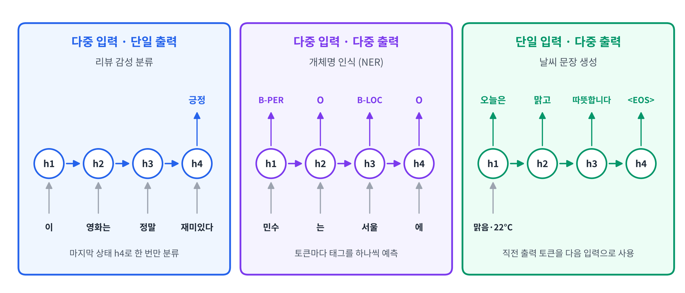
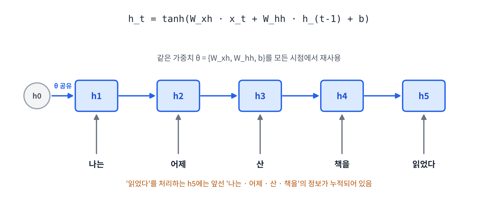
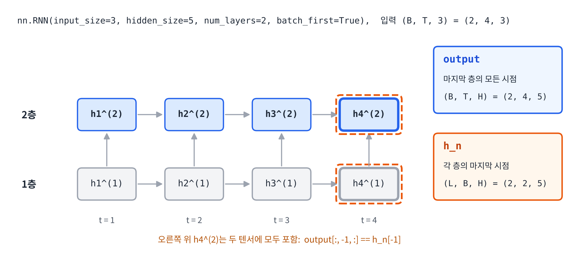
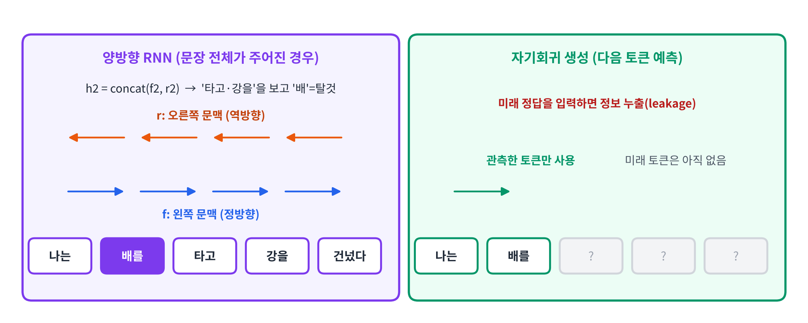
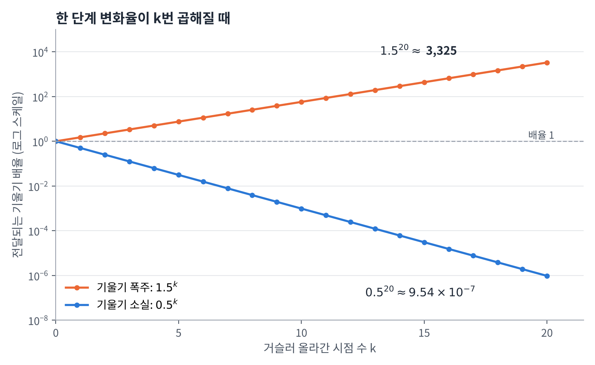
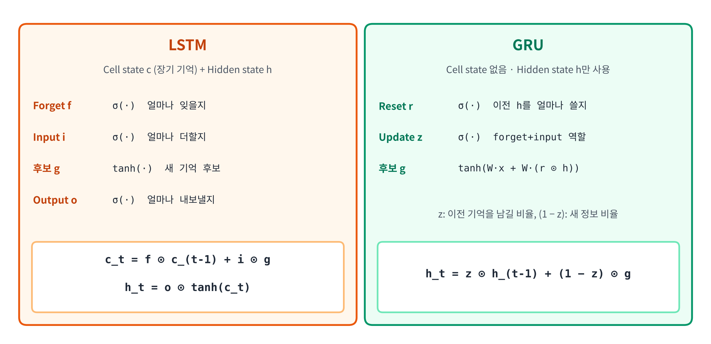

## 1. 강의의 학습 목표

- Sequential Data의 특징과 RNN이 필요한 이유
- 기본 순환 신경망(Vanilla RNN)의 구조와 순전파 계산
- RNN의 입출력 텐서 구조와 PyTorch `nn.RNN`
- 다층·양방향 RNN
- BPTT(시간 펼침 역전파)와 기울기 소실·폭주
- LSTM과 GRU

## 2. Sequential Data

### 시간과 관련된 데이터의 종류

| 구분 | 의미 |
|-----|------|
| **Sequential Data** | **순서가 의미 있는 데이터**, 순서가 바뀌면 의미를 잃음, 시간 개념은 없음 |
| **Temporal Sequence** | Sequential Data + **시간 개념** |
| **Time Series** | Temporal Sequence를 **일정한 간격으로 샘플링**한 데이터 |

### Sequential Data vs. Time Series

| 구분 | Sequential Data (시퀀셜 데이터) | Time Series (시계열 데이터) |
|-----|-----------------------------|-------------------------|
| Time-stamp | X | O |
| 중요 포인트 | **데이터의 순서** (텍스트라면 단어의 순서) | **데이터의 발생 시점** (주식이라면 가격 변동 시점) |
| 대표적인 예 | 언어(텍스트), DNA 염기 서열 | 주식 데이터, 센서 데이터 |

> **RNN (Recurrent Neural Network, 순환신경망)**: 딥러닝에 **시간 개념(메모리)**이 추가된 구조

### 일반 신경망(DNN)으로 시퀀스를 처리할 때의 문제

음성 신호를 DNN에 넣는다고 생각해 보면

- 음성은 초당 **약 44,000개** 샘플로 구성됨 → **입력층이 너무 길어짐**
- 음성의 길이는 매번 다름 → **입력층의 크기가 계속 변함**
- "치킨 먹을래?", "치킨 먹을까?", "치킨 안 먹어?"처럼 **순서와 일부 단어만 달라도 의미가 달라짐**

→ **길이가 변하는 입력을 순서대로 처리하면서, 앞의 내용을 기억하는 구조**가 필요함

### RNN의 입출력 형태



| 형태 | 예시 | 수식 | 특징 |
|-----|-----|------|------|
| **다중 입력 · 단일 출력** | 리뷰 감성 분류 | $$\hat{y} = \text{softmax}(W_y h_T + b_y)$$ | 입력 길이는 달라도 **문장마다 레이블은 하나** |
| **다중 입력 · 다중 출력** | 개체명 인식 (NER) | $$\hat{y}_t = \text{softmax}(W_y h_t + b_y)$$ | 토큰마다 태그를 하나씩 예측 |
| **단일 입력 · 다중 출력** | 날씨 문장 생성 | $$h_0 = f(c),\ h_t = \text{RNN}(\text{Emb}(y_{t-1}), h_{t-1})$$ | 하나의 **조건 벡터**로 문장을 순차 생성 |

- NER 태그: `B-PER`(사람 이름 시작), `B-LOC`(지명 시작), `O`(개체명 아님)
- NER은 입력과 출력의 길이가 같지만, **번역**처럼 다중 입출력이어도 **길이가 달라지는** 경우가 있음
- 단일 입력은 "단어 하나"가 아니라 **한 번 주어지는 조건 벡터** (예: `맑음 · 22°C`)
- 문장 생성은 `<BOS>`로 시작해서 `<EOS>`가 나오면 종료

> **세 가지 형태 중 하나라도 해당되면 RNN을 적용할 수 있음**

### 쉬운 설명

- 문장은 단어의 **순서**가 중요한 데이터라서, 단어를 한꺼번에 넣는 일반 신경망으로는 다루기 어려움
- RNN은 단어를 **하나씩 차례로 읽으면서**, 지금까지 읽은 내용을 기억에 담아 다음 단어로 넘김
- 그래서 문장 길이가 매번 달라도 처리할 수 있고, 문장 하나를 분류하거나 단어마다 태그를 붙이거나 문장을 생성하는 데 모두 쓸 수 있음

## 3. RNN의 기억: Hidden State

### 사람의 기억과 컴퓨터의 기억

| 구분 | 단기 기억 | 장기 기억 |
|-----|--------|--------|
| 의미 | 짧은 시간, 제한된 양의 정보 유지 | 경험·지식·기술을 비교적 오래 보존 |
| 예 | 인증번호를 입력할 때까지 기억하기 | 어린 시절의 경험, 자전거 타는 법 |

RNN은 현재 단어를 처리할 때 **이전까지의 정보를 담은 은닉 상태(Hidden State)**를 함께 사용함

$$
h_t = \tanh(W_{xh} x_t + W_{hh} h_{t-1} + b)
$$



- ⭐️ RNN의 기억은 원문을 저장한 목록이 아니라, **입력에 따라 계속 갱신되는 은닉 벡터** ⭐️
- 같은 단어라도 **앞선 문맥에 따라 상태가 달라짐**
- 사람의 기억처럼 **과거 정보가 일부 소실**될 수 있음

### 기억이 없는 시스템 vs. RNN

| 구분 | 기존 신경망 (DNN, CNN 등) | RNN (순환신경망) |
|-----|---------------------|---------------|
| 입력 데이터 | Tabular Data, Image | Sequential Data, Time-series |
| 수식 | $$y = f(x; \theta)$$ | $$h_t = f(x_t, h_{t-1}; \theta)$$ |
| 기억 | 없음 (입력마다 독립적으로 계산) | **이전 상태 $$h_{t-1}$$을 함께 사용** |

얕은 신경망의 수식은 다음과 같음 (이전 입력에 대한 정보가 없음)

$$
h_n = a(w_{xh} x_n + b_h), \qquad y_n = a(w_{hy} h_n + b_y)
$$

### 기본 순환 신경망 (Vanilla RNN)

얕은 신경망에 **순환(Recurrent) 구조**를 추가한 형태

$$
h_n = \tanh(w_{xh} x_n + w_{hh} h_{n-1} + b_h) = \tanh(W [x_n;\, h_{n-1}]) \quad (\text{bias 생략})
$$

$$
y_n = \tanh(w_{hy} h_n + b_y)
$$

- 이전을 기억하는 구조이므로 **모든 이전 입력의 영향**을 받음
- 모든 시점에서 **같은 파라미터 $$\theta$$를 공유**함
- 문제점: 출력이 다시 입력으로 들어가므로 **기존 역전파 학습법을 그대로 적용하기 어려움** → **BPTT** 필요

## 4. RNN의 정보 처리 과정

### ① 정보 결합 (Concatenation)

현재 입력과 이전 은닉 상태를 **이어붙여** 하나의 입력 벡터를 만듦

$$
z_t = \text{concat}(x_t, h_{t-1}) = [x_t;\, h_{t-1}] \in \mathbb{R}^{d + H}
$$

- 예: 현재 입력 2차원 + 과거 문맥 3차원 = **5차원**
- 원소의 값과 순서를 그대로 유지하며 차원만 합침
- ⭐️ Concat 자체에는 **학습 파라미터가 없음** ⭐️

### ② 정보 융합 (Weighted Sum → 활성함수)

가중합으로 두 정보의 성분을 섞고, 활성함수로 **새로운 은닉 표현**을 만듦

$$
h_t = \tanh(W z_t + b) = \tanh(W_{xh} x_t + W_{hh} h_{t-1} + b)
$$

예: $$x_t = 1,\ h_{t-1} = 0.4,\ b = 0,\ W = [0.5,\ 0.8]$$

$$
W z_t = 0.5 \times 1 + 0.8 \times 0.4 = 0.82, \qquad \tanh(0.82) \approx 0.675
$$

- 이어붙이기만으로는 융합 방식을 학습할 수 없음
- $$W$$의 두 부분($$W_{xh}$$, $$W_{hh}$$)이 함께 학습되며, 두 정보가 새 표현에 기여함

### ③ 융합 정보의 학습

손실을 줄이도록 가중치를 조정하여 **학습 목표에 유용한 융합 방식**을 학습

$$
\theta = \{W_{xh},\ W_{hh},\ b\}, \qquad \theta \leftarrow \theta - \eta \frac{\partial L}{\partial \theta}
$$

- 학습 대상은 **융합 가중치**이고, $$h_t$$는 그 가중치로 계산되는 표현
- Concat의 기울기는 두 입력으로 전달되어 **앞단의 학습에도 기여**함

### RNN 순전파 계산 예제

$$h_t = \tanh(0.5 x_t + 0.8 h_{t-1}),\ h_0 = 0,\ b = 0$$, 입력 $$x = (1, 0, 1)$$

| 시점 | 계산 | 결과 |
|-----|------|------|
| $$t = 1$$ | $$\tanh(0.5 \times 1 + 0.8 \times 0)$$ = $$\tanh(0.500)$$ | $$h_1 \approx 0.462$$ |
| $$t = 2$$ | $$\tanh(0.5 \times 0 + 0.8 \times 0.462)$$ = $$\tanh(0.370)$$ | $$h_2 \approx 0.354$$ |
| $$t = 3$$ | $$\tanh(0.5 \times 1 + 0.8 \times 0.354)$$ = $$\tanh(0.783)$$ | $$h_3 \approx 0.654$$ |

```python
import math

w_x, w_h = 0.5, 0.8          # 입력 가중치, 이전 상태 가중치 (b = 0)
xs = [1, 0, 1]               # x1, x2, x3

h = 0.0                      # h0 = 0
for t, x in enumerate(xs, start=1):
    h = math.tanh(w_x * x + w_h * h)
    print(f"h{t} = {h:.3f}")

# 이전 상태를 매번 0으로 초기화하면?
print([round(math.tanh(w_x * x), 3) for x in xs])
```

실행 결과

```text
h1 = 0.462
h2 = 0.354
h3 = 0.654
[0.462, 0.0, 0.462]
```

- ⭐️ 같은 입력 $$x_1 = x_3 = 1$$이어도 **이전 상태가 다르면 $$h_1 \neq h_3$$** ⭐️
- 이전 상태를 매번 0으로 만들면 $$(h_1, h_2, h_3) \approx (0.462,\ 0,\ 0.462)$$ → **과거 입력의 영향과 문맥이 사라짐**

**Q. 같은 단어가 두 번 나왔는데 왜 은닉 상태가 다른가?**

**A.** 은닉 상태는 현재 입력뿐 아니라 **지금까지 읽은 문맥($$h_{t-1}$$)**도 반영하기 때문

### 쉬운 설명

1. 현재 단어와 지금까지의 기억을 **나란히 붙임** (Concat)
2. 가중치를 곱해 둘을 **섞고**, tanh를 통과시켜 **새 기억**을 만듦
3. 이 새 기억이 다음 단어를 처리할 때 다시 쓰임
4. 어떻게 섞을지는 **학습으로 정해짐**

## 5. 활성함수: 왜 tanh와 sigmoid인가?

| 구분 | Sigmoid | tanh |
|-----|--------|------|
| 수식 | $$\sigma(a) = \dfrac{1}{1 + e^{-a}}$$ | $$\tanh(a) = \dfrac{e^{a} - e^{-a}}{e^{a} + e^{-a}}$$ |
| 출력 범위 | $$(0, 1)$$, $$\sigma(0) = 0.5$$ | $$(-1, 1)$$, $$\tanh(0) = 0$$ |
| 미분의 최댓값 | $$\sigma'(a) = \sigma(a)(1 - \sigma(a)) \le \dfrac{1}{4}$$ | $$\tanh'(a) = 1 - \tanh^2(a) \le 1$$ |
| RNN에서의 역할 | **게이트**: 정보의 통과 비율(0~1) | **은닉·후보 상태**의 값 표현 |

- **tanh**: 0 중심이라 기울기 전달에 유리하고, **음수로 이전 정보의 영향을 줄이는 방향**으로도 업데이트 가능
- **sigmoid**: 0~1 범위이므로 "얼마나 통과시킬지"를 나타내는 **게이트**에 사용 (LSTM, GRU)

### ReLU 계열은 안 되는가?

$$
h_t = \varphi(W_{hh} h_{t-1} + W_{xh} x_t + b)
$$

| 문제 | 설명 |
|-----|------|
| **상태·기울기 폭주** | ReLU는 양수 출력을 제한하지 않음. 기울기는 각 시점의 상태 변화율을 **연속으로 곱하며** 과거로 전달되므로, 곱이 커지면 폭주할 수 있음 |
| **음수 영역의 기울기 차단** | 음수 입력에서 국소 미분이 0 (다른 입력·상태에서 다시 활성화될 수는 있음) |

- ReLU도 사용은 가능: **IRNN**(단위행렬 초기화) + **Gradient Clipping**
- **Leaky ReLU**는 음수 영역 기울기를 보완, **Clipped ReLU**는 상태의 상한을 제한

## 6. RNN의 입출력 텐서 구조

### 입력 텐서

| 단위 | 크기 |
|-----|------|
| 단어 하나 (Word Embedding Vector) | $$x_i = (1,\ \text{emb\_size})$$ |
| 문장 하나 ($$n$$개 단어) | $$x_{\text{sentence}} = (n,\ \text{emb\_size})$$ |
| 미니배치 | $$X = (\text{batch\_size},\ n,\ \text{emb\_size})$$ |
| 하나의 Time Step | $$x_t = (\text{batch\_size},\ 1,\ \text{emb\_size})$$ |

### Hidden State (출력) 텐서

| 단위 | 크기 |
|-----|------|
| 한 시점의 은닉 상태 | $$h_t = (\text{batch\_size},\ \text{hidden\_size})$$ |
| 모든 시점의 은닉 상태 | $$h_{1:n} = (\text{batch\_size},\ n,\ \text{hidden\_size})$$ |

> 텐서의 차원 순서는 프레임워크와 옵션(예: `batch_first`)에 따라 다르므로, **항상 공식 문서를 확인하는 습관**을 갖자
>
> PyTorch `nn.RNN` 공식 문서: [https://pytorch.org/docs/stable/generated/torch.nn.RNN.html](https://pytorch.org/docs/stable/generated/torch.nn.RNN.html)

### PyTorch의 `output`과 `h_n`

설정: Batch = 2, Time step = 4, Embedding = 3, Hidden = 5, Layers = 2, 단방향



| 반환값 | 담는 내용 | 크기 |
|------|---------|------|
| `output` | **마지막 층의 모든 시점** 은닉 상태 | $$(B, T, D \cdot H) = (2, 4, 5)$$ |
| `h_n` | **각 층의 마지막 시점** 은닉 상태 | $$(L \cdot D, B, H) = (2, 2, 5)$$ |

- $$D$$: 방향 수 (단방향 1, 양방향 2), $$L$$: 층 수
- ⭐️ 마지막 층의 마지막 시점 상태는 **두 텐서에 모두 포함**: `output[:, -1, :]`과 `h_n[-1]`이 같음 ⭐️
- `h_n`은 `batch_first=True`여도 **배치 차원이 두 번째**에 위치함

```python
import torch
import torch.nn as nn

torch.manual_seed(0)

rnn = nn.RNN(input_size=3, hidden_size=5, num_layers=2, batch_first=True)

x = torch.randn(2, 4, 3)     # (Batch, Time, Embedding)
output, h_n = rnn(x)

print(output.shape)          # 마지막 층의 모든 시점
print(h_n.shape)             # 각 층의 마지막 시점
print(torch.allclose(output[:, -1, :], h_n[-1]))
```

실행 결과

```text
torch.Size([2, 4, 5])
torch.Size([2, 2, 5])
True
```

## 7. 다층 RNN과 양방향 RNN

### 다층 순환 신경망 (Multi-layered RNN)

각 층은 **아래층의 현재 상태**와 **같은 층의 이전 상태**를 함께 사용

$$
h_t^{(\ell)} = \varphi\left(W_{in}^{(\ell)} h_t^{(\ell - 1)} + W_{rec}^{(\ell)} h_{t-1}^{(\ell)} + b^{(\ell)}\right), \qquad h_t^{(0)} = x_t
$$

- $$\ell$$: 층 번호
- **시간 방향**: 이전 시점의 상태 전달 / **층 방향**: 아래층의 현재 표현 전달
- **층마다 별도 파라미터**를 쓰고, **같은 층은 시간축으로 파라미터를 공유**
- 층을 쌓으면 표현력이 높아지지만, 계산 비용·학습 난도도 커지므로 **검증 성능으로 층 수를 결정**

### 양방향 RNN (Bidirectional RNN)

정방향 RNN($$f$$)과 역방향 RNN($$r$$)의 상태를 이어붙여 사용

$$
h_t = \text{concat}(f_t,\ r_t)
$$



예시: `나는 배를 타고 강을 건넜다`

- $$f_2$$: 왼쪽 문맥(`나는`)의 상태, $$r_2$$: 오른쪽 문맥(`타고 · 강을 · 건넜다`)의 상태
- 오른쪽 문맥까지 보면 '배'가 **탈것**이라는 것을 알 수 있음

| 상황 | 양방향 사용 | 이유 |
|-----|----------|------|
| **문장 분류, 태깅** (문장 전체가 주어짐) | **가능** | 오른쪽 문맥도 이미 입력에 있음 |
| **자기회귀 생성** (다음 토큰 예측) | **불가능** | 미래 토큰은 아직 없음. 미래 정답을 입력하면 **정보 누출(leakage)** |

> 양방향 RNN은 **입력이 통째로 들어가고 출력이 통째로 나오는 구조**에 가장 많이 활용됨

### Bidirectional Encoder vs. Autoregressive Encoder

| 구분 | Bidirectional Encoder | Autoregressive Encoder |
|-----|---------------------|----------------------|
| 계산 방식 | 전체 입력을 받아 상태들을 **한 번에** 계산 | 생성·스트리밍에서는 **새 토큰마다** 계산 |
| 참조 범위 | $$h_t = f(x_1, x_2, x_3)$$: **모든 입력 위치** | $$h_t = f(x_1, \cdots, x_t)$$: **현재·이전 위치만** |

### 쉬운 설명

- **다층 RNN**은 RNN을 여러 층 쌓아서, 아래층이 만든 표현을 위층이 한 번 더 가공하는 구조
- **양방향 RNN**은 문장을 앞에서 뒤로, 뒤에서 앞으로 **두 번 읽고** 두 결과를 합치는 구조
- 문장 전체를 알고 있을 때는 양방향이 유리하지만, **다음 단어를 만들어 내야 할 때는 미래를 볼 수 없으므로** 한 방향만 사용해야 함

## 8. BPTT (Back Propagation Through Time)

### BPTT란?

- RNN은 하나의 은닉층이 시간에 따라 **반복**되므로, 오류를 이전 층이 아니라 **과거 시점으로** 전달해야 함
- 그래서 RNN을 **시간 순서대로 펼친 뒤(Unrolling)** 역전파를 수행 → **BPTT**
- 모든 시점이 같은 파라미터를 공유하므로, **모든 경로의 미분값을 더해야** 함

손실 함수 (Many to Many)

$$
\mathcal{L}(\theta) = \sum_{t=1}^{T} \lVert \hat{y}_t - y_t \rVert
$$

### Many to One ($$T = 4$$)

$$
h_t = f(x_t, h_{t-1}; \psi), \qquad \hat{y} = g(h_T; \phi), \qquad \theta = \{\phi, \psi\}, \qquad \mathcal{L}(\theta) = \lVert \hat{y} - y \rVert
$$

출력층 파라미터 $$\phi$$는 마지막에만 쓰이므로 간단함

$$
\frac{\partial \mathcal{L}}{\partial \phi} = \frac{\partial \mathcal{L}}{\partial \hat{y}} \frac{\partial \hat{y}}{\partial \phi}
$$

RNN 파라미터 $$\psi$$는 **모든 시점**에서 쓰이므로, 각 시점에서 $$\psi$$로 가는 경로를 모두 더함

$$
\frac{\partial \mathcal{L}}{\partial \psi}
= \frac{\partial \mathcal{L}}{\partial \hat{y}} \frac{\partial \hat{y}}{\partial h_4} \frac{\partial h_4}{\partial \psi}
+ \frac{\partial \mathcal{L}}{\partial \hat{y}} \frac{\partial \hat{y}}{\partial h_4} \frac{\partial h_4}{\partial h_3} \frac{\partial h_3}{\partial \psi}
+ \cdots
= \sum_{t=1}^{T} \frac{\partial \mathcal{L}}{\partial \hat{y}} \frac{\partial \hat{y}}{\partial h_T} \left( \prod_{i=t}^{T-1} \frac{\partial h_{i+1}}{\partial h_i} \right) \frac{\partial h_t}{\partial \psi}
$$

### Many to Many ($$T = 4$$)

**Many to One이 4개 있는 경우**로 나누어 생각하면 됨

$$
\frac{\partial \mathcal{L}}{\partial \phi} = \sum_{t=1}^{T} \frac{\partial \mathcal{L}}{\partial \hat{y}_t} \frac{\partial \hat{y}_t}{\partial \phi}
$$

$$
\frac{\partial \mathcal{L}}{\partial \psi} = \sum_{t=1}^{T} \sum_{k=1}^{t} \frac{\partial \mathcal{L}}{\partial \hat{y}_t} \frac{\partial \hat{y}_t}{\partial h_t} \left( \prod_{i=k}^{t-1} \frac{\partial h_{i+1}}{\partial h_i} \right) \frac{\partial h_k}{\partial \psi}
$$

- ⭐️ 핵심은 $$\prod \dfrac{\partial h_{i+1}}{\partial h_i}$$: **시점 간 변화율이 반복해서 곱해짐** ⭐️
- 이 곱이 기울기 소실과 폭주의 원인이 됨

### 기울기 소실과 폭주

$$
\frac{\partial h_t}{\partial h_{t-k}} = J_t\, J_{t-1} \cdots J_{t-k+1}, \qquad J_t: \text{한 단계의 상태 변화율}
$$



각 단계의 변화율이 일정한 스칼라라고 가정하면

| 현상 | 예시 ($$k = 20$$) | 결과 |
|-----|--------------|------|
| **기울기 폭주** (Exploding) | $$1.5^{20} \approx 3.33 \times 10^{3}$$ | 전달되는 기울기가 과도하게 커져 **학습이 불안정** |
| **기울기 소실** (Vanishing) | $$0.5^{20} \approx 9.54 \times 10^{-7}$$ | 먼 과거로 전달되는 **학습 신호가 거의 사라짐** |

- sigmoid는 입력의 절댓값이 크면 출력이 0 또는 1에 가까워지면서 **기울기가 0에 가까워짐**
- 미분 최댓값도 $$1/4$$이므로, 여러 번 곱해지면 **입력층(먼 과거) 쪽으로 갈수록 역전파가 제대로 되지 않음**

### Truncated BPTT

- 시퀀스의 처음부터 끝까지 모든 오류를 역전파하면 **계산량이 너무 많음**
- 현재 시점에서 **일정 시간 이전까지만** (예: 5 time step) 역전파를 수행
- 실제로 많이 사용하는 방법이지만, 그보다 **먼 과거와의 관계는 학습하기 어려움**

### 쉬운 설명

- RNN을 학습시킬 때는 "이 결과가 틀린 건 몇 단계 전의 어떤 계산 때문인가?"를 **시간을 거슬러 올라가며** 계산해야 함 (BPTT)
- 거슬러 올라갈 때마다 숫자를 한 번씩 곱하는데, 1보다 작은 수를 계속 곱하면 **0에 가까워지고**(소실), 1보다 큰 수를 계속 곱하면 **너무 커짐**(폭주)
- 그래서 기본 RNN은 **긴 문장의 앞부분 내용을 잘 기억하지 못함** → 이를 해결한 것이 **LSTM과 GRU**

## 9. LSTM (Long Short-Term Memory)

### 설계 철학

> **오래 기억할 것은 오래 기억하고, 잊을 것은 빨리 잊자**

- Vanilla RNN을 개선한 구조로, RNN과 비슷한 **체인 구조**
- **Cell State**: 일종의 **컨베이어 벨트**. 새로운 기억을 **덧셈으로 업데이트**하므로 기울기가 잘 전달됨 (장기 기억)
- **Hidden State**: 은닉층의 정보를 다음 시점·다음 층으로 넘기는 값 (단기 기억)
- **3개의 Gate** (Forget, Input, Output): sigmoid로 정보를 통과시킬 비율을 정해 **셀 상태를 보호하거나 제어**함



### 세 가지 게이트

| 게이트 | 역할 | 값의 의미 |
|------|-----|---------|
| **Forget Gate** $$f_t$$ | 이전 Cell State를 **얼마나 잊을지** 결정 | 0이면 모두 잊고, 1이면 모두 기억 |
| **Input Gate** $$i_t$$ | 새로운 정보 $$g_t$$를 Cell State에 **얼마나 더할지** 결정 | $$g_t$$는 tanh로 만든 새 기억 후보 (기존 Vanilla RNN의 계산과 같은 형태) |
| **Output Gate** $$o_t$$ | Cell State를 **얼마나 출력할지** 결정 | Cell State를 tanh로 $$[-1, 1]$$ 범위로 만든 뒤 비율을 곱함 |

### LSTM 수식

$$
\begin{aligned}
f_t &= \sigma(W_{xf} x_t + W_{hf} h_{t-1} + b_f) \\
i_t &= \sigma(W_{xi} x_t + W_{hi} h_{t-1} + b_i) \\
o_t &= \sigma(W_{xo} x_t + W_{ho} h_{t-1} + b_o) \\
g_t &= \tanh(W_{xg} x_t + W_{hg} h_{t-1} + b_g) \\
c_t &= f_t \odot c_{t-1} + i_t \odot g_t \\
h_t &= o_t \odot \tanh(c_t)
\end{aligned}
$$

- $$\odot$$: **하다마드 곱** (Hadamard product, 원소별 곱)
- ⭐️ $$c_t$$가 **덧셈**으로 갱신되므로, 곱셈만 반복되는 Vanilla RNN보다 **기울기가 덜 소실됨** ⭐️

## 10. GRU (Gated Recurrent Unit)

### GRU의 특징

- **LSTM의 간소화 버전**
- **Cell State가 없음** → Hidden State 하나만 사용
- Forget Gate와 Input Gate를 **Update Gate 하나로 합침**
- **Reset Gate**를 추가

| 게이트 | 역할 |
|------|-----|
| **Reset Gate** $$r_t$$ | 이전 Hidden State를 **얼마나 사용할지** 결정. 0에 가까우면 리셋 (예: 새로운 문장이 시작될 때) |
| **Update Gate** $$z_t$$ | 이전 기억을 **얼마나 남길지** 결정. 남기지 않은 나머지 비율 $$(1 - z_t)$$만큼 새 정보를 반영 |

### GRU 수식

$$
\begin{aligned}
r_t &= \sigma(W_{xr} x_t + W_{hr} h_{t-1} + b_r) \\
z_t &= \sigma(W_{xz} x_t + W_{hz} h_{t-1} + b_z) \\
g_t &= \tanh(W_{xg} x_t + W_{hg} (r_t \odot h_{t-1}) + b_g) \\
h_t &= z_t \odot h_{t-1} + (1 - z_t) \odot g_t
\end{aligned}
$$

- $$z_t \odot h_{t-1}$$: 이전 기억 중 **남길 부분**
- $$(1 - z_t) \odot g_t$$: 새로운 정보 중 **반영할 부분**
- 두 비율의 합이 1이므로, **잊는 만큼 새로 채우는** 구조

> **참고**: 문헌에 따라 $$z_t$$와 $$(1 - z_t)$$의 위치를 반대로 쓰기도 함. 위 식은 강의와 PyTorch `nn.GRU` 문서의 표기를 따름

## 11. RNN, LSTM, GRU 비교

| 구분 | Vanilla RNN | LSTM | GRU |
|-----|-----------|------|-----|
| 상태 | Hidden State | **Cell State + Hidden State** | Hidden State |
| 게이트 | 없음 | Forget, Input, Output (**3개**) | Reset, Update (**2개**) |
| 장기 의존성 | 기울기 소실로 **어려움** | Cell State의 덧셈 갱신으로 **완화** | 게이트로 **완화** |
| 파라미터 수 | 가장 적음 | 가장 많음 | LSTM보다 적음 |
| 특징 | 구조가 단순 | 오래 기억하는 데 강함 | LSTM과 비슷한 성능을 더 가볍게 |

## 12. 최종 핵심 정리

1. **Sequential Data**는 순서가 중요한 데이터이며, RNN은 딥러닝에 **기억(Hidden State)**을 추가한 구조
2. RNN은 $$h_t = \tanh(W_{xh} x_t + W_{hh} h_{t-1} + b)$$로 **현재 입력과 이전 상태를 함께** 반영하고, **모든 시점에서 파라미터를 공유**
3. 같은 입력이라도 **이전 상태가 다르면 은닉 상태가 달라짐** → 문맥 반영
4. 은닉·후보 상태는 **tanh**, 게이트는 **sigmoid**를 사용
5. PyTorch `nn.RNN`의 `output`은 **마지막 층의 모든 시점**, `h_n`은 **각 층의 마지막 시점**
6. **양방향 RNN**은 문장 전체가 주어진 분류·태깅에 사용하고, **자기회귀 생성**에는 쓸 수 없음
7. **BPTT**에서 시점 간 변화율이 반복해서 곱해져 **기울기 소실·폭주**가 발생하며, Truncated BPTT로 계산량을 줄임
8. **LSTM**(Cell State + 3개 게이트)과 **GRU**(2개 게이트)는 게이트로 정보 흐름을 조절해 **장기 의존성 문제를 완화**

---

End.
