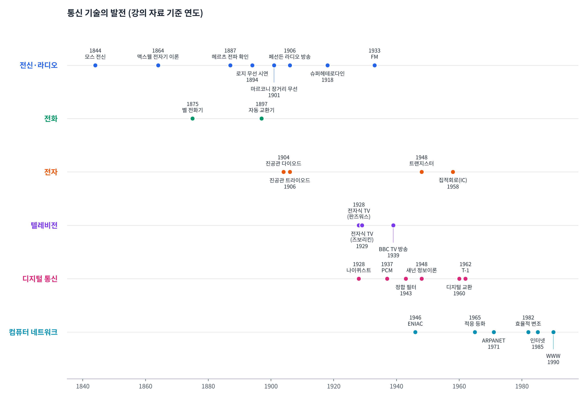
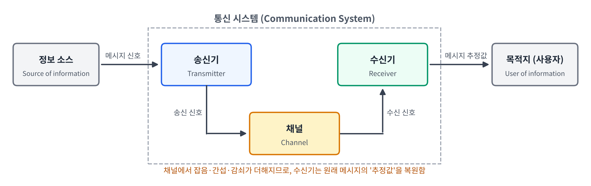
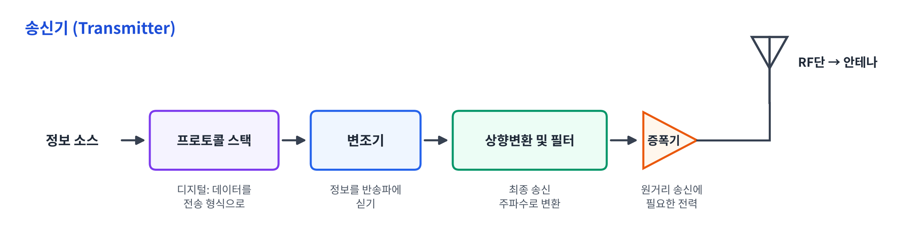
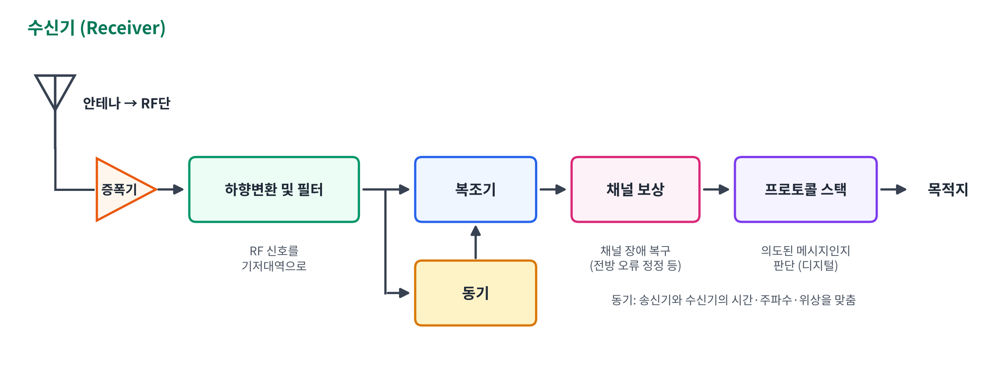

[toc]

## 학습 목표

- 통신 기술이 어떤 흐름으로 발전해 왔는지 이해
- 통신 시스템의 기본 구성 요소(**정보 소스 → 송신기 → 채널 → 수신기 → 목적지**) 이해
- 무선 통신 **송신기와 수신기**를 이루는 블록과 각각의 역할 이해

---

## 통신의 역사적 배경

### 전신(Telegraph)과 라디오(Radio)

| 연도 | 인물 | 내용 |
| --- | --- | --- |
| 1844 | **Samuel Morse** | 전신으로 "What hath God wrought" 전송 (Washington D.C. ~ Baltimore) |
| 1864 | **James Clerk Maxwell** | 빛의 **전자기 이론** 정립, **전파의 존재를 예측** |
| 1887 | **Heinrich Hertz** | 전파의 존재를 **실험으로 확인** |
| 1894 | **Oliver Lodge** | 짧은 거리(150야드) 무선 통신 시연 |
| 1901 | **Guglielmo Marconi** | 장거리(1,700마일) 무선 통신 시연 |
| 1906 | **Reginald Fessenden** | 최초의 **라디오 방송** |
| 1918 | **Edwin H. Armstrong** | **슈퍼헤테로다인(superheterodyne) 수신기** 발명 |
| 1933 | **Edwin H. Armstrong** | 새로운 변조 방식인 **주파수 변조(FM)** 시연 |

- **모스 부호(Morse code)**: 점(dot), 선(dash), 글자 간격, 단어 간격으로 이루어진 **가변 길이 부호(variable-length code)**
  - 자주 쓰는 글자(E = `·`)는 짧게, 드문 글자는 길게 → 평균 전송 길이를 줄이는 아이디어
- **슈퍼헤테로다인 수신기**: 수신한 신호를 **고정된 중간 주파수(IF)**로 바꾼 뒤 처리하는 방식으로, 지금도 대부분의 수신기에서 쓰이는 구조

### 전화(Telephone)

| 연도 | 인물 | 내용 |
| --- | --- | --- |
| 1875 | **Alexander Graham Bell** | **전화기** 발명 |
| 1897 | **A. B. Strowger** | **자동 단계식 교환기**(automatic step-by-step switch) 고안 |

### 전자(Electronics)

| 연도 | 인물 | 내용 |
| --- | --- | --- |
| 1904 | **John Ambrose Fleming** | **진공관 다이오드** 발명 |
| 1906 | **Lee de Forest** | **진공관 트라이오드(3극관)** 발명 |
| 1948 | **John Bardeen, Walter H. Brattain, William Shockley** (Bell Lab.) | **트랜지스터** 발명 |
| 1958 | **Robert Noyce** | 최초의 실리콘 **집적회로(IC)** 생산 |

### 텔레비전(Television)

| 연도 | 인물·기관 | 내용 |
| --- | --- | --- |
| 1928 | **Philo T. Farnsworth** | 최초의 **완전 전자식 텔레비전** 시스템 |
| 1929 | **Vladimir K. Zworykin** | 완전 전자식 텔레비전 시스템 |
| 1939 | **BBC** | 상업적 기반의 텔레비전 방송 서비스 |

### 디지털 통신(Digital Communications)

| 연도 | 인물·기관 | 내용 |
| --- | --- | --- |
| 1928 | **Harry Nyquist** | 전신에서의 **신호 전송 이론** |
| 1937 | **Alec Reeves** | **펄스 부호 변조(PCM)** 발명 |
| 1943 | **D. O. North** | 백색 잡음 속에서 **알려진(known) 신호**를 최적으로 검출하는 **정합 필터(Matched Filter)** |
| 1948 | **Claude Shannon** | **디지털 통신의 이론적 기초** 확립 (정보 이론) |
| 1958 | Bell Lab. | 프로그램 내장(stored-program) 시스템을 통한 첫 통화 |
| 1960 | Morris, Illinois | **디지털 교환**을 사용한 최초의 상용 전화 서비스 |
| 1962 | Bell Lab. | 최초의 **T-1 반송 시스템** 전송 설치 |

- **PCM**: 아날로그 신호를 **표본화 → 양자화 → 부호화**해서 0과 1로 보내는 방식 → 디지털 통신의 출발점
- **정합 필터**: 수신기가 "어떤 모양의 신호가 올지" 알고 있을 때, 잡음 속에서 그 신호를 가장 잘 찾아내도록 설계한 필터
- **Shannon**: 채널마다 오류 없이 보낼 수 있는 **최대 전송률(채널 용량)**이 있다는 것을 보임

### 컴퓨터 네트워크(Computer Networks)

| 연도 | 인물·기관 | 내용 |
| --- | --- | --- |
| 1943~1946 | 펜실베이니아 대학교 무어 스쿨 | **ENIAC**: 최초의 전자식 디지털 컴퓨터 |
| 1950년대 | - | 컴퓨터와 단말기가 서로 통신하기 시작 |
| 1950~1970 | - | 컴퓨터 네트워크에 대한 다양한 연구 |
| 1965 | **Robert Lucky** | **적응 등화(adaptive equalization)** 아이디어 |
| 1971 | ARPA | **ARPANET**(Advanced Research Projects Agency Network) 서비스 시작 |
| 1982 | **G. Ungerboeck** | **효율적인 변조 기법** (부호화 변조, TCM) |
| 1985 | - | ARPANET이 **인터넷(Internet)**으로 이름이 바뀜 |
| 1990 | **Tim Berners-Lee** | 인터넷용 하이퍼미디어 인터페이스 **월드 와이드 웹(WWW)** 제안 |

- **적응 등화**: 채널이 신호를 일그러뜨리는 정도를 **스스로 추정해서 보정**하는 기술 → 뒤에서 나오는 수신기의 **채널 보상**과 연결됨

### 강의 자료와 다르게 알려진 부분

강의 자료(교재)의 연도와 표기를 위 표에 그대로 옮겼지만, 일반적으로 알려진 사실과 다른 부분이 있어서 정리함

| 항목 | 강의 자료 | 일반적으로 알려진 내용 |
| --- | --- | --- |
| BBC 텔레비전 | 1939년 | BBC의 정규 TV 방송은 **1936년** 알렉산드라 궁전에서 시작 |
| 집적회로 | 1958년 Robert Noyce | **1958년 Jack Kilby**(TI)가 최초의 IC를 시연, Noyce의 **실리콘** IC는 **1959년** |
| 트랜지스터 | Brattain, Shockley | **John Bardeen**도 공동 발명자 (1956년 노벨 물리학상 3인 공동 수상) |
| ARPANET | 1971년 서비스 시작 | 첫 노드 간 연결은 **1969년** |
| WWW | 1990년 제안 | Berners-Lee의 첫 제안서는 **1989년**, 1990년에 구현 |

**강의 자료의 오타 정정**

| 강의 자료 | 정정 |
| --- | --- |
| broascast, Frequency nodulation | broad**c**ast, Frequency **m**odulation |
| autiomatic step-by-step switch | **automatic** step-by-step switch |
| John Abbrose Eleming | John **Ambrose Fleming** |
| Alex Reeves | **Alec** Reeves |
| APRANET | **ARPANET** |
| matched filter ... of **a unknown** signal | matched filter ... of **a known** signal (정합 필터는 **알려진 신호**를 검출하는 필터) |

요약:

- 통신은 **전신 → 라디오 → 전화 → TV → 디지털 통신 → 인터넷** 순서로 발전
- 이 과목에서 다루는 개념들이 역사 속에 이미 등장함
  - **AM/FM 변조**(Armstrong), **슈퍼헤테로다인 수신기**, **표본화·PCM**(Nyquist, Reeves), **정합 필터**(North), **채널 용량**(Shannon)

---

## 통신 시스템

### 통신이란?

- **정보를 한 지점에서 다른 지점으로 전송하는 것**

| 구성 요소 | 역할 |
| --- | --- |
| **정보 소스** (Source of information) | 보내고자 하는 정보가 발생하는 곳 (음성, 영상, 데이터 등) |
| **송신기** (Transmitter) | 정보를 **채널에 적합한 형태**로 바꾸어 줌 |
| **채널** (Channel) | 신호가 지나가는 통로 → **유선 채널**(전선, 광섬유), **무선 채널**(공기 중 전파) |
| **수신기** (Receiver) | 채널을 거쳐 온 신호를 **목적지에서 이해할 수 있는 형태로 변환** |
| **목적지** (User of information) | 정보를 받아서 사용하는 곳 |

**메시지 신호 → 송신 신호 → 수신 신호 → 메시지 추정값**

- 송신기가 내보낸 **송신 신호**는 채널을 지나면서 **잡음, 간섭, 감쇠, 왜곡**을 겪음
- 그래서 수신기가 받는 **수신 신호**는 송신 신호와 똑같지 않음
- 수신기가 복원한 결과는 원래 메시지 그 자체가 아니라 **메시지의 추정값(estimate)**
- ⭐️ 통신 시스템 설계의 목표 = **추정값을 원래 메시지에 최대한 가깝게** 만드는 것 ⭐️

---

## 무선 통신

### 송신기(Transmitter)

| 블록 | 역할 |
| --- | --- |
| **프로토콜 스택** | (디지털 시스템) 데이터를 전송 규칙에 맞는 형식으로 만듦 |
| **변조기** (Modulator) | 정보를 **반송파(carrier)에 실어 줌** |
| **상향변환 단** (Upconverter stage) | 신호를 **송신할 최종 주파수**로 바꿈 + 필터로 불필요한 성분 제거 |
| **증폭기** (Amplifier) | **원거리 송신에 필요한 전력**으로 증폭 |
| **RF단** | 전력 증폭 후 **안테나로 송신** |

### 수신기(Receiver)

| 블록 | 역할 |
| --- | --- |
| **RF단** | 안테나로 받은 **고주파(Radio Frequency) 신호**를 처리하는 단 |
| **하향변환 단** (Downconverter stage) | RF 신호를 **기저대역(baseband)으로 변환** |
| **복조기** (Demodulator) | 송신된 **메시지 신호를 복구** |
| **동기** (Synchronization) | 송신기와 수신기 사이의 **동기를 맞춤** (시간, 주파수, 위상) |
| **채널 보상** | 채널에서 생긴 **장애를 복구** (예: 전방 오류 정정, FEC) |
| **프로토콜 스택** | (디지털 시스템) 수신된 메시지가 **의도된 것인지 판단** |

- 수신기는 송신기의 과정을 **거꾸로** 수행함
  - 송신기: 변조 → **상향**변환 → 증폭
  - 수신기: 증폭 → **하향**변환 → 복조
- 강의 자료의 수신기 그림은 마지막 블록이 '정보소스'로 되어 있지만, 수신 쪽 끝은 정보를 받는 **목적지(사용자)**이므로 그림에서는 목적지로 표기함

---

### 보충: 왜 변조와 주파수 변환이 필요할까?

**기저대역(Baseband)과 대역통과(Passband)**

| 구분 | 의미 | 예 |
| --- | --- | --- |
| **기저대역 신호** | 원래 메시지가 가진 **0 Hz 근처의 낮은 주파수** 신호 | 사람 목소리 (약 수백 Hz ~ 수 kHz) |
| **대역통과 신호** | 반송파 주파수 $$f_c$$ 근처로 옮겨진 신호 | FM 라디오 (약 88 ~ 108 MHz) |

**① 안테나 크기 때문에**

- 안테나가 전파를 효율적으로 내보내려면, 크기가 **파장 $$\lambda$$의 몇 분의 1** (예: $$\lambda/4$$) 정도는 되어야 함

$$
\lambda = \frac{c}{f}, \qquad c = 3 \times 10^8 \ \text{m/s}
$$

| 주파수 $$f$$ | 파장 $$\lambda$$ | $$\lambda / 4$$ |
| --- | --- | --- |
| 1 kHz (음성) | 300 km | 75 km |
| 100 MHz (FM 라디오) | 3 m | 75 cm |
| 1 GHz | 30 cm | 7.5 cm |

- 음성을 그대로 보내려면 **수십 km짜리 안테나**가 필요 → 불가능
- 높은 주파수의 반송파에 실으면 **현실적인 크기의 안테나**로 송신 가능

**② 여러 신호가 채널을 나눠 쓰기 위해**

- 모든 방송국이 기저대역 그대로 보내면 **같은 주파수에서 서로 섞여 버림**
- 방송국마다 **다른 반송파 주파수**를 쓰면 한 공간에서 여러 신호를 동시에 보낼 수 있음 → **주파수 분할 다중화(FDM)**
- 라디오에서 채널을 돌리는 것 = 수신할 **반송파 주파수를 고르는 것**

요약:

- **변조**: 메시지를 반송파에 싣는 과정 / **복조**: 반송파에서 메시지를 다시 꺼내는 과정
- **상향변환**은 기저대역 → 송신 주파수, **하향변환**은 송신 주파수 → 기저대역
- 이후 장에서 배우는 **푸리에 변환**은 이렇게 신호를 **주파수 축에서 보고 옮기는 과정**을 수학적으로 다루는 도구

---

## 최종 핵심 정리

1. 통신은 **전신 → 라디오 → 전화 → TV → 디지털 통신 → 인터넷** 순으로 발전했고, 변조·표본화·정합 필터·정보 이론 같은 핵심 개념이 그 과정에서 등장함
2. 통신 시스템은 **정보 소스 → 송신기 → 채널 → 수신기 → 목적지**로 구성됨
3. 채널에서 잡음·간섭·감쇠가 더해지므로, 수신기는 메시지의 **추정값**을 복원함
4. **송신기**: 프로토콜 스택 → 변조기 → 상향변환 및 필터 → 증폭기 → RF단(안테나)
5. **수신기**: RF단 → 증폭기 → 하향변환 및 필터 → 복조기(+동기) → 채널 보상 → 프로토콜 스택
6. 높은 주파수의 반송파로 변조하는 이유는 **안테나 크기**와 **여러 신호의 주파수 분할** 때문

---

End.
