[toc]

## 학습 목표

- 시계열 데이터 이해
- 데이터 준비와 탐색
- 시계열 분해 (Time Series Decomposition)
- 정상성과 차분 (Stationarity & Differencing)
- ARIMA 계열 모델링
- 대안 모델과 최신 도구

---

## 시계열(Time Series) 데이터 이해

### 시계열의 정의와 특징

**시계열이란?**

- **일정한 시간 간격으로 기록된 관측값의 집합**
- **시간 순서가 매우 중요** (순서가 바뀌면 패턴이 사라짐)

**주요 특징**

| 특징 | 설명 | 예시 |
| --- | --- | --- |
| **자기상관 (Autocorrelation)** | 인접한 시점끼리 값이 비슷한 경향 | 오늘 전력 사용량 ≈ 어제 전력 사용량 |
| **비정상성 (Non-stationarity)** | 시간이 지나면서 평균·분산이 변함 | 평균·분산 같은 단순 통계로는 전체 구조를 설명하기 어려움 |

---

### 시계열의 구성 요소

| 구성 요소 | 의미 | 예시 | 분석 포인트 |
| --- | --- | --- | --- |
| **Trend (추세)** | 장기적으로 상승 또는 하락하는 흐름 | 학기 중 유튜브 구독자 수가 꾸준히 증가 | 최근 흐름을 더 강조해야 함 |
| **Seasonality (계절성)** | **일정한 간격으로 반복**되는 패턴 | 시험 전 매출 급증, 방학 중 감소 | 주기를 고려한 차분, SARIMA 같은 계절형 모델 필요 |
| **Cycle (주기성)** | 계절성보다 **긴 불규칙한** 변동 | 경기 변화로 인한 임대료 등락 | 거시경제 지표와 함께 해석 |
| **Residual / Noise (불규칙성)** | 추세·계절성·주기로 설명되지 않는 일시적 변동 | 폭우로 하루 택시 이용 급증 | 스무딩·이상치 탐지로 영향 최소화 |

시계열을 네 가지 요소로 분해했을 때의 모습

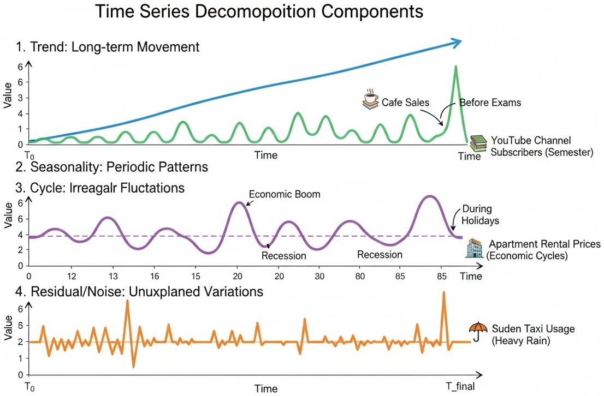

요약:

- **계절성**은 주기가 **일정**하고, **주기성(Cycle)**은 주기가 **길고 불규칙**하다는 점이 다름
- 시계열 분석은 결국 하나의 그래프 안에 섞여 있는 이 네 가지 성분을 **구분해서 보는 것**에서 시작함

---

## 데이터 준비와 탐색

### AirPassengers 데이터

- **1949년부터 1960년까지 국제선 여객 수를 월별로 기록**한 데이터
- **장기 추세와 뚜렷한 계절성**을 동시에 관찰할 수 있는 대표적인 예제
- 누락된 월, 문자열 형태의 날짜, 시간대 미지정 등 **시계열 전처리에서 자주 만나는 문제**를 한 번에 연습할 수 있음
- Dataset: [AirPassengers 다운로드](https://www.deepshark.org/courses/data_science/w/07_time_series#airpassengers_dataset)

**시계열 분석이란?**

- 단순히 날짜가 포함된 데이터를 다루는 것이 아니라, **시간의 흐름에 따라 규칙적으로 발생하는 데이터를 이해하고 예측**하는 과정
- 컴퓨터(특히 pandas)가 **"이건 시간에 따라 변화하는 데이터야"라고 인식하도록 형태를 바꿔 주는 것**이 첫 단계

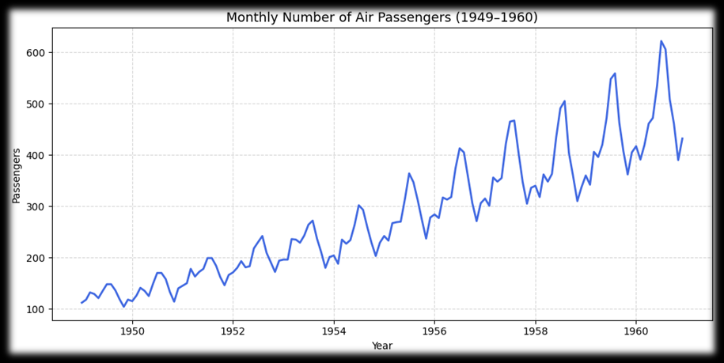

- 시간이 지날수록 여객 수가 **꾸준히 증가(추세)**하고
- 매년 비슷한 시기에 **오르내림이 반복(계절성)**되며
- 뒤로 갈수록 **오르내림의 폭이 점점 커짐** → 뒤에서 나오는 **승법모형, 로그 변환**과 연결됨

---

### 시간 인덱스 처리

**시계열 데이터를 다룰 때 가장 먼저 확인할 것**

- **"시간 정보가 규칙적인 간격으로 정렬되어 있는가?"**
- 날짜가 문자열로 남아 있거나, 몇 달이 빠져 있는 채로 분석하면 **이후 모델링 단계에서 오류 발생**

**처리 절차**

1. **원시 데이터 구조 확인**
   - `read_csv()` 후 `head()`로 열 이름과 값 범위를 바로 확인
   - 시간 순서 컬럼을 잘못 이해하면 이후 변환에서 오류 발생
2. **날짜 컬럼을 datetime으로 변환**
   - `"Month"` 컬럼은 문자열 상태로 들어옴
   - 변환하지 않으면 `asfreq`, 이동평균, 시각화 등 **pandas의 시계열 함수를 사용할 수 없음**
3. **시간 인덱스 설정과 간격 강제**
   - `set_index("Month").asfreq("MS")` → **매월 첫 날(Month Start)** 기준으로 인덱스를 맞춤
   - 빠진 달이 있으면 그 자리에 `NaN`이 생기므로 **결측을 눈으로 확인**할 수 있음

---

### `.asfreq()` 메서드

**`.asfreq()`: 시계열 데이터의 주기(frequency)를 설정하거나 변경할 때 사용하는 메서드**

| 강의 옵션 | 최신 pandas | 의미 | 설명 | 예시 인덱스 |
| --- | --- | --- | --- | --- |
| `"A"` | `"YE"` | 연도별 (Annual) | 매년 12월 31일 기준 | 2020-12-31, 2021-12-31 |
| `"AS"` | `"YS"` | 연초 기준 (Annual Start) | 매년 1월 1일 기준 | 2020-01-01, 2021-01-01 |
| `"Q"` | `"QE"` | 분기별 (Quarter End) | 3월, 6월, 9월, 12월 말일 | 2020-03-31, 2020-06-30 |
| `"QS"` | `"QS"` | 분기 시작 (Quarter Start) | 분기 첫 달 1일 | 2020-01-01, 2020-04-01 |
| `"M"` | `"ME"` | 월말 기준 (Month End) | 매월 말일 | 2020-01-31, 2020-02-29 |
| `"MS"` | `"MS"` | 월초 기준 (Month Start) | 매월 1일 | 2020-01-01, 2020-02-01 |
| `"W"` | `"W"` | 주간 (Weekly) | 매주 일요일 (기본값) | 2020-01-05, 2020-01-12 |
| `"W-MON"` | `"W-MON"` | 월요일 기준 주간 | 매주 월요일 기준 | 2020-01-06, 2020-01-13 |
| `"D"` | `"D"` | 일별 (Daily) | 하루 단위 | 2020-01-01, 2020-01-02 |
| `"B"` | `"B"` | 영업일 (Business Day) | 주말을 제외한 평일 | 2020-01-01, 2020-01-02 |
| `"H"` | `"h"` | 시간별 (Hourly) | 1시간 단위 | 2020-01-01 00:00, 01:00 |
| `"T"` 또는 `"min"` | `"min"` | 분 단위 (Minute) | 1분 단위 | 2020-01-01 00:00, 00:01 |
| `"S"` | `"s"` | 초 단위 (Second) | 1초 단위 | 2020-01-01 00:00:00, 00:00:01 |

**(중요!!) pandas 버전에 따른 차이**

- pandas 2.2부터 `"A"`, `"AS"`, `"Q"`, `"M"`, `"H"`, `"T"`, `"S"`는 **경고(Deprecated)**가 나오고
- **pandas 3.x에서는 오류(ValueError)**가 발생함 → 직접 실행해서 확인한 결과
- 따라서 최신 환경에서는 **오른쪽 열(최신 pandas)의 이름**을 사용해야 함
- `"MS"`, `"QS"`, `"W"`, `"D"`, `"B"`처럼 이름이 그대로인 옵션은 어느 버전에서나 동작함

---

### 타임존(Time Zone) 명시 필요성

**타임존이란?**

- 전 세계를 **기준시(UTC, Coordinated Universal Time)**로 나눈 표준 시간대
  - 한국: UTC+09:00
  - 미국 뉴욕: UTC-05:00 (서머타임 기간에는 UTC-04:00)
  - **동일한 순간이라도 위치에 따라 시각 표기가 다름**

**언제 신경 써야 할까?**

- AirPassengers 데이터는 과거 기록이라 시간대 정보가 없음 → **무시해도 무방**
- 하지만 **서버 로그처럼 UTC 기준으로 쌓이는 데이터**라면
  - **원본 타임존을 명시**하고
  - **분석 대상 지역에 맞춰 변환**하는 과정을 거쳐야 함

**타임존을 처리하지 않으면?**

- **일중(daily) 패턴 분석에서 시간이 어긋난 결과**를 얻을 수 있음
- 예: UTC로 기록된 데이터를 그대로 보면, 한국 시간 오전 9시 출근 시간대의 피크가 **0시**에 있는 것처럼 보임

실습 코드: [AirPassengers 데이터 실습](https://www.deepshark.org/courses/data_science/w/07_time_series#time_series_practice)

---

## 결측치와 이상치 처리

### 결측치(Missing Value) 확인

**결측치란?**

- **데이터가 일부 누락된 상태**
- 원인: 센서 오류, 수집 누락, 시스템 문제, 통신 지연, 측정 중단
- 영향: **평균·분산·상관계수 왜곡, 모델 학습 오류 발생**
- 분석과 모델 학습에 직접 영향을 주므로 **반드시 탐지하고 적절히 보정**해야 함

**해결 방법**

- 보간(Interpolation)
- 이전 값 대체(Forward Fill)
- 도메인 지식 기반 보정

---

### 결측치 실습 - Air Quality Dataset

**데이터 특징**

- 시간별 또는 일별로 측정한 **대기 오염 물질**(CO, NOx, Benzene 등) 데이터
- 일부 시점에 **결측치 또는 비정상값(-200 등)**이 포함되어 있음
  - `-200`은 실제 측정값이 아니라 **측정 실패를 표시한 값** → 결측으로 바꿔서 처리해야 함
- Dataset: [Air Quality Dataset](https://www.deepshark.org/courses/data_science/w/07_time_series#airquality_dataset)

**실습 목표**

- 시계열 인덱스 처리 및 기본 사항 확인
- 결측치 탐지 및 보정 (보간, `ffill`/`bfill` 등)
- 이상치 탐지 및 보정
- 대기질 추세 분석

**의존성 설치**

- 엑셀 파일을 읽을 때 `ImportError: Missing optional dependency 'openpyxl'`가 나오면 `pip install openpyxl`로 설치

실습 코드: [Air Quality 실습 코드](https://www.deepshark.org/courses/data_science/w/07_time_series#airquality_codes)

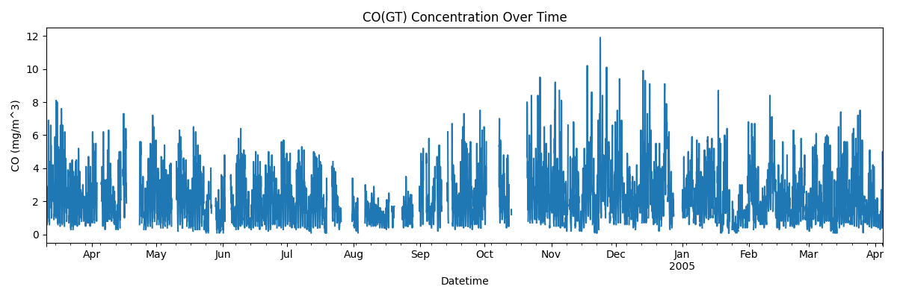

- CO 농도를 시간 순서로 그린 결과
- 값이 매우 촘촘하고 변동이 커서, 그대로는 **추세를 읽기 어려움** → 뒤에서 이동평균으로 정리

---

### 결측치 보정 방법

| 방법 | 설명 | 특징 |
| --- | --- | --- |
| `interpolate()` | **이전·다음 값의 선형 관계**를 기반으로 보간 | **연속적인 시계열에 적합** |
| `ffill()` (forward fill) | **직전 관측값**으로 결측치를 채움 | **센서 일시 오류**에 유용 |
| `bfill()` (backward fill) | **이후 관측값**으로 결측치를 채움 | **데이터 앞부분의 공백**에 사용 |

---

### 선형보간법(Linear Interpolation)

**선형보간법이란?**

- 빠진 값을 **이전 값과 다음 값을 직선으로 연결**해서 그 중간 값으로 채워 넣는 방법
- **"결측된 구간에서도 값이 일정한 속도로 변한다"고 가정**하고 그 사이의 값을 계산

$$
y(x) = y_1 + \frac{y_2 - y_1}{x_2 - x_1}(x - x_1)
$$

| 시간 | 온도(℃) |
| --- | --- |
| 10시 | 20 |
| 11시 | NaN (측정 누락) |
| 12시 | 24 |

- 10시엔 20℃, 12시엔 24℃이므로 **"11시는 중간쯤인 22℃일 것"**이라고 선형적으로 추정
- 위 수식에 넣으면 $$y(11) = 20 + \frac{24-20}{12-10}(11-10) = 22$$

같은 예시에 세 가지 방법을 적용하면 다음과 같음 (직접 실행해서 확인)

| 방법 | 10시 | 11시 | 12시 |
| --- | --- | --- | --- |
| `interpolate()` | 20 | **22** | 24 |
| `ffill()` | 20 | **20** | 24 |
| `bfill()` | 20 | **24** | 24 |

실습 코드: [결측치 보정 전·후 비교](https://www.deepshark.org/courses/data_science/w/07_time_series#correction_before_after)

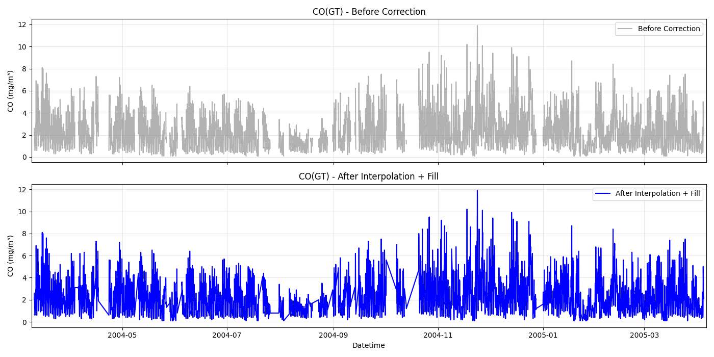

- 위: 보정 전 (결측 구간이 비어 있음)
- 아래: 보간 + fill 적용 후 (빈 구간이 채워져 **연속적인 시계열**이 됨)

---

### 이상치(Outlier) 처리

**이상치란?**

- **정상 패턴에서 벗어난 비정상적인 값**
- 원인: 센서 오작동, 외부 환경 요인
- 영향: **평균 왜곡, 회귀 기울기의 비정상적 변화**

**탐지 방법**

**① IQR(사분위 범위) 기반 탐지**

$$
IQR = Q_3 - Q_1
$$

$$
\text{Limit}_{lower} = Q_1 - 1.5 \times IQR, \qquad \text{Limit}_{upper} = Q_3 + 1.5 \times IQR
$$

- 이 범위를 벗어나는 값을 이상치로 판단

**② 이동평균 편차 확인**

$$
\lvert x_t - \bar{x}_t \rvert > k \times \sigma_t
$$

- $$\bar{x}_t$$: 최근 일정 구간의 평균
- $$\sigma_t$$: 최근 구간의 표준편차
- $$k$$: 임계값 (보통 2~3)
- 전체 평균이 아니라 **최근 구간의 평균**과 비교하므로, 추세가 있는 시계열에서도 쓸 수 있음

**③ 도메인 기준 임계값 설정** → 필요하면 보정 또는 제거

---

### 이상치 보정 방법

| 방법 | 설명 | 특징 |
| --- | --- | --- |
| 삭제(drop) | 명백한 오류값 제거 | **데이터 손실** 가능 |
| 평균/중앙값 대체 | 주변 통계값으로 치환 | 극단값 완화 |
| 보간(interpolation) | 시간 흐름을 고려한 선형 대체 | **연속성 유지** |
| 윈도우 스무딩 | 급격한 변화 완화 | **장기 추세 반영**에 유리 |

---

### 이동평균과 스무딩

**이동평균(Moving Average)**

- 일정한 창(window)에 포함된 관측값의 평균
- **단기 변동을 완화하고 장기 추세를 강조**
- **창 크기 ↑ → 노이즈 ↓, 하지만 반응 속도가 느려짐** → 분석 목적에 맞게 적정 값 선택
- **가중 이동평균(Weighted Moving Average)**이나 **지수평활(Exponential Smoothing)**처럼 최근 관측치에 더 큰 가중치를 주는 변형도 실무에서 자주 사용

**윈도우 스무딩(Window Smoothing)**

- 시계열의 **단기적인 요동(잡음)을 완화**하고
- 전체적인 **장기 추세(trend)를 부드럽게 보기 위해** 사용하는 기법

$$
\tilde{y}_t = \frac{1}{n} \sum_{i=t-n+1}^{t} y_i
$$

- $$\tilde{y}_t$$: 스무딩(평활화)된 값
- $$n$$: 윈도우 크기 (예: 3시간, 7일 등)
- $$y_i$$: 시점 $$i$$의 실제 관측값

---

### 이상치 탐지 및 중앙값 보정 실습

실습 코드: [이상치 탐지 및 시각화](https://www.deepshark.org/courses/data_science/w/07_time_series#outlier_detection_visualization)

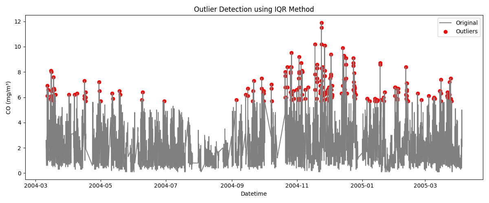

- IQR 방법으로 탐지한 이상치(빨간 점)
- **겨울철(2004-11 ~ 2005-01)에 이상치가 집중**되어 있음

실습 코드: [이상치 탐지 후 중앙값 보정](https://www.deepshark.org/courses/data_science/w/07_time_series#outlier_correction_median)

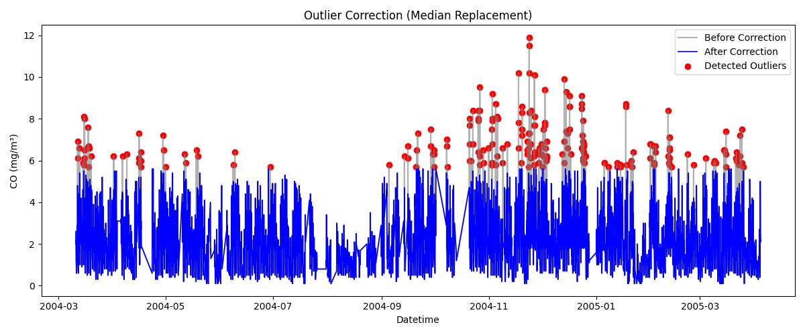

- 회색: 보정 전, 파란색: 중앙값으로 보정 후
- 빨간 점으로 표시된 이상치가 **중앙값으로 대체**되어 그래프의 위쪽 끝이 낮아짐

**주의할 점**

- 겨울철에 이상치가 몰려 있다는 것은 **실제로 그 시기에 오염이 심했을 가능성**도 있다는 뜻
- IQR은 **계절성을 고려하지 않는 기준**이므로, 무조건 보정하기 전에 **센서 오류인지 실제 현상인지** 도메인 관점에서 확인해야 함

---

### 종합 실습 - 대기질 추세 분석

| 분석 관점 | 설명 |
| --- | --- |
| **장기 추세** (Long-term Trend) | 1년 단위로 CO, NOx, Benzene 등의 평균 농도 변화 분석 (예: 겨울철 오염 증가) |
| **계절별 변화** (Seasonality) | 월별 또는 분기별 평균값을 비교해 봄·여름·가을·겨울 간 대기질 차이 탐색 |
| **일중 패턴** (Daily Pattern) | 하루 중 오전/오후/야간의 오염물질 변화 관찰 (예: 출퇴근 시간대 CO 증가) |
| **센서 간 상관관계** | 여러 센서(PT08.S1~S5)와 오염물질 간의 관계 파악 |

실습 코드: [대기질 종합 실습](https://www.deepshark.org/courses/data_science/w/07_time_series#airquality_overall_practice)

#### 장기 추세 (30일 이동평균)

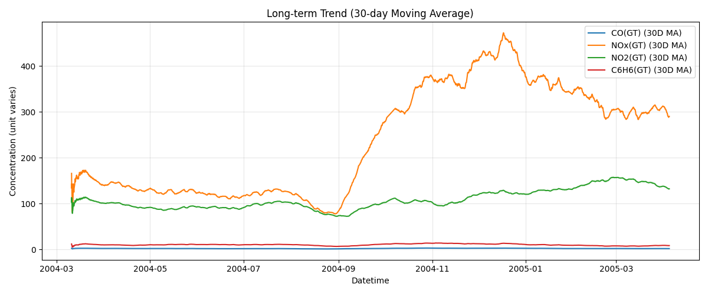

- **NOx는 2004년 9월 이후 급격히 증가**해 11~12월에 최고치를 보이고 이후 감소
- NO2도 비슷한 시기에 완만하게 증가

#### 계절별 변화 (월별 평균)

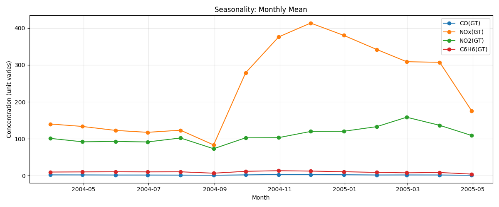

- NOx의 월평균이 **늦가을~겨울(11~12월)에 가장 높음** → 겨울철 오염 증가

#### 일중 패턴 (시간대별 평균)

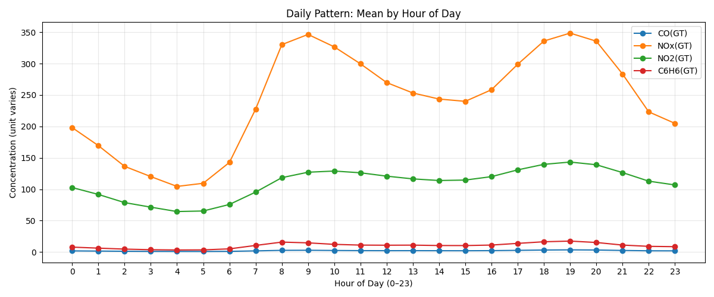

- **오전 8~9시**와 **저녁 18~19시**에 NOx가 크게 상승 → **출퇴근 시간대**의 교통량과 연결
- 새벽 3~5시에 가장 낮음

#### 센서 간 상관관계 (피어슨)

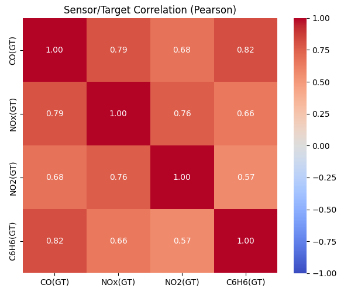

- **CO와 C6H6(Benzene)의 상관계수 0.82**, CO와 NOx 0.79로 높은 양의 상관
- 상관이 높다는 것은 **함께 움직인다는 뜻**이지, 하나가 다른 하나의 원인이라는 뜻은 아님

---

## 시계열 분해(Time Series Decomposition)

### 시계열 분해란?

- 시계열 데이터는 단순히 시간에 따른 값의 나열이 아니라, **다양한 패턴의 합성**으로 이루어짐
- **시계열 분해**: 합쳐져 있는 패턴을 **성분별로 분리하는 과정**

**시계열 분해를 하는 이유**

| 목적 | 설명 | 예시 |
| --- | --- | --- |
| 구조 이해 | 추세·계절·노이즈를 분리하여 패턴 파악 | 온도 상승 + 계절 변동 |
| 예측 개선 | 비정상성 제거로 모델 성능 향상 | ARIMA 학습 안정화 |
| 이상 탐지 | 잔차를 통해 예외적 사건 탐색 | 폭염으로 인한 전력 급등 |
| 해석력 향상 | 각 요인의 기여도를 설명 | 매출 상승 원인 분리 |

---

### 시계열의 구성 요소 (4가지 성분)

$$
Y_t = T_t + S_t + C_t + I_t
$$

| 구성 요소 | 설명 | 예시 |
| --- | --- | --- |
| **추세** (Trend, $$T_t$$) | 장기간에 걸쳐 증가하거나 감소하는 전반적 경향 | 평균기온 상승, 판매량 증가 |
| **계절성** (Seasonality, $$S_t$$) | 일정 주기마다 반복되는 패턴 | 월별 전기 사용량, 요일별 교통량 |
| **순환성** (Cyclic, $$C_t$$) | 경기 변동과 같은 비정기적 장기 요동 | 경기 침체, 호황 주기 |
| **불규칙성** (Irregular, $$I_t$$) | 예측 불가능한 우연적 요인 | 천재지변, 이벤트 효과 |

- 대부분의 분석에서는 **$$C_t$$와 $$I_t$$를 합쳐서 잔차(residual)**로 다룸

---

### 분해 방식: 가법모형 vs. 승법모형

| 구분 | 가법모형 (Additive) | 승법모형 (Multiplicative) |
| --- | --- | --- |
| 수식 | $$Y_t = T_t + S_t + I_t$$ | $$Y_t = T_t \cdot S_t \cdot I_t$$ |
| 결합 방식 | 각 성분이 **더해짐** | 각 성분이 **곱해짐** |
| 언제 쓰나 | **변동 폭이 일정**할 때 (예: 월별 온도 변화) | **변동 폭이 시간에 따라 커질 때** (예: 매출이 커지면서 변동 폭도 커짐) |
| 계절 성분 해석 | 추세에 **몇을 더하는지** (단위: 원래 값) | 추세에 **몇 배를 곱하는지** (1 근처의 비율) |

- 승법모형에 **로그를 취하면** $$\log Y_t = \log T_t + \log S_t + \log I_t$$로 **가법모형이 됨**
- AirPassengers처럼 **뒤로 갈수록 진폭이 커지는 데이터**는 승법모형(또는 로그 변환 후 가법모형)이 더 적합

---

### 시계열 분해 실습

**의존성 설치**: `pip install statsmodels`

실습 코드: [시계열 분해 실습](https://www.deepshark.org/courses/data_science/w/07_time_series#decompose_practice)

#### 가법(Additive) 모형 적용 결과

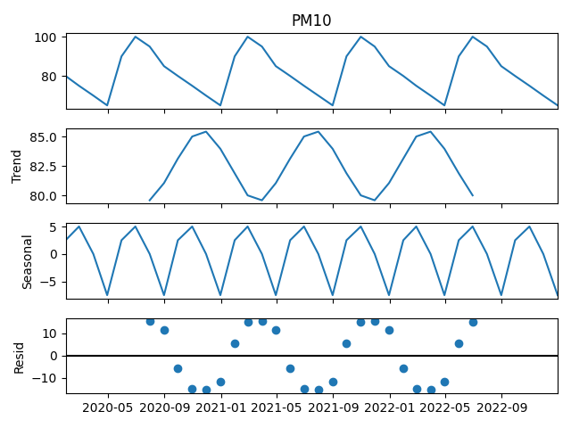

- 위에서부터 **원본(PM10) → 추세(Trend) → 계절성(Seasonal) → 잔차(Resid)**
- 계절 성분이 **약 -7 ~ +5**처럼 원래 값의 단위로 더해지는 양으로 나타남

#### 승법(Multiplicative) 모형 적용 결과

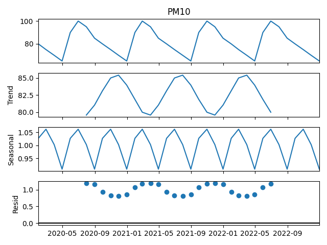

- 같은 데이터지만 계절 성분이 **약 0.93 ~ 1.06**처럼 **1 근처의 비율**로 나타남
- 잔차도 0이 아니라 **1을 중심**으로 분포 → 곱셈 구조이기 때문

**요약**

- 두 그래프의 **모양은 비슷하지만 값의 의미가 다름**
- 가법은 "추세에 얼마를 **더하는가**", 승법은 "추세에 몇 **배를 곱하는가**"로 읽어야 함

---

## 정상성과 차분(Stationarity & Differencing)

### 정상성(Stationarity)

**정상성이란?**

- **시간이 지나도 데이터의 통계적 성질이 변하지 않는 성질**

| 항목 | 내용 |
| --- | --- |
| 정의 | 시간에 따라 **평균, 분산, 공분산이 일정**한 시계열 |
| 의의 | 모델이 안정적으로 동작하고 **미래 예측의 타당성**을 확보 |
| 비정상 예시 | 꾸준히 증가하는 매출, 계절적 반복이 있는 데이터 |
| 정상 예시 | 평균을 중심으로 진동하는 노이즈형 데이터 |

**정상성이 필요한 이유**

- **전통적 시계열 모델(ARIMA 등)은 데이터가 정상(stationary)일 때만 통계적으로 타당한 예측이 가능**
- 과거의 평균·분산이 미래에도 유지되어야, 과거로 학습한 모델을 미래에 적용할 수 있기 때문

---

### 단위근(Unit Root)

**단위근이란?**

- **"시계열이 자기 자신의 과거 값에 지나치게 의존하는 상태"**
- 즉, **이전 시점의 영향이 시간이 지나도 사라지지 않고 누적**되는 경우

$$
y_t = \phi\, y_{t-1} + \epsilon_t
$$

- $$\phi$$: 자기회귀 계수, $$\epsilon_t$$: 백색 잡음
- **$$\phi = 1$$이면 오차가 계속 누적**되어 시간이 지날수록 평균과 분산이 계속 변함 → **비정상 시계열**
- $$\lvert \phi \rvert < 1$$이면 과거 충격의 영향이 점점 줄어들어 **정상 시계열**이 됨

| 현상 | 의미 |
| --- | --- |
| 평균이 일정하지 않음 | 시간에 따라 평균이 변함 |
| 분산이 증가 | 시간이 지날수록 변동성이 커짐 |
| 충격이 누적 | 일시적 변동이 장기적으로 영향을 미침 |

- 예: **주가, 환율** → 한 번의 급등이 이후에도 누적되어 남음

---

### ADF Test (Augmented Dickey-Fuller Test)

**"시계열에 단위근이 존재하는가?"를 검정하는 통계적 방법**

| 항목 | 설명 |
| --- | --- |
| 귀무가설 ($$H_0$$) | **단위근 존재** → 비정상 시계열 |
| 대립가설 ($$H_1$$) | 단위근 없음 → 정상 시계열 |
| 판단 기준 | **p-value < 0.05 → 귀무가설 기각 → 정상성 확보** |

| 결과 | 의미 |
| --- | --- |
| p-value < 0.05 | 정상 시계열 (차분 불필요) |
| p-value ≥ 0.05 | **비정상 시계열 (차분 필요)** |

```python
from statsmodels.tsa.stattools import adfuller

adf_result = adfuller(df["Passengers"])
print(f"ADF Statistic: {adf_result[0]:.3f}")
print(f"p-value: {adf_result[1]:.4f}")
```

- `adf_result[0]`: 검정 통계량, `adf_result[1]`: p-value
- **주의**: ADF의 귀무가설은 "비정상"이므로, 일반적인 검정과 반대로 **p-value가 작아야 정상**이라는 점을 헷갈리지 말 것

---

### 차분(Differencing)

**차분이란?**

- **이전 시점의 값을 현재 시점에서 빼서**, 변화량으로 이루어진 새로운 시계열을 만드는 과정
- **비정상 시계열은 차분을 통해 정상 시계열로 변환** 가능

| 차분 종류 | 수식 | 설명 |
| --- | --- | --- |
| **1차 차분** | $$Y'_t = Y_t - Y_{t-1}$$ | **추세(Trend) 제거** |
| **계절 차분** | $$Y'_t = Y_t - Y_{t-s}$$ ($$s$$: 계절 주기) | **계절성(Seasonality) 제거** |
| **복합 차분** | 1차 차분 + 계절 차분을 순차 적용 | **추세와 계절성이 모두 있을 때** |

```python
# 1차 차분 (Trend 제거)
df["diff1"] = df["Passengers"].diff(periods=1)

# 계절 차분 (Seasonality 제거)
# 12는 월별 데이터에서 1년 주기(12개월)를 의미
df["diff_seasonal"] = df["Passengers"].diff(periods=12)

# 복합 차분: 추세 + 계절성 모두 제거
df["diff_both"] = df["Passengers"].diff(periods=1).diff(periods=12)
```

- 차분을 하면 앞부분에 **빈 값(NaN)**이 생김 → 1차 차분은 1개, 계절 차분은 12개, 복합 차분은 13개
- 모델에 넣기 전에 `dropna()` 등으로 처리해야 함

---

### 변동성(분산) 안정화

시계열의 **변동 폭이 일정하지 않은 경우**, 로그 변환이나 Box-Cox 변환으로 **분산을 안정화**할 수 있음

| 방법 | 수식 | 설명 |
| --- | --- | --- |
| **로그 변환** | $$Y'_t = \log Y_t$$ | **값이 커질수록 변동 폭이 커지는 경우** 사용 |
| **Box-Cox 변환** | $$Y'_t = \dfrac{Y_t^{\lambda} - 1}{\lambda}$$ ($$\lambda \neq 0$$) | 로그보다 **일반화된 형태**, 통계적 안정화에 효과적 |

- $$\lambda$$: 변환 파라미터, 값에 따라 데이터의 형태가 달라짐
- $$\lambda$$는 보통 **MLE(최대우도추정)로 자동 추정**됨
- **$$\lambda = 0$$일 때는 로그 변환과 같음** ($$Y'_t = \log Y_t$$)
- 로그와 Box-Cox 모두 **값이 양수($$Y_t > 0$$)일 때만** 사용할 수 있음

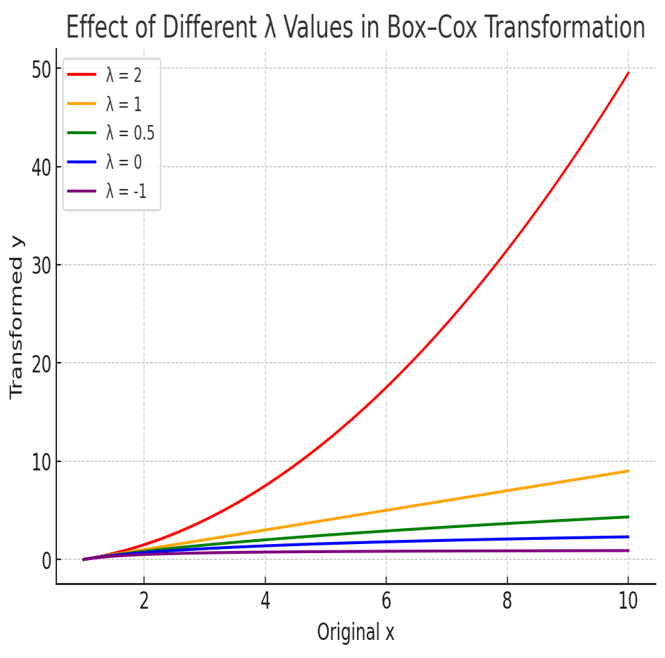

- $$\lambda$$가 클수록 큰 값을 더 크게 늘리고, $$\lambda$$가 작을수록(0, -1) 큰 값을 **강하게 눌러 줌**
- 변동 폭이 커지는 데이터는 **$$\lambda$$를 작게** 잡아 큰 값의 변동을 줄임

---

### 차분 실습

실습 코드: [정상성과 차분 실습](https://www.deepshark.org/courses/data_science/w/07_time_series#stationary_differencing_practice)

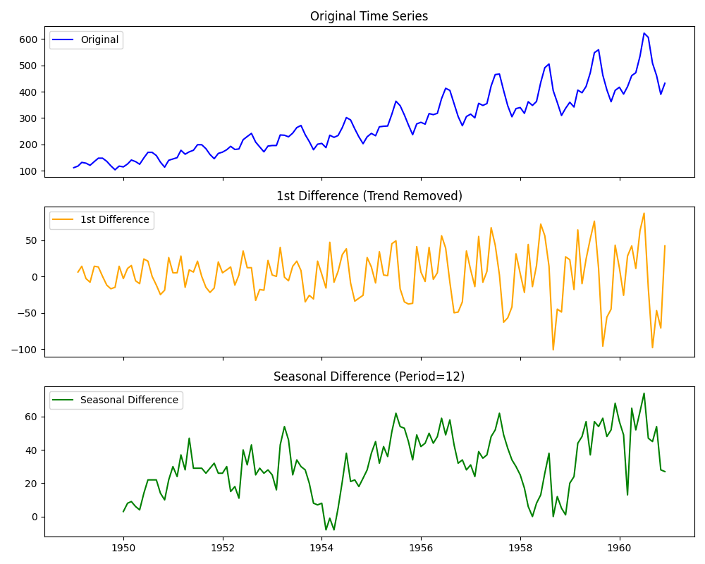

| 그래프 | 해석 |
| --- | --- |
| **원본 시계열** | 1949~1960년 국제 항공 여객 수. 시간이 지날수록 **꾸준히 증가(추세)**하고 연도마다 **주기적 변동(계절성)**이 반복됨 → **비정상 시계열의 전형적인 특징** |
| **1차 차분** | 전 시점과의 차이를 계산해 **추세가 제거**됨. 평균이 일정한 중심을 기준으로 진동하지만, **계절성은 여전히 남아 있음** |
| **계절 차분 (12개월)** | **계절적 반복 패턴이 제거**됨. 특정 주기에 따른 진폭 변화가 줄고, 평균이 일정하게 유지되는 **정상 시계열에 가까워짐** |

**요약**

- 1차 차분은 **추세**, 계절 차분은 **계절성**을 지움
- 1차 차분 그래프를 보면 **뒤로 갈수록 진폭이 커짐** → 분산은 아직 일정하지 않으므로 **로그 변환**을 함께 고려할 수 있음

---

## ARIMA 계열 모델링

### ARIMA란?

**ARIMA (AutoRegressive Integrated Moving Average)**

- 비정상 시계열을 **차분을 통해 정상화한 뒤**
- **AR(자기회귀)**과 **MA(이동평균)** 요소를 결합하여 예측하는 모델

| 구성 요소 | 의미 | 설명 |
| --- | --- | --- |
| **AR($$p$$)** | AutoRegressive | **과거 $$p$$개의 값**이 현재 값에 영향을 미침 |
| **I($$d$$)** | Integrated | **$$d$$차 차분**을 통해 비정상성을 제거 |
| **MA($$q$$)** | Moving Average | **과거 $$q$$개의 오차항**이 현재 값에 영향을 미침 |

- 여기서 MA는 앞에서 본 **이동평균 스무딩과 다른 개념**
  - 스무딩의 이동평균: 과거 **관측값**의 평균
  - ARIMA의 MA: 과거 **예측 오차**의 가중합

---

### ARIMA 파라미터와 확장 모델

| 모델 | 구성 | 설명 |
| --- | --- | --- |
| $$ARIMA(p, d, q)$$ | $$p$$: AR 차수, $$d$$: 차분 횟수, $$q$$: MA 차수 | 비계절형 시계열 모델 |
| $$SARIMA(p, d, q)(P, D, Q)_s$$ | $$(P, D, Q)$$: 계절 성분 차수, $$s$$: 주기 (예: 12개월) | 계절성이 있는 시계열 모델 |

| 모델 | 형태 | 설명 |
| --- | --- | --- |
| $$ARIMA(p, d, q)$$ | 기본형 | 추세 중심 |
| $$SARIMA(p, d, q)(P, D, Q)_s$$ | 계절형 | 계절성 주기 $$s$$ 포함 |
| $$ARIMAX$$ | ARIMA + 외생변수 | **외부 요인(X 변수)**을 함께 고려 |
| $$SARIMAX$$ | SARIMA + 외생변수 | 계절성 + 외생변수 |

- **외생변수(Exogenous Variable)**: 예측하려는 시계열 바깥에서 영향을 주는 변수 (예: 기온, 공휴일, 광고비)

---

### 모델 성능지표

| 번호 | 지표 | 의미 | 해석 기준 / 특징 |
| --- | --- | --- | --- |
| 1 | **AIC** (Akaike Information Criterion) | 모델의 **적합도 + 복잡도(파라미터 수)**를 동시에 고려 | **값이 작을수록 좋음**, 여러 모델을 비교할 때 AIC가 작은 모델 선택 |
| 2 | **BIC** (Bayesian Information Criterion) | AIC와 비슷하지만 복잡도에 **더 강한 패널티** | 값이 작을수록 좋음 |
| 3 | **coef** (Coefficient) | AR, MA, Trend 등 각 항의 추정 계수 | 부호(+, −)로 영향 방향 해석 |
| 4 | **std err** (Standard Error) | 계수 추정의 불확실성 정도 | **작을수록 신뢰도 높음** |
| 5 | **z** (z-statistic) | 계수의 유의성 검정 통계량 (coef / std err) | 절댓값이 크면 계수가 통계적으로 유의할 가능성이 높음 |
| 6 | **P>\|z\|** (p-value) | 귀무가설($$H_0$$: 계수 = 0)이 맞다고 할 때, 지금만큼 극단적인 z가 나올 확률 | **0.05보다 작으면 계수가 유의함** |
| 7 | **Ljung–Box (Q)** | 잔차의 **자기상관(독립성)** 검정 | **p > 0.05 → 잔차가 독립적**, 모델 적합 양호 |
| 8 | **Jarque–Bera (JB)** | 잔차의 **정규성** 검정 (왜도·첨도 이용) | **p > 0.05 → 정규분포 가정 만족** |
| 9 | **Heteroskedasticity (H)** | 잔차의 **등분산성** 여부 | 값이 **1에 가까울수록 등분산** (Prob(H) > 0.05면 등분산 가정 만족) |
| 10 | **Durbin–Watson** | 잔차의 **1차 자기상관** 검정 (0~4 범위) | **2에 가까울수록 자기상관 없음**, 1보다 작으면 양의 상관, 3보다 크면 음의 상관 |

**지표를 볼 때의 핵심**

- **AIC/BIC**: 여러 모델 중에서 **무엇을 고를지** 결정
- **coef ~ P>\|z\|**: 각 항이 **의미 있는지** 판단
- **Ljung–Box, JB, H**: 잔차가 **백색 잡음처럼 남았는지** 확인 → 모델이 패턴을 충분히 뽑아냈는지 점검

---

### SARIMAX 모델 출력 결과

$$SARIMAX(1, 1, 1)(1, 1, 1)_{12}$$를 AirPassengers에 적용한 결과

| 항목 | 값 |
| --- | --- |
| No. Observations | 144 |
| Log Likelihood | -456.103 |
| AIC | 922.205 |
| BIC | 936.016 |
| HQIC | 927.812 |

| 항 | coef | std err | z | P>\|z\| | [0.025, 0.975] |
| --- | --- | --- | --- | --- | --- |
| ar.L1 | -0.2298 | 0.401 | -0.573 | 0.567 | [-1.016, 0.557] |
| ma.L1 | -0.0987 | 0.374 | -0.264 | 0.792 | [-0.832, 0.634] |
| ar.S.L12 | -0.5460 | 0.299 | -1.825 | 0.068 | [-1.133, 0.041] |
| ma.S.L12 | 0.3959 | 0.352 | 1.125 | 0.261 | [-0.294, 1.086] |
| sigma2 | 140.2945 | 17.997 | 7.795 | 0.000 | [105.020, 175.569] |

| 잔차 진단 | 값 | p-value |
| --- | --- | --- |
| Ljung-Box (L1) (Q) | 0.00 | 0.95 |
| Jarque-Bera (JB) | 5.42 | 0.07 |
| Heteroskedasticity (H) | 2.51 | 0.01 |
| Skew / Kurtosis | 0.12 / 4.03 | - |

**결과 해석** (앞의 지표 기준을 적용한 해석)

- **Ljung-Box p = 0.95 > 0.05** → 잔차에 자기상관이 거의 없음 → **패턴은 충분히 뽑아냄**
- **JB p = 0.07 > 0.05** → 잔차의 정규성 가정은 만족 (다만 경계에 가까움)
- **H = 2.51, p = 0.01 < 0.05** → **잔차 분산이 일정하지 않음 (이분산)**
  - 뒤로 갈수록 진폭이 커지는 AirPassengers의 특성 때문
  - **로그 변환 후 모델링**하면 개선될 가능성이 있음
- AR·MA 계수들은 **모두 p > 0.05** → 개별 계수는 통계적으로 유의하지 않음
  - 더 단순한 차수를 시도하고 **AIC를 비교**해 볼 수 있음
- sigma2(잔차 분산)는 유의함

실습 코드: [SARIMAX 실습](https://www.deepshark.org/courses/data_science/w/07_time_series#sarimax_practice)

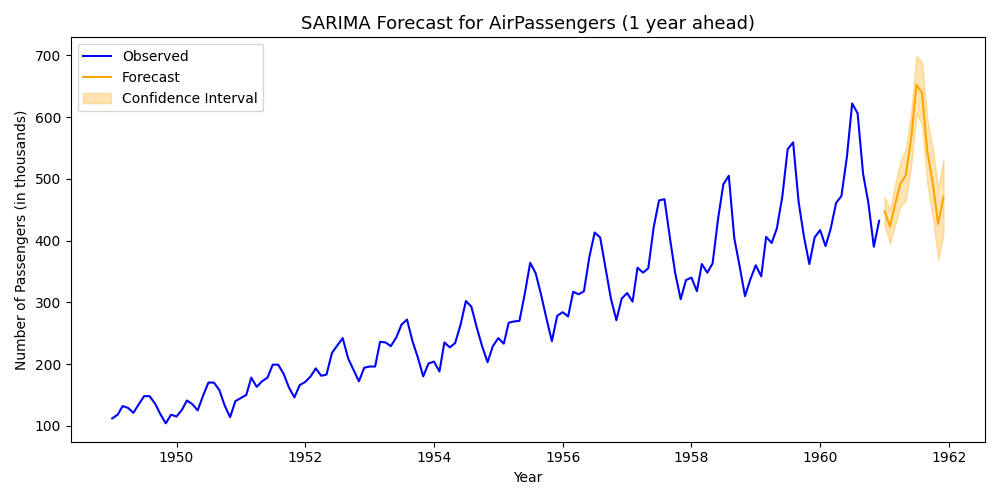

- 파란색: 관측값, 주황색: 1년(12개월) 예측값, 음영: **신뢰구간**
- 예측이 **추세와 계절 패턴을 그대로 이어 가는 모습**
- 먼 미래일수록 **신뢰구간이 넓어짐** → 불확실성 증가

---

## 대안 모델과 최신 도구

### 통계 기반 시계열 모델

**Prophet (by Facebook / Meta)**

- **추세(Trend), 계절성(Seasonality), 이벤트(Holiday)를 독립적으로 모델링**
- 각 성분을 더하는 **가법(additive) 회귀 구조**라 해석이 쉬움
- **결측치·이상치에 강건(Robust)**
- 공휴일, 정책 변경 등 **도메인 이벤트 반영이 쉬움**
- Python / R 모두 지원

**TBATS**

- **T**rigonometric + **B**ox-Cox + **A**RMA + **T**rend + **S**easonal
- **다중 계절성(Multiple Seasonality)** 처리 가능
  - 예: 7일 주기(주간) + 365일 주기(연간)를 동시에 반영
- 단점: 계산량이 많아 **대규모 데이터에서는 학습이 느림**

---

### 딥러닝 기반 시계열 모델

**LSTM (Long Short-Term Memory)**

- 순환신경망(RNN)의 확장형
- **장기 의존성(Long-term dependency) 학습**
- 비선형·복잡한 패턴 학습 가능 (주가, 센서, 로그 등)
- **다변량 시계열 + 외부 요인** 입력 가능
- 단점: **GPU 자원이 많이 필요하고 해석이 어려움**

**TCN (Temporal Convolutional Network)**

- **1D CNN 기반** 시계열 모델
- 시점 순서를 유지한 채 **병렬 학습** 가능
- RNN보다 빠르고 안정적
- 단점: **짧거나 불규칙한 시계열에서는 성능 저하**

---

### Transformer 기반 모델

- **Attention 메커니즘**으로 시점 간 중요도를 동적으로 학습
- 대표 모델: **Informer, TFT, FEDformer**
- 다변량 시계열 + 외부 변수 입력 가능
- 고정 주기의 한계를 넘어 **복잡한 패턴 학습**
- 단점: **대규모 데이터와 GPU 필요, 해석이 어려움**

**시계열 예측의 최신 트렌드**

- **딥러닝 + Attention 기반**으로 고정 주기의 한계를 극복하는 방향

| 구분 | 모델 | 장점 | 단점 |
| --- | --- | --- | --- |
| 전통 통계 | ARIMA / SARIMA | 해석이 쉽고 데이터가 적어도 동작 | 정상성 가정, 단일 계절성 |
| 통계 기반 도구 | Prophet, TBATS | 이벤트·다중 계절성 처리 | TBATS는 학습이 느림 |
| 딥러닝 | LSTM, TCN | 비선형·다변량 패턴 | 데이터·GPU 필요, 해석 어려움 |
| Transformer | Informer, TFT, FEDformer | 장기·복잡 패턴 | 대규모 데이터·GPU 필요 |

---

## 최종 핵심 정리

1. 시계열은 **시간 순서가 중요한 데이터**이며, **추세·계절성·주기·불규칙성**으로 구성됨
2. 분석 전에 **날짜를 datetime으로 바꾸고, `asfreq()`로 간격을 맞추고, 타임존을 확인**해야 함
3. 결측치는 **보간·ffill·bfill**, 이상치는 **IQR·이동평균 편차**로 탐지하고 목적에 맞게 보정
4. **이동평균(윈도우 스무딩)**은 노이즈를 줄여 장기 추세를 보여 주지만, 창이 클수록 반응이 느려짐
5. 시계열 분해는 **변동 폭이 일정하면 가법, 커지면 승법** 모형을 사용
6. 전통 모델은 **정상성**이 필요하며, **ADF 검정(p < 0.05면 정상)**으로 확인하고 **차분·로그/Box-Cox 변환**으로 정상화
7. **ARIMA(p, d, q)**는 자기회귀·차분·이동평균의 결합이며, 계절성은 **SARIMA**, 외생변수는 **ARIMAX/SARIMAX**
8. 모델은 **AIC/BIC로 비교**하고, **잔차 진단(Ljung-Box, JB, H)**으로 적합도를 확인

---

End.
