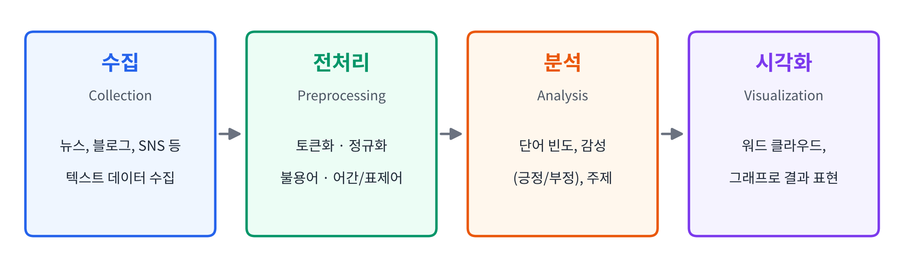
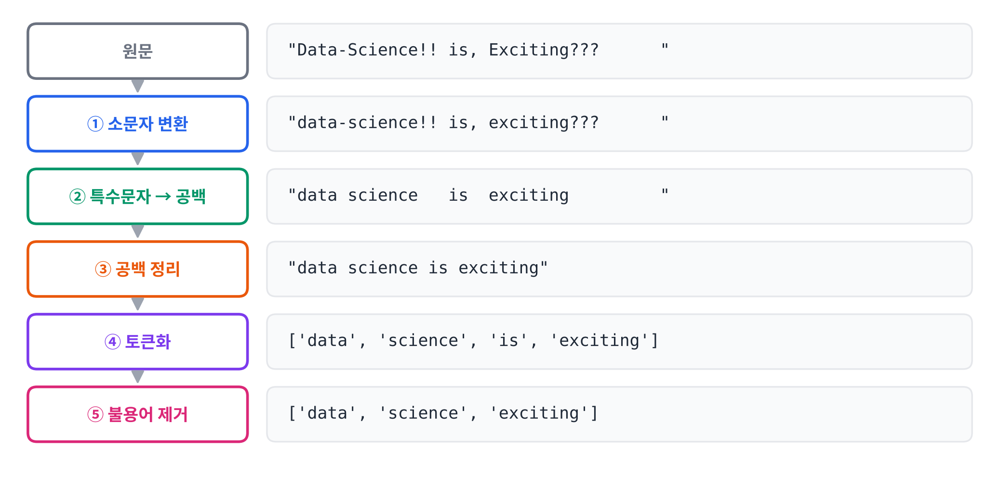
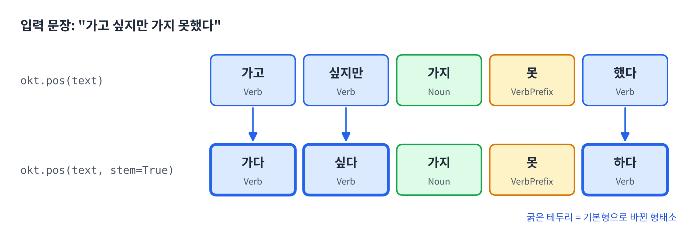
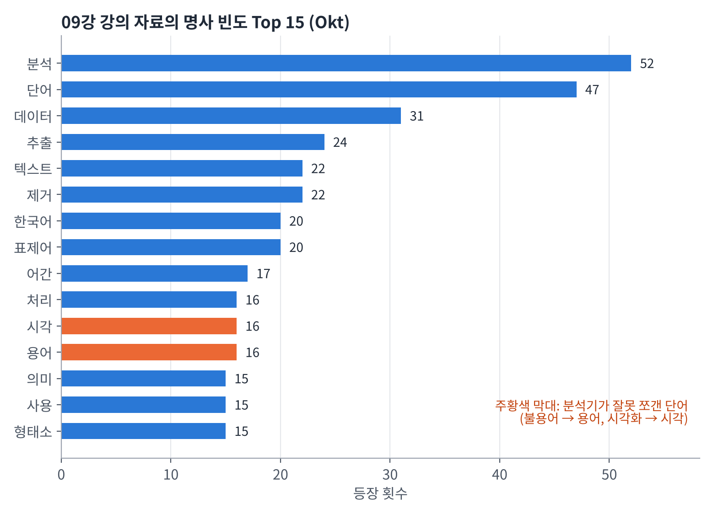
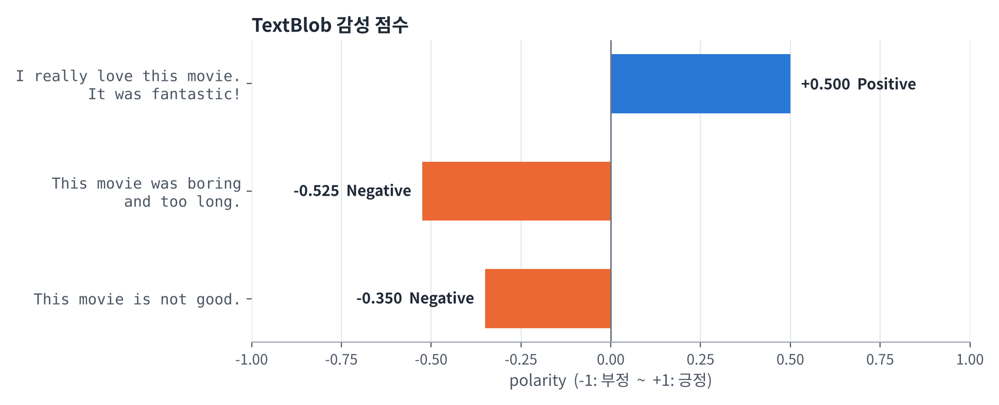

## 학습 목표

- 텍스트 마이닝 흐름과 비정형 데이터 특성 이해
  - **수집 → 전처리 → 분석 → 시각화**
- 영어·한국어 전처리 기법
  - 토큰화, 정규화, 불용어·어간/표제어 처리
- 단어 빈도 분석과 시각화
- 감성 분석 수행과 결과 해석
- 워드 클라우드 등 시각화 기법 적용

---

## 텍스트 데이터란?

### 텍스트 데이터와 텍스트 마이닝

- 현대 사회에서 우리가 남기는 데이터의 상당수는 **텍스트 형태**로 존재
  - 예: 뉴스, SNS, 리뷰, 이메일, 논문 등
- 이런 데이터는 **비정형 데이터(Unstructured Data)**
  - 숫자·표 형태의 **구조적 데이터(Structured Data)**와 달리 **일정한 형식이 없음**

**텍스트 마이닝(Text Mining)이란?**

- **텍스트 데이터를 분석해 의미 있는 정보를 추출하는 기술**
- **자연어처리(NLP)** 기술과 밀접하게 연결되어 있음

| 구분 | 구조적 데이터 | 비정형 데이터 (텍스트) |
| --- | --- | --- |
| 형태 | 행과 열이 정해진 표 | 정해진 형식이 없는 문장 |
| 예시 | 매출표, 센서 측정값 | 뉴스, 리뷰, SNS 댓글 |
| 바로 계산 가능? | 가능 | **불가능** → 숫자로 바꾸는 전처리가 필요 |

---

### 텍스트 분석 단계



| 단계 | 설명 |
| --- | --- |
| **수집** (Collection) | 뉴스, 블로그, SNS 등에서 텍스트 데이터를 수집 |
| **전처리** (Preprocessing) | 불필요한 기호나 단어를 제거하고 정제 |
| **분석** (Analysis) | 단어 빈도, 감성(긍정/부정), 주제 등을 분석 |
| **시각화** (Visualization) | 워드 클라우드, 그래프 등으로 결과 표현 |

---

## 텍스트 전처리

### 토큰화(Tokenization)

**토큰화란?**

- **문장을 단어나 의미 있는 단위로 나누는 과정**

예:

- `"데이터 사이언스는 흥미로운 학문이다"`
- → `[데이터, 사이언스는, 흥미로운, 학문이다]`

이 예시는 **공백 기준**으로 나눈 결과라서 `사이언스는`, `학문이다`처럼 조사·어미가 붙어 있음 → 한국어는 **형태소 분석기**가 필요한 이유

---

### NLTK 소개

**NLTK (Natural Language Tool Kit)**

- 파이썬에서 가장 널리 쓰이는 **자연어처리(NLP) 라이브러리** 중 하나
- **영어 텍스트 분석**에 강력한 도구로, 교육용·연구용으로 매우 자주 활용
- **한국어** 텍스트는 **KoNLPy** 같은 별도의 형태소 분석기가 필요

| 기능 | 설명 |
| --- | --- |
| 토큰화 (Tokenization) | 문장을 단어, 문장 등으로 분리 |
| 불용어 제거 (Stopword Removal) | 의미 없는 단어 제거 |
| 표제어 추출 (Lemmatization) | 단어의 기본형(표제어)으로 변환 |
| 감성 분석 (Sentiment Analysis) | 문장의 긍·부정 감정 분석 |
| 말뭉치 (Corpus) 제공 | 영어 텍스트 샘플 및 사전 데이터 포함 |

**NLTK 실습**

- 설치: `pip install nltk`
- 토큰화·불용어·표제어 기능은 **데이터를 따로 내려받아야** 사용 가능 (최초 1회만 실행)

```python
import nltk

# 최초 한 번만 실행 (이후에는 필요 없음)
# nltk.download("punkt")       # 토큰화용 데이터
# nltk.download("punkt_tab")   # 토큰화용 데이터 (최신 NLTK에서 필요)
# nltk.download("stopwords")   # 불용어 리스트
# nltk.download("wordnet")     # 표제어 추출용 데이터

text = "Data Science is an exciting field."
tokens = nltk.word_tokenize(text)
print(tokens)
```

실행 결과

```text
['Data', 'Science', 'is', 'an', 'exciting', 'field', '.']
```

- 마침표 `.`도 **하나의 토큰**으로 분리됨

---

### 한국어 토큰화

**한국어의 특징**

- **조사, 어미, 복합명사**가 많아서 단순히 공백 기준으로는 단어를 나누기 어려움
- 한국어 문장은 **전용 형태소 분석기**를 사용
- 대표 라이브러리는 **KoNLPy**이며, 내부에 여러 분석기(**Okt, Komoran, Mecab** 등)를 포함
- 다양한 한국어 분석기: [한국어 토큰화 비교](https://www.deepshark.org/courses/data_science/w/09_text_data_analysis#ko-tokenization)

**Okt (Open Korean Text)**

- 한국어 문장을 **형태소 단위로 나누고, 각 단어의 품사**를 알려 주는 형태소 분석기
- 원래 이름은 **트위터 형태소 분석기(Twitter)**였고, 나중에 Okt로 이름이 바뀜
- 한국어 자연어처리(NLP)에서 많이 사용

**KoNLPy 실습**

- 설치: `pip install konlpy`
- KoNLPy는 내부적으로 **Java**를 사용하므로, **JDK가 설치**되어 있어야 함

```python
from konlpy.tag import Okt

okt = Okt()
text = "데이터 사이언스는 정말 흥미로운 학문이다."

print("토큰:", okt.morphs(text))          # 형태소 단위로 분리
print("품사 태깅:", okt.pos(text))        # (형태소, 품사) 쌍
print("명사:", okt.nouns(text))           # 명사만 추출
```

실행 결과 (KoNLPy 0.6.0)

```text
토큰: ['데이터', '사이언스', '는', '정말', '흥미로운', '학문', '이다', '.']
품사 태깅: [('데이터', 'Noun'), ('사이언스', 'Noun'), ('는', 'Josa'), ('정말', 'Noun'), ('흥미로운', 'Adjective'), ('학문', 'Noun'), ('이다', 'Josa'), ('.', 'Punctuation')]
명사: ['데이터', '사이언스', '정말', '학문']
```

| 메서드 | 역할 |
| --- | --- |
| `morphs()` | 형태소 단위로 분리 |
| `pos()` | 형태소와 **품사**를 함께 반환 (Noun, Josa, Adjective 등) |
| `nouns()` | **명사만** 추출 |

- 강의 자료에서는 `정말`이 **Adverb(부사)**로 나오지만, 직접 실행했을 때는 **Noun**으로 분석되어 명사 목록에도 포함됨
- 이처럼 **분석기 버전과 사전에 따라 결과가 조금씩 달라질 수 있음**

---

### 정규화(Normalization)

**정규화란?**

- **텍스트 데이터를 일관된 형태로 바꾸는 과정**
- 같은 의미의 단어라도 표현 방식이 다르면, **컴퓨터는 서로 다른 단어로 인식**
  - `"Data"`, `"data."`, `"DATA!"`, `"data?"` → 사람이 보기엔 모두 `data`이지만, 컴퓨터는 **각각 다른 단어**로 처리

컴퓨터는 문자를 **숫자(유니코드)**로 저장하기 때문에 대문자 `D`와 소문자 `d`는 완전히 다른 값임

| 단어 | 각 문자의 유니코드 (10진수) |
| --- | --- |
| `Data` | 68, 97, 116, 97 |
| `data` | **100**, 97, 116, 97 |

**정규화의 목표**

- **"사람이 보기엔 같지만, 컴퓨터는 다르게 보는" 단어들을 하나의 형태로 통일**
- → 단어 중복이 줄고, **분석 정확도가 크게 향상**

---

### 정규화 변환 방법

| 단계 | 설명 | 예시 |
| --- | --- | --- |
| **소문자 변환** (Lowercasing) | 대소문자 구분을 없애 동일 단어로 인식 | `"Data"`, `"DATA"` → `"data"` |
| **특수문자 제거** | 문장부호나 불필요한 기호 제거 | `"data-science!!"` → `"data science"` |
| **공백 정리** | 여러 개의 공백을 하나로 줄임 | `"data   science"` → `"data science"` |
| **숫자/이모티콘 제거** (필요 시) | 분석 목적에 따라 숫자·이모티콘을 제거하거나 유지 | `"2024년 데이터 😊"` → `"년 데이터"` (숫자·이모티콘 제거 시) |

- 숫자나 이모티콘은 **무조건 지우는 대상이 아님**
  - 예: 감성 분석에서는 `😊`, `ㅠㅠ`가 중요한 단서, 연도별 분석에서는 `2024`가 핵심 정보

---

### re 모듈

**re 모듈이란?**

- **정규표현식(Regular Expression)**을 다루는 파이썬 표준 라이브러리
- 단순히 "기호를 지운다" 수준을 넘어, 데이터를 **깨끗하고 분석하기 좋은 형태로 만드는 정제 도구**

| 구분 | 설명 |
| --- | --- |
| [Python 공식 문서](https://docs.python.org/3/library/re.html) | re 모듈의 모든 함수(`match`, `search`, `sub`, `findall` 등)의 동작과 인자 설명 |
| [정규표현식 HOWTO](https://docs.python.org/3/howto/regex.html) | 초보자를 위한 공식 입문 가이드, 메타문자·그룹·수량자 등의 원리 설명 |
| [Real Python 튜토리얼](https://realpython.com/regex-python/) | 실습 중심 예제로 단계별 학습에 적합 |
| [note.nkmk.me 정리](https://note.nkmk.me/en/python-re-match-search-findall-etc/) | `match`, `search`, `findall` 등의 차이를 한눈에 비교 |

**re 간단 실습**



```python
import re

text = "Data-Science!! is, Exciting???      "

# 모든 문자를 소문자로 변환
text = text.lower()

# 알파벳(a~z)과 공백(\s)을 제외한 나머지를 모두 공백으로 치환
text = re.sub(r"[^a-z\s]", " ", text)

# 공백이 여러 개 이어지면 하나로 줄이고, 양쪽 공백 제거
text = re.sub(r"\s+", " ", text).strip()

print(text)
```

실행 결과

```text
data science is exciting
```

- `[^a-z\s]`: 알파벳과 공백이 **아닌** 문자 (`[ ]` 안의 `^`는 "제외")
- `\s+`: 공백 문자(스페이스, 탭, 줄바꿈 등)가 **하나 이상** 연속된 부분
- 강의 자료에는 결과가 `datascience is exciting`으로 되어 있지만, 실제로는 `-`가 **공백으로 치환**되므로 `data science`로 나뉨

---

### 불용어(Stopwords) 제거

**불용어란?**

- 텍스트에 **자주 등장하지만 분석 목적에 큰 기여를 하지 않는 단어**
- "의미가 없다"기보다는 **구분력을 떨어뜨리거나 노이즈가 되는 경향**이 있어서 제거
  - 영어: `the`, `is`, `and`
  - 한국어: 조사·어미 `은`, `는`, `이`, `가`, `을`, `를`, `에`, `와`, `과` 등
- ⭐️ **불용어는 절대적인 목록이 아니라 과제·도메인에 따라 달라짐** ⭐️

**제거하면 안 되는 불용어**

| 종류 | 예 | 이유 |
| --- | --- | --- |
| **부정어/부사** | not, no, never, 없다, 않다, 못하다 | **감성 분석**에서 결정적인 의미 |
| **지시어/의문사** | what, where, how / 이것, 저것, 여기 | **검색, QA 시스템**에서 핵심 역할 |
| **짧은 문장의 단어** | SNS, 댓글 | 문장이 짧으면 불용어를 지울 때 **전체 의미가 사라짐** |

부정어를 지우면 어떻게 되는지 직접 확인해 보면 다음과 같음

```python
from nltk.corpus import stopwords
from nltk.tokenize import word_tokenize

text = "This movie is not good and the ending was not satisfying."
tokens = [t.lower() for t in word_tokenize(text) if t.isalpha()]

stop_en = set(stopwords.words("english"))
print("기본 불용어 제거:", [t for t in tokens if t not in stop_en])

keep = {"not", "no", "never"}          # 화이트리스트 (부정어 보존)
stop_custom = stop_en - keep
print("부정어 보존:   ", [t for t in tokens if t not in stop_custom])
```

실행 결과

```text
기본 불용어 제거: ['movie', 'good', 'ending', 'satisfying']
부정어 보존:    ['movie', 'not', 'good', 'ending', 'not', 'satisfying']
```

- NLTK 기본 불용어 목록에는 **`not`이 들어 있음**
- 그대로 쓰면 "좋지 않다"는 리뷰가 `good`, `satisfying`만 남아 **긍정처럼 보이게 됨**
- 그래서 감성 분석에서는 **부정어를 화이트리스트로 보존**해야 함

---

### 불용어 설계 가이드

| 단계 | 설명 |
| --- | --- |
| **1. 기본 리스트 사용** | 영어: `nltk.corpus.stopwords.words("english")` / 한국어: KoNLPy로 형태소 분석 후 **조사(Josa), 어미(Eomi)** 제거 |
| **2. 화이트리스트 정의** (보존할 단어) | 부정어·강조어(예: not, 없다, 않다)는 **제거하지 않음** |
| **3. 빈도 기반 제거** | 문서의 일정 비율 이상 등장하는 단어(`max_df`), 너무 희귀한 단어(`min_df`)는 제거 |
| **4. 지속적 업데이트** | 분석 결과를 검토하며 커스텀 불용어 목록을 보완 |

- `max_df`, `min_df`는 scikit-learn의 `CountVectorizer`, `TfidfVectorizer`에서 쓰는 옵션
  - `max_df=0.9`: 문서의 90% 이상에 등장하는 단어 제거
  - `min_df=2`: 2개 미만의 문서에만 등장하는 단어 제거

실습 코드

- [영어 불용어 제거 실습](https://www.deepshark.org/courses/data_science/w/09_text_data_analysis#en_stopword)
- [한국어 불용어 제거 실습](https://www.deepshark.org/courses/data_science/w/09_text_data_analysis#ko_stopword)

---

### 어간 추출(Stemming)

**어간 추출과 표제어 추출**

- 단어의 **다양한 변형 형태를 하나의 공통된 형태로 통일**하는 과정

**어간(Stem)이란?**

- 단어의 기본 형태 중에서 **변하지 않는 핵심 부분**
- 동사의 시제, 명사의 복수형 등은 변해도, 어간은 **단어의 뿌리** 역할
- 단어 변화의 공통된 부분으로, 의미를 유지하는 최소 단위

| 원형 단어 | 변형된 형태 | 공통 어간 (Porter) |
| --- | --- | --- |
| play | playing, played, plays | **play** |
| study | studying, studied, studies | **studi** |
| move | moving, moved, moves | **move** |

- `studi`처럼 **실제 단어가 아닌 형태**가 나올 수 있음
- 강의 자료에는 move의 어간이 `mov`로 되어 있지만, 직접 실행해 보면 **Porter Stemmer는 `move`**, **Lancaster Stemmer는 `mov`**를 반환함 → **어떤 Stemmer를 쓰는지에 따라 결과가 다름**

---

### 표제어 추출(Lemmatization)

**표제어(Lemma)란?**

- **사전(dictionary)에 등록된 단어의 기본형**
- 단어의 **품사(POS)와 문법 규칙을 고려**하여 의미적으로 올바른 기본 형태로 변환
- 예: `better`는 어간 추출로는 그대로 남지만, 표제어 추출(형용사 기준)에서는 `good`으로 바뀜

| 단어 | 표제어 (Lemma) | 품사 |
| --- | --- | --- |
| running | run | 동사 (verb) |
| studies | study | 동사 (verb) |
| better | good | 형용사 (adj) |
| was | be | 동사 (verb) |

---

### 어간 추출 vs. 표제어 추출

| 구분 | 어간 추출 (Stemming) | 표제어 추출 (Lemmatization) |
| --- | --- | --- |
| 정의 | 단순히 단어의 **어미를 자르고** 통일 | **사전과 품사 정보**로 의미적으로 정확한 기본형 변환 |
| 예시 | studying → **studi** | studying → **study** |
| 결과 형태 | **실제 단어가 아닐 수 있음** | **실제 존재하는 단어** |
| 처리 속도 | 빠름 | 느리지만 정확함 |
| 사용 목적 | 단순 검색, 키워드 중심 분석 | 문법적·의미적 분석이 필요한 작업 |

**어간 및 표제어 추출 실습**

```python
from nltk.stem import PorterStemmer, WordNetLemmatizer
from nltk.corpus import wordnet

stemmer = PorterStemmer()          # 어간 추출 (Stemming)
lemmatizer = WordNetLemmatizer()   # 표제어 추출 (Lemmatization)

words = ["studies", "studying", "studied", "better", "running"]

print(f"{'단어':<10}{'어간추출':<10}{'표제어(동사)':<14}{'표제어(형용사)'}")
for w in words:
    stem = stemmer.stem(w)
    lemma_v = lemmatizer.lemmatize(w, pos=wordnet.VERB)
    lemma_a = lemmatizer.lemmatize(w, pos=wordnet.ADJ)
    print(f"{w:<10}{stem:<10}{lemma_v:<14}{lemma_a}")
```

실행 결과

```text
단어        어간추출      표제어(동사)       표제어(형용사)
studies   studi     study         studies
studying  studi     study         studying
studied   studi     study         studied
better    better    better        good
running   run       run           running
```

**(중요!!) 품사를 맞게 지정해야 표제어가 제대로 나옴**

- 강의 코드는 모든 단어를 `pos=wordnet.VERB`(동사)로 처리하는데, 이 경우 **`better`는 `good`이 되지 않고 그대로 `better`**
- `better`는 형용사이므로 `pos=wordnet.ADJ`로 지정해야 **`good`**이 나옴
- 반대로 `studies`, `running`은 형용사로 지정하면 바뀌지 않음 → **단어마다 올바른 품사**를 넣어야 함
- 또한 Porter Stemmer는 `running`을 **`run`**으로 줄임 (강의 자료의 `runn`과 다름)

---

### 한국어에서 어간·표제어 추출을 따로 하지 않는 이유

#### ① 형태가 복잡하고 규칙이 단순하지 않음

- 영어는 `run → running`, `study → studying`처럼 **접사 규칙이 단순**
- 한국어는 **어미 변화와 조사 결합이 매우 다양**

| 원형 | 변형된 형태 |
| --- | --- |
| 가다 | 갑니다, 가요, 가고, 갔지만, 가니까, 가려면 |
| 하다 | 합니다, 해요, 했지만, 하는, 하려고, 하겠다고 |

#### ② 대신 형태소 분석(Morphological Analysis)을 사용

- 어미를 단순히 자르는 것보다, 문장을 **형태소 단위로 나누고 각 형태소의 품사를 분석**하는 방식이 훨씬 정확

#### ③ KoNLPy 분석기가 이미 "어간화" 옵션을 제공

- `Okt.pos(text, stem=True)`를 쓰면 자동으로 기본형으로 바뀜
  - `필요하다 → 필요`, `먹었다 → 먹다`, `한다 → 하다`
- 영어의 Lemmatizer처럼 **별도 단계가 아니라, 형태소 분석 단계에서 표제어 처리가 함께 수행**됨



```python
from konlpy.tag import Okt

okt = Okt()
text = "가고 싶지만 가지 못했다"

print("기본:      ", okt.pos(text))
print("stem=True: ", okt.pos(text, stem=True))
```

실행 결과 (KoNLPy 0.6.0)

```text
기본:       [('가고', 'Verb'), ('싶지만', 'Verb'), ('가지', 'Noun'), ('못', 'VerbPrefix'), ('했다', 'Verb')]
stem=True:  [('가다', 'Verb'), ('싶다', 'Verb'), ('가지', 'Noun'), ('못', 'VerbPrefix'), ('하다', 'Verb')]
```

- `stem=True`를 주면 `가고 → 가다`, `싶지만 → 싶다`, `했다 → 하다`처럼 **기본형**으로 바뀜
- 다만 `가지`(동사 '가다'의 활용)를 **명사**로 잘못 분석함 → 분석기도 완벽하지 않음
- 강의 자료에는 `('가', 'Verb'), ('고', 'Eomi')`처럼 **어간과 어미를 따로 나눈 결과**가 나오는데, Okt는 `가고`를 **하나의 동사**로 반환함
  - 어미까지 쪼개려면 **Komoran, Kkma** 같은 다른 분석기를 사용해야 함

#### ④ 실제 연구·실무에서는 형태소 기반 처리로 충분

한국어 NLP는 보통 다음 순서로 진행

1. **형태소 분석** (Morphological Analysis) → 품사 정보까지 포함한 토큰화
2. **불용어 제거 + 품사 선택** (예: 명사, 동사만 사용)
3. **임베딩/모델 입력** (Word2Vec, BERT 등)

---

## 단어 빈도 분석

### 단어 빈도 분석(Word Frequency Analysis)이란?

- 문서 안에서 **어떤 단어가 자주 등장하는지 계산**하여 **주제나 핵심 키워드를 빠르게 파악**하는 과정
- 예: 뉴스 기사나 대통령 연설문을 분석하면 `경제`, `국민`, `정책`, `안전` 같은 단어가 자주 등장할 수 있음
- 자주 등장하는 단어는 그 문서의 **핵심 관심사**를 파악하는 데 도움이 됨

**대통령 연설문 단어 빈도 분석 실습**

- 대통령기록관: [https://www.pa.go.kr/research/contents/speech/index.jsp](https://www.pa.go.kr/research/contents/speech/index.jsp)
- 샘플 데이터: 제103주년 3·1절 기념사
- 실습 코드: [대통령 연설문 단어 빈도 분석](https://www.deepshark.org/courses/data_science/w/09_text_data_analysis#word_frequency_president_speech)

### 빈도 분석 예시: 이번 강의 자료

연설문 대신 **이번 강의 자료(PDF)의 한국어 텍스트**에 Okt 명사 추출을 적용해 직접 빈도를 세어 보면 다음과 같음

- 처리 과정: URL 제거 → 한글만 남김 → `okt.nouns()` → 1글자 단어 및 간단한 불용어 제거 → `Counter`로 빈도 계산



- `분석`, `단어`, `데이터`, `추출`, `텍스트`가 상위 → 강의 주제(텍스트 데이터 분석)가 잘 드러남
- ⭐️ **주의**: `용어`(16회)는 사실 `불용어`, `시각`(16회)은 `시각화`가 **잘못 쪼개진 결과** ⭐️
  - 형태소 분석기의 사전에 없는 단어는 이렇게 **엉뚱하게 분리**될 수 있음
  - 빈도 결과를 그대로 믿지 말고 **상위 단어를 직접 확인**해야 하며, 필요하면 **사용자 사전**에 단어를 추가해야 함

---

## 감성 분석

### 감성 분석(Sentiment Analysis)이란?

- 텍스트(문장, 리뷰, 트윗 등)에 담긴 **사람의 감정이나 의견을 자동으로 파악**하는 기술
- 문장이 **긍정(Positive), 부정(Negative), 중립(Neutral)** 중 무엇인지 구분
  - `"I really love this movie. It was fantastic!"` → 긍정 (Positive)
  - `"This movie was boring and too long."` → 부정 (Negative)

**텍스트 데이터 분석에서의 역할**

| 역할 | 설명 |
| --- | --- |
| **의견 요약 및 분류** | 수많은 고객 리뷰나 SNS 댓글을 자동으로 요약하거나 긍·부정 비율로 시각화 |
| **의사결정 지원** | 마케팅, 정치, 주식 시장 등에서 대중의 정서를 수치화하여 데이터 기반 의사결정 |
| **NLP 파이프라인의 핵심 단계** | 다른 분석(추천, 고객 응대 등)의 입력으로 활용 |

---

### TextBlob을 이용한 간단한 감성 분석

**TextBlob이란?**

- 텍스트 데이터를 처리하기 위한 파이썬 라이브러리
- NLP에서 자주 쓰는 작업을 **간단하게 수행할 수 있는 직관적인 API** 제공

**주요 기능**

- 품사 태깅 (Part-of-Speech Tagging)
- 명사구 추출 (Noun Phrase Extraction)
- 감성 분석 (Sentiment Analysis)
- 문서 분류 (Classification)
- 번역 (Translation) 등

```python
from textblob import TextBlob

sentences = [
    "I really love this movie. It was fantastic!",
    "This movie was boring and too long.",
    "This movie is not good.",
]

for s in sentences:
    p = TextBlob(s).sentiment.polarity
    label = "Positive" if p > 0 else "Negative" if p < 0 else "Neutral"
    print(f"{p:+.3f}  {label:<8} {s}")
```

실행 결과

```text
+0.500  Positive I really love this movie. It was fantastic!
-0.525  Negative This movie was boring and too long.
-0.350  Negative This movie is not good.
```



- `polarity`: **-1(부정) ~ +1(긍정)** 사이의 감성 점수
- `not good`처럼 **부정어가 붙은 표현도 부정**으로 판단함 → 앞에서 부정어를 불용어로 지우면 안 되는 이유
- TextBlob의 기본 감성 분석은 **영어 단어 사전 기반**이므로, 한국어 문장에는 그대로 쓸 수 없음
- 실습 코드: [TextBlob 감성 분석](https://www.deepshark.org/courses/data_science/w/09_text_data_analysis#textblob)

---

### 딥러닝 모델을 이용한 감성 분석

**BERT (Bidirectional Encoder Representations from Transformers)**

- **Google이 2018년에 발표**한 언어 모델
- 문맥을 **양방향(앞뒤 문장 모두)**으로 이해하는 **Transformer 기반** 구조
- 문장의 의미나 어휘 간 관계를 깊이 파악

**RoBERTa (Robustly Optimized BERT Approach)**

- **2019년 Facebook AI(현재 Meta AI)**가 발표한 BERT의 개선 버전
- 실습 코드: [RoBERTa 감성 분석](https://www.deepshark.org/courses/data_science/w/09_text_data_analysis#roberta)
- 주의: **GPU가 없으면 오래 걸릴 수 있음**

| 구분 | TextBlob | BERT / RoBERTa |
| --- | --- | --- |
| 방식 | 단어별 감성 점수 사전 | 대규모 데이터로 학습한 딥러닝 모델 |
| 문맥 이해 | 제한적 | **양방향 문맥**을 반영 |
| 속도·자원 | 빠르고 가벼움 | 느리고 **GPU 권장** |

---

## 워드 클라우드 시각화

### 워드 클라우드(Word Cloud)란?

- 텍스트 데이터에서 **단어의 등장 빈도를 시각적으로 표현**하는 방법
- **단어의 크기, 굵기, 색상** 등으로 등장 빈도가 높은 단어일수록 강조
- 긴 문서의 **핵심 주제나 주요 키워드를 한눈에 파악**

앞의 빈도 분석 결과를 그대로 워드 클라우드로 그린 결과


**워드 클라우드를 사용하는 이유**

| 이유 | 설명 |
| --- | --- |
| **요약 효과** | 대량의 텍스트를 읽지 않아도 주요 단어를 직관적으로 확인 |
| **탐색적 분석(EDA)** | 본격적인 분석 이전에 데이터의 전반적 특징 파악 |
| **커뮤니케이션** | 분석 결과를 시각적으로 전달하여 비전문가도 쉽게 이해 |
| **전처리 점검** | 불용어 제거와 형태소 분석이 잘 되었는지 시각적으로 확인 |

- 위 그림에서도 `용어`, `시각`이 크게 보임 → **전처리 점검** 용도로 쓰면 이런 문제를 바로 발견할 수 있음

---

### 장점과 한계

- 시각적으로 아름답고 직관적이지만
- **문맥이나 부정 표현(예: "좋지 않다")을 반영하기 어려움**
- 정밀 분석보다는 **탐색적 시각화나 발표용 요약**에 적합

**사용 도구**

| 환경 | 도구 |
| --- | --- |
| Python | `wordcloud`, `matplotlib`, `konlpy` 조합 |
| R | `wordcloud`, `tm`, `tidytext` 패키지 |
| 시각화 툴 | Tableau, Power BI, Flourish 등 |
| 웹 도구 | Voyant Tools, D3.js, ECharts |

**한국어 분석 시 주의사항**

- 한국어는 조사가 많고 어미 변형이 다양하므로 **형태소 분석을 반드시 수행**
- 의미 없는 조사나 접속사는 **불용어로 제거**

---

### 워드 클라우드 실습

- 설치: `pip install wordcloud`
- 실습 코드: [워드 클라우드 실습](https://www.deepshark.org/courses/data_science/w/09_text_data_analysis#wordcloud)

**운영체제별 한글 폰트 위치**

- 워드 클라우드는 기본 폰트에 한글이 없어서, **한글 폰트 경로(`font_path`)를 직접 지정**해야 글자가 깨지지 않음

| 운영체제 | 폰트 경로 |
| --- | --- |
| Windows | `C:/Windows/Fonts/malgun.ttf` (맑은 고딕) |
| macOS | `/Library/Fonts/AppleGothic.ttf` (애플고딕) |
| Linux / Colab | `/usr/share/fonts/truetype/nanum/NanumGothic.ttf` (나눔고딕) |

- macOS 버전에 따라 애플고딕이 `/System/Library/Fonts/Supplemental/AppleGothic.ttf`에 있을 수도 있음
- 운영체제에 한글 폰트가 없다면 **직접 내려받아 해당 위치에 넣어야** 함

| 폰트 이름 | 라이선스 | 특징 | 배포처 |
| --- | --- | --- | --- |
| 나눔고딕 (Nanum Gothic) | 무료 (NAVER OFL) | 깔끔하고 가독성이 좋아 워드 클라우드나 웹 프로젝트에 자주 사용 | NAVER |
| 카페24 써라운드 (Cafe24 Surround) | 무료, 상업적 사용 가능 | 귀엽고 부드러운 곡선체, 감성적인 디자인에 적합 | 카페24 |
| 배민 도현체 (BM DoHyeon) | 무료, 상업적 사용 가능 | 굵고 임팩트 있는 제목용 폰트 | 배달의민족 |

---

## 최종 핵심 정리

1. 텍스트는 **비정형 데이터**이며, **수집 → 전처리 → 분석 → 시각화** 순서로 분석함
2. **토큰화**: 영어는 NLTK, 한국어는 조사·어미 때문에 **KoNLPy(Okt 등) 형태소 분석기**를 사용
3. **정규화**: 소문자 변환, 특수문자 제거, 공백 정리로 "사람에겐 같지만 컴퓨터에겐 다른" 단어를 통일
4. **불용어는 과제에 따라 다르며**, 감성 분석에서는 `not`, `없다` 같은 **부정어를 지우면 안 됨**
5. **어간 추출**은 빠르지만 실제 단어가 아닐 수 있고, **표제어 추출**은 사전과 **올바른 품사 지정**이 필요함
6. 한국어는 별도의 어간·표제어 단계 대신 **형태소 분석 + `stem=True`**로 기본형을 얻음
7. **단어 빈도 분석**과 **워드 클라우드**로 핵심 키워드를 파악하되, **분석기가 잘못 쪼갠 단어**가 없는지 반드시 확인
8. **감성 분석**은 TextBlob 같은 사전 기반 방법부터 **BERT·RoBERTa** 같은 딥러닝 모델까지 있으며, 문맥 이해력과 계산 비용이 다름

---

End.
