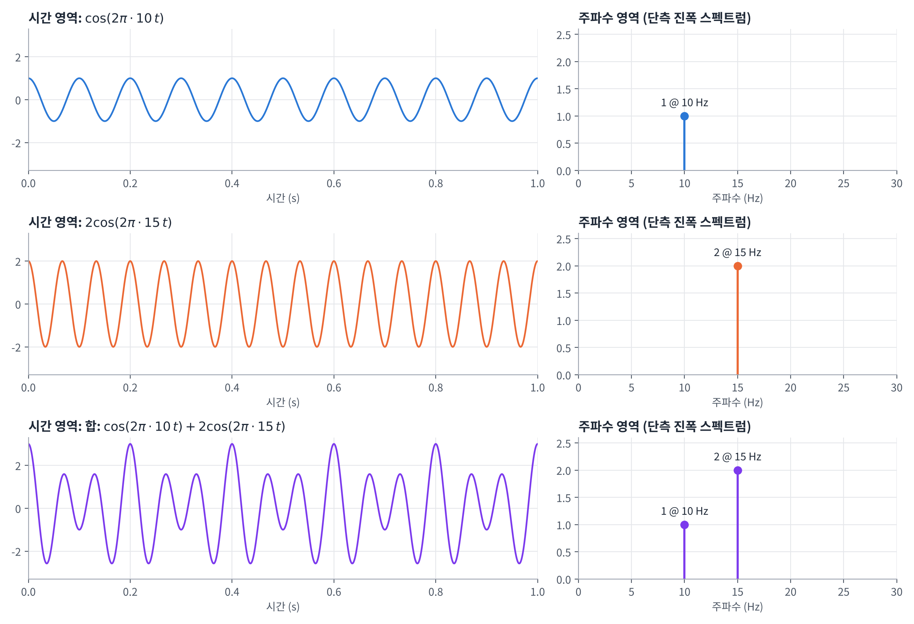
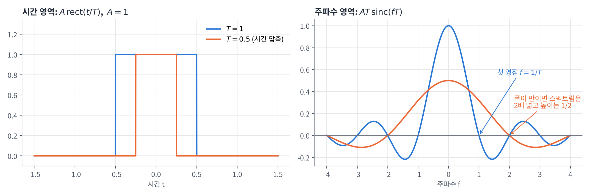
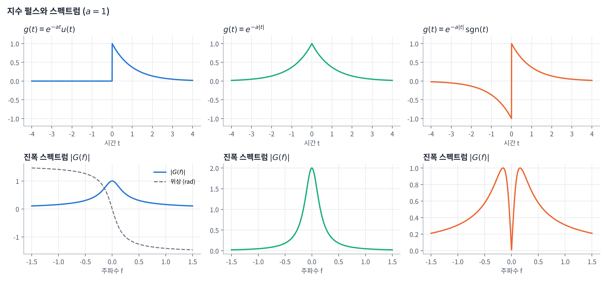
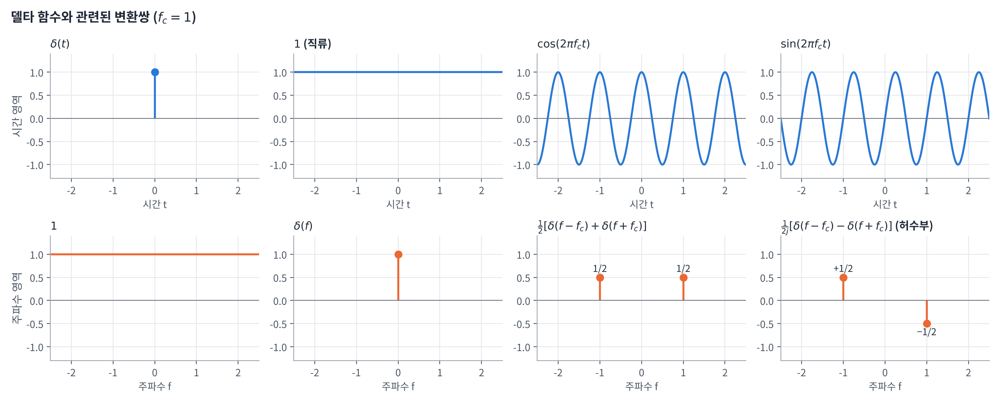
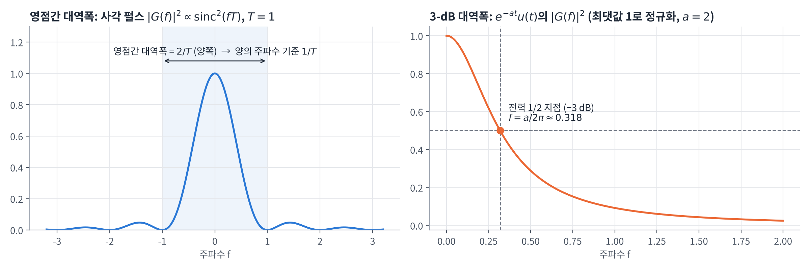
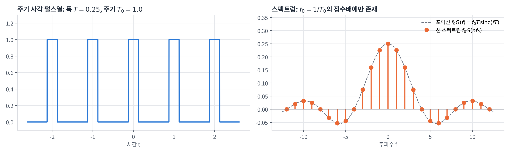
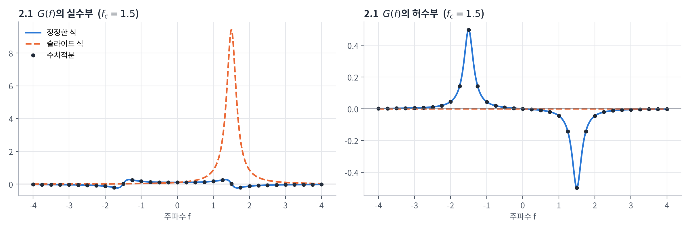
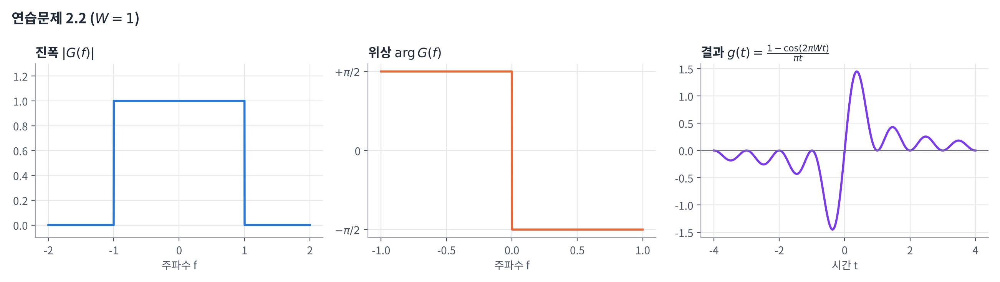
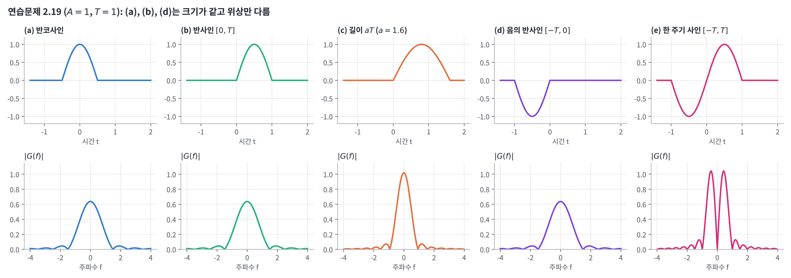

## 학습 목표

- 푸리에 변환의 정의와 존재 조건(디리클레 조건) 이해
- 진폭·위상 스펙트럼, 켤레 대칭 이해
- 푸리에 변환의 성질(선형성, 팽창, 쌍대성, 시간·주파수 이동, 미분·적분, 변조, 컨볼루션, 레일리 에너지 정리) 이해
- 대표 변환쌍(사각 펄스, sinc, 지수 펄스, 델타, 정현파, 부호·계단 함수) 유도
- 대역폭 정의와 시간-대역폭 곱 이해
- 주기 신호의 푸리에 급수와 푸리에 변환의 관계 이해
- 과제 연습문제 2.1 ~ 2.5, 2.8, 2.9, 2.19, 2.24, 2.27 풀이

---

## 시간 영역과 주파수 영역

같은 신호를 **시간에 따른 값**으로 볼 수도 있고, **어떤 주파수 성분이 얼마나 들어 있는지**로 볼 수도 있음



- $$\cos(2\pi \cdot 10\,t)$$ → 주파수 영역에서는 **10 Hz에 크기 1**인 막대 하나
- $$2\cos(2\pi \cdot 15\,t)$$ → **15 Hz에 크기 2**인 막대 하나
- 두 신호의 합은 시간 영역에서는 복잡해 보이지만, 주파수 영역에서는 **막대 두 개**로 간단히 보임

요약:

- **푸리에 변환**은 시간 영역의 신호를 **주파수 영역으로 바꾸는 도구**
- 통신에서는 신호가 **어떤 주파수 대역을 차지하는지**가 핵심이므로, 주파수 영역에서 보는 것이 훨씬 편함

numpy로 위 스펙트럼을 직접 구하면 다음과 같음

```python
import numpy as np

fs = 1000                       # 샘플링 주파수 [Hz]
t = np.arange(0, 1, 1 / fs)     # 1초 동안 1000개 샘플
g = np.cos(2 * np.pi * 10 * t) + 2 * np.cos(2 * np.pi * 15 * t)

G = np.fft.rfft(g)                          # 양의 주파수 쪽 스펙트럼
f = np.fft.rfftfreq(len(g), 1 / fs)
amp = np.abs(G) / len(g) * 2                # 단측(single-sided) 진폭으로 환산
amp[0] /= 2                                 # 0 Hz(직류)는 2배 하지 않음

for k in np.where(amp > 0.1)[0]:
    print(f"{f[k]:.0f} Hz: 진폭 {amp[k]:.2f}")
```

실행 결과

```text
10 Hz: 진폭 1.00
15 Hz: 진폭 2.00
```

---

## 푸리에 변환의 정의

**푸리에 변환 (Fourier Transform)**

$$
G(f) = \mathcal{F}[g(t)] = \int_{-\infty}^{\infty} g(t)\, e^{-j2\pi f t}\, dt
$$

**역 푸리에 변환 (Inverse Fourier Transform)**

$$
g(t) = \mathcal{F}^{-1}[G(f)] = \int_{-\infty}^{\infty} G(f)\, e^{+j2\pi f t}\, df
$$

- 정변환과 역변환은 **지수의 부호만 다름** → 뒤에서 나오는 **쌍대성**의 근거
- 이 글에서는 $$g(t) \rightleftharpoons G(f)$$로 변환쌍을 표기

### 푸리에 변환이 존재하기 위한 충분조건: 디리클레 조건(Dirichlet's conditions)

1. $$g(t)$$는 **단일 값**을 가지며, 유한한 시간 구간 안에서 **극대·극소점의 개수가 유한**함
2. $$g(t)$$는 유한한 시간 구간 안에서 **불연속점의 개수가 유한**함
3. $$g(t)$$는 **절대 적분 가능**함

$$
\int_{-\infty}^{\infty} \lvert g(t) \rvert\, dt < \infty
$$

- **충분조건**이라서 만족하지 않아도 변환이 존재할 수 있음
- 예: $$\cos$$, 직류 1, $$\mathrm{sgn}(t)$$, $$u(t)$$는 절대 적분 불가능하지만 **델타 함수**를 써서 변환을 정의함 (뒤에서 다룸)

### 각주파수와 복소 정현파

**각주파수**

$$
\omega = 2\pi f \quad [\text{rad/s}]
$$

**오일러 공식과 복소 정현파**

$$
e^{jx} = \cos x + j \sin x, \qquad \cos x = \frac{e^{jx} + e^{-jx}}{2}, \qquad \sin x = \frac{e^{jx} - e^{-jx}}{2j}
$$

- 실수 코사인 하나 = **양의 주파수와 음의 주파수에 있는 복소 지수 두 개의 합**
- 그래서 스펙트럼에 **음의 주파수**가 나타남

---

## 진폭 스펙트럼, 위상 스펙트럼, 켤레 대칭

푸리에 변환 $$G(f)$$는 **$$f$$에 대한 복소 함수**

$$
G(f) = \lvert G(f) \rvert\, e^{j\theta(f)}
$$

| 기호 | 의미 | numpy |
| --- | --- | --- |
| $$\lvert G(f) \rvert$$ | $$g(t)$$의 **진폭(amplitude) 스펙트럼** | `np.abs()` |
| $$\theta(f)$$ | $$g(t)$$의 **위상(phase) 스펙트럼** | `np.angle()` |

### 복소 켤레 대칭 (Conjugate Symmetry)

**$$g(t)$$가 실수 함수이면**

$$
G(-f) = G^*(f) \qquad (\ast: \text{복소 켤레})
$$

| 성질 | 의미 |
| --- | --- |
| $$\lvert G(-f) \rvert = \lvert G(f) \rvert$$ | **진폭은 주파수에 대해 좌우 대칭** (우함수) |
| $$\theta(-f) = -\theta(f)$$ | **위상은 원점 대칭** (기함수) |

증명: $$g(t)$$가 실수이면 $$g^*(t) = g(t)$$이므로

$$
G^*(f) = \left[ \int_{-\infty}^{\infty} g(t)\, e^{-j2\pi f t}\, dt \right]^* = \int_{-\infty}^{\infty} g(t)\, e^{+j2\pi f t}\, dt = G(-f)
$$

- 실수 신호의 스펙트럼은 **양의 주파수 쪽만 알면 음의 주파수 쪽은 자동으로 결정**됨
- 그래서 앞의 그림처럼 **단측(single-sided) 스펙트럼**으로 그려도 정보가 빠지지 않음

### 켤레 규칙 (Conjugation Rule)

$$
g(t) \rightleftharpoons G(f) \quad \Longrightarrow \quad g^*(t) \rightleftharpoons G^*(-f)
$$

---

## 푸리에 변환의 성질

| 성질 | 시간 영역 | 주파수 영역 |
| --- | --- | --- |
| **선형성** (중첩) | $$c_1 g_1(t) + c_2 g_2(t)$$ | $$c_1 G_1(f) + c_2 G_2(f)$$ |
| **팽창** (시간 척도) | $$g(at)$$ | $$\dfrac{1}{\lvert a \rvert} G\!\left(\dfrac{f}{a}\right)$$ |
| **쌍대성** (Duality) | $$G(t)$$ | $$g(-f)$$ |
| **시간 이동** | $$g(t - t_0)$$ | $$G(f)\, e^{-j2\pi f t_0}$$ |
| **주파수 이동** | $$g(t)\, e^{j2\pi f_c t}$$ | $$G(f - f_c)$$ |
| **$$g(t)$$의 면적** | $$\int g(t)\, dt$$ | $$G(0)$$ |
| **$$G(f)$$의 면적** | $$g(0)$$ | $$\int G(f)\, df$$ |
| **시간 미분** | $$\dfrac{d^n}{dt^n} g(t)$$ | $$(j2\pi f)^n G(f)$$ |
| **시간 적분** | $$\int_{-\infty}^{t} g(\tau)\, d\tau$$ | $$\dfrac{G(f)}{j2\pi f} + \dfrac{G(0)}{2}\delta(f)$$ |
| **변조** (곱셈) | $$g_1(t)\, g_2(t)$$ | $$G_1(f) * G_2(f)$$ |
| **컨볼루션** | $$g_1(t) * g_2(t)$$ | $$G_1(f)\, G_2(f)$$ |

### 선형성 (Linearity, Superposition)

$$
\mathcal{F}[c_1 g_1(t) + c_2 g_2(t)] = c_1 \int g_1(t) e^{-j2\pi f t} dt + c_2 \int g_2(t) e^{-j2\pi f t} dt = c_1 G_1(f) + c_2 G_2(f)
$$

- 적분이 선형이므로 바로 성립
- 강의 자료 10·12쪽에 $$c_1 G_1(f) + c_2 G_1(f)$$로 된 부분은 **$$c_1 G_1(f) + c_2 G_2(f)$$의 오타**

### 팽창 (Dilation, Time Scaling)

$$
g(at) \rightleftharpoons \frac{1}{\lvert a \rvert} G\!\left(\frac{f}{a}\right)
$$

유도: $$u = at$$로 치환하면 $$dt = du / a$$

$$
\int_{-\infty}^{\infty} g(at)\, e^{-j2\pi f t}\, dt = \frac{1}{\lvert a \rvert} \int_{-\infty}^{\infty} g(u)\, e^{-j2\pi (f/a) u}\, du = \frac{1}{\lvert a \rvert} G\!\left(\frac{f}{a}\right)
$$

- $$a > 0$$이면 적분 구간이 그대로, $$a < 0$$이면 구간이 뒤집혀서 부호가 바뀌므로 $$\lvert a \rvert$$가 됨
- 특히 $$a = -1$$이면 **시간 반전**: $$g(-t) \rightleftharpoons G(-f)$$
- 예: $$s(2t) \rightleftharpoons \frac{1}{2} S\!\left(\frac{f}{2}\right)$$ → 시간에서 **2배 압축** = 주파수에서 **2배 확장 + 높이 1/2**

### 쌍대성 (Duality)

$$
g(t) \rightleftharpoons G(f) \quad \Longrightarrow \quad G(t) \rightleftharpoons g(-f)
$$

유도:

$$
\int_{-\infty}^{\infty} G(t)\, e^{-j2\pi f t}\, dt = \int\!\!\int g(\tau)\, e^{-j2\pi t (f + \tau)}\, d\tau\, dt = \int g(\tau)\, \delta(\tau + f)\, d\tau = g(-f)
$$

- 정변환과 역변환이 **지수 부호만 다른 같은 꼴**이라서, 아는 변환쌍의 **시간과 주파수를 바꿔서** 새 변환쌍을 얻을 수 있음

### 시간 이동과 주파수 이동

**시간 이동 (Time Shifting)**: $$u = t - t_0$$로 치환

$$
\int g(t - t_0)\, e^{-j2\pi f t}\, dt = e^{-j2\pi f t_0} \int g(u)\, e^{-j2\pi f u}\, du = G(f)\, e^{-j2\pi f t_0}
$$

- 시간 이동은 **진폭 스펙트럼은 그대로, 위상만 $$-2\pi f t_0$$만큼** 바꿈

**주파수 이동 (Frequency Shifting)**: $$v = f - f_c$$로 치환

$$
\int G(f - f_c)\, e^{j2\pi f t}\, df = e^{j2\pi f_c t} \int G(v)\, e^{j2\pi v t}\, dv = g(t)\, e^{j2\pi f_c t}
$$

- 신호에 $$e^{j2\pi f_c t}$$를 곱하면 스펙트럼이 **$$f_c$$만큼 옮겨짐** → **변조의 수학적 원리**

### 면적 성질

$$
\int_{-\infty}^{\infty} g(t)\, dt = G(0), \qquad g(0) = \int_{-\infty}^{\infty} G(f)\, df
$$

- 정의식에 $$f = 0$$ 또는 $$t = 0$$을 넣으면 $$e^0 = 1$$이 되어 바로 나옴
- 손으로 구한 변환이 맞는지 **검산할 때 매우 유용**함

### 시간 영역 미분

$$
\frac{d}{dt} g(t) = \frac{d}{dt} \int G(f)\, e^{j2\pi f t}\, df = \int (j2\pi f)\, G(f)\, e^{j2\pi f t}\, df \quad \Longrightarrow \quad \frac{d}{dt} g(t) \rightleftharpoons j2\pi f\, G(f)
$$

- $$n$$번 미분하면 $$(j2\pi f)^n G(f)$$
- 미분은 **높은 주파수 성분을 키움** (곱해지는 $$f$$가 클수록 커짐)

### 시간 영역 적분

$$x(t) = \int_{-\infty}^{t} g(\tau)\, d\tau$$로 두면 $$\dfrac{d}{dt} x(t) = g(t)$$이므로 $$j2\pi f\, X(f) = G(f)$$

$$
\int_{-\infty}^{t} g(\tau)\, d\tau \rightleftharpoons \frac{1}{j2\pi f} G(f) + \frac{G(0)}{2} \delta(f)
$$

- 강의 자료 30쪽은 $$\frac{1}{j2\pi f} G(f)$$까지만 나와 있는데, 이것은 **$$G(0) = 0$$일 때의 형태**
- $$G(0) \neq 0$$(면적이 0이 아님)이면 적분 결과에 **직류 성분이 남으므로** $$\frac{G(0)}{2}\delta(f)$$ 항이 필요함
- 예: $$\delta(t)$$를 적분하면 $$u(t)$$인데, $$u(t) \rightleftharpoons \frac{1}{j2\pi f} + \frac{1}{2}\delta(f)$$ (뒤에서 유도)

### 변조 정리 (Modulation Theorem): 시간 영역의 곱셈

$$
g_1(t)\, g_2(t) \rightleftharpoons \int_{-\infty}^{\infty} G_1(\lambda)\, G_2(f - \lambda)\, d\lambda \equiv G_1(f) * G_2(f)
$$

유도: $$g_2(t)$$를 역변환 꼴로 쓰고 적분 순서를 바꿈

$$
\mathcal{F}[g_1 g_2] = \int\!\!\int e^{-j2\pi (f - k) t} g_1(t)\, dt\, G_2(k)\, dk = \int G_1(f - k)\, G_2(k)\, dk = G_1(f) * G_2(f)
$$

### 컨볼루션 정리 (Convolution Theorem): 시간 영역의 컨볼루션

$$
g_1(t) * g_2(t) \rightleftharpoons G_1(f)\, G_2(f)
$$

- **시간에서 곱셈 ↔ 주파수에서 컨볼루션**, **시간에서 컨볼루션 ↔ 주파수에서 곱셈**
- 뒤 장의 **LTI 시스템**(출력 = 입력 $$*$$ 임펄스 응답)과 **변조**(신호 × 반송파)의 핵심 도구

### 레일리 에너지 정리 (Rayleigh's Energy Theorem, Parseval)

$$
E = \int_{-\infty}^{\infty} \lvert g(t) \rvert^2\, dt = \int_{-\infty}^{\infty} \lvert G(f) \rvert^2\, df
$$

- **에너지 보존**: 시간 영역에서 잰 에너지 = 주파수 영역에서 잰 에너지
- $$\lvert G(f) \rvert^2$$를 **에너지 스펙트럼 밀도**라고 함

### 쉬운 설명

- **시간 이동**은 위상만 바꾸고, **주파수 이동**(복소 지수 곱하기)은 스펙트럼 위치를 옮김
- 시간에서 **좁히면** 주파수에서 **넓어짐** (팽창 성질)
- **곱하기와 컨볼루션은 영역을 바꾸면 서로 자리를 바꿈**
- 면적 성질과 에너지 정리는 계산 결과를 **검산**할 때 가장 먼저 써 볼 도구

---

## 대표적인 변환쌍

### 사각(구형) 펄스와 sinc 함수

**사각 펄스**: 폭 $$T$$, 진폭 $$A$$

$$
\mathrm{rect}(t) = \begin{cases} 1, & \lvert t \rvert < \frac{1}{2} \\ 0, & \lvert t \rvert > \frac{1}{2} \end{cases}
\qquad\qquad
g(t) = A\, \mathrm{rect}\!\left(\frac{t}{T}\right)
$$

$$
G(f) = \int_{-T/2}^{T/2} A\, e^{-j2\pi f t}\, dt = AT\, \frac{\sin(\pi f T)}{\pi f T} = AT\, \mathrm{sinc}(fT)
$$

**sinc 함수**

$$
\mathrm{sinc}(\lambda) = \frac{\sin(\pi \lambda)}{\pi \lambda}, \qquad \mathrm{sinc}(0) = 1, \qquad \mathrm{sinc}(n) = 0 \ (n = \pm 1, \pm 2, \ldots)
$$

- $$\mathrm{sinc}(0)$$은 $$\frac{0}{0}$$ 꼴이지만, **로피탈의 정리**(분모·분자를 한 번씩 미분)로 $$\frac{\pi \cos(0)}{\pi} = 1$$



- 사각 펄스의 스펙트럼은 **중심 로브(main lobe)**와 양쪽의 **사이드 로브(side lobe)**를 갖는 sinc 모양
- 첫 영점은 $$f = \pm 1/T$$ → **펄스 폭이 좁을수록 스펙트럼이 넓어짐**
- $$G(0) = AT$$ = 펄스의 면적 (면적 성질과 일치)

### sinc 펄스

$$\mathrm{rect}(f)$$를 역변환하면

$$
\int_{-1/2}^{1/2} e^{j2\pi f t}\, df = \frac{e^{j\pi t} - e^{-j\pi t}}{j2\pi t} = \frac{\sin(\pi t)}{\pi t} = \mathrm{sinc}(t)
\quad \Longrightarrow \quad \mathrm{sinc}(t) \rightleftharpoons \mathrm{rect}(f)
$$

팽창 성질을 적용하면

$$
x(t) = A\, \mathrm{sinc}(2Wt) \quad \rightleftharpoons \quad X(f) = \frac{A}{2W} \mathrm{rect}\!\left(\frac{f}{2W}\right)
$$

- 시간에서 무한히 퍼진 sinc 펄스는 주파수에서 **$$-W \sim W$$에만 존재** (대역 제한 신호)

**sinc 펄스의 에너지** (레일리 에너지 정리 이용)

$$
E = A^2 \int_{-\infty}^{\infty} \mathrm{sinc}^2(2Wt)\, dt = \left(\frac{A}{2W}\right)^2 \int_{-W}^{W} 1\, df = \frac{A^2}{2W}
$$

- 시간 영역에서 $$\mathrm{sinc}^2$$를 직접 적분하기는 어렵지만, 주파수 영역에서는 **사각형 넓이**만 구하면 됨
- 수치 확인 ($$A = 2$$, $$W = 3$$): 수치적분 0.6666, 공식 $$4/6 = 0.6667$$

### 지수 펄스

**단위 계단 함수**

$$
u(t) = \begin{cases} 1, & t > 0 \\ \frac{1}{2}, & t = 0 \\ 0, & t < 0 \end{cases}
$$

**감소하는 지수 펄스** $$g(t) = e^{-at} u(t)$$ ($$a > 0$$)

$$
G(f) = \int_0^{\infty} e^{-(a + j2\pi f) t}\, dt = \left[ \frac{-1}{a + j2\pi f} e^{-(a + j2\pi f) t} \right]_0^{\infty} = \frac{1}{a + j2\pi f}
$$

**증가하는 지수 펄스** $$g(t) = e^{at} u(-t)$$

$$
G(f) = \int_{-\infty}^{0} e^{(a - j2\pi f) t}\, dt = \frac{1}{a - j2\pi f}
$$

**양측 지수 펄스 (좌우 대칭)** $$g(t) = e^{-a\lvert t \rvert}$$ → 위 두 결과의 합

$$
G(f) = \frac{1}{a + j2\pi f} + \frac{1}{a - j2\pi f} = \frac{2a}{a^2 + (2\pi f)^2}
$$

**양측 지수 펄스 (원점 대칭)** $$g(t) = e^{-a\lvert t \rvert} \mathrm{sgn}(t)$$ → 두 결과의 차

$$
G(f) = \frac{1}{a + j2\pi f} - \frac{1}{a - j2\pi f} = \frac{-j4\pi f}{a^2 + (2\pi f)^2}
$$



| 신호 | 대칭 | 스펙트럼 |
| --- | --- | --- |
| $$e^{-at}u(t)$$ | 대칭 없음 | **복소수** (진폭 우함수, 위상 기함수) |
| $$e^{-a\lvert t \rvert}$$ | 실수·**우함수** | **실수·우함수** |
| $$e^{-a\lvert t \rvert}\,\mathrm{sgn}(t)$$ | 실수·**기함수** | **순허수·기함수** |

- 수치 확인 ($$a = 2$$, $$f = 0.4$$): 좌우 대칭은 $$0.38773$$, 원점 대칭은 $$-0.48723j$$로 공식과 일치
- 강의 자료 25·26쪽의 경우 분기 중 $$t = 1$$로 표기된 줄은 **$$t = 0$$**의 오타 (원점 대칭 펄스와 $$\mathrm{sgn}(t)$$의 $$t = 0$$ 값은 0)

---

## 델타 함수와 관련 변환쌍

### 디랙 델타 함수 (Dirac Delta Function)

- 영국 물리학자 **Paul Dirac**의 이름에서 기원
- **무한히 좁고 무한히 높으며, 넓이가 1**인 이상적인 함수

$$
\delta(t) = 0 \ (t \neq 0), \qquad \int_{-\infty}^{\infty} \delta(t)\, dt = 1
$$

| 성질 | 수식 | 활용 |
| --- | --- | --- |
| **이동(샘플링) 특성** | $$\int g(t)\, \delta(t - t_0)\, dt = g(t_0)$$ | 특정 시점의 값 **샘플링** |
| **복제 특성** | $$g(t) * \delta(t) = g(t)$$ | 컨볼루션의 항등원, **임펄스 응답** |

### 델타 함수가 필요한 이유

- 직류, $$\cos$$, $$\sin$$, $$\mathrm{sgn}$$, $$u(t)$$ 같은 신호는 **디리클레 조건을 만족하지 않음** (절대 적분 불가능)
- 델타 함수를 쓰면 이런 신호와 **주기 신호(푸리에 급수)**도 푸리에 변환의 틀 안에서 다룰 수 있음
- 시스템의 고유 특성인 **임펄스 응답**을 정의할 때도 사용

### 델타 관련 변환쌍

| 시간 영역 | 주파수 영역 | 유도 |
| --- | --- | --- |
| $$\delta(t)$$ | $$1$$ | 이동 특성: $$\int \delta(t) e^{-j2\pi f t} dt = e^0 = 1$$ |
| $$1$$ (직류) | $$\delta(f)$$ | 쌍대성: $$\delta(-f) = \delta(f)$$ |
| $$e^{j2\pi f_c t}$$ | $$\delta(f - f_c)$$ | 주파수 이동: $$1 \times e^{j2\pi f_c t}$$ |
| $$\cos(2\pi f_c t)$$ | $$\frac{1}{2}[\delta(f - f_c) + \delta(f + f_c)]$$ | 오일러 공식 + 위 결과 |
| $$\sin(2\pi f_c t)$$ | $$\frac{1}{2j}[\delta(f - f_c) - \delta(f + f_c)]$$ | 오일러 공식 + 위 결과 |



- **시간에서 한 점에 몰린 신호**($$\delta$$)는 **주파수에서 모든 성분이 똑같이 퍼짐**, 반대도 마찬가지
- 강의 자료 49~52쪽의 $$\cos(j2\pi f_c t)$$, $$\sin(j2\pi f_c t)$$는 **$$\cos(2\pi f_c t)$$, $$\sin(2\pi f_c t)$$의 오타** (각도 안에 $$j$$가 들어가지 않음)

### 부호 함수 (Signum Function)

$$
\mathrm{sgn}(t) = \begin{cases} +1, & t > 0 \\ 0, & t = 0 \\ -1, & t < 0 \end{cases}
$$

- 디리클레 조건을 만족하지 않으므로, **원점 대칭 양측 지수 펄스에서 $$a \to 0$$**으로 극한을 취함

$$
\mathcal{F}[\mathrm{sgn}(t)] = \lim_{a \to 0} \frac{-j4\pi f}{a^2 + (2\pi f)^2} = \frac{-j4\pi f}{4\pi^2 f^2} = \frac{-j}{\pi f} = \frac{1}{j\pi f}
$$

$$
\mathrm{sgn}(t) \rightleftharpoons \frac{1}{j\pi f}
$$


### 단위 계단 함수 (Unit Step Function)

$$
u(t) = \frac{1}{2}[\mathrm{sgn}(t) + 1] \quad \Longrightarrow \quad u(t) \rightleftharpoons \frac{1}{j2\pi f} + \frac{1}{2}\delta(f)
$$

- 선형성으로 $$\frac{1}{2} \cdot \frac{1}{j\pi f} + \frac{1}{2}\delta(f)$$
- $$\frac{1}{2}\delta(f)$$는 $$u(t)$$의 **평균값(직류 성분) 1/2**에 해당

---

## 시간과 주파수의 역관계, 대역폭

### 시간과 주파수 간의 역관계

- 신호가 시간 영역에서 **좁아지면**, 주파수 영역에서는 **넓어짐** (반대도 마찬가지)
- 주파수가 엄격히 제한된 신호(예: $$\delta(f)$$)는 시간 영역에서 **무한히 퍼짐**
- ⭐️ **신호는 시간과 주파수 모두에서 동시에 엄격히 제한될 수 없음** ⭐️
  - 예: 시간 제한된 사각 펄스의 스펙트럼(sinc)은 무한히 퍼짐

### 대역폭 (Bandwidth)

**대역폭**: 신호가 **양의 주파수 영역**에서 의미 있는 스펙트럼 성분을 갖는 범위



| 정의 | 기준 | 특징 |
| --- | --- | --- |
| **영점간 대역폭** (Null-to-Null) | 중심 로브 양쪽에서 크기가 처음 **0이 되는 지점** 사이 | 직관적, sinc 모양처럼 **영점이 분명할 때** 사용 |
| **3-dB 대역폭** (Half-Power) | 전력이 최댓값의 **절반**(진폭 $$1/\sqrt{2}$$)이 되는 지점 | 가장 널리 쓰임, $$10\log_{10}\frac{1}{2} \approx -3$$ dB |
| **RMS 대역폭** | 전력 스펙트럼의 **표준편차** | 스펙트럼이 얼마나 넓게 퍼졌는지를 통계적으로 표현 |

$$
W_{\mathrm{rms}} = \left( \frac{\int_{-\infty}^{\infty} f^2 \lvert G(f) \rvert^2\, df}{\int_{-\infty}^{\infty} \lvert G(f) \rvert^2\, df} \right)^{1/2}
$$

- 예: $$e^{-at}u(t)$$의 전력 스펙트럼 $$\frac{1}{a^2 + 4\pi^2 f^2}$$은 $$f = \frac{a}{2\pi}$$에서 최댓값의 절반 → **3-dB 대역폭 $$= a/2\pi$$**
- 사각 펄스는 영점이 분명하지만, 지수 펄스처럼 **영점이 없는** 스펙트럼에는 영점간 대역폭을 쓸 수 없음

### 시간-대역폭 곱 (Time-Bandwidth Product)

$$
(\text{신호의 지속 시간}) \times (\text{대역폭}) = \text{상수}
$$

- 예: 폭 $$T$$인 사각 펄스의 영점간 대역폭은 $$1/T$$ → 곱은 항상 **1**
- 통신 관점: 데이터를 빨리 보내려면 비트 하나당 시간을 줄여야 함 → **더 넓은 대역폭이 필요** → 초고속 통신에는 넓은 대역폭이 필요함

---

## 주기 신호와 푸리에 급수

### 푸리에 급수 (Fourier Series)

주기 $$T_0$$인 주기 신호는 **기본 주파수 $$f_0 = 1/T_0$$과 그 고조파(harmonics) $$nf_0$$**의 합으로 표현됨

$$
g_{T_0}(t) = \sum_{n=-\infty}^{\infty} c_n\, e^{j2\pi n f_0 t}, \qquad c_n = \frac{1}{T_0} \int_{-T_0/2}^{T_0/2} g_{T_0}(t)\, e^{-j2\pi n f_0 t}\, dt
$$

삼각함수 형태로 쓰면

$$
g_{T_0}(t) = a_0 + \sum_{n=1}^{\infty} \left[ a_n \cos(2\pi n f_0 t) + b_n \sin(2\pi n f_0 t) \right]
$$

- 강의 자료 59쪽의 복소 지수 형태는 합이 $$n = 1$$부터로 되어 있는데, **$$n = -\infty$$부터 $$\infty$$까지**가 맞음

### 주기 신호의 푸리에 변환

한 주기만 잘라 낸 펄스 $$g(t)$$를 $$T_0$$마다 반복하면 $$g_{T_0}(t) = \sum_m g(t - mT_0)$$이고

$$
c_n = \frac{1}{T_0} \int_{-T_0/2}^{T_0/2} g_{T_0}(t)\, e^{-j2\pi n f_0 t}\, dt = f_0 \int_{-\infty}^{\infty} g(t)\, e^{-j2\pi n f_0 t}\, dt = f_0\, G(nf_0)
$$

$$e^{j2\pi n f_0 t} \rightleftharpoons \delta(f - nf_0)$$를 쓰면

$$
\sum_{m=-\infty}^{\infty} g(t - mT_0) \quad \rightleftharpoons \quad f_0 \sum_{n=-\infty}^{\infty} G(nf_0)\, \delta(f - nf_0)
$$



- ⭐️ **주기 신호의 스펙트럼은 $$f_0$$와 그 고조파에서만 값이 존재 → 이산적인 선 스펙트럼** ⭐️
- 각 선의 크기는 **한 주기 펄스의 스펙트럼 $$f_0 G(f)$$를 포락선(envelope)**으로 따름

### 이상적인 샘플링 함수 (Dirac Comb)

일정한 간격의 델타 함수열

$$
\delta_{T_0}(t) = \sum_{m=-\infty}^{\infty} \delta(t - mT_0) \quad \rightleftharpoons \quad f_0 \sum_{n=-\infty}^{\infty} \delta(f - nf_0)
$$

- 위 공식에서 $$g(t) = \delta(t)$$로 두면 $$G(nf_0) = 1$$이므로 바로 나옴
- **시간 간격 $$T_0$$의 델타열 ↔ 주파수 간격 $$f_0 = 1/T_0$$의 델타열**
- 뒤에서 배우는 **샘플링 이론**의 기초

---

## 연습문제 풀이

과제 1(2.1, 2.2, 2.3, 2.4, 2.27)과 과제 2(2.5, 2.8, 2.9, 2.19, 2.24) 중 푸리에 변환 단원에 해당하는 문제만 정리함. 모든 최종 답은 수치적분으로 다시 확인함

### 연습문제 2.1 감쇠 사인파의 푸리에 변환

**문제**: $$g(t) = e^{-t}\sin(2\pi f_c t)\, u(t)$$의 푸리에 변환을 구하라

**풀이**

① $$u(t)$$ 때문에 적분 구간이 $$0 \sim \infty$$로 줄어들고, $$\sin$$을 오일러 공식으로 나눔

$$
G(f) = \frac{1}{2j} \int_0^{\infty} \left[ e^{(j2\pi(f_c - f) - 1)t} - e^{-(j2\pi(f_c + f) + 1)t} \right] dt
$$

② $$t \to \infty$$에서 $$e^{-t}$$ 때문에 각 항이 0으로 가므로

$$
G(f) = \frac{1}{2j} \left[ \frac{1}{1 - j2\pi(f_c - f)} - \frac{1}{1 + j2\pi(f_c + f)} \right]
$$

③ 통분하면 분자는 $$j4\pi f_c$$, 분모는

$$
\big(1 - j2\pi(f_c - f)\big)\big(1 + j2\pi(f_c + f)\big) = 1 + j4\pi f + 4\pi^2 (f_c^2 - f^2)
$$

**답**

$$
G(f) = \frac{2\pi f_c}{1 + 4\pi^2 (f_c^2 - f^2) + j4\pi f} = \frac{2\pi f_c}{(1 + j2\pi f)^2 + (2\pi f_c)^2}
$$

**다른 풀이**: $$e^{-t}u(t) \rightleftharpoons \frac{1}{1 + j2\pi f}$$에 주파수 이동 성질을 적용해도 같은 결과



**(중요!!) 수업 슬라이드와 다른 점**

- 슬라이드는 ③의 분모를 $$1 - (j2\pi)^2 (f_c - f)^2$$으로 써서 답을 $$\frac{2\pi f_c}{1 + 4\pi^2 (f_c - f)^2}$$로 적음
- 하지만 두 괄호 안의 값이 $$(f_c - f)$$, $$(f_c + f)$$로 **서로 다르므로** $$(1 - x)(1 + x) = 1 - x^2$$ 꼴이 아님
- 슬라이드 식은 **항상 실수**인데, $$g(t)$$는 우함수가 아니므로 $$G(f)$$가 항상 실수일 수 없음
- 수치 확인 ($$f_c = 1.5$$, $$f = 0.7$$): 수치적분 $$0.13167 - j0.01643$$ = 정정한 식, 슬라이드 식은 $$0.3588$$
- 위 그림처럼 정정한 식은 수치적분 점과 정확히 겹치고, 슬라이드 식은 실수부부터 크게 벗어남

**검산**: $$G(0) = \frac{2\pi f_c}{1 + 4\pi^2 f_c^2}$$ = $$\int_0^\infty e^{-t}\sin(2\pi f_c t)\, dt$$ (면적 성질)

---

### 연습문제 2.2 진폭·위상 스펙트럼의 역 푸리에 변환

**문제**: 진폭은 $$-W < f < W$$에서 1, 위상은 음의 주파수에서 $$+\pi/2$$, 양의 주파수에서 $$-\pi/2$$인 $$G(f)$$의 역변환을 구하라

**풀이**

① $$G(f) = \lvert G(f) \rvert e^{j\theta(f)}$$로 복소 함수를 만듦 ($$e^{\pm j\pi/2} = \pm j$$)

$$
G(f) = \begin{cases} j, & -W < f < 0 \\ -j, & 0 < f < W \\ 0, & \lvert f \rvert > W \end{cases}
$$

② 구간을 나눠 역변환 ($$f$$로 적분하므로 $$t$$는 상수)

$$
g(t) = \int_{-W}^{0} j\, e^{j2\pi f t}\, df + \int_0^{W} (-j)\, e^{j2\pi f t}\, df = \frac{1}{2\pi t}\left[ 2 - e^{j2\pi W t} - e^{-j2\pi W t} \right]
$$

**답**

$$
g(t) = \frac{1 - \cos(2\pi W t)}{\pi t} = \frac{2\sin^2(\pi W t)}{\pi t}
$$



**검산**

- $$G(f)$$가 **순허수·기함수**이므로 $$g(t)$$는 **실수·기함수** → 구한 식도 실수·기함수
- $$g(0) = \int G(f)\, df = jW - jW = 0$$ (면적 성질)
- 수치 확인 ($$W = 1$$, $$t = 0.3$$): 수치적분 1.38891 = 공식 1.38891
- 참고: 양의 주파수에서 $$-90°$$, 음의 주파수에서 $$+90°$$인 $$-j\,\mathrm{sgn}(f)$$는 **힐베르트 변환**의 전달함수

---

### 연습문제 2.3, 2.4 실수 신호의 면적 성질

**문제**: 실수 $$g(t)$$와 복소 $$G(f)$$에 대해 $$\int g(t)\, dt = G(0)$$ (2.3)과 $$g(0) = \int G(f)\, df$$ (2.4)가 어떻게 성립하는지 설명하라

**2.3 풀이**

오일러 공식으로 실수부와 허수부를 나누면

$$
G(f) = \int g(t)\cos(2\pi f t)\, dt - j \int g(t)\sin(2\pi f t)\, dt
$$

$$f = 0$$을 넣으면 $$\sin 0 = 0$$이므로 **허수부가 사라지고**, 실수부는 $$g(t)$$의 면적이 됨

- 켤레 대칭으로도 같은 결론: $$G(-f) = G^*(f)$$에 $$f = 0$$을 넣으면 $$G(0) = G^*(0)$$ → **$$G(0)$$은 실수**
- 따라서 "실수인 면적 = 실수인 $$G(0)$$"으로 모순 없이 성립

**2.4 풀이**

실수 $$g(t)$$이면 $$\mathrm{Re}\,G(f)$$는 **우함수**, $$\mathrm{Im}\,G(f)$$는 **기함수**

$$
g(0) = \int_{-\infty}^{\infty} G(f)\, df = \int \mathrm{Re}\,G(f)\, df + j \underbrace{\int \mathrm{Im}\,G(f)\, df}_{= 0 \ (\text{기함수})}
$$

- 허수부는 대칭 구간 적분에서 **양수 쪽과 음수 쪽이 상쇄**되어 0
- 따라서 $$\int G(f)\, df$$는 실수이고 $$g(0)$$과 같음

| $$g(t)$$ | $$G(f)$$의 성질 | $$G(0)$$ |
| --- | --- | --- |
| 실수 | 실수부 우함수, 허수부 기함수 | 실수 |
| 실수·우함수 | 실수·우함수 | 실수 |
| 실수·기함수 | 순허수·기함수 | 0 |

**주의**: $$g(t)$$가 $$t = 0$$에서 불연속이면 $$g(0) = \frac{1}{2}[g(0^+) + g(0^-)]$$ → 그래서 $$u(0) = \frac{1}{2}$$로 정의함

---

### 연습문제 2.27 계단 모양 $$G(f)$$의 역변환

**문제**: $$G(f) = 1\ (f > 0)$$, $$\frac{1}{2}\ (f = 0)$$, $$0\ (f < 0)$$, 즉 $$G(f) = u(f)$$일 때 $$g(t)$$를 구하라

**풀이**

① 먼저 $$u(t) \rightleftharpoons \frac{1}{j2\pi f} + \frac{1}{2}\delta(f)$$를 구함

- 직접 적분하면 $$f \neq 0$$ 부분인 $$\frac{1}{j2\pi f}$$만 나옴
- 빠진 성분은 면적 성질로 찾음: $$u(0) = \frac{1}{2}$$인데 $$\frac{1}{j2\pi f}$$는 기함수라 면적이 0 → **$$\frac{1}{2}\delta(f)$$가 필요**
- 또는 $$u(t) = \frac{1}{2} + \frac{1}{2}\mathrm{sgn}(t)$$로 분해해도 같은 결과

② 쌍대성 $$G(t) \rightleftharpoons g(-f)$$를 적용

$$
\frac{1}{j2\pi t} + \frac{1}{2}\delta(t) \rightleftharpoons u(-f)
$$

③ 원하는 것은 $$u(f)$$이므로 시간 반전 ($$t \to -t$$, $$\delta(-t) = \delta(t)$$, $$\frac{1}{j} = -j$$)

**답**

$$
g(t) = \frac{1}{2}\delta(t) + \frac{j}{2\pi t}
$$

- $$G(f)$$가 **양의 주파수에만** 있으므로 $$G(-f) \neq G^*(f)$$ → $$g(t)$$는 반드시 **복소수**
- 슬라이드 3은 쌍대성 결과를 $$-\frac{1}{j2\pi f} + \frac{1}{2}\delta(f) \rightleftharpoons u(f)$$로 적었는데, 왼쪽은 시간 함수이므로 변수가 **$$t$$**여야 함
- 슬라이드의 $$\int_0^\infty e^{-j2\pi f t} dt$$에서 $$e^{-\infty} = 0$$으로 처리한 부분은 엄밀하지 않음 ($$\lvert e^{-j2\pi f t} \rvert = 1$$이라 진동할 뿐 0으로 가지 않음)

---

### 연습문제 2.5 변조 정리와 컨볼루션 정리의 쌍대 관계

**문제**: 변조 정리와 컨볼루션 정리가 서로 쌍대 관계임을 보여라

**풀이**

① 컨볼루션 정리 $$g_1 * g_2 \rightleftharpoons G_1 G_2$$에서 시작. 새 시간 함수 $$x_1(t) = G_1(t)$$, $$x_2(t) = G_2(t)$$를 두면, 쌍대성에 의해 $$X_1(f) = g_1(-f)$$, $$X_2(f) = g_2(-f)$$

② $$x_1, x_2$$에 컨볼루션 정리 적용

$$
G_1(t) * G_2(t) \rightleftharpoons g_1(-f)\, g_2(-f)
$$

③ 쌍대성을 한 번 더 적용

$$
g_1(-t)\, g_2(-t) \rightleftharpoons (G_1 * G_2)(-f)
$$

④ 시간 반전 ($$t \to -t$$, $$f \to -f$$)

$$
g_1(t)\, g_2(t) \rightleftharpoons G_1(f) * G_2(f) \quad (\text{변조 정리})
$$

| | 시간 영역 | 주파수 영역 |
| --- | --- | --- |
| 컨볼루션 정리 | $$g_1 * g_2$$ (컨볼루션) | $$G_1 G_2$$ (곱셈) |
| 변조 정리 | $$g_1 g_2$$ (곱셈) | $$G_1 * G_2$$ (컨볼루션) |

- 정변환과 역변환이 지수 부호만 다른 같은 꼴이라서, 곱셈과 컨볼루션이 **영역을 바꾸면 자리를 바꿈**
- 예: $$\mathrm{rect} * \mathrm{rect} = \Lambda$$ (삼각형) $$\rightleftharpoons \mathrm{sinc}^2$$, $$\mathrm{sinc} \cdot \mathrm{sinc} = \mathrm{sinc}^2 \rightleftharpoons \mathrm{rect} * \mathrm{rect} = \Lambda$$

---

### 연습문제 2.8 $$\int \mathrm{sinc}^2(t)\, dt = 1$$

**문제**: $$\displaystyle\int_{-\infty}^{\infty} \mathrm{sinc}^2(t)\, dt = 1$$임을 보여라

**풀이**: $$\mathrm{sinc}^2$$는 초등함수로 된 부정적분이 없으므로 **주파수 영역**으로 옮김

$$\mathrm{sinc}(t) \rightleftharpoons \mathrm{rect}(f)$$와 레일리 에너지 정리를 쓰면 ($$\mathrm{rect}^2 = \mathrm{rect}$$)

$$
\int_{-\infty}^{\infty} \mathrm{sinc}^2(t)\, dt = \int_{-\infty}^{\infty} \mathrm{rect}^2(f)\, df = \int_{-1/2}^{1/2} 1\, df = 1
$$

- 앞의 sinc 펄스 에너지 $$E = A^2/(2W)$$에서 $$A = 1$$, $$2W = 1$$로 둔 것과 같음
- 수치 확인: $$\int_{-2000}^{2000} \mathrm{sinc}^2(t)\, dt = 0.99995$$ (잘린 꼬리 부분 ≈ 0.0001)
- 다른 풀이: $$\mathrm{sinc}^2 \rightleftharpoons \mathrm{rect} * \mathrm{rect} = \Lambda(f)$$이고, 면적 성질로 $$\Lambda(0) = 1$$

---

### 연습문제 2.9 사인파 제곱의 푸리에 변환

**문제**: (i) $$g(t) = \cos^2(2\pi f_c t)$$, (ii) $$g(t) = \sin^2(2\pi f_c t)$$의 변환을 구하라

**풀이**: 배각 공식으로 **직류 + 2배 주파수 코사인**으로 바꿈

$$
\cos^2\theta = \frac{1}{2}(1 + \cos 2\theta), \qquad \sin^2\theta = \frac{1}{2}(1 - \cos 2\theta)
$$

**답**

$$
\text{(i)}\ \ G(f) = \frac{1}{2}\delta(f) + \frac{1}{4}\delta(f - 2f_c) + \frac{1}{4}\delta(f + 2f_c)
$$

$$
\text{(ii)}\ \ G(f) = \frac{1}{2}\delta(f) - \frac{1}{4}\delta(f - 2f_c) - \frac{1}{4}\delta(f + 2f_c)
$$

**검산**

- $$\cos^2 + \sin^2 = 1$$이므로 두 스펙트럼의 합은 $$\delta(f)$$ → $$\pm\frac{1}{4}$$ 항은 상쇄, $$\frac{1}{2} + \frac{1}{2} = 1$$ ✓
- 델타 계수의 합 $$= g(0)$$: $$\cos^2$$는 $$\frac{1}{2} + \frac{1}{4} + \frac{1}{4} = 1 = \cos^2 0$$, $$\sin^2$$는 $$\frac{1}{2} - \frac{1}{4} - \frac{1}{4} = 0 = \sin^2 0$$ ✓
- 제곱하면 주파수가 $$f_c$$에서 **$$2f_c$$로 두 배**가 되고 **직류 성분**이 생김 → 뒤 장의 **동기 검파**와 연결됨

---

### 연습문제 2.19 반코사인·반사인 펄스의 스펙트럼

**문제**: (a) 반코사인 펄스, (b) 반사인 펄스 $$[0, T]$$, (c) 길이 $$aT$$인 반사인 펄스, (d) 음의 반사인 펄스 $$[-T, 0]$$, (e) 한 주기 사인 펄스 $$[-T, T]$$의 스펙트럼을 구하라

공통 기호: $$S(f) \equiv \mathrm{sinc}\!\left(fT - \frac{1}{2}\right) + \mathrm{sinc}\!\left(fT + \frac{1}{2}\right) = \dfrac{4\cos(\pi f T)}{\pi(1 - 4f^2 T^2)}$$

**(a) 반코사인**: 펄스를 **코사인 × 사각 창**으로 보고 변조 정리 적용

$$
g_a(t) = A\cos\!\left(\frac{\pi t}{T}\right)\mathrm{rect}\!\left(\frac{t}{T}\right)
\quad \Longrightarrow \quad
G_a(f) = \frac{AT}{2} S(f) = \frac{2AT\cos(\pi f T)}{\pi(1 - 4f^2 T^2)}
$$

**(b) 반사인**: (a)를 오른쪽으로 $$T/2$$ 이동 → 시간 이동 성질

$$
G_b(f) = G_a(f)\, e^{-j\pi f T}
$$

**(c) 길이 $$aT$$**: (b)를 시간축으로 $$a$$배 늘림 → 팽창 성질

$$
G_c(f) = \frac{aAT}{2}\left[ \mathrm{sinc}\!\left(afT - \tfrac{1}{2}\right) + \mathrm{sinc}\!\left(afT + \tfrac{1}{2}\right) \right] e^{-j\pi a f T}
$$

**(d) 음의 반사인**: (a)를 왼쪽으로 $$T/2$$ 이동하고 부호를 뒤집음

$$
G_d(f) = -G_a(f)\, e^{+j\pi f T}
$$

**(e) 한 주기 사인**: (b) + (d), 선형성과 $$e^{-jx} - e^{jx} = -2j\sin x$$

$$
G_e(f) = -jAT\, S(f)\sin(\pi f T) = -j\frac{2AT\sin(2\pi f T)}{\pi(1 - 4f^2 T^2)}
$$



- (a), (b), (d)는 시간 이동과 부호만 다르므로 **진폭 스펙트럼이 같고 위상만 다름**
- (c)는 시간에서 길어진 만큼 주파수에서 **좁고 높아짐** (팽창 성질)
- (e)는 실수·기함수이므로 **순허수·기함수**, 면적이 0이라 $$G_e(0) = 0$$

**(중요!!) 수업 슬라이드와 다른 점 (2.19(c))**

- 슬라이드: $$\frac{\lvert a \rvert AT}{2}\left[\mathrm{sinc}\!\left(afT \mp \frac{1}{2T}\right)\right] e^{-j2\pi f aT}$$
- 정정 ①: sinc 안의 $$\frac{1}{2T}$$ → $$\frac{1}{2}$$ ($$afT$$는 단위가 없는 수인데 $$\frac{1}{2T}$$는 단위가 1/s라서 더할 수 없음)
- 정정 ②: $$e^{-j2\pi f aT}$$ → $$e^{-j\pi f aT}$$ (펄스가 $$[0, aT]$$에 있으므로 중심 이동량은 $$aT$$가 아니라 **$$aT/2$$**)
- 수치 확인 ($$A = 1.3$$, $$T = 0.7$$, $$a = 1.6$$, $$f = 0.37$$): 수치적분 $$0.20899 - j0.75832$$ = 정정한 식, 슬라이드 식 $$-0.46739 - j0.27880$$
- 슬라이드의 (b), (d) 펄스 표기 $$A\cos\!\left(\frac{\pi t}{T} - \frac{T}{2}\right)$$는 각도 안에서 더하는 값이 **$$\frac{\pi}{2}$$**여야 함 (스펙트럼 결과는 같음)

---

### 연습문제 2.24 컨볼루션의 미분·적분 성질

**문제**: 다음을 보여라

$$
\text{(a)}\ \frac{d}{dt}[g_1(t) * g_2(t)] = \left[\frac{d}{dt} g_1(t)\right] * g_2(t)
\qquad
\text{(b)}\ \int_{-\infty}^{t} [g_1(\tau) * g_2(\tau)]\, d\tau = \left[\int_{-\infty}^{t} g_1(\tau)\, d\tau\right] * g_2(t)
$$

**(a) 풀이**

- 시간 영역: $$g_1 * g_2 = \int g_1(t - \tau)\, g_2(\tau)\, d\tau$$에서 $$t$$는 $$g_1$$에만 있으므로, 미분을 적분 안으로 넣으면 $$g_1'(t - \tau)$$만 남음
- 주파수 영역: 미분 성질과 컨볼루션 정리로 양변의 변환이 같음

$$
\mathcal{F}\!\left\{\frac{d}{dt}[g_1 * g_2]\right\} = j2\pi f\, G_1 G_2 = [j2\pi f\, G_1]\, G_2 = \mathcal{F}\!\left\{\frac{dg_1}{dt} * g_2\right\}
$$

**(b) 풀이**

- 시간 영역: 적분 순서를 바꾸고 $$s = \tau - \lambda$$로 치환하면 안쪽 적분이 $$h_1(t - \lambda) = \int_{-\infty}^{t-\lambda} g_1(s)\, ds$$가 됨
- 주파수 영역: **$$\frac{1}{2}G(0)\delta(f)$$ 항까지 포함한** 적분 성질을 쓰면, 델타 함수의 성질 $$X(f)\delta(f) = X(0)\delta(f)$$에 의해 양변이 같음

$$
\text{좌변: } \frac{G_1 G_2}{j2\pi f} + \frac{G_1(0) G_2(0)}{2}\delta(f), \qquad
\text{우변: } \left[\frac{G_1}{j2\pi f} + \frac{G_1(0)}{2}\delta(f)\right] G_2
$$

- 수치 확인 ($$g_1 = e^{-t}$$, $$g_2 = e^{-\lvert t \rvert}$$, $$t = 0.4$$): (a) 양변 $$-0.332228$$, (b) 양변 $$2.199531$$로 일치

---

### 강의 자료·풀이에서 정정한 부분 정리

| 위치 | 강의 자료·슬라이드 | 정정 | 이유 |
| --- | --- | --- | --- |
| 연습문제 2.1 | 분모 $$1 + 4\pi^2 (f_c - f)^2$$ | 분모 $$(1 + j2\pi f)^2 + (2\pi f_c)^2$$ | 두 괄호의 주파수가 달라 합차 공식을 쓸 수 없음, **결과가 달라짐** |
| 연습문제 2.19(c) | $$\mathrm{sinc}(afT \mp \frac{1}{2T})\, e^{-j2\pi f aT}$$ | $$\mathrm{sinc}(afT \mp \frac{1}{2})\, e^{-j\pi f aT}$$ | 단위 불일치, 지연은 $$aT/2$$, **결과가 달라짐** |
| 연습문제 2.19(b), (d) | 각도에 $$\frac{T}{2}$$를 더함 | 각도에 $$\frac{\pi}{2}$$를 더함 | 스펙트럼 결과는 같음 |
| 연습문제 2.27 | $$-\frac{1}{j2\pi f} + \frac{1}{2}\delta(f) \rightleftharpoons u(f)$$ | $$-\frac{1}{j2\pi t} + \frac{1}{2}\delta(t) \rightleftharpoons u(f)$$ | 왼쪽은 시간 함수 |
| 강의 자료 30쪽 | 적분 성질 $$\frac{G(f)}{j2\pi f}$$ | $$+\frac{1}{2}G(0)\delta(f)$$ 추가 | $$G(0) \neq 0$$일 때 필요 |
| 강의 자료 49~52쪽 | $$\cos(j2\pi f_c t)$$, $$\sin(j2\pi f_c t)$$ | $$\cos(2\pi f_c t)$$, $$\sin(2\pi f_c t)$$ | 오타 |
| 강의 자료 10, 12쪽 | $$c_1 G_1 + c_2 G_1$$ | $$c_1 G_1 + c_2 G_2$$ | 오타 |
| 강의 자료 25, 26쪽 | 경우 분기 $$t = 1$$ | $$t = 0$$ | 오타 |
| 강의 자료 59쪽 | 복소 급수의 합 $$n = 1$$부터 | $$n = -\infty$$부터 | 음의 주파수 성분 포함 |

---

## 최종 핵심 정리

1. 푸리에 변환은 $$G(f) = \int g(t)\, e^{-j2\pi f t}\, dt$$, 역변환은 지수 부호만 바뀐 같은 꼴 → **쌍대성**의 근거
2. 실수 신호는 **켤레 대칭** $$G(-f) = G^*(f)$$ → 진폭은 우함수, 위상은 기함수
3. **시간 이동 → 위상 변화**, **주파수 이동(복소 지수 곱) → 스펙트럼 위치 이동**(변조의 원리)
4. **시간에서 곱셈 ↔ 주파수에서 컨볼루션**, **시간에서 컨볼루션 ↔ 주파수에서 곱셈**
5. 사각 펄스 ↔ sinc, 지수 펄스 ↔ $$\frac{1}{a + j2\pi f}$$, $$\delta(t) ↔ 1$$, $$\cos ↔$$ 델타 두 개, $$\mathrm{sgn}(t) ↔ \frac{1}{j\pi f}$$, $$u(t) ↔ \frac{1}{j2\pi f} + \frac{1}{2}\delta(f)$$
6. **면적 성질**($$G(0)$$ = 면적, $$g(0)$$ = 스펙트럼 면적)과 **레일리 에너지 정리**는 계산 검산에 유용
7. 시간에서 좁을수록 주파수에서 넓어지며, **시간-대역폭 곱은 일정** → 빠른 통신에는 넓은 대역폭이 필요
8. **주기 신호의 스펙트럼은 $$f_0$$의 정수배에만 존재하는 선 스펙트럼**이며, 크기는 한 주기 펄스의 스펙트럼을 따름

---

End.
