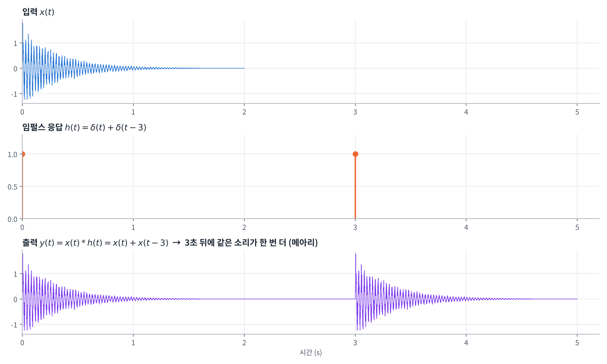
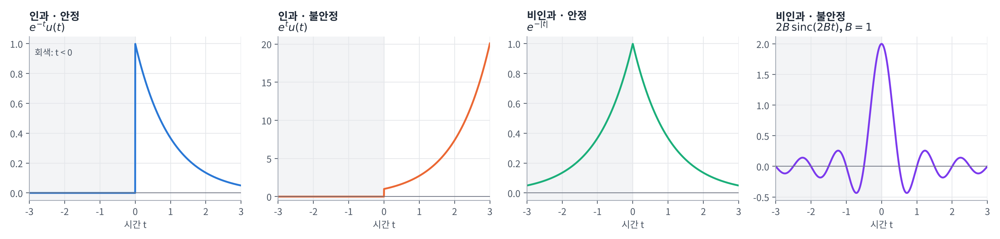
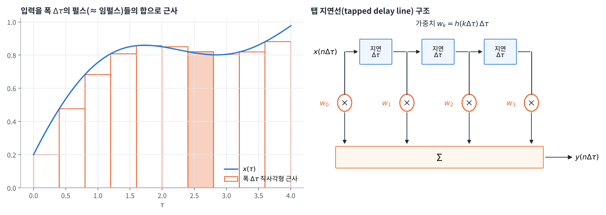
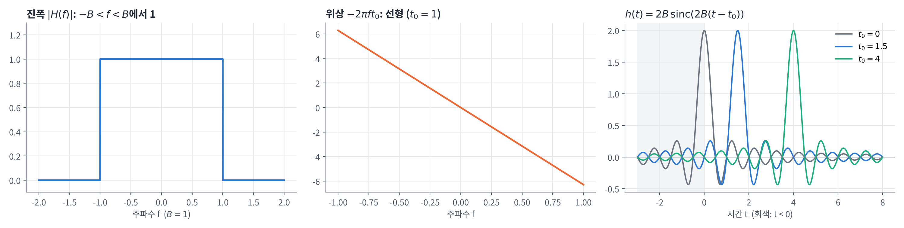
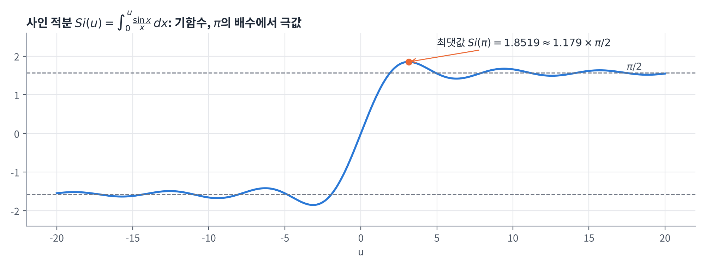
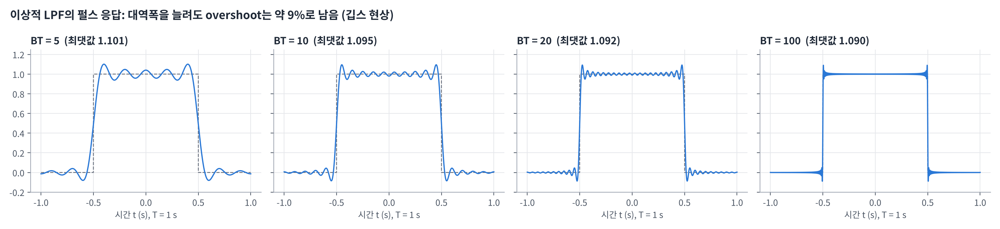
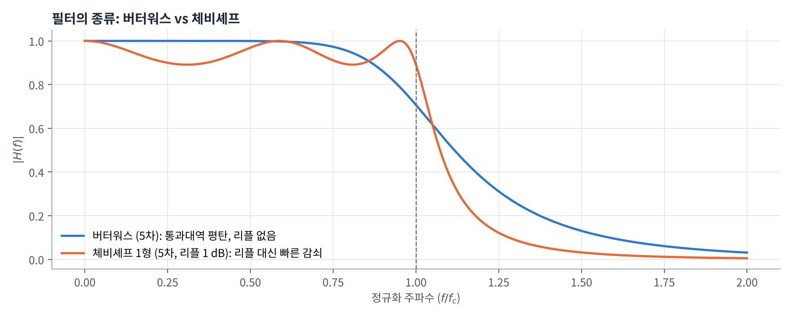
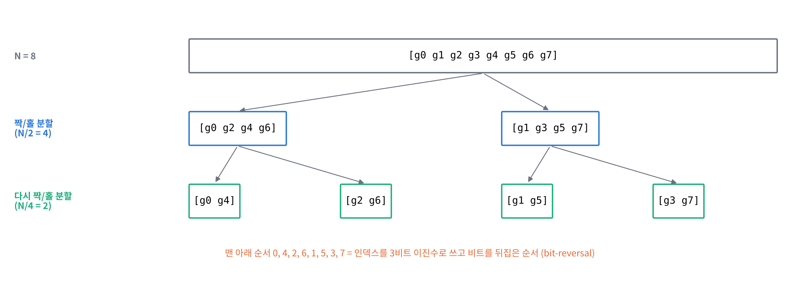
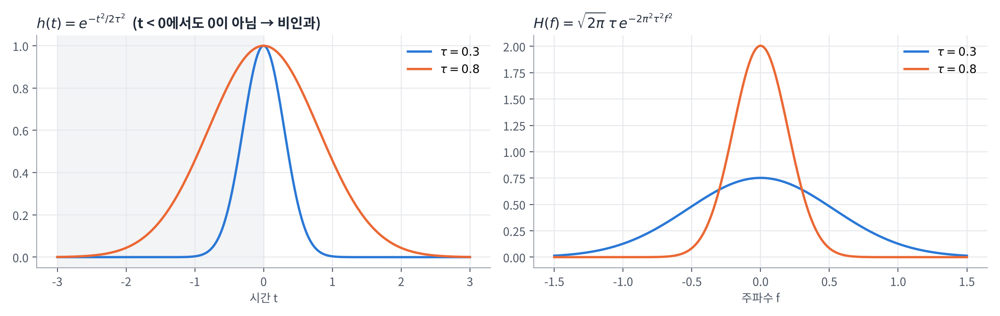

## 학습 목표

- 선형성(가산성, 동차성, 중첩의 원리)과 시불변성의 의미 이해
- 임펄스 응답과 컨볼루션으로 LTI 시스템의 출력을 구하는 방법 이해
- 인과성과 BIBO 안정성을 임펄스 응답으로 판정하는 방법 이해
- 주파수 응답(전달함수) $$H(f)$$와 $$Y(f) = H(f)X(f)$$의 의미 이해
- 이상적인 저역통과 필터의 임펄스 응답, 비인과성, 펄스 응답과 깁스 현상 이해
- 버터워스 필터와 체비셰프 필터의 차이 이해
- 이산 푸리에 변환(DFT)과 고속 푸리에 변환(FFT, Cooley-Tukey, 버터플라이, 비트 반전) 이해
- 과제 연습문제 2.12, 2.13 풀이

---

## 선형 시불변 (LTI) 시스템

### 선형 시스템

시스템 $$T[\cdot]$$이 **가산성**과 **동차성**을 모두 만족하면 **선형(Linear)** 시스템

| 성질 | 수식 | 의미 |
| --- | --- | --- |
| 가산성 (Additivity) | $$T[x_1(t) + x_2(t)] = T[x_1(t)] + T[x_2(t)]$$ | 입력을 더해서 넣은 결과 = 각각 넣은 결과의 합 |
| 동차성 (Homogeneity) | $$T[a x_1(t)] = a\,T[x_1(t)]$$ | 입력을 $$a$$배 하면 출력도 $$a$$배 |
| 중첩의 원리 (Superposition) | $$T[a x_1(t) + b x_2(t)] = a\,T[x_1(t)] + b\,T[x_2(t)]$$ | 위 두 성질을 합친 것 |

- 중첩의 원리 덕분에 복잡한 입력을 **간단한 신호(임펄스, 정현파)들의 합**으로 쪼개서 각각의 응답을 더하면 됨
- 이 생각이 뒤에 나오는 **컨볼루션**(임펄스로 쪼개기)과 **주파수 응답**(정현파로 쪼개기)의 출발점

### 임펄스 응답 (Impulse Response) $$h(t)$$

- 초기 조건이 0인 시스템에 **델타 함수 $$\delta(t)$$를 입력으로 넣었을 때의 출력**
- LTI 시스템은 $$h(t)$$ 하나만 알면 **어떤 입력에 대한 출력도 계산 가능** → 시스템의 "지문" 같은 역할

### 시불변 (Time Invariant) 시스템

- 입력을 $$t_0$$만큼 늦추면 출력도 **모양은 그대로, 정확히 $$t_0$$만큼 늦게** 나오는 시스템
- 즉 $$\delta(t - t_0)$$를 넣으면 $$h(t - t_0)$$가 나옴
- 쉽게 말해, **오늘 실험하든 내일 실험하든 시스템의 성질이 같다**는 뜻

---

## LTI 시스템의 시간 응답: 컨볼루션

### 컨볼루션 (Convolution) ⭐️

입력 $$x(t)$$를 시간 $$\tau$$마다 놓인 임펄스들 $$x(\tau)\delta(t - \tau)$$의 합으로 보면,

- 선형성 → 각 임펄스의 응답을 더하면 됨
- 시불변성 → $$\delta(t - \tau)$$의 응답은 $$h(t - \tau)$$

따라서 출력은

$$
y(t) = \int_{-\infty}^{\infty} x(\tau)\, h(t - \tau)\, d\tau = \int_{-\infty}^{\infty} h(\tau)\, x(t - \tau)\, d\tau = x(t) * h(t)
$$

- 두 적분은 $$\lambda = t - \tau$$ 치환으로 서로 같음 → 컨볼루션은 **교환 법칙**이 성립
- 입력이 $$\delta(t)$$이면 $$y(t) = \int \delta(\tau) h(t - \tau)\, d\tau = h(t)$$ → 임펄스 응답의 정의와 일치

### 시불변성의 확인

입력을 $$d$$만큼 지연한 $$x(t - d)$$를 넣고 $$k = \tau - d$$로 치환하면

$$
\int_{-\infty}^{\infty} x(\tau - d)\, h(t - \tau)\, d\tau = \int_{-\infty}^{\infty} x(k)\, h\big((t - d) - k\big)\, dk = y(t - d)
$$

- 출력도 정확히 $$d$$만큼 지연됨 → 컨볼루션으로 표현되는 시스템은 시불변

### 예시: 델타 두 개로 메아리 만들기

강의에서는 MATLAB의 `gong.mat` 소리에 $$h(t) = \delta(t) + \delta(t - 3)$$을 컨볼루션해서 **3초 뒤에 같은 소리가 한 번 더 들리는** 메아리를 만듦



- 델타 함수와의 컨볼루션은 **신호를 그 위치로 옮기는 것**: $$x(t) * \delta(t - 3) = x(t - 3)$$
- 따라서 $$y(t) = x(t) + x(t - 3)$$ → 원래 소리 + 3초 늦은 소리

같은 실험을 파이썬으로 짧은 입력에 해 보면 다음과 같음

```python
import numpy as np

fs = 100                                   # 샘플링 주파수 [Hz]
x = np.array([1.0, 0.5, 0.25])             # 짧은 입력 신호
h = np.zeros(3 * fs + 1)                   # 임펄스 응답: 0초와 3초에 델타
h[0] = 1.0
h[3 * fs] = 1.0

y = np.convolve(x, h)                      # y = x * h
nz = np.nonzero(y)[0]
for n in nz:
    print(f"t = {n / fs:.2f} s, y = {y[n]:.2f}")
```

실행 결과

```text
t = 0.00 s, y = 1.00
t = 0.01 s, y = 0.50
t = 0.02 s, y = 0.25
t = 3.00 s, y = 1.00
t = 3.01 s, y = 0.50
t = 3.02 s, y = 0.25
```

- 입력 `[1, 0.5, 0.25]`가 0초와 3초에 **그대로 한 번씩** 나타남 → 메아리

---

## 인과성과 안정성

### 인과 (Causal) 시스템

- 인과 시스템은 **입력이 들어오기 전에는 응답하지 않음** (미래의 입력을 쓰지 않음)
- LTI 시스템이 인과 시스템이 되기 위한 **필요충분조건**

$$
h(t) = 0, \quad t < 0
$$

- 이유: $$y(t) = \int h(\tau)\, x(t - \tau)\, d\tau$$에서 $$\tau < 0$$이면 $$x(t - \tau)$$는 **미래 시각의 입력**
- 따라서 $$\tau < 0$$에서 $$h(\tau) = 0$$이어야 현재와 과거의 입력만 사용

### 안정 (Stable) 시스템: BIBO 안정

- **유한한 입력을 넣으면 출력도 유한** (Bounded Input, Bounded Output)
- $$\lvert x(t) \rvert < M$$이면 삼각부등식에 의해

$$
\lvert y(t) \rvert = \left\lvert \int_{-\infty}^{\infty} h(\tau)\, x(t - \tau)\, d\tau \right\rvert
\le \int_{-\infty}^{\infty} \lvert h(\tau) \rvert\, \lvert x(t - \tau) \rvert\, d\tau
\le M \int_{-\infty}^{\infty} \lvert h(\tau) \rvert\, d\tau
$$

- LTI 시스템이 안정 시스템이 되기 위한 **필요충분조건**

$$
\int_{-\infty}^{\infty} \lvert h(t) \rvert\, dt < \infty
$$

**(중요!!)**

- 인과성은 $$h(t)$$가 **어디에** 있는지(시간축의 부호), 안정성은 $$h(t)$$가 **얼마나 큰지**(절댓값의 면적)를 보는 조건
- 서로 다른 조건이라 **네 가지 조합이 모두 가능** (연습문제 2.12에서 자세히 다룸)



- 회색 부분($$t < 0$$)이 0이 아니면 **비인과**, $$\lvert h \rvert$$의 면적이 무한하면 **불안정**
- 이상적인 저역통과 필터의 $$\mathrm{sinc}$$는 **비인과이면서 불안정** → 바로 뒤에서 다룸

---

## 주파수 응답 (Frequency Response)

### 복소 지수 입력에 대한 응답

임펄스 응답이 $$h(t)$$인 LTI 시스템에 $$x(t) = \exp(j\omega t)$$ ($$\omega = 2\pi f$$)를 넣으면

$$
y(t) = \int_{-\infty}^{\infty} h(\tau)\, e^{j\omega(t - \tau)}\, d\tau
= e^{j\omega t} \underbrace{\int_{-\infty}^{\infty} h(\tau)\, e^{-j\omega\tau}\, d\tau}_{H(f)}
= H(f)\, e^{j\omega t}
$$

- 복소 지수 입력은 LTI 시스템을 통과해도 **모양이 그대로** 나오고, **$$H(f)$$가 곱해질 뿐**
- 즉 복소 지수는 LTI 시스템의 **고유함수(eigenfunction)**, $$H(f)$$는 그 **고윳값**

### 일반 입력으로 확장

푸리에 역변환에 의해 임의의 입력은 복소 지수들의 합(적분)으로 쓸 수 있음

$$
x(t) = \int_{-\infty}^{\infty} X(f)\, e^{j2\pi f t}\, df = \lim_{\Delta f \to 0} \sum_{k=-\infty}^{\infty} X(f)\, e^{j2\pi f t}\, \Delta f \Big\rvert_{f = k\Delta f}
$$

- 각 성분은 $$H(f)$$가 곱해져서 나오고(선형성), 그 결과를 다시 더하면

$$
y(t) = \lim_{\Delta f \to 0} \sum_{k=-\infty}^{\infty} H(f) X(f)\, e^{j2\pi f t}\, \Delta f
= \int_{-\infty}^{\infty} H(f) X(f)\, e^{j2\pi f t}\, df
$$

$$
\therefore\; Y(f) = H(f)\, X(f)
$$

- 시간 영역의 컨볼루션 $$y = x * h$$가 주파수 영역에서는 **곱셈**이 됨 → 2장의 **컨볼루션 정리**와 같은 결과

### 컨볼루션의 이산 근사와 탭 지연선

컴퓨터로 계산할 때는 적분을 간격 $$\Delta\tau$$의 합(리만 합)으로 근사

$$
y(n\Delta\tau) = \sum_{k=0}^{N-1} h(k\Delta\tau)\, x(n\Delta\tau - k\Delta\tau)\, \Delta\tau
$$



- 왼쪽: 입력을 폭 $$\Delta\tau$$의 직사각형(≈ 임펄스)들로 쪼개서 근사
- 오른쪽: 위 식을 회로로 그리면 **지연 소자 + 곱셈기(가중치 $$w_k = h(k\Delta\tau)\Delta\tau$$) + 덧셈기** 구조
- 이 구조를 **탭 지연선(tapped delay line)** 이라고 하며, 디지털 필터(FIR 필터)의 기본 형태
- $$\Delta\tau$$를 작게 할수록 적분에 가까워짐

---

## 전달함수 (Transfer Function)

임펄스 응답의 푸리에 변환을 **전달함수**라고 함

$$
H(f) \equiv \mathcal{F}[h(t)] = \int_{-\infty}^{\infty} h(t)\, e^{-j2\pi f t}\, dt, \qquad
H(f) = \lvert H(f) \rvert\, e^{j\beta(f)}
$$

| 기호 | 이름 | numpy |
| --- | --- | --- |
| $$\lvert H(f) \rvert$$ | $$h(t)$$의 진폭(amplitude) 스펙트럼 | `np.abs(H)` |
| $$\beta(f)$$ | $$h(t)$$의 위상(phase) 스펙트럼 | `np.angle(H)` |

- 임펄스 응답이 **실수**이면 2장의 켤레 대칭에 의해
  - $$\lvert H(f) \rvert = \lvert H(-f) \rvert$$ → 진폭은 **우함수(even)**
  - $$\beta(f) = -\beta(-f)$$ → 위상은 **기함수(odd)**
- LTI 시스템 출력의 푸리에 변환은 **임펄스 응답의 스펙트럼과 입력의 푸리에 변환의 곱**: $$Y(f) = H(f)X(f)$$

쉬운 설명:

- $$\lvert H(f) \rvert$$: 주파수 $$f$$ 성분을 **몇 배로 키우거나 줄이는지**
- $$\beta(f)$$: 주파수 $$f$$ 성분을 **위상으로 얼마나 밀어내는지**(시간 지연)
- 필터 설계는 결국 **원하는 $$\lvert H(f) \rvert$$와 $$\beta(f)$$를 만드는 것**

---

## 이상적인 저역통과 필터 (Ideal Low Pass Filter)

### 정의

- 통과대역 $$-B < f < B$$에서 **진폭 응답은 일정한 상수**
- 통과대역에서 **위상 응답은 선형**

$$
H(f) =
\begin{cases}
\exp(-j2\pi f t_0), & -B < f < B \\
0, & \lvert f \rvert > B
\end{cases}
$$

- 선형 위상 $$-2\pi f t_0$$는 2장의 시간 이동 성질에 의해 **모든 주파수 성분을 똑같이 $$t_0$$만큼 지연** → 파형이 찌그러지지 않음

### 임펄스 응답

$$H(f)$$를 푸리에 역변환하면

$$
\begin{aligned}
h(t) &= \int_{-B}^{B} e^{j2\pi f t}\, e^{-j2\pi f t_0}\, df = \int_{-B}^{B} e^{j2\pi f (t - t_0)}\, df
= \left[ \frac{e^{j2\pi f (t - t_0)}}{j2\pi (t - t_0)} \right]_{-B}^{B} \\
&= \frac{e^{j2\pi B (t - t_0)} - e^{-j2\pi B (t - t_0)}}{j2\pi (t - t_0)}
= \frac{\sin\big(2\pi B (t - t_0)\big)}{\pi (t - t_0)}
= 2B\, \mathrm{sinc}\big(2B(t - t_0)\big)
\end{aligned}
$$



- 사각형 모양의 $$\lvert H(f) \rvert$$ ↔ $$\mathrm{sinc}$$ 모양의 $$h(t)$$ (2장의 사각 펄스 ↔ sinc 변환쌍)
- 최댓값 $$2B$$는 $$t = t_0$$에서 나타나고, 첫 번째 0은 $$t = t_0 \pm \frac{1}{2B}$$

### 비인과성과 실제 구현

- 이상적인 LPF는 **$$t < 0$$에서 임펄스 응답이 0이 아니므로 비인과적** (sinc는 양쪽으로 무한히 이어짐)
- 실시간으로 동작하는 인과 시스템으로 구현하려면 **지연 $$t_0$$를 크게** 해서 $$t < 0$$ 구간의 값을 무시할 정도로 작게 만듦

$$
\lvert \mathrm{sinc}\big(2B(t - t_0)\big) \rvert \ll 1, \quad t < 0
$$

- 위 그림 오른쪽: $$t_0 = 0$$이면 절반이 $$t < 0$$에 있지만, $$t_0 = 4$$이면 $$t < 0$$ 부분이 거의 0
- 대가는 **출력이 $$t_0$$만큼 늦게 나온다**는 것
- 또한 $$\int \lvert \mathrm{sinc} \rvert\, dt = \infty$$이므로 이상적인 LPF는 엄밀히는 **BIBO 안정도 아님** (연습문제 2.12)

---

## 이상적인 LPF의 펄스 응답과 깁스 현상

### 사각 펄스 입력에 대한 응답

입력이 폭 $$T$$인 사각 펄스 $$x(t) = \mathrm{rect}(t/T)$$이고, 계산을 간단히 하기 위해 $$t_0 = 0$$으로 두면

$$
y(t) = \int_{-\infty}^{\infty} x(\tau)\, h(t - \tau)\, d\tau = 2B \int_{-T/2}^{T/2} \frac{\sin\big(2\pi B (t - \tau)\big)}{2\pi B (t - \tau)}\, d\tau
$$

$$\lambda = 2\pi B (t - \tau)$$로 치환하면 ($$d\lambda = -2\pi B\, d\tau$$)

$$
y(t) = \frac{1}{\pi} \int_{2\pi B (t - T/2)}^{2\pi B (t + T/2)} \frac{\sin\lambda}{\lambda}\, d\lambda
= \frac{1}{\pi} \left[ \int_{0}^{2\pi B (t + T/2)} \frac{\sin\lambda}{\lambda}\, d\lambda - \int_{0}^{2\pi B (t - T/2)} \frac{\sin\lambda}{\lambda}\, d\lambda \right]
$$

$$
\therefore\; y(t) = \frac{1}{\pi} \left[ \mathrm{Si}\Big(2\pi B \big(t + \tfrac{T}{2}\big)\Big) - \mathrm{Si}\Big(2\pi B \big(t - \tfrac{T}{2}\big)\Big) \right]
$$

### 사인 적분 (Sine Integral)

$$
\mathrm{Si}(u) = \int_{0}^{u} \frac{\sin x}{x}\, dx
$$



- $$u = 0$$을 기준으로 **기함수(odd symmetry)** 인 진동 함수
- **$$\pi$$의 배수에서 최댓값/최솟값**을 가짐 ($$\frac{d}{du}\mathrm{Si} = \frac{\sin u}{u} = 0$$인 지점)
- $$u \to \infty$$에서 $$\frac{\pi}{2}$$로 수렴
- 최댓값은 $$\mathrm{Si}(\pi)$$로, **윌브러햄-깁스 상수(Wilbraham-Gibbs constant)** 라고 부름

$$
\mathrm{Si}(\pi) = 1.8519 = (1.179) \times \frac{\pi}{2}
$$

### 깁스 현상 (Gibbs Phenomenon) ⭐️

$$y(t)$$의 최댓값/최솟값은 $$t_{\max} = \pm\frac{T}{2} \pm \frac{1}{2B}$$에서 나타남. 예를 들어 $$t_{\max} = -\frac{T}{2} + \frac{1}{2B}$$이면

$$
y(t_{\max}) = \frac{1}{\pi} \big[ \mathrm{Si}(\pi) - \mathrm{Si}(\pi - 2\pi BT) \big]
= \frac{1}{\pi} \big[ \mathrm{Si}(\pi) + \mathrm{Si}(2\pi BT - \pi) \big]
$$

- 두 번째 등호는 $$\mathrm{Si}$$가 기함수라서 성립
- $$BT \gg 1$$이면 $$\mathrm{Si}(2\pi BT - \pi) \approx \frac{\pi}{2}(1 \pm \Delta)$$, $$\Delta$$는 아주 작은 값

$$
y(t_{\max}) = \frac{1}{\pi} \left[ 1.179 \times \frac{\pi}{2} + \frac{\pi}{2}(1 \pm \Delta) \right] \approx 1.09 \pm \frac{\Delta}{2}
$$



**(중요!!)**

- 필터 응답의 **overshoot은 대략 9%**
- 대역폭 $$B$$를 늘리면 진동이 **가장자리로 몰리고 폭이 좁아질 뿐**, overshoot의 크기는 줄지 않음
- 즉 overshoot은 대역폭 $$B$$에 **"실질적으로" 독립**
- 원인: 이상적인 LPF가 주파수 영역에서 **뚝 잘려 있기 때문**(불연속) → 시간 영역에서 sinc의 진동(ringing)으로 나타남

수치로 확인하면 다음과 같음

```python
import numpy as np
from scipy.special import sici

T = 1.0                                        # 펄스 폭 [s]
t = np.linspace(-1, 1, 200001)
for BT in [5, 10, 20, 100]:
    B = BT / T
    Si = lambda u: sici(u)[0]                  # sici는 (Si, Ci)를 반환
    y = (Si(2 * np.pi * B * (t + T / 2)) - Si(2 * np.pi * B * (t - T / 2))) / np.pi
    print(f"BT = {BT:3d}: 최댓값 {y.max():.4f}, overshoot {100 * (y.max() - 1):.2f}%")

print(f"Si(pi) / (pi/2) = {sici(np.pi)[0] / (np.pi / 2):.4f}")
```

실행 결과

```text
BT =   5: 최댓값 1.1007, overshoot 10.07%
BT =  10: 최댓값 1.0948, overshoot 9.48%
BT =  20: 최댓값 1.0921, overshoot 9.21%
BT = 100: 최댓값 1.0900, overshoot 9.00%
Si(pi) / (pi/2) = 1.1790
```

- $$BT$$가 20배 커져도 overshoot은 10%에서 9%로 거의 그대로 → 약 9%로 수렴

---

## 필터의 종류

실제 필터는 이상적인 LPF처럼 뚝 자를 수 없으므로, 어느 특성을 우선하느냐에 따라 종류가 나뉨



| 필터 | 통과대역 | 차단 특성 | 특징 |
| --- | --- | --- | --- |
| 버터워스 (Butterworth) | **평탄한 주파수 응답, 리플 없음** | 비교적 완만하게 감쇠 | 진폭 왜곡이 적음 |
| 체비셰프 (Chebyshev, 1형) | 통과대역에 **리플(물결)** 이 있음 | **빠르게 감쇠** | 같은 차수에서 더 날카로운 차단 |

- 같은 5차 필터라도 체비셰프는 리플을 허용하는 대신 차단 주파수 부근에서 훨씬 가파르게 떨어짐
- "평탄함"과 "날카로움" 사이의 **트레이드오프**

---

## 이산 푸리에 변환 (DFT)

### 정의

유한 길이의 연속 신호 $$g(t)$$를 $$T_s$$ 주기로 샘플링하면

$$
g_n = g(nT_s), \quad n = 0, 1, 2, \dots, N - 1
$$

- 길이 $$N$$인 시퀀스가 **주기적으로 반복되는 신호**라고 가정 (푸리에 급수의 이산 버전)

| 이름 | 수식 |
| --- | --- |
| 이산 푸리에 변환 (DFT) | $$G_k = \sum_{n=0}^{N-1} g_n \exp\left(-j\frac{2\pi}{N} kn\right)$$ |
| 역 이산 푸리에 변환 (IDFT) | $$g_n = \frac{1}{N} \sum_{k=0}^{N-1} G_k \exp\left(j\frac{2\pi}{N} kn\right)$$ |

- $$G_k$$ 하나를 구하는 데 곱셈 $$N$$번, $$k$$가 $$N$$개이므로 전체 계산량은 **$$O(N^2)$$**
- $$N$$이 커지면 매우 느림 → **FFT**가 필요

---

## 고속 푸리에 변환 (FFT): Cooley-Tukey

### 아이디어: 짝수/홀수로 나누기 (Divide and Conquer)

$$g_n$$을 짝수 인덱스 $$g_{2m}$$과 홀수 인덱스 $$g_{2m+1}$$로 나누면

$$
\begin{aligned}
G_k &= \sum_{m=0}^{N/2-1} g_{2m}\, e^{-j\frac{2\pi}{N} k(2m)} + \sum_{m=0}^{N/2-1} g_{2m+1}\, e^{-j\frac{2\pi}{N} k(2m+1)} \\
&= \underbrace{\sum_{m=0}^{N/2-1} g_{2m}\, e^{-j\frac{2\pi}{N/2} km}}_{E_k:\ \text{짝수 부분의 } N/2 \text{점 DFT}}
+ e^{-j\frac{2\pi}{N} k} \underbrace{\sum_{m=0}^{N/2-1} g_{2m+1}\, e^{-j\frac{2\pi}{N/2} km}}_{O_k:\ \text{홀수 부분의 } N/2 \text{점 DFT}}
= E_k + W_{k,N}\, O_k
\end{aligned}
$$

- $$W_{k,N} = e^{-j\frac{2\pi}{N}k}$$를 **회전 인자(twiddle factor)** 라고 함
- $$E_k$$, $$O_k$$는 주기가 $$N/2$$이고 $$W_{k+N/2,N} = -W_{k,N}$$이므로 **대칭 성질**이 성립

$$
G_k = E_k + W_{k,N}\, O_k, \qquad G_{k + N/2} = E_k - W_{k,N}\, O_k \qquad \left(k = 0, \dots, \tfrac{N}{2} - 1\right)
$$

- 이 과정을 **재귀적으로** 적용해서 $$N = 2$$가 될 때까지 진행 ($$N = 2$$이면 $$G_0 = g_0 + g_1$$, $$G_1 = g_0 - g_1$$)
- 단계 수는 $$\log_2 N$$, 각 단계의 계산량은 $$O(N)$$ → 전체 **$$O(N \log_2 N)$$**
- 예: $$N = 1024$$이면 DFT는 약 100만 번, FFT는 약 1만 번의 곱셈 수준 → **약 100배 빠름**

### 재귀 FFT 구현 순서

1. 짝수 인덱스와 홀수 인덱스로 분리
2. 각각에 대해 재귀 함수 형태로 FFT를 호출
3. 현재 단계의 신호 길이 $$N$$으로 회전 인자 $$W_{k,N} = e^{-j\frac{2\pi}{N}k}$$를 정의
4. $$G_k = E_k + W O_k$$, $$G_{k+N/2} = E_k - W O_k$$로 조합

```python
import numpy as np

def fft(g):
    """Cooley-Tukey radix-2 FFT (재귀). len(g)는 2의 거듭제곱이어야 함"""
    N = len(g)
    if N == 1:
        return np.array(g, dtype=complex)
    E = fft(g[0::2])                                  # 짝수 인덱스
    O = fft(g[1::2])                                  # 홀수 인덱스
    W = np.exp(-2j * np.pi * np.arange(N // 2) / N)   # twiddle factor
    return np.concatenate([E + W * O, E - W * O])     # G_k, G_(k+N/2)

for g in ([1, 2, 3, 4], [1, 2, 3, 4, 5, 6, 7, 8]):
    G = fft(np.array(g, dtype=float))
    print(np.round(G, 3))
    print("numpy와 일치:", np.allclose(G, np.fft.fft(g)))
```

실행 결과

```text
[10.+0.j -2.+2.j -2.+0.j -2.-2.j]
numpy와 일치: True
[36.+0.j    -4.+9.657j -4.+4.j    -4.+1.657j -4.+0.j    -4.-1.657j
 -4.-4.j    -4.-9.657j]
numpy와 일치: True
```

### 예시 1: $$N = 4$$, $$g_n = [1, 2, 3, 4]$$

- 짝수 인덱스 $$[1, 3]$$, 홀수 인덱스 $$[2, 4]$$
- 2점 DFT: $$\mathrm{DFT}(a_0, a_1) = [a_0 + a_1,\ a_0 - a_1]$$

| 부분 | 0번 | 1번 |
| --- | --- | --- |
| 짝수 $$E$$ | $$E_0 = 1 + 3 = 4$$ | $$E_1 = 1 - 3 = -2$$ |
| 홀수 $$O$$ | $$O_0 = 2 + 4 = 6$$ | $$O_1 = 2 - 4 = -2$$ |

- 회전 인자 ($$N = 4$$): $$W_0 = 1$$, $$W_1 = e^{-j\pi/2} = -j$$, $$W_2 = -1$$, $$W_3 = j$$
- 결합

$$
\begin{aligned}
X_0 &= E_0 + W_0 O_0 = 4 + 6 = 10, & X_2 &= E_0 + W_2 O_0 = 4 - 6 = -2 \\
X_1 &= E_1 + W_1 O_1 = -2 + (-j)(-2) = -2 + 2j, & X_3 &= E_1 + W_3 O_1 = -2 + j(-2) = -2 - 2j
\end{aligned}
$$

$$
X = [10,\ -2 + 2j,\ -2,\ -2 - 2j]
$$

### 예시 2: $$N = 8$$, $$g_n = [1, 2, 3, 4, 5, 6, 7, 8]$$

**1단계: 짝수 부분 $$[1, 3, 5, 7]$$의 4점 FFT**

- $$[1, 5]$$와 $$[3, 7]$$로 다시 분할: $$E_0 = 6$$, $$E_1 = -4$$, $$O_0 = 10$$, $$O_1 = -4$$
- 결과: $$X_e = [6 + 10,\ -4 + (-j)(-4),\ 6 - 10,\ -4 + j(-4)] = [16,\ -4 + 4j,\ -4,\ -4 - 4j]$$

**2단계: 홀수 부분 $$[2, 4, 6, 8]$$의 4점 FFT**

- $$[2, 6]$$과 $$[4, 8]$$로 다시 분할: $$E_0 = 8$$, $$E_1 = -4$$, $$O_0 = 12$$, $$O_1 = -4$$
- 결과: $$X_o = [20,\ -4 + 4j,\ -4,\ -4 - 4j]$$

**3단계: 결합 ($$N = 8$$)**

- 회전 인자: $$W_0 = 1$$, $$W_1 = \frac{1}{\sqrt{2}} - \frac{j}{\sqrt{2}}$$, $$W_2 = -j$$, $$W_3 = -\frac{1}{\sqrt{2}} - \frac{j}{\sqrt{2}}$$, 그리고 $$W_{k+4} = -W_k$$
- $$X_e$$, $$X_o$$는 주기 4이므로 $$X_e[k + 4] = X_e[k]$$, $$X_o[k + 4] = X_o[k]$$

| $$k$$ | 계산 | 결과 |
| --- | --- | --- |
| 0 | $$16 + 1 \cdot 20$$ | $$36$$ |
| 1 | $$(-4 + 4j) + W_1(-4 + 4j)$$ | $$-4 + (4 + 4\sqrt{2})j = -4 + 9.657j$$ |
| 2 | $$-4 + (-j)(-4)$$ | $$-4 + 4j$$ |
| 3 | $$(-4 - 4j) + W_3(-4 - 4j)$$ | $$-4 + (4\sqrt{2} - 4)j = -4 + 1.657j$$ |
| 4 | $$16 - 20$$ | $$-4$$ |
| 5 | $$(-4 + 4j) - W_1(-4 + 4j)$$ | $$-4 + (4 - 4\sqrt{2})j = -4 - 1.657j$$ |
| 6 | $$-4 - (-j)(-4)$$ | $$-4 - 4j$$ |
| 7 | $$(-4 - 4j) - W_3(-4 - 4j)$$ | $$-4 - (4 + 4\sqrt{2})j = -4 - 9.657j$$ |

- 위 코드의 실행 결과와 정확히 일치
- 실수 입력이므로 $$X_{8-k} = X_k^*$$ (켤레 대칭): $$X_1$$과 $$X_7$$, $$X_3$$과 $$X_5$$가 서로 켤레

참고: 강의 자료 33쪽의 $$W_3$$, $$X_3$$, $$X_7$$은 오타가 있음 (아래 정정 표 참고)

---

## Iterative Butterfly와 비트 반전

### 출력을 짝수/홀수로 나누기

재귀 대신 **반복문**으로 구현하는 방법. 이번에는 입력을 앞쪽 절반과 뒤쪽 절반으로 나누고 $$W_N = e^{-j\frac{2\pi}{N}}$$이라 두면

$$
G_k = \sum_{n=0}^{N/2-1} \left( g_n + g_{n+N/2}\, e^{-j\pi k} \right) W_N^{kn}, \qquad
e^{-j\pi k} =
\begin{cases}
1, & k \text{ 짝수} \\
-1, & k \text{ 홀수}
\end{cases}
$$

따라서 **출력**을 짝수 번째와 홀수 번째로 나누면

$$
G_{2r} = \sum_{n=0}^{N/2-1} \underbrace{(g_n + g_{n+N/2})}_{a_n} W_{N/2}^{rn}, \qquad
G_{2r+1} = \sum_{n=0}^{N/2-1} \underbrace{(g_n - g_{n+N/2})\, W_N^{n}}_{b_n} W_{N/2}^{rn}
$$

- 짝수 번째 출력 = $$a_n$$의 $$N/2$$점 DFT, 홀수 번째 출력 = $$b_n$$의 $$N/2$$점 DFT
- $$N = 8$$이면
  - $$a_0 = g_0 + g_4$$, $$a_1 = g_1 + g_5$$, $$a_2 = g_2 + g_6$$, $$a_3 = g_3 + g_7$$ → $$[G_0, G_2, G_4, G_6]$$
  - $$b_n = (g_n - g_{n+4})\, W_8^n$$ ($$n = 0, 1, 2, 3$$) → $$[G_1, G_3, G_5, G_7]$$
- 한 쌍 $$(g_n, g_{n+N/2})$$에서 **합과 차**를 만드는 모양이 나비 같아서 **버터플라이(butterfly)** 연산이라고 부름
- 이 과정을 $$N = 8 \to 4 \to 2$$로 반복

| 단계 | 결과 순서 |
| --- | --- |
| $$N = 8$$ | $$[G_0, G_1, \dots, G_7]$$ |
| 짝/홀 분할 | $$[G_0, G_2, G_4, G_6]$$, $$[G_1, G_3, G_5, G_7]$$ |
| 다시 분할 | $$[G_0, G_4]$$, $$[G_2, G_6]$$, $$[G_1, G_5]$$, $$[G_3, G_7]$$ |
| 최종 | $$G_0, G_4, G_2, G_6, G_1, G_5, G_3, G_7$$ |

### 비트 반전 (Bit-Reversal)

- 재귀적으로 짝수/홀수를 분할하는 과정은 **인덱스를 비트 반전 순서대로 불러오는 것**과 같음
- 위의 재귀 FFT(입력 분할)와 버터플라이(출력 분할) 모두 같은 순서가 나옴



| 원래 인덱스 | 2진수 (3비트) | 비트 반전 | 반전 후 (10진수) |
| --- | --- | --- | --- |
| 0 | 000 | 000 | 0 |
| 1 | 001 | 100 | 4 |
| 2 | 010 | 010 | 2 |
| 3 | 011 | 110 | 6 |
| 4 | 100 | 001 | 1 |
| 5 | 101 | 101 | 5 |
| 6 | 110 | 011 | 3 |
| 7 | 111 | 111 | 7 |

반복 버터플라이 방식을 직접 구현하면 다음과 같음

```python
import numpy as np

def bit_reverse(n_bits, i):
    """i를 n_bits 비트 이진수로 보고 비트 순서를 뒤집은 값"""
    return int(format(i, f"0{n_bits}b")[::-1], 2)

def fft_dif(g):
    """반복(iterative) 버터플라이 FFT, 주파수 솎음(DIF) 방식"""
    x = np.array(g, dtype=complex)
    N = len(x)
    size = N
    while size > 1:                                    # N -> N/2 -> ... -> 2
        half = size // 2
        W = np.exp(-2j * np.pi * np.arange(half) / size)
        for start in range(0, N, size):
            a = x[start:start + half].copy()
            b = x[start + half:start + size].copy()
            x[start:start + half] = a + b              # a_n = g_n + g_(n+N/2)
            x[start + half:start + size] = (a - b) * W # b_n = (g_n - g_(n+N/2)) W^n
        size = half
    n_bits = int(np.log2(N))
    order = [bit_reverse(n_bits, i) for i in range(N)]
    print("bit-reversal 순서:", order)
    G = np.empty(N, dtype=complex)
    G[order] = x                                       # 결과는 비트 반전 순서로 나옴
    return G

G = fft_dif([1, 2, 3, 4, 5, 6, 7, 8])
print(np.round(G, 3))
print("numpy와 일치:", np.allclose(G, np.fft.fft([1, 2, 3, 4, 5, 6, 7, 8])))
```

실행 결과

```text
bit-reversal 순서: [0, 4, 2, 6, 1, 5, 3, 7]
[36.+0.j    -4.+9.657j -4.+4.j    -4.+1.657j -4.+0.j    -4.-1.657j
 -4.-4.j    -4.-9.657j]
numpy와 일치: True
```

- 반복문이 끝난 직후 배열의 $$i$$번째 칸에는 $$G_{\text{bitrev}(i)}$$가 들어 있음 → 비트 반전 순서로 다시 배치하면 원래 순서
- 재귀 호출이 없어 메모리를 덜 쓰고, 실제 FFT 라이브러리와 하드웨어 구현에 주로 쓰이는 방식
- 강의 자료에는 $$N = 16$$ 버터플라이 그림도 있으며, 단계 수가 $$\log_2 16 = 4$$로 하나 늘어날 뿐 구조는 같음

---

## 연습문제 풀이

과제 파일 중 이번 장(LTI 시스템)에 해당하는 문제는 2.12, 2.13

### 연습문제 2.12 인과성과 안정성

> 예제를 인용하여, 다음 두 주제를 토론하라.
> (a) 선형 시불변 시스템이 인과적이면서 불안정한 것이 가능한가?
> (b) 이런 시스템이 인과적이지 않으면서 안정한 것은 가능한가?

**답**: (a), (b) 모두 **가능**

**판정 기준 (본문 정리)**

- 인과: $$h(t) = 0$$ ($$t < 0$$)
- 안정(BIBO): $$\int_{-\infty}^{\infty} \lvert h(t) \rvert\, dt < \infty$$

안정 조건이 **필요조건**이기도 한 이유: $$\int \lvert h \rvert\, dt = \infty$$이면 크기 1인 입력 $$x(t) = \mathrm{sgn}\big(h(-t)\big)$$를 넣었을 때

$$
y(0) = \int_{-\infty}^{\infty} h(\tau)\, x(-\tau)\, d\tau = \int_{-\infty}^{\infty} h(\tau)\, \mathrm{sgn}\big(h(\tau)\big)\, d\tau = \int_{-\infty}^{\infty} \lvert h(\tau) \rvert\, d\tau = \infty
$$

이 되므로 불안정

**(a) 인과적이면서 불안정: $$h(t) = e^{at}u(t)$$, $$a > 0$$**

- 인과성: $$t < 0$$에서 $$u(t) = 0$$이므로 $$h(t) = 0$$ → 인과적
- 안정성:

$$
\int_{-\infty}^{\infty} \lvert h(t) \rvert\, dt = \int_{0}^{\infty} e^{at}\, dt = \lim_{T \to \infty} \frac{e^{aT} - 1}{a} = \infty \;\Rightarrow\; \text{불안정}
$$

- 실제로 유한한 입력 $$x(t) = u(t)$$를 넣으면 ($$t > 0$$에서 적분 구간은 $$0 < \tau < t$$)

$$
y(t) = \int_{0}^{t} e^{a\tau} \cdot 1\, d\tau = \frac{e^{at} - 1}{a} \xrightarrow{t \to \infty} \infty
$$

- 다른 예: **이상적인 적분기** $$h(t) = u(t)$$ → 출력 $$y(t) = \int_{-\infty}^{t} x(\lambda)\, d\lambda$$, 입력 $$u(t)$$를 넣으면 $$y(t) = t \to \infty$$
- 또 다른 예: $$\cos(2\pi f_0 t)u(t)$$는 같은 주파수의 입력을 넣으면 진폭이 $$t/2$$로 계속 커짐(**공진**)

**(b) 인과적이지 않으면서 안정: $$h(t) = e^{-a\lvert t \rvert}$$, $$a > 0$$**

- 인과성: $$t < 0$$에서 $$h(t) = e^{at} > 0$$ → 비인과적
- 안정성:

$$
\int_{-\infty}^{\infty} e^{-a\lvert t \rvert}\, dt = \int_{-\infty}^{0} e^{at}\, dt + \int_{0}^{\infty} e^{-at}\, dt = \frac{1}{a} + \frac{1}{a} = \frac{2}{a} < \infty \;\Rightarrow\; \text{안정}
$$

- 다른 예: 가우시안 $$h(t) = e^{-t^2/2\tau^2}$$ (연습문제 2.13), $$\int \lvert h \rvert\, dt = \sqrt{2\pi}\tau < \infty$$

**주의할 반례: 이상적인 LPF는 (b)의 예가 아님**

- $$h(t) = 2B\,\mathrm{sinc}\big(2B(t - t_0)\big)$$는 비인과이지만 **안정하지도 않음**
- $$\int \mathrm{sinc}\, dt = 1$$로 유한하지만, 안정성은 **절댓값**의 면적으로 판정
- $$n \le t \le n + 1$$에서 $$\frac{1}{\pi t} \ge \frac{1}{\pi(n+1)}$$이고 $$\int_n^{n+1} \lvert \sin \pi t \rvert\, dt = \frac{2}{\pi}$$이므로

$$
\int_{1}^{\infty} \frac{\lvert \sin \pi t \rvert}{\pi t}\, dt \ge \sum_{n=1}^{\infty} \frac{1}{\pi(n+1)} \cdot \frac{2}{\pi} = \frac{2}{\pi^2} \left( \frac{1}{2} + \frac{1}{3} + \cdots \right) = \infty
$$

- 조화급수가 발산하기 때문. 수치로도 $$\int_{-L}^{L} \lvert \mathrm{sinc}(t) \rvert\, dt$$는 $$L = 10, 100, 1000$$에서 $$2.11, 3.04, 3.97$$로 계속 커짐

**정리: 네 가지 조합**

| | 안정 ($$\int \lvert h \rvert < \infty$$) | 불안정 ($$\int \lvert h \rvert = \infty$$) |
| --- | --- | --- |
| 인과 ($$h = 0$$, $$t < 0$$) | $$e^{-at}u(t)$$ (RC 저역통과 필터) | $$e^{at}u(t)$$, $$u(t)$$ (적분기) |
| 비인과 | $$e^{-a\lvert t \rvert}$$, 가우시안, $$\mathrm{rect}(t/T)$$ | 이상적 LPF $$2B\,\mathrm{sinc}(2Bt)$$, $$e^{a\lvert t \rvert}$$ |

의미:

- 인과적·불안정 시스템은 실시간으로 만들 수는 있지만 **출력이 발산**하므로 쓸모가 없음
- 비인과적·안정 시스템은 미래 입력이 필요해서 실시간으로는 만들 수 없지만, **저장된 데이터를 처리할 때(오프라인)** 는 그대로 쓸 수 있음
- 실시간에서는 지연 $$t_0$$를 주고 $$t < 0$$ 부분을 잘라서 근사 (이상적인 LPF와 같은 방법)

**자주 나오는 판정 예**

| $$h(t)$$ | 인과? | 안정? |
| --- | --- | --- |
| $$e^{-at}u(t - t_0)$$, $$a > 0$$ | $$t_0 \ge 0$$이면 인과 | 안정 |
| $$\delta(t - t_0)$$ (지연기) | $$t_0 \ge 0$$이면 인과 | 안정 |
| $$\mathrm{rect}\left(\frac{t - t_0}{T}\right)$$ | $$t_0 \ge \frac{T}{2}$$이면 인과 | 안정 (면적 $$T$$) |
| $$e^{at}u(-t)$$, $$a > 0$$ | 비인과 | 안정 ($$\frac{1}{a}$$) |
| $$\cos(2\pi f_0 t)u(t)$$ | 인과 | 불안정 |

실수 주의:

- 안정성은 $$\int h\, dt$$가 아니라 **$$\int \lvert h \rvert\, dt$$** 로 판정
- "$$t < 0$$에서 값이 작다"는 인과가 아님 → **정확히 0**이어야 인과

---

### 연습문제 2.13 가우시안 임펄스 응답의 주파수 응답

> 선형 시스템의 임펄스 응답이 다음 가우시안 함수에 의해 정의된다.
> $$h(t) = \exp\left(-\frac{t^2}{2\tau^2}\right)$$
> 여기서 $$\tau$$는 펄스 구간을 정의하는 조절 가능한 변수이다. 시스템의 주파수 응답을 구하라.

**답**

$$
H(f) = \sqrt{2\pi}\, \tau\, \exp\left(-2\pi^2 \tau^2 f^2\right)
$$

**풀이 1: 완전제곱식 + 가우시안 적분**

주파수 응답은 임펄스 응답의 푸리에 변환

$$
H(f) = \int_{-\infty}^{\infty} \exp\left(-\frac{t^2}{2\tau^2}\right) e^{-j2\pi f t}\, dt
= \int_{-\infty}^{\infty} \exp\left(-\frac{t^2 + j4\pi f \tau^2 t}{2\tau^2}\right) dt
$$

지수 안을 완전제곱식으로 바꾸면

$$
t^2 + j4\pi f\tau^2 t = \left(t + j2\pi f \tau^2\right)^2 + 4\pi^2 f^2 \tau^4
$$

$$
\Rightarrow\; H(f) = \exp\left(-2\pi^2 \tau^2 f^2\right) \int_{-\infty}^{\infty} \exp\left(-\frac{(t + j2\pi f\tau^2)^2}{2\tau^2}\right) dt
$$

- 남은 적분은 $$u = t + j2\pi f\tau^2$$로 옮겨도 값이 같은 가우시안 적분 (복소 이동은 적분값을 바꾸지 않음)

$$
\int_{-\infty}^{\infty} e^{-u^2 / 2\tau^2}\, du = \sqrt{2\pi}\, \tau
$$

- 이 값은 $$I = \int e^{-x^2}dx$$에 대해 $$I^2$$를 극좌표로 계산하면 $$I = \sqrt{\pi}$$이고, $$x = u/(\sqrt{2}\tau)$$로 치환해서 얻음

$$
\therefore\; H(f) = \sqrt{2\pi}\, \tau\, \exp\left(-2\pi^2 \tau^2 f^2\right)
$$

**풀이 2: 변환쌍과 팽창 성질**

- 알려진 변환쌍 $$e^{-\pi t^2} \rightleftharpoons e^{-\pi f^2}$$ 이용
- $$h(t) = e^{-t^2/2\tau^2} = e^{-\pi (t/a)^2}$$, $$a = \sqrt{2\pi}\, \tau$$
- 2장의 팽창 성질 $$g(t/a) \rightleftharpoons \lvert a \rvert\, G(af)$$에 의해

$$
H(f) = a\, e^{-\pi a^2 f^2} = \sqrt{2\pi}\, \tau\, e^{-2\pi^2 \tau^2 f^2}
$$



**검산과 해석**

- 면적 성질: $$H(0) = \int h\, dt = \sqrt{2\pi}\, \tau$$, $$h(0) = \int H\, df = 1$$ ✓
- 수치 적분과 비교 ($$\tau = 0.37$$): $$f = 0, 0.5, 1.3$$에서 $$H(f) = 0.927452,\ 0.471947,\ 0.009637$$로 공식과 일치
- **가우시안의 푸리에 변환은 다시 가우시안** → 실수, 양수, 우함수이므로 **위상이 0인 저역통과 특성**
- $$\tau$$가 클수록(시간에서 넓을수록) $$H(f)$$는 좁아짐 → 2장의 **시간-대역폭 역관계**
- 3 dB 대역폭: $$\lvert H(f) \rvert^2$$이 절반이 되는 주파수

$$
e^{-4\pi^2\tau^2 f^2} = \frac{1}{2} \;\Rightarrow\; f_{3\mathrm{dB}} = \frac{\sqrt{\ln 2}}{2\pi\tau} \approx \frac{0.1325}{\tau}
$$

- 예: $$\tau = 1$$ ms이면 $$f_{3\mathrm{dB}} \approx 132.5$$ Hz, 시간-대역폭 곱 $$\tau f_{3\mathrm{dB}} = \frac{\sqrt{\ln 2}}{2\pi}$$로 $$\tau$$와 무관
- 인과성과 안정성: $$t < 0$$에서도 0이 아니므로 **비인과**, $$\int \lvert h \rvert = \sqrt{2\pi}\tau < \infty$$이므로 **안정** (2.12 (b)의 예)
- 참고: $$\lvert H(f) \rvert$$가 너무 빨리 줄어드는 필터는 인과적일 수 없다는 **Paley-Wiener 조건**이 있으며, 가우시안 필터도 그래서 지연을 주고 잘라서 근사해야 함

---

### 강의 자료에서 정정한 부분 정리

| 위치 | 강의 자료 | 정정 | 이유 |
| --- | --- | --- | --- |
| 강의 자료 33쪽 | $$W_3 = \frac{1}{\sqrt{2}} - \frac{1}{\sqrt{2}}j$$ | $$W_3 = -\frac{1}{\sqrt{2}} - \frac{1}{\sqrt{2}}j$$ | $$e^{-j3\pi/4}$$의 실수부는 음수 |
| 강의 자료 33쪽 | $$X_3 = (-4 + 4\sqrt{2}) + (-4 + 4\sqrt{2})j$$ | $$X_3 = -4 + (4\sqrt{2} - 4)j$$ | $$X_e[3] = -4 - 4j$$를 써야 함, **결과가 달라짐** |
| 강의 자료 33쪽 | $$X_7 = (-4 - 4\sqrt{2}) + (-4 - 4\sqrt{2})j$$ | $$X_7 = -4 - (4 + 4\sqrt{2})j$$ | $$X_1$$의 켤레여야 함, **결과가 달라짐** |

- 33쪽의 $$X_0, X_1, X_2, X_4, X_5, X_6$$은 맞음
- 정정한 값은 재귀 FFT, 반복 FFT, `np.fft.fft` 세 가지 결과로 모두 확인

---

## 최종 핵심 정리

1. **선형성(중첩의 원리) + 시불변성**이 성립하면 시스템은 임펄스 응답 $$h(t)$$ 하나로 완전히 결정됨
2. LTI 시스템의 출력은 **컨볼루션** $$y(t) = x(t) * h(t)$$, 주파수 영역에서는 **곱셈** $$Y(f) = H(f)X(f)$$
3. **인과**: $$h(t) = 0$$ ($$t < 0$$), **BIBO 안정**: $$\int \lvert h \rvert\, dt < \infty$$ → 서로 독립이라 네 조합 모두 가능
4. 전달함수 $$H(f) = \mathcal{F}[h]$$, 실수 $$h(t)$$이면 **진폭은 우함수, 위상은 기함수**
5. 이상적인 LPF는 $$h(t) = 2B\,\mathrm{sinc}\big(2B(t - t_0)\big)$$ → **비인과**라서 지연 $$t_0$$를 주어 근사
6. 이상적인 LPF의 펄스 응답에는 **약 9%의 overshoot(깁스 현상)** 이 있고, 대역폭을 늘려도 줄지 않음 ($$\mathrm{Si}(\pi) = 1.179 \times \frac{\pi}{2}$$)
7. 버터워스는 **평탄(리플 없음)**, 체비셰프는 **리플 대신 빠른 감쇠**
8. FFT는 DFT를 **짝수/홀수로 반씩 나누는 분할 정복**($$G_k = E_k \pm W O_k$$)으로 계산량을 $$O(N^2)$$에서 **$$O(N\log_2 N)$$** 으로 줄이며, 분할 순서는 **비트 반전** 순서

---

End.
