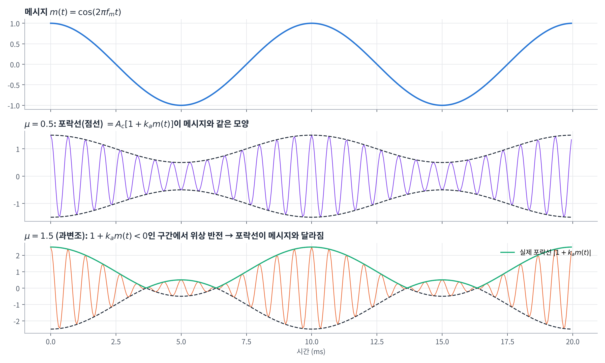
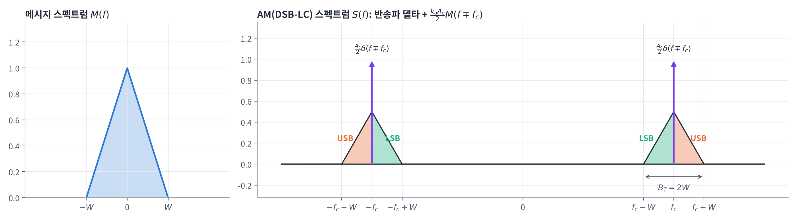
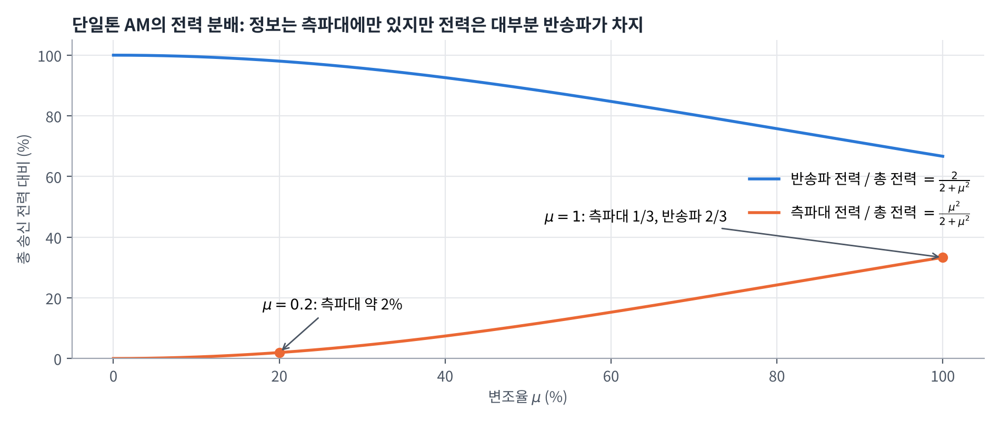
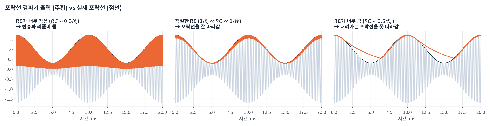
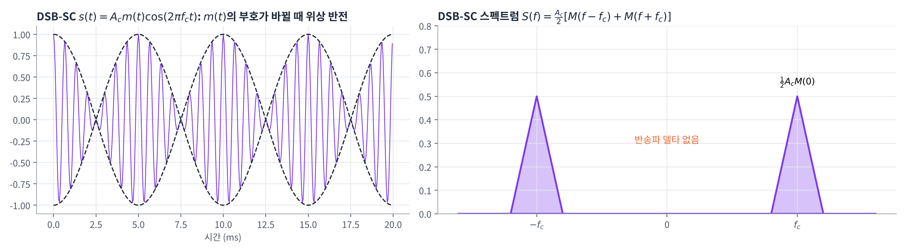
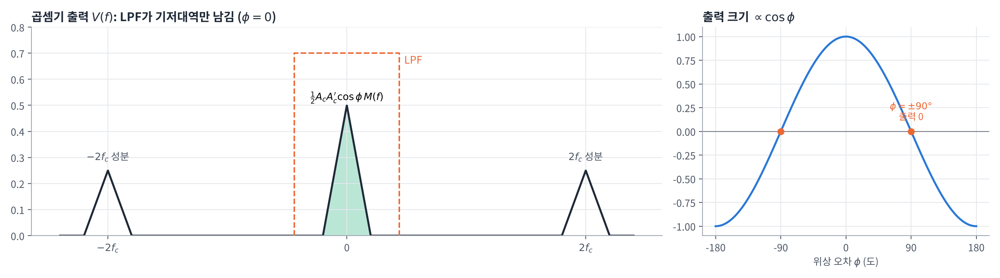
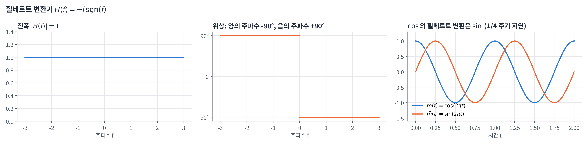
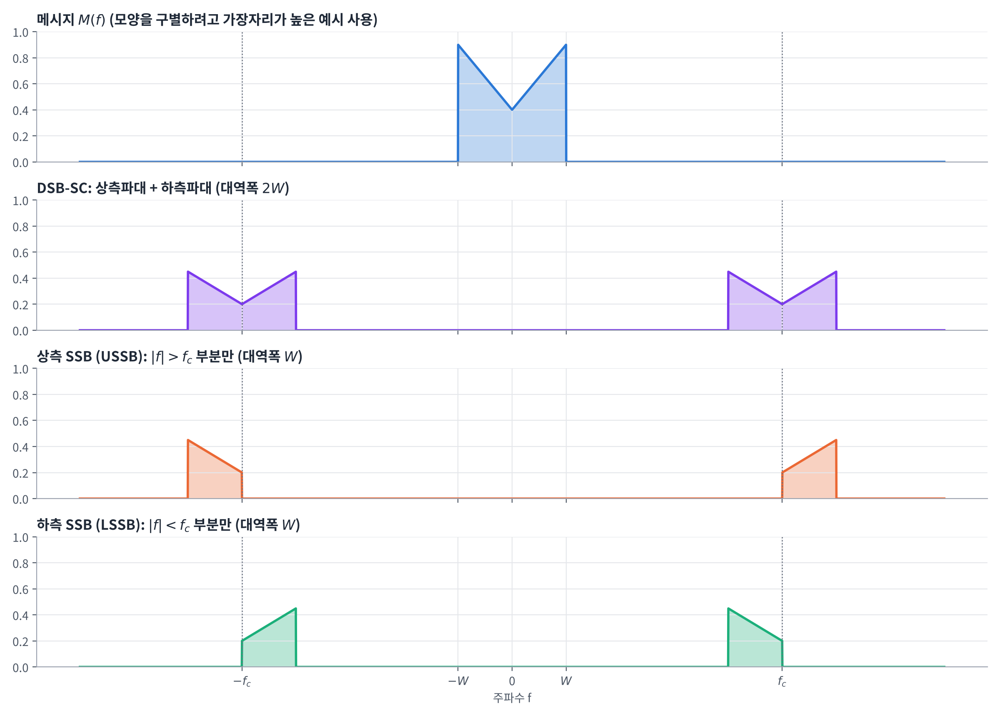
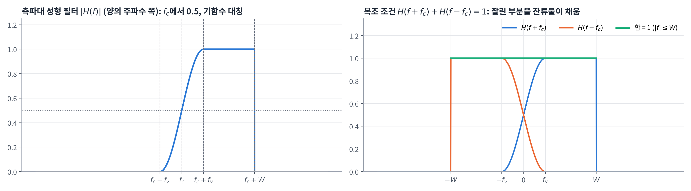
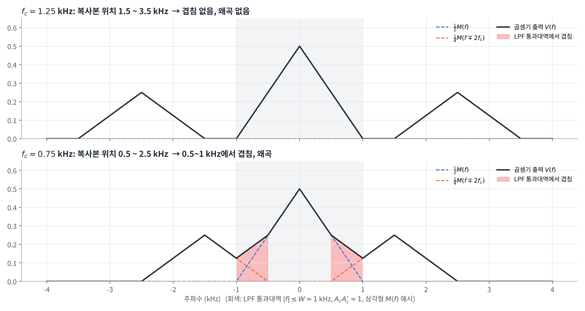

## 학습 목표

- 변조의 의미와 AM 계열(AM, DSB-SC, SSB, VSB)의 차이 이해
- AM(DSB-LC) 신호의 시간 영역 표현과 스펙트럼, 대역폭 이해
- 단일톤 변조의 변조지수와 반송파/측파대 전력 분배 이해
- 포락선 검파기의 동작과 RC 시정수 조건 이해
- DSB-SC 변조(링 변조기)와 동기 검파, 위상 오차의 영향, Costas 수신기, QAM 이해
- SSB 변조(힐베르트 변환, 주파수 변별법, 위상 변별법)와 SSB 복조 이해
- 주파수 천이(혼합기), VSB 변조와 측파대 성형 필터 조건 이해
- 동위상·직교 성분 표현과 슈퍼헤테로다인 수신기 이해
- 과제 연습문제 3.17, 3.23 풀이

---

## 변조 (Modulation)

### 변조란?

- **정보를 가진 신호(메시지)에 따라 반송파(carrier wave)의 특정 특성을 변화시키는 과정**
- 연속파 변조의 두 갈래
  - **진폭 변조 (Amplitude Modulation)**: 반송파의 **진폭**을 바꿈 → 이번 장
  - **주파수 변조 (Frequency Modulation)**: 반송파의 **주파수(위상)**를 바꿈 → 다음 장

쉬운 설명:

- 음성(수 kHz)을 그대로 안테나로 보내기는 어려움 (안테나 크기가 파장에 비례하므로 너무 커짐)
- 그래서 높은 주파수의 반송파에 메시지를 **"실어서"** 보내고, 받는 쪽에서 다시 **꺼내는(복조)** 것

### AM 변조 계열

| 방식 | 전송하는 것 | 대역폭 | 특징 |
| --- | --- | --- | --- |
| AM (DSB-LC) | 반송파 + 상측파대 + 하측파대 | $$2W$$ | 수신기가 간단(포락선 검파), 전력 낭비 |
| DSB-SC | 상측파대 + 하측파대 | $$2W$$ | 반송파 전력 절약, 동기 검파 필요 |
| SSB | 상측파대 **또는** 하측파대 | $$W$$ | 최소 전력·최소 대역폭, 구현이 복잡 |
| VSB | 한 측파대 + 다른 측파대의 일부(잔류물) | $$W + f_v$$ | SSB와 DSB-SC의 절충 |

---

## 진폭 변조 (AM, DSB-LC)

### 정의

- 정현파 반송파 (sinusoidal carrier wave)

$$
c(t) = A_c \cos(2\pi f_c t)
$$

- 진폭 변조파 (Double Sideband - Large Carrier, DSB-LC)

$$
s(t) = A_c [1 + k_a m(t)] \cos(2\pi f_c t)
$$

| 기호 | 의미 |
| --- | --- |
| $$m(t)$$ | 메시지 신호 (대역폭 $$W$$) |
| $$k_a$$ | 진폭 감도 (amplitude sensitivity) |
| $$f_c$$ | 반송파 주파수 |

**(중요!!) 포락선이 메시지 모양을 유지하기 위한 두 조건**

1. $$\lvert k_a m(t) \rvert < 1$$ (모든 $$t$$): $$1 + k_a m(t)$$가 항상 양수여야 함
2. $$f_c \gg W$$: 반송파 주파수가 메시지 대역폭보다 훨씬 커야 함



- 조건 1이 만족되면 $$s(t)$$의 **포락선(envelope)** $$A_c[1 + k_a m(t)]$$이 메시지 $$m(t)$$와 같은 모양
- 조건 1이 깨지면(**과변조**, overmodulation) $$1 + k_a m(t) < 0$$인 구간에서 **위상 반전(phase reversal)**이 생기고, 실제 포락선은 $$\lvert 1 + k_a m(t) \rvert$$가 되어 메시지가 왜곡됨

### AM의 푸리에 변환

2장의 변환쌍을 이용

$$
\cos(2\pi f_c t) = \frac{1}{2}\left[e^{j2\pi f_c t} + e^{-j2\pi f_c t}\right], \qquad
e^{j2\pi f_c t} \rightleftharpoons \delta(f - f_c), \qquad
m(t)\, e^{j2\pi f_c t} \rightleftharpoons M(f - f_c)
$$

$$s(t) = A_c \cos(2\pi f_c t) + k_a A_c\, m(t) \cos(2\pi f_c t)$$를 변환하면

$$
S(f) = \frac{A_c}{2}\left[\delta(f - f_c) + \delta(f + f_c)\right] + \frac{k_a A_c}{2}\left[M(f - f_c) + M(f + f_c)\right]
$$



- 첫째 항: **반송파**에 해당하는 델타 함수 한 쌍
- 둘째 항: 메시지 스펙트럼이 $$\pm f_c$$로 **옮겨진** 것 (2장의 주파수 이동, 변조 정리)
- $$m(t)$$의 $$(-W, 0)$$ 영역 스펙트럼이 AM에서 $$f_c$$ 왼쪽에 나타남 → **하측파대 (LSB, lower sideband)**
- $$m(t)$$의 $$(0, W)$$ 영역 스펙트럼이 $$f_c$$ 오른쪽에 나타남 → **상측파대 (USB, upper sideband)**
- 실수 메시지는 $$\lvert M(f) \rvert$$가 우함수이므로 $$f_c$$를 기준으로 상측파대와 하측파대는 **대칭**
- AM 신호의 대역폭

$$
B_T = (f_c + W) - (f_c - W) = 2W
$$

→ 메시지 대역폭의 **2배**

---

## 단일톤 변조 (Single-Tone Modulation)

### 변조지수

메시지가 정현파 하나인 경우

$$
m(t) = A_m \cos(2\pi f_m t), \qquad s(t) = A_c[1 + \mu \cos(2\pi f_m t)] \cos(2\pi f_c t), \qquad \mu = k_a A_m
$$

- $$\mu$$: **변조지수 (modulation factor)**, 왜곡이 없으려면 $$\mu \le 1$$
- 포락선의 최댓값 $$A_{\max} = A_c(1 + \mu)$$, 최솟값 $$A_{\min} = A_c(1 - \mu)$$이므로

$$
\frac{A_{\max}}{A_{\min}} = \frac{1 + \mu}{1 - \mu} \quad\Rightarrow\quad \mu = \frac{A_{\max} - A_{\min}}{A_{\max} + A_{\min}}
$$

→ 오실로스코프로 파형의 최대·최소만 재면 변조지수를 구할 수 있음

### 단일톤 AM의 스펙트럼

곱→합 공식 $$\cos A \cos B = \frac{1}{2}[\cos(A + B) + \cos(A - B)]$$로 전개하면

$$
s(t) = A_c \cos(2\pi f_c t) + \frac{1}{2}\mu A_c \cos\big(2\pi(f_c + f_m)t\big) + \frac{1}{2}\mu A_c \cos\big(2\pi(f_c - f_m)t\big)
$$

$$
S(f) = \frac{A_c}{2}\left[\delta(f - f_c) + \delta(f + f_c)\right]
+ \frac{\mu A_c}{4}\left[\delta(f - f_c - f_m) + \delta(f + f_c + f_m)\right]
+ \frac{\mu A_c}{4}\left[\delta(f - f_c + f_m) + \delta(f + f_c - f_m)\right]
$$

- 반송파 1개 + 측파대 주파수 2개($$f_c \pm f_m$$) → 정현파 **세 개의 합**
- 참고: 강의 자료의 $$\cos\big(2\pi(f_m - f_c)t\big)$$는 $$\cos$$가 우함수라서 $$\cos\big(2\pi(f_c - f_m)t\big)$$와 같음

### 전력 분배

진폭 $$A$$인 정현파의 평균 전력은 $$\frac{A^2}{2}$$ (1 Ω 기준)

| 성분 | 진폭 | 전력 |
| --- | --- | --- |
| 반송파 | $$A_c$$ | $$\frac{1}{2}A_c^2$$ |
| 상측 주파수 | $$\frac{1}{2}\mu A_c$$ | $$\frac{1}{8}\mu^2 A_c^2$$ |
| 하측 주파수 | $$\frac{1}{2}\mu A_c$$ | $$\frac{1}{8}\mu^2 A_c^2$$ |
| 합계 | | $$\frac{1}{2}A_c^2\left(1 + \frac{\mu^2}{2}\right)$$ |

$$
\frac{\text{측파대 전력}}{\text{총 송신 전력}} = \frac{2 \cdot \frac{1}{8}\mu^2 A_c^2}{\frac{1}{2}A_c^2 + \frac{1}{4}\mu^2 A_c^2} = \frac{\mu^2}{2 + \mu^2}
$$

- $$\mu = 1$$ (100% 변조): 반송파 $$\frac{2}{3}$$, 전체 측파대 $$\frac{1}{3}$$ → 최선의 경우에도 전력의 **1/3만** 정보 전달에 쓰임
- $$\mu = \frac{1}{5}$$ (20% 변조): 한쪽 측파대 전력 $$= \frac{1}{8} \times \frac{1}{5^2} A_c^2 = \frac{1}{100} \times \frac{1}{2}A_c^2$$ → 반송파 전력의 **1%**



FFT로 단일톤 AM의 스펙트럼과 전력을 확인하면 다음과 같음 ($$A_c = 1$$, $$\mu = 0.5$$)

```python
import numpy as np

fs = 100_000                      # 샘플링 주파수 [Hz]
t = np.arange(0, 1, 1 / fs)       # 1초
Ac, fc, fm, mu = 1.0, 10_000, 1_000, 0.5

s = Ac * (1 + mu * np.cos(2 * np.pi * fm * t)) * np.cos(2 * np.pi * fc * t)

S = np.fft.rfft(s) / len(s)       # 양의 주파수 쪽 복소 진폭 (= 진폭/2)
f = np.fft.rfftfreq(len(s), 1 / fs)
for k in np.where(np.abs(S) > 1e-3)[0]:
    amp = 2 * np.abs(S[k])        # 정현파 진폭
    print(f"{f[k]:>6.0f} Hz: 진폭 {amp:.3f}, 전력 {amp**2 / 2:.4f}")

P_total = np.mean(s ** 2)
print(f"총 전력 {P_total:.4f}, 이론값 {Ac**2 / 2 * (1 + mu**2 / 2):.4f}")
print(f"측파대 전력 비율 {mu**2 / (2 + mu**2):.4f}")
```

실행 결과

```text
  9000 Hz: 진폭 0.250, 전력 0.0312
 10000 Hz: 진폭 1.000, 전력 0.5000
 11000 Hz: 진폭 0.250, 전력 0.0312
총 전력 0.5625, 이론값 0.5625
측파대 전력 비율 0.1111
```

- 측파대 진폭 $$\frac{1}{2}\mu A_c = 0.25$$, 전력 $$\frac{1}{8}\mu^2 A_c^2 = 0.03125$$로 이론과 일치
- $$\mu = 0.5$$이면 측파대 전력은 전체의 약 11%뿐

---

## 포락선 검파기 (Envelope Detector)

### 구조와 동작

- 다이오드 + 커패시터 $$C$$ + 부하 저항 $$R_l$$로 구성된 가장 간단한 AM 복조기
- 다이오드가 켜지면(입력 > 출력) **입력 = 출력**이 되도록 $$C$$가 충전
- 다이오드가 꺼지면 $$C$$에 쌓인 전하가 $$R_l$$을 통해 **천천히 방전**
- 결과적으로 반송파의 꼭짓점을 이어 **포락선을 따라감**

**동작 조건**

- AM파는 협대역(narrowband): 반송파 주파수가 메시지 대역폭보다 매우 큼
- 변조율(percent modulation)은 100% 이하 (과변조 없음)

**(중요!!) RC 시정수 조건**

$$
(r_f + R_s)C \ll \frac{1}{f_c}, \qquad \frac{1}{f_c} \ll R_l C \ll \frac{1}{W}
$$

| 조건 | 의미 |
| --- | --- |
| $$(r_f + R_s)C \ll \frac{1}{f_c}$$ | **충전**은 반송파 한 주기보다 훨씬 빨라야 꼭짓점을 따라감 ($$r_f$$: 다이오드 순방향 저항, $$R_s$$: 소스 저항) |
| $$\frac{1}{f_c} \ll R_l C$$ | **방전**은 반송파 주기보다 충분히 느려야 리플이 작음 |
| $$R_l C \ll \frac{1}{W}$$ | 방전이 메시지 변화보다는 빨라야 **내려가는 포락선**을 따라감 |



- 왼쪽: $$R_l C$$가 너무 작으면 반송파 주기마다 거의 0까지 방전 → 큰 리플
- 가운데: 적절한 $$R_l C$$ → 포락선을 잘 따라감 (작은 톱니 리플은 이후 LPF로 제거)
- 오른쪽: $$R_l C$$가 너무 크면 포락선이 빨리 내려갈 때 따라가지 못함 → 왜곡

### 진폭 변조(DSB-LC)의 한계

- **전력 낭비**: 정보가 없는 반송파를 전송하는 데 전력 대부분을 씀 (최대 2/3 이상)
- **대역폭 낭비**: 상측파대와 하측파대에 같은 정보가 들어 있는데 둘 다 보냄 → 송신 대역폭이 메시지 대역폭의 2배

→ 이를 개선한 것이 **DSB-SC**(반송파 제거), **SSB**(측파대 하나만), **VSB**(절충)

---

## DSB-SC (Double Sideband - Suppressed Carrier)

### 정의

- 반송파와 메시지의 **곱**으로 구성 → **곱 변조 (product modulation)**

$$
s(t) = c(t)\, m(t) = A_c \cos(2\pi f_c t)\, m(t)
$$

- 변조 정리(시간 곱 ↔ 주파수 컨볼루션)에 의해

$$
S(f) = C(f) * M(f) = \frac{1}{2}A_c\left[\delta(f - f_c) + \delta(f + f_c)\right] * M(f) = \frac{1}{2}A_c\left[M(f - f_c) + M(f + f_c)\right]
$$



- **반송파 델타가 없음** → 반송파 전력을 아낌
- 점유 대역폭은 여전히 $$2W$$ (AM과 동일)
- $$m(t)$$의 부호가 바뀔 때마다 위상이 반전되므로 포락선이 메시지와 다름 → **포락선 검파 불가**, 동기 검파가 필요

### 링 변조기 (Ring Modulator)

- 다이오드 4개를 고리 모양으로 연결한 DSB-SC 변조기
- 반송파 대신 **구형파** $$w(t)$$로 다이오드를 스위칭
  - $$w(t)$$가 양수일 때 $$D_1$$, $$D_2$$가 켜짐 → 메시지가 그대로 통과
  - $$w(t)$$가 음수일 때 $$D_3$$, $$D_4$$가 켜짐 → 메시지의 부호가 반전
- 결과적으로 $$m(t) \times (\pm 1$$ 구형파$$)$$가 되고, 구형파는 $$f_c$$와 그 홀수 배 고조파의 합
- **$$f_c$$에 맞춘 대역통과 필터(BPF)**로 $$f_c$$ 성분만 남기면 DSB-SC 신호

---

## DSB-SC 복조: 동기 검파 (Coherent Detection)

### 동작 원리

- 수신단에서 $$f_c$$의 정현파를 자체적으로 만들어(국부 발진기) 수신 신호와 곱한 뒤 **저역통과 필터(LPF)**를 통과
- 국부 발진기의 위상 오차를 $$\phi$$라 하면

$$
\begin{aligned}
v(t) &= A_c' \cos(2\pi f_c t + \phi)\, s(t) = A_c A_c' \cos(2\pi f_c t + \phi)\cos(2\pi f_c t)\, m(t) \\
&= \underbrace{\frac{1}{2}A_c A_c' \cos(4\pi f_c t + \phi)\, m(t)}_{2f_c \text{ 고주파 성분}} + \underbrace{\frac{1}{2}A_c A_c' \cos\phi\, m(t)}_{\text{기저대역 성분}}
\end{aligned}
$$

- 사용한 공식: $$\cos\theta_1 \cos\theta_2 = \frac{1}{2}\cos(\theta_1 + \theta_2) + \frac{1}{2}\cos(\theta_1 - \theta_2)$$
- LPF가 $$2f_c$$ 성분을 제거하면

$$
v_o(t) = \frac{1}{2}A_c A_c' \cos\phi\, m(t)
$$



### 위상 오차의 영향

- $$\phi$$: 위상 오차(phase error), 일반적으로 여러 요인에 의해 **랜덤하게 변화**
- 출력이 $$\cos\phi$$만큼 **감쇄(attenuation)**
- $$\phi = \pm\frac{\pi}{2}$$이면 $$\cos\phi = 0$$ → **출력이 완전히 사라짐 (quadrature null effect)**
- 따라서 수신기의 국부 발진기는 송신 반송파와 **주파수와 위상이 모두 동기**되어야 함

시뮬레이션으로 위상 오차에 따른 출력 크기를 확인하면 다음과 같음 ($$A_c = A_c' = 1$$)

```python
import numpy as np
from scipy import signal

fs = 200_000
t = np.arange(0, 0.05, 1 / fs)
fc, fm = 20_000, 500
m = np.cos(2 * np.pi * fm * t)                       # 메시지
s = m * np.cos(2 * np.pi * fc * t)                   # DSB-SC (Ac = 1)

b, a = signal.butter(6, 2_000, fs=fs)                # 차단 2 kHz 저역통과 필터
for deg in [0, 30, 60, 90]:
    phi = np.deg2rad(deg)
    v = s * np.cos(2 * np.pi * fc * t + phi)         # 국부 발진기 (A'c = 1)
    vo = signal.filtfilt(b, a, v)
    gain = np.max(np.abs(vo[2000:-2000]))            # 가장자리 과도 응답 제외
    print(f"phi = {deg:2d}도: 출력 진폭 {gain:.3f}, 이론 0.5*cos(phi) = {0.5 * np.cos(phi):.3f}")
```

실행 결과

```text
phi =  0도: 출력 진폭 0.500, 이론 0.5*cos(phi) = 0.500
phi = 30도: 출력 진폭 0.433, 이론 0.5*cos(phi) = 0.433
phi = 60도: 출력 진폭 0.250, 이론 0.5*cos(phi) = 0.250
phi = 90도: 출력 진폭 0.000, 이론 0.5*cos(phi) = 0.000
```

### Costas 수신기 (Costas Receiver)

위상 동기를 자동으로 맞추는 DSB-SC 수신기

- **두 개의 동기 검파기**로 구성
  - **I-채널 (In-phase)**: 국부 발진기 $$\cos(2\pi f_c t + \phi)$$를 곱함
  - **Q-채널 (Quadrature)**: $$-90°$$ 위상 천이기를 거친 $$\sin(2\pi f_c t + \phi)$$를 곱함
- 각 채널의 LPF 출력 ($$A_c = 1$$로 정규화)

$$
I(t) = \frac{1}{2}m(t)\cos\phi, \qquad Q(t) = \frac{1}{2}m(t)\sin\phi
$$

- 위상 판별기(phase discriminator)가 두 출력을 곱함 ($$\sin\theta\cos\theta = \frac{1}{2}\sin 2\theta$$ 이용)

$$
e(t) = I(t)\,Q(t) = \frac{1}{4}m^2(t)\cos\phi\sin\phi = \frac{1}{8}m^2(t)\sin(2\phi)
$$

- $$\phi$$가 작으면 $$e(t) \approx \frac{1}{4}m^2(t)\,\phi$$ → $$\phi$$의 부호와 크기를 알려주는 **오차 신호**
- $$e(t) = 0$$이 되도록 전압 제어 발진기(VCO)의 위상을 조절 → $$\phi \to 0$$
- 그러면 I-채널 출력은 $$I(t) = \frac{1}{2}m(t)\cos 0 = \frac{1}{2}m(t)$$로 메시지가 복원됨

### 직교 진폭 변조 (QAM, Quadrature-Amplitude Modulation)

- **두 DSB-SC 신호가 같은 채널 대역폭을 공유**하는 방법 (quadrature-carrier multiplexing)

$$
s(t) = A_c\, m_1(t)\cos(2\pi f_c t) + A_c\, m_2(t)\sin(2\pi f_c t)
$$

- 수신기: $$2\cos(2\pi f_c t)$$를 곱하고 LPF → $$A_c m_1(t)$$, $$2\sin(2\pi f_c t)$$를 곱하고 LPF → $$A_c m_2(t)$$
- $$\cos$$와 $$\sin$$이 **직교**하기 때문에 서로 간섭하지 않음 (곱하면 $$\sin 2\theta$$ 성분만 남고 LPF로 제거됨)
- 동기화를 유지하기 위해 변조 신호의 통과대역 밖에 **파일럿 신호(pilot signal)**를 함께 보냄
- 대역폭 $$2W$$로 메시지 **두 개**를 보내므로 대역폭 효율은 SSB와 같음

### DSB-LC vs DSB-SC

| 항목 | DSB-LC (AM) | DSB-SC |
| --- | --- | --- |
| 점유 대역폭 | $$2W$$ | $$2W$$ (동일) |
| 송신 전력 | 반송파 때문에 **더 많이 필요** | 측파대 전력만 |
| 수신기 | **간단** (포락선 검파) | 복잡 (동기 검파, 위상 동기 필요) |

---

## 단측파대 변조 (SSB, Single-Sideband)

### 단일톤으로 본 SSB

DSB-SC의 두 측파대 중 **한쪽을 억제**. 단일톤 $$m(t) = A_m\cos(2\pi f_m t)$$이면

$$
s_{\mathrm{DSB}}(t) = A_c A_m \cos(2\pi f_c t)\cos(2\pi f_m t) = \frac{1}{2}A_c A_m \cos\big(2\pi(f_c + f_m)t\big) + \frac{1}{2}A_c A_m \cos\big(2\pi(f_c - f_m)t\big)
$$

덧셈정리 $$\cos(\theta_1 \pm \theta_2) = \cos\theta_1\cos\theta_2 \mp \sin\theta_1\sin\theta_2$$를 쓰면

$$
s_{\mathrm{USSB}}(t) = \frac{1}{2}A_c A_m \cos\big(2\pi(f_c + f_m)t\big) = \frac{1}{2}A_c A_m \cos(2\pi f_c t)\cos(2\pi f_m t) - \frac{1}{2}A_c A_m \sin(2\pi f_c t)\sin(2\pi f_m t)
$$

$$
s_{\mathrm{LSSB}}(t) = \frac{1}{2}A_c A_m \cos\big(2\pi(f_c - f_m)t\big) = \frac{1}{2}A_c A_m \cos(2\pi f_c t)\cos(2\pi f_m t) + \frac{1}{2}A_c A_m \sin(2\pi f_c t)\sin(2\pi f_m t)
$$

$$
\therefore\; s_{\mathrm{SSB}}(t) = \frac{1}{2}A_c A_m \cos(2\pi f_c t)\cos(2\pi f_m t) \mp \frac{1}{2}A_c A_m \sin(2\pi f_c t)\sin(2\pi f_m t)
$$

- 부호 $$-$$: 상측 SSB, 부호 $$+$$: 하측 SSB

### 일반 메시지로 확장: 힐베르트 변환

메시지를 정현파들의 합 $$m(t) = \sum_n a_n\cos(2\pi f_n t)$$로 보면, 각 $$\cos$$를 $$\sin$$으로 바꾼 신호가 필요

$$
\hat{m}(t) = \mathcal{H}\{m(t)\} = \sum_n a_n \sin(2\pi f_n t)
$$

$$
s_{\mathrm{SSB}}(t) = \frac{1}{2}A_c\, m(t)\cos(2\pi f_c t) \mp \frac{1}{2}A_c\, \hat{m}(t)\sin(2\pi f_c t)
$$

- 주기 신호의 푸리에 급수 표현은 비주기 신호의 푸리에 변환으로 수렴하므로 일반 신호에도 성립
- $$\hat{m}(t)$$는 $$m(t)$$의 **힐베르트(Hilbert) 변환**
- 힐베르트 변환기의 전달함수

$$
H(f) = -j\,\mathrm{sgn}(f) =
\begin{cases}
-j = e^{-j\pi/2}, & f > 0 \\
+j = e^{+j\pi/2}, & f < 0
\end{cases}
$$



- 진폭 응답은 양·음의 주파수 모두 **1 (unity)** → 크기는 그대로
- 위상 응답은 양의 주파수에서 **$$-90°$$**, 음의 주파수에서 **$$+90°$$** → 모든 주파수 성분을 1/4 주기씩 지연
- 그래서 $$\cos \to \sin$$, 즉 **광대역 $$-90°$$ 위상 천이기**

### SSB의 스펙트럼

$$s(t) = \frac{A_c}{2}m(t)\cos(2\pi f_c t) \mp \frac{A_c}{2}\hat{m}(t)\sin(2\pi f_c t)$$를 변환하고 $$\hat{M}(f) = -jM(f)\,\mathrm{sgn}(f)$$를 넣으면

$$
\begin{aligned}
S(f) &= \frac{A_c}{4}\left[M(f - f_c) + M(f + f_c)\right] \mp \frac{A_c}{4j}\left[\hat{M}(f - f_c) - \hat{M}(f + f_c)\right] \\
&= \frac{A_c}{4}\left[M(f - f_c) + M(f + f_c)\right] \mp \frac{A_c}{4j}\left[-jM(f - f_c)\,\mathrm{sgn}(f - f_c) + jM(f + f_c)\,\mathrm{sgn}(f + f_c)\right] \\
&= \frac{A_c}{4}\big(1 \pm \mathrm{sgn}(f - f_c)\big)M(f - f_c) + \frac{A_c}{4}\big(1 \mp \mathrm{sgn}(f + f_c)\big)M(f + f_c)
\end{aligned}
$$

**상측 SSB (위쪽 부호)**, 양의 주파수 쪽만 보면 $$\mathrm{sgn}(f + f_c) = 1$$이므로 둘째 항은 0

- $$f > f_c$$: $$\mathrm{sgn}(f - f_c) = 1$$ → $$S(f) = \frac{A_c}{4}(1 + 1)M(f - f_c) = \frac{A_c}{2}M(f - f_c)$$
- $$0 < f < f_c$$: $$\mathrm{sgn}(f - f_c) = -1$$ → $$S(f) = 0$$

**하측 SSB (아래쪽 부호)**, 양의 주파수 쪽에서는

- $$f > f_c$$: $$(1 - 1) = 0$$ → $$S(f) = 0$$
- $$0 < f < f_c$$: $$(1 - (-1)) = 2$$ → $$S(f) = \frac{A_c}{2}M(f - f_c)$$
- 이때 둘째 항의 $$(1 + 1)M(f + f_c)$$는 $$f_c > W$$이면 **음의 주파수 영역**에만 존재

$$
S_{\mathrm{USSB}}(f) =
\begin{cases}
\frac{A_c}{2}M(f - f_c), & f > f_c \\
0, & 0 < f < f_c
\end{cases}
\qquad
S_{\mathrm{LSSB}}(f) =
\begin{cases}
0, & f > f_c \\
\frac{A_c}{2}M(f - f_c), & 0 < f < f_c
\end{cases}
$$



- SSB는 대역폭이 **$$W$$** (DSB의 절반)이고 측파대 하나만 보내므로 전력도 최소
- 음성 신호의 전송에 적합 (음성은 약 300 Hz 이하에 에너지가 거의 없어서 두 측파대 사이에 **에너지 간극(energy gap)**이 있음)
- 단점: 구현 시 비용과 복잡성 증가

`scipy.signal.hilbert`로 힐베르트 변환을 구해서 SSB를 만들어 보면 다음과 같음

```python
import numpy as np
from scipy.signal import hilbert

fs = 100_000
t = np.arange(0, 1, 1 / fs)
fc = 10_000
m = np.cos(2 * np.pi * 1_000 * t) + 0.5 * np.cos(2 * np.pi * 2_000 * t)
m_hat = np.imag(hilbert(m))                          # 힐베르트 변환 (각 cos -> sin)

for name, sign in [("상측 SSB", -1), ("하측 SSB", +1)]:
    s = 0.5 * m * np.cos(2 * np.pi * fc * t) + sign * 0.5 * m_hat * np.sin(2 * np.pi * fc * t)
    S = np.abs(np.fft.rfft(s)) / len(s) * 2
    f = np.fft.rfftfreq(len(s), 1 / fs)
    lines = [f"{f[k]:.0f} Hz({S[k]:.3f})" for k in np.where(S > 1e-3)[0]]
    print(name + ":", ", ".join(lines))
```

실행 결과

```text
상측 SSB: 11000 Hz(0.500), 12000 Hz(0.250)
하측 SSB: 8000 Hz(0.250), 9000 Hz(0.500)
```

- `hilbert()`는 해석 신호 $$m(t) + j\hat{m}(t)$$를 돌려주므로 허수부가 $$\hat{m}(t)$$
- 상측 SSB는 $$f_c + 1, f_c + 2$$ kHz, 하측 SSB는 $$f_c - 1, f_c - 2$$ kHz에만 성분이 있음 → 한쪽 측파대만 남음

### SSB 생성 방법 1: 주파수 변별법 (Frequency Discrimination Method)

- **곱 변조기**: 상측파대와 하측파대를 가진 DSB-SC 파형 생성
- **대역통과 필터**: 상측 SSB 혹은 하측 SSB 중 하나만 통과
- 필터가 두 측파대를 가르려면 측파대 사이에 **충분히 넓은 간격**($$2f_a$$, $$f_a$$: 메시지의 최저 주파수)이 필요 → 음성처럼 저주파 성분이 없는 신호에 적합

### SSB 생성 방법 2: 위상 변별법 (Phase Discrimination Method)

- 두 개의 병렬 경로로 구성
  - **동위상 경로 (in-phase path)**: $$m(t) \times \cos(2\pi f_c t)$$
  - **직교 위상 경로 (quadrature path)**: $$\hat{m}(t) \times \sin(2\pi f_c t)$$
- 두 경로의 곱 변조기에 들어가는 반송파는 $$-90°$$의 위상차
- **광대역 위상 천이기(wide-band phase-shifter)**가 $$m(t)$$의 힐베르트 변환 $$\hat{m}(t)$$를 생성
- 두 경로를 더하거나 빼면 $$s(t) = \frac{A_c}{2}m(t)\cos(2\pi f_c t) \mp \frac{A_c}{2}\hat{m}(t)\sin(2\pi f_c t)$$ (빼면 상측, 더하면 하측)

### SSB 복조: 동기 검출

- DSB-SC의 동기 검출기와 유사, 단 **$$W < f_c$$**를 반드시 충족해야 함
- 상측 SSB 예시 (위상 오차 $$\phi = 0$$ 가정)

$$
\begin{aligned}
v(t) &= A_c' s(t)\cos(2\pi f_c t) = \frac{A_c A_c'}{2}\left[m(t)\cos^2(2\pi f_c t) - \hat{m}(t)\cos(2\pi f_c t)\sin(2\pi f_c t)\right] \\
&= \frac{A_c A_c'}{2}\left[m(t)\left(\frac{1}{2} + \frac{1}{2}\cos(4\pi f_c t)\right) - \frac{1}{2}\hat{m}(t)\sin(4\pi f_c t)\right] \\
&= \frac{A_c A_c'}{4}m(t) + \underbrace{\frac{A_c A_c'}{4}\left[m(t)\cos(4\pi f_c t) - \hat{m}(t)\sin(4\pi f_c t)\right]}_{\text{중심 주파수 } 2f_c \text{ 인 고주파 성분}}
\end{aligned}
$$

$$
\xrightarrow{\text{LPF}}\; v_o(t) = \frac{1}{4}A_c A_c'\, m(t)
$$

- 두 성분(기저대역 $$[0, W]$$와 $$2f_c$$ 근처 $$[2f_c, 2f_c + W]$$)을 필터로 분리하려면 $$W < f_c$$

---

## 주파수 천이 (Frequency Translation)

- SSB의 "주파수 옮기기" 개념은 메시지뿐 아니라 **이미 변조된 신호**에도 일반화 가능
- 반송 주파수 $$f_1$$의 변조파를 새로운 반송 주파수 $$f_2$$로 옮김
  - **상향 변환 (up conversion)**: $$f_2 = f_1 + f_L$$
  - **하향 변환 (down conversion)**: $$f_2 = f_1 - f_L$$
- 구성: **혼합기(mixer)** = 곱 변조기(국부 발진기 $$A_l\cos(2\pi f_L t)$$) + 대역통과 필터
- 곱셈 후 스펙트럼은 $$f_1 + f_L$$과 $$\lvert f_1 - f_L \rvert$$ 두 곳에 생기고, BPF가 원하는 쪽만 남김
- 강의 자료에서는 혼합기 발진기 주파수 조건을 $$f_L > f_1 + W$$로 제시
- 일반적으로는 두 복사본이 서로, 그리고 0 Hz를 넘어 겹치지 않을 만큼 떨어져 있어야 BPF로 분리 가능

---

## 잔류측파대 변조 (VSB, Vestigial Sideband)

### 필요성

- 텔레비전 영상 신호처럼 **광대역 신호가 저주파 성분(거의 0 Hz)까지 포함**하면 두 측파대 사이에 간격이 없어 SSB 필터를 만들 수 없음
- DSB-SC는 가능하지만 메시지 대역폭의 2배가 필요
- VSB는 한 측파대를 거의 다 보내고, 다른 측파대는 완전히 제거하는 대신 **흔적(trace) 혹은 잔류물(vestige)**만 보냄
- 전송 대역폭

$$
B_T = W + f_v
$$

| 기호 | 의미 |
| --- | --- |
| $$f_v$$ | 잔류 대역폭 (vestige bandwidth), 전형적으로 $$W$$의 약 25% |
| $$W$$ | 메시지 대역폭 |

→ SSB의 대역폭 $$W$$와 DSB-SC의 대역폭 $$2W$$ 사이

### 측파대 성형 필터 (Sideband Shaping Filter)

- 곱 변조기(DSB-SC 생성) + **측파대 성형 필터 $$H(f)$$**로 VSB를 생성
- 잔류물이 손실된 측파대 부분을 **정확히 보상**하려면 다음을 반드시 충족해야 함

$$
H(f + f_c) + H(f - f_c) = 1, \qquad -W \le f \le W
$$

- 전달함수는 $$f_c$$에 대해 **기함수 대칭(odd symmetry)** ($$f_c$$에서 크기 0.5)

$$
H(f) = u(f - f_c) - H_v(f - f_c), \quad f_c - f_v < \lvert f \rvert < f_c + W, \qquad H_v(-f) = -H_v(f)
$$

- $$u(f)$$: 주파수 영역의 단위 계단 함수 ($$f > 0$$에서 1, $$f < 0$$에서 0)
- $$H_v(f)$$: 계단에서 뺄 "보정" 부분, 기함수이므로 $$f_c$$ 위쪽에서 잘린 만큼 아래쪽에 남음



### VSB 복조와 조건의 의미

동기 검출기($$A_c'\cos(2\pi f_c t)$$ 곱 + LPF, $$\phi = 0$$)로 복조

$$
V(f) = \frac{1}{2}A_c'\left[S(f - f_c) + S(f + f_c)\right], \qquad S(f) = \frac{1}{2}A_c\left[M(f - f_c) + M(f + f_c)\right]H(f)
$$

$$
\begin{aligned}
V(f) &= \frac{1}{4}A_c A_c'\, M(f)\left[H(f - f_c) + H(f + f_c)\right] + \frac{1}{4}A_c A_c'\left[M(f - 2f_c)H(f - f_c) + M(f + 2f_c)H(f + f_c)\right] \\
&\xrightarrow{\text{LPF}}\; \frac{1}{4}A_c A_c'\, M(f) \quad \left(\because H(f + f_c) + H(f - f_c) = 1\right)
\end{aligned}
$$

- 성형 필터 조건 덕분에 기저대역에서 두 측파대 조각이 **더해져서 정확히 원래 $$M(f)$$**가 됨
- 조건이 깨지면 $$M(f)$$에 $$[H(f - f_c) + H(f + f_c)]$$라는 주파수 의존 가중치가 곱해져 왜곡

### 정현 VSB (Sinusoidal VSB)

$$m(t) = A_m\cos(2\pi f_m t)$$, $$c(t) = A_c\cos(2\pi f_c t)$$에서 상측파대의 크기를 $$k$$, 하측파대를 $$(1 - k)$$로 두면

$$
S(f) = \frac{k}{4}A_m A_c\left[\delta(f - (f_c + f_m)) + \delta(f + (f_c + f_m))\right] + \frac{1 - k}{4}A_m A_c\left[\delta(f - (f_c - f_m)) + \delta(f + (f_c - f_m))\right]
$$

$$
\begin{aligned}
s(t) &= \frac{k}{2}A_m A_c \cos\big(2\pi(f_c + f_m)t\big) + \frac{1 - k}{2}A_m A_c \cos\big(2\pi(f_c - f_m)t\big) \\
&= \frac{1}{2}A_m A_c \cos(2\pi f_c t)\cos(2\pi f_m t) + \frac{1 - 2k}{2}A_m A_c \sin(2\pi f_c t)\sin(2\pi f_m t)
\end{aligned}
$$

| $$k$$ | $$s(t)$$ |
| --- | --- |
| $$k = \frac{1}{2}$$ | DSB-SC와 동일 (두 측파대 크기가 같음) |
| $$k = 0$$ | 하측 SSB |
| $$k = 1$$ | 상측 SSB |
| $$0 < k < \frac{1}{2}$$ | 상측 주파수의 감쇠된 형태가 잔류물 |
| $$\frac{1}{2} < k < 1$$ | 하측 주파수의 감쇠된 형태가 잔류물 |

- 강의 자료의 예: $$m(t) = A\cos(2\pi f_1 t) + B\cos(2\pi f_2 t)$$를 VSB 필터에 통과시키면 $$f_c - f_1$$ 성분은 $$\epsilon$$배, $$f_c + f_1$$ 성분은 $$(1 - \epsilon)$$배로 바뀜 → 두 크기의 합이 1이 되도록 보상됨

**정현 VSB의 동기 검출**

$$
\begin{aligned}
v(t) &= A_c' s(t)\cos(2\pi f_c t) \\
&= \frac{1}{2}A_m A_c A_c' \cos(2\pi f_m t)\left(\frac{1}{2} + \frac{1}{2}\cos(4\pi f_c t)\right) + \frac{1 - 2k}{2}A_m A_c A_c' \sin(2\pi f_m t)\left(\frac{1}{2}\sin(4\pi f_c t)\right) \\
&= \frac{1}{4}A_m A_c A_c' \cos(2\pi f_m t) + \frac{1}{4}A_m A_c A_c'\left[\cos(2\pi f_m t)\cos(4\pi f_c t) + (1 - 2k)\sin(2\pi f_m t)\sin(4\pi f_c t)\right]
\end{aligned}
$$

- LPF가 $$2f_c$$ 성분을 제거하면 $$\frac{1}{4}A_m A_c A_c'\cos(2\pi f_m t)$$ → $$k$$와 무관하게 메시지 복원

---

## 변조된 파형의 일반 표현

### 동위상 성분과 직교 성분

모든 선형 변조파는 다음 꼴로 쓸 수 있음

$$
s(t) = s_I(t)\cos(2\pi f_c t) - s_Q(t)\sin(2\pi f_c t) = s_I(t)\,c(t) - s_Q(t)\,\hat{c}(t)
$$

| 기호 | 의미 |
| --- | --- |
| $$s_I(t)$$ | 동위상(in-phase) 성분 |
| $$s_Q(t)$$ | 직교(quadrature) 위상 성분 |
| $$\tilde{s}(t) = s_I(t) + js_Q(t)$$ | 복소 포락선 (complex envelope) |
| $$\tilde{c}(t) = \cos(2\pi f_c t) + j\sin(2\pi f_c t) = e^{j2\pi f_c t}$$ | 복소 반송파 |

$$
s(t) = \mathrm{Re}\left[\tilde{s}(t)\,\tilde{c}(t)\right]
$$

- 확인: $$(s_I + js_Q)(\cos + j\sin)$$의 실수부 $$= s_I\cos - s_Q\sin$$ ✓
- **분석기(analyzer)**: $$s(t)$$에 $$2\cos(2\pi f_c t)$$, $$-2\sin(2\pi f_c t)$$를 각각 곱하고 LPF → $$s_I(t)$$, $$s_Q(t)$$
- **합성기(synthesizer)**: $$s_I(t)\cos(2\pi f_c t) - s_Q(t)\sin(2\pi f_c t)$$를 만들어 $$s(t)$$ 복원

### 각 변조 방식의 동위상·직교 성분 (반송파 진폭 1)

| 방식 | $$s_I(t)$$ | $$s_Q(t)$$ | 비고 |
| --- | --- | --- | --- |
| AM | $$1 + k_a m(t)$$ | $$0$$ | |
| DSB-SC | $$m(t)$$ | $$0$$ | |
| 상측 SSB | $$\frac{1}{2}m(t)$$ | $$\frac{1}{2}\hat{m}(t)$$ | $$\hat{m}$$: 힐베르트 변환 |
| 하측 SSB | $$\frac{1}{2}m(t)$$ | $$-\frac{1}{2}\hat{m}(t)$$ | |
| VSB (하측파대 잔류) | $$\frac{1}{2}m(t)$$ | $$\frac{1}{2}m'(t)$$ | $$m'$$: 필터 $$H_Q(f)$$의 응답 |
| VSB (상측파대 잔류) | $$\frac{1}{2}m(t)$$ | $$-\frac{1}{2}m'(t)$$ | $$H_Q(f) = -j[H(f + f_c) - H(f - f_c)]$$ |

- AM, DSB-SC는 직교 성분이 없고, SSB·VSB는 직교 성분이 **한쪽 측파대를 지우는 역할**

---

## 슈퍼헤테로다인 수신기 (Superheterodyne Receiver)

AM 라디오 수신기의 기본 구조

| 단계 | 역할 |
| --- | --- |
| RF 단 (RF section) | 원하는 방송 주파수 근처를 선택·증폭 |
| 혼합기 (Mixer) + 국부 발진기 | 수신 신호를 **고정된 중간 주파수(IF)**로 하향 변환 (주파수 천이) |
| IF 단 (IF section) | 대부분의 **필터링과 증폭**을 고정 주파수에서 수행 |
| 포락선 검파기 | AM 복조 |
| 오디오 증폭기 | 스피커 구동 |

- 수신기가 해야 할 일: **주파수 동조**(원하는 전파 선택), **필터링**(원하는 신호 분리), **증폭**(전력 손실 보상)
- RF 단과 국부 발진기는 **함께 동조(common tuning)** → 어떤 방송을 고르든 혼합기 출력은 항상 같은 IF
- **중간 주파수 (IF)**: 입력 반송파보다는 낮고 원본 신호 주파수보다는 높은 주파수
- 장점: 날카로운 필터를 **고정 주파수 하나**에만 만들면 됨

| 항목 | AM 라디오 | FM 라디오 |
| --- | --- | --- |
| RF 반송파 범위 | 0.535 ~ 1.605 MHz | 88 ~ 108 MHz |
| IF 중심 주파수 | 0.455 MHz | 10.7 MHz |
| IF 대역폭 | 10 kHz | 200 kHz |

---

## 연습문제 풀이

과제 파일 중 이번 장(AM)에 해당하는 문제는 3.17, 3.23

### 연습문제 3.17 사인 반송파를 쓰는 AM의 스펙트럼

> 이 장에서는 반송파로 $$c(t) = A_c\cos(2\pi f_c t)$$를 사용했다. 대신 $$c(t) = A_c\sin(2\pi f_c t)$$를 반송파로 쓰고, 메시지도 $$m(t) = A_m\sin(2\pi f_m t)$$로 정의한다고 하자.
> (a) 새로운 AM 정의 $$s(t) = A_c[1 + k_a m(t)]\sin(2\pi f_c t)$$의 스펙트럼을 구하라.
> (b) (a)의 결과를 예제 3.1(cos 반송파의 단일톤 AM)과 비교하라.
> (c) 이 정의는 예제 3.1의 변조 이론에 어떤 차이를 만드는가?

참고: 문제지에는 $$m(t)$$의 진폭이 $$A_c$$로 인쇄되어 보이지만 메시지 진폭이므로 $$A_m$$으로 둠 ($$A_c$$로 두어도 $$\mu = k_a A_c$$로 바뀔 뿐 풀이는 같음)

**(a) 스펙트럼**

1. $$\mu = k_a A_m$$으로 두고 전개

$$
s(t) = A_c[1 + \mu\sin(2\pi f_m t)]\sin(2\pi f_c t) = A_c\sin(2\pi f_c t) + \mu A_c\sin(2\pi f_m t)\sin(2\pi f_c t)
$$

2. 곱→합 공식 $$\sin A\sin B = \frac{1}{2}[\cos(A - B) - \cos(A + B)]$$ 적용

$$
s(t) = A_c\sin(2\pi f_c t) + \frac{\mu A_c}{2}\cos\big(2\pi(f_c - f_m)t\big) - \frac{\mu A_c}{2}\cos\big(2\pi(f_c + f_m)t\big)
$$

3. 변환쌍 $$\sin(2\pi f_0 t) \rightleftharpoons \frac{1}{2j}[\delta(f - f_0) - \delta(f + f_0)]$$, $$\cos(2\pi f_0 t) \rightleftharpoons \frac{1}{2}[\delta(f - f_0) + \delta(f + f_0)]$$ 적용

$$
\begin{aligned}
S(f) = \frac{A_c}{2j}\left[\delta(f - f_c) - \delta(f + f_c)\right]
&+ \frac{\mu A_c}{4}\left[\delta(f - f_c + f_m) + \delta(f + f_c - f_m)\right] \\
&- \frac{\mu A_c}{4}\left[\delta(f - f_c - f_m) + \delta(f + f_c + f_m)\right]
\end{aligned}
$$

| 주파수 | 복소 값 | 크기 | 위상 |
| --- | --- | --- | --- |
| $$+f_c$$ | $$-j\frac{A_c}{2}$$ | $$\frac{A_c}{2}$$ | $$-90°$$ |
| $$-f_c$$ | $$+j\frac{A_c}{2}$$ | $$\frac{A_c}{2}$$ | $$+90°$$ |
| $$\pm(f_c - f_m)$$ (하측파대) | $$+\frac{\mu A_c}{4}$$ | $$\frac{\mu A_c}{4}$$ | $$0°$$ |
| $$\pm(f_c + f_m)$$ (상측파대) | $$-\frac{\mu A_c}{4}$$ | $$\frac{\mu A_c}{4}$$ | $$180°$$ |

- 검산: $$s(t)$$가 실수이므로 $$S(-f) = S^*(f)$$여야 함 → $$\pm f_c$$에서 $$(-j)^* = +j$$, 나머지는 실수라 성립

**(b) 예제 3.1과 비교**

| 항목 | 예제 3.1 (cos, cos) | 문제 3.17 (sin, sin) |
| --- | --- | --- |
| 선 스펙트럼 위치 | $$\pm f_c$$, $$\pm(f_c \pm f_m)$$ | 같음 |
| 크기 | 반송파 $$\frac{A_c}{2}$$, 측파대 $$\frac{\mu A_c}{4}$$ | 같음 |
| 위상 ($$f > 0$$) | 모두 $$0°$$ | 반송파 $$-90°$$, 상측 $$180°$$, 하측 $$0°$$ |
| 전송 대역폭 | $$2f_m$$ | 같음 |
| 반송파 / 측파대 전력 | $$\frac{1}{2}A_c^2$$ / 각각 $$\frac{1}{8}\mu^2 A_c^2$$ | 같음 |
| 포락선 | $$A_c\lvert 1 + \mu\cos(2\pi f_m t) \rvert$$ | $$A_c\lvert 1 + \mu\sin(2\pi f_m t) \rvert$$ (시간만 $$\frac{1}{4f_m}$$ 이동) |

- 위상이 그렇게 나오는 이유: $$\sin x = \cos(x - \frac{\pi}{2})$$이므로 반송파와 메시지가 모두 $$-90°$$ 늦은 $$\cos$$
  - 상측파대(합 주파수) 위상 $$= -90° + (-90°) = -180°$$
  - 하측파대(차 주파수) 위상 $$= -90° - (-90°) = 0°$$
- 위상은 전력에 영향을 주지 않으므로 전력은 같음 (수치로도 $$A_c = 2$$, $$\mu = 0.6$$에서 두 신호의 평균 전력이 모두 2.36)

**(c) 변조 이론에 주는 차이**

- **본질적인 차이는 없음**: $$\sin(2\pi f_c t) = \cos\big(2\pi f_c(t - \frac{1}{4f_c})\big)$$로, 같은 반송파를 1/4 주기 늦게 본 것 → **시간 원점(기준 위상)**의 문제
- 그대로인 것: 포락선 구조 $$A_c\lvert 1 + k_a m(t) \rvert$$, 진폭 스펙트럼 $$\lvert S(f) \rvert$$, 대역폭 $$B_T = 2W$$, 전력 분배, 과변조 조건 $$\lvert k_a m(t) \rvert \le 1$$, 포락선 검파
- 바뀌는 것: **위상 스펙트럼뿐**
- 단, 동기 검파처럼 수신기가 반송파 위상을 쓰는 경우에는 국부 발진기도 $$\sin$$으로 맞춰야 함 → $$\cos$$를 쓰면 위상 오차 $$\phi = 90°$$가 되어 출력이 $$\cos\phi = 0$$배로 사라짐

---

### 연습문제 3.23 DSB-SC 동기 검파와 최저 반송파 주파수

> 그림 3.31의 스펙트럼을 갖는 메시지 신호 $$m(t)$$ (대역폭 $$W = 1$$ kHz)를 반송파 $$A_c\cos(2\pi f_c t)$$와 함께 곱 변조기에 넣어 DSB-SC 신호 $$s(t)$$를 만들고, 이를 동기 검파기에 넣는다. 변조기와 검파기의 반송파가 완벽히 동기되었다고 할 때, (a) $$f_c = 1.25$$ kHz, (b) $$f_c = 0.75$$ kHz에서 검파기 출력의 스펙트럼을 구하라. $$s(t)$$의 각 성분이 $$m(t)$$로 유일하게 결정되는 최저 반송파 주파수는 얼마인가?

참고: 그림 3.31이 받은 자료에 없어서 풀이는 $$\lvert f \rvert \le W$$에만 있는 임의의 $$M(f)$$에 대해 쓰고, 그림은 삼각형 $$M(f)$$로 예를 듦 (실제 모양이 달라도 겹치는 구간과 결론은 같음)

**1단계: DSB-SC 스펙트럼**

$$
S(f) = \frac{A_c}{2}\left[M(f - f_c) + M(f + f_c)\right]
$$

- $$M(f - f_c)$$는 $$[f_c - W, f_c + W]$$, $$M(f + f_c)$$는 $$[-f_c - W, -f_c + W]$$에 있음

**2단계: 동기 검파기의 곱셈 출력** ($$\phi = 0$$, $$\cos^2\theta = \frac{1}{2}(1 + \cos 2\theta)$$)

$$
v(t) = A_c'\cos(2\pi f_c t)\,s(t) = \frac{A_c A_c'}{2}m(t) + \frac{A_c A_c'}{2}m(t)\cos\big(2\pi(2f_c)t\big)
$$

$$
V(f) = \frac{A_c A_c'}{2}M(f) + \frac{A_c A_c'}{4}\left[M(f - 2f_c) + M(f + 2f_c)\right]
$$

- 복사본 $$M(f - 2f_c)$$는 $$[2f_c - W, 2f_c + W]$$에 있음
- 기저대역 $$[-W, W]$$와 겹치지 않을 조건: $$2f_c - W \ge W$$, 즉 $$f_c \ge W$$

**3단계: LPF 출력** (통과대역 $$\lvert f \rvert \le W$$)



**(a) $$f_c = 1.25$$ kHz**

- $$s(t)$$: $$M(f - f_c)$$는 $$0.25 \sim 2.25$$ kHz, $$M(f + f_c)$$는 $$-2.25 \sim -0.25$$ kHz → 두 측파대가 겹치지 않음
- $$v(t)$$: 복사본이 $$1.5 \sim 3.5$$ kHz → 기저대역($$\lvert f \rvert \le 1$$ kHz)과 겹치지 않음 (1 ~ 1.5 kHz가 비어 있음)

$$
V_o(f) = \frac{A_c A_c'}{2}M(f) \quad\Rightarrow\quad v_o(t) = \frac{A_c A_c'}{2}m(t) \quad \text{(왜곡 없는 복원)}
$$

**(b) $$f_c = 0.75$$ kHz**

- $$s(t)$$: $$M(f - f_c)$$는 $$-0.25 \sim 1.75$$ kHz, $$M(f + f_c)$$는 $$-1.75 \sim 0.25$$ kHz → $$\lvert f \rvert \le 0.25$$ kHz에서 두 조각이 겹쳐 어느 측파대 성분인지 구별 불가
- $$v(t)$$: 복사본 $$M(f - 1.5\text{ kHz})$$가 $$0.5 \sim 2.5$$ kHz → 기저대역과 $$0.5 \le \lvert f \rvert \le 1$$ kHz에서 겹침

$$
V_o(f) = \frac{A_c A_c'}{2}M(f) + \frac{A_c A_c'}{4}\left[M(f - 1.5\text{ kHz}) + M(f + 1.5\text{ kHz})\right], \quad \lvert f \rvert \le 1\text{ kHz}
$$

- $$\lvert f \rvert < 0.5$$ kHz에서는 원래 모양이지만 $$0.5 \le \lvert f \rvert \le 1$$ kHz에서는 둘째 항이 더해져 **왜곡**
- 삼각형 예($$M(f) = 1 - \lvert f \rvert / W$$, $$A_c A_c' = 1$$)에서 $$f = 0.75$$ kHz: 원하는 값 $$\frac{1}{2} \times 0.25 = 0.125$$, 실제 값 $$0.125 + \frac{1}{4} \times 0.25 = 0.1875$$

**최저 반송파 주파수**

- $$s(t)$$의 각 성분이 $$m(t)$$로 유일하게 정해지려면 양의 주파수 쪽 조각 $$[f_c - W, f_c + W]$$가 $$f = 0$$을 넘어가지 않아야 함

$$
f_c - W \ge 0 \;\Leftrightarrow\; f_c \ge W \quad\Rightarrow\quad f_{c,\min} = W = 1\text{ kHz}
$$

- 이때 검파기의 복사본은 $$[1, 3]$$ kHz로 기저대역과 경계점 하나에서만 닿으므로 이상적 LPF로 복원 가능
- 실제 필터는 전이 대역이 필요하므로 $$f_c \gg W$$로 보호 대역을 둠 (LPF 차단 주파수 $$B$$는 $$W \le B \le 2f_c - W$$에서 선택)

랜덤한 대역 제한 메시지로 시뮬레이션해서 확인하면 다음과 같음

```python
import numpy as np

fs, N = 64_000, 64_000                          # 1초, 주파수 해상도 1 Hz
t = np.arange(N) / fs
f = np.fft.fftfreq(N, 1 / fs)
W = 1_000                                       # 메시지 대역폭 1 kHz

rng = np.random.default_rng(0)
M = np.fft.fft(rng.standard_normal(N))
M[np.abs(f) >= W] = 0                           # |f| < W 로 대역 제한
m = np.real(np.fft.ifft(M))

def ideal_lpf(x, B):
    X = np.fft.fft(x)
    X[np.abs(f) > B] = 0
    return np.real(np.fft.ifft(X))

for fc in [1_250, 1_000, 750]:
    s = m * np.cos(2 * np.pi * fc * t)          # DSB-SC (Ac = 1)
    v = s * np.cos(2 * np.pi * fc * t)          # 동기 검파 (A'c = 1, phi = 0)
    vo = ideal_lpf(v, W)
    err = np.max(np.abs(vo - m / 2)) / np.max(np.abs(m / 2))
    print(f"fc = {fc / 1000:.2f} kHz: 출력과 m(t)/2의 최대 오차 {100 * err:.1f}%")
```

실행 결과

```text
fc = 1.25 kHz: 출력과 m(t)/2의 최대 오차 0.0%
fc = 1.00 kHz: 출력과 m(t)/2의 최대 오차 0.0%
fc = 0.75 kHz: 출력과 m(t)/2의 최대 오차 40.0%
```

- $$f_c \ge W$$이면 오차 0%, $$f_c = 0.75$$ kHz이면 겹친 복사본 때문에 큰 왜곡 (오차 크기는 메시지 스펙트럼 모양에 따라 달라짐)

**일반 규칙** (메시지 대역폭 $$W$$, 반송파 $$f_c$$)

| 항목 | 조건 / 구간 |
| --- | --- |
| $$s(t)$$의 두 측파대가 겹칠 조건 | $$f_c < W$$, 겹치는 구간 $$\lvert f \rvert \le W - f_c$$ |
| 곱셈 후 복사본 위치 | $$[2f_c - W, 2f_c + W]$$ |
| 복사본이 기저대역과 겹치는 구간 | $$2f_c - W \le \lvert f \rvert \le W$$ ($$f_c < W$$일 때) |
| 왜곡 없는 복원 조건 | $$f_c \ge W$$ |
| 출력 크기 | $$\frac{A_c A_c'}{2}$$배 ($$\cos^2$$의 $$\frac{1}{2}$$ 때문) |

---

### 강의 자료에서 정정한 부분 정리

| 위치 | 강의 자료 | 정정 | 이유 |
| --- | --- | --- | --- |
| 강의 자료 5, 6쪽 | $$\frac{k_a A_c}{2}[M(f - f_c) + M(f - f_c)]$$ | $$\frac{k_a A_c}{2}[M(f - f_c) + M(f + f_c)]$$ | 음의 주파수 쪽 측파대, **결과가 달라짐** |
| 강의 자료 5, 17쪽 | $$\cos(j2\pi f_c t)$$ | $$\cos(2\pi f_c t)$$ | 오타 |
| 강의 자료 29쪽 | $$s_{\mathrm{LSSB}}(t) = \frac{1}{2}A_c A_m\cos\big(2\pi(f_c + f_m)t\big)$$ | $$\frac{1}{2}A_c A_m\cos\big(2\pi(f_c - f_m)t\big)$$ | 하측파대는 차 주파수, 바로 아래 줄의 전개식과도 일치 |
| 강의 자료 32쪽 | $$+j\hat{M}(f + f_c)\,\mathrm{sgn}(f + f_c)$$ | $$+jM(f + f_c)\,\mathrm{sgn}(f + f_c)$$ | $$\hat{M} = -jM\,\mathrm{sgn}$$을 대입한 결과, 다음 줄과도 일치 |
| 강의 자료 43쪽 | DSB-SB | DSB-SC | 오타 |

---

## 최종 핵심 정리

1. 변조는 메시지에 따라 반송파의 특성을 바꾸는 것이며, AM 계열은 **AM(DSB-LC), DSB-SC, SSB, VSB**
2. AM: $$s(t) = A_c[1 + k_a m(t)]\cos(2\pi f_c t)$$, 조건 $$\lvert k_a m(t) \rvert < 1$$과 $$f_c \gg W$$, 대역폭 $$B_T = 2W$$
3. 단일톤 AM의 측파대 전력 비율은 $$\frac{\mu^2}{2 + \mu^2}$$로 $$\mu = 1$$에서도 **1/3** → 반송파가 전력을 낭비
4. 포락선 검파기는 간단하지만 $$\frac{1}{f_c} \ll R_l C \ll \frac{1}{W}$$와 과변조 없음이 필요
5. DSB-SC는 반송파를 없애 전력을 아끼지만 **동기 검파**가 필요하고, 출력은 $$\cos\phi$$만큼 줄어듦 → Costas 수신기로 위상 동기, QAM으로 같은 대역에 두 신호 전송
6. SSB는 $$s(t) = \frac{A_c}{2}m(t)\cos(2\pi f_c t) \mp \frac{A_c}{2}\hat{m}(t)\sin(2\pi f_c t)$$, 힐베르트 변환 $$H(f) = -j\,\mathrm{sgn}(f)$$를 이용하며 대역폭 **$$W$$**
7. VSB는 대역폭 $$W + f_v$$, 측파대 성형 필터 조건 **$$H(f + f_c) + H(f - f_c) = 1$$**로 왜곡 없이 복조
8. 모든 선형 변조는 $$s(t) = s_I\cos(2\pi f_c t) - s_Q\sin(2\pi f_c t)$$로 표현되며, 슈퍼헤테로다인 수신기는 **혼합기로 고정 IF로 옮긴 뒤** 필터링·증폭

---

End.
