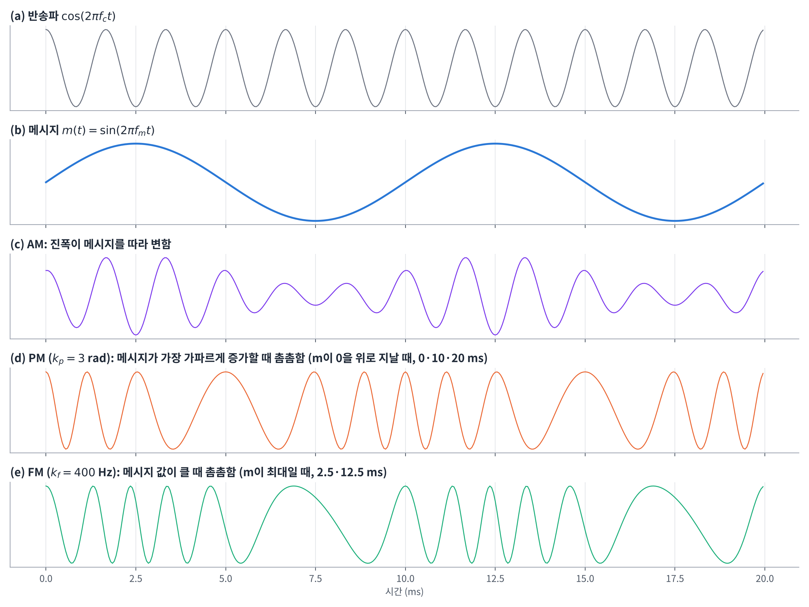
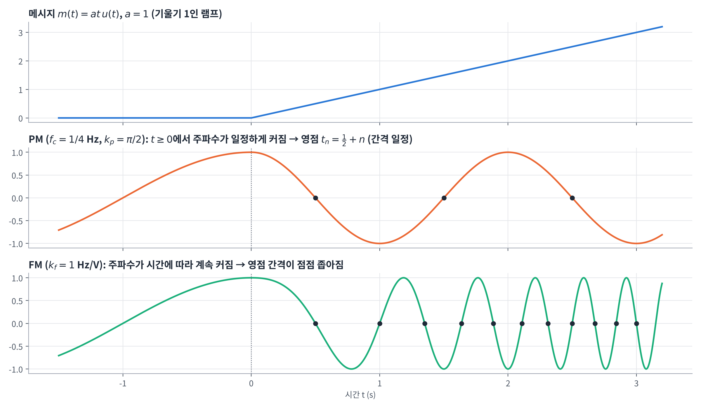
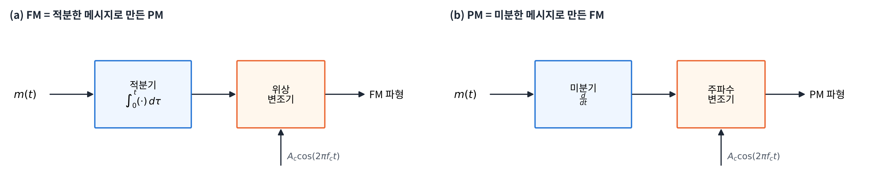
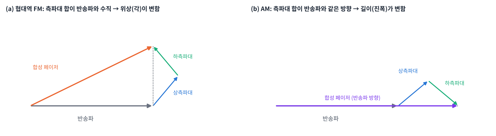
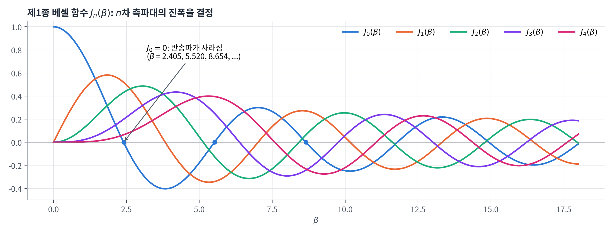
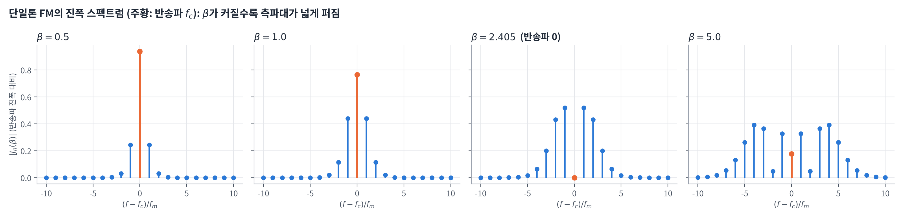
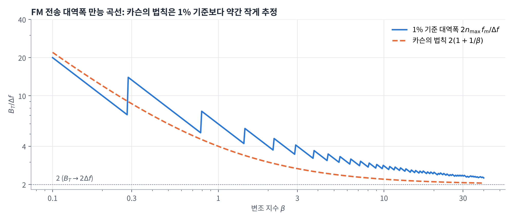
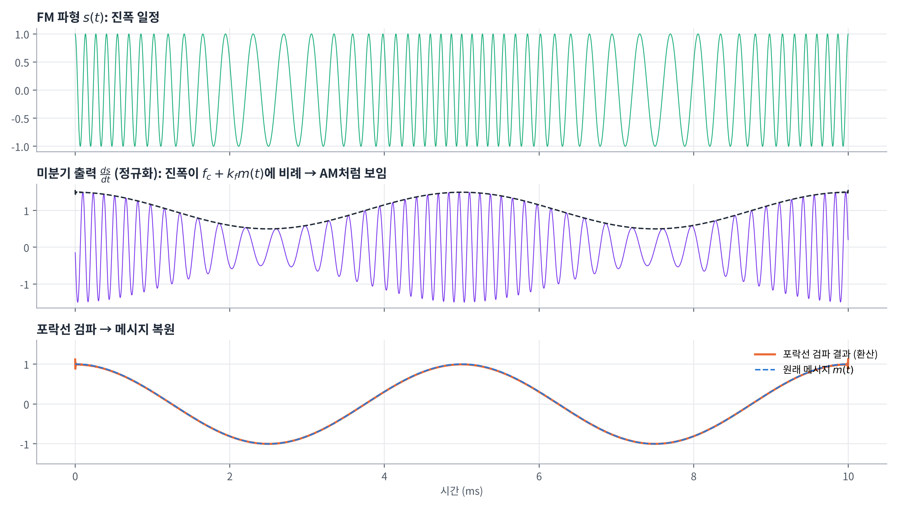
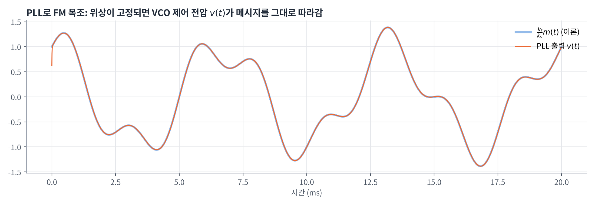

[toc]

## 학습 목표

- 각변조의 의미와 순시 주파수의 정의 이해
- 위상 변조(PM)와 주파수 변조(FM)의 정의, 둘 사이의 관계 이해
- 각변조의 특성(일정한 전력, 비선형성, 불규칙한 영점 교차) 이해
- 협대역 FM의 근사식과 AM과의 차이(페이저 해석) 이해
- 광대역 FM의 스펙트럼을 베셀 함수로 표현하는 방법 이해
- 카슨의 법칙과 1% 기준 만능 곡선으로 전송 대역폭 구하기
- FM 발생(직접 방식, 암스트롱 간접 방식)과 복조(주파수 변별기, 위상 동기 루프) 이해

---

## 각변조 (Angle Modulation)

### 개요

- 반송파의 **각(angle)**, 즉 위상이나 주파수를 메시지에 따라 바꾸는 변조
- AM과 비교한 특징

| 항목 | 각변조 (FM, PM) |
| --- | --- |
| 처리 과정 | **비선형(nonlinear)** → 스펙트럼 분석이 매우 어려움 |
| 전송 대역폭 | 이론상 **무한대** (실제로는 유효 대역폭으로 제한) |
| 잡음 영향 | 첨가 잡음의 영향이 **진폭 변조보다 작음** |

쉬운 설명:

- 잡음은 주로 신호의 **진폭**을 흔듦
- 각변조는 정보가 진폭이 아니라 **위상·주파수**에 있으므로 잡음에 강함
- 대신 넓은 대역폭이 필요 → **대역폭과 잡음 성능을 맞바꾸는** 변조

### 순시 주파수 (Instantaneous Frequency)

각변조된 신호는

$$
s(t) = A_c \cos[\theta_i(t)]
$$

작은 시간 구간 $$[t, t + \Delta t]$$ 동안의 평균 주파수 (i는 instantaneous)

$$
f_{\Delta t}(t) = \frac{\theta_i(t + \Delta t) - \theta_i(t)}{2\pi\Delta t}
$$

$$\Delta t \to 0$$으로 보내면 **순시 주파수**

$$
f_i(t) = \lim_{\Delta t \to 0} f_{\Delta t}(t) = \lim_{\Delta t \to 0} \frac{\theta_i(t + \Delta t) - \theta_i(t)}{2\pi\Delta t} = \frac{1}{2\pi}\frac{d\theta_i(t)}{dt}
$$

- 변조되지 않은 반송파($$m(t) = 0$$)라면 $$\theta_i(t) = 2\pi f_c t + \phi_c$$이므로 $$f_i(t) = f_c$$
- 즉 **각을 미분하면 주파수, 주파수를 적분하면 각**

---

## 위상 변조와 주파수 변조

### 위상 변조 (PM, Phase Modulation)

- **순시 각** $$\theta_i(t)$$가 메시지 $$m(t)$$에 대해 선형적으로 변함 ($$\phi_c = 0$$ 가정)

$$
\theta_i(t) = 2\pi f_c t + k_p m(t), \qquad s(t) = A_c \cos[2\pi f_c t + k_p m(t)]
$$

- $$k_p$$: **위상 감도 인자 (phase sensitivity factor)**, 단위 rad/V

### 주파수 변조 (FM, Frequency Modulation)

- **순시 주파수**가 메시지에 따라 선형적으로 변함

$$
f_i(t) = f_c + k_f m(t)
$$

- $$k_f$$: **주파수 감도 인자 (frequency sensitivity factor)**, 단위 Hz/V
- 각은 주파수를 적분해서 얻으므로

$$
\theta_i(t) = \int_0^t 2\pi f_i(\tau)\, d\tau = \int_0^t 2\pi\big(f_c + k_f m(\tau)\big)\, d\tau = 2\pi f_c t + 2\pi k_f \int_0^t m(\tau)\, d\tau
$$

$$
s(t) = A_c \cos\left[2\pi f_c t + 2\pi k_f \int_0^t m(\tau)\, d\tau\right]
$$

### PM과 FM의 정의 비교 ⭐️

| 항목 | 위상 변조 (PM) | 주파수 변조 (FM) |
| --- | --- | --- |
| 순시 각 $$\theta_i(t)$$ | $$2\pi f_c t + k_p m(t)$$ | $$2\pi f_c t + 2\pi k_f \int_0^t m(\tau)\, d\tau$$ |
| 순시 주파수 $$f_i(t)$$ | $$f_c + \frac{k_p}{2\pi}\frac{dm(t)}{dt}$$ | $$f_c + k_f m(t)$$ |
| 변조파 $$s(t)$$ | $$A_c\cos[2\pi f_c t + k_p m(t)]$$ | $$A_c\cos\left[2\pi f_c t + 2\pi k_f \int_0^t m(\tau)\, d\tau\right]$$ |



- AM은 **진폭**이 메시지를 따라가므로 파형만 보고도 메시지를 짐작할 수 있음
- PM은 메시지의 **기울기**($$\frac{dm}{dt}$$)가 클 때, FM은 메시지의 **값**이 클 때 파형이 촘촘해짐
- 그래서 PM, FM 파형은 메시지를 눈으로 읽기 어려움

---

## 각변조의 특성

### 1. 전송 전력의 불변성

- PM, FM 파형의 진폭은 $$k_p$$나 $$k_f$$와 무관하게 **항상 반송파 진폭 $$A_c$$로 일정**
- 따라서 평균 전송 전력도 메시지와 상관없이 일정

$$
P_{\mathrm{avr}} = \frac{1}{2}A_c^2
$$

- AM은 메시지에 따라 전력이 달라졌던 것과 대조적

### 2. 비선형성

- 각변조는 **중첩의 원리가 성립하지 않음**
- $$m(t) = m_1(t) + m_2(t)$$일 때 PM의 경우

$$
s(t) = A_c\cos\big[2\pi f_c t + k_p\big(m_1(t) + m_2(t)\big)\big] \neq s_1(t) + s_2(t)
$$

$$
s_1(t) = A_c\cos[2\pi f_c t + k_p m_1(t)], \qquad s_2(t) = A_c\cos[2\pi f_c t + k_p m_2(t)]
$$

- 메시지는 $$\cos$$ 함수 **안**에 들어가 있으므로, 두 메시지를 더한 결과는 각각의 변조파를 더한 것과 다름
- FM도 적분 $$\int (m_1 + m_2)\, d\tau$$가 $$\cos$$ 안에 있으므로 똑같이 비선형
- 이 때문에 AM처럼 "메시지 스펙트럼을 옮긴다"는 간단한 분석이 불가능

### 3. 불규칙적인 영점 교차

- PM은 $$m(t)$$, FM은 $$\int_0^t m(\tau)\, d\tau$$에 따라 각이 바뀌므로 **영점 교차점(zero crossing)의 간격이 규칙적이지 않음**
- 이 때문에 메시지 파형을 눈으로 확인하기 어려움

### 4. 대역폭과 잡음 성능의 교환

- 잡음 성능을 높이려면 전송 대역폭을 늘려야 함 (주파수 편차를 키울수록 잡음에 강해짐)

---

## 예제: PM과 FM의 영점 교차점 비교

### 조건

메시지가 $$t = 0$$부터 일정하게 증가하는 램프 신호

$$
m(t) =
\begin{cases}
at, & t \ge 0 \\
0, & t < 0
\end{cases}
\qquad f_c = \frac{1}{4}\ \mathrm{Hz},\quad a = 1,\quad k_p = \frac{\pi}{2}\ \mathrm{rad/V},\quad k_f = 1\ \mathrm{Hz/V}
$$

### PM의 영점 교차

$$t \ge 0$$에서 $$s(t) = A_c\cos(2\pi f_c t + k_p a t)$$. 영점은 $$\cos$$의 인자가 $$\frac{\pi}{2} + n\pi$$인 순간

$$
2\pi f_c t_n + k_p a t_n = \frac{\pi}{2} + n\pi
\quad\Rightarrow\quad
t_n = \frac{\frac{1}{2} + n}{2f_c + \frac{k_p}{\pi}a} = \frac{1}{2} + n, \qquad n = 0, 1, 2, \dots
$$

- 램프의 기울기가 일정하므로 PM의 순시 주파수는 $$f_c + \frac{k_p a}{2\pi} = \frac{1}{4} + \frac{1}{4} = \frac{1}{2}$$ Hz로 **일정** → 영점 간격도 1초로 일정

### FM의 영점 교차

$$\int_0^t a\tau\, d\tau = \frac{a}{2}t^2$$이므로 $$t \ge 0$$에서

$$
s(t) = A_c\cos\left[2\pi f_c t + 2\pi k_f \frac{a}{2}t^2\right] = A_c\cos\left[2\pi f_c t + \pi k_f a t^2\right]
$$

영점 조건은 $$t_n$$에 대한 2차 방정식

$$
2\pi f_c t_n + \pi k_f a t_n^2 = \frac{\pi}{2} + n\pi
\quad\Rightarrow\quad
k_f a\, t_n^2 + 2f_c\, t_n - \left(\frac{1}{2} + n\right) = 0
$$

근의 공식에서 양수 근을 고르면

$$
t_n = \frac{1}{a k_f}\left[-f_c + \sqrt{f_c^2 + a k_f\left(\frac{1}{2} + n\right)}\right]
= \frac{1}{4}\left(-1 + \sqrt{9 + 16n}\right), \qquad n = 0, 1, 2, \dots
$$

- FM의 순시 주파수 $$f_c + k_f a t$$가 **시간에 따라 계속 커지므로** 영점 간격이 점점 좁아짐



두 공식으로 영점을 직접 계산하면 다음과 같음

```python
import numpy as np

fc, a, kp, kf = 0.25, 1.0, np.pi / 2, 1.0       # 강의 자료의 값
n = np.arange(11)

t_pm = (0.5 + n) / (2 * fc + kp * a / np.pi)     # PM: 2*pi*fc*t + kp*a*t = pi/2 + n*pi
t_fm = (-fc + np.sqrt(fc**2 + a * kf * (0.5 + n))) / (a * kf)   # FM: 2*pi*fc*t + pi*kf*a*t^2 = pi/2 + n*pi

print("PM 영점:", np.round(t_pm, 4))
print("FM 영점:", np.round(t_fm, 4))
print("FM 영점 간격:", np.round(np.diff(t_fm), 4))
```

실행 결과

```text
PM 영점: [ 0.5  1.5  2.5  3.5  4.5  5.5  6.5  7.5  8.5  9.5 10.5]
FM 영점: [0.5    1.     1.3508 1.6375 1.886  2.1085 2.3117 2.5    2.6762 2.8423
 3.    ]
FM 영점 간격: [0.5    0.3508 0.2867 0.2485 0.2225 0.2032 0.1883 0.1762 0.1662 0.1577]
```

- 예: $$n = 7$$이면 $$\sqrt{9 + 112} = \sqrt{121} = 11$$이므로 $$t_7 = \frac{1}{4}(-1 + 11) = 2.5$$로 정확히 떨어짐
- 강의 자료의 $$t_5$$ ~ $$t_{10}$$ 값은 공식과 다름 (아래 정정 표 참고)

---

## PM과 FM 파형의 관계

PM과 FM은 **미분·적분 관계**로 서로 바꿀 수 있음

| 생성하려는 파형 | 방법 | 이유 |
| --- | --- | --- |
| FM | $$m(t)$$를 **적분**한 뒤 위상 변조기에 입력 | FM의 각에는 $$\int_0^t m(\tau)\, d\tau$$가 들어 있음 |
| PM | $$m(t)$$를 **미분**한 뒤 주파수 변조기에 입력 | 주파수 변조기는 입력을 적분하므로 $$\int \frac{dm}{d\tau}d\tau = m(t)$$가 각이 됨 |



- 즉 FM은 "적분한 메시지로 만든 PM", PM은 "미분한 메시지로 만든 FM"
- 그래서 PM의 성질은 FM에서 유도할 수 있고, 이 장은 주로 FM을 다룸

---

## 협대역 주파수 변조 (Narrowband FM)

### 단일톤 FM

메시지가 정현파 하나인 경우

$$
m(t) = A_m\cos(2\pi f_m t)
$$

순시 주파수

$$
f_i(t) = f_c + k_f A_m\cos(2\pi f_m t) = f_c + \Delta f\cos(2\pi f_m t), \qquad \Delta f = k_f A_m
$$

- **주파수 편차 $$\Delta f$$**: 순시 주파수가 반송파 주파수 $$f_c$$로부터 벗어날 수 있는 최대 주파수 크기

순시 각

$$
\theta_i(t) = \int_0^t 2\pi\big(f_c + \Delta f\cos(2\pi f_m \tau)\big)\, d\tau
= 2\pi f_c t + 2\pi\Delta f\left[\frac{\sin(2\pi f_m \tau)}{2\pi f_m}\right]_0^t
= 2\pi f_c t + \frac{\Delta f}{f_m}\sin(2\pi f_m t)
$$

**변조 지수 (modulation index)**

$$
\beta = \frac{\Delta f}{f_m}
$$

- 주파수 편차와 메시지 주파수의 비 = **위상 편차의 최댓값(rad)**

$$
s(t) = A_c\cos[2\pi f_c t + \beta\sin(2\pi f_m t)]
$$

### 협대역 근사

- $$\beta$$가 1 라디안에 비해 **작으면 협대역 FM**
- 덧셈정리 $$\cos(A + B) = \cos A\cos B - \sin A\sin B$$로 전개

$$
s(t) = A_c\cos(2\pi f_c t)\cos\big(\beta\sin(2\pi f_m t)\big) - A_c\sin(2\pi f_c t)\sin\big(\beta\sin(2\pi f_m t)\big)
$$

- 작은 각 근사: $$\cos\big(\beta\sin(2\pi f_m t)\big) \approx 1$$, $$\sin\big(\beta\sin(2\pi f_m t)\big) \approx \beta\sin(2\pi f_m t)$$

$$
s(t) \approx A_c\cos(2\pi f_c t) - \beta A_c\sin(2\pi f_c t)\sin(2\pi f_m t)
$$

### 협대역 FM 발생기

- 반송파를 2개의 경로로 나눔
  - 하나는 그대로 전송
  - 다른 하나는 $$-90°$$ 위상 천이 후 **적분된 $$m(t)$$**와 곱해서 DSB-SC 파형을 만듦
- 두 경로를 빼면 위 근사식 → **협대역 위상 변조기**에 적분기를 붙인 구조

### 데카르트 표현과 극 표현

비선형 변조를 묘사하기에는 **극(polar) 형식**이 더 적합

| 표현 | 수식 |
| --- | --- |
| 극 표현 | $$s(t) = a(t)\cos[2\pi f_c t + \phi(t)]$$ ($$a(t)$$: 포락선, $$\phi(t)$$: 위상) |
| 데카르트 표현 | $$s(t) = s_I(t)\cos(2\pi f_c t) - s_Q(t)\sin(2\pi f_c t)$$ ($$s_I$$: 동위상, $$s_Q$$: 직교 성분) |

두 표현 사이의 관계

$$
a(t) = \left[s_I^2(t) + s_Q^2(t)\right]^{1/2}, \qquad \phi(t) = \tan^{-1}\left[\frac{s_Q(t)}{s_I(t)}\right]
$$

- 확인: $$a\cos(2\pi f_c t + \phi) = a\cos\phi\cos(2\pi f_c t) - a\sin\phi\sin(2\pi f_c t)$$이므로 $$s_I = a\cos\phi$$, $$s_Q = a\sin\phi$$
- 협대역 FM은 $$s_I = A_c$$, $$s_Q = \beta A_c\sin(2\pi f_m t)$$인 경우

### 협대역 FM과 AM 비교 ⭐️

곱→합 공식 $$\sin A\sin B = \frac{1}{2}[\cos(A - B) - \cos(A + B)]$$를 쓰면

$$
s_{\mathrm{NBFM}}(t) \approx A_c\cos(2\pi f_c t) + \frac{1}{2}\beta A_c\left\{\cos\big[2\pi(f_c + f_m)t\big] - \cos\big[2\pi(f_c - f_m)t\big]\right\}
$$

AM (단일톤, 4장 예제 3.1)

$$
s_{\mathrm{AM}}(t) = A_c\cos(2\pi f_c t) + \frac{1}{2}\mu A_c\left\{\cos\big[2\pi(f_c + f_m)t\big] + \cos\big[2\pi(f_c - f_m)t\big]\right\}
$$

- 두 식 모두 반송파 + $$f_c \pm f_m$$의 측파대 한 쌍으로 비슷해 보임 → 대역폭도 $$2f_m$$으로 같음
- 하지만 협대역 FM에서는 **하측파대 성분의 부호가 음(−)**

### 페이저 해석



**협대역 FM**

$$
s_{\mathrm{sideband}}(t) = \frac{\beta A_c}{2}\left\{\cos\big[2\pi(f_c + f_m)t\big] - \cos\big[2\pi(f_c - f_m)t\big]\right\} = -\beta A_c\sin(2\pi f_c t)\sin(2\pi f_m t)
$$

- 측파대 성분은 $$\sin(2\pi f_c t)$$를 포함 → 반송파 $$\cos(2\pi f_c t)$$와 **90도 위상차(직교)**
- 두 측파대 페이저의 합이 반송파에 **항상 수직** → 합성 페이저의 **각(위상)**이 변함
- 따라서 협대역 FM은 진폭은 (근사적으로) 변하지 않고 위상/주파수가 변조됨
- 엄밀히는 합성 페이저 길이가 $$A_c\sqrt{1 + \beta^2\sin^2(2\pi f_m t)}$$로 약간 변하지만, $$\beta$$가 작으면 무시할 수 있음

**AM**

$$
s_{\mathrm{sideband}}(t) = \frac{\mu A_c}{2}\left\{\cos\big[2\pi(f_c + f_m)t\big] + \cos\big[2\pi(f_c - f_m)t\big]\right\} = \mu A_c\cos(2\pi f_c t)\cos(2\pi f_m t)
$$

- 측파대 성분이 반송파 $$\cos(2\pi f_c t)$$와 **같은 위상**
- 두 측파대 페이저의 합이 반송파와 **같은 방향** → 합성 페이저의 **길이(진폭)**만 변함

쉬운 설명:

- 같은 재료(반송파 + 측파대 두 개)라도 측파대를 **옆으로** 붙이면 FM, **같은 방향**으로 붙이면 AM

---

## 광대역 FM (Wideband FM)

### 복소 포락선

$$\beta$$가 클 때는 근사를 쓸 수 없으므로 정확히 분석. 반송파 주파수가 대역폭에 비해 충분히 크다고 가정하면

$$
s(t) = A_c\cos[2\pi f_c t + \beta\sin(2\pi f_m t)] = \mathrm{Re}\left[A_c e^{j2\pi f_c t + j\beta\sin(2\pi f_m t)}\right] = \mathrm{Re}\left[\tilde{s}(t)\, e^{j2\pi f_c t}\right]
$$

- **복소 포락선 (complex envelope)**

$$
\tilde{s}(t) = A_c e^{j\beta\sin(2\pi f_m t)}
$$

- 확인: $$s(t)e^{-j2\pi f_c t} = \frac{A_c}{2}e^{j\beta\sin(2\pi f_m t)} + \frac{A_c}{2}e^{-j(4\pi f_c t + \beta\sin(2\pi f_m t))}$$에서 LPF로 $$2f_c$$ 성분을 없애고 2배 하면 $$\tilde{s}(t)$$

### 푸리에 급수 전개

- $$t$$를 $$t + \frac{k}{f_m}$$로 바꿔도 $$\sin\big(2\pi f_m t + 2k\pi\big) = \sin(2\pi f_m t)$$이므로 $$\tilde{s}(t)$$는 **기본 주파수 $$f_m$$인 주기 함수**
- 따라서 복소 푸리에 급수로 전개 가능

$$
\tilde{s}(t) = \sum_{n=-\infty}^{\infty} c_n\exp(j2\pi n f_m t)
$$

- 계수 ($$x = 2\pi f_m t$$로 치환)

$$
c_n = f_m\int_{-1/(2f_m)}^{1/(2f_m)} A_c\exp\big(j\beta\sin(2\pi f_m t) - j2\pi n f_m t\big)\, dt
= \frac{A_c}{2\pi}\int_{-\pi}^{\pi}\exp\big(j(\beta\sin x - nx)\big)\, dx = A_c J_n(\beta)
$$

- **$$n$$차 제1종 베셀 함수 (Bessel function of the first kind)**

$$
J_n(\beta) = \frac{1}{2\pi}\int_{-\pi}^{\pi}\exp\big(j(\beta\sin x - nx)\big)\, dx
$$

### FM의 시간 표현과 스펙트럼

$$
\tilde{s}(t) = A_c\sum_{n=-\infty}^{\infty} J_n(\beta)\exp(j2\pi n f_m t)
$$

$$
s(t) = \mathrm{Re}\left[A_c\sum_{n=-\infty}^{\infty} J_n(\beta)\exp\big(j2\pi(f_c + nf_m)t\big)\right] = A_c\sum_{n=-\infty}^{\infty} J_n(\beta)\cos\big[2\pi(f_c + nf_m)t\big]
$$

$$
S(f) = \frac{A_c}{2}\sum_{n=-\infty}^{\infty} J_n(\beta)\left[\delta(f - f_c - nf_m) + \delta(f + f_c + nf_m)\right]
$$

- 스펙트럼은 $$f = f_c \pm nf_m$$ ($$n = 0, 1, 2, \dots$$)에 위치하는 **무한 개의 델타 함수**
- AM은 측파대가 한 쌍뿐이었지만, FM은 $$f_m$$ 간격으로 **무한히 많은 측파대**가 생김 → 비선형성의 결과



### 단일톤 FM 스펙트럼의 특성 ⭐️

**1. 진폭은 베셀 함수로 결정**

- $$n$$차 측파대의 상대 크기는 $$J_n(\beta)$$, 반송파의 상대 크기는 $$J_0(\beta)$$에 비례

**2. 대칭성**

$$
J_n(\beta) = J_{-n}(\beta)\ (n \text{ 짝수}), \qquad J_n(\beta) = -J_{-n}(\beta)\ (n \text{ 홀수})
$$

- 진폭 스펙트럼 $$\lvert J_n \rvert$$은 반송파를 중심으로 좌우 대칭, 홀수 차 하측파대만 부호가 반대

**3. $$\beta$$가 작은 경우**

$$
J_0(\beta) \approx 1, \qquad J_1(\beta) \approx \frac{\beta}{2}, \qquad J_n(\beta) \approx 0\ (n \ge 2)
$$

$$
S(f) \approx \frac{A_c}{2}J_0(\beta)\left[\delta(f - f_c) + \delta(f + f_c)\right] + \frac{A_c}{2}J_1(\beta)\left[\delta(f - f_c - f_m) + \delta(f + f_c + f_m)\right] + \frac{A_c}{2}J_{-1}(\beta)\left[\delta(f - f_c + f_m) + \delta(f + f_c - f_m)\right]
$$

- 반송파와 $$f_c \pm f_m$$의 측파대 한 쌍만 남음 → 앞의 협대역 FM과 같은 결과 ($$J_{-1} = -J_1 = -\frac{\beta}{2}$$라서 하측파대 부호가 음)

**4. 반송파 진폭이 $$\beta$$에 따라 변함**

- AM은 반송파 진폭이 변조와 무관했지만, FM은 반송파 성분 진폭이 $$J_0(\beta)$$로 **$$\beta$$에 의존**
- $$J_0(\beta) = 0$$인 $$\beta = 2.405, 5.520, 8.654, \dots$$에서는 **반송파가 완전히 사라짐**

**5. 전력은 항상 일정**

$$
\sum_{n=-\infty}^{\infty} J_n^2(\beta) = 1
$$

- 반송파가 줄어든 만큼 측파대로 전력이 옮겨갈 뿐, 총 전력 $$\frac{1}{2}A_c^2$$은 그대로 (각변조 특성 1과 일치)



FM 신호를 FFT해서 각 선 스펙트럼의 진폭이 $$J_n(\beta)$$와 같은지 확인하면 다음과 같음 ($$A_c = 1$$)

```python
import numpy as np
from scipy.special import jv

fs, fc, fm, Ac = 100_000, 10_000, 500, 1.0
t = np.arange(0, 1, 1 / fs)
f = np.fft.rfftfreq(len(t), 1 / fs)

for beta in [0.2, 1.0, 2.405]:
    s = Ac * np.cos(2 * np.pi * fc * t + beta * np.sin(2 * np.pi * fm * t))
    S = np.abs(np.fft.rfft(s)) / len(t) * 2               # 각 선 스펙트럼의 진폭
    amp = [S[np.argmin(np.abs(f - (fc + k * fm)))] for k in range(4)]
    print(f"beta = {beta}: FFT 진폭 (fc, fc+fm, fc+2fm, fc+3fm) =", np.round(amp, 4))
    print(f"            |J_n(beta)| (n = 0..3)               =", np.round(np.abs(jv(range(4), beta)), 4))

beta = 5.0
n = np.arange(-60, 61)
print(f"beta = 5: sum J_n^2 = {np.sum(jv(n, beta) ** 2):.6f}")
```

실행 결과

```text
beta = 0.2: FFT 진폭 (fc, fc+fm, fc+2fm, fc+3fm) = [9.90e-01 9.95e-02 5.00e-03 2.00e-04]
            |J_n(beta)| (n = 0..3)               = [9.90e-01 9.95e-02 5.00e-03 2.00e-04]
beta = 1.0: FFT 진폭 (fc, fc+fm, fc+2fm, fc+3fm) = [0.7652 0.4401 0.1149 0.0196]
            |J_n(beta)| (n = 0..3)               = [0.7652 0.4401 0.1149 0.0196]
beta = 2.405: FFT 진폭 (fc, fc+fm, fc+2fm, fc+3fm) = [1.000e-04 5.191e-01 4.318e-01 1.990e-01]
            |J_n(beta)| (n = 0..3)               = [1.000e-04 5.191e-01 4.318e-01 1.990e-01]
beta = 5: sum J_n^2 = 1.000000
```

- $$\beta = 0.2$$: $$J_1 \approx \frac{\beta}{2} = 0.1$$이고 $$J_2$$ 이상은 거의 0 → 협대역
- $$\beta = 2.405$$: 반송파($$f_c$$) 성분이 거의 0
- 모든 경우에 FFT 결과와 베셀 함수 값이 일치하고, $$\sum J_n^2 = 1$$

---

## FM 파형의 전송 대역폭

### 카슨의 법칙 (Carson's Rule)

- 이론상 FM 파형은 무한 개의 측파대를 포함 → 대역폭이 무한대
- 실제로는 **유의미한 측파대까지만** 고려해서 유효 대역폭을 정함
  1. $$\beta$$가 **큰** 경우: 대역폭은 전체 주파수 변동 $$2\Delta f$$보다 약간 큰 정도
  2. $$\beta$$가 **작은** 경우: 반송파와 $$f_c \pm f_m$$ 한 쌍으로 제한 → 대역폭 $$2f_m$$
- 두 경우를 합친 근사식

$$
B_T \approx 2\Delta f + 2f_m = 2\Delta f\left(1 + \frac{1}{\beta}\right)
$$

### 1% 기준 만능 곡선 (Universal Curve)

- 변조되지 않은 반송파 진폭의 **1%**를 기준으로 사용
- 대역폭을 "그 바깥에 있는 어떤 측파대도 반송파 진폭의 1%보다 크지 않은 범위"로 정의

$$
B_T = 2n_{\max} f_m
$$

- $$n_{\max}$$: $$\lvert J_n(\beta) \rvert > 0.01$$을 만족하는 정수 $$n$$의 최댓값
- $$n_{\max}$$는 $$\beta$$에 따라 변하며, 베셀 함수 표에서 결정

```python
import numpy as np
from scipy.special import jv

print(" beta | 2n_max (1% 기준) | B_T/df (1%) | Carson B_T/df")
for beta in [0.1, 0.3, 0.5, 1, 2, 5, 10, 20, 30]:
    n = np.arange(1, 200)
    n_max = n[np.abs(jv(n, beta)) > 0.01].max()          # |J_n| > 0.01 인 가장 큰 n
    print(f"{beta:5} | {2 * n_max:16d} | {2 * n_max / beta:11.2f} | {2 * (1 + 1 / beta):13.2f}")
```

실행 결과

```text
 beta | 2n_max (1% 기준) | B_T/df (1%) | Carson B_T/df
  0.1 |                2 |       20.00 |         22.00
  0.3 |                4 |       13.33 |          8.67
  0.5 |                4 |        8.00 |          6.00
    1 |                6 |        6.00 |          4.00
    2 |                8 |        4.00 |          3.00
    5 |               16 |        3.20 |          2.40
   10 |               28 |        2.80 |          2.20
   20 |               48 |        2.40 |          2.10
   30 |               70 |        2.33 |          2.07
```

- 강의 자료 표(Haykin 표 4.2)와 비교하면 $$\beta = 20$$에서만 다름: 표는 50, 계산은 48
- 이유: $$\lvert J_{25}(20) \rvert = 0.00978$$로 기준 0.01에 아주 근소하게 못 미침 → 반올림하면 50
- 측파대 수 $$n_{\max}$$는 정수라서 1% 기준 곡선은 아래 그림처럼 **계단(톱니) 모양**으로 변함



**(중요!!)**

- 세로축이 $$B_T / \Delta f$$이므로, $$\beta$$가 작을수록 **주파수 편차 $$\Delta f$$에 비해** 넓은 대역폭이 필요 (측파대가 최소 한 쌍은 있어야 하므로 $$B_T \ge 2f_m$$)
- $$\beta$$가 크면 $$B_T / \Delta f \to 2$$, 즉 $$B_T \approx 2\Delta f$$
- 카슨의 법칙은 1% 기준보다 대역폭을 **약간 작게** 추정 → 실제 설계는 더 여유 있게 잡음

---

## FM 파형의 발생

FM 파형의 순시 주파수 $$f_i(t) = f_c + k_f m(t)$$가 메시지에 따라 **선형적으로** 변하도록 만드는 것이 목표

### 직접 방식 (Direct Method)

- 정현 발진기 회로 내부의 소자(예: 커패시터)를 메시지 신호로 **직접** 조절
- 예: 하틀리 발진기에서 커패시터가 메시지에 따라 변하면

$$
f_i(t) = \frac{1}{2\pi\sqrt{(L_1 + L_2)C(t)}}
$$

- 장점: 구현이 간단하고 **큰 주파수 편차**를 만들 수 있음
- 단점: 주파수 값이 흔들리는(불안정한) 심각한 한계 → 주파수 안정화를 위해 **피드백 구조** 사용 (크리스탈 발진기와 비교해서 VCO를 보정)

### 간접 방식: 암스트롱 변조기 (Armstrong Modulator)

1. 메시지를 적분해서 $$\int_0^t m(\tau)\, d\tau$$를 얻음
2. 이를 **협대역 위상 변조기**에 넣어 협대역 FM 생성
3. **주파수 체배기(frequency multiplier)**로 주파수 편차를 키워 광대역 FM으로 만듦

- 반송파 발진기로 **크리스탈 발진기**를 사용 → 반송파 주파수가 매우 정확함
- 직접 방식보다 잡음이 적고 고정밀 FM 파형 생성 가능

---

## FM 신호의 복조

### 주파수 변별기 (Frequency Discriminator)

- FM 파형의 순시 주파수에서 $$m(t)$$를 복원 → **주파수 변화를 전압으로** 바꿔주는 회로
- FM 신호를 미분하면

$$
\frac{ds(t)}{dt} = -2\pi A_c\big(f_c + k_f m(t)\big)\sin\left[2\pi f_c t + 2\pi k_f\int_0^t m(\tau)\, d\tau\right]
$$

- 이는 $$f_c + k_f m(t)$$의 크기로 **진폭 변조된 신호** ($$f_c > k_f\lvert m(t) \rvert$$이면 포락선이 항상 양수)
- 따라서 **포락선 검파기**로 메시지를 꺼낼 수 있음
- **주파수 변별기 = 미분기 + 포락선 검파기**



**미분기의 구현**

- 이상적 미분기의 전달함수는 $$\frac{d}{dt} \rightleftharpoons j2\pi f$$
- 모든 주파수에서 이를 만족하는 회로는 만들기 어려움
- 대신 **신호 대역폭 $$[f_c - \frac{B_T}{2}, f_c + \frac{B_T}{2}]$$ 안에서만** 주파수에 선형인 응답을 갖는 회로(slope circuit)로 근사
- **평형 주파수 변별기 (balanced discriminator)**: 기울기가 반대인 두 회로의 출력 차이를 이용해서 선형 구간을 넓힘

미분기와 포락선 검파로 직접 복조해 보면 다음과 같음

```python
import numpy as np
from scipy.signal import hilbert

fs, fc, kf = 2_000_000, 10_000, 2_000            # kf: 주파수 감도 [Hz/V]
t = np.arange(0, 0.02, 1 / fs)
m = np.cos(2 * np.pi * 200 * t) + 0.5 * np.sin(2 * np.pi * 450 * t)

phase = 2 * np.pi * fc * t + 2 * np.pi * kf * np.cumsum(m) / fs   # 2*pi*kf * m의 적분
s = np.cos(phase)                                                 # FM (Ac = 1)

ds = np.gradient(s, 1 / fs)                      # 1) 미분기: 진폭이 2*pi*(fc + kf*m)
env = np.abs(hilbert(ds))                        # 2) 포락선 검파 (이상적)
m_hat = (env / (2 * np.pi) - fc) / kf            # 진폭 -> 메시지로 환산

core = slice(2000, -2000)                        # 양 끝 경계 효과 제외
err = np.max(np.abs(m_hat[core] - m[core]))
print(f"메시지 최대 크기 {np.max(np.abs(m)):.3f}, 복원 최대 오차 {err:.4f}")
```

실행 결과

```text
메시지 최대 크기 1.500, 복원 최대 오차 0.0020
```

- 메시지 크기 1.5에 비해 오차 0.002로 거의 정확히 복원
- 샘플링 주파수가 낮으면 `np.gradient`(차분) 미분이 부정확해져 오차가 커짐 → 실제 회로에서 "대역 안에서만 미분기를 근사"하는 것과 같은 문제

### 위상 동기 루프 (PLL, Phase-Locked Loop)

FM 파형의 위상/주파수에 **VCO 출력을 동기시키는** 피드백 시스템. 구성 요소:

- **전압 제어 발진기 (VCO, voltage-controlled oscillator)**
- **곱셈기**
- **루프 필터** (일반적으로 적분기)

**동작 가정**

1. 입력이 0일 때 VCO는 $$f_c$$에 정확히 맞춰져 있음
2. VCO 출력은 변조되지 않은 반송파와 90도 위상차 (입력을 $$\sin$$으로 가정)

$$
s(t) = A_c\sin[2\pi f_c t + \phi_1(t)], \qquad \phi_1(t) = 2\pi k_f\int_0^t m(\tau)\, d\tau
$$

$$
r(t) = A_v\cos[2\pi f_c t + \phi_2(t)], \qquad \phi_2(t) = 2\pi k_v\int_0^t v(\tau)\, d\tau
$$

- $$v(t)$$: VCO의 제어 신호, $$k_v$$: VCO의 주파수 감도 계수
- 목표: $$\phi_2(t)$$가 $$\phi_1(t)$$를 따라가도록 조정

**곱셈기 출력** ($$\sin A\cos B = \frac{1}{2}[\sin(A - B) + \sin(A + B)]$$)

$$
s(t)\,r(t) = \frac{1}{2}A_c A_v\Big\{\underbrace{\sin\big[4\pi f_c t + \phi_1(t) + \phi_2(t)\big]}_{\text{고주파 성분}} + \underbrace{\sin\big[\phi_1(t) - \phi_2(t)\big]}_{\text{저주파 성분}}\Big\}
$$

- 루프 필터가 고주파 성분을 제거하면 남는 **위상 오차 신호** ($$k_m$$: 곱셈기 이득)

$$
e(t) = k_m A_c A_v\sin\big[\phi_1(t) - \phi_2(t)\big] = k_m A_c A_v\sin\phi_e(t)
$$

- 위상 오차가 0일 때 PLL이 **위상 고정(phase-lock)**되었다고 함

**선형 모델과 출력**

- 위상 오차

$$
\phi_e(t) = \phi_1(t) - \phi_2(t) = \phi_1(t) - 2\pi k_v\int_0^t v(\tau)\, d\tau
\quad\Rightarrow\quad
\frac{d}{dt}\phi_e(t) = \frac{d}{dt}\phi_1(t) - 2\pi k_v v(t)
$$

- $$\phi_e$$가 작다고 보고 $$\sin\phi_e \approx \phi_e$$, $$k_m A_c A_v = 1$$로 정규화하면 $$v(t) = \int \phi_e(\tau)g(t - \tau)\, d\tau$$ ($$g$$: 루프 필터 임펄스 응답)

$$
\frac{d}{dt}\phi_1(t) = \frac{d}{dt}\phi_e(t) + 2\pi k_v\int_0^\infty \phi_e(\tau)\, g(t - \tau)\, d\tau
\quad\xrightarrow{\mathcal{F}}\quad
(j2\pi f)\Phi_1(f) = (j2\pi f)\Phi_e(f) + 2\pi k_v\Phi_e(f)G(f)
$$

- 출력 전압

$$
V(f) = \Phi_e(f)G(f) = \frac{G(f)}{1 + (k_v / jf)G(f)}\Phi_1(f)
$$

- 루프 이득이 커서 $$\left\lvert \frac{k_v}{jf}G(f) \right\rvert \gg 1$$이면

$$
V(f) \approx \frac{G(f)}{(k_v / jf)G(f)}\Phi_1(f) = \frac{j2\pi f}{2\pi k_v}\Phi_1(f)
\quad\xrightarrow{\mathcal{F}^{-1}}\quad
v(t) = \frac{1}{2\pi k_v}\frac{d}{dt}\phi_1(t) = \frac{k_f}{k_v}m(t)
$$

- $$j2\pi f$$를 곱하는 것은 미분이므로, $$\phi_1$$을 미분하면 $$2\pi k_f m(t)$$
- 즉 위상이 고정되면 **VCO 제어 전압이 메시지에 비례** → 그대로 복조 출력



- 위 그림은 루프 필터를 상수 이득(20)으로 둔 1차 PLL을 시뮬레이션한 결과 ($$k_f = k_v$$)
- 시작 직후의 짧은 과도 구간 뒤에는 $$v(t)$$가 $$\frac{k_f}{k_v}m(t)$$와 거의 겹침

---

## 연습 예제

과제 파일에는 이번 장(FM, PM)에 해당하는 문제가 없어서, 강의 내용을 확인하는 예제 두 개를 직접 정리함

### 예제 1. 상용 FM 방송의 대역폭

> 최대 주파수 편차 $$\Delta f = 75$$ kHz, 메시지 최고 주파수 $$W = 15$$ kHz인 FM 방송의 전송 대역폭을 카슨의 법칙과 1% 기준으로 각각 구하라.

**풀이**

- 변조 지수 (최악의 경우인 최고 주파수 기준): $$\beta = \frac{\Delta f}{W} = \frac{75}{15} = 5$$
- 카슨의 법칙

$$
B_T \approx 2(\Delta f + W) = 2(75 + 15) = 180\ \text{kHz}
$$

- 1% 기준: 위 표에서 $$\beta = 5$$이면 $$2n_{\max} = 16$$

$$
B_T = 2n_{\max}W = 16 \times 15 = 240\ \text{kHz}
$$

- 해석: 카슨의 법칙이 1% 기준보다 작게 나옴 (만능 곡선 그림과 같은 결론). 실제 FM 방송 채널 간격(200 kHz)과 FM 라디오의 IF 대역폭(200 kHz, 4장 표)은 그 사이 값

### 예제 2. 메시지 주파수가 바뀔 때 PM과 FM의 차이

> 단일톤 메시지 $$m(t) = A_m\cos(2\pi f_m t)$$의 진폭은 고정하고 주파수 $$f_m$$만 2배로 늘리면, PM과 FM에서 주파수 편차 $$\Delta f$$와 변조 지수 $$\beta$$는 각각 어떻게 되는가?

**풀이**

| 항목 | FM | PM |
| --- | --- | --- |
| 순시 각 | $$2\pi f_c t + \frac{k_f A_m}{f_m}\sin(2\pi f_m t)$$ | $$2\pi f_c t + k_p A_m\cos(2\pi f_m t)$$ |
| 순시 주파수 | $$f_c + k_f A_m\cos(2\pi f_m t)$$ | $$f_c - k_p A_m f_m\sin(2\pi f_m t)$$ |
| 주파수 편차 $$\Delta f$$ | $$k_f A_m$$ → **변화 없음** | $$k_p A_m f_m$$ → **2배** |
| 변조 지수 $$\beta$$ (최대 위상 편차) | $$\frac{k_f A_m}{f_m}$$ → **절반** | $$k_p A_m$$ → **변화 없음** |

- PM의 순시 주파수는 $$f_c + \frac{k_p}{2\pi}\frac{dm}{dt}$$이고, 미분하면 $$f_m$$이 앞으로 나오기 때문
- FM은 $$\Delta f$$가 일정해서 카슨 대역폭 $$2(\Delta f + f_m)$$이 $$f_m$$에 따라 조금만 변함
- PM은 $$\Delta f$$가 $$f_m$$에 비례해서 메시지 주파수가 높을수록 대역폭이 크게 늘어남 → 대역폭 관리가 쉬운 FM이 방송에 주로 쓰임

---

### 강의 자료에서 정정한 부분 정리

| 위치 | 강의 자료 | 정정 | 이유 |
| --- | --- | --- | --- |
| 강의 자료 3쪽 | $$d\theta_i(t) = 2\pi f_c t + \phi_c$$ | $$\theta_i(t) = 2\pi f_c t + \phi_c$$ | 미분 기호가 붙을 이유 없음 |
| 강의 자료 15쪽 | $$t_5 \approx 2.1073$$, $$t_6 \approx 2.3087$$, $$t_7 \approx 2.4944$$, $$t_8 \approx 2.6671$$, $$t_9 \approx 2.8290$$, $$t_{10} \approx 2.9814$$ | $$t_5 \approx 2.1085$$, $$t_6 \approx 2.3117$$, $$t_7 = 2.5$$, $$t_8 \approx 2.6762$$, $$t_9 \approx 2.8423$$, $$t_{10} = 3$$ | 같은 쪽 공식 $$\frac{1}{4}(-1 + \sqrt{9 + 16n})$$으로 계산한 값 ($$t_0$$ ~ $$t_4$$는 맞음) |
| 강의 자료 25쪽 | $$s(t) = s_I\cos(2\pi f_c t) + s_Q\sin(2\pi f_c t)$$ | $$s(t) = s_I\cos(2\pi f_c t) - s_Q\sin(2\pi f_c t)$$ | 같은 쪽의 $$\phi = \tan^{-1}(s_Q / s_I)$$, 4장 정의와 맞추려면 − 부호 |
| 강의 자료 26, 28쪽 | 협대역 FM $$A_c\cos(2\pi f_c t) - \frac{1}{2}\beta A_c\{\cos[2\pi(f_c + f_m)t] - \cos[2\pi(f_c - f_m)t]\}$$ | $$A_c\cos(2\pi f_c t) + \frac{1}{2}\beta A_c\{\cdots\}$$ | $$-\sin A\sin B = +\frac{1}{2}[\cos(A + B) - \cos(A - B)]$$, 28쪽의 $$-\beta A_c\sin\sin$$과도 일치 |
| 강의 자료 26, 29쪽 | AM $$A_c\cos(2\pi f_c t) - \frac{1}{2}\mu A_c\{\cdots + \cdots\}$$ | $$A_c\cos(2\pi f_c t) + \frac{1}{2}\mu A_c\{\cdots + \cdots\}$$ | 4장 예제 3.1의 식, 29쪽의 $$s_{\mathrm{sideband}} = +\frac{1}{2}\mu A_c\{\cdots\}$$과도 일치 |
| 강의 자료 35~37쪽 | $$J_n(\beta) \approx 0,\ n > 2$$ | $$J_n(\beta) \approx 0,\ n \ge 2$$ | $$J_2(\beta) \approx \frac{\beta^2}{8}$$도 작은 $$\beta$$에서 무시 가능 (37쪽 식도 $$n = 0, \pm 1$$만 남김) |
| 강의 자료 41쪽 | "$$\beta$$가 작은 경우 메시지 대역폭 대비 넓은 유효 대역폭이 필요" | "$$\beta$$가 작은 경우 **주파수 편차 $$\Delta f$$ 대비** 넓은 대역폭이 필요" | 곡선의 세로축이 $$B_T / \Delta f$$, 작은 $$\beta$$에서 $$B_T \approx 2f_m$$ |

---

## 최종 핵심 정리

1. 각변조는 반송파의 각을 바꾸는 **비선형** 변조이며, 순시 주파수는 $$f_i(t) = \frac{1}{2\pi}\frac{d\theta_i}{dt}$$
2. PM은 각이 $$k_p m(t)$$, FM은 주파수가 $$k_f m(t)$$만큼 변함 → **FM = 적분한 메시지의 PM, PM = 미분한 메시지의 FM**
3. 각변조는 진폭이 일정해서 **전력 $$\frac{1}{2}A_c^2$$이 항상 일정**하지만, 중첩의 원리가 성립하지 않고 영점 교차가 불규칙
4. 단일톤 FM의 변조 지수 $$\beta = \frac{\Delta f}{f_m}$$, $$\beta \ll 1$$이면 협대역 FM으로 AM과 같은 대역폭 $$2f_m$$을 갖지만 **측파대 합이 반송파와 직교**
5. 광대역 FM은 $$s(t) = A_c\sum_n J_n(\beta)\cos[2\pi(f_c + nf_m)t]$$로 **무한 개의 측파대**를 가짐
6. 반송파 진폭 $$J_0(\beta)$$는 $$\beta$$에 따라 변하고($$\beta = 2.405$$에서 0), $$\sum J_n^2 = 1$$로 전력은 보존
7. 전송 대역폭은 카슨의 법칙 **$$B_T \approx 2\Delta f + 2f_m$$**, 또는 1% 기준 **$$B_T = 2n_{\max}f_m$$** (카슨이 약간 작게 추정)
8. FM 발생은 직접 방식(VCO)과 간접 방식(암스트롱), 복조는 **주파수 변별기(미분기 + 포락선 검파)**와 **PLL**($$v(t) = \frac{k_f}{k_v}m(t)$$)

---

End.
