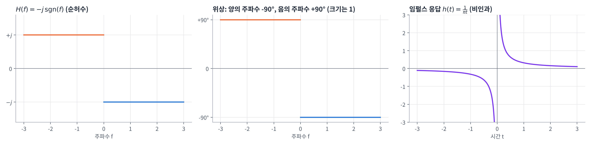
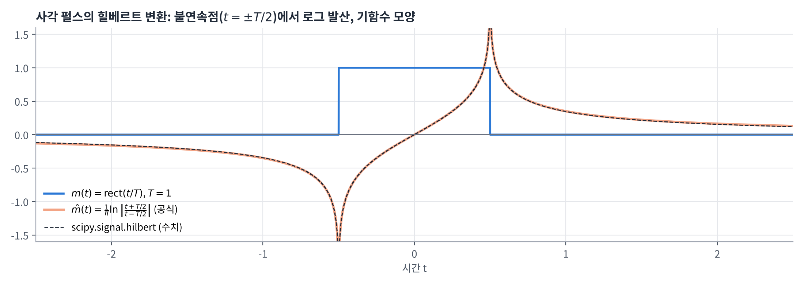
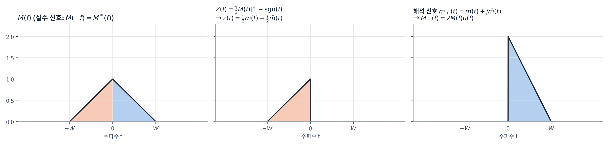
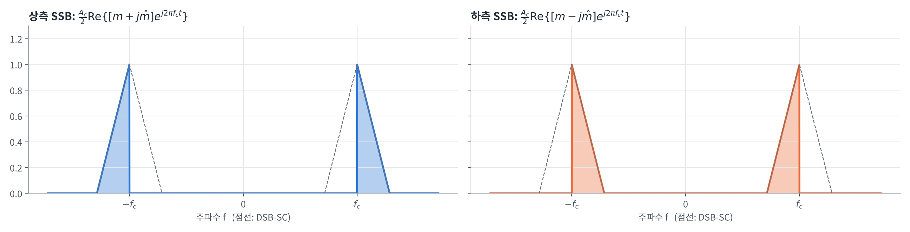

## 학습 목표

- 힐베르트 변환의 정의(주파수 영역, 시간 영역) 이해
- 변환쌍 $$\frac{1}{\pi t} \rightleftharpoons -j\,\mathrm{sgn}(f)$$ 유도
- 힐베르트 변환으로 한쪽 측파대만 남기는 방법 이해
- 해석 신호(pre-envelope) $$m(t) + j\hat{m}(t)$$와 SSB 신호의 관계 이해
- 힐베르트 변환의 주요 성질 이해와 수치 확인

---

## 힐베르트 변환 (Hilbert Transform)

### 정의

- 스펙트럼의 **크기(magnitude)는 바꾸지 않고**, 위상만 $$\mp 90°$$ 이동시키는 변환
  - **양의 주파수: $$-90°$$**
  - **음의 주파수: $$+90°$$**
- 이 동작을 하는 시스템(힐베르트 변환기)의 전달함수

$$
H(f) = -j\,\mathrm{sgn}(f) =
\begin{cases}
-j = e^{-j\pi/2}, & f > 0 \\
0, & f = 0 \\
+j = e^{+j\pi/2}, & f < 0
\end{cases}
$$

- 메시지 $$m(t)$$의 힐베르트 변환을 $$\hat{m}(t)$$로 쓰면

$$
\mathcal{F}\{\hat{m}(t)\} = \hat{M}(f) = H(f)M(f) = -j\,\mathrm{sgn}(f)\,M(f)
$$

- 시간 영역에서는 임펄스 응답 $$h(t) = \frac{1}{\pi t}$$와의 **컨볼루션**

$$
\hat{m}(t) = \mathcal{H}\{m(t)\} = m(t) * \frac{1}{\pi t} = \frac{1}{\pi}\int_{-\infty}^{\infty}\frac{m(\tau)}{t - \tau}\, d\tau
$$



- $$H(f)$$는 크기가 모든 주파수에서 1이고 위상만 바뀌므로 **올패스(all-pass) 필터**
- $$h(t) = \frac{1}{\pi t}$$는 $$t < 0$$에서도 0이 아니므로 **비인과**이고, $$\int \lvert h \rvert\, dt = \infty$$라 3장 기준으로는 BIBO 안정도 아님 → 실제로는 신호 대역 안에서만 근사해서 구현 (4장의 "광대역 위상 천이기")

### 변환쌍 $$\frac{1}{\pi t} \rightleftharpoons -j\,\mathrm{sgn}(f)$$ 유도

강의 자료의 상자에 있는 변환쌍은 2장의 부호 함수 변환과 쌍대성으로 얻을 수 있음

1. 부호 함수의 변환 (2장): $$\mathrm{sgn}(t) \rightleftharpoons \frac{1}{j\pi f}$$
2. 쌍대성 $$G(t) \rightleftharpoons g(-f)$$를 적용: $$\frac{1}{j\pi t} \rightleftharpoons \mathrm{sgn}(-f) = -\mathrm{sgn}(f)$$
3. 양변에 $$j$$를 곱하면

$$
\frac{1}{\pi t} \rightleftharpoons -j\,\mathrm{sgn}(f), \qquad \frac{j}{\pi t} \rightleftharpoons \mathrm{sgn}(f)
$$

- 두 번째 식이 강의 자료 상자에 있는 $$\frac{j}{\pi t} \rightleftharpoons \mathrm{sgn}(f)$$

### 대표적인 힐베르트 변환쌍

| $$m(t)$$ | $$\hat{m}(t)$$ | 이유 |
| --- | --- | --- |
| $$\cos(2\pi f_c t)$$ | $$\sin(2\pi f_c t)$$ | $$+f_c$$ 성분 $$\times(-j)$$, $$-f_c$$ 성분 $$\times(+j)$$ |
| $$\sin(2\pi f_c t)$$ | $$-\cos(2\pi f_c t)$$ | 같은 방법 |
| $$\mathrm{rect}(t/T)$$ | $$\frac{1}{\pi}\ln\left\lvert\frac{t + T/2}{t - T/2}\right\rvert$$ | $$\frac{1}{\pi t}$$와 직접 컨볼루션 |
| $$\delta(t)$$ | $$\frac{1}{\pi t}$$ | 임펄스 응답의 정의 |

$$\cos$$의 경우를 풀어 쓰면

$$
\cos(2\pi f_c t) \rightleftharpoons \frac{1}{2}[\delta(f - f_c) + \delta(f + f_c)]
\quad\xrightarrow{\times(-j\,\mathrm{sgn}f)}\quad
\frac{1}{2}[-j\,\delta(f - f_c) + j\,\delta(f + f_c)] = \frac{1}{2j}[\delta(f - f_c) - \delta(f + f_c)]
\rightleftharpoons \sin(2\pi f_c t)
$$

→ 모든 $$\cos$$ 성분을 $$\sin$$으로 바꾸므로 4장 SSB에서 쓴 "**광대역 $$-90°$$ 위상 천이기**"가 바로 힐베르트 변환기



- 사각 펄스처럼 불연속이 있는 신호는 힐베르트 변환이 불연속점에서 로그로 발산
- 우함수인 사각 펄스가 **기함수** 모양으로 바뀜 ($$-j\,\mathrm{sgn}(f)$$가 기함수이기 때문)

---

## 한쪽 측파대만 남기기

### 실수 신호의 스펙트럼

- 메시지 $$m(t)$$가 실수이면 2장의 켤레 대칭에 의해 $$M(-f) = M^*(f)$$
- 즉 음의 주파수 쪽 스펙트럼은 양의 주파수 쪽에서 **완전히 결정** → 정보가 중복됨
- 그래서 한쪽 측파대만 보내도 메시지를 복원할 수 있음 (SSB의 원리)

### 하측파대만 남기기 (강의 자료 예)

$$M(f)$$의 음의 주파수 부분(하측파대)만 남긴 스펙트럼을 $$Z(f)$$라 하면

$$
Z(f) = \frac{1}{2}M(f)\big[1 - \mathrm{sgn}(f)\big] =
\begin{cases}
M(f), & f < 0 \\
0, & f > 0
\end{cases}
$$

역변환하면 ($$\mathrm{sgn}(f)M(f) \rightleftharpoons m(t) * \frac{j}{\pi t}$$)

$$
z(t) = \frac{1}{2}m(t) - \frac{1}{2}m(t) * \frac{j}{\pi t} = \frac{1}{2}m(t) - \frac{j}{2}\hat{m}(t)
$$

### 상측파대만 남기기: 해석 신호 (Pre-envelope)

같은 방법으로 양의 주파수 부분만 남기고 2배 하면 **해석 신호(analytic signal, pre-envelope)**

$$
m_+(t) = m(t) + j\hat{m}(t)
\quad\rightleftharpoons\quad
M_+(f) = M(f) + j\big(-j\,\mathrm{sgn}(f)\big)M(f) = M(f)\big[1 + \mathrm{sgn}(f)\big] =
\begin{cases}
2M(f), & f > 0 \\
M(0), & f = 0 \\
0, & f < 0
\end{cases}
$$



| 신호 | 스펙트럼 | 남는 부분 |
| --- | --- | --- |
| $$m(t)$$ | $$M(f)$$ | 전체 ($$-W \sim W$$) |
| $$m(t) + j\hat{m}(t)$$ | $$M(f)[1 + \mathrm{sgn}(f)]$$ | 양의 주파수만 (2배) |
| $$m(t) - j\hat{m}(t)$$ | $$M(f)[1 - \mathrm{sgn}(f)]$$ | 음의 주파수만 (2배) |

- $$\hat{m}(t)$$에 $$j$$를 곱해서 더하면 음의 주파수가 **상쇄**되고, 빼면 양의 주파수가 상쇄됨
- 해석 신호는 복소 신호이지만, 실수부 $$\mathrm{Re}\{m_+(t)\} = m(t)$$로 원래 신호를 그대로 담고 있음

---

## 힐베르트 변환과 SSB

### 해석 신호로 SSB 만들기

해석 신호를 $$e^{j2\pi f_c t}$$와 곱해서 $$f_c$$로 옮긴 뒤 실수부를 취하면 SSB

$$
\begin{aligned}
s_{\mathrm{USSB}}(t) &= \frac{A_c}{2}\mathrm{Re}\left\{\big[m(t) + j\hat{m}(t)\big]e^{j2\pi f_c t}\right\} = \frac{A_c}{2}m(t)\cos(2\pi f_c t) - \frac{A_c}{2}\hat{m}(t)\sin(2\pi f_c t) \\
s_{\mathrm{LSSB}}(t) &= \frac{A_c}{2}\mathrm{Re}\left\{\big[m(t) - j\hat{m}(t)\big]e^{j2\pi f_c t}\right\} = \frac{A_c}{2}m(t)\cos(2\pi f_c t) + \frac{A_c}{2}\hat{m}(t)\sin(2\pi f_c t)
\end{aligned}
$$

- 전개: $$\mathrm{Re}\{(m + j\hat{m})(\cos\theta + j\sin\theta)\} = m\cos\theta - \hat{m}\sin\theta$$ ($$\theta = 2\pi f_c t$$)



- 상측 SSB: 양의 주파수만 있는 $$m + j\hat{m}$$을 $$+f_c$$로 옮김 → $$f_c$$ 위쪽에만 스펙트럼 (실수부를 취하면 $$-f_c$$ 쪽에는 켤레 대칭 복사본)
- 하측 SSB: 음의 주파수만 있는 $$m - j\hat{m}$$을 $$+f_c$$로 옮김 → $$f_c$$ 아래쪽에만 스펙트럼
- 4장에서 정현파 합으로 유도한 SSB 식과 **정확히 같은 결과**를 훨씬 간단하게 얻음

### 4장 내용과의 연결

| 4장 개념 | 힐베르트 변환으로 본 의미 |
| --- | --- |
| SSB의 $$\hat{m}(t)\sin(2\pi f_c t)$$ 항 | 반대쪽 측파대를 지우는 **직교 성분** |
| 위상 변별법의 광대역 위상 천이기 | 힐베르트 변환기 $$H(f) = -j\,\mathrm{sgn}(f)$$ |
| SSB의 $$s_I = \frac{1}{2}m$$, $$s_Q = \pm\frac{1}{2}\hat{m}$$ | 복소 포락선 $$\frac{1}{2}(m \pm j\hat{m})$$ = 해석 신호 |

---

## 힐베르트 변환의 성질 (보충)

강의 자료에는 없지만 SSB와 다음 장들을 이해하는 데 자주 쓰이는 성질

| 성질 | 수식 | 이유 |
| --- | --- | --- |
| 1. 같은 진폭 스펙트럼, 같은 에너지 | $$\lvert\hat{M}(f)\rvert = \lvert M(f)\rvert$$, $$\int\hat{m}^2 dt = \int m^2 dt$$ | $$\lvert -j\,\mathrm{sgn}(f) \rvert = 1$$, 레일리 에너지 정리 |
| 2. 두 번 적용하면 부호 반전 | $$\mathcal{H}\{\hat{m}(t)\} = -m(t)$$ | $$(-j\,\mathrm{sgn}f)^2 = -1$$ ($$f \neq 0$$) |
| 3. 원래 신호와 직교 | $$\int_{-\infty}^{\infty} m(t)\hat{m}(t)\, dt = 0$$ | 아래 유도 |
| 4. 실수 신호의 변환은 실수 | $$m(t)$$ 실수 → $$\hat{m}(t)$$ 실수 | $$-j\,\mathrm{sgn}(f)$$가 켤레 대칭을 유지 |

**성질 3 유도** (일반화된 레일리 정리 $$\int x(t)y^*(t)\, dt = \int X(f)Y^*(f)\, df$$, $$\hat{m}$$은 실수)

$$
\int_{-\infty}^{\infty} m(t)\hat{m}(t)\, dt = \int_{-\infty}^{\infty} M(f)\big[-j\,\mathrm{sgn}(f)M(f)\big]^* df = \int_{-\infty}^{\infty} j\,\mathrm{sgn}(f)\lvert M(f)\rvert^2 df = 0
$$

- $$\lvert M(f) \rvert^2$$은 우함수, $$\mathrm{sgn}(f)$$는 기함수 → 피적분 함수가 기함수라 적분이 0

주의: 성질 2는 직류 성분이 없을 때 성립 ($$\mathrm{sgn}(0) = 0$$이라 상수의 힐베르트 변환은 0)

`scipy.signal.hilbert`로 성질들을 확인하면 다음과 같음 (이 함수는 해석 신호 $$m + j\hat{m}$$을 돌려주므로 허수부가 $$\hat{m}$$)

```python
import numpy as np
from scipy.signal import hilbert

fs = 1000
t = np.arange(0, 1, 1 / fs)                         # 1초, 주기 신호가 정확히 들어가도록
H = lambda x: np.imag(hilbert(x))                   # 힐베르트 변환 m_hat(t)

c = np.cos(2 * np.pi * 5 * t)
s = np.sin(2 * np.pi * 5 * t)
print("H{cos} = sin  :", np.allclose(H(c), s))
print("H{sin} = -cos :", np.allclose(H(s), -c))

m = np.cos(2 * np.pi * 3 * t) + 0.5 * np.sin(2 * np.pi * 7 * t) + 0.2 * np.cos(2 * np.pi * 11 * t)
m_hat = H(m)
print("H{H{m}} = -m  :", np.allclose(H(m_hat), -m))
print(f"에너지  m: {np.sum(m**2) / fs:.4f},  m_hat: {np.sum(m_hat**2) / fs:.4f}")
print(f"내적 <m, m_hat> = {np.sum(m * m_hat) / fs:.2e}")

M = np.fft.fft(m)
Mp = np.fft.fft(m + 1j * m_hat)                     # 해석 신호(pre-envelope)의 스펙트럼
f = np.fft.fftfreq(len(t), 1 / fs)
print("해석 신호: 음의 주파수 성분 최대 크기", f"{np.max(np.abs(Mp[f < 0])):.2e}")
print("해석 신호: 양의 주파수는 2M(f)       :", np.allclose(Mp[f > 0], 2 * M[f > 0]))
```

실행 결과

```text
H{cos} = sin  : True
H{sin} = -cos : True
H{H{m}} = -m  : True
에너지  m: 0.6450,  m_hat: 0.6450
내적 <m, m_hat> = -3.55e-18
해석 신호: 음의 주파수 성분 최대 크기 6.60e-14
해석 신호: 양의 주파수는 2M(f)       : True
```

- 에너지가 같고(성질 1), 두 번 적용하면 $$-m$$(성질 2), 내적이 사실상 0(성질 3)
- 해석 신호의 음의 주파수 성분은 반올림 오차 수준($$10^{-14}$$)으로 0이고, 양의 주파수는 정확히 $$2M(f)$$

---

### 강의 자료 확인 결과

- 4쪽 분량의 자료에서 수식(변환쌍, $$Z(f)$$, $$z(t)$$, $$s_{\mathrm{USSB}}$$, $$s_{\mathrm{LSSB}}$$)을 모두 다시 유도했고 **틀린 곳은 없었음**
- 표기만 참고: 강의 자료는 힐베르트 변환 연산자와 전달함수를 둘 다 $$H$$로 씀 → 이 글에서는 연산자를 $$\mathcal{H}\{\cdot\}$$, 전달함수를 $$H(f)$$로 구분

---

## 최종 핵심 정리

1. 힐베르트 변환은 **크기는 그대로, 위상만** 양의 주파수 $$-90°$$, 음의 주파수 $$+90°$$ 이동
2. 주파수 영역 $$\hat{M}(f) = -j\,\mathrm{sgn}(f)M(f)$$, 시간 영역 $$\hat{m}(t) = m(t) * \frac{1}{\pi t}$$
3. 변환쌍 $$\frac{1}{\pi t} \rightleftharpoons -j\,\mathrm{sgn}(f)$$는 부호 함수 변환과 쌍대성으로 유도
4. $$\cos \to \sin$$, $$\sin \to -\cos$$ → 4장의 **광대역 $$-90°$$ 위상 천이기**와 같음
5. 실수 신호는 $$M(-f) = M^*(f)$$라 한쪽 스펙트럼만으로 충분하며, $$\frac{1}{2}M(f)[1 \mp \mathrm{sgn}(f)]$$로 한쪽만 남길 수 있음
6. 해석 신호 $$m(t) + j\hat{m}(t)$$는 양의 주파수 성분만 가짐 ($$2M(f)u(f)$$)
7. SSB는 $$s(t) = \frac{A_c}{2}\mathrm{Re}\left\{[m(t) \pm j\hat{m}(t)]e^{j2\pi f_c t}\right\}$$ (+: 상측, −: 하측)
8. 힐베르트 변환은 에너지를 보존하고, 두 번 적용하면 $$-m(t)$$, 원래 신호와 **직교**

---

End.
