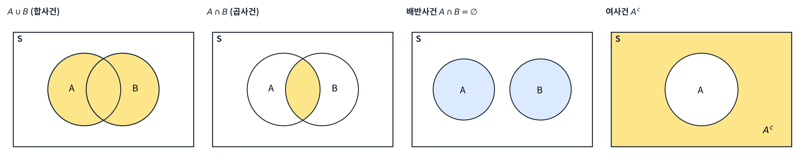
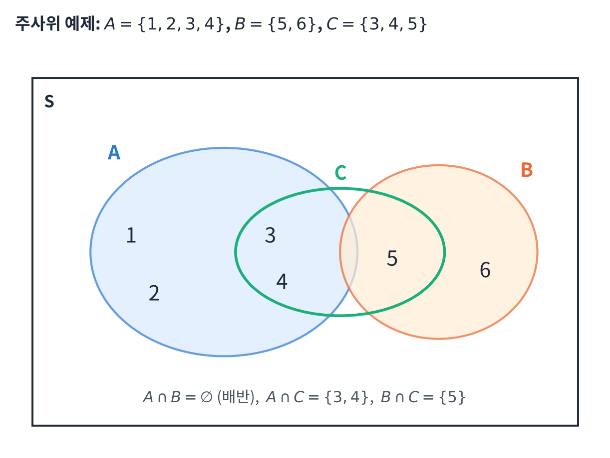
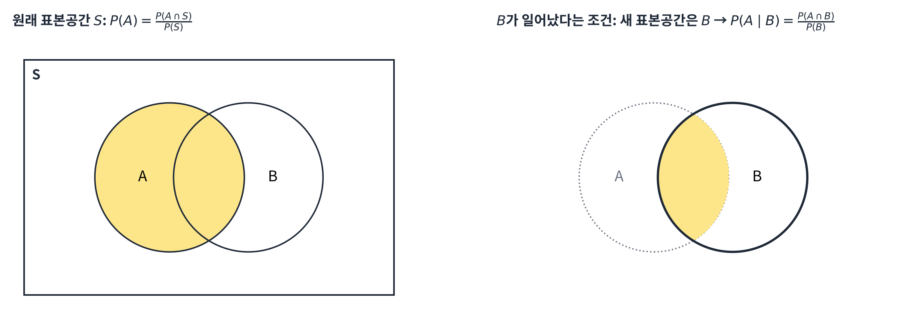
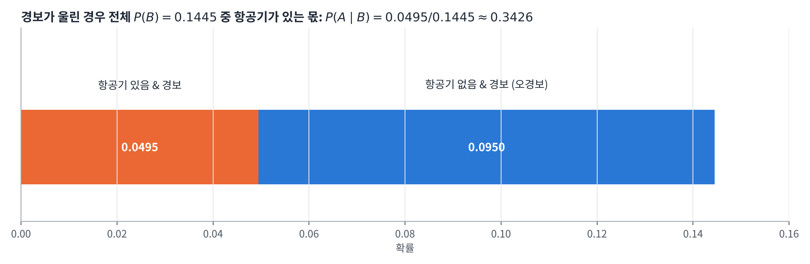
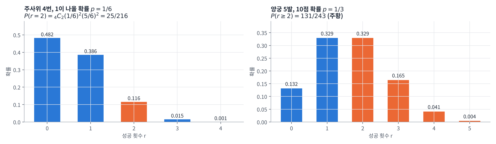

## 학습 목표

- 실험, 표본공간, 사건, 사건공간의 의미 이해
- 확률의 정의와 세 가지 공리 이해
- 합사건, 곱사건, 배반사건, 여사건의 확률 계산
- 조건부 확률, 곱셈 정리, 베이즈 정리 이해
- 독립 사건과 독립시행의 확률(이항 확률) 계산

---

## 통신이론에서 확률이 필요한 이유

- 지금까지 다룬 신호(정현파, 펄스 등)는 값이 **정해진 결정적(deterministic) 신호**
- 실제 통신에서는 **잡음**과 **보낼 메시지 자체**가 미리 알 수 없는 **랜덤(random)** 신호
- 잡음이 섞인 신호에서 원래 비트를 얼마나 잘 맞히는지(오류 확률) 계산하려면 확률이 필요
- 이번 글은 그 기초인 **확률의 정의와 계산 규칙**, 다음 글은 **확률 변수와 분포**

---

## 실험, 표본공간, 사건

### 기본 용어

| 용어 | 의미 | 주사위 예 |
| --- | --- | --- |
| 실험 (Experiment) | 결과가 랜덤하게 나오는 시행 | 주사위 던지기 |
| 표본공간 (Sample space) $$S$$ | 가능한 **모든 결과의 집합** | $$S = \{1, 2, 3, 4, 5, 6\}$$ |
| 사건 (Event) | 표본공간의 **부분집합** | 짝수 $$A = \{2, 4, 6\}$$, 1이 나옴 $$B = \{1\}$$ |
| 확률 (Probability) | 각 사건에 0~1 사이의 값을 대응 | $$P(A) = \frac{1}{2}$$, $$P(B) = \frac{1}{6}$$ |

**예제: 스페이드 카드 한 세트에서 한 장 뽑기**

- 표본공간: $$S = \{A, 2, 3, 4, 5, 6, 7, 8, 9, 10, J, Q, K\}$$ (13장)
- 사건 $$E$$ (3의 배수가 적힌 카드): $$E = \{3, 6, 9\}$$ → $$P(E) = \frac{3}{13}$$

### 확률의 정의 (고전적 정의)

모든 결과가 일어날 가능성이 같을 때

$$
P(A) = \frac{n(A)}{n(S)}
$$

- $$n(A)$$: 사건 $$A$$에 속한 결과의 수, $$n(S)$$: 전체 결과의 수

### 확률 공간과 공리 (Axioms) ⭐️

확률 공간은 세 가지로 구성됨

- **표본공간** $$S$$
- **사건공간** $$E$$: 확률을 부여할 사건들의 모음
- **확률함수** $$P(\cdot)$$

확률함수가 반드시 만족해야 하는 세 공리

| 공리 | 수식 | 의미 |
| --- | --- | --- |
| 비음수성 (Nonnegativity) | $$P(A) \ge 0$$ | 확률은 음수가 될 수 없음 |
| 정규화 (Normalization) | $$P(S) = 1$$ | 무언가는 반드시 일어남 |
| 가법성 (Additivity) | $$A \cap B = \emptyset$$이면 $$P(A \cup B) = P(A) + P(B)$$ | 겹치지 않는 사건은 확률을 더함 |

- 뒤에 나오는 모든 규칙(여사건, 합사건 공식 등)은 이 세 공리에서 유도됨

**예제: 동전을 두 번 던질 때**

- (a) 표본공간: $$S = \{HH, HT, TH, TT\}$$
- (b) 사건공간 $$E$$ = $$S$$의 **모든 부분집합의 집합** → 원소 수는 $$2^4 = 16$$

$$
\begin{aligned}
E = \{\ &\emptyset,\ \{HH\}, \{HT\}, \{TH\}, \{TT\}, \\
&\{HH, HT\}, \{HH, TH\}, \{HH, TT\}, \{HT, TH\}, \{HT, TT\}, \{TH, TT\}, \\
&\{HH, HT, TH\}, \{HH, HT, TT\}, \{HH, TH, TT\}, \{HT, TH, TT\}, \\
&\{HH, HT, TH, TT\}\ \}
\end{aligned}
$$

- 원소 0개 1 + 1개 4 + 2개 6 + 3개 4 + 4개 1 = 16 ($${}_4C_0 + {}_4C_1 + \cdots + {}_4C_4 = 2^4$$)

---

## 합사건, 곱사건, 배반사건, 여사건



| 사건 | 기호 | 의미 |
| --- | --- | --- |
| 합사건 | $$A \cup B$$ (A cup B) | $$A$$ **또는** $$B$$가 일어나는 사건 |
| 곱사건 | $$A \cap B$$ (A cap B) | $$A$$**와** $$B$$가 **동시에** 일어나는 사건 |
| 배반사건 | $$A \cap B = \emptyset$$ | 동시에 일어날 수 없는 사건 (서로소) |
| 여사건 | $$A^c$$ | $$A$$가 일어나지 **않는** 사건, $$A \cap A^c = \emptyset$$ |

### 확률의 덧셈 정리 ⭐️

$$
P(A \cup B) = P(A) + P(B) - P(A \cap B)
$$

- $$P(A) + P(B)$$는 겹치는 부분 $$A \cap B$$를 **두 번** 더하므로 한 번 빼 줌
- 따라서 항상 $$P(A \cup B) \le P(A) + P(B)$$
- **배반사건**이면 $$P(A \cap B) = 0$$이므로 $$P(A \cup B) = P(A) + P(B)$$

**예제 1: 1~20이 적힌 공 20개에서 한 개 뽑기**

(1) 2의 배수 또는 3의 배수가 적힌 공을 뽑을 확률

| 사건 | 원소 | 확률 |
| --- | --- | --- |
| $$A$$ (2의 배수) | $$\{2, 4, 6, \dots, 20\}$$ | $$\frac{10}{20}$$ |
| $$B$$ (3의 배수) | $$\{3, 6, 9, 12, 15, 18\}$$ | $$\frac{6}{20}$$ |
| $$A \cap B$$ (6의 배수) | $$\{6, 12, 18\}$$ | $$\frac{3}{20}$$ |

$$
P(A \cup B) = \frac{10}{20} + \frac{6}{20} - \frac{3}{20} = \frac{13}{20}
$$

(2) 5의 배수 또는 7의 배수가 적힌 공을 뽑을 확률

| 사건 | 원소 | 확률 |
| --- | --- | --- |
| $$A$$ (5의 배수) | $$\{5, 10, 15, 20\}$$ | $$\frac{4}{20}$$ |
| $$B$$ (7의 배수) | $$\{7, 14\}$$ | $$\frac{2}{20}$$ |
| $$A \cap B$$ (35의 배수) | $$\emptyset$$ | $$0$$ |

$$
P(A \cup B) = \frac{4}{20} + \frac{2}{20} = \frac{3}{10} \quad \text{(배반사건)}
$$

**예제 2: 구독 서비스**

> 한 학급에서 전체의 3/5는 Netflix, 1/2는 Watcha를 구독하고, 2/5는 둘 다 구독한다. 임의의 한 학생이 Netflix 또는 Watcha를 구독할 확률은?

$$
P(N \cup W) = P(N) + P(W) - P(N \cap W) = \frac{3}{5} + \frac{1}{2} - \frac{2}{5} = \frac{6 + 5 - 4}{10} = \frac{7}{10}
$$

- 강의 자료에는 $$\frac{3}{10}$$으로 되어 있지만 계산하면 $$\frac{7}{10}$$ (아래 정정 표 참고)
- 검산: 둘 중 하나도 구독하지 않는 학생은 $$1 - \frac{7}{10} = \frac{3}{10}$$ → 강의 자료의 값은 여사건의 확률과 같음

### 사건이 3개일 때 (포함-배제 원리)

$$
P(A \cup B \cup C) = P(A) + P(B) + P(C) - P(A \cap B) - P(B \cap C) - P(C \cap A) + P(A \cap B \cap C)
$$

- 합집합의 상한: $$P(A \cup B \cup C) \le P(A) + P(B) + P(C)$$ (union bound)
- 서로 배반이면: $$P(A \cup B \cup C) = P(A) + P(B) + P(C)$$

**예제 3: 주사위 한 개, $$A = \{1, 2, 3, 4\}$$, $$B = \{5, 6\}$$, $$C = \{3, 4, 5\}$$**



- (a) $$P(A) = \frac{4}{6}$$, $$P(B) = \frac{2}{6}$$, $$P(C) = \frac{3}{6}$$
- (b) $$P(A \cup B) = \frac{6}{6} = 1$$, $$P(B \cup C) = \frac{4}{6}$$ ($$\{3, 4, 5, 6\}$$), $$P(C \cup A) = \frac{5}{6}$$ ($$\{1, 2, 3, 4, 5\}$$)
- (c) $$A \cap B = \emptyset$$이므로 **$$A$$와 $$B$$가 배반사건** → $$P(A \cup B) = P(A) + P(B) = \frac{4}{6} + \frac{2}{6} = 1$$이 성립
  - $$A \cap C = \{3, 4\}$$, $$B \cap C = \{5\}$$는 공집합이 아니므로 배반이 아님

### 여사건의 확률

$$A \cap A^c = \emptyset$$, $$A \cup A^c = S$$이므로 공리에 의해

$$
P(A) + P(A^c) = P(A \cup A^c) = P(S) = 1 \quad\Rightarrow\quad P(A^c) = 1 - P(A)
$$

- "**적어도 하나**"를 묻는 문제는 여사건으로 푸는 것이 훨씬 쉬움

**예제 4: 서로 다른 동전 두 개를 던질 때, 적어도 하나가 앞면일 확률**

$$
P(\text{적어도 하나 앞면}) = 1 - P(\text{둘 다 뒷면}) = 1 - \frac{1}{4} = \frac{3}{4}
$$

- 직접 세면 $$P(HH) + P(HT) + P(TH) = \frac{3}{4}$$로 같음

**예제 5: 서로 다른 주사위 두 개를 던질 때, 두 눈이 서로 다를 확률**

$$
P(\text{눈이 다름}) = 1 - P(\text{눈이 같음}) = 1 - \frac{6}{36} = \frac{30}{36} = \frac{5}{6}
$$

---

## 조건부 확률 (Conditional Probability)

### 정의

- 조건부 확률은 **부분적인 정보를 반영한 수정된 확률 모델**이며, 원래보다 **더 작은 표본공간**을 가짐
- $$P(A \mid B)$$: 사건 $$B$$가 일어났다는 조건 아래에서 사건 $$A$$가 일어날 확률 → **$$B$$가 새로운 표본공간**

$$
P(A) = P(A \mid S) = \frac{P(A \cap S)}{P(S)}, \qquad P(A \mid B) = \frac{P(A \cap B)}{P(B)}
$$



- 일반 확률은 "$$A$$가 $$S$$에서 차지하는 비율", 조건부 확률은 "$$A$$가 $$B$$ 안에서 차지하는 비율"

### 조건부 확률의 공리

조건부 확률도 확률의 공리를 그대로 만족 (표본공간만 $$B$$로 바뀜)

- 비음수성: $$P(A \mid B) \ge 0$$
- 정규화: $$P(B \mid B) = 1$$
- $$A = A_1 \cup A_2 \cup \cdots$$이고 $$A_i \cap A_j = \emptyset$$ ($$i \ne j$$)이면 $$P(A \mid B) = P(A_1 \mid B) + P(A_2 \mid B) + \cdots$$
- $$A \cap B = \emptyset$$이면 $$P(A \mid B) = 0$$

### 곱셈 정리 (Multiplication Theorem)

조건부 확률의 정의를 두 방향으로 쓰면

$$
P(A \mid B) = \frac{P(A \cap B)}{P(B)}, \qquad P(B \mid A) = \frac{P(A \cap B)}{P(A)}
$$

$$
P(A \cap B) = P(B)\,P(A \mid B) = P(A)\,P(B \mid A)
$$

### 베이즈 정리 (Bayes' Rule) ⭐️

곱셈 정리의 두 식이 같다는 것에서

$$
P(A \mid B) = \frac{P(A)\,P(B \mid A)}{P(B)}
$$

분모 $$P(B)$$는 $$A$$와 $$A^c$$로 나누어 계산 (**전확률 정리**)

$$
P(B) = P(A)P(B \mid A) + P(A^c)P(B \mid A^c)
$$

- 의미: "원인 → 결과" 확률 $$P(B \mid A)$$를 알 때, 결과를 보고 "원인"의 확률 $$P(A \mid B)$$를 거꾸로 구함
- 통신에서는 **수신 신호(결과)를 보고 어떤 비트가 송신되었는지(원인)** 판단할 때 그대로 쓰임

**예제 6: 레이더 감지**

> 항공기가 나타나면 레이더는 0.99의 확률로 경보를 울리고, 항공기가 없어도 0.10의 확률로 오경보를 울린다. 항공기가 나타날 확률은 0.05이다. 경보가 울렸을 때 실제로 항공기가 있을 확률은?

- $$A$$ = 항공기가 있음, $$B$$ = 레이더가 경보를 울림
- $$P(A) = 0.05$$, $$P(B \mid A) = 0.99$$, $$P(B \mid A^c) = 0.1$$

$$
P(A \mid B) = \frac{P(A)P(B \mid A)}{P(A)P(B \mid A) + (1 - P(A))P(B \mid A^c)} = \frac{0.05 \times 0.99}{0.05 \times 0.99 + 0.95 \times 0.1} = \frac{0.0495}{0.1445} \approx 0.3426
$$



- 레이더의 감지율이 99%인데도 경보가 울렸을 때 항공기가 있을 확률은 **약 34%뿐**
- 이유: 항공기가 없는 경우(95%)가 훨씬 많아서, 10%의 오경보만으로도 경보 대부분을 차지
- 사전 확률 $$P(A)$$를 무시하면 결과를 크게 잘못 해석하게 됨 (기저율 오류)

---

## 독립 (Independence)

### 독립 사건

두 사건 $$A$$, $$B$$가 **독립**이면

$$
P(A \cap B) = P(A)\,P(B)
$$

- $$P(B) > 0$$이면 $$P(A \mid B) = \frac{P(A)P(B)}{P(B)} = P(A)$$ → $$B$$가 일어났다는 정보가 $$A$$의 확률을 바꾸지 않음
- $$A$$, $$B$$가 독립이면 $$A$$와 $$B^c$$도 독립

$$
P(A \cap B^c) = P(A) - P(A \cap B) = P(A) - P(A)P(B) = P(A)\big(1 - P(B)\big) = P(A)P(B^c)
$$

**(중요!!) 배반과 독립은 다름**

- 배반: $$P(A \cap B) = 0$$ (동시에 일어날 수 없음)
- 독립: $$P(A \cap B) = P(A)P(B)$$ (서로 영향을 주지 않음)
- $$P(A), P(B) > 0$$인 배반사건은 독립이 **아님**: 하나가 일어나면 다른 하나는 반드시 안 일어나므로 강한 영향을 줌

### 독립시행과 이항 확률

- **독립시행**: 각 시행에서 일어나는 사건이 서로 독립 (동전·주사위를 여러 번 던지는 것처럼 같은 시행을 반복)
- 한 번의 시행에서 사건 $$A$$가 일어날 확률이 $$p$$ ($$0 < p < 1$$)일 때, $$n$$번 반복하는 독립시행에서 $$A$$가 **$$r$$번** 일어날 확률

$$
{}_nC_r\, p^r (1 - p)^{n - r}, \qquad r = 0, 1, 2, \dots, n
$$

- $${}_nC_r$$: $$n$$번 중 성공할 $$r$$번의 **위치를 고르는 경우의 수**
- $$p^r(1 - p)^{n - r}$$: 그중 한 가지 순서가 일어날 확률 (독립이라 곱함)

**예제 7: 주사위를 4번 던져서 1이 2번 나올 확률**

- 1이 나오는 위치를 고르는 경우: $${}_4C_2 = 6$$ (○○××, ○×○×, ○××○, ×○○×, ×○×○, ××○○)
- 각 경우의 확률: $$\frac{1}{6} \times \frac{1}{6} \times \frac{5}{6} \times \frac{5}{6}$$

$$
{}_4C_2\left(\frac{1}{6}\right)^2\left(\frac{5}{6}\right)^2 = 6 \times \frac{25}{1296} = \frac{25}{216} \approx 0.116
$$

**예제 8: 양궁, 10점 영역을 맞힐 확률 $$\frac{1}{3}$$, 5발**

(1) 10점을 3번 맞힐 확률 ($${}_5C_3 = \frac{5 \times 4 \times 3}{3 \times 2 \times 1} = 10$$)

$$
{}_5C_3\left(\frac{1}{3}\right)^3\left(\frac{2}{3}\right)^2 = 10 \times \frac{1^3 \times 2^2}{3^3 \times 3^2} = \frac{40}{243}
$$

(2) 적어도 2번 맞힐 확률 → 여사건(0번 또는 1번) 이용

$$
P(0\text{번}) = {}_5C_0\left(\frac{1}{3}\right)^0\left(\frac{2}{3}\right)^5 = \frac{32}{243}, \qquad
P(1\text{번}) = {}_5C_1\left(\frac{1}{3}\right)^1\left(\frac{2}{3}\right)^4 = 5 \times \frac{16}{243} = \frac{80}{243}
$$

$$
P(\text{적어도 2번}) = 1 - \frac{32}{243} - \frac{80}{243} = \frac{131}{243} \approx 0.539
$$



- 막대 전체의 합은 항상 1 (이항 정리 $$\sum_r {}_nC_r p^r(1 - p)^{n - r} = (p + 1 - p)^n = 1$$)
- 통신에서는 "$$n$$비트 중 $$r$$비트가 틀릴 확률"이 바로 이 식 ($$p$$: 비트 오류 확률)

---

## 예제 검산 (Python)

분수(`Fraction`)로 정확히 계산해서 강의 예제를 모두 확인

```python
from fractions import Fraction as F
from itertools import product

balls = range(1, 21)                                   # 1~20번 공
P = lambda event: F(len(event), 20)
A2 = {b for b in balls if b % 2 == 0}
A3 = {b for b in balls if b % 3 == 0}
A5 = {b for b in balls if b % 5 == 0}
A7 = {b for b in balls if b % 7 == 0}
print("P(2의 배수 또는 3의 배수) =", P(A2 | A3), "=", P(A2) + P(A3) - P(A2 & A3))
print("P(5의 배수 또는 7의 배수) =", P(A5 | A7), ", 공통 원소:", A5 & A7)

print("P(Netflix 또는 Watcha) =", F(3, 5) + F(1, 2) - F(2, 5))

dice = list(product(range(1, 7), repeat=2))            # 두 주사위의 36가지 결과
diff = [d for d in dice if d[0] != d[1]]
print("P(두 주사위 눈이 다름) =", F(len(diff), len(dice)))

pA, pB_A, pB_Ac = F(5, 100), F(99, 100), F(1, 10)
pA_B = pA * pB_A / (pA * pB_A + (1 - pA) * pB_Ac)
print("레이더 P(A|B) =", pA_B, "≈", round(float(pA_B), 4))
```

실행 결과

```text
P(2의 배수 또는 3의 배수) = 13/20 = 13/20
P(5의 배수 또는 7의 배수) = 3/10 , 공통 원소: set()
P(Netflix 또는 Watcha) = 7/10
P(두 주사위 눈이 다름) = 5/6
레이더 P(A|B) = 99/289 ≈ 0.3426
```

- 집합 연산 `|`(합집합), `&`(교집합)으로 직접 센 값과 덧셈 정리 결과가 같음
- 레이더 예제는 정확히 $$\frac{99}{289}$$

이항 확률은 공식과 100만 번 시뮬레이션으로 확인

```python
import numpy as np
from math import comb
from fractions import Fraction as F

def binom_pmf(n, p, r):
    return comb(n, r) * p**r * (1 - p) ** (n - r)

p = F(1, 3)                                            # 10점을 맞힐 확률
print("P(5번 중 3번) =", binom_pmf(5, p, 3))
print("P(적어도 2번) =", 1 - binom_pmf(5, p, 0) - binom_pmf(5, p, 1))
print("P(주사위 4번 중 1이 2번) =", binom_pmf(4, F(1, 6), 2))

rng = np.random.default_rng(0)
hits = (rng.random((1_000_000, 5)) < 1 / 3).sum(axis=1)   # 5발 쏘기를 100만 번 반복
print(f"시뮬레이션: P(3번) = {np.mean(hits == 3):.4f} (이론 {40 / 243:.4f}), "
      f"P(>=2번) = {np.mean(hits >= 2):.4f} (이론 {131 / 243:.4f})")
```

실행 결과

```text
P(5번 중 3번) = 40/243
P(적어도 2번) = 131/243
P(주사위 4번 중 1이 2번) = 25/216
시뮬레이션: P(3번) = 0.1649 (이론 0.1646), P(>=2번) = 0.5397 (이론 0.5391)
```

- 시뮬레이션 빈도가 이론값과 소수 셋째 자리까지 일치 → 반복 횟수가 많을수록 상대 빈도가 확률에 가까워짐

---

### 강의 자료에서 정정한 부분 정리

| 위치 | 강의 자료 | 정정 | 이유 |
| --- | --- | --- | --- |
| 강의 자료 17쪽 | $$P(N \cup W) = \frac{3}{5} + \frac{1}{2} - \frac{2}{5} = \frac{3}{10}$$ | $$\frac{7}{10}$$ | $$0.6 + 0.5 - 0.4 = 0.7$$, **결과가 달라짐** ($$\frac{3}{10}$$은 둘 다 구독하지 않을 확률) |
| 강의 자료 15쪽 | Event A and B (multiple of 6) | multiple of 35 | 5의 배수이면서 7의 배수 (앞 예제를 복사한 표기), 결과 $$\emptyset$$은 맞음 |
| 강의 자료 39쪽 | $${}_5C_3 = \frac{5 \times 4}{2}$$ | $${}_5C_3 = \frac{5 \times 4 \times 3}{3 \times 2 \times 1}$$ | 값 10은 같음 ($${}_5C_3 = {}_5C_2$$라서 우연히 일치) |

---

## 최종 핵심 정리

1. **표본공간** $$S$$는 모든 결과의 집합, **사건**은 그 부분집합, 고전적 확률은 $$P(A) = \frac{n(A)}{n(S)}$$
2. 확률의 세 공리: $$P(A) \ge 0$$, $$P(S) = 1$$, 배반사건이면 $$P(A \cup B) = P(A) + P(B)$$
3. 덧셈 정리 $$P(A \cup B) = P(A) + P(B) - P(A \cap B)$$, 3개면 포함-배제 원리
4. 여사건 $$P(A^c) = 1 - P(A)$$ → "적어도 하나" 문제에 유용
5. 조건부 확률 $$P(A \mid B) = \frac{P(A \cap B)}{P(B)}$$는 **표본공간을 $$B$$로 줄인 확률**
6. 곱셈 정리 $$P(A \cap B) = P(B)P(A \mid B) = P(A)P(B \mid A)$$에서 **베이즈 정리** 유도
7. 베이즈 정리는 결과로부터 원인의 확률을 구하며, **사전 확률**이 작으면 감지율이 높아도 사후 확률이 낮을 수 있음 (레이더 예: 34%)
8. 독립이면 $$P(A \cap B) = P(A)P(B)$$, $$n$$번 독립시행에서 $$r$$번 성공할 확률은 $${}_nC_r p^r(1 - p)^{n - r}$$

---

End.
